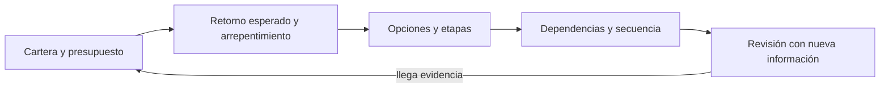
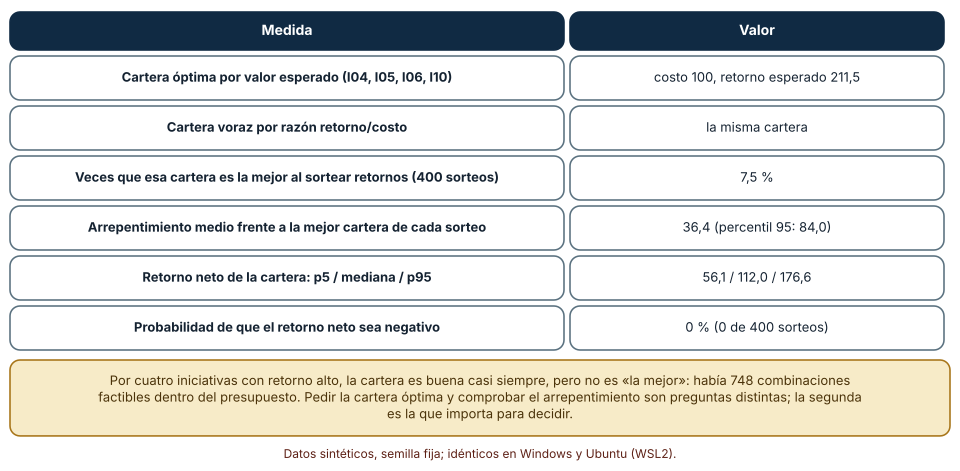
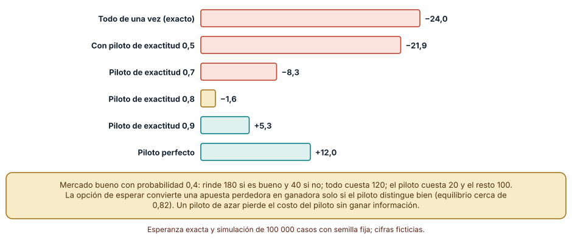
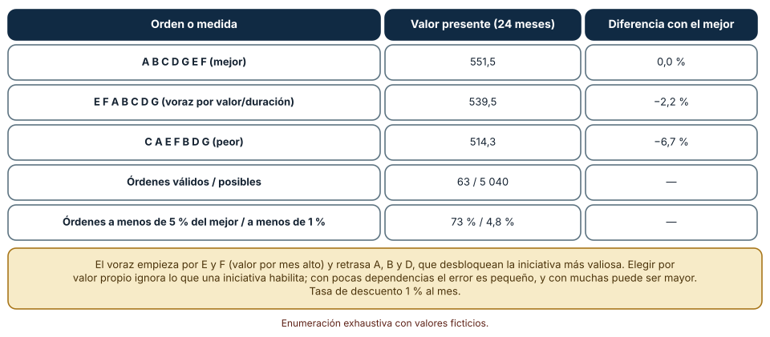

# SE-141 — Portafolio, opciones y secuenciación de inversión

[← SE-140 — FinOps de producto y costo por resultado](../../classes/part-11-economia-metricas-y-decisiones-de-producto/se-140-finops-de-producto-y-costo-por-resultado/README.md) · [↑ Parte 11](../../classes/part-11-economia-metricas-y-decisiones-de-producto/README.md) · [📚 Índice completo](../../classes/README.md) · [🌐 Portal](../../site/classes/SE-141.html) · [SE-142 — Decisiones reversibles e irreversibles →](../../classes/part-11-economia-metricas-y-decisiones-de-producto/se-142-decisiones-reversibles-e-irreversibles/README.md)

## Punto profesional y fundamento pedagógico

**Punto profesional.** La clase existe para elegir un conjunto de iniciativas dentro de un presupuesto, invertir por etapas cuando la información llega con el tiempo y ordenar el trabajo respetando dependencias, sin tratar el valor esperado como si fuera una promesa.

**Por qué aparece aquí.** Se sitúa después de **FinOps de producto y costo por resultado** y antes de **Decisiones reversibles e irreversibles**: `SE-140` dejó el costo por resultado de cada iniciativa; esta clase decide qué conjunto financiar, cuánto comprometer por adelantado y en qué orden hacerlo. Fija el vocabulario (portafolio, retorno esperado, arrepentimiento, opción, secuencia) y deja una cartera y un orden que `SE-142` someterá a la pregunta de cuánto cuesta equivocarse.

**Error conceptual que debe corregir.** Creer que la cartera de mayor valor esperado es «la mejor», que invertir todo de una vez es siempre más eficiente que por etapas, y que se puede ordenar el trabajo por el valor de cada pieza sin mirar lo que habilita.

**Secuencia de aprendizaje.** Antes de ejecutar, predices en qué fracción de los futuros posibles es la mejor la cartera óptima por valor esperado y cuánto vale un piloto que no es perfecto; después simulas, comparas todas las carteras y todos los órdenes válidos y reconstruyes sin apoyo qué hace valiosa a una opción. La secuencia usa predicción, explicación propia, contraste y recuperación. [ICAP](https://icap.education.asu.edu/research) distingue participación de construcción de conocimiento; [How People Learn II](https://nap.nationalacademies.org/catalog/24783/how-people-learn-ii-learners-contexts-and-cultures) exige conectar conocimiento previo, contexto y transferencia; la [práctica de recuperación](https://pubmed.ncbi.nlm.nih.gov/16507066/) respalda producir de nuevo la explicación tras una demora; y [Education for Life and Work](https://nap.nationalacademies.org/resource/13398/dbasse_084153.pdf) exige devolución que explique la causa del error.

**Evidencia de aprendizaje.** `portfolio-log.md` con la cartera elegida y su robustez (veces que es la mejor, arrepentimiento, retorno neto como intervalo), el valor de invertir por etapas según la exactitud del piloto y el mejor orden frente al voraz con dependencias.

**Límite de la conclusión.** Las iniciativas, sus costos, sus retornos y sus dependencias son sintéticos; el mercado «bueno» con probabilidad 0,4 y la exactitud del piloto son supuestos del autor. Los experimentos muestran cómo se comparan las decisiones, no qué iniciativas conviene financiar.

### Trazabilidad fuente → afirmación

| Fuente primaria u oficial | Afirmación que respalda | Lo que no prueba |
|---|---|---|
| [GOV.UK Service Manual: How the alpha phase works](https://www.gov.uk/service-manual/agile-delivery/how-the-alpha-phase-works) | Un servicio avanza por fases (descubrimiento, alfa, beta) y en cada una se decide si seguir, con prototipos que prueban las incertidumbres mayores antes de construir. | No dice cuántas fases conviene a la plataforma ni su costo. |
| [HM Treasury: The Green Book](https://www.gov.uk/government/publications/the-green-book-appraisal-and-evaluation-in-central-governent/the-green-book-2020) | Evalúa un conjunto de opciones frente a una de referencia, con análisis de sensibilidad y corrección del sesgo de optimismo. | No fija la regla de selección de una cartera. |
| [Python: itertools](https://docs.python.org/3/library/itertools.html) | `permutations` y `combinations` enumeran todas las ordenaciones y subconjuntos, y permiten comprobar exhaustivamente un problema pequeño. | No escala a decenas de elementos. |

## Antes de empezar

Recupera lo aprendido en `SE-140`: cada iniciativa tiene un costo por resultado y un rango de retorno. La pregunta activa es: **¿qué conjunto y qué orden maximizan lo que se aprende y lo que se obtiene, y cuánta confianza hay en esa elección?**

## Prerrequisitos

- Haber completado `SE-140` o poder explicar un costo por resultado con su incertidumbre.
- Python 3.11 o posterior y un terminal.
- Trabajar solo con iniciativas, costos y retornos sintéticos.

## Problema auténtico

La plataforma tiene doce iniciativas candidatas y un presupuesto de 100. El equipo ordena por razón de retorno esperado entre costo y elige cuatro. Otra persona propone invertir las 120 unidades de una iniciativa grande «antes de que lo haga la competencia», con una probabilidad de éxito de 40 %. Una tercera pide ordenar un conjunto de siete tareas por el valor de cada una, sin notar que dos dependen de otras.

## Objetivos observables

Al terminar podrás:

1. seleccionar una cartera dentro de un presupuesto y medir su robustez (veces que es la mejor, arrepentimiento, retorno neto);
2. calcular el valor de invertir por etapas con un piloto de exactitud conocida y decir a partir de cuándo conviene;
3. enumerar los órdenes válidos de tareas con dependencias y comparar el mejor con uno voraz;
4. explicar qué hace valiosa a una opción y cuándo deja de serlo;
5. declarar qué parte de la elección depende de supuestos no medidos.

## Mapa conceptual



El mapa se lee como una cadena de razonamiento, no como fases obligatorias. La flecha de retorno indica que la evidencia que llega tras una etapa reabre la cartera; no autoriza a aferrarse al plan inicial.

## Temas y por qué importan

| Tema | Por qué cambia una decisión profesional | Evidencia mínima |
|---|---|---|
| Cartera y presupuesto | Elegir un conjunto no es ordenar una lista: el presupuesto crea restricciones que cambian la respuesta. | Cartera elegida y alternativas en `portfolio-log.md` |
| Retorno esperado y arrepentimiento | El valor esperado resume, pero no dice cuán a menudo se acierta ni cuánto se pierde al errar. | Veces que la cartera es la mejor y arrepentimiento medio |
| Opciones y etapas | Una etapa barata compra información y permite no gastar el resto si el resultado es malo. | Valor esperado por etapas y exactitud mínima del piloto |
| Dependencias y secuencia | Una pieza de poco valor propio puede desbloquear la de mayor valor. | Órdenes válidos y comparación con el voraz |
| Revisión con nueva información | La cartera inicial es una hipótesis; la evidencia nueva la modifica. | Regla de revisión y fecha |

## Conceptos y decisiones

### 1. Cartera y presupuesto

Un portafolio es un conjunto de iniciativas financiadas a la vez. Con un presupuesto fijo, el problema es una mochila: elegir el subconjunto de mayor valor cuyo costo cabe. Ordenar por razón valor/costo (voraz) suele dar una buena respuesta pero no siempre la óptima. Con doce iniciativas hay 4 096 subconjuntos y se pueden revisar todos; con cien ya no, y se usan aproximaciones o programación entera.

### 2. Retorno esperado y arrepentimiento

El retorno esperado promedia futuros posibles. Dos medidas lo complementan: la fracción de futuros en que la cartera elegida es la mejor de todas, y el arrepentimiento, la diferencia entre el valor de la mejor cartera de ese futuro y el de la elegida. Una cartera puede ser excelente en promedio y rara vez la mejor: eso describe el riesgo de decidir sin saber, no un error de selección.

### 3. Opciones y etapas

Invertir por etapas es comprar una opción: se paga un piloto y se decide continuar o detenerse según su resultado. La opción tiene valor cuando el piloto es suficientemente informativo y cuando detenerse evita pérdidas mayores que el costo del piloto. Un piloto no informativo (exactitud de azar) solo agrega costo. Para un valor esperado negativo, el piloto puede hacer positiva la inversión si distingue bien.

### 4. Dependencias y secuencia

Las dependencias imponen un orden parcial: no se puede hacer D antes de B. Entre los órdenes válidos varía el valor, porque el trabajo que se hace antes entrega su beneficio antes (descuento) y desbloquea a otros. Ordenar por valor propio por unidad de tiempo es una heurística razonable y no tiene en cuenta lo que una pieza habilita.

### 5. Revisión con nueva información

La cartera y la secuencia cambian cuando la evidencia llega: un piloto, un experimento, un cambio de costo. Una regla de revisión (fecha, criterio, responsable) evita dos errores opuestos: no revisar nunca y revisar por cada novedad. La capacidad de cambiar de rumbo sin pérdida se estudia en `SE-142`.

### La cartera óptima casi nunca es la mejor de un futuro

Se generan 12 iniciativas con costos de 10 a 40 y retorno triangular (mínimo 0,2–0,9 veces el costo, moda 0,9–2,2 veces, máximo 2–5 veces), con semilla 1411. El presupuesto es 100 y hay 748 subconjuntos factibles. Se elige por retorno esperado el subconjunto de mayor valor; después se sortean 400 futuros y en cada uno se busca la mejor cartera. Predicción: ¿en qué fracción de futuros coinciden?

```python
mejor = max(masks, key=lambda m: sum(esperado[i] for i in bits(m)))
for _ in range(400):
    retorno = [rng.triangular(lo, hi, moda) for (lo, hi, moda) in rangos]
    mejor_sorteo = max(masks, key=lambda m: sum(retorno[i] for i in bits(m)))
```

Resultado, idéntico en Windows (CPython 3.12.9) y Ubuntu bajo WSL2 (3.12.3): la cartera óptima por valor esperado, I04 + I05 + I06 + I10 (costo 100), tiene un retorno esperado de 211,5 y coincide con la voraz por razón retorno/costo. Es la mejor en 7,5 % de los 400 futuros; el arrepentimiento medio frente a la mejor de cada uno es 36,4 y el del percentil 95, 84,0. Su retorno neto va de 56,1 (percentil 5) a 176,6 (percentil 95), con mediana de 112,0, y fue negativo en 0 de 400 sorteos. Es buena casi siempre, y rara vez es la mejor: con 748 alternativas factibles y retornos inciertos, esa es la naturaleza del problema.



**Cómo leer la figura.** Cada fila es una medida de la misma cartera; la tercera y cuarta describen cuánto se equivoca respecto del futuro realizado. **Dónde deja de valer:** los retornos son independientes y triangulares por supuesto; los reales se correlacionan (una mala economía afecta a varias iniciativas), lo que ensancha el retorno neto de la cartera. La figura no recomienda esas cuatro iniciativas: muestra cómo se mide la robustez de una selección.

### Un piloto convierte una apuesta perdedora en una buena si distingue bien

Una iniciativa cuesta 120, rinde 180 si el mercado es bueno (probabilidad 0,4) y 40 si no. Invertir todo de una vez tiene valor esperado 0,4 × 180 + 0,6 × 40 − 120 = −24. Por etapas: un piloto cuesta 20, produce una señal «buena» con probabilidad igual a su exactitud cuando el mercado es bueno y con probabilidad 1 − exactitud cuando no lo es, y solo si la señal es buena se invierten los 100 restantes. Predicción: ¿desde qué exactitud el piloto vuelve positiva la inversión?

```python
senal_buena = (rng.random() < exactitud) if bueno else (rng.random() > exactitud)
total -= 20
if senal_buena:
    total += (180 if bueno else 40) - 100
```

Con 100 000 casos y semilla 1412: con exactitud 0,5 el valor esperado es −21,9; con 0,6, −15,1; con 0,7, −8,3; con 0,8, −1,6; con 0,9, +5,3; con un piloto perfecto, +12,0. La fórmula exacta es −56 + 68 × exactitud: se anula en 0,82. Por debajo, el piloto gasta 20 y la opción de detenerse no compensa; por encima, el piloto vale. Invertir todo no es más eficiente: es más caro cuando el mercado resulta malo.



**Cómo leer la figura.** Las barras coral son valores negativos y las verdes, positivos; la primera es invertir todo. **Dónde deja de valer:** las probabilidades, los retornos y el costo del piloto son supuestos del autor, y un piloto real no tiene una exactitud conocida de antemano: su informatividad se estima. El modelo también supone que el piloto no cambia el mercado y que se puede detener sin costo; ambas condiciones fallan con frecuencia.

### Ordenar por valor propio no es ordenar por valor total

Siete tareas A a G con duraciones de 2, 3, 1, 4, 2, 3 y 2 meses, valores mensuales una vez terminadas de 3, 10, 1, 14, 4, 9 y 6, y dependencias: B requiere A; D requiere B y C; F requiere E; G requiere D. Se enumeran los 5 040 órdenes posibles y se descartan los que violan alguna dependencia; el valor de cada orden es el valor presente a 24 meses con descuento de 1 % mensual.

```python
validos = [o for o in permutations("ABCDEFG")
           if all(o.index(d) < o.index(k) for k, ds in deps.items() for d in ds)]
valor = lambda o: sum(v[k] / 1.01 ** m for k, t in terminadas(o) for m in range(t, 24))
```

Hay 63 órdenes válidos. El mejor, A B C D G E F, vale 551,5. El voraz que elige cada vez la disponible con mayor valor por duración, E F A B C D G, vale 539,5 (−2,2 %); el peor, C A E F B D G, 514,3 (−6,7 %). El 73 % de los órdenes válidos está a menos de 5 % del mejor, pero solo el 4,8 % a menos de 1 %. El voraz empieza por E y F, que valen mucho por mes y retrasan a A, B y D, que desbloquean la pieza más valiosa. Según la primera tarea: A permite 551,5 como máximo; C, 543,9; E, 539,5.



**Cómo leer la figura.** Cada fila es un orden o una medida sobre el conjunto de órdenes válidos. **Dónde deja de valer:** los valores mensuales son ciertos y las duraciones fijas; con dependencias más densas o incertidumbre en las duraciones, el mejor orden cambia. La enumeración exhaustiva solo funciona con pocas tareas: con veinte, hay más de 10^18 permutaciones.

## Definiciones de trabajo

- **portafolio:** conjunto de iniciativas financiadas a la vez dentro de un presupuesto.
- **arrepentimiento:** diferencia entre el valor de la mejor decisión en un futuro realizado y el de la elegida.
- **opción:** derecho, no obligación, de continuar una inversión tras observar información de una etapa previa.
- **dependencia:** relación que impide empezar una tarea antes de terminar otra.
- **secuencia:** orden de ejecución de las tareas que respeta las dependencias.

Las definiciones son operativas para la plataforma de entregas y deben contrastarse con las fuentes enlazadas al final.

## Ejemplo mínimo

Predice la mejor cartera de tres iniciativas con costos 6, 5 y 4 y retornos esperados 12, 9 y 7 con un presupuesto de 10.

```python
from itertools import combinations
datos = {"X": (6, 12), "Y": (5, 9), "Z": (4, 7)}
mejor = max((c for r in range(1, 4) for c in combinations(datos, r)
             if sum(datos[k][0] for k in c) <= 10),
            key=lambda c: sum(datos[k][1] for k in c))
print(mejor)
```

La mejor es X + Z (costo 10, retorno 19) y no X + Y (costo 11, inviable) ni Y + Z (costo 9, retorno 16). Ordenar por razón valor/costo daría X (2,0), Y (1,8), Z (1,75): entra X, Y ya no cabe y entra Z: coincide con la óptima. Registra versión del intérprete, comando y salida.

## Ejemplo profesional

En la plataforma, `portfolio-log.md` registra cada iniciativa con costo, rango de retorno, dependencias y responsable, la cartera elegida con las alternativas descartadas, la medida de robustez (veces que es la mejor, arrepentimiento) y la regla de revisión. El contrato es que ninguna cartera se aprueba sin sus alternativas y sin la fecha en que se revisará. Esa estructura permite que otra persona vea qué se descartó y por qué.

Compara el caso normal con una iniciativa que desbloquea a otras, con una que solo es valiosa si se hace otra, con una cuyo retorno depende de otra iniciativa de la cartera y con una cuyo costo se incrementa tras un piloto. El registro es adecuado cuando esas relaciones quedan explícitas; es peligroso cuando se archiva solo la lista elegida.

## Práctica guiada

1. Copia el contrato de iniciativas (costo, rango, dependencias, responsable) antes de elegir.
2. Predice en qué fracción de futuros es la mejor la cartera por valor esperado y anótalo.
3. Genera las 12 iniciativas con semilla fija y enumera los subconjuntos factibles.
4. Sortea 400 futuros y calcula veces mejor, arrepentimiento y retorno neto.
5. Calcula el valor por etapas con seis exactitudes y la exactitud de equilibrio.
6. Enumera los órdenes válidos de siete tareas y compara el mejor, el voraz y el peor.
7. Pide a otra persona que reconstruya cartera, valor por etapas y orden solo con `portfolio-log.md`.

## Ejercicios

1. **Presupuesto:** repite la selección con un presupuesto de 80 y de 130 y describe cuánto cambia la cartera y su robustez.
2. **Correlación:** introduce un factor común que mueva todos los retornos y calcula cómo cambian el retorno neto p5 y la probabilidad de pérdida.
3. **Piloto:** cambia el costo del piloto a 10 y a 30 y calcula la exactitud de equilibrio; explica qué ocurre cuando el piloto es caro.
4. **Dependencias:** añade la dependencia «F requiere D» y calcula cuántos órdenes válidos quedan y cuánto pierde el voraz.

## Reto verificable

Entrega `portfolio-log.md` con las iniciativas, la cartera elegida con su robustez, el valor por etapas con la exactitud de equilibrio y la comparación de órdenes con el mejor, el voraz y el peor. Se aprueba si otra persona ejecuta el código desde un checkout limpio, obtiene los mismos números con la semilla indicada y puede decir qué iniciativa cambiaría la cartera si su retorno fuera la mitad. No se aprueba por la cantidad de iniciativas.

## Caso conductor

La plataforma de entregas continúa como caso. Esta clase deja una cartera con su robustez, un criterio para invertir por etapas y una secuencia con dependencias. `SE-142` preguntará cuán reversible es cada decisión de esa cartera y `SE-144` integrará todo en un caso de viabilidad. Cambia después una sola iniciativa y revisa qué conclusiones del registro cambian.

## Preguntas frecuentes

### Si la cartera óptima solo es la mejor 7,5 % de las veces, ¿para qué sirve elegirla?

Porque su retorno neto fue positivo en los 400 sorteos y su valor esperado es el más alto. «La mejor» es una vara irreal: casi ninguna cartera lo es. Lo que importa es que sea buena en la mayoría de los futuros y que su peor caso sea tolerable.

### ¿Por qué no invertir todo de una vez si el mercado es bueno el 40 % de las veces?

Porque el valor esperado de la apuesta es −24 y el 60 % de las veces se pierden 80. Un piloto de exactitud 0,9 lo convierte en +5,3. Invertir todo es razonable cuando el piloto es caro, no informativo o cuando esperar tiene un costo de oportunidad mayor.

### ¿Cuándo ordenar por valor por duración funciona bien?

Cuando hay pocas dependencias o éstas son poco valiosas. En el experimento, perdió 2,2 % respecto del mejor; con otra estructura de dependencias podría perder más. Es una heurística y se verifica contra una enumeración cuando el problema es pequeño.

### ¿Un modelo de lenguaje puede construir el portafolio?

Puede proponer iniciativas y ordenarlas, pero no conoce los retornos ni las dependencias reales. Exige los rangos con su fuente, la medida de robustez y la lista de alternativas descartadas, y revisa si trata los valores esperados como seguros.

## Fallo controlado y diagnóstico

Reproduce el fallo clásico de la clase: **optimizar el valor esperado sin medir cuán a menudo se equivoca**. Elige la cartera óptima y declárala «la mejor»; luego compárala con la mejor de cada futuro.

Registra síntoma, entrada mínima, hipótesis, observación que descarta cada hipótesis, causa, corrección y prueba de regresión. **Síntoma:** el comité cree que la cartera «ganará» y a mitad de año otra combinación habría rendido más. **Hipótesis rivales:** (a) la selección fue mala; (b) cualquier selección tiene arrepentimiento; (c) los retornos se correlacionaron. **Prueba:** simula 400 futuros: la cartera es la mejor en 7,5 % y su arrepentimiento medio es 36,4, con retorno neto positivo en todos, lo que sostiene (b). **Conclusión:** la selección era buena y no era «la mejor». **Regresión:** añade al contrato una prueba que falle si una cartera se aprueba sin su arrepentimiento y su retorno neto p5. No cambies a la vez la selección y la medida de robustez.

## Errores comunes y cómo corregirlos

| Síntoma | Causa probable | Corrección |
|---|---|---|
| El comité cree que la cartera «ganará» | Se informó solo el valor esperado | Informar arrepentimiento y retorno neto p5 |
| Se compromete todo el presupuesto en una iniciativa | No se evaluó un piloto | Calcular el valor por etapas y la exactitud mínima |
| Un piloto «positivo» no cambia la decisión | La señal no era informativa | Estimar su exactitud antes de comprarlo |
| Se hace primero lo de mayor valor propio y todo se retrasa | Se ignoraron las dependencias | Enumerar o resolver el orden con las dependencias |
| La cartera no se revisa en un año | No hay regla de revisión | Fijar fecha, criterio y responsable |

## Entorno y archivos clave

```text
work/SE-141/
├── README.md
├── cartera/
│   ├── seleccion.py
│   ├── etapas.py
│   └── secuencia.py
├── fixtures/iniciativas.csv
├── tests/test_seleccion.py
└── evidence/portfolio-log.md
```

El `README` declara plataforma, versión de Python, semillas (1411, 1412) y comandos. Los experimentos usan solo la biblioteca estándar (`random`, `itertools`, `statistics`) y se ejecutaron con CPython 3.12.9 en Windows 11 y 3.12.3 en Ubuntu bajo WSL2 con salidas idénticas. Si añades una dependencia, fija procedencia y versión.

## Seguridad, ética y accesibilidad

- una cartera decide qué personas se benefician primero: documenta a quiénes beneficia y a quiénes posterga;
- los retornos suelen medirse en dinero y omiten accesibilidad, seguridad y deuda técnica: añade criterios no financieros;
- detener un proyecto afecta a personas (equipos y usuarios): planifica la salida con anticipación;
- ofrece una alternativa textual a cada tabla y describe los resultados con palabras;
- no pegues planes reales de inversión en un modelo de lenguaje sin política de datos;
- atribuye las fuentes usadas.

## Puente hacia el trabajo con agentes

Un agente al que se le pide «prioriza el roadmap» devolverá una lista ordenada por retorno sobre costo. Pídele que declare el presupuesto y las dependencias, que entregue la cartera con la fracción de futuros en que es la mejor, su arrepentimiento y el retorno neto p5, que evalúe un piloto como opción y que enumere los órdenes válidos si hay pocas tareas. Revisa especialmente si ignora una dependencia: es el mismo error del orden por valor propio con aspecto de plan.

## Transferencia

Traslada el experimento a otro dominio persistente (por ejemplo, un servicio de reparto): cambia las iniciativas por mejoras operativas, los costos y los retornos; conserva el contrato de iniciativas y comprueba si la cartera óptima vuelve a ser «la mejor» en una fracción pequeña de futuros. La transferencia está lograda cuando puedes explicar qué dependía del dominio y qué no.

## Evaluación y evidencia

| Criterio | Evidencia para aprobar |
|---|---|
| comprensión | explicación de cartera, arrepentimiento, opción y dependencia |
| corrección | selección, valor por etapas y órdenes reproducibles con la misma semilla |
| diseño | contrato de iniciativas con costos, rangos y dependencias |
| diagnóstico | reproducción del fallo «valor esperado como promesa» con regresión |
| incertidumbre | retorno neto p5–p95, arrepentimiento y exactitud de equilibrio |
| reproducibilidad | versiones, comandos, salida y límites declarados |

## Fuentes

- [GOV.UK Service Manual: How the alpha phase works](https://www.gov.uk/service-manual/agile-delivery/how-the-alpha-phase-works) — prototipos para probar incertidumbres antes de construir y decisión de continuar; autoridad: Government Digital Service (Reino Unido).
- [GOV.UK Service Manual: How the beta phase works](https://www.gov.uk/service-manual/agile-delivery/how-the-beta-phase-works) — construcción por etapas con evidencia de cada una; autoridad: Government Digital Service.
- [GOV.UK Service Manual: How the discovery phase works](https://www.gov.uk/service-manual/agile-delivery/how-the-discovery-phase-works) — fase inicial que decide si avanzar; autoridad: Government Digital Service.
- [HM Treasury: The Green Book](https://www.gov.uk/government/publications/the-green-book-appraisal-and-evaluation-in-central-governent/the-green-book-2020) — evaluación de opciones y sensibilidad; autoridad: HM Treasury (Reino Unido).
- [SWEBOK Guide v4.0a](https://www.computer.org/education/bodies-of-knowledge/software-engineering) — economía de la ingeniería de software; autoridad: IEEE Computer Society.

Cada fuente respalda el mecanismo indicado; ninguna demuestra que la cartera o la secuencia de la plataforma sean las adecuadas. Esa afirmación depende de retornos medidos y de la revisión de otra persona.

- [Python: `itertools`](https://docs.python.org/3/library/itertools.html) — `permutations` y `combinations` usadas en la enumeración.
- [Python: `random.triangular`](https://docs.python.org/3/library/random.html#random.triangular) — retornos con rango y moda.

## Límites y siguiente paso

Se ejecutaron tres experimentos con datos sintéticos en Windows y Ubuntu (WSL2) con resultados idénticos. No se evaluó ninguna iniciativa real; los costos, los retornos independientes, la probabilidad de mercado bueno, la exactitud del piloto y las dependencias son supuestos del autor, y la enumeración exhaustiva solo sirve para problemas pequeños. La siguiente clase pregunta cuán reversible es cada decisión de la cartera.

## Glosario

- **portafolio:** conjunto de iniciativas financiadas a la vez dentro de un presupuesto.
- **arrepentimiento:** diferencia entre el valor de la mejor decisión en un futuro realizado y el de la elegida.
- **opción:** derecho, no obligación, de continuar una inversión tras observar información de una etapa previa.
- **dependencia:** relación que impide empezar una tarea antes de terminar otra.
- **secuencia:** orden de ejecución de las tareas que respeta las dependencias.

---

[← SE-140 — FinOps de producto y costo por resultado](../../classes/part-11-economia-metricas-y-decisiones-de-producto/se-140-finops-de-producto-y-costo-por-resultado/README.md) · [↑ Parte 11](../../classes/part-11-economia-metricas-y-decisiones-de-producto/README.md) · [📚 Índice completo](../../classes/README.md) · [🌐 Portal](../../site/classes/SE-141.html) · [SE-142 — Decisiones reversibles e irreversibles →](../../classes/part-11-economia-metricas-y-decisiones-de-producto/se-142-decisiones-reversibles-e-irreversibles/README.md)
