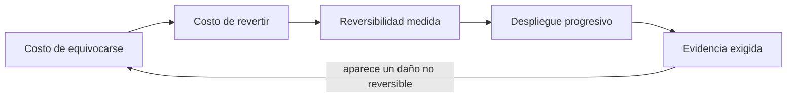
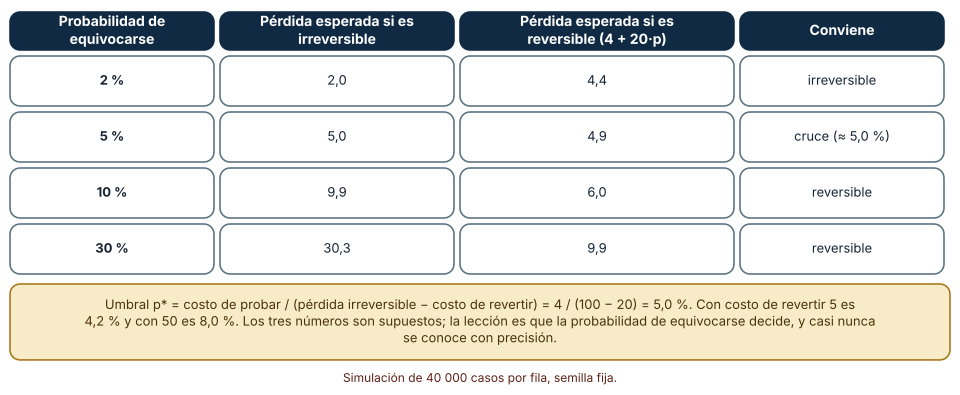
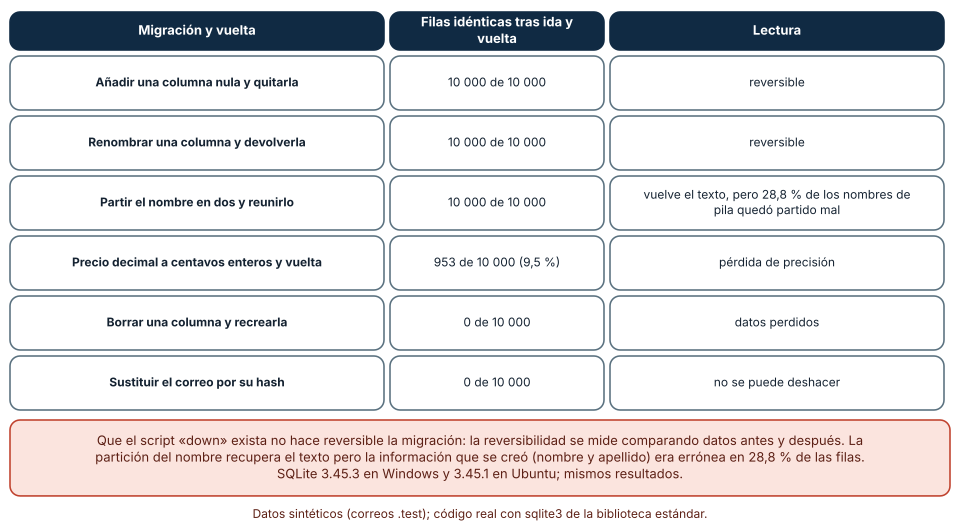
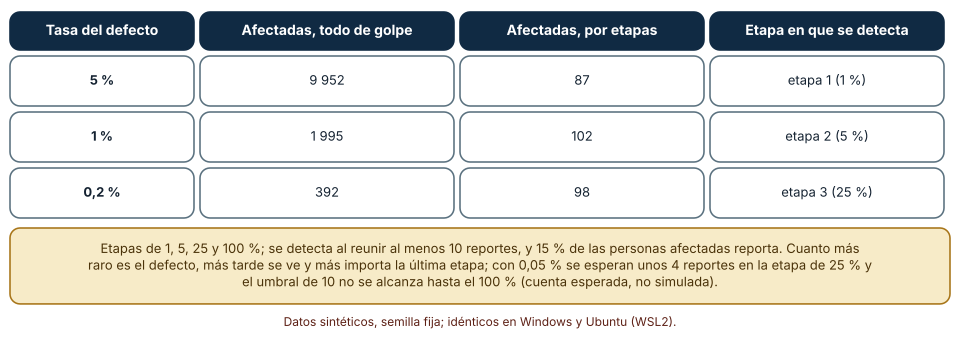

# SE-142 — Decisiones reversibles e irreversibles

[← SE-141 — Portafolio, opciones y secuenciación de inversión](../../classes/part-11-economia-metricas-y-decisiones-de-producto/se-141-portafolio-opciones-y-secuenciacion-de-inversion/README.md) · [↑ Parte 11](../../classes/part-11-economia-metricas-y-decisiones-de-producto/README.md) · [📚 Índice completo](../../classes/README.md) · [🌐 Portal](../../site/classes/SE-142.html) · [SE-143 — Taller: diseñar un árbol de métricas →](../../classes/part-11-economia-metricas-y-decisiones-de-producto/se-143-taller-disenar-un-arbol-de-metricas/README.md)

## Punto profesional y fundamento pedagógico

**Punto profesional.** La clase existe para distinguir las decisiones que se pueden deshacer de las que no, calcular cuánto cuesta deshacer cada una y diseñar los cambios para que el costo de equivocarse sea pequeño y se descubra pronto.

**Por qué aparece aquí.** Se sitúa después de **Portafolio, opciones y secuenciación de inversión** y antes de **Taller: diseñar un árbol de métricas**: `SE-141` dejó una cartera y un orden; esta clase pregunta, para cada decisión, cuánto cuesta equivocarse y cuánto puede deshacerse. Fija el vocabulario (reversible, irreversible, costo de reversión, despliegue progresivo) y deja una regla para decidir cuánta evidencia exige cada decisión.

**Error conceptual que debe corregir.** Tratar todas las decisiones con el mismo nivel de cautela, o creer que existir un procedimiento de reversión (un script «down») hace reversible un cambio.

**Secuencia de aprendizaje.** Antes de ejecutar, predices a partir de qué probabilidad de equivocarse conviene probar con vuelta atrás; después ejecutas seis migraciones de base de datos con su reversión y mides cuántas filas vuelven idénticas, y comparas desplegar de golpe con desplegar por etapas. La secuencia usa predicción, explicación propia, contraste y recuperación. [ICAP](https://icap.education.asu.edu/research) distingue participación de construcción de conocimiento; [How People Learn II](https://nap.nationalacademies.org/catalog/24783/how-people-learn-ii-learners-contexts-and-cultures) exige conectar conocimiento previo, contexto y transferencia; la [práctica de recuperación](https://pubmed.ncbi.nlm.nih.gov/16507066/) respalda producir de nuevo la explicación tras una demora; y [Education for Life and Work](https://nap.nationalacademies.org/resource/13398/dbasse_084153.pdf) exige devolución que explique la causa del error.

**Evidencia de aprendizaje.** `decision-reversibility.md` con el umbral de probabilidad de equivocarse que cambia la decisión, el resultado de seis migraciones con su ida y vuelta, la comparación de despliegue de golpe y por etapas con personas afectadas, y una clasificación de las decisiones de la plataforma en reversibles, costosas de revertir e irreversibles.

**Límite de la conclusión.** Las pérdidas, las probabilidades y las tasas de reporte son supuestos del autor; los datos de las migraciones son sintéticos. Las migraciones se ejecutaron en SQLite y no representan a otros motores ni volúmenes mayores.

### Trazabilidad fuente → afirmación

| Fuente primaria u oficial | Afirmación que respalda | Lo que no prueba |
|---|---|---|
| [Amazon: Letter to Shareholders](https://www.aboutamazon.com/news/company-news/2016-letter-to-shareholders) | Distingue decisiones irreversibles (de un solo sentido), que exigen un proceso cuidadoso, de decisiones reversibles (de dos sentidos), que pueden tomarse con un proceso ligero. | No dice dónde está esa frontera en la plataforma ni demuestra el beneficio. |
| [Google SRE Workbook: Canarying Releases](https://sre.google/workbook/canarying-releases/) | Desplegar a una fracción de tráfico y comparar con el resto limita el daño de un defecto y permite detectarlo antes de la exposición total. | No fija el tamaño de las etapas ni el umbral de detección. |
| [SQLite: ALTER TABLE](https://www.sqlite.org/lang_altertable.html) | Documenta qué cambios de esquema admite el motor (renombrar, añadir y quitar columnas) y sus restricciones. | No garantiza que deshacer un cambio recupere los datos. |

## Antes de empezar

Recupera lo aprendido en `SE-141`: una opción vale por lo que permite evitar. La pregunta activa es: **¿cuánto cuesta equivocarme con esta decisión, qué parte puedo deshacer y cuánto tardo en enterarme?**

## Prerrequisitos

- Haber completado `SE-141` o poder explicar el valor de invertir por etapas.
- Python 3.11 o posterior con `sqlite3` (incluido en la biblioteca estándar) y un terminal.
- Trabajar solo con datos sintéticos y correos de dominio reservado `.test`.

## Problema auténtico

La plataforma va a cambiar su esquema de base de datos: partir el nombre en dos columnas, guardar precios en centavos enteros, eliminar un campo que «nadie usa» y reemplazar el correo por un hash. Cada migración incluye un script de reversión. Además, la versión nueva se despliega a todos los centros a las 18:00 del viernes. Nadie ha preguntado qué datos se recuperan al revertir ni cuántas personas verían un defecto antes de que alguien lo reporte.

## Objetivos observables

Al terminar podrás:

1. calcular la probabilidad de equivocarse a partir de la cual conviene una opción reversible con costo de prueba;
2. medir la reversibilidad de una migración comparando los datos antes y después de ida y vuelta;
3. comparar el despliegue de golpe con el progresivo en personas afectadas y etapa de detección;
4. clasificar las decisiones de la plataforma por reversibilidad y decir cuánta evidencia exige cada una;
5. declarar qué cambios no pueden deshacerse y qué se hace antes de ejecutarlos.

## Mapa conceptual



El mapa se lee como una cadena de razonamiento, no como fases obligatorias. La flecha de retorno indica que un daño que no se puede deshacer reabre el análisis; no autoriza a confiar en el script de reversión.

## Temas y por qué importan

| Tema | Por qué cambia una decisión profesional | Evidencia mínima |
|---|---|---|
| Costo de equivocarse | Decide cuánta evidencia justifica actuar; si es bajo, se prueba, y si es alto, se estudia. | Pérdida estimada y probabilidad en `decision-reversibility.md` |
| Costo de revertir | Lo que cuesta volver atrás (tiempo, dinero, confianza) separa decisiones de dos sentidos de las de uno. | Costo de reversión por decisión |
| Reversibilidad medida | Un script de reversión no garantiza recuperar los datos; solo la comparación antes y después lo prueba. | Filas idénticas tras ida y vuelta por migración |
| Despliegue progresivo | Limitar la exposición reduce el daño de un defecto y acorta el tiempo hasta verlo. | Personas afectadas con despliegue de golpe y por etapas |
| Evidencia exigida | Las decisiones irreversibles piden más evidencia, revisión y un plan de salida; las reversibles, un experimento barato. | Clasificación con la evidencia exigida a cada decisión |

## Conceptos y decisiones

### 1. Costo de equivocarse

Es la pérdida esperada si la decisión resulta mala: lo que se pierde por el daño y por el tiempo hasta corregirlo. Se estima con una probabilidad de equivocarse y una pérdida si se equivoca. Ambas son inciertas, y la decisión no debería cambiar con la segunda cifra decimal: si cambia, falta evidencia o la decisión es más difícil de lo que parece.

### 2. Costo de revertir

Una decisión de dos sentidos puede deshacerse a un costo bajo; una de un solo sentido, no. Entre ambas hay un continuo: revertir una configuración cuesta minutos; revertir una migración que descartó datos cuesta la confianza de los usuarios y una reconstrucción manual; revertir una promesa pública cuesta reputación. El costo de revertir incluye el tiempo en que el error estuvo expuesto, no solo la operación inversa.

### 3. Reversibilidad medida

La reversibilidad de un cambio de datos se comprueba aplicando el cambio, su inverso y comparando con el estado original. Muchas migraciones «reversibles» no devuelven los datos: borrar una columna elimina su contenido; convertir decimales a enteros redondea; sustituir un correo por su hash es unidireccional por diseño. Un script «down» que recrea la estructura, vacía de datos, se parece a una reversión y no lo es.

### 4. Despliegue progresivo

Desplegar a una fracción creciente de personas limita cuántas ven un defecto antes de detectarlo. La detección depende de cuántas personas se ven afectadas y de qué fracción lo reporta: un defecto frecuente se ve en la primera etapa; uno raro, solo cuando la exposición es mayor. El diseño de las etapas y del umbral de detección es una decisión que se escribe antes de desplegar.

### 5. Evidencia exigida

La evidencia que pide una decisión crece con su costo de equivocarse y su irreversibilidad. Una decisión reversible y barata se toma con un experimento; una irreversible y cara exige revisión de otra persona, una copia de seguridad verificada, un plan de salida y una ventana de observación. Lo irreversible no se prohíbe, se hace con otra disciplina, y a veces se descompone en un paso reversible y uno irreversible.

### Probar con vuelta atrás conviene sobre cierto umbral de probabilidad

Una decisión puede tomarse de forma irreversible (comprometerse ya) o reversible (probar a un costo T de 4 y, si resulta mala, revertir a un costo R de 20). Equivocarse sin posibilidad de revertir cuesta L = 100. Predicción: ¿a partir de qué probabilidad de equivocarse gana la opción reversible?

```python
irreversible = L * p
reversible = T + R * p
umbral = T / (L - R)          # 4 / 80
```

El umbral es 5,0 %. Con costo de revertir 5 baja a 4,2 %; con 50 sube a 8,0 %. Con 40 000 casos y semilla 1421: con p = 2 %, la pérdida esperada es 2,0 si es irreversible y 4,4 si es reversible (conviene comprometerse); con 5 %, 5,0 y 4,9 (el cruce); con 10 %, 9,9 y 6,0; con 30 %, 30,3 y 9,9. Resultado idéntico en Windows (CPython 3.12.9) y Ubuntu bajo WSL2 (3.12.3). Por debajo del umbral, probar cuesta más de lo que evita; por encima, probar es mejor.



**Cómo leer la figura.** Cada fila es una probabilidad de equivocarse; las dos columnas centrales son las pérdidas esperadas de cada opción y la última dice cuál conviene. **Dónde deja de valer:** las tres cifras (100, 20, 4) son supuestos, y la probabilidad de equivocarse casi nunca se conoce con precisión. El umbral sirve para ver cuánta probabilidad hace falta para cambiar la decisión; si tu probabilidad está lejos del umbral, la decisión es robusta.

### Seis migraciones con su ida y vuelta

Se crea una tabla con 10 000 filas sintéticas (identificador, nombre compuesto, correo `.test`, precio decimal, curso) en SQLite en memoria (3.45.3 en Windows, 3.45.1 en Ubuntu). Para cada migración se aplica el cambio, su inversa y se cuenta cuántas filas quedan idénticas a las originales.

```python
before = {r[0]: r[1:] for r in db.execute("select id, nombre, email, precio, curso from t")}
# migración y su inversa
after = {r[0]: r[1:] for r in db.execute("select id, nombre, email, precio, curso from t")}
identicas = sum(before[k] == after[k] for k in before)
```

Añadir una columna nula y quitarla: 10 000 de 10 000 idénticas. Renombrar una columna y devolverla: 10 000 de 10 000. Partir el nombre en dos columnas (en el primer espacio) y reunirlo: 10 000 de 10 000, pero el 28,8 % de los nombres de pila quedó partido en el lugar equivocado («María» y «José de la Cruz» en lugar de «María José» y «de la Cruz»), de modo que el texto vuelve y lo creado era incorrecto. Pasar el precio a centavos enteros y volver: 953 de 10 000 (9,5 %) idénticas, porque el redondeo pierde información. Borrar la columna de correo y recrearla: 0 de 10 000. Sustituir el correo por su hash y «revertir»: 0 de 10 000. Los dos primeros son reversibles; el cuarto pierde precisión; los dos últimos destruyen datos.



**Cómo leer la figura.** Cada fila es una migración con su inversa; la columna central cuenta filas idénticas y la última da la lectura. **Dónde deja de valer:** las migraciones se probaron con 10 000 filas en memoria y datos sintéticos; los volúmenes reales y los motores distintos (que bloquean tablas o cambian tipos) pueden comportarse de otra manera. La comparación antes/después es el método, no una garantía para tus datos.

### Desplegar por etapas limita cuántas personas ven un defecto

Se simulan 200 000 personas; un defecto afecta a una fracción q (5 %, 1 % o 0,2 %); 15 % de las personas afectadas lo reporta y se detecta al acumular 10 reportes. Se compara desplegar a todos de golpe con hacerlo por etapas (1 %, 5 %, 25 % y 100 %).

```python
expuestas = int(N * fraccion)
afectadas = sum(rng.random() < q for _ in range(expuestas))
reportes = sum(rng.random() < 0.15 for _ in range(afectadas))
detectado = reportes >= 10
```

Con q = 5 %, el despliegue total afecta a 9 952 personas y el progresivo se detiene en la primera etapa con 87; con q = 1 %, 1 995 frente a 102 (detectado en la segunda etapa); con q = 0,2 %, 392 frente a 98 (detectado en la tercera). Cuanto más raro es el defecto, más tarde se detecta: con 0,05 % se esperan unos 4 reportes en la etapa de 25 % y el umbral de 10 no se alcanza hasta el 100 % (cuenta esperada, no simulada).



**Cómo leer la figura.** Cada fila es una tasa de defecto; las columnas comparan las personas afectadas con cada estrategia y la etapa de detección. **Dónde deja de valer:** el reporte de 15 % y el umbral de 10 son supuestos; un defecto silencioso (que corrompe datos sin avisar) puede no reportarse nunca, y entonces la detección depende de otra señal (guardas de `SE-139`). El despliegue progresivo reduce la exposición, no sustituye las pruebas.

## Definiciones de trabajo

- **decisión reversible (de dos sentidos):** decisión que puede deshacerse con un costo bajo y sin pérdida de información.
- **decisión irreversible (de un sentido):** decisión cuyo efecto no puede deshacerse o cuyo costo de deshacerlo es muy alto.
- **costo de reversión:** costo de volver al estado anterior, incluido el tiempo de exposición del error.
- **migración reversible:** cambio de datos cuya inversa devuelve los datos originales, comprobado por comparación.
- **despliegue progresivo:** exposición gradual de un cambio a fracciones crecientes de personas con detección entre etapas.

Las definiciones son operativas para la plataforma de entregas y deben contrastarse con las fuentes enlazadas al final.

## Ejemplo mínimo

Predice si una migración que redondea precios a la unidad es reversible.

```python
precios = [1.25, 3.5, 4.0]
ida = [round(p) for p in precios]
print(ida, ida == precios)
```

La ida da `[1, 4, 4]` y la comparación es falsa: los datos originales no vuelven. Registra versión del intérprete, comando y salida; si guardas antes una copia, la reversión se hace desde la copia y no desde la inversa.

## Ejemplo profesional

En la plataforma, `decision-reversibility.md` tiene una fila por decisión con su costo de equivocarse, su costo de reversión, su clasificación (dos sentidos, costosa de revertir, un sentido), la evidencia exigida y el mecanismo de salida. El contrato es que ninguna migración se despliega sin la comparación antes/después en un entorno de prueba y que las irreversibles requieren copia verificada, revisión de otra persona y ventana de observación. Esa estructura permite que una revisora entienda qué se puede deshacer y qué no.

Compara el caso normal con una migración que añade una columna, con una que la elimina, con una que cambia un tipo y con una que anonimiza datos. El registro es adecuado cuando cada caso tiene su clasificación; es peligroso cuando todos usan el mismo procedimiento.

## Práctica guiada

1. Copia el contrato de decisiones (costo de equivocarse, costo de reversión, clasificación, evidencia, salida) antes de decidir nada.
2. Predice el umbral de probabilidad con tus cifras y anota por qué.
3. Calcula el umbral con tres costos de reversión y verifícalo con una simulación de semilla fija.
4. Ejecuta las seis migraciones con su inversa y cuenta las filas idénticas.
5. Simula el despliegue de golpe y por etapas con tres tasas de defecto.
6. Clasifica diez decisiones de la plataforma y escribe la evidencia que exige cada una.
7. Pide a otra persona que reconstruya el umbral, las migraciones y el despliegue solo con `decision-reversibility.md`.

## Ejercicios

1. **Umbral:** calcula el umbral cuando probar cuesta 10 y revertir cuesta 40 con pérdida de 200, y explica por qué sube o baja.
2. **Migración:** diseña una migración que parta el nombre sin perder información y demuestra con la comparación que lo logra.
3. **Etapas:** prueba etapas de 0,5 %, 2 %, 10 % y 100 % y describe cómo cambian las personas afectadas con q = 0,2 %.
4. **Clasificación:** clasifica «cambiar el precio», «eliminar una cuenta» y «publicar una API» y propone cómo volver cada una más reversible.

## Reto verificable

Entrega `decision-reversibility.md` con el umbral y su verificación, las seis migraciones con filas idénticas, el despliegue de golpe y por etapas con tres tasas de defecto y la clasificación de diez decisiones. Se aprueba si otra persona ejecuta el código desde un checkout limpio, obtiene los mismos números con la semilla indicada y puede decir qué migración no debe ejecutarse sin copia verificada. No se aprueba por la cantidad de decisiones clasificadas.

## Caso conductor

La plataforma de entregas continúa como caso. Esta clase deja una clasificación de decisiones por reversibilidad y una regla de evidencia. `SE-143` organizará las métricas en un árbol y `SE-144` incorporará el criterio de abandono al caso de viabilidad. Cambia después una sola decisión —por ejemplo, el tamaño de la primera etapa— y revisa qué conclusiones cambian.

## Preguntas frecuentes

### Si tengo un script de reversión, ¿la migración es reversible?

Solo si la comparación antes/después lo confirma. En el experimento, borrar y recrear una columna tiene un «down» que recrea la estructura y devuelve 0 de 10 000 filas idénticas. La reversión de datos es una propiedad del cambio, no del script.

### ¿Qué hago con una decisión que no puede deshacerse?

La haces con otra disciplina: copia verificada, revisión de otra persona, ventana de observación y plan de salida. Y buscas descomponerla en un paso reversible y uno irreversible, de modo que el segundo ocurra cuando la evidencia ya existe.

### ¿Cuántas etapas debe tener un despliegue progresivo?

Las que permitan detectar el defecto más raro que te importa antes de la exposición total. En el experimento, un defecto de 0,2 % se detectó en la etapa de 25 %; con etapas más pequeñas se habría detectado antes y con menos personas afectadas, pero con más tiempo total. El número de etapas es un compromiso entre exposición y velocidad.

### ¿Puede un modelo de lenguaje generar y revisar migraciones?

Puede generarlas y detectar patrones destructivos conocidos, pero no sabe qué datos son valiosos ni si tu entorno de prueba es representativo. Exige la comparación antes/después como evidencia y una persona que decida las irreversibles.

## Fallo controlado y diagnóstico

Reproduce el fallo clásico de la clase: **creer que existir un procedimiento de reversión hace reversible el cambio**. Aplica la migración de borrar la columna de correo y ejecuta su «down».

Registra síntoma, entrada mínima, hipótesis, observación que descarta cada hipótesis, causa, corrección y prueba de regresión. **Síntoma:** tras la reversión la columna existe y está vacía. **Hipótesis rivales:** (a) el script de reversión falló; (b) la información se destruyó al borrar; (c) el entorno no restauró una copia. **Prueba:** compara antes y después: 0 de 10 000 filas idénticas; el script no falló, la información no estaba en la inversa, lo que sostiene (b). **Conclusión:** la migración era irreversible. **Regresión:** añade al contrato una prueba que falle si una migración se despliega sin comparación antes/después o si destruye datos sin copia verificada. No cambies a la vez la migración y la clasificación.

## Errores comunes y cómo corregirlos

| Síntoma | Causa probable | Corrección |
|---|---|---|
| Tras revertir faltan datos | La inversa recrea estructura, no contenido | Comparar antes y después y guardar copia verificada |
| Un defecto afecta a miles de personas el viernes | Despliegue a todos de golpe | Desplegar por etapas con detección entre etapas |
| Una decisión menor consume semanas de análisis | Se trató como irreversible | Clasificarla y probarla con un experimento barato |
| Una decisión grave se aprueba en cinco minutos | Se trató como reversible | Exigir copia, revisión y ventana de observación |
| El defecto raro nunca se detecta en las primeras etapas | El umbral de detección es demasiado alto | Ajustar etapas y umbral al defecto más raro que importa |

## Entorno y archivos clave

```text
work/SE-142/
├── README.md
├── reversibilidad/
│   ├── umbral.py
│   ├── migraciones.py
│   └── despliegue.py
├── fixtures/filas.csv
├── tests/test_migraciones.py
└── evidence/decision-reversibility.md
```

El `README` declara plataforma, versión de Python y de SQLite, semillas (1421, 1422, 1423) y comandos. Los experimentos usan solo la biblioteca estándar (`random`, `sqlite3`, `hashlib`, `statistics`) y se ejecutaron con CPython 3.12.9 (SQLite 3.45.3) en Windows 11 y 3.12.3 (SQLite 3.45.1) en Ubuntu bajo WSL2, con salidas idénticas salvo la versión de SQLite. Si añades una dependencia, fija procedencia y versión.

## Seguridad, ética y accesibilidad

- una migración que destruye datos puede afectar a personas que dependían de ellos: avisa, ofrece exportación y verifica la copia antes de ejecutar;
- sustituir identificadores por hashes sin clave no anonimiza si el espacio de valores es pequeño (`SE-137`): evalúa la reidentificación;
- un despliegue progresivo expone primero a un grupo de personas: elige ese grupo sin sesgo y con su consentimiento cuando corresponda;
- describe los resultados con palabras y ofrece una alternativa textual a cada tabla;
- no pegues datos reales de migraciones en un modelo de lenguaje sin política de datos;
- atribuye las fuentes usadas.

## Puente hacia el trabajo con agentes

Un agente al que se le pide «migra el esquema» generará el cambio y un script de reversión. Pídele que ejecute la migración y su inversa sobre datos sintéticos, que compare antes y después y que clasifique cada paso como reversible, con pérdida o irreversible, que proponga una copia verificada para los últimos y que no ejecute nada irreversible sin aprobación. Revisa especialmente si borra columnas «sin uso»: es el mismo error de creer que existe una reversión, con apariencia de orden.

## Transferencia

Traslada el experimento a otro dominio persistente (por ejemplo, un servicio de reparto): cambia las migraciones por un cambio de política de precios o de zonas; conserva la clasificación por reversibilidad y comprueba si el despliegue progresivo vuelve a limitar las personas afectadas. La transferencia está lograda cuando puedes explicar qué dependía del dominio y qué no.

## Evaluación y evidencia

| Criterio | Evidencia para aprobar |
|---|---|
| comprensión | explicación de la diferencia entre reversible, costoso de revertir e irreversible |
| corrección | umbral, filas idénticas y personas afectadas reproducibles con la misma semilla |
| diseño | contrato de decisiones con costo de reversión y evidencia exigida |
| diagnóstico | reproducción del fallo «existe un script de reversión» con regresión |
| incertidumbre | sensibilidad del umbral a los costos y detección según la tasa del defecto |
| reproducibilidad | versiones, comandos, salida y límites declarados |

## Fuentes

- [Amazon: Letter to Shareholders](https://www.aboutamazon.com/news/company-news/2016-letter-to-shareholders) — decisiones de un sentido y de dos sentidos y el proceso que merece cada una; autoridad: Amazon (carta corporativa).
- [Google SRE Workbook: Canarying Releases](https://sre.google/workbook/canarying-releases/) — despliegue a una fracción y comparación con el control; autoridad: Google SRE.
- [Google SRE Book: Embracing Risk](https://sre.google/sre-book/embracing-risk/) — presupuesto de error y decisiones sobre riesgo; autoridad: Google SRE.
- [SQLite: ALTER TABLE](https://www.sqlite.org/lang_altertable.html) — qué cambios de esquema admite SQLite y con qué restricciones; autoridad: proyecto SQLite.
- [Martin Fowler: Evolutionary Database Design](https://martinfowler.com/articles/evodb.html) — cambios de esquema pequeños, reversibles y automatizados; autoridad: M. Fowler y P. Sadalage.

Cada fuente respalda el mecanismo indicado; ninguna demuestra que las migraciones de la plataforma sean reversibles. Esa afirmación depende de la comparación antes/después con tus datos y de la revisión de otra persona.

- [Python: `sqlite3`](https://docs.python.org/3/library/sqlite3.html) — módulo usado en el experimento de migraciones.
- [Python: `hashlib`](https://docs.python.org/3/library/hashlib.html) — resumen criptográfico usado en la migración unidireccional.

## Límites y siguiente paso

Se ejecutaron tres experimentos con datos sintéticos en Windows y Ubuntu (WSL2) con resultados idénticos salvo la versión de SQLite (3.45.3 y 3.45.1). No se migró ninguna base real; las pérdidas, las probabilidades, la tasa de reporte y el umbral de detección son supuestos del autor, y los resultados con 10 000 filas no se extrapolan a volúmenes mayores ni a otros motores. La siguiente clase organiza las métricas de esta parte en un árbol.

## Glosario

- **decisión reversible (de dos sentidos):** decisión que puede deshacerse con un costo bajo y sin pérdida de información.
- **decisión irreversible (de un sentido):** decisión cuyo efecto no puede deshacerse o cuyo costo de deshacerlo es muy alto.
- **costo de reversión:** costo de volver al estado anterior, incluido el tiempo de exposición del error.
- **migración reversible:** cambio de datos cuya inversa devuelve los datos originales, comprobado por comparación.
- **despliegue progresivo:** exposición gradual de un cambio a fracciones crecientes de personas con detección entre etapas.

---

[← SE-141 — Portafolio, opciones y secuenciación de inversión](../../classes/part-11-economia-metricas-y-decisiones-de-producto/se-141-portafolio-opciones-y-secuenciacion-de-inversion/README.md) · [↑ Parte 11](../../classes/part-11-economia-metricas-y-decisiones-de-producto/README.md) · [📚 Índice completo](../../classes/README.md) · [🌐 Portal](../../site/classes/SE-142.html) · [SE-143 — Taller: diseñar un árbol de métricas →](../../classes/part-11-economia-metricas-y-decisiones-de-producto/se-143-taller-disenar-un-arbol-de-metricas/README.md)
