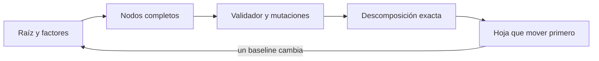
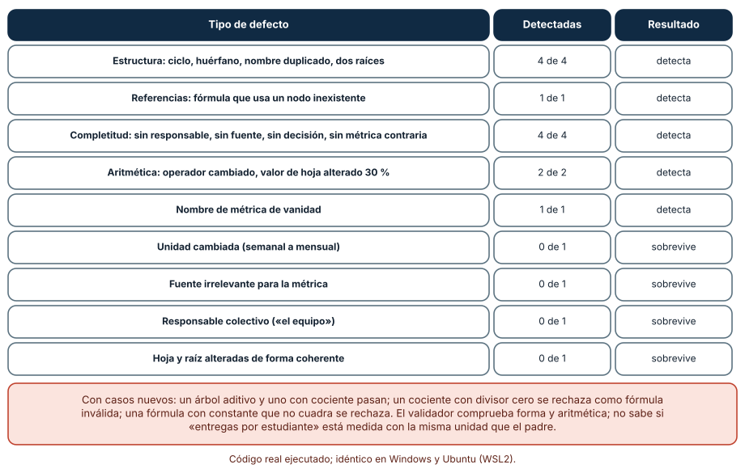
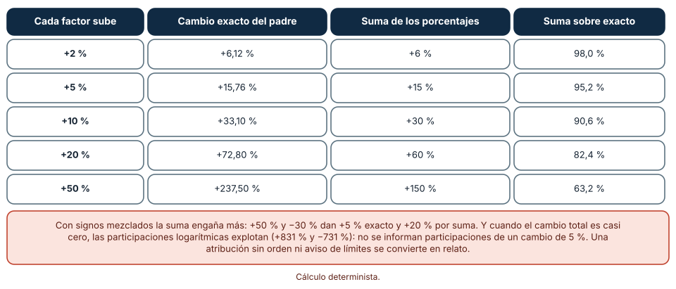
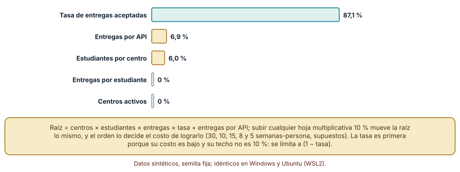

# SE-143 — Taller: diseñar un árbol de métricas

[← SE-142 — Decisiones reversibles e irreversibles](../../classes/part-11-economia-metricas-y-decisiones-de-producto/se-142-decisiones-reversibles-e-irreversibles/README.md) · [↑ Parte 11](../../classes/part-11-economia-metricas-y-decisiones-de-producto/README.md) · [📚 Índice completo](../../classes/README.md) · [🌐 Portal](../../site/classes/SE-143.html) · [SE-144 — Proyecto: caso de viabilidad técnico-económica →](../../classes/part-11-economia-metricas-y-decisiones-de-producto/se-144-proyecto-caso-de-viabilidad-tecnico-economica/README.md)

## Punto profesional y fundamento pedagógico

**Punto profesional.** El taller existe para que las métricas de la Parte 11 dejen de ser una lista y pasen a ser un árbol: una métrica norte descompuesta en factores calculables, cada uno con responsable, fuente, decisión y contrapeso, que otra persona puede revisar con un validador y recalcular con otros valores.

**Por qué aparece aquí.** Se sitúa después de **Decisiones reversibles e irreversibles** y antes de **Proyecto: caso de viabilidad técnico-económica**: las clases 135 a 142 dieron las piezas (resultados, retención, telemetría, experimentos, guardas, costos, cartera, reversibilidad); este taller las ordena en un árbol que `SE-144` usará como base del caso. No introduce un concepto nuevo: exige integrarlos y mostrar qué comprueba una herramienta y qué no.

**Error conceptual que debe corregir.** Creer que un árbol de métricas que pasa un validador estructural es un árbol correcto, y que descomponer una métrica en sumas de porcentajes explica su cambio.

**Secuencia de aprendizaje.** Antes de construir, predices qué defectos detectaría un validador y cuáles no; después construyes el árbol, lo mutas dieciséis veces, mides qué atrapa, comparas la descomposición aditiva con la exacta y decides qué hoja mover primero con baselines inciertos. La secuencia usa predicción, explicación propia, contraste y recuperación. [ICAP](https://icap.education.asu.edu/research) distingue participación de construcción de conocimiento; [How People Learn II](https://nap.nationalacademies.org/catalog/24783/how-people-learn-ii-learners-contexts-and-cultures) exige conectar conocimiento previo, contexto y transferencia; la [práctica de recuperación](https://pubmed.ncbi.nlm.nih.gov/16507066/) respalda producir de nuevo la explicación tras una demora; y [Education for Life and Work](https://nap.nationalacademies.org/resource/13398/dbasse_084153.pdf) exige devolución que explique la causa del error.

**Evidencia de aprendizaje.** `metric-tree.md` con el árbol (nodos, fórmulas, responsables, fuentes, decisiones, métricas contrarias), el validador con sus pruebas y el registro de mutaciones, la tabla de descomposición exacta y la decisión de qué hoja mover primero con su estabilidad.

**Límite de la conclusión.** El árbol, los valores y los costos son sintéticos. El validador comprueba forma y aritmética; no comprueba que una unidad sea la misma entre padre e hijo ni que la fuente sea pertinente. El orden de hojas por efecto sobre costo usa costos de mejora supuestos.

### Trazabilidad fuente → afirmación

| Fuente primaria u oficial | Afirmación que respalda | Lo que no prueba |
|---|---|---|
| [GOV.UK Service Manual: Measuring success](https://www.gov.uk/service-manual/measuring-success) | Un servicio parte de lo que necesita saber para mejorar y define indicadores con su cálculo, fuente y uso. | No dice cuál es el árbol de la plataforma. |
| [Google Research: HEART framework](https://research.google/pubs/measuring-the-user-experience-on-a-large-scale-user-centered-metrics-for-web-applications/) | Propone partir de objetivos, derivar señales y definir métricas, de modo que cada métrica responda a un propósito. | No valida las métricas escogidas para un producto. |
| [Python: ast](https://docs.python.org/3/library/ast.html) | El módulo analiza expresiones como árboles sintácticos y permite validarlas sin ejecutar código arbitrario. | No hace seguro cualquier uso de `eval`; debe restringirse a nodos permitidos. |

## Antes de empezar

Recupera lo aprendido en la Parte 11: una métrica norte con guardas (`SE-139`), definiciones calculables (`SE-136`), eventos con consentimiento (`SE-137`), costos por resultado (`SE-140`) y reglas de revisión (`SE-141`, `SE-142`). La pregunta activa es: **¿qué cambia en la raíz si cambia esta hoja, quién responde por ella y cómo me entero de que está mal medida?**

## Prerrequisitos

- Haber completado `SE-142` o poder explicar qué evidencia exige una decisión reversible y una irreversible.
- Python 3.11 o posterior y un terminal; el validador usa solo la biblioteca estándar.
- Trabajar solo con cifras sintéticas: ninguna observación necesita datos de una persona o producto real.

## Problema auténtico

La plataforma tiene un tablero con cuarenta métricas, cada equipo defiende las suyas y nadie sabe cuáles explican la raíz. Se pide un árbol de métricas. El primer borrador lista las cuarenta en columnas, tiene dos raíces, una hoja llamada «descargas totales» y una fórmula que suma en vez de multiplicar; un validador lo acepta tras corregir la forma, pero otra persona descubre que una hoja usa «entregas por mes» donde el padre espera «por semana».

## Objetivos observables

Al terminar podrás:

1. construir un árbol de métricas con una raíz, factores calculables, responsable, fuente, decisión y contrapeso en cada nodo;
2. escribir un validador estructural y aritmético, y medir cuántas mutaciones detecta y cuáles no;
3. comparar la descomposición aditiva con la exacta y decidir cuándo informar participaciones;
4. ordenar las hojas por efecto sobre la raíz por unidad de costo y medir cuán estable es el orden con baselines inciertos;
5. declarar qué comprueba la herramienta y qué exige revisión humana.

## Mapa conceptual



El mapa se lee como una cadena de razonamiento, no como fases obligatorias. La flecha de retorno indica que un baseline distinto o una hoja mal medida reabre el árbol; no autoriza a parchear solo el nodo que falló.

## Temas y por qué importan

| Tema | Por qué cambia una decisión profesional | Evidencia mínima |
|---|---|---|
| Raíz y factores | La raíz fija qué se persigue y los factores, qué se puede mover; sin raíz única el árbol no decide nada. | Raíz con fórmula y factores en `metric-tree.md` |
| Nodos completos | Un nodo sin responsable, fuente o decisión es una métrica sin dueño ni uso. | Tabla de nodos con los cinco campos |
| Validador y mutaciones | Mide qué defectos atrapa una comprobación automática y cuáles exigen una segunda persona. | Registro de dieciséis mutaciones con resultado |
| Descomposición exacta | Explica qué factor movió la raíz sin los errores de sumar porcentajes. | Tabla exacta frente a aditiva y regla de cuándo informar participaciones |
| Hoja que mover primero | Ordena el trabajo por efecto por costo, y la estabilidad del orden dice cuánto confiar en él. | Primer lugar y segundo lugar por proporción de sorteos |

## Conceptos y decisiones

### 1. Raíz y factores

La raíz es la métrica norte (`SE-139`): tareas útiles por semana. Se descompone en factores cuyo producto o suma la reproduce: centros activos × estudiantes activos por centro × entregas por estudiante × tasa de aceptación. Cada factor debe ser a su vez medible y movible por alguien. La descomposición es una decisión de modelado: otra puede ser correcta y diferente; lo importante es que sea exacta y declare su forma.

### 2. Nodos completos

Cada nodo lleva: nombre, fórmula (si no es hoja) o fuente (si lo es), responsable nombrado, decisión que informa y, en la raíz, una métrica contraria. Una hoja con fuente pero sin decisión no se usa; una con decisión pero sin fuente no se puede calcular. El campo «responsable» debe ser una persona o un rol con nombre, no «el equipo».

### 3. Validador y mutaciones

Un validador comprueba lo que se puede comprobar sin entender el dominio: una sola raíz, ausencia de ciclos y de nodos huérfanos, referencias a nodos existentes, campos completos, valores que cuadran con las fórmulas, nombres de vanidad. Para saber qué tan bueno es, se le aplican mutaciones: copias del árbol con un defecto conocido. Las mutaciones que sobreviven delimitan el territorio de la revisión humana.

### 4. Descomposición exacta

Cuando todos los factores cambian, la suma de sus porcentajes subestima el cambio del producto, y el error crece con el tamaño de los cambios. La descomposición logarítmica es exacta y no depende del orden, pero su reparto en porcentajes explota cuando el cambio total es casi cero. La regla del taller: informar cambios por factor, el exacto del padre y las participaciones solo si el cambio total supera un umbral declarado.

### 5. Hoja que mover primero

La hoja que más conviene mover es la de mayor efecto sobre la raíz por unidad de costo de lograrlo. En un árbol multiplicativo, subir cualquier factor 10 % mueve la raíz lo mismo; lo que diferencia a las hojas es su costo y su techo (una tasa no puede pasar de 1). Con baselines inciertos, el orden se evalúa con sorteos para ver cuán a menudo cada hoja queda primera.

### Un validador que atrapa 12 de 16 defectos

El árbol tiene la raíz U = S × E × T × X y cuatro hojas: centros activos (S = 400), estudiantes activos por centro (E = 30), entregas por estudiante (T = 3) y tasa de aceptación (X = 0,8), con U = 28 800. El validador comprueba una raíz, ausencia de ciclos y huérfanos, nombres únicos, campos completos, referencias válidas, aritmética con una evaluación restringida de la fórmula (solo `+ - * /`) y nombres de vanidad. Se generan dieciséis mutaciones del árbol. Predicción: ¿cuántas detecta?

```python
def validar(arbol, raiz="U"):
    errores = []
    # una raíz, sin ciclos, sin huérfanos, nombres únicos
    # campos: responsable, decisión, fuente en hojas, contraria en la raíz
    # aritmética: evaluar la fórmula con los valores de los hijos
    obtenido = evaluar(formula, {h: arbol[h]["valor"] for h in hijos})
    if abs(obtenido - valor) > 0.01 * abs(valor):
        errores.append(f"{nodo} no cuadra")
    return errores
```

Resultado, idéntico en Windows (CPython 3.12.9) y Ubuntu bajo WSL2 (3.12.3): el árbol base no tiene errores. De las 16 mutaciones se detectan 12: ciclo, huérfano, nombre duplicado y dos raíces (4 de 4 de estructura), fórmula con un nodo inexistente (1 de 1), hoja sin responsable, sin fuente, sin decisión y raíz sin métrica contraria (4 de 4 de completitud), operador cambiado de × a + y un valor de hoja alterado 30 % (2 de 2 de aritmética), y una hoja llamada «descargas totales» (1 de 1). Sobreviven cuatro semánticas: la unidad cambiada de semanal a mensual, una fuente irrelevante (una encuesta anual para un conteo), un responsable colectivo («el equipo») y una hoja y una raíz alteradas de forma coherente (centros duplicados y raíz duplicada). Con tres árboles nuevos, uno aditivo y uno con cociente pasan; el cociente con divisor cero se rechaza como fórmula inválida y una fórmula con constante que no cuadra se rechaza por aritmética.



**Cómo leer la figura.** Cada fila agrupa mutaciones del mismo tipo; las filas coral son las que sobreviven. **Dónde deja de valer:** las dieciséis mutaciones las escribió quien escribió el validador, por lo que la cifra de 12 de 16 es optimista; un defecto no imaginado no figura. El validador sabe de forma y aritmética y no sabe si «entregas por estudiante» está medida en la misma unidad que el padre: eso lo revisa una segunda persona con el registro de cada fuente.

### Sumar porcentajes no es descomponer

Con la raíz producto de factores, si cada uno sube un porcentaje g, el cambio exacto es (1 + g)^k − 1 y la suma de porcentajes da k × g. Predicción: ¿a partir de qué cambio la suma deja de servir?

```python
for g in (0.02, 0.05, 0.10, 0.20, 0.50):
    exacto = (1 + g) ** 3 - 1
    suma = 3 * g
```

Con tres factores: con +2 % cada uno, el cambio exacto es +6,12 % y la suma 6 % (98,0 % de lo real); con +5 %, 15,76 % frente a 15 % (95,2 %); con +10 %, 33,10 % frente a 30 % (90,6 %); con +20 %, 72,80 % frente a 60 % (82,4 %); con +50 %, 237,50 % frente a 150 % (63,2 %). Con signos mezclados engaña más: +50 % y −30 % dan +5 % exacto y +20 % por suma. Y cuando el cambio total es casi cero, las participaciones logarítmicas explotan: +50 % y −30 % reparten 831 % y −731 %; con +20 % y −20 % (−4 % total), −447 % y 547 %. Por eso el taller exige un umbral para informar participaciones.



**Cómo leer la figura.** Cada fila es el mismo porcentaje en cada factor; la última columna es qué parte del cambio real recoge la suma. **Dónde deja de valer:** supone un producto exacto de factores sin interacciones externas; en un árbol con sumas (como una raíz con una parte aditiva), los factores sumados sí se suman. La figura no dice que la suma sea inútil: dice cuándo deja de ser una aproximación aceptable.

### ¿Qué hoja mover primero?

El árbol se extiende con una hoja aditiva I (entregas por API, de mediana 6 000 y dispersión lognormal 0,6) y cada hoja tiene un costo de mejorarla 10 % en semanas-persona: S 30, E 10, T 15, X 8, I 5. Los baselines son inciertos: S triangular 250–600 (moda 400), E 15–50 (30), T 1,5–4,5 (3,0), X uniforme 0,6–0,95. Subir X está limitado a (1 − X) / X porque una tasa no pasa de 1. Predicción: ¿qué hoja queda primera?

```python
termino = S * E * T * X
ganancia = {"S": 0.1 * termino, "E": 0.1 * termino, "T": 0.1 * termino,
            "X": min(0.1 * termino, (1 - X) * termino / X), "I": 0.1 * I}
puntaje = {k: ganancia[k] / costo[k] for k in costo}
```

Con el baseline central el orden es X (360), E (288), T (192), I (120) y S (96). Con 10 000 sorteos de baselines (semilla 1433), X queda primera en 87,1 % de los casos, I en 6,9 % y E en 6,0 %; S y T, en ninguno. En segundo lugar, E queda en 82,8 % y X en 12,0 %. El orden es estable en cuanto a «X o E»: la elección entre ellas depende del costo y del techo de X; la incertidumbre en I puede dejarla primera en uno de cada quince casos.



**Cómo leer la figura.** Cada barra es la proporción de 10 000 sorteos en que esa hoja es la primera; las grises son hojas que nunca lo son. **Dónde deja de valer:** los costos de mejora son supuestos y se tratan como ciertos; con costos inciertos el orden se aflojaría. Lo que aprende el equipo es que el orden depende de dos cosas distintas, el efecto estructural y el costo, y que una hoja cuyo techo se acerca al valor actual (una tasa cercana a 1) deja de ser la mejor aunque lo fuera.

## Definiciones de trabajo

- **árbol de métricas:** descomposición de una métrica norte en factores calculables, con responsable, fuente y decisión en cada nodo.
- **nodo completo:** nodo con nombre, fórmula o fuente, responsable nombrado, decisión que informa y, en la raíz, métrica contraria.
- **mutación:** copia del árbol con un defecto conocido que se usa para evaluar un validador.
- **descomposición exacta:** reparto del cambio de la raíz entre factores sin depender del orden de sustitución.
- **efecto por costo:** cambio esperado de la raíz al mejorar una hoja dividido por lo que cuesta lograrlo.

Las definiciones son operativas para la plataforma de entregas y deben contrastarse con las fuentes enlazadas al final.

## Ejemplo mínimo

Predice si un árbol con raíz R = A × B, con A = 10 y B = 5, pasa la validación aritmética si R vale 55.

```python
env = {"A": 10, "B": 5}
obtenido = eval("A * B", {"__builtins__": {}}, env)
print(obtenido, abs(obtenido - 55) <= 0.01 * 55)
```

La fórmula da 50, el valor declarado es 55 y la diferencia (9,1 %) supera el 1 % admitido: el validador lo rechaza. Registra versión del intérprete, comando y salida. En el taller la evaluación usa el módulo `ast` y solo permite sumas, restas, productos y cocientes.

## Ejemplo profesional

En la plataforma, `metric-tree.md` contiene el árbol completo con una fila por nodo (nombre, fórmula o fuente, responsable, decisión, contraria), el validador, las dieciséis mutaciones con su resultado, la tabla de descomposición y el orden de hojas. El contrato es que ningún nodo se añade sin los cinco campos y que cada cambio de fórmula conserva la raíz exacta. Esa estructura permite que otra persona recalcule la raíz con otros valores y vea qué cambia.

Compara el caso normal con una hoja que cambia de definición a mitad de año, con una que depende de dos fuentes de datos que no coinciden, con una que solo se mide en una versión del producto y con una cuya responsable deja el equipo. El árbol es adecuado cuando esas excepciones quedan registradas; es peligroso cuando un nodo cambia sin dejar huella.

## Práctica guiada

1. Copia el contrato de nodo (nombre, fórmula o fuente, responsable, decisión, contraria) antes de construir el árbol.
2. Predice cuántas de dieciséis mutaciones detectará tu validador y cuáles no.
3. Construye el árbol con raíz y cuatro hojas y escribe el validador con evaluación restringida.
4. Genera las dieciséis mutaciones, mide la detección y explica cada superviviente.
5. Calcula la descomposición exacta y la aditiva para cinco cambios iguales y para dos con signos mezclados.
6. Define costos de mejora, sortea baselines con semilla fija y calcula la proporción de veces que cada hoja queda primera.
7. Pide a otra persona que reconstruya el árbol, la detección y el orden de hojas solo con `metric-tree.md`.

## Ejercicios

1. **Mutación nueva:** diseña una mutación que el validador no detecte y una forma de detectarla sin entender el dominio.
2. **Unidad:** añade un campo «unidad» a cada nodo y una regla que compruebe que el padre y los hijos son consistentes; indica qué mutaciones nuevas detecta.
3. **Descomposición:** descompón el cambio de la raíz cuando S sube 20 %, E baja 10 % y X sube 5 % y explica qué participaciones informarías.
4. **Costos:** cambia los costos de mejora de X y E y describe cómo cambia la proporción de veces que cada una queda primera.

## Reto verificable

Entrega `metric-tree.md` con el árbol completo, el validador con sus pruebas, las dieciséis mutaciones y su resultado, la tabla de descomposición y el orden de hojas con su estabilidad. Se aprueba si otra persona ejecuta el código desde un checkout limpio, obtiene los mismos números con la semilla indicada y puede decir qué defecto del árbol no habría detectado el validador. No se aprueba por la cantidad de nodos.

## Caso conductor

La plataforma de entregas continúa como caso. Este taller deja el árbol de métricas con la raíz de `SE-139`, las definiciones de `SE-136`, los eventos de `SE-137`, los costos de `SE-140` y las reglas de revisión de `SE-141` y `SE-142`. `SE-144` lo usará como base del caso de viabilidad. Cambia después una sola hoja —por ejemplo, la tasa de aceptación— y revisa qué conclusiones del árbol cambian.

## Preguntas frecuentes

### ¿Por qué no basta con un validador estructural?

Porque la forma no es el sentido. En el taller, 4 de 16 mutaciones sobreviven: una unidad cambiada, una fuente irrelevante, un responsable colectivo y una alteración coherente. Son los defectos que una persona con conocimiento del dominio encuentra y el validador no.

### ¿Puedo usar `eval` para evaluar las fórmulas?

No sin restringirlo. La ejecución de código arbitrario desde un campo de datos es un riesgo. El taller usa `ast` para recorrer la expresión y aceptar solo constantes, nombres de hijos y operadores aritméticos; cualquier otro nodo se rechaza.

### ¿Cuántas hojas debe tener un árbol?

Las que alguien pueda mover y medir. Un árbol con cuarenta hojas es el tablero original con otra forma. En el taller, cuatro hojas y una aditiva bastan para ordenar el trabajo; añadir más exige una decisión que cada una informe.

### ¿Un modelo de lenguaje puede construir el árbol?

Puede proponerlo y escribir el validador, pero la fuente, el responsable y la decisión de cada nodo los decide una persona que responde por ellos. Si un agente propone el árbol, exige los cinco campos y las mutaciones que sobreviven.

## Fallo controlado y diagnóstico

Reproduce el fallo clásico de la clase: **dar por correcto un árbol porque el validador lo acepta**. Cambia la unidad de una hoja de semanal a mensual y ejecuta el validador.

Registra síntoma, entrada mínima, hipótesis, observación que descarta cada hipótesis, causa, corrección y prueba de regresión. **Síntoma:** el validador no marca nada y la raíz queda equivocada por un factor cercano a cuatro (semanas por mes). **Hipótesis rivales:** (a) el cambio no afecta la raíz; (b) el validador no comprueba unidades; (c) el valor de la raíz se recalculó. **Prueba:** compara la raíz recalculada con la declarada y con los datos de origen; el validador pasa porque los valores declarados cuadran, lo que sostiene (b). **Conclusión:** la mutación semántica es invisible para la comprobación estructural. **Regresión:** añade al contrato el campo «unidad» y una prueba que falle si un padre y sus hijos no la comparten, y conserva la mutación como caso que debe fallar. No cambies a la vez el árbol y el validador.

## Errores comunes y cómo corregirlos

| Síntoma | Causa probable | Corrección |
|---|---|---|
| El árbol tiene dos raíces | Se mezclaron métricas de dos objetivos | Elegir una raíz y mover la otra a una guarda |
| La raíz no se recupera de las hojas | La fórmula suma donde debía multiplicar | Validar aritmética con los valores declarados |
| Una hoja no tiene a quién preguntarle | Responsable colectivo o ausente | Nombrar a una persona o rol y revisarlo cada trimestre |
| Se celebra que un factor explica 90 % del cambio | Se usó sustitución en un solo orden | Usar descomposición exacta y umbral para participaciones |
| El equipo mejora la hoja equivocada | Se ignoró el costo y el techo | Ordenar por efecto por costo y medir la estabilidad |

## Entorno y archivos clave

```text
work/SE-143/
├── README.md
├── arbol/
│   ├── modelo.py
│   ├── validador.py
│   └── mutaciones.py
├── fixtures/arbol.json
├── tests/test_validador.py
└── evidence/metric-tree.md
```

El `README` declara plataforma, versión de Python, semilla (1433) y comandos. Los experimentos usan solo la biblioteca estándar (`ast`, `copy`, `random`, `math`) y se ejecutaron con CPython 3.12.9 en Windows 11 y 3.12.3 en Ubuntu bajo WSL2 con salidas idénticas. Si añades una dependencia, fija procedencia y versión.

## Seguridad, ética y accesibilidad

- evaluar fórmulas que escribe otra persona es ejecutar datos: restringe los nodos permitidos y no uses `eval` sobre entradas no confiables;
- un árbol con responsables nombrados identifica a personas: define quién ve esos nombres y cómo se actualizan;
- una hoja medida sobre personas exige el consentimiento y la minimización de `SE-137`;
- describe el árbol con texto además de un diagrama y ofrece una alternativa accesible a cada gráfico;
- no pegues árboles con datos reales en un modelo de lenguaje sin política de datos;
- atribuye los marcos usados.

## Puente hacia el trabajo con agentes

Un agente al que se le pide «arma el árbol de métricas» devolverá un diagrama con nombres plausibles. Pídele el árbol en un formato validable, con los cinco campos por nodo, un validador con evaluación restringida, dieciséis mutaciones con su resultado y la lista de las que sobreviven. Revisa especialmente si omite el responsable o repite la misma fuente: es el mismo error de la forma sin sentido, con apariencia de método.

## Transferencia

Traslada el taller a otro dominio persistente (por ejemplo, un servicio de reparto): cambia la raíz por «pedidos entregados a tiempo» y las hojas por comercios activos, pedidos por comercio, tasa de entrega y pedidos por API; conserva el contrato de nodo y el validador y comprueba si las mismas mutaciones siguen sobreviviendo. La transferencia está lograda cuando puedes explicar qué dependía del dominio y qué no.

## Evaluación y evidencia

| Criterio | Evidencia para aprobar |
|---|---|
| comprensión | explicación de por qué la raíz se descompone en esos factores y qué decide cada uno |
| corrección | validador, mutaciones, descomposición y orden de hojas reproducibles con la misma semilla |
| diseño | contrato de nodo con los cinco campos y evaluación restringida |
| diagnóstico | reproducción del fallo «el validador lo acepta» con regresión |
| incertidumbre | estabilidad del orden de hojas y umbral para informar participaciones |
| reproducibilidad | versiones, comandos, salida y límites declarados |

## Fuentes

- [GOV.UK Service Manual: Measuring success](https://www.gov.uk/service-manual/measuring-success) — definir indicadores con su cálculo, fuente y uso; autoridad: Government Digital Service (Reino Unido).
- [Measuring the User Experience on a Large Scale: HEART (Google Research)](https://research.google/pubs/measuring-the-user-experience-on-a-large-scale-user-centered-metrics-for-web-applications/) — de objetivos a señales y métricas; autoridad: Google Research.
- [DORA: Software delivery performance metrics](https://dora.dev/guides/dora-metrics-four-keys/) — conjunto equilibrado de métricas con contrapesos; autoridad: DORA (Google Cloud).
- [Categorizing Variants of Goodhart's Law](https://arxiv.org/abs/1803.04585) — por qué cada nodo necesita un contrapeso; autoridad: investigación publicada en arXiv.
- [SWEBOK Guide v4.0a](https://www.computer.org/education/bodies-of-knowledge/software-engineering) — medición en ingeniería de software; autoridad: IEEE Computer Society.

Cada fuente respalda el mecanismo indicado; ninguna demuestra que el árbol de la plataforma sea el correcto. Esa afirmación depende de datos reales y de la revisión de otra persona.

- [Python: `ast`](https://docs.python.org/3/library/ast.html) — análisis de expresiones para evaluarlas con nodos permitidos.
- [Python: `random`](https://docs.python.org/3/library/random.html) — generadores con semilla.

## Límites y siguiente paso

Se ejecutaron tres experimentos con datos sintéticos en Windows y Ubuntu (WSL2) con resultados idénticos. El validador se evaluó con dieciséis mutaciones elegidas por el autor y tres árboles nuevos, por lo que su exactitud real es desconocida; los costos de mejora y los baselines son supuestos. La siguiente clase integra el árbol en un caso de viabilidad técnico-económica.

## Glosario

- **árbol de métricas:** descomposición de una métrica norte en factores calculables, con responsable, fuente y decisión en cada nodo.
- **nodo completo:** nodo con nombre, fórmula o fuente, responsable nombrado, decisión que informa y, en la raíz, métrica contraria.
- **mutación:** copia del árbol con un defecto conocido que se usa para evaluar un validador.
- **descomposición exacta:** reparto del cambio de la raíz entre factores sin depender del orden de sustitución.
- **efecto por costo:** cambio esperado de la raíz al mejorar una hoja dividido por lo que cuesta lograrlo.

---

[← SE-142 — Decisiones reversibles e irreversibles](../../classes/part-11-economia-metricas-y-decisiones-de-producto/se-142-decisiones-reversibles-e-irreversibles/README.md) · [↑ Parte 11](../../classes/part-11-economia-metricas-y-decisiones-de-producto/README.md) · [📚 Índice completo](../../classes/README.md) · [🌐 Portal](../../site/classes/SE-143.html) · [SE-144 — Proyecto: caso de viabilidad técnico-económica →](../../classes/part-11-economia-metricas-y-decisiones-de-producto/se-144-proyecto-caso-de-viabilidad-tecnico-economica/README.md)
