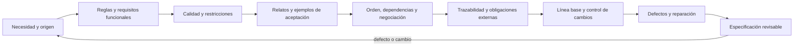

# Parte 12 — Ingeniería de requisitos

La Parte 10 decidió qué problema merece resolverse y la Parte 11 cuánto cuesta y rinde resolverlo. La pregunta cambia de «¿conviene?» a «¿qué exactamente debe hacer el sistema y cómo lo sabremos?». Esta parte sigue la **plataforma de entregas de tareas** y su requisito conductor —recuperar el borrador cuando la sesión expira— a lo largo de doce clases: de dónde sale cada requisito, qué reglas lo gobiernan, con qué calidad debe cumplirse, cómo se cuenta, con qué ejemplos se acepta, en qué orden se hace, cómo se rastrea, qué obligaciones externas lo condicionan, cómo se protege de los cambios, qué defectos esconde y cómo se repara lo que no se puede verificar. Termina en una especificación que otra persona puede revisar sin pedir contexto.

## Pregunta rectora

> ¿Quién necesita qué resultado, bajo qué condición y cómo se verificará?

## Antes del recorrido clase por clase

Esta parte no enseña una plantilla de documento de requisitos. Enseña que un requisito es el resultado de actividades distintas —descubrir, analizar, escribir, comprobar— y que cada una falla de una forma propia: las entrevistas no llegan a lo tácito, una regla razonable deja huecos, un adjetivo admite lecturas opuestas, un ejemplo feliz no distingue nada, el orden por valor ignora las dependencias, una matriz manual se degrada, una obligación se implementa con un borde equivocado, un hash crudo confunde formato con contenido, ningún par de requisitos se contradice y el conjunto sí, y un «nunca» no se prueba con pruebas finitas. Cada clase ejecuta experimentos con datos sintéticos que muestran uno de esos mecanismos y declara lo que el experimento no demuestra.

El diagrama se lee de izquierda a derecha y no es un proceso obligatorio. El retorno indica que un defecto hallado en la revisión o un cambio aprobado reabre el origen; una especificación entregada no cierra la pregunta, la fecha.

## Resultados acumulativos

Podrás distinguir elicitación, análisis, especificación y validación y elegir la técnica según el tipo de conocimiento; separar requisito funcional, regla de negocio y supuesto, y comprobar la completitud de una regla con una tabla de decisión; convertir adjetivos en escenarios de calidad con estadístico, población y ventana; contar los caminos de un caso de uso y cortar el trabajo en vertical; elegir ejemplos que distinguen implementaciones y medir qué suite los detecta; comprobar si un conjunto priorizado es entregable y decidir entre intereses y no entre posiciones; mantener la trazabilidad con etiquetas verificables; convertir una obligación externa en requisitos, pruebas y evidencia con un responsable que la interprete; identificar una línea base y calcular el alcance de un cambio; buscar ambigüedad, contradicción e incompletitud con una técnica para cada una; reparar requisitos no verificables o reformularlos; y entregar un expediente con validador, mutaciones y una estimación de lo que queda por encontrar.

Al finalizar podrás defender una especificación con origen, criterio, responsable y fecha para cada requisito, indicar qué defectos detecta su validador y cuáles no, y señalar qué parte de tu conclusión es observación, cuál es inferencia y cuál es suposición.

## Prerrequisitos enlazados

- [Parte 4 — Pensamiento computacional](../../classes/part-04-pensamiento-computacional-y-resolucion-de-problemas/): modelado, invariantes y razonamiento sobre evidencia.
- [Parte 7 — Estructuras de datos y algoritmos](../../classes/part-07-estructuras-de-datos-y-algoritmos/): medir, enumerar y no confundir un resultado con un modelo.
- [Parte 10 — Descubrimiento y estrategia de producto](../../classes/part-10-descubrimiento-y-estrategia-de-producto/): el problema y la evidencia de los que parte esta parte.
- [Parte 11 — Economía, métricas y decisiones de producto](../../classes/part-11-economia-metricas-y-decisiones-de-producto/): el caso de viabilidad que decide qué especificar.
- Python 3.11+ y terminal; los experimentos usan solo la biblioteca estándar y datos sintéticos; la demostración de `SE-153` usa `git`.

## Bloques y progresión

1. **Descubrir y decir lo que hace el sistema:** las clases 145–146 separan elicitación, análisis, especificación y validación, y distinguen requisitos funcionales de reglas de negocio con tablas de decisión.
2. **Calidad, relatos y ejemplos:** las clases 147–149 convierten adjetivos en escenarios de calidad, cuentan los requisitos como casos de uso, historias y job stories, y los cierran con criterios de aceptación y ejemplos.
3. **Ordenar, rastrear y proteger:** las clases 150–153 priorizan con dependencias y negociación, enlazan cada requisito con su origen y su evidencia, derivan requisitos de obligaciones externas y amenazas, y controlan el cambio con líneas base.
4. **Depurar e integrar:** las clases 154–156 buscan ambigüedad, contradicción e incompletitud, reparan requisitos no verificables y reúnen todo en una especificación revisable con validador y revisión medida.

## Evidencia medida y límites

Las figuras y los ejemplos de esta parte usan experimentos ejecutados con CPython 3.12.9 en Windows 11 y repetidos con CPython 3.12.3 en Ubuntu bajo WSL2. Los datos son **sintéticos** y las semillas están fijadas: las salidas deterministas fueron idénticas en ambos sistemas; los únicos valores que difieren por equipo son los tiempos de derivación de contraseñas de `SE-147` (570 ms con 600 000 iteraciones en Windows y 544 ms en Ubuntu, una corrida) y los percentiles de latencia de un servidor local de `SE-155`, que se informan como rangos de tres corridas de un solo equipo. Los experimentos son: cobertura de elicitación con y sin observación, revisión con defectos de dificultad desigual e intersección de restricciones de interesados (`SE-145`); una tabla de decisión de 24 combinaciones con huecos y conflictos, horas locales que no existen o se repiten y 12 mutantes frente a tres suites (`SE-146`); media frente a percentil sobre 100 000 latencias, ventanas de disponibilidad y costo de PBKDF2 (`SE-147`); caminos de un caso de uso, valor por iteración al cortar por capas o en vertical y cruce de actores con historias (`SE-148`); 10 mutantes frente a cuatro suites, 18 casos de pares frente a 1 296 combinaciones y un redondeo con tres notas en el empate (`SE-149`); prefijos por valor/costo que violan dependencias, inflación de Must y ciclos de mayoría (`SE-150`); densidad de enlaces frente a huérfanos e impacto, deterioro de una matriz y trazas de ejecución con `sys.settrace` (`SE-151`); cinco variantes de una regla de retención sobre 10 000 registros, 66 celdas STRIDE y una cadena de hashes frente a cinco manipulaciones (`SE-152`); alcance transitivo de un cambio, hash crudo frente a normalizado, una demostración con `git` y la cadencia de un comité (`SE-153`); lecturas de una frase con conectores, subconjuntos mínimos de requisitos incompatibles y celdas sin definir de una tabla estado–evento (`SE-154`); una regla de verificabilidad, la latencia de un servidor local y las pruebas sin fallos que exige un «nunca» (`SE-155`); y un validador con 16 mutaciones, un camino crítico y la estimación por captura–recaptura de los defectos remanentes (`SE-156`). Los rangos, las tasas, las ponderaciones, los sesgos, las reglas y las etiquetas son supuestos o juicios del autor, no datos de una organización, un proyecto ni de personas reales; las reglas léxicas se afinaron con pocos ejemplos y se evaluaron con casos nuevos mínimos, por lo que su exactitud real es desconocida. No se entrevistó a nadie, no se revisó ninguna especificación real, no se consultó a una persona especialista en normativa y las referencias a obligaciones externas no constituyen asesoría legal. Esta parte no tiene laboratorio propio en `labs/`; el proyecto integrador `SE-156` define el contrato y la evidencia. Cada clase termina con un puente hacia el trabajo con agentes.

## Guía razonada clase por clase

La plataforma de entregas mantiene un requisito conductor, un expediente y criterios estables mientras cambian las lentes. Cada clase explica qué defecto previene, qué experimento lo muestra, qué no demuestra y qué evidencia permite revisarlo.

### Bloque 1 — Descubrir y decir lo que hace el sistema

#### SE-145 — Elicitación, análisis, especificación y validación

Elicitar es hacer aparecer conocimiento que no está escrito; analizar, tratarlo como conjunto; especificar, escribirlo para quien construye y prueba; validar, comprobar con las personas que es lo que necesitan. La clase muestra con una simulación que ocho entrevistas se estancan en 77 % de los requisitos porque lo tácito no se enuncia, que más revisores aportan menos de lo que promete un modelo independiente y que tres de cinco conjuntos de restricciones de interesados no tienen solución.

El estudiante entrega el ciclo aplicado al requisito conductor, con origen, supuestos y un acta de validación. `SE-146` baja al contenido de los requisitos funcionales y de las reglas que los gobiernan.

#### SE-146 — Requisitos funcionales y reglas de negocio

Un requisito funcional dice qué responde el sistema a qué estímulo bajo qué condición; una regla de negocio es una decisión de la organización que existiría sin el sistema. La clase enumera las 24 combinaciones de una regla de penalización razonable y encuentra dos huecos y dos conflictos, muestra que una medianoche local puede no existir o repetirse y mide que tres ejemplos típicos detectan 4 de 12 mutantes y las fronteras, 10.

El estudiante entrega una tabla de decisión completa y una política de plazo. `SE-147` pregunta con qué calidad debe cumplirse.

#### SE-147 — Atributos de calidad y restricciones

Un adjetivo se vuelve verificable como escenario con fuente, estímulo, entorno, respuesta y medida. La clase muestra que la media de 100 000 latencias cumple «menos de 2 s» mientras el percentil 99 no, que un mismo comportamiento cumple 99,9 % mensual en 85,8 % de los meses y 99,9 % anual en 99,8 % de los años, y que la guía vigente de derivación de contraseñas choca con un presupuesto de 300 ms.

El estudiante entrega tres escenarios de calidad completos y una decisión sobre el choque medido. `SE-148` cuenta los requisitos desde quien los usa.

### Bloque 2 — Calidad, relatos y ejemplos

#### SE-148 — Casos de uso, historias y job stories

Un caso de uso narra secuencias y variantes; una historia, un incremento de valor negociable; una job story, la situación que desencadena la necesidad. La clase cuenta 16 caminos en un caso con 7 alternativas, simula que cortar por capas entrega valor visible en la tercera iteración y cortar en vertical en la primera, y cruza un catálogo de actores con un backlog para hallar un actor inexistente y dos sin historias.

El estudiante entrega un caso de uso, cinco historias verticales y una job story. `SE-149` las cierra con criterios y ejemplos.

#### SE-149 — Criterios de aceptación y ejemplos

Un criterio de aceptación es binario, concreto y comprobable por quien no lo escribió. La clase mide que un ejemplo feliz detecta 0 de 10 mutantes de una validación y las fronteras los 10, construye 18 casos que cubren todos los pares de 1 296 combinaciones y muestra que solo un ejemplo en el empate decide entre dos reglas de redondeo que difieren en 3 de 61 notas.

El estudiante entrega escenarios con fronteras y una suite combinatoria justificada. `SE-150` ordena el conjunto.

### Bloque 3 — Ordenar, rastrear y proteger

#### SE-150 — Priorización, dependencias y negociación

Ordenar por valor/costo ignora las dependencias, MoSCoW se infla sin límite y una mayoría puede no existir. La clase muestra que los prefijos del ranking no son entregables y que el óptimo cerrado vale 27 frente a los 33 que promete el voraz, que la misma votación produce entre 10 y 27 Must según la regla, y que 5,56 % de los perfiles de tres votantes tiene un ciclo de mayoría.

El estudiante entrega un conjunto cerrado bajo presupuesto, un límite de Must y una negociación por intereses. `SE-151` enlaza cada requisito con su origen y su prueba.

#### SE-151 — Trazabilidad desde necesidad hasta evidencia

Un enlace dice a qué requisito pertenece una prueba; la evidencia es su ejecución fechada. La clase mide cómo la densidad de enlaces elimina huérfanos a costa de hacer inútil el análisis de impacto, calcula cuánto dura una matriz manual y compara los enlaces declarados con las funciones que cada prueba ejecuta realmente.

El estudiante entrega la cadena completa del requisito conductor y un verificador de etiquetas. `SE-152` añade las obligaciones externas.

#### SE-152 — Requisitos regulatorios, de datos y seguridad

Una obligación externa se interpreta, se convierte en requisito con criterio y se respalda con evidencia. La clase mide cinco variantes plausibles de una regla de retención que tratan mal entre 10 y 1 473 registros de 10 000, enumera 66 preguntas de amenaza de un diagrama de 18 elementos y muestra que una cadena de hashes detecta la modificación y el borrado, pero no el truncado ni la reconstrucción sin un ancla externa.

El estudiante entrega una obligación con su interpretación, requisitos derivados y el inventario de amenazas. `SE-153` protege el conjunto con líneas base.

#### SE-153 — Gestión de cambios y líneas base

Una línea base permite cambiar con control. La clase calcula el alcance transitivo de un cambio según la densidad de dependencias, muestra que un hash crudo confunde formato con contenido mientras uno normalizado no, demuestra con `git` cómo se identifica y se compara una línea base y simula que la espera de una solicitud es la mitad del periodo del comité.

El estudiante entrega una línea base identificada, dos solicitudes con alcance y una cadencia justificada. `SE-154` busca los defectos que sobreviven.

### Bloque 4 — Depurar e integrar

#### SE-154 — Ambigüedad, contradicción e incompletitud

Cada defecto se busca con su técnica. La clase cuenta las lecturas de una frase con conectores (14 con cinco operandos), encuentra seis conjuntos mínimos de requisitos incompatibles entre doce, ninguno de los cuales es un par, y clasifica las 42 celdas de una tabla de estados: 10 definidas, 11 imposibles y 21 preguntas abiertas.

El estudiante entrega un inventario de defectos con tipo, técnica y responsable. `SE-155` repara lo que no se puede verificar.

#### SE-155 — Taller: reparar requisitos no verificables

Un requisito es verificable si un procedimiento finito, ejecutado por otra persona, da un veredicto aceptado. El taller repara diez frases vagas con cuatro patrones, puntúa las reparaciones con una regla que cuenta señales y deja ver sus fallos, mide un percentil sobre un servidor local con su variación y calcula que acotar una tasa de 1 por 10 000 exige casi 30 000 pruebas sin fallos.

El estudiante entrega las reparaciones con su procedimiento y la reformulación de un «nunca». `SE-156` reúne todo.

#### SE-156 — Proyecto: especificación de requisitos revisable

Una especificación revisable responde sin su autor. El proyecto entrega la especificación, un validador con pruebas y 16 mutaciones (11 detectadas, 5 que escapan), el camino crítico de los requisitos (9 días frente a 17) y la estimación por captura–recaptura de los defectos que dejan dos revisoras, que subestima cuando algunos son difíciles para ambas.

El estudiante entrega el expediente completo. La Parte 13 toma este texto y estudia cómo expresarlo con mayor formalidad.

## Resumen operativo del recorrido

| Clase | Capacidad que construye | Pregunta que resuelve | Evidencia acumulativa |
|---|---|---|---|
| [SE-145](../../classes/part-12-ingenieria-de-requisitos/se-145-elicitacion-analisis-especificacion-y-validacion/) | Elicitación, análisis, especificación y validación | ¿De dónde viene cada requisito y cómo sé que es el correcto? | `requirements-cycle.md` con origen, supuestos y acta de validación |
| [SE-146](../../classes/part-12-ingenieria-de-requisitos/se-146-requisitos-funcionales-y-reglas-de-negocio/) | Requisitos funcionales y reglas de negocio | ¿Qué hace el sistema y qué decidió la organización? | `rules-table.md` con tabla de decisión y política de plazo |
| [SE-147](../../classes/part-12-ingenieria-de-requisitos/se-147-atributos-de-calidad-y-restricciones/) | Atributos de calidad y restricciones | ¿Con qué calidad, medida cómo y a qué costo? | `quality-scenarios.md` con escenarios y choque medido |
| [SE-148](../../classes/part-12-ingenieria-de-requisitos/se-148-casos-de-uso-historias-y-job-stories/) | Casos de uso, historias y job stories | ¿Cómo se cuenta y se corta para entregar valor? | `stories.md` con caso de uso, historias y catálogo de actores |
| [SE-149](../../classes/part-12-ingenieria-de-requisitos/se-149-criterios-de-aceptacion-y-ejemplos/) | Criterios de aceptación y ejemplos | ¿Qué ejemplos distinguen una implementación correcta? | `acceptance.md` con fronteras, mutantes y suite de pares |
| [SE-150](../../classes/part-12-ingenieria-de-requisitos/se-150-priorizacion-dependencias-y-negociacion/) | Priorización, dependencias y negociación | ¿Qué conjunto se puede entregar y cómo se decide? | `priorities.md` con conjunto cerrado y negociación por intereses |
| [SE-151](../../classes/part-12-ingenieria-de-requisitos/se-151-trazabilidad-desde-necesidad-hasta-evidencia/) | Trazabilidad desde necesidad hasta evidencia | ¿Por qué existe, qué lo prueba y qué afecta si cambia? | `traceability.md` con cadena y verificador |
| [SE-152](../../classes/part-12-ingenieria-de-requisitos/se-152-requisitos-regulatorios-de-datos-y-seguridad/) | Requisitos regulatorios, de datos y seguridad | ¿Qué obligación hay, quién la interpreta y cómo se demuestra? | `compliance-requirements.md` con obligación, amenazas y evidencia |
| [SE-153](../../classes/part-12-ingenieria-de-requisitos/se-153-gestion-de-cambios-y-lineas-base/) | Gestión de cambios y líneas base | ¿Qué cambió, a quién alcanza y quién lo aprobó? | `change-control.md` con línea base y solicitudes |
| [SE-154](../../classes/part-12-ingenieria-de-requisitos/se-154-ambiguedad-contradiccion-e-incompletitud/) | Ambigüedad, contradicción e incompletitud | ¿Qué defectos esconde el texto y quién decide? | `defect-inventory.md` con tipo, técnica y responsable |
| [SE-155](../../classes/part-12-ingenieria-de-requisitos/se-155-taller-reparar-requisitos-no-verificables/) | Taller: reparar requisitos no verificables | ¿Qué procedimiento daría un sí o un no? | `repairs.md` con reparaciones y procedimientos |
| [SE-156](../../classes/part-12-ingenieria-de-requisitos/se-156-proyecto-especificacion-de-requisitos-revisable/) | Proyecto: especificación revisable | ¿Puede otra persona decidir con este expediente? | `spec.md`, validador, mutaciones y estimación de remanentes |

## Proyecto integrador

El proyecto **SE-156** entrega una especificación con problema, supuestos, fuera de alcance, requisitos con origen, texto singular y verificable, criterio de aceptación, dueño, prioridad y dependencias, la línea base de `SE-153`, las obligaciones de `SE-152` y el inventario de defectos de `SE-154`. Se acompaña de un validador con pruebas, de un registro de mutaciones detectadas y no detectadas, del camino crítico y de un informe de revisión por dos personas con criterios distintos y la estimación de lo que queda por encontrar. La especificación solo respalda lo que el expediente sostiene y declara sus defectos abiertos.

## Criterios de salida

- las doce clases explican todos sus temas mediante mecanismos, ejemplos y límites;
- cada requisito remite a un origen, tiene un criterio binario y un responsable;
- cada adjetivo de calidad tiene estadístico, población, ventana y método de medición;
- cada obligación externa tiene una interpretación firmada por quien corresponde y una evidencia generable;
- cada regla se ha enumerado y sus huecos y conflictos tienen una decisión;
- el validador tiene pruebas con defectos inyectados y declara los que no detecta;
- otra persona reproduce comandos y resultados desde un checkout limpio;
- el informe declara lo observado, lo inferido y lo no ejecutado.

## Preguntas de control por bloque

- ¿De dónde viene este requisito y qué supuesto del mundo lo sostiene?
- ¿Qué medida, con qué estadístico y ventana, haría decir que no se cumple?
- ¿Qué ejemplo distingue esta implementación de una incorrecta plausible?
- ¿Qué defecto de este expediente no detectaría el validador, y quién lo revisaría?

## Fuentes de la parte

- [ISO/IEC/IEEE 29148:2018](https://www.iso.org/standard/72089.html) — procesos y elementos de información de la ingeniería de requisitos; autoridad: ISO, IEC e IEEE.
- [Nuseibeh y Easterbrook: Requirements engineering, a roadmap (2000)](https://doi.org/10.1145/336512.336523) — panorama de las actividades de la disciplina; autoridad: ACM.
- [Zave y Jackson: Four dark corners of requirements engineering (1997)](https://doi.org/10.1145/237432.237434) — requisitos, supuestos del dominio y especificación; autoridad: ACM.
- [Mavin et al.: Easy Approach to Requirements Syntax (EARS) (2009)](https://doi.org/10.1109/RE.2009.9) — plantillas de redacción de requisitos; autoridad: IEEE.
- [Reglamento (UE) 2016/679](https://eur-lex.europa.eu/eli/reg/2016/679/oj) — limitación de la conservación, supresión y protección desde el diseño; autoridad: Unión Europea.
- [SWEBOK Guide v4.0a](https://www.computer.org/education/bodies-of-knowledge/software-engineering) — requisitos, configuración y calidad; autoridad: IEEE Computer Society.

Las fuentes se vinculan también dentro de cada clase. Definen vocabulario y mecanismos; la adecuación de los requisitos de la plataforma de entregas se demuestra con el caso, la evidencia trazable y la revisión de otra persona, no con la autoridad de la fuente.
