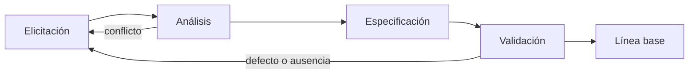
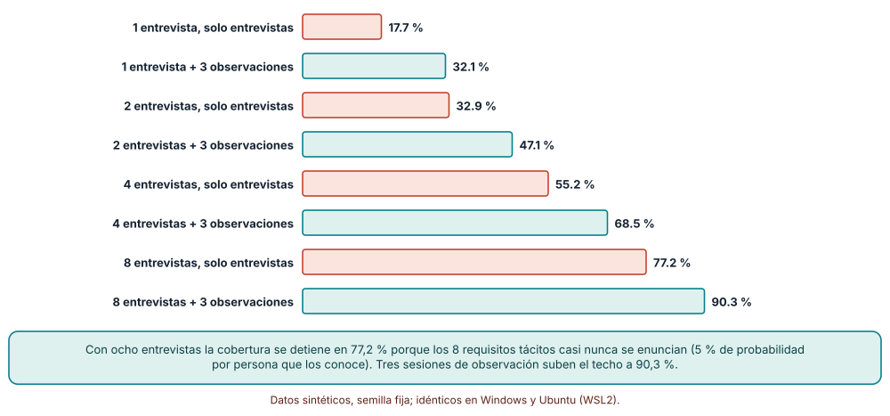
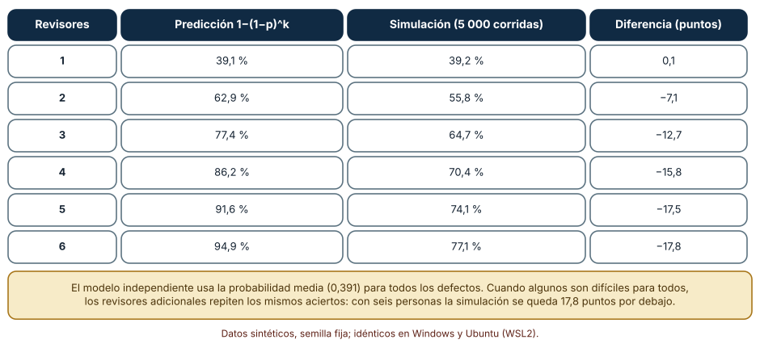
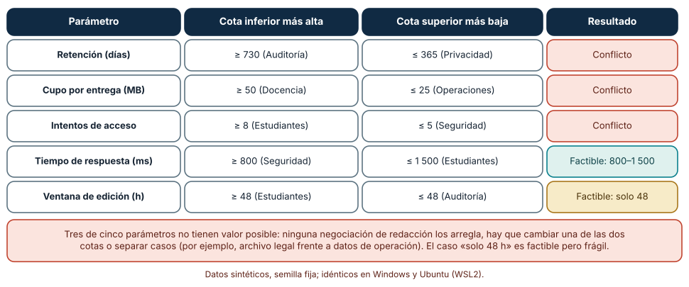

# SE-145 — Elicitación, análisis, especificación y validación

[← SE-144 — Proyecto: caso de viabilidad técnico-económica](../../classes/part-11-economia-metricas-y-decisiones-de-producto/se-144-proyecto-caso-de-viabilidad-tecnico-economica/README.md) · [↑ Parte 12](../../classes/part-12-ingenieria-de-requisitos/README.md) · [📚 Índice completo](../../classes/README.md) · [🌐 Portal](../../site/classes/SE-145.html) · [SE-146 — Requisitos funcionales y reglas de negocio →](../../classes/part-12-ingenieria-de-requisitos/se-146-requisitos-funcionales-y-reglas-de-negocio/README.md)

## Punto profesional y fundamento pedagógico

**Punto profesional.** La clase existe para que un requisito deje de ser «lo que dijo la persona que habló más fuerte» y pase a ser el resultado de cuatro actividades distintas —descubrir, analizar, escribir y comprobar— cada una con su propia forma de fallar y su propia evidencia.

**Por qué aparece aquí.** Se sitúa después de **Proyecto: caso de viabilidad técnico-económica** y antes de **Requisitos funcionales y reglas de negocio**: la Parte 10 terminó con un brief que dice qué problema merece resolverse y la Parte 11 con un caso de viabilidad que dice cuánto cuesta y rinde. La Parte 12 cambia la pregunta de «¿conviene?» a «¿qué exactamente debe hacer el sistema y cómo lo sabremos?». Esta clase fija el ciclo de cuatro actividades que las once siguientes profundizan, y deja un expediente mínimo de la función «recuperar borradores cuando la sesión expira», el requisito conductor de toda la parte.

**Error conceptual que debe corregir.** Creer que los requisitos «están ahí» y solo hay que recogerlos, y que una lista bien redactada ya es una especificación validada.

**Secuencia de aprendizaje.** Antes de leer el resultado, predices cuántos requisitos encontrarás con más entrevistas y qué parte no aparecerá nunca; después ejecutas la simulación, explicas por qué se estanca, comparas la predicción de un modelo ingenuo con la simulación y reconstruyes sin apoyo el ciclo con un fallo en cada etapa. La secuencia usa predicción, explicación propia, contraste y recuperación. [ICAP](https://icap.education.asu.edu/research) distingue participación de construcción de conocimiento; [How People Learn II](https://nap.nationalacademies.org/catalog/24783/how-people-learn-ii-learners-contexts-and-cultures) exige conectar conocimiento previo, contexto y transferencia; la [práctica de recuperación](https://pubmed.ncbi.nlm.nih.gov/16507066/) respalda producir de nuevo la explicación tras una demora; y [Education for Life and Work](https://nap.nationalacademies.org/resource/13398/dbasse_084153.pdf) exige devolución que explique la causa del error.

**Evidencia de aprendizaje.** `requirements-cycle.md` con el origen de cada requisito del caso, el análisis de al menos un conflicto entre interesados, la redacción de dos requisitos con su criterio, y un acta de validación que separe «lo que se revisó» de «lo que se probó». Debe contener predicción previa, observación, explicación causal, contraejemplo, criterio de aceptación y una nota de qué dato haría cambiar la conclusión.

**Límite de la conclusión.** Las entrevistas, los interesados y los requisitos tácitos son sintéticos: la proporción de conocimiento tácito (8 de 40) y la probabilidad de recordarlo son supuestos del autor, no mediciones de personas. Lo que se muestra es el mecanismo, no una tasa de descubrimiento aplicable a otro proyecto.

### Trazabilidad fuente → afirmación

| Fuente primaria u oficial | Afirmación que respalda | Lo que no prueba |
|---|---|---|
| [Nuseibeh y Easterbrook, «Requirements engineering: a roadmap» (2000)](https://doi.org/10.1145/336512.336523) | Describe la ingeniería de requisitos como actividades de obtener, modelar y analizar, comunicar, acordar y evolucionar los requisitos. | No fija un orden obligatorio ni una cantidad de entrevistas. |
| [Zave y Jackson, «Four dark corners of requirements engineering» (1997)](https://doi.org/10.1145/237432.237434) | Distingue requisitos, especificación y supuestos del dominio: el programa cumple los requisitos solo si la especificación, junto con los supuestos sobre el mundo, los implica. | No dice cómo descubrir cuáles son los supuestos. |
| [Boehm, «Verifying and validating software requirements and design specifications» (1984)](https://doi.org/10.1109/MS.1984.233702) | Separa verificar (¿se construye bien?) de validar (¿se construye lo correcto?). | Sus cifras de costo son históricas y no se usan aquí. |
| [Fagan, «Design and code inspections to reduce errors in program development» (1976)](https://doi.org/10.1147/sj.153.0182) | Una inspección estructurada con roles encuentra defectos antes de construir. | No garantiza una tasa de detección para otro equipo. |
| [ISO/IEC/IEEE 29148:2018](https://www.iso.org/standard/72089.html) | Define procesos y elementos de información de la ingeniería de requisitos y características de un buen requisito. | El texto completo es de pago; aquí se cita solo su alcance. |
| [Python: random](https://docs.python.org/3/library/random.html) | Un generador con semilla (`random.Random(145)`) produce secuencias reproducibles. | No garantiza que la distribución sintética se parezca a la de proyectos reales. |

## Antes de empezar

Esta clase abre la **Parte 12 sobre la plataforma de entregas de tareas**, el mismo caso de la Parte 10, ahora en su etapa de especificación. Recupera lo aprendido en las Partes 10 y 11: ya sabes qué problema merece atención (los estudiantes pierden el borrador cuando la sesión expira) y cuánto puede costar resolverlo; falta decir con precisión qué debe hacer el sistema. La pregunta activa es: **¿cómo sé que lo que voy a escribir como requisito es lo que alguien necesita, y que lo escribí de forma que se pueda comprobar?**

## Prerrequisitos

- Haber completado `SE-144` o poder explicar qué decisión de viabilidad entregó.
- Python 3.11 o posterior y un terminal; la hoja de cálculo es opcional.
- Trabajar solo con interesados y cifras sintéticas: ningún experimento necesita datos de una persona o de un sistema real.

## Problema auténtico

El equipo de la plataforma de entregas aprobó recuperar borradores cuando la sesión expira. Docencia pide «que nada se pierda», Seguridad pide «sesiones cortas», Privacidad pide «borrar pronto» y Auditoría pide «conservar todo». Alguien escribe «el sistema guardará los borradores de forma segura» y lo da por especificado. Nadie ha preguntado quién conoce las reglas de borrado, qué cosas nadie dirá en voz alta, ni si dos de esos deseos pueden cumplirse a la vez.

## Objetivos observables

Al terminar podrás:

1. distinguir elicitación, análisis, especificación y validación con un ejemplo y un contraejemplo de la plataforma de entregas;
2. predecir cuándo más entrevistas dejan de aumentar la cobertura y qué técnica distinta llega a lo que las entrevistas no alcanzan;
3. detectar un conflicto entre interesados como una intersección vacía de restricciones, antes de escribir código;
4. escribir un requisito con origen, texto y criterio, y distinguir lo que una revisión encontró de lo que una prueba demostró;
5. declarar qué supuesto del mundo (Zave y Jackson) sostiene la especificación y qué ocurre si falla.

## Mapa conceptual



El mapa se lee como un ciclo con retornos, no como cascada. El retorno desde el análisis indica que un conflicto entre interesados obliga a volver a preguntar; el retorno desde la validación indica que un defecto o un requisito ausente reabre la elicitación. No hay fase terminal: la línea base de `SE-153` fija un estado, no cierra el ciclo.

## Temas y por qué importan

| Tema | Por qué cambia una decisión profesional | Evidencia mínima |
|---|---|---|
| Elicitación | Decide qué técnica usar para cada tipo de conocimiento; entrevistar no llega a lo tácito. | Predicción, traza causal y contraejemplo de **Elicitación** en `requirements-cycle.md` |
| Análisis | Detecta conflictos, dependencias y huecos antes de comprometer diseño. | Predicción, traza causal y contraejemplo de **Análisis** en `requirements-cycle.md` |
| Especificación | Fija un texto que otra persona puede implementar y probar sin preguntar. | Predicción, traza causal y contraejemplo de **Especificación** en `requirements-cycle.md` |
| Validación | Comprueba que lo especificado es lo que se necesita, no solo que está bien escrito. | Predicción, traza causal y contraejemplo de **Validación** en `requirements-cycle.md` |
| Conocimiento tácito y supuestos | Lo que nadie dice y lo que se da por cierto sobre el mundo decide si el sistema funciona. | Predicción, traza causal y contraejemplo de **Conocimiento tácito y supuestos** en `requirements-cycle.md` |

## Conceptos y decisiones

### 1. Elicitación

Elicitar es provocar que aparezca conocimiento que no está escrito en ningún sitio. Una entrevista recoge lo que la persona sabe y es capaz de decir; una observación recoge lo que hace; el análisis de documentos recoge lo que la organización ya decidió; un prototipo recoge reacciones ante algo concreto. Cada técnica tiene un alcance: preguntar «¿qué necesita el sistema?» a una docente no revelará que siempre abre las entregas en el móvil mientras camina, porque ella no lo considera un dato. Elegir la técnica por el tipo de conocimiento buscado, y no por costumbre, es la primera decisión profesional de la parte.

### 2. Análisis

Analizar es tratar lo recogido como un conjunto, no como una lista. Se buscan duplicados (dos personas piden lo mismo con palabras distintas), conflictos (dos personas piden cosas incompatibles), dependencias (un requisito solo tiene sentido si otro existe) y huecos (una situación que nadie contempló). El resultado no es un texto más bonito sino una lista de preguntas pendientes con nombre y apellido: «Auditoría exige 730 días y Privacidad 365; ¿quién decide?». Un análisis que no produce preguntas probablemente no analizó nada.

### 3. Especificación

Especificar es escribir lo acordado de forma que sirva a quien construye, a quien prueba y a quien audita. Zave y Jackson separan tres cosas que suelen mezclarse: el requisito (lo que se quiere en el mundo: «la estudiante recupera su trabajo»), los supuestos del dominio (lo que se cree del mundo: «la sesión dura 30 minutos y el navegador conserva el almacenamiento local») y la especificación (lo que el sistema hará: «guardará el borrador cada 30 s»). El programa satisface el requisito solo si especificación y supuestos, juntos, lo implican. Si el supuesto es falso —el navegador de la estudiante borra el almacenamiento al cerrar—, la especificación puede cumplirse al pie de la letra y el requisito, no.

### 4. Validación

Validar es preguntar si el requisito es el correcto; verificar es preguntar si el sistema cumple el requisito. Boehm los resume como construir lo correcto frente a construirlo correctamente. La validación ocurre con las personas que tienen la necesidad (revisión, prototipo, ejemplos concretos), mientras que la verificación ocurre contra el texto (pruebas, inspecciones). Un requisito puede estar perfectamente escrito, perfectamente verificado y perfectamente equivocado. Por eso un acta de validación debe decir con quién se revisó, qué se mostró y qué se decidió, no solo «aprobado».

### 5. Conocimiento tácito y supuestos

Hay requisitos que nadie enuncia porque parecen obvios (el borrador no debe mostrarse a otra estudiante) y supuestos que nadie cuestiona porque nunca han fallado (la hora del servidor es la misma que la del navegador). La clase los trata como categoría propia porque son los que producen los defectos más caros: no están en ningún documento, así que ninguna revisión de documentos los encuentra. La defensa no es preguntar más sino preguntar de otra manera: observar el trabajo real, pedir casos de excepción, y escribir los supuestos como una lista revisable con una persona responsable.

### Cobertura: lo que ninguna entrevista dice

Un proyecto sintético tiene 40 requisitos verdaderos: 32 explícitos, que 2 o 3 de 8 interesados conocen, y 8 tácitos, que 2 de 8 conocen pero casi nunca verbalizan. Cada entrevista recupera un requisito explícito con probabilidad 0,7 si la persona lo conoce, y uno tácito con probabilidad 0,05. Una sesión de observación revela cada requisito tácito con probabilidad 0,35. Predicción antes de ejecutar: con las ocho entrevistas la cobertura no llegará al 100 %, y el techo lo marcarán los tácitos.

```python
import random

def cobertura(rng, entrevistas, observaciones):
    explicitos = [rng.sample(range(8), rng.choice([2, 3])) for _ in range(32)]
    tacitos = [rng.sample(range(8), 2) for _ in range(8)]
    hallados = set()
    for persona in range(entrevistas):
        for i, duenos in enumerate(explicitos):
            if persona in duenos and rng.random() < 0.7:
                hallados.add(("e", i))
        for i, duenos in enumerate(tacitos):
            if persona in duenos and rng.random() < 0.05:
                hallados.add(("t", i))
    for _ in range(observaciones):
        hallados.update(("t", i) for i in range(8) if rng.random() < 0.35)
    return len(hallados) / 40

rng = random.Random(145)
media = sum(cobertura(rng, 8, 0) for _ in range(2000)) / 2000
```

Resultado, idéntico en Windows (CPython 3.12.9) y en Ubuntu bajo WSL2 (3.12.3): promedio de 2 000 proyectos, solo entrevistas, 17,7 % con una persona, 32,9 % con dos, 55,2 % con cuatro y 77,2 % con las ocho. Añadir tres sesiones de observación da 32,1 %, 47,1 %, 68,5 % y 90,3 %. Las ocho entrevistas dejan sin descubrir casi toda la fracción tácita; las observaciones llegan a ella. Tres observaciones sumaron 13,1 puntos incluso después de ocho entrevistas, y llegaron a requisitos que ninguna entrevista adicional habría alcanzado; las cuatro últimas entrevistas sumaron 22,0 puntos, pero todos explícitos.



**Cómo leer la figura.** Cada par de barras es el mismo número de entrevistas; la barra coral usa solo entrevistas y la verde añade observación. La distancia entre ambas es la parte tácita. **Dónde deja de valer:** los 8 requisitos tácitos de 40, la probabilidad de 0,05 y la de 0,35 son supuestos del autor; en un proyecto real nadie conoce de antemano cuántos hay. El resultado enseña que existe un techo por técnica, no cuánto vale.

### Revisar con más personas ya no ayuda al mismo ritmo

La validación suele apoyarse en revisión. Un modelo ingenuo supone que cada revisor encuentra cada defecto con la misma probabilidad p, de modo que con k revisores se halla una fracción 1 − (1 − p)^k. Se siembran 30 defectos con dificultad uniforme; la probabilidad de que un revisor halle un defecto de dificultad d es 0,9·(1 − d)^1,5, cuyo promedio es 0,391. Predicción: los revisores adicionales ayudarán menos de lo que el modelo ingenuo promete, porque los defectos difíciles lo son para todos.

```python
rng = random.Random(1452)
dificultad = [rng.random() for _ in range(30)]
q = [0.9 * (1 - d) ** 1.5 for d in dificultad]
p_media = sum(q) / 30            # 0,391
ingenuo = 1 - (1 - p_media) ** k  # predicción del modelo independiente
hallados = sum(any(rng.random() < qi for _ in range(k)) for qi in q) / 30
```

Con 5 000 simulaciones por valor de k: una persona halla 39,2 % (el modelo dice 39,1 %); dos, 55,8 % (modelo 62,9 %); tres, 64,7 % (77,4 %); cuatro, 70,4 % (86,2 %); cinco, 74,1 % (91,6 %); seis, 77,1 % (94,9 %). La brecha crece hasta 17,8 puntos. Con una persona los dos modelos coinciden porque la media es la misma; con varias, las que se añaden repiten los hallazgos fáciles. Sumar revisores de perfil parecido sigue el modelo pesimista; sumar revisores con perspectivas distintas (seguridad, privacidad, docencia) cambia la dificultad que cada uno percibe.



**Cómo leer la figura.** La segunda columna es lo que prometería creer que los revisores son independientes y la tercera es lo que ocurre cuando los defectos difieren en dificultad; la última columna es la brecha. **Dónde deja de valer:** la forma de la dificultad (uniforme, exponente 1,5) es un supuesto; con defectos todos igual de fáciles el modelo ingenuo sería exacto. El experimento enseña por qué «dos pares de ojos más» no es una estrategia suficiente, no cuánto detectará una inspección real.

### Conflictos entre interesados como intersección de intervalos

El análisis no necesita un modelo sofisticado para detectar muchos conflictos: si cada interesado expresa su restricción como una cota inferior o superior sobre un parámetro, el valor es posible solo si la cota inferior más alta no supera a la superior más baja. Cinco parámetros de la plataforma, cada uno con las cotas de varios interesados, se resuelven en un par de líneas.

```python
lo = max(a for a, b in cotas if a is not None)
hi = min(b for a, b in cotas if b is not None)
factible = lo <= hi
```

Resultado: retención de borradores (Auditoría ≥ 730 días, Privacidad ≤ 365): sin solución; cupo por entrega (Docencia ≥ 50 MB, Operaciones ≤ 25 MB): sin solución; intentos de acceso (Estudiantes ≥ 8, Seguridad ≤ 5): sin solución; tiempo de respuesta (Seguridad ≥ 800 ms, Estudiantes ≤ 1 500 ms): factible entre 800 y 1 500; ventana de edición (Estudiantes ≥ 48 h, Auditoría ≤ 48 h): factible solo en 48. Buscando el conjunto mínimo en conflicto, cada una de las tres infactibilidades se reduce a dos interesados. Ninguna redacción hábil lo arregla: hay que decidir quién cede, separar casos (archivo legal frente a borrador de trabajo) o cambiar la cota.



**Cómo leer la figura.** Cada fila es un parámetro con la cota inferior más alta y la superior más baja; las filas coral no tienen valor posible. **Dónde deja de valer:** solo funciona cuando la restricción es un número en un eje y los interesados la expresaron así; la mayoría de los conflictos reales son de intención («seguro» frente a «cómodo») y tardan en convertirse en cotas. La conversión en sí es una buena parte del trabajo de análisis.

## Definiciones de trabajo

- **elicitación:** conjunto de técnicas para hacer aparecer el conocimiento sobre lo que se necesita, incluida la parte que nadie escribe ni enuncia.
- **análisis:** tratamiento del conjunto recogido para encontrar duplicados, conflictos, dependencias y huecos y convertirlos en decisiones o preguntas.
- **especificación:** texto acordado de lo que el sistema debe hacer, escrito para que pueda construirse, probarse y auditarse sin preguntar a su autor.
- **validación:** comprobación, con las personas que tienen la necesidad, de que lo especificado es lo que se necesita.
- **conocimiento tácito y supuestos:** lo que quienes participan saben o creen sin decirlo, y lo que se da por cierto del mundo sin haberlo comprobado.

Las definiciones son operativas para la plataforma de entregas. No convierten términos con una historia más amplia en sinónimos y deben contrastarse con la documentación primaria enlazada al final.

## Ejemplo mínimo

El fragmento siguiente comprueba si las cotas de dos interesados admiten un valor. Antes de ejecutarlo, predice qué ocurre con la retención.

```python
cotas = {"Auditoría": (730, None), "Privacidad": (None, 365), "Docencia": (365, None)}
lo = max(a for a, b in cotas.values() if a is not None)
hi = min(b for a, b in cotas.values() if b is not None)
assert lo > hi          # 730 > 365: no hay valor posible
```

Con las tres cotas no hay solución; si se retira Auditoría queda 365 como único valor. Registra versión del intérprete, comando y salida. La conclusión no es «Auditoría sobra» sino «hay una decisión pendiente con un nombre».

## Ejemplo profesional

En la plataforma de entregas, el requisito conductor se registra con su cadena completa:

```text
NEC-01  Necesidad: «Necesito recuperar mi respuesta si la sesión expira, para no repetir el trabajo».   Origen: SE-121, 42 tickets.
SUP-01  Supuesto: la sesión dura 30 minutos y el almacenamiento local del navegador persiste.            Responsable: producto.
REQ-001 Cuando la sesión expira, el sistema conservará el borrador de los últimos 30 s.                   Origen: NEC-01.
AC-001  Dado un borrador editado hace 20 s, cuando la sesión expira, entonces al volver aparece el borrador.
```

Compara con el caso del interesado que pide algo que otro prohíbe, el requisito que se cumple con el supuesto falso, y el borrador que contiene datos de otra persona. Una especificación es apropiada cuando esas diferencias quedan visibles y localizadas; es peligrosa cuando se compila en una sola frase («guardará los borradores de forma segura»).

## Práctica guiada

1. Copia el expediente del ejemplo profesional y escribe de dónde viene cada línea antes de ampliarlo.
2. Predice cuántos de los requisitos de tu lista encontrarías solo con entrevistas y cuáles necesitan observación.
3. Ejecuta la simulación de cobertura con la semilla 145 y guarda la salida bajo `evidence/`.
4. Anota tres supuestos del dominio del caso y quién respondería si fallan.
5. Convierte dos deseos en conflicto (por ejemplo, retención y privacidad) en cotas y calcula la intersección.
6. Redacta REQ-002 con su criterio de aceptación y márcalo como «revisado» o «probado», sin mezclar ambos estados.
7. Pide a otra persona que reconstruya el ciclo solo con `requirements-cycle.md`.

## Ejercicios

1. **Cobertura:** repite el experimento con 12 requisitos tácitos de 40 y explica cómo cambia el techo de solo entrevistas.
2. **Dificultad:** cambia el exponente 1,5 por 0,5 (defectos más fáciles) y explica qué ocurre con la brecha entre modelo y simulación.
3. **Intersección:** inventa una sexta restricción cuya redacción haga factible un conflicto y explica qué costo tiene esa redacción.
4. **Supuestos:** para REQ-001 escribe tres supuestos del mundo y, para cada uno, la prueba o la pregunta que lo comprobaría.

## Reto verificable

Entrega `requirements-cycle.md` con los cuatro pasos aplicados al caso: al menos seis requisitos con origen, un conflicto resuelto como decisión con responsable, tres supuestos con su prueba y un acta de validación. Se aprueba si otra persona reproduce la simulación con la semilla indicada, obtiene los mismos porcentajes y puede señalar qué dato haría cambiar el techo de cobertura. No se aprueba por la cantidad de requisitos ni por la longitud del acta.

## Caso conductor

La plataforma de entregas es el caso conductor de la Parte 12. Esta clase deja el primer artefacto: el requisito REQ-001 con su necesidad de origen, un supuesto y un criterio. Las clases siguientes lo someten a otras lentes: reglas de negocio (`SE-146`), calidad y restricciones (`SE-147`), historias y casos de uso (`SE-148`), ejemplos de aceptación (`SE-149`), prioridad (`SE-150`), trazabilidad (`SE-151`) y así hasta la especificación revisable de `SE-156`. Cambia después una sola decisión —por ejemplo, la retención a 365 días— y revisa qué líneas del expediente cambian.

## Preguntas frecuentes

### ¿Elicitación y análisis no son lo mismo que «hablar con el cliente»?

No. Hablar con el cliente es una técnica de elicitación entre varias, y en la simulación solo llega hasta 77 % de la cobertura aunque se hablara con todos. El análisis empieza cuando lo recogido se trata como conjunto: allí aparecen los conflictos que cada persona, por separado, no ve.

### ¿Quién valida si el cliente y el usuario son personas distintas?

Ambos, con preguntas distintas. El cliente valida que el requisito sirve al objetivo del negocio; la persona usuaria valida que describe lo que hace. Si solo valida quien paga, el requisito puede ser cómodo para quien decide e inútil para quien usa; esa asimetría es una causa frecuente de requisitos correctos en el papel e ignorados en la práctica.

### ¿Cuántas entrevistas bastan?

No hay un número. La curva del experimento muestra un techo que depende de qué técnica se usa, no de cuántas veces se repite. Detén las entrevistas cuando las nuevas no aporten requisitos distintos y cambia de técnica para lo que no apareció.

### ¿Puedo pedirle a un modelo de lenguaje que redacte los requisitos a partir de las notas?

Puedes pedirle una propuesta, pero no el criterio de que sea el requisito correcto. Cada línea que redacte necesita un origen identificable y una persona que la revise; un modelo no distingue lo que se dijo de lo que sonaría razonable, y eso es precisamente lo que la elicitación debe separar.

## Fallo controlado y diagnóstico

Reproduce el fallo clásico de la clase: **aceptar un lenguaje ambiguo que no puede verificarse**. Escribe el requisito «el sistema guardará los borradores de forma segura» y pide a dos personas que preparen una prueba de aceptación sin hablar entre sí.

Registra síntoma, entrada mínima, hipótesis, observación que descarta cada hipótesis, causa, corrección y prueba de regresión. **Síntoma:** las dos pruebas no se parecen: una comprueba el cifrado, la otra que el borrador no aparece a otra estudiante, y ninguna cubre los 30 s ni la retención. **Hipótesis rivales:** (a) las personas son descuidadas; (b) el requisito admite varias lecturas. **Prueba:** reescribe el requisito con origen, condición y umbral y vuelve a pedir las pruebas; si ahora coinciden, la causa estaba en el texto. **Conclusión:** «seguro» no es verificable sin decir contra qué amenaza. **Regresión:** añade al expediente una regla de revisión que rechace adjetivos sin criterio (`seguro`, `rápido`, `fácil`) y una prueba que falle si un requisito no tiene criterio asociado. No cambies a la vez la redacción y el alcance.

## Errores comunes y cómo corregirlos

| Síntoma | Causa probable | Corrección |
|---|---|---|
| La especificación está completa y el sistema decepciona a quienes lo usan | Solo se entrevistó a quien paga; el conocimiento tácito no se elicitó | Añadir observación del trabajo real y validar con la persona usuaria, no solo con el cliente |
| Dos equipos discuten una frase durante una hora | La frase mezcla un requisito y una solución, y los interesados entienden cosas distintas | Separar necesidad, requisito y supuesto, y registrar el origen de cada uno |
| El sistema cumple la especificación y falla en producción | Un supuesto del dominio era falso y nadie lo había escrito | Listar los supuestos con responsable y una forma de comprobarlos |
| Se aprueba un requisito con «revisado por todo el equipo» y contiene un defecto grave | Revisores de perfil parecido repiten los hallazgos fáciles | Incluir perspectivas distintas y registrar qué rol revisó qué |
| Un conflicto entre áreas aparece en la entrega final | Se resolvió en la redacción, no en una decisión con responsable | Convertir el conflicto en cotas, calcular la intersección y asignar una decisión |

## Entorno y archivos clave

```text
work/SE-145/
├── README.md
├── ciclo/
│   ├── cobertura.py
│   └── restricciones.py
├── fixtures/interesados.csv
├── tests/test_ciclo.py
└── evidence/requirements-cycle.md
```

El `README` declara plataforma, versión de Python, semilla y comandos. Los experimentos de esta clase usan solo la biblioteca estándar (`random`, `itertools`) y se ejecutaron con CPython 3.12.9 en Windows 11 y 3.12.3 en Ubuntu bajo WSL2; las salidas fueron idénticas. Si añades una dependencia, fija procedencia y versión.

## Seguridad, ética y accesibilidad

- las entrevistas reales contienen opiniones sobre personas y organizaciones: trabaja con notas minimizadas y con consentimiento para el uso previsto;
- registra quién aportó cada requisito para poder cuestionarlo, pero no publiques nombres sin permiso;
- un requisito elicitado solo de quien tiene más poder invisibiliza a quien no lo tiene; incluye de forma deliberada a personas con necesidades de accesibilidad;
- redacta con lenguaje comprensible y ofrece una alternativa textual a las figuras;
- no uses un modelo de lenguaje con notas de entrevistas reales sin una política de datos que lo permita;
- respeta licencias de plantillas y atribuye adaptaciones.

## Puente hacia el trabajo con agentes

Un agente al que se le pide «extrae los requisitos de estas notas» devolverá una lista bien redactada que mezcla lo que se dijo con lo que parece razonable. Pídele en cambio que cite la línea de origen de cada requisito, que marque como «inferido» lo que no esté dicho, que liste los supuestos del dominio por separado y que señale cotas incompatibles entre interesados. Revisa especialmente si inventa un umbral para completar una frase: es el mismo error del adjetivo sin criterio, ahora con apariencia de precisión.

## Transferencia

Traslada el ciclo a otro dominio (por ejemplo, un servicio de reservas de salas): cambia los interesados, el número de tácitos y las cotas, conserva la separación de requisito, supuesto y especificación y comprueba si el techo de las entrevistas sigue existiendo. La transferencia está lograda cuando puedes explicar qué parte del ciclo dependía del dominio y cuál no, no cuando el código se parece.

## Evaluación y evidencia

| Criterio | Evidencia para aprobar |
|---|---|
| comprensión | explicación causal de la diferencia entre elicitación, análisis, especificación y validación, con ejemplo y contraejemplo |
| corrección | porcentajes de cobertura y de revisión reproducibles con las mismas semillas |
| diseño | separación de necesidad, requisito, supuesto y criterio en el expediente |
| diagnóstico | reproducción del fallo «lenguaje ambiguo» con regresión |
| incertidumbre | techo de cobertura por técnica y brecha entre modelo ingenuo y simulación, con supuestos declarados |
| reproducibilidad | versiones, comandos, salida y límites declarados |

## Fuentes

- [Nuseibeh y Easterbrook: Requirements engineering, a roadmap (2000)](https://doi.org/10.1145/336512.336523) — panorama de las actividades de la disciplina; autoridad: ACM, The Future of Software Engineering.
- [Zave y Jackson: Four dark corners of requirements engineering (1997)](https://doi.org/10.1145/237432.237434) — relación entre requisitos, supuestos del dominio y especificación; autoridad: ACM Transactions on Software Engineering and Methodology.
- [Boehm: Verifying and validating software requirements and design specifications (1984)](https://doi.org/10.1109/MS.1984.233702) — validación frente a verificación; autoridad: IEEE Software.
- [Fagan: Design and code inspections to reduce errors in program development (1976)](https://doi.org/10.1147/sj.153.0182) — inspección estructurada con roles; autoridad: IBM Systems Journal.
- [ISO/IEC/IEEE 29148:2018](https://www.iso.org/standard/72089.html) — procesos y elementos de información de la ingeniería de requisitos; autoridad: ISO, IEC e IEEE.
- [SWEBOK Guide v4.0a](https://www.computer.org/education/bodies-of-knowledge/software-engineering) — requisitos de software como área de conocimiento; autoridad: IEEE Computer Society.

Cada fuente respalda el mecanismo indicado; ninguna demuestra que las entrevistas de la plataforma de entregas alcancen una cobertura dada. Esa afirmación depende de los interesados, de las técnicas usadas y de la revisión de otra persona.

- [Python: `random`](https://docs.python.org/3/library/random.html) — generador con semilla usado en las simulaciones.
- [Python: `itertools`](https://docs.python.org/3/library/itertools.html) — combinaciones usadas para buscar el conjunto mínimo en conflicto.

## Límites y siguiente paso

Se ejecutaron tres experimentos con datos sintéticos en Windows y Ubuntu (WSL2) con resultados idénticos. No se entrevistó a nadie, no se observó trabajo real y los porcentajes de tácitos, de recuerdo y de detección son supuestos del autor. La siguiente clase baja del ciclo al contenido de los requisitos funcionales y de las reglas de negocio que los sostienen.

## Glosario

- **elicitación:** conjunto de técnicas para hacer aparecer el conocimiento sobre lo que se necesita, incluida la parte que nadie escribe ni enuncia.
- **análisis:** tratamiento del conjunto recogido para encontrar duplicados, conflictos, dependencias y huecos y convertirlos en decisiones o preguntas.
- **especificación:** texto acordado de lo que el sistema debe hacer, escrito para que pueda construirse, probarse y auditarse sin preguntar a su autor.
- **validación:** comprobación, con las personas que tienen la necesidad, de que lo especificado es lo que se necesita.
- **conocimiento tácito y supuestos:** lo que quienes participan saben o creen sin decirlo, y lo que se da por cierto del mundo sin haberlo comprobado.

---

[← SE-144 — Proyecto: caso de viabilidad técnico-económica](../../classes/part-11-economia-metricas-y-decisiones-de-producto/se-144-proyecto-caso-de-viabilidad-tecnico-economica/README.md) · [↑ Parte 12](../../classes/part-12-ingenieria-de-requisitos/README.md) · [📚 Índice completo](../../classes/README.md) · [🌐 Portal](../../site/classes/SE-145.html) · [SE-146 — Requisitos funcionales y reglas de negocio →](../../classes/part-12-ingenieria-de-requisitos/se-146-requisitos-funcionales-y-reglas-de-negocio/README.md)
