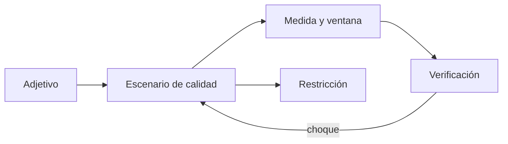
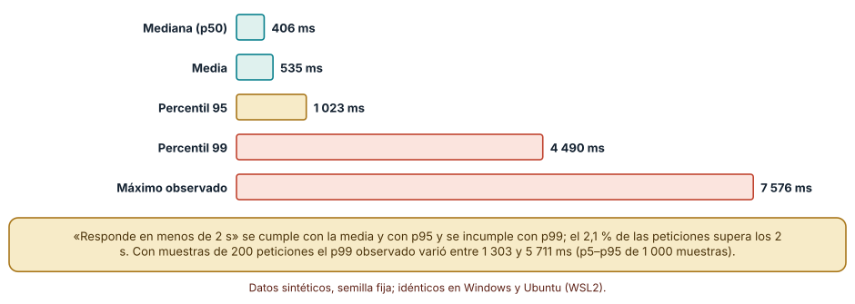
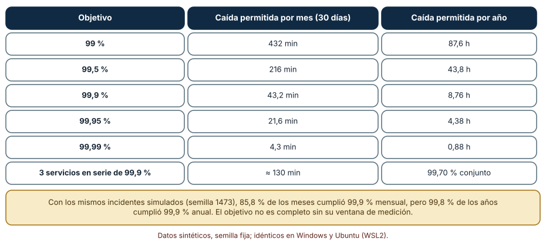
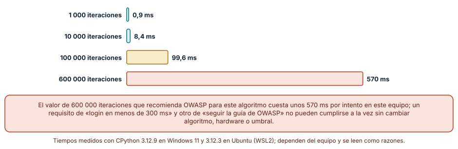

# SE-147 — Atributos de calidad y restricciones

[← SE-146 — Requisitos funcionales y reglas de negocio](../../classes/part-12-ingenieria-de-requisitos/se-146-requisitos-funcionales-y-reglas-de-negocio/README.md) · [↑ Parte 12](../../classes/part-12-ingenieria-de-requisitos/README.md) · [📚 Índice completo](../../classes/README.md) · [🌐 Portal](../../site/classes/SE-147.html) · [SE-148 — Casos de uso, historias y job stories →](../../classes/part-12-ingenieria-de-requisitos/se-148-casos-de-uso-historias-y-job-stories/README.md)

## Punto profesional y fundamento pedagógico

**Punto profesional.** La clase existe para convertir adjetivos como «rápido», «disponible» o «seguro» en afirmaciones con medida, ventana y método de comprobación, y para ver a tiempo cuándo dos de ellas no pueden cumplirse a la vez.

**Por qué aparece aquí.** Se sitúa después de **Requisitos funcionales y reglas de negocio** y antes de **Casos de uso, historias y job stories**: `SE-146` fijó qué hace el sistema y con qué reglas; esta clase fija con qué calidad lo hace y bajo qué restricciones. Deja escenarios de calidad que `SE-149` convertirá en criterios de aceptación y que `SE-152` cruzará con requisitos de seguridad y datos.

**Error conceptual que debe corregir.** Creer que «responde en menos de 2 segundos» o «99,9 % de disponibilidad» son requisitos completos, cuando cada una admite lecturas que dan veredictos opuestos sobre el mismo sistema.

**Secuencia de aprendizaje.** Antes de leer la solución, predices si una latencia con media de 535 ms cumple «menos de 2 s»; después calculas media, percentiles y variabilidad de la estimación, explicas por qué los veredictos difieren, mides un costo de seguridad y reconstruyes sin apoyo un escenario de calidad completo. La secuencia usa predicción, explicación propia, contraste y recuperación. [ICAP](https://icap.education.asu.edu/research) distingue participación de construcción de conocimiento; [How People Learn II](https://nap.nationalacademies.org/catalog/24783/how-people-learn-ii-learners-contexts-and-cultures) exige conectar conocimiento previo, contexto y transferencia; la [práctica de recuperación](https://pubmed.ncbi.nlm.nih.gov/16507066/) respalda producir de nuevo la explicación tras una demora; y [Education for Life and Work](https://nap.nationalacademies.org/resource/13398/dbasse_084153.pdf) exige devolución que explique la causa del error.

**Evidencia de aprendizaje.** `quality-scenarios.md` con tres escenarios de calidad completos (fuente, estímulo, entorno, respuesta y medida con percentil y ventana), una tabla de conflicto entre dos atributos con el valor medido y una restricción separada de los requisitos. Debe contener predicción previa, observación, explicación causal, contraejemplo, criterio de aceptación y una nota de qué dato haría cambiar la conclusión.

**Límite de la conclusión.** Las latencias son una mezcla sintética (lognormal más una cola lenta del 2 %) y los incidentes son sorteos con semilla; los tiempos de PBKDF2 son de un equipo concreto y una sola corrida. No se midió ningún sistema real de entregas.

### Trazabilidad fuente → afirmación

| Fuente primaria u oficial | Afirmación que respalda | Lo que no prueba |
|---|---|---|
| [ISO/IEC 25010:2023](https://www.iso.org/standard/78176.html) | Define un modelo de características de calidad del producto (rendimiento, fiabilidad, seguridad, usabilidad, mantenibilidad, entre otras). | No dice qué valores exigir a un sistema concreto. |
| [Google SRE: Service Level Objectives](https://sre.google/sre-book/service-level-objectives/) | Recomienda expresar objetivos con percentiles y ventanas de medición, y distingue indicador, objetivo y acuerdo. | No fija los percentiles correctos para tu servicio. |
| [Google SRE: Embracing Risk](https://sre.google/sre-book/embracing-risk/) | Relaciona un objetivo de disponibilidad con el tiempo de caída permitido y con el costo de lograrlo. | No es un requisito legal. |
| [OWASP Password Storage Cheat Sheet](https://cheatsheetseries.owasp.org/cheatsheets/Password_Storage_Cheat_Sheet.html) | Recomienda 600 000 iteraciones para PBKDF2-HMAC-SHA256 cuando se usa ese algoritmo. | La cifra evoluciona con el hardware; verifica la versión vigente. |
| [Python: hashlib.pbkdf2_hmac](https://docs.python.org/3/library/hashlib.html#hashlib.pbkdf2_hmac) | Describe la función usada para medir el costo de la derivación. | No define cuántas iteraciones usar. |
| Bass, Clements y Kazman, *Software Architecture in Practice*, 4.ª ed. (ISBN 978-0136886099) | Presenta el escenario de calidad (fuente, estímulo, artefacto, entorno, respuesta, medida de respuesta). | No sustituye la medición en el sistema. |

## Antes de empezar

Retomas el requisito conductor de la Parte 12: recuperar borradores cuando la sesión expira. `SE-146` dejó qué hace; ahora la estudiante espera que el borrador reaparezca «rápido», que el servicio esté «siempre disponible» y que sus datos estén «seguros». Recupera lo aprendido: un adjetivo sin criterio no se verifica. La pregunta activa es: **¿qué número, con qué estadístico, en qué ventana y medido de qué manera hace verificable cada adjetivo, y cuál de ellos cede si chocan?**

## Prerrequisitos

- Haber completado `SE-146` o poder explicar la diferencia entre requisito funcional y regla de negocio.
- Python 3.11 o posterior; los tiempos se leen como razones.
- Trabajar solo con latencias, incidentes y contraseñas sintéticas.

## Problema auténtico

El pliego dice: «el sistema debe responder en menos de 2 segundos, estar disponible el 99,9 % del tiempo y almacenar las contraseñas de forma segura». Tres personas lo implementan. El tablero muestra una latencia media de 535 ms y el equipo celebra; los estudiantes siguen quejándose de esperas de 5 segundos. El monitor reporta 99,9 % anual y aun así hubo un mes con 90 minutos de caída. Y el login tarda medio segundo desde que se endureció el hash.

## Objetivos observables

Al terminar podrás:

1. distinguir un atributo de calidad, un escenario de calidad y una restricción con un ejemplo y un contraejemplo de la plataforma;
2. decidir qué estadístico (media, percentil, máximo) hace verificable un requisito de tiempo y cuánta variabilidad tiene su estimación;
3. convertir un objetivo de disponibilidad en minutos de caída permitidos, componerlo en serie y fijar su ventana;
4. medir el costo de un requisito de seguridad y detectar su choque con uno de rendimiento;
5. separar restricciones (decididas fuera del equipo) de requisitos (negociables).

## Mapa conceptual



El mapa se lee de izquierda a derecha como una concreción: un adjetivo se vuelve un escenario, el escenario recibe una medida con ventana y la medida se verifica. Las restricciones se separan porque no se negocian al mismo nivel; el retorno indica que el choque entre dos atributos obliga a reescribir el escenario, no a ocultarlo.

## Temas y por qué importan

| Tema | Por qué cambia una decisión profesional | Evidencia mínima |
|---|---|---|
| Atributos de calidad | Nombran las dimensiones de la calidad (rendimiento, fiabilidad, seguridad) que el cliente suele pedir con una palabra. | Predicción, traza causal y contraejemplo de **Atributos de calidad** en `quality-scenarios.md` |
| Escenarios de calidad | Convierten un adjetivo en fuente, estímulo, entorno, respuesta y medida. | Predicción, traza causal y contraejemplo de **Escenarios de calidad** en `quality-scenarios.md` |
| Medidas y ventanas | Un objetivo sin estadístico ni ventana admite veredictos opuestos. | Predicción, traza causal y contraejemplo de **Medidas y ventanas** en `quality-scenarios.md` |
| Restricciones | Limitan el espacio de diseño y no se negocian como un requisito. | Predicción, traza causal y contraejemplo de **Restricciones** en `quality-scenarios.md` |
| Compromisos entre atributos | Mejorar uno suele costar otro; decidirlo a tiempo evita descubrirlo en producción. | Predicción, traza causal y contraejemplo de **Compromisos entre atributos** en `quality-scenarios.md` |

## Conceptos y decisiones

### 1. Atributos de calidad

Un atributo de calidad es una propiedad del sistema que importa más allá de lo que hace: cuán rápido, cuán seguro, cuán fácil de cambiar. ISO/IEC 25010 ofrece un vocabulario común (rendimiento, fiabilidad, seguridad, usabilidad, mantenibilidad, portabilidad y otros), útil como lista de preguntas para no olvidar dimensiones. No decide por sí misma cuáles importan: una plataforma de entregas de tareas que se usa dos veces al día no necesita el mismo nivel de disponibilidad que un servicio de emergencias.

### 2. Escenarios de calidad

Un escenario de calidad es una frase estructurada con seis partes: fuente del estímulo, estímulo, artefacto, entorno, respuesta y medida de la respuesta. «Cuando una estudiante (fuente) abre su borrador (estímulo) en la aplicación web (artefacto) con 200 usuarios activos (entorno), el sistema lo muestra (respuesta) en menos de 1,5 s en el percentil 95 de las aperturas diarias (medida)». Cada parte elimina una lectura: sin entorno no se sabe con qué carga; sin percentil no se sabe qué fracción de aperturas debe cumplir.

### 3. Medidas y ventanas

Una medida sin estadístico es ambigua porque distribuciones distintas dan resúmenes distintos: la media esconde la cola, el máximo depende de una sola petición, el percentil 99 de una muestra pequeña es inestable. Una medida sin ventana es igual de ambigua: 99,9 % «de disponibilidad» puede ser mensual, trimestral o anual, y cada ventana tolera una caída continua diferente. Escribe siempre el estadístico, la población sobre la que se calcula (¿todas las peticiones o solo las exitosas?), la ventana y el método de medición.

### 4. Restricciones

Una restricción es una condición impuesta que el equipo no puede cambiar: debe usarse el servidor de identidad de la universidad, los datos no salen de un país, el sistema corre en una versión de navegador. Se separan de los requisitos porque su tratamiento es otro: no se prioriza, se cumple, y su origen es una decisión externa que hay que registrar. Una restricción mal identificada es un requisito negociable que nadie negocia o, peor, un requisito que se negoció cuando no se podía.

### 5. Compromisos entre atributos

Casi todo atributo cuesta otro. Una derivación de contraseña más costosa protege mejor frente a un ataque de fuerza bruta y hace más lento cada acceso legítimo. Más réplicas aumentan la disponibilidad y el costo de consistencia. Un requisito de calidad aislado es una promesa sin precio; la especificación debe mostrar con qué otro atributo compite y quién decide cuál cede. Descubrir el choque en la redacción cuesta una conversación; descubrirlo en producción cuesta un incidente.

### La media cumple, el percentil 99 no

Se generaron 100 000 latencias sintéticas con semilla 147: una lognormal con mediana de 400 ms y σ = 0,5, más una cola lenta que añade entre 2 y 6 segundos al 2 % de las peticiones. Predicción antes de ejecutar: la media estará lejos de los 2 segundos, y el veredicto de «menos de 2 s» cambiará según el estadístico.

```python
lat = []
for _ in range(100_000):
    t = rng.lognormvariate(math.log(400), 0.5)
    if rng.random() < 0.02:
        t += rng.uniform(2000, 6000)
    lat.append(t)
lat.sort()
p99 = lat[int(0.99 * len(lat)) - 1]
```

Resultado, idéntico en Windows (CPython 3.12.9) y en Ubuntu bajo WSL2 (3.12.3): mediana 406 ms, media 535, percentil 95 1 023, percentil 99 4 490 y máximo 7 576. El 97,9 % de las peticiones tarda menos de 2 s. Con «media < 2 s» el sistema cumple; con «p95 < 2 s» cumple; con «p99 < 2 s» incumple; con «todas < 2 s» incumple. Cuatro lecturas del mismo requisito dan dos veredictos. Además, con muestras de 200 peticiones, el p99 observado osciló entre 1 303 ms (percentil 5 de 1 000 muestras) y 5 711 ms (percentil 95): una medición corta no puede verificar un p99.



**Cómo leer la figura.** Cada barra es un resumen de las mismas 100 000 latencias; las verdes cumplen el umbral de 2 s y las coral lo incumplen. **Dónde deja de valer:** la cola del 2 % es un supuesto del autor; un sistema real puede tener colas de otra forma, por reintentos, recolección de basura o red. El experimento enseña que el estadístico forma parte del requisito, no qué estadístico corresponde a tu servicio.

### Disponibilidad: minutos, series y ventanas

Un objetivo de disponibilidad es una cuenta: caída permitida = (1 − objetivo) × ventana. Con 30 días, 99 % permite 432 minutos; 99,5 %, 216; 99,9 %, 43,2; 99,95 %, 21,6; 99,99 %, 4,3. En un año, 99,9 % permite 8,76 horas. Tres servicios en serie, cada uno con 99,9 %, dan 0,999³ = 99,70 % (unos 130 minutos mensuales); dos réplicas independientes de 99 % en paralelo dan 99,99 %, pero solo si los fallos son independientes. Predicción para el siguiente cálculo: los mismos incidentes cumplirán más a menudo el objetivo anual que el mensual.

```python
meses = [0.0] * 12
for _ in range(incidentes):
    meses[rng.randrange(12)] += rng.expovariate(1 / 20)   # media 20 min
cumple_mes = sum(m <= 43.2 for m in meses)
cumple_anio = sum(meses) <= 525.6
```

En 2 000 años simulados (aproximadamente 10,8 incidentes por año, duración media de 20 minutos, semilla 1473), el 85,8 % de los meses cumplió 99,9 % mensual y el 99,8 % de los años cumplió 99,9 % anual. El mismo comportamiento del sistema produce 14,2 % de meses fuera de objetivo y casi ningún año fuera. Un requisito que dice «99,9 %» sin ventana no dice cuál de los dos números quiere que se informe.



**Cómo leer la figura.** Cada fila convierte un porcentaje en minutos mensuales y horas anuales; la última muestra la composición en serie. **Dónde deja de valer:** la composición supone fallos independientes y dependencias en serie estricta; si hay reintentos, caché o degradación, la cuenta cambia. Los incidentes son sorteos, no la historia de un sistema.

### Seguridad frente a rendimiento: PBKDF2 medido

La guía de OWASP recomienda 600 000 iteraciones para PBKDF2-HMAC-SHA256. Medimos cuánto cuesta una verificación con `hashlib.pbkdf2_hmac` para 1 000, 10 000, 100 000 y 600 000 iteraciones. Predicción: el tiempo crece casi linealmente con las iteraciones y 600 000 chocará con un presupuesto de login de 300 ms.

```python
t = time.perf_counter()
for _ in range(3):
    hashlib.pbkdf2_hmac("sha256", clave, sal, iteraciones)
ms = (time.perf_counter() - t) / 3 * 1000
```

Resultado en una corrida (los tiempos dependen del equipo): Windows 11, 0,9 ms, 8,4 ms, 99,6 ms y 570 ms; Ubuntu bajo WSL2, 0,7 ms, 10,4 ms, 85,8 ms y 544 ms. Linealidad aproximada a partir de 10 000. Con 600 000 iteraciones un acceso cuesta más de medio segundo de CPU: un requisito de «login en menos de 300 ms» y otro de «seguir la guía vigente de OWASP para PBKDF2» no pueden cumplirse con este algoritmo y este equipo. La salida honesta es una decisión explícita: cambiar el umbral, cambiar el algoritmo (la propia guía prefiere otros), mover el costo a un proceso o aceptar el riesgo con su responsable.



**Cómo leer la figura.** La longitud de cada barra es el tiempo medido en Windows; la barra coral supera el presupuesto de 300 ms. **Dónde deja de valer:** una sola corrida en un equipo, sin carga concurrente ni hardware especializado; en un servidor con otra CPU el valor cambia pero la relación lineal con las iteraciones se mantiene. La cifra de OWASP puede actualizarse: verifica la guía vigente al decidir.

## Definiciones de trabajo

- **atributos de calidad:** propiedades del sistema, distintas de su función, como rendimiento, fiabilidad, seguridad o mantenibilidad.
- **escenarios de calidad:** formulación estructurada de un atributo con fuente, estímulo, artefacto, entorno, respuesta y medida.
- **medidas y ventanas:** estadístico, población y periodo sobre los que se evalúa el cumplimiento de un escenario.
- **restricciones:** condiciones impuestas fuera del equipo que limitan el diseño y no se negocian como requisitos.
- **compromisos entre atributos:** relaciones en las que mejorar un atributo cuesta otro.

Las definiciones son operativas para la plataforma de entregas. No convierten términos con una historia más amplia en sinónimos y deben contrastarse con la documentación primaria enlazada al final.

## Ejemplo mínimo

El fragmento siguiente calcula tres estadísticos de la misma lista. Antes de ejecutarlo, predice cuáles cumplen el umbral.

```python
lat = [300] * 98 + [4000, 5000]
lat.sort()
media = sum(lat) / len(lat)          # 384 ms
p95 = lat[int(0.95 * len(lat)) - 1]  # 300 ms
maximo = lat[-1]                     # 5000 ms
assert media < 2000 and p95 < 2000 and maximo > 2000
```

El 2 % de las peticiones tarda 4 segundos o más y la media dice 384 ms. Registra versión del intérprete, comando y salida. La conclusión no es «usa siempre el máximo» sino «el requisito debe decir qué fracción de peticiones debe cumplir».

## Ejemplo profesional

Tres escenarios de calidad del requisito conductor, escritos de forma verificable:

```text
QA-01  Cuando una estudiante abre un borrador recuperado con 200 usuarios activos, el sistema lo muestra en 1500 ms o menos en el percentil 95 de las aperturas de cada día. Medición: registro del servidor, excluye aperturas sin sesión válida.
QA-02  La ruta de entrega estará disponible al menos el 99,5 % de los minutos de cada mes calendario (216 min de caída permitidos). Medición: sonda sintética cada minuto desde un punto externo.
QA-03  El borrador se cifra en reposo con una clave gestionada; un acceso de lectura cuesta como máximo 50 ms adicionales en el percentil 95.
RESTR-01  El inicio de sesión usa el servicio de identidad institucional (decisión de TI, 2026-02).
```

Compara con el caso de la sonda que mide solo desde dentro de la red, con el mes con una sola caída larga, con los reintentos del navegador que enmascaran fallos y con el requisito que fija un percentil sin muestra suficiente. El escenario es apropiado cuando otra persona puede escribir la prueba sin preguntar; es peligroso cuando la medida es una impresión.

## Práctica guiada

1. Escribe los tres adjetivos del pliego («rápido», «disponible», «seguro») tal como los dijo el cliente.
2. Predice qué estadístico cumpliría cada uno con una latencia que te inventes.
3. Genera 100 000 latencias con la semilla 147 y calcula media y percentiles; guarda la salida bajo `evidence/`.
4. Reescribe cada adjetivo como un escenario de seis partes con medida y ventana.
5. Convierte el objetivo de disponibilidad en minutos mensuales y anuales y compón dos servicios en serie.
6. Mide PBKDF2 con tres valores de iteración en tu equipo y compara con el presupuesto del escenario.
7. Pide a otra persona que escriba una prueba para QA-01 sin consultarte.

## Ejercicios

1. **Estadístico:** cambia la cola lenta del 2 % al 0,5 % y calcula qué estadísticos cumplen «menos de 2 s».
2. **Ventana:** repite la simulación de incidentes con ventanas semanales y explica cómo cambia la fracción que cumple.
3. **Choque:** propón un valor de iteraciones que cumpla un presupuesto de 300 ms en tu equipo y redacta la decisión de riesgo.
4. **Restricción:** distingue entre tres frases del pliego cuáles son restricciones y cuáles requisitos negociables, con el origen de cada una.

## Reto verificable

Entrega `quality-scenarios.md` con tres escenarios de calidad, la tabla de estadísticos de tu simulación, el cálculo de disponibilidad con su ventana y una decisión explícita sobre el choque medido. Se aprueba si otra persona ejecuta el código desde un checkout limpio, obtiene los mismos estadísticos con la misma semilla y puede señalar qué cambio de ventana alteraría el veredicto. No se aprueba por usar números redondos ni por repetir los de la guía.

## Caso conductor

La plataforma de entregas sigue siendo el caso de la parte. Esta clase añade al expediente tres escenarios de calidad, una restricción y la constancia del choque entre seguridad y rendimiento. Las clases siguientes preguntarán cómo cuenta la historia una persona real (`SE-148`), con qué ejemplos se acepta (`SE-149`) y qué cede cuando no cabe todo (`SE-150`). Cambia después una sola decisión —por ejemplo, el percentil de QA-01 de p95 a p99— y revisa qué mediciones deben repetirse.

## Preguntas frecuentes

### ¿Por qué no usar siempre el máximo, que es lo más estricto?

Porque depende de una sola petición y casi nunca puede garantizarse. Un máximo exige que ningún evento raro (una recolección de basura, una red caída un segundo) ocurra jamás. Un percentil alto acompañado de un presupuesto de errores expresa una promesa que se puede cumplir y comprobar.

### ¿Cuántas peticiones necesito para verificar un p99?

Muchas más de 100. Con 200 peticiones el p99 observado varió entre 1 303 y 5 711 ms en el experimento, porque solo dos peticiones caen por encima. Un p99 se estima con miles de muestras, o se verifica con un test que cuente cuántas peticiones superan el umbral y decida con un intervalo.

### ¿La disponibilidad se mide con «el sistema responde» o con «la función funciona»?

Depende de lo que prometa el requisito. Un servicio que responde 200 y devuelve un error en el cuerpo está «arriba» y no funciona. Define el indicador: peticiones válidas que reciben una respuesta correcta en el tiempo establecido, medidas desde un punto que la persona usuaria pudiera ocupar.

### ¿Un modelo de lenguaje puede proponer los umbrales?

Puede proponer valores típicos, pero no tu contexto. Trata cada número como hipótesis con un dato que lo respalde (uso real, tolerancia de las personas, costo) y con una persona responsable; un umbral copiado de otro sistema es una decisión que nadie tomó.

## Fallo controlado y diagnóstico

Reproduce el fallo clásico de la clase: **dar por cumplido un requisito de tiempo porque la media está bien**. Con las 100 000 latencias, declara «cumple: media 535 ms < 2 s» y compara con el recuento de peticiones que superan los 2 s.

Registra síntoma, entrada mínima, hipótesis, observación que descarta cada hipótesis, causa, corrección y prueba de regresión. **Síntoma:** el tablero está verde y 2,1 % de las estudiantes reporta esperas largas. **Hipótesis rivales:** (a) los reportes son exageraciones; (b) la media oculta una cola. **Prueba:** cuenta peticiones por encima de 2 s: 2 101 de 100 000 (2,1 %), todas del tramo lento. **Conclusión:** el requisito no declaraba qué fracción debía cumplir. **Regresión:** exige que cada requisito de tiempo nombre un percentil y que la prueba de aceptación calcule ese percentil sobre al menos 1 000 muestras. No cambies a la vez el umbral y el estadístico.

## Errores comunes y cómo corregirlos

| Síntoma | Causa probable | Corrección |
|---|---|---|
| El tablero está verde y la gente se queja | El objetivo usa la media y la cola concentra el daño | Fijar percentil y fracción de peticiones, y vigilar la cola |
| Se cumple el 99,9 % anual con un mes catastrófico | La ventana anual diluye una caída larga | Declarar la ventana (mensual) o añadir un tope de caída continua |
| Dos requisitos de calidad no pueden cumplirse a la vez | El choque no se midió ni se redactó | Medir el costo, escribir el choque y asignar quién decide cuál cede |
| Una restricción se discute como un requisito más | No se identificó su origen externo | Registrar origen, fecha y quién puede cambiarla |
| La prueba de p99 es inestable entre ejecuciones | Muestra demasiado pequeña | Aumentar la muestra o expresar el criterio como un conteo con intervalo |

## Entorno y archivos clave

```text
work/SE-147/
├── README.md
├── calidad/
│   ├── latencia.py
│   ├── disponibilidad.py
│   └── pbkdf2.py
├── fixtures/escenarios.csv
├── tests/test_calidad.py
└── evidence/quality-scenarios.md
```

El `README` declara plataforma, versión de Python, semilla y comandos. Los experimentos usan `random`, `math`, `statistics`, `hashlib` y `time` y se ejecutaron con CPython 3.12.9 en Windows 11 y 3.12.3 en Ubuntu bajo WSL2; las salidas deterministas fueron idénticas y los tiempos de PBKDF2 difirieron por equipo. Si añades una dependencia, fija procedencia y versión.

## Seguridad, ética y accesibilidad

- un requisito de rendimiento puede excluir a quien usa conexiones lentas o dispositivos antiguos: declara el entorno de referencia;
- reducir el costo de la derivación de contraseñas para cumplir un tiempo de login es una decisión de riesgo, no un detalle técnico: regístrala con su responsable;
- no pruebes con contraseñas reales ni con cuentas de personas; usa valores sintéticos;
- incluye requisitos de accesibilidad (por ejemplo, conformidad con WCAG 2.2 nivel AA) como atributos verificables, no como deseos;
- no uses un modelo de lenguaje con registros de producción sin una política de datos que lo permita;
- respeta licencias de guías y atribuye adaptaciones.

## Puente hacia el trabajo con agentes

Un agente al que se le pide «agrega requisitos no funcionales al documento» devolverá una lista de adjetivos con cifras redondas («99,9 %», «menos de 2 s») sin percentil, ventana ni método. Pídele en cambio que escriba cada requisito como escenario de seis partes, que declare el estadístico y la población, que calcule los minutos de caída permitidos para cada ventana y que señale pares de atributos que compiten. Revisa especialmente si copia una cifra de una guía sin indicar su versión: es una decisión de riesgo disfrazada de dato.

## Transferencia

Traslada el análisis a otro dominio (por ejemplo, una app de pedidos): cambia el tipo de cola lenta y la carga, conserva el estadístico y la ventana en cada escenario y comprueba si el veredicto de la media y el del percentil siguen divergiendo. La transferencia está lograda cuando puedes explicar qué parte del método dependía del dominio y cuál no, no cuando el código se parece.

## Evaluación y evidencia

| Criterio | Evidencia para aprobar |
|---|---|
| comprensión | explicación causal de la diferencia entre atributo, escenario y restricción, con ejemplo y contraejemplo |
| corrección | estadísticos, minutos de caída y tiempos de derivación reproducibles |
| diseño | escenarios de seis partes con medida, población y ventana |
| diagnóstico | reproducción del fallo «la media cumple» con regresión |
| incertidumbre | variabilidad del p99 con muestras pequeñas y declaración del equipo de medición |
| reproducibilidad | versiones, comandos, salida y límites declarados |

## Fuentes

- [ISO/IEC 25010:2023](https://www.iso.org/standard/78176.html) — modelo de calidad del producto; autoridad: ISO e IEC.
- [Google SRE: Service Level Objectives](https://sre.google/sre-book/service-level-objectives/) — indicadores, objetivos, percentiles y ventanas; autoridad: Google.
- [Google SRE: Embracing Risk](https://sre.google/sre-book/embracing-risk/) — relación entre disponibilidad, riesgo y costo; autoridad: Google.
- [OWASP Password Storage Cheat Sheet](https://cheatsheetseries.owasp.org/cheatsheets/Password_Storage_Cheat_Sheet.html) — parámetros recomendados para almacenar contraseñas; autoridad: OWASP.
- [NIST SP 800-63B](https://pages.nist.gov/800-63-3/sp800-63b.html) — requisitos de autenticación y almacenamiento de secretos memorizados; autoridad: NIST.
- [WCAG 2.2](https://www.w3.org/TR/WCAG22/) — criterios de accesibilidad verificables; autoridad: W3C.
- Bass, Clements y Kazman, *Software Architecture in Practice*, 4.ª ed. (ISBN 978-0136886099) — escenarios de calidad; autoridad: libro de referencia.

Cada fuente respalda el mecanismo indicado; ninguna demuestra que los valores elegidos para la plataforma de entregas sean los adecuados. Esa afirmación depende de la carga real, de la tolerancia de las personas y de la revisión de otra persona.

- [Python: `hashlib.pbkdf2_hmac`](https://docs.python.org/3/library/hashlib.html#hashlib.pbkdf2_hmac) — función medida en el experimento.
- [Python: `random`](https://docs.python.org/3/library/random.html) — generador con semilla y distribuciones usadas.
- [Python: `statistics`](https://docs.python.org/3/library/statistics.html) — media y funciones de resumen.

## Límites y siguiente paso

Se ejecutaron tres experimentos con datos sintéticos en Windows y Ubuntu (WSL2): los dos primeros con salidas idénticas y el tercero con tiempos propios de cada equipo. No se midió ningún sistema real, la cola lenta y los incidentes son supuestos y el costo de PBKDF2 corresponde a una corrida. La siguiente clase cuenta los requisitos desde la perspectiva de quien los usa: casos de uso, historias y job stories.

## Glosario

- **atributos de calidad:** propiedades del sistema, distintas de su función, como rendimiento, fiabilidad, seguridad o mantenibilidad.
- **escenarios de calidad:** formulación estructurada de un atributo con fuente, estímulo, artefacto, entorno, respuesta y medida.
- **medidas y ventanas:** estadístico, población y periodo sobre los que se evalúa el cumplimiento de un escenario.
- **restricciones:** condiciones impuestas fuera del equipo que limitan el diseño y no se negocian como requisitos.
- **compromisos entre atributos:** relaciones en las que mejorar un atributo cuesta otro.

---

[← SE-146 — Requisitos funcionales y reglas de negocio](../../classes/part-12-ingenieria-de-requisitos/se-146-requisitos-funcionales-y-reglas-de-negocio/README.md) · [↑ Parte 12](../../classes/part-12-ingenieria-de-requisitos/README.md) · [📚 Índice completo](../../classes/README.md) · [🌐 Portal](../../site/classes/SE-147.html) · [SE-148 — Casos de uso, historias y job stories →](../../classes/part-12-ingenieria-de-requisitos/se-148-casos-de-uso-historias-y-job-stories/README.md)
