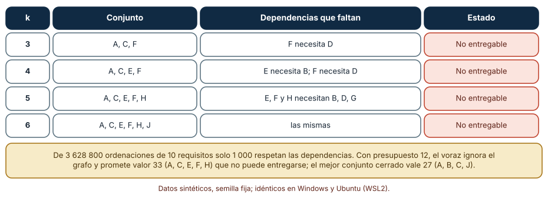
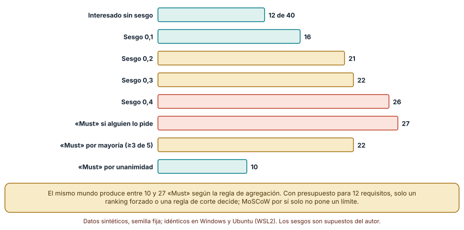
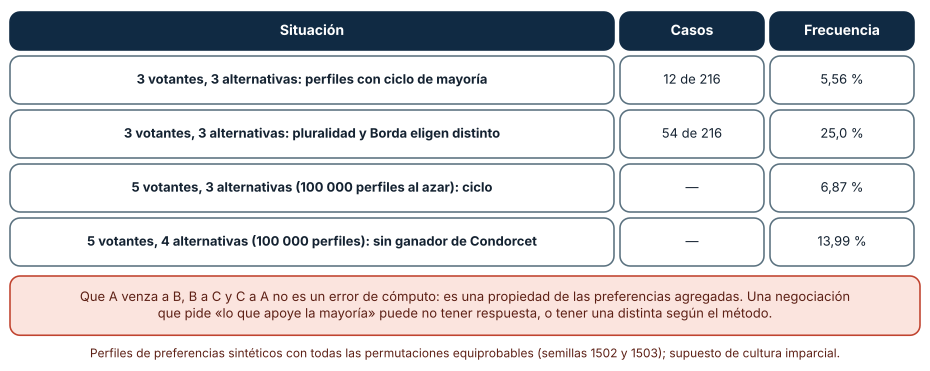

# SE-150 — Priorización, dependencias y negociación

[← SE-149 — Criterios de aceptación y ejemplos](../../classes/part-12-ingenieria-de-requisitos/se-149-criterios-de-aceptacion-y-ejemplos/README.md) · [↑ Parte 12](../../classes/part-12-ingenieria-de-requisitos/README.md) · [📚 Índice completo](../../classes/README.md) · [🌐 Portal](../../site/classes/SE-150.html) · [SE-151 — Trazabilidad desde necesidad hasta evidencia →](../../classes/part-12-ingenieria-de-requisitos/se-151-trazabilidad-desde-necesidad-hasta-evidencia/README.md)

## Punto profesional y fundamento pedagógico

**Punto profesional.** La clase existe para que decidir qué se hace primero deje de ser una votación de volumen y pase a respetar lo que ya se sabe de las dependencias, de los límites de cada método de priorización y de la forma en que un grupo decide.

**Por qué aparece aquí.** Se sitúa después de **Criterios de aceptación y ejemplos** y antes de **Trazabilidad desde necesidad hasta evidencia**: `SE-149` dejó historias con criterios; esta clase las ordena dentro de un presupuesto y entre personas que quieren cosas distintas, y deja un orden defendible que `SE-151` enlazará con su origen y `SE-153` protegerá como línea base.

**Error conceptual que debe corregir.** Creer que ordenar por valor sobre costo, o marcar «Must», produce un plan ejecutable, y que una mayoría siempre existe.

**Secuencia de aprendizaje.** Antes de leer el resultado, predices si los primeros k por valor/costo forman un conjunto entregable, cuántos requisitos terminarán marcados «Must» según la regla de agregación y con qué frecuencia una mayoría produce un ciclo; después calculas, explicas cada resultado, comparas reglas y reconstruyes sin apoyo el orden de entrega de un conjunto con dependencias. La secuencia usa predicción, explicación propia, contraste y recuperación. [ICAP](https://icap.education.asu.edu/research) distingue participación de construcción de conocimiento; [How People Learn II](https://nap.nationalacademies.org/catalog/24783/how-people-learn-ii-learners-contexts-and-cultures) exige conectar conocimiento previo, contexto y transferencia; la [práctica de recuperación](https://pubmed.ncbi.nlm.nih.gov/16507066/) respalda producir de nuevo la explicación tras una demora; y [Education for Life and Work](https://nap.nationalacademies.org/resource/13398/dbasse_084153.pdf) exige devolución que explique la causa del error.

**Evidencia de aprendizaje.** `priorities.md` con diez requisitos, su valor, su costo y sus dependencias; el grafo de dependencias; el conjunto óptimo bajo un presupuesto declarado; la clasificación MoSCoW con la regla de agregación; y el registro de una negociación con los intereses detrás de cada posición. Debe contener predicción previa, observación, explicación causal, contraejemplo, criterio de aceptación y una nota de qué dato haría cambiar la conclusión.

**Límite de la conclusión.** Los valores, costos, dependencias, sesgos y perfiles de preferencias son sintéticos o supuestos del autor. Las frecuencias de ciclos suponen que todas las preferencias son igual de probables, lo que en un grupo real casi nunca ocurre.

### Trazabilidad fuente → afirmación

| Fuente primaria u oficial | Afirmación que respalda | Lo que no prueba |
|---|---|---|
| [Karlsson y Ryan, «A cost-value approach for prioritizing requirements» (1997)](https://doi.org/10.1109/52.605933) | Propone comparar requisitos por pares en valor y costo relativos y ordenar por la relación entre ambos. | No considera las dependencias entre requisitos. |
| Reinertsen, *The Principles of Product Development Flow* (ISBN 978-1935401001) | Argumenta que el orden óptimo depende del costo del retraso y de la duración de cada trabajo. | Sus cifras de ejemplo no se transfieren a otro contexto. |
| Fisher, Ury y Patton, *Getting to Yes* (ISBN 978-0143118756) | Distingue posiciones de intereses y propone negociar sobre estos últimos. | No garantiza que exista un acuerdo. |
| [Stanford Encyclopedia of Philosophy: Voting Methods](https://plato.stanford.edu/entries/voting-methods/) | Explica la paradoja de Condorcet y que distintos métodos de votación pueden elegir resultados diferentes. | No dice qué método usar en un equipo. |
| [Python: functools.lru_cache](https://docs.python.org/3/library/functools.html#functools.lru_cache) | Describe la memoización usada para contar órdenes válidos. | No es un algoritmo de priorización. |
| [Python: itertools](https://docs.python.org/3/library/itertools.html) | Ofrece permutaciones y producto para enumerar perfiles de preferencias. | No modela preferencias reales. |

## Antes de empezar

Retomas las cinco historias de `SE-148`, ahora con criterios (`SE-149`), y las amplías a diez requisitos para el trimestre. Hay presupuesto para once o doce unidades de esfuerzo. Recupera lo aprendido en `SE-128` (Parte 10): un ranking por fórmula es una regla cuya robustez se mide. La pregunta activa es: **¿qué conjunto de requisitos puede entregarse de verdad con este presupuesto, y cómo se decide cuando quienes deciden quieren cosas incompatibles?**

## Prerrequisitos

- Haber completado `SE-149` o poder explicar qué distingue un criterio de aceptación de un ejemplo.
- Python 3.11 o posterior.
- Trabajar solo con requisitos, valores y votos sintéticos.

## Problema auténtico

El equipo ordena diez requisitos por valor dividido entre costo y toma los primeros cinco. Al planificar descubre que dos de ellos necesitan otros que quedaron fuera. Docencia, Seguridad y Soporte marcan «Must» casi todo. En la reunión, tres personas votan entre tres opciones y la mayoría prefiere A a B, B a C y C a A. Nadie sabe qué hacer, y todas las reglas anteriores parecían razonables.

## Objetivos observables

Al terminar podrás:

1. distinguir valor, costo, riesgo y dependencia con un ejemplo y un contraejemplo de la plataforma;
2. comprobar si un conjunto priorizado es entregable y calcular el mejor conjunto cerrado bajo un presupuesto;
3. medir cómo la regla de agregación cambia el número de «Must»;
4. explicar con un cálculo por qué una mayoría puede no existir y qué método alternativo discrepa;
5. registrar una negociación en términos de intereses, no solo de posiciones.

## Mapa conceptual


El mapa se lee de izquierda a derecha: el valor y el costo dan un primer orden, las dependencias lo corrigen, el resultado es un conjunto entregable y la negociación lo ajusta con las personas. Los retornos indican que un veto o un ciclo de preferencias obliga a volver a reconsiderar valor y costo, y que un requisito faltante obliga a incluirlo o a retirar los que dependen de él.

## Temas y por qué importan

| Tema | Por qué cambia una decisión profesional | Evidencia mínima |
|---|---|---|
| Valor, costo y riesgo | Dan un primer orden y hacen explícitos los supuestos de cada estimación. | Predicción, traza causal y contraejemplo de **Valor, costo y riesgo** en `priorities.md` |
| Dependencias | Un requisito sin sus precondiciones no se puede entregar; el orden por valor las ignora. | Predicción, traza causal y contraejemplo de **Dependencias** en `priorities.md` |
| MoSCoW | Clasifica en Must, Should, Could y Won't, pero sin límite se infla. | Predicción, traza causal y contraejemplo de **MoSCoW** en `priorities.md` |
| Negociación por intereses | Convierte posiciones incompatibles en objetivos que pueden coexistir. | Predicción, traza causal y contraejemplo de **Negociación por intereses** en `priorities.md` |
| Decisión colectiva | Los métodos de votación pueden no tener ganador o discrepar entre sí. | Predicción, traza causal y contraejemplo de **Decisión colectiva** en `priorities.md` |

## Conceptos y decisiones

### 1. Valor, costo y riesgo

El valor es lo que un requisito aporta si se cumple, el costo es lo que consume en esfuerzo y el riesgo es la incertidumbre sobre ambos. Una razón valor/costo ordena muy bien cuando los trabajos son independientes y divisibles; deja de hacerlo cuando hay dependencias, cuando el presupuesto es una mochila de tamaño fijo o cuando el valor depende del orden. Karlsson y Ryan comparan por pares precisamente porque las estimaciones absolutas son poco fiables. Todo número de este paso es una hipótesis con una persona detrás.

### 2. Dependencias

Un requisito depende de otro si no puede entregarse, probarse o usarse sin él. Las dependencias forman un grafo dirigido; si hay un ciclo, los requisitos implicados son en realidad uno solo o están mal separados. Un conjunto es entregable si está cerrado bajo las dependencias: si contiene un requisito, contiene también todo aquello de lo que depende. Ordenar por valor/costo sin comprobar el cierre produce planes que prometen lo que no se puede construir con lo comprometido.

### 3. MoSCoW

MoSCoW clasifica en lo que debe estar (Must), debería (Should), podría (Could) y no estará esta vez (Won't). Es útil para conversar, porque obliga a decir «no» explícitamente. Su debilidad es que no impone un presupuesto: si cada interesado puede marcar Must, la categoría crece hasta cubrir casi todo y deja de ordenar. Las guías de la técnica recomiendan limitar Must a una fracción del esfuerzo disponible; el límite es una decisión del equipo, no una propiedad del método.

### 4. Negociación por intereses

Una posición es lo que alguien pide («retener 730 días»); un interés es por qué lo pide («poder responder a una auditoría de dos años»). Dos posiciones incompatibles pueden tener intereses compatibles: Auditoría necesita demostrar el contenido durante 730 días, Privacidad necesita no tener datos personales más de 365; una copia anonimizada de los metadatos por 730 días satisface a ambos. Negociar sobre intereses expande el conjunto de soluciones; negociar sobre posiciones solo reparte la diferencia.

### 5. Decisión colectiva

Cuando un grupo elige entre tres o más opciones, «la que prefiera la mayoría» puede no existir: la paradoja de Condorcet muestra mayorías cíclicas. Y métodos razonables —pluralidad, recuento de Borda, eliminación sucesiva— pueden elegir ganadores distintos con las mismas preferencias. Un equipo que decide por voto debe declarar el método antes de votar y saber qué hacer si no hay ganador; si no, el método se elegirá después, según quién gane.

### Los k primeros por valor/costo no son un plan

Diez requisitos (A–J) con valores 9, 8, 8, 7, 6, 6, 5, 4, 3, 2 y costos 3, 5, 2, 4, 3, 2, 3, 2, 2, 1, y dependencias: B←A, C←A, D←B,C, E←B, F←D, G←C, H←E,G, I←F. Se ordenan por valor/costo: C, A, F, E, H, J, D, G, B, I. Predicción: algún prefijo de ese orden no será entregable. Con la función de cierre y memoización se cuentan también los órdenes de entrega válidos.

```python
def cerrado(S):
    return all(d in S for r in S for d in dependencias[r])

@lru_cache(None)
def n_ordenes(mascara):
    if mascara == todos:
        return 1
    return sum(n_ordenes(mascara | (1 << i)) for i in range(10)
               if not mascara >> i & 1 and previos[i] & mascara == previos[i])
```

Resultado, idéntico en Windows y Ubuntu: los prefijos de 3, 4, 5 y 6 no son entregables (por ejemplo, el de tres incluye F sin D). De 3 628 800 ordenaciones solo 1 000 respetan las dependencias. Con presupuesto 12, tomar en orden de ratio lo que cabe da A, C, E, F, H con valor 33, que no se puede entregar (E necesita B; F, D; H, G); por fuerza bruta el mejor conjunto cerrado es A, B, C, J con valor 27 y costo 11. El «mejor» según la fórmula vale 33 y no existe; el real vale 27.



**Cómo leer la figura.** Cada fila es un prefijo del orden por valor/costo y las columnas dicen qué dependencias le faltan; todas son «no entregable». **Dónde deja de valer:** valores, costos y dependencias son un ejemplo del autor, y la búsqueda exhaustiva sobre 2^10 subconjuntos es viable solo con pocos requisitos; con cientos se usa programación entera o una heurística que respete el cierre.

### La inflación de «Must»

Cuarenta requisitos con una importancia real aleatoria (semilla 150). Cinco interesados la perciben con ruido (σ = 0,15) y marcan Must si lo percibido supera un umbral de 0,7 menos su sesgo (0, 0,1, 0,2, 0,3 y 0,4), que representa el miedo a quedarse sin algo. Predicción: los Must crecerán con el sesgo y la regla de agregación decidirá si el total se infla.

```python
must = [1 if r + rng.gauss(0, 0.15) > 0.7 - sesgo else 0 for r in importancia]
union = [any(v[i] for v in votos) for i in range(40)]
```

Resultado: sin sesgo 12 Must de 40; con sesgo 0,1, 16; 0,2, 21; 0,3, 22; 0,4, 26. Si basta que alguien lo pida: 27 Must; por mayoría (3 de 5 o más): 22; por unanimidad: 10. El mismo mundo da entre 10 y 27 Must según la regla, y con presupuesto para 12 solo un ranking forzado o un límite explícito decide. Los interesados no mienten: cada uno responde a su percepción y a su costo de perder.



**Cómo leer la figura.** Las cinco primeras barras son cada interesado con su sesgo; las tres últimas son la misma votación agregada con tres reglas. **Dónde deja de valer:** el modelo de percepción, la importancia uniforme y los sesgos son supuestos; no hay medición de personas. Muestra por qué un límite es parte del método, no cuántos Must habrá en un proyecto real.

### Cuando la mayoría no existe

Tres votantes ordenan tres alternativas (X, Y, Z) de todas las maneras posibles: 6³ = 216 perfiles. Predicción: unos pocos perfiles producirán un ciclo, y pluralidad y Borda no siempre coincidirán.

```python
def gana(a, b, perfil):
    return sum(p.index(a) < p.index(b) for p in perfil) >= 2
ciclo = (gana("X","Y") and gana("Y","Z") and gana("Z","X")) or (gana("Y","X") and gana("Z","Y") and gana("X","Z"))
```

Resultado: 12 de 216 perfiles (5,56 %) producen un ciclo de mayoría; en 54 de 216 (25,0 %) los conjuntos ganadores de pluralidad y Borda difieren. Con cinco votantes y tres alternativas, 100 000 perfiles al azar dan 6,87 % de ciclos; con cinco votantes y cuatro alternativas, 13,99 % no tienen un ganador de Condorcet. No es un error del cómputo: A puede vencer a B, B a C y C a A. Un comité que decida por mayoría sin declarar qué hacer si no hay ganador acabará decidiendo por el orden en que se vota.



**Cómo leer la figura.** Cada fila es una situación con el número de casos y su frecuencia; los porcentajes son de perfiles de preferencias equiprobables. **Dónde deja de valer:** las preferencias reales están correlacionadas (la gente de un mismo área vota parecido), y con ellas los ciclos son menos frecuentes; la ausencia de ciclo no prueba que el método sea el correcto, solo que existe un ganador.

## Definiciones de trabajo

- **valor, costo y riesgo:** beneficio que aporta un requisito, esfuerzo que consume e incertidumbre sobre ambos.
- **dependencias:** relaciones por las cuales un requisito no puede entregarse, probarse o usarse sin otro.
- **MoSCoW:** clasificación en Must, Should, Could y Won't para decir qué debe estar, qué debería, qué podría y qué no estará esta vez.
- **negociación por intereses:** acuerdo que parte de las razones de cada posición y no de las posiciones mismas.
- **decisión colectiva:** regla para transformar preferencias de varias personas en una elección del grupo.

Las definiciones son operativas para la plataforma de entregas. No convierten términos con una historia más amplia en sinónimos y deben contrastarse con la documentación primaria enlazada al final.

## Ejemplo mínimo

El fragmento siguiente comprueba si un conjunto está cerrado. Antes de ejecutarlo, predice el resultado.

```python
dependencias = {"A": [], "B": ["A"], "F": ["D"], "D": ["B"]}
def cerrado(S): return all(d in S for r in S for d in dependencias[r])
assert cerrado({"A", "B"}) and not cerrado({"A", "F"})   # F necesita D
```

Un conjunto con F y sin D no se puede entregar, aunque F tenga la mejor razón valor/costo. Registra versión del intérprete, comando y salida. La corrección puede ser incluir D, retirar F o argumentar que la dependencia no existe, pero debe ser una decisión.

## Ejemplo profesional

La priorización del trimestre se registra como una tabla con el orden, la razón y quién decidió:

```text
Presupuesto: 12 unidades.  Regla: conjunto cerrado de mayor valor; Must limitado a 12 de 40.
Seleccionado: R-A, R-B, R-C, R-J (valor 27, costo 11).   Decisión: producto, 2026-03-02.
Excluido con razón: R-H (depende de R-E y R-G, fuera del presupuesto). Revisión: tras el segundo trimestre.
Negociación NEG-04: Auditoría pide 730 días; Privacidad ≤ 365. Interés: poder demostrar el contenido de una entrega por dos años.
                    Acuerdo: conservar metadatos anonimizados 730 días y el contenido 365. Responsable: privacidad.
```

Compara con el caso de un requisito que dos áreas marcan Must con motivos distintos, con un cambio de costo a mitad de trimestre, con una dependencia no declarada y con un empate real. El registro es apropiado cuando otra persona puede reconstruir la decisión; es peligroso cuando solo conserva el orden.

## Práctica guiada

1. Lista diez requisitos con valor, costo y dependencias antes de ordenar nada.
2. Predice qué prefijo del orden por razón deja de ser entregable.
3. Ordena por valor/costo y comprueba el cierre de cada prefijo; guarda la salida bajo `evidence/`.
4. Calcula el mejor conjunto cerrado con presupuesto 12 por fuerza bruta y compáralo con el voraz.
5. Simula cinco interesados con sesgo y compara reglas de agregación; fija un límite de Must.
6. Registra una negociación separando posición e interés de cada parte.
7. Pide a otra persona que reconstruya tu plan solo con `priorities.md`.

## Ejercicios

1. **Dependencias:** añade una dependencia I←J y recalcula el óptimo y el número de órdenes válidos.
2. **Presupuesto:** cambia el presupuesto a 8 y explica qué conjunto óptimo aparece y por qué no es un prefijo del orden por ratio.
3. **Límite:** fija el máximo de Must en 12 y define una regla de desempate; explica a quién perjudica.
4. **Votación:** construye un perfil de tres votantes con ciclo y explica qué regla alternativa usarías y por qué.

## Reto verificable

Entrega `priorities.md` con los diez requisitos, el grafo de dependencias, el conjunto cerrado óptimo con su presupuesto, la clasificación MoSCoW con límite y una negociación registrada por intereses. Se aprueba si otra persona ejecuta el código desde un checkout limpio, obtiene el mismo óptimo y puede señalar qué cambio de costo alteraría el plan. No se aprueba por el orden obtenido ni por declarar un ganador sin indicar la regla.

## Caso conductor

La plataforma de entregas sigue siendo el caso de la parte. Esta clase añade al expediente un conjunto cerrado de requisitos para el trimestre, una clasificación con límite y una negociación registrada. Las clases siguientes enlazarán cada requisito con su necesidad y su prueba (`SE-151`), controlarán los cambios sobre la línea base (`SE-153`) y buscarán contradicciones (`SE-154`). Cambia después una sola decisión —por ejemplo, el presupuesto— y revisa qué requisitos entran o salen.

## Preguntas frecuentes

### ¿Por qué no basta ordenar por valor sobre costo?

Porque esa razón supone trabajos independientes y divisibles. Con dependencias, el prefijo de mayor razón puede no ser entregable, y con un presupuesto fijo el óptimo puede dejar fuera un requisito de buena razón que no cabe junto a otros. La razón es un buen primer filtro, no un plan.

### ¿MoSCoW sirve entonces?

Sirve para conversar y para decir «no» con claridad, siempre que Must tenga un límite. Sin un tope, el 27 de 40 de la simulación es la norma, no la excepción. El tope convierte la clasificación en una decisión de presupuesto y obliga a comparar.

### ¿Qué hago si no hay mayoría?

Decláralo antes: qué método se usará, cómo se desempata y quién tiene la última palabra. Si el grupo ya votó y hay un ciclo, no inventes un ganador: vuelve a los intereses, reduce las alternativas o delega en una persona con responsabilidad explícita.

### ¿Puede un modelo de lenguaje priorizar el backlog?

Puede ordenar según criterios que le des y señalar dependencias evidentes en el texto. No puede conocer las dependencias no escritas ni los intereses de las personas, y su orden se verá objetivo aunque descanse en estimaciones inventadas. Pide que muestre valor, costo y dependencia por requisito y verifica el cierre del conjunto.

## Fallo controlado y diagnóstico

Reproduce el fallo clásico de la clase: **comprometer un conjunto que viola sus dependencias**. Toma el prefijo de cinco por valor/costo y presenta el plan «A, C, E, F, H» como entregable.

Registra síntoma, entrada mínima, hipótesis, observación que descarta cada hipótesis, causa, corrección y prueba de regresión. **Síntoma:** a mitad del trimestre el equipo no puede probar E ni F. **Hipótesis rivales:** (a) las estimaciones eran optimistas; (b) faltan requisitos de los que dependen. **Prueba:** comprueba el cierre del conjunto: E necesita B, F necesita D y H necesita G; ninguno está. **Conclusión:** el plan prometía valor 33 que no podía entregarse; el conjunto cerrado óptimo vale 27. **Regresión:** añade al proceso una comprobación automática de cierre antes de aprobar un plan y una regla de que el presupuesto incluya las dependencias. No cambies a la vez el presupuesto y el conjunto.

## Errores comunes y cómo corregirlos

| Síntoma | Causa probable | Corrección |
|---|---|---|
| El plan aprobado no se puede construir | Se ordenó por valor sin comprobar dependencias | Verificar el cierre del conjunto antes de aprobar |
| Casi todo es «Must» | No hay un límite a la categoría | Fijar un tope como fracción del esfuerzo y desempatar con una regla |
| Dos áreas no se ponen de acuerdo | Se negocian posiciones, no intereses | Registrar el interés de cada parte y buscar una solución que satisfaga ambos |
| El voto cambia con el orden de las opciones | La mayoría es cíclica | Declarar el método y el desempate antes de votar |
| Un requisito de alto valor nunca se hace | Su dependencia está fuera del presupuesto | Hacer visible la dependencia y decidir si incluirla o retirar el requisito |

## Entorno y archivos clave

```text
work/SE-150/
├── README.md
├── prioridad/
│   ├── dependencias.py
│   ├── moscow.py
│   └── votacion.py
├── fixtures/requisitos.csv
├── tests/test_prioridad.py
└── evidence/priorities.md
```

El `README` declara plataforma, versión de Python, semilla y comandos. Los experimentos usan `itertools`, `functools`, `random` y `collections` y se ejecutaron con CPython 3.12.9 en Windows 11 y 3.12.3 en Ubuntu bajo WSL2; las salidas fueron idénticas. Si añades una dependencia, fija procedencia y versión.

## Seguridad, ética y accesibilidad

- una priorización que posterga requisitos de accesibilidad o de seguridad por «poco valor» transfiere riesgo a quienes menos pueden defenderse; registra qué se pospone y quién lo decidió;
- el valor lo estima quien tiene voz: incluye a quienes usan el sistema, no solo a quienes lo financian;
- una negociación entre áreas con poder desigual necesita un mecanismo para que la parte débil pueda objetar;
- publica el plan en lenguaje claro y con alternativa textual para cualquier gráfico;
- no uses un modelo de lenguaje con información interna de áreas sin una política de datos que lo permita;
- respeta licencias de plantillas y atribuye adaptaciones.

## Puente hacia el trabajo con agentes

Un agente al que se le pide «prioriza este backlog» devolverá un orden por valor y esfuerzo con apariencia de objetividad y sin comprobar dependencias. Pídele en cambio que liste las dependencias que asume, que compruebe el cierre del conjunto elegido, que calcule el óptimo bajo el presupuesto declarado y que marque los requisitos cuyo valor dependa de un supuesto. Revisa especialmente si ajusta el valor para que el orden se parezca al esperado: es el sesgo de MoSCoW con otra forma.

## Transferencia

Traslada el análisis a otro dominio (por ejemplo, la hoja de ruta de una app de reservas): cambia valores, costos y dependencias, conserva la comprobación de cierre y la búsqueda del óptimo, y verifica si el prefijo por ratio sigue siendo no entregable. La transferencia está lograda cuando puedes explicar qué parte del método dependía del dominio y cuál no, no cuando el código se parece.

## Evaluación y evidencia

| Criterio | Evidencia para aprobar |
|---|---|
| comprensión | explicación causal de la diferencia entre valor/costo, dependencia y entregabilidad, con ejemplo y contraejemplo |
| corrección | óptimo cerrado y recuentos de órdenes válidos reproducibles |
| diseño | límite de Must declarado y regla de agregación explícita |
| diagnóstico | reproducción del fallo «plan que viola dependencias» con regresión |
| incertidumbre | declaración de los supuestos de valor y costo y de qué dato cambiaría el plan |
| reproducibilidad | versiones, comandos, salida y límites declarados |

## Fuentes

- [Karlsson y Ryan: A cost-value approach for prioritizing requirements (1997)](https://doi.org/10.1109/52.605933) — comparación por pares de valor y costo; autoridad: IEEE Software.
- Reinertsen, *The Principles of Product Development Flow* (ISBN 978-1935401001) — costo del retraso y orden de trabajos; autoridad: libro de referencia.
- Fisher, Ury y Patton, *Getting to Yes* (ISBN 978-0143118756) — negociación basada en intereses; autoridad: libro de referencia.
- [Stanford Encyclopedia of Philosophy: Voting Methods](https://plato.stanford.edu/entries/voting-methods/) — paradoja de Condorcet y métodos de votación; autoridad: Stanford University.
- [ISO/IEC/IEEE 29148:2018](https://www.iso.org/standard/72089.html) — atributos de un conjunto de requisitos, incluida la priorización; autoridad: ISO, IEC e IEEE.
- [SWEBOK Guide v4.0a](https://www.computer.org/education/bodies-of-knowledge/software-engineering) — priorización y negociación de requisitos; autoridad: IEEE Computer Society.

Cada fuente respalda el mecanismo indicado; ninguna demuestra que el plan de la plataforma de entregas sea el mejor. Esa afirmación depende de las estimaciones, de las personas y de la revisión de otra persona.

- [Python: `functools.lru_cache`](https://docs.python.org/3/library/functools.html#functools.lru_cache) — memoización del conteo de órdenes.
- [Python: `itertools`](https://docs.python.org/3/library/itertools.html) — permutaciones y producto de perfiles.
- [Python: `random`](https://docs.python.org/3/library/random.html) — generador con semilla.

## Límites y siguiente paso

Se ejecutaron tres experimentos con datos sintéticos en Windows y Ubuntu (WSL2) con resultados idénticos. No se midieron decisiones reales, los sesgos y los costos son supuestos del autor y las frecuencias de ciclos suponen preferencias equiprobables. La siguiente clase enlaza cada requisito con su origen, su criterio y su evidencia.

## Glosario

- **valor, costo y riesgo:** beneficio que aporta un requisito, esfuerzo que consume e incertidumbre sobre ambos.
- **dependencias:** relaciones por las cuales un requisito no puede entregarse, probarse o usarse sin otro.
- **MoSCoW:** clasificación en Must, Should, Could y Won't para decir qué debe estar, qué debería, qué podría y qué no estará esta vez.
- **negociación por intereses:** acuerdo que parte de las razones de cada posición y no de las posiciones mismas.
- **decisión colectiva:** regla para transformar preferencias de varias personas en una elección del grupo.

---

[← SE-149 — Criterios de aceptación y ejemplos](../../classes/part-12-ingenieria-de-requisitos/se-149-criterios-de-aceptacion-y-ejemplos/README.md) · [↑ Parte 12](../../classes/part-12-ingenieria-de-requisitos/README.md) · [📚 Índice completo](../../classes/README.md) · [🌐 Portal](../../site/classes/SE-150.html) · [SE-151 — Trazabilidad desde necesidad hasta evidencia →](../../classes/part-12-ingenieria-de-requisitos/se-151-trazabilidad-desde-necesidad-hasta-evidencia/README.md)
