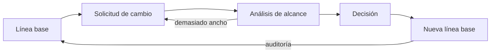
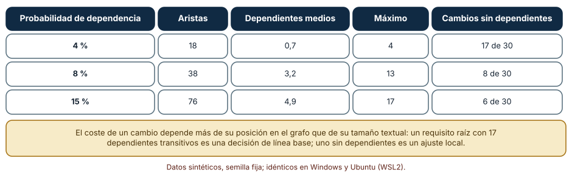
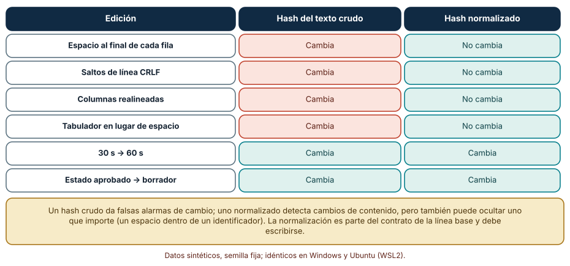
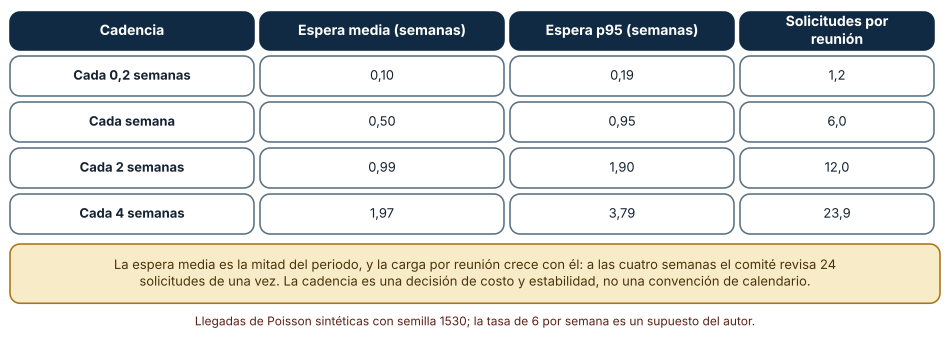

# SE-153 — Gestión de cambios y líneas base

[← SE-152 — Requisitos regulatorios, de datos y seguridad](../../classes/part-12-ingenieria-de-requisitos/se-152-requisitos-regulatorios-de-datos-y-seguridad/README.md) · [↑ Parte 12](../../classes/part-12-ingenieria-de-requisitos/README.md) · [📚 Índice completo](../../classes/README.md) · [🌐 Portal](../../site/classes/SE-153.html) · [SE-154 — Ambigüedad, contradicción e incompletitud →](../../classes/part-12-ingenieria-de-requisitos/se-154-ambiguedad-contradiccion-e-incompletitud/README.md)

## Punto profesional y fundamento pedagógico

**Punto profesional.** La clase existe para que los requisitos puedan cambiar sin que nadie pierda la pista de qué se había acordado: fijar una línea base identificable, decidir quién aprueba cada cambio y saber de antemano a cuántos elementos alcanza.

**Por qué aparece aquí.** Se sitúa después de **Requisitos regulatorios, de datos y seguridad** y antes de **Ambigüedad, contradicción e incompletitud**: `SE-151` y `SE-152` enlazaron cada requisito con su origen y su evidencia; esta clase protege ese conjunto con una línea base y un proceso de cambio, y deja un registro de cambios que `SE-154` usará para cazar contradicciones introducidas por modificaciones parciales y `SE-156` entregará dentro de la especificación.

**Error conceptual que debe corregir.** Creer que congelar los requisitos los protege del cambio, y que cualquier diferencia en el texto es un cambio de requisito.

**Secuencia de aprendizaje.** Antes de leer el resultado, predices cuántos requisitos alcanza un cambio según la densidad de dependencias, qué ediciones alteran el hash de una línea base y cuánto espera una solicitud según la cadencia del comité; después calculas, explicas cada resultado y reconstruyes sin apoyo el ciclo de solicitud, evaluación, decisión y nueva línea base. La secuencia usa predicción, explicación propia, contraste y recuperación. [ICAP](https://icap.education.asu.edu/research) distingue participación de construcción de conocimiento; [How People Learn II](https://nap.nationalacademies.org/catalog/24783/how-people-learn-ii-learners-contexts-and-cultures) exige conectar conocimiento previo, contexto y transferencia; la [práctica de recuperación](https://pubmed.ncbi.nlm.nih.gov/16507066/) respalda producir de nuevo la explicación tras una demora; y [Education for Life and Work](https://nap.nationalacademies.org/resource/13398/dbasse_084153.pdf) exige devolución que explique la causa del error.

**Evidencia de aprendizaje.** `change-control.md` con la línea base 1 identificada por una etiqueta y un hash normalizado, dos solicitudes de cambio con su análisis de alcance y su decisión, la cadencia elegida para el comité con su justificación y la diferencia entre líneas base. Debe contener predicción previa, observación, explicación causal, contraejemplo, criterio de aceptación y una nota de qué dato haría cambiar la conclusión.

**Límite de la conclusión.** Los grafos de dependencias, las llegadas de solicitudes (6 por semana) y los textos de la línea base son sintéticos. El experimento con `git` se ejecutó en un repositorio temporal; no se midió ningún proyecto real ni el costo de ningún cambio.

### Trazabilidad fuente → afirmación

| Fuente primaria u oficial | Afirmación que respalda | Lo que no prueba |
|---|---|---|
| [ISO 10007:2017, Gestión de la calidad: directrices para la gestión de la configuración](https://www.iso.org/standard/70400.html) | Describe la gestión de la configuración como identificación, control de cambios, registro de estado y auditoría de configuración. | El texto completo es de pago; aquí se cita su alcance. |
| [SWEBOK Guide v4.0a](https://www.computer.org/education/bodies-of-knowledge/software-engineering) | Incluye la gestión de la configuración y el control de cambios entre las áreas de conocimiento de la ingeniería de software. | No fija una cadencia ni una herramienta. |
| [Git: git-tag](https://git-scm.com/docs/git-tag) | Una etiqueta anotada identifica de forma estable un commit y guarda autor, fecha y mensaje. | No decide qué merece una línea base. |
| [Git: git-diff](https://git-scm.com/docs/git-diff) | Muestra las diferencias entre dos revisiones, incluido un resumen por archivo. | No clasifica un cambio como de formato o de contenido. |
| [Python: hashlib](https://docs.python.org/3/library/hashlib.html) | Documenta SHA-256 usado para identificar una versión del texto. | No define qué normalización aplicar. |
| [Nuseibeh y Easterbrook, «Requirements engineering: a roadmap» (2000)](https://doi.org/10.1145/336512.336523) | Incluye la evolución de los requisitos como una de las actividades de la disciplina. | No cuantifica el ritmo de cambio de ningún proyecto. |

## Antes de empezar

Retomas el expediente de la Parte 12: cuatro requisitos elegidos, con origen, criterio, pruebas y obligaciones. La docente pide cambiar la retención de 60 a 30 segundos y añadir una purga; Seguridad pide cifrar también los metadatos. Recupera lo aprendido en `SE-151`: el alcance de un cambio se calcula recorriendo enlaces. La pregunta activa es: **¿qué estoy cambiando respecto de lo acordado, a quién alcanza, quién lo aprueba y cómo identifico la versión resultante?**

## Prerrequisitos

- Haber completado `SE-152` o poder explicar cómo se traza una obligación hasta su evidencia.
- Python 3.11 o posterior y `git` instalado (versión 2.43 o posterior para reproducir la demostración).
- Trabajar solo con requisitos, textos y repositorios temporales sintéticos.

## Problema auténtico

Tres personas editan el mismo documento de requisitos durante una semana. El viernes nadie sabe cuál era la versión acordada el lunes. Una de las ediciones corrigió espacios, otra cambió «60 s» por «30 s» y otra marcó como «aprobado» un requisito que seguía pendiente. El comité de cambios se reúne una vez al mes y acumula 24 solicitudes; ya hay trabajo hecho sobre cuatro de ellas.

## Objetivos observables

Al terminar podrás:

1. distinguir línea base, solicitud de cambio, versión y registro de estado con un ejemplo y un contraejemplo de la plataforma;
2. estimar el alcance de un cambio recorriendo las dependencias y explicar qué lo hace grande o pequeño;
3. identificar una línea base con una etiqueta y un hash que ignore diferencias de formato y detecte las de contenido;
4. elegir la cadencia de un comité de cambios justificando el compromiso entre espera y carga;
5. escribir una solicitud de cambio que otra persona pueda evaluar sin contexto adicional.

## Mapa conceptual



El mapa se lee de izquierda a derecha como un ciclo. Una línea base recibe solicitudes, se analiza su alcance, se decide y el resultado es una nueva línea base. Los retornos indican que una auditoría puede revelar que la línea base real difiere de la registrada, y que un alcance demasiado ancho puede devolver la solicitud para reformularla o dividirla.

## Temas y por qué importan

| Tema | Por qué cambia una decisión profesional | Evidencia mínima |
|---|---|---|
| Línea base | Fija una versión acordada a la que referirse, comparar y volver. | Predicción, traza causal y contraejemplo de **Línea base** en `change-control.md` |
| Solicitud de cambio | Convierte una modificación en un objeto con autor, motivo y alcance. | Predicción, traza causal y contraejemplo de **Solicitud de cambio** en `change-control.md` |
| Análisis de alcance | Estima el costo y el riesgo de un cambio antes de aprobarlo. | Predicción, traza causal y contraejemplo de **Análisis de alcance** en `change-control.md` |
| Comité y cadencia | Equilibra la espera de quien pide con la estabilidad de quien construye. | Predicción, traza causal y contraejemplo de **Comité y cadencia** en `change-control.md` |
| Identidad de una versión | Permite saber si dos personas hablan de la misma versión. | Predicción, traza causal y contraejemplo de **Identidad de una versión** en `change-control.md` |

## Conceptos y decisiones

### 1. Línea base

Una línea base es una versión del conjunto de requisitos que el equipo acordó y que sirve de referencia: lo que se construye, se prueba y se entrega se mide contra ella. No significa que no pueda cambiar; significa que cambia de forma controlada y que siempre se sabe contra cuál versión se trabaja. Sin ella, «¿esto está dentro del alcance?» no tiene respuesta, porque el alcance se mueve con cada edición.

### 2. Solicitud de cambio

Una solicitud de cambio es la propuesta de modificar la línea base: qué cambia, quién lo pide, por qué, qué elementos alcanza y qué decisión se tomó. Registrarla sirve a tres cosas: evita cambios silenciosos, obliga a nombrar el motivo y deja un historial que explica por qué el sistema es como es. Un cambio urgente puede saltarse la espera, pero no el registro.

### 3. Análisis de alcance

El alcance de un cambio es el conjunto de elementos que habría que revisar: requisitos que dependen del modificado, criterios y pruebas enlazados, módulos, documentación y obligaciones. Con el grafo de `SE-151` se obtiene recorriendo las dependencias hacia quienes dependen del cambiado. Un cambio con alcance cero es un ajuste local; uno con muchos dependientes transitivos es una decisión de arquitectura de los requisitos y merece más cuidado.

### 4. Comité y cadencia

Un comité de cambios decide si una solicitud entra. Su cadencia fija un compromiso: reunirse seguido reduce la espera de quien pide pero interrumpe y fragmenta la línea base; reunirse poco da estabilidad pero acumula decisiones y las apila. No hay una cadencia correcta; hay una que corresponde a la tasa de solicitudes, al costo de una reunión y a cuánto trabajo en curso se invalida con cada decisión. Para cambios urgentes se define una vía rápida con registro posterior.

### 5. Identidad de una versión

Para hablar de la misma versión hace falta una identidad estable: una etiqueta (`baseline-1`), un identificador de commit o un hash del contenido. Un hash del texto crudo cambia con cualquier byte (un espacio, un salto de línea), así que confunde formato con contenido. Un hash de un texto normalizado cambia solo cuando cambia lo que importa, a costa de que la normalización quede escrita: si normalizas mal, ocultas cambios reales. La identidad de la línea base es parte del contrato.

### El alcance depende de la posición del cambio

Se generaron grafos de dependencias de 30 requisitos con semilla 153: el requisito i puede depender de cada j < i con probabilidad p. Para cada requisito se calculó el conjunto transitivo de requisitos que dependen de él. Predicción: con pocas dependencias casi todos los cambios tendrán alcance cero o pequeño, y con muchas, unos pocos requisitos raíz concentrarán la mayor parte del alcance.

```python
def alcance(i):
    visto, pila = set(), [i]
    while pila:
        x = pila.pop()
        for y in dependientes[x]:
            if y not in visto:
                visto.add(y)
                pila.append(y)
    return len(visto)
```

Resultado, idéntico en Windows y Ubuntu: con p = 4 % (18 aristas) el alcance medio es de 0,7 requisitos dependientes, el máximo 4 y 17 de 30 cambios no tienen dependientes; con p = 8 % (38 aristas), media 3,2, máximo 13 y 8 sin dependientes; con p = 15 % (76 aristas), media 4,9, máximo 17 y 6 sin dependientes. El alcance medio es modesto, pero el máximo es grande: unos pocos requisitos (los que muchos otros presuponen) hacen cambiar la mitad del sistema. Esos son los que justifican un análisis explícito.



**Cómo leer la figura.** Cada fila es una densidad de dependencias; las columnas dan el número de aristas, el alcance medio y máximo y cuántos cambios no afectan a nadie. **Dónde deja de valer:** las dependencias son aleatorias y solo hacia requisitos anteriores; en un sistema real están agrupadas y hay ciclos que se tratan como un solo bloque. El alcance cuenta requisitos, no esfuerzo: dos dependientes pueden costar mucho más que diez.

### Identificar una versión: crudo, normalizado y etiqueta

Una tabla de requisitos en Markdown (dos filas) se edita de seis maneras: espacio al final de cada fila, saltos de línea CRLF, columnas realineadas, tabulador en lugar de espacio dentro de una frase, cambiar «30 s» por «60 s» y cambiar el estado de «aprobado» a «borrador». Se calcula el SHA-256 del texto crudo y el de un texto normalizado (recortar espacios en cada celda y colapsar espacios internos). Predicción: las cuatro primeras alteran el hash crudo pero no el normalizado; las dos últimas alteran ambos.

```python
def normalizado(texto):
    filas = []
    for linea in texto.strip().splitlines():
        celdas = [re.sub(r"\s+", " ", c.strip()) for c in linea.strip().strip("|").split("|")]
        filas.append("|".join(celdas))
    return hashlib.sha256("\n".join(filas).encode()).hexdigest()
```

Resultado: las cuatro ediciones de formato cambian el hash del texto crudo y no el normalizado; el cambio de umbral y el cambio de estado cambian ambos. Con `git`, la misma versión se identifica con una etiqueta anotada: en un repositorio temporal con fechas fijas, el commit de la línea base 1 es `9c269eb` en Windows (Git 2.55) y en Ubuntu bajo WSL2 (Git 2.43), `git diff --stat baseline-1 HEAD` informa «1 file changed, 2 insertions(+), 1 deletion(-)» y `git describe --tags` devuelve `baseline-1-1-gc18cba8`. El diff muestra el cambio de contenido (60 s → 30 s y la línea de purga nueva) y ningún ruido de formato, porque las dos versiones del archivo de ejemplo usan el mismo formato.



**Cómo leer la figura.** Cada fila es una edición; la segunda columna muestra qué ocurre con el hash crudo (cambia siempre) y la tercera con el normalizado (cambia solo cuando cambia el contenido). **Dónde deja de valer:** la normalización de ejemplo ignora espacios; si un espacio dentro de un identificador importa, el hash normalizado oculta ese cambio. El conjunto de ediciones lo eligió el autor y no cubre cambios de codificación ni de orden de filas.

### Cuánto espera una solicitud según la cadencia

Las solicitudes llegan como un proceso de Poisson de 6 por semana (semilla 1530, 2 000 semanas simuladas). Un comité que se reúne cada T semanas atiende en su reunión siguiente todas las pendientes. Predicción: la espera media será cercana a T/2 y la carga por reunión crecerá con T.

```python
proxima_reunion = math.ceil(llegada / periodo) * periodo
espera = proxima_reunion - llegada
```

Resultado: con reuniones cada 0,2 semanas, espera media de 0,10 semanas, percentil 95 de 0,19 y 1,2 solicitudes por reunión; cada semana, 0,50, 0,95 y 6,0; cada 2 semanas, 0,99, 1,90 y 12,0; cada 4 semanas, 1,97, 3,79 y 23,9. La espera es la mitad del periodo y la carga por reunión es 6 × T. A las cuatro semanas, el comité revisa 24 solicitudes de golpe y cada una espera casi dos semanas. Una cadencia semanal da una espera media de medio período con una carga de 6 solicitudes, que se evalúa en una conversación.



**Cómo leer la figura.** Cada fila es una cadencia; las columnas muestran cuánto espera una solicitud y cuántas se acumulan por reunión. **Dónde deja de valer:** la tasa de 6 por semana, la llegada de Poisson y la decisión inmediata en la reunión son supuestos; en la práctica algunas solicitudes se devuelven para completar, y las llegadas se agrupan antes de una entrega. El modelo no incluye el costo de cada reunión, que empuja hacia cadencias más largas.

## Definiciones de trabajo

- **línea base:** versión acordada del conjunto de requisitos que sirve de referencia y solo cambia por un proceso controlado.
- **solicitud de cambio:** propuesta registrada de modificar la línea base, con motivo, alcance y decisión.
- **análisis de alcance:** determinación de los elementos que un cambio obliga a revisar, a partir de las dependencias y los enlaces.
- **comité y cadencia:** grupo que decide los cambios y frecuencia con que lo hace.
- **identidad de una versión:** identificador estable (etiqueta, commit o hash) que permite saber de qué versión se habla.

Las definiciones son operativas para la plataforma de entregas. No convierten términos con una historia más amplia en sinónimos y deben contrastarse con la documentación primaria enlazada al final.

## Ejemplo mínimo

El fragmento siguiente compara dos versiones de un requisito por su hash normalizado. Antes de ejecutarlo, predice si difieren.

```python
import hashlib, re
def h(t): return hashlib.sha256(re.sub(r"\s+", " ", t.strip()).encode()).hexdigest()[:8]
a = "REQ-001  conservar borrador 30 s"
b = "REQ-001 conservar borrador 30 s "
c = "REQ-001 conservar borrador 60 s"
assert h(a) == h(b) and h(a) != h(c)
```

Los dos primeros difieren solo en espacios y comparten hash; el tercero cambia el umbral y su hash difiere. Registra versión del intérprete, comando y salida. La corrección es documentar la normalización, no ocultarla.

## Ejemplo profesional

Una solicitud de cambio con su análisis y su decisión, sobre la línea base 1:

```text
CR-01   Cambiar el umbral de conservación del borrador de 60 s a 30 s.   Pide: docencia.   Motivo: el 90 % de las ediciones ocurre en 30 s.
        Alcance (SE-151): REQ-001, AC-001, test_recupera_a_los_20s; dependientes: REQ-002.   Costo: 1 día.   Decisión: aprobada, 2026-03-09, producto.
CR-02   Añadir purga a los 30 días.   Pide: privacidad (OBL-02).   Alcance: nuevo REQ-005 y AC-005; afecta a REQ-004 (cifrado).   Decisión: aprobada.
Línea base 2 = baseline-1 + CR-01 + CR-02.   Etiqueta: baseline-2.   Hash normalizado de requisitos.md: registrado.
```

Los identificadores, las fechas y el 90 % son ilustrativos. Compara con el cambio urgente de seguridad que se aplica antes de la reunión, con el cambio de formato que no debería generar solicitud, con el cambio rechazado y con el que se retira. El proceso es apropiado cuando una persona puede reconstruir qué cambió entre dos líneas base y por qué; es peligroso cuando el único registro es el historial de ediciones.

## Práctica guiada

1. Escribe la línea base 1 de tu caso y asigna una etiqueta y un hash normalizado.
2. Predice a cuántos requisitos alcanza cada cambio de tu grafo de `SE-151`.
3. Calcula el alcance de dos solicitudes con el código de la clase; guarda la salida bajo `evidence/`.
4. Redacta CR-01 y CR-02 con motivo, alcance, costo y decisión.
5. Crea un repositorio temporal, etiqueta la línea base y compara con `git diff --stat`.
6. Elige una cadencia para el comité y justifícala con tu tasa de solicitudes.
7. Pide a otra persona que reconstruya qué cambió entre baseline-1 y baseline-2 solo con `change-control.md`.

## Ejercicios

1. **Alcance:** encuentra el requisito de tu grafo con más dependientes transitivos y explica qué haría distinto al cambiarlo.
2. **Hash:** añade una edición que el hash normalizado oculte aunque sea de contenido y propón una normalización más cuidadosa.
3. **Cadencia:** con 12 solicitudes por semana, calcula la espera y la carga por reunión para cada cadencia y propón una vía rápida.
4. **Etiqueta:** crea una segunda etiqueta y describe qué diferencias aparecen en `git diff --stat` entre las dos.

## Reto verificable

Entrega `change-control.md` con la línea base 1 identificada, dos solicitudes con alcance calculado por código, la tabla de cadencias con la decisión elegida y la comparación entre baseline-1 y baseline-2. Se aprueba si otra persona ejecuta el código desde un checkout limpio, obtiene los mismos alcances y puede decir cuál de las dos solicitudes habría rechazado y por qué. No se aprueba por el número de solicitudes ni por un registro sin fechas ni responsables.

## Caso conductor

La plataforma de entregas sigue siendo el caso de la parte. Esta clase añade al expediente una línea base identificada, dos solicitudes de cambio con alcance y una cadencia justificada. Las clases siguientes buscarán ambigüedad y contradicción introducidas por cambios parciales (`SE-154`), repararán requisitos no verificables (`SE-155`) y entregarán todo en una especificación revisable (`SE-156`). Cambia después una sola decisión —por ejemplo, la cadencia a dos semanas— y revisa qué solicitudes se retrasan.

## Preguntas frecuentes

### ¿Congelar los requisitos es lo mismo que tener una línea base?

No. Congelar impide cambiar; una línea base permite cambiar con control. Congelar suele fracasar porque el contexto cambia y los cambios ocurren igual, sin registro. La línea base acepta el cambio y hace que dejarlo documentado sea la vía más fácil.

### ¿Todo cambio necesita una solicitud formal?

No. Un cambio de formato o una errata evidente puede registrarse directamente en el historial. Lo que exige solicitud es lo que modifica el comportamiento prometido o la evidencia. La frontera está en el contenido, no en el tamaño del texto: cambiar «30» por «3 000» es un cambio mínimo en caracteres y máximo en consecuencias.

### ¿Cuál es la cadencia correcta para el comité?

Depende de la tasa de solicitudes, del costo de reunirse y de cuánto trabajo se invalida con cada decisión. Con 6 solicitudes semanales, cada semana da una espera media de medio período y 6 por reunión. Añade una vía rápida para urgencias con registro posterior; sin ella, el proceso se evita.

### ¿Un modelo de lenguaje puede resumir qué cambió entre dos líneas base?

Puede resumir un diff y señalar cambios de texto relevantes; no sabe si un cambio de formato oculta uno de contenido ni qué decisión lo respalda. Pídele que cite el hunk exacto de cada cambio y que marque los que no tengan solicitud asociada.

## Fallo controlado y diagnóstico

Reproduce el fallo clásico de la clase: **tratar cualquier diferencia de texto como un cambio de requisito, o ninguna**. Calcula el hash crudo de la línea base y de una copia con saltos de línea CRLF, y después el de una copia en que «30 s» pasó a «60 s» con el formato intacto.

Registra síntoma, entrada mínima, hipótesis, observación que descarta cada hipótesis, causa, corrección y prueba de regresión. **Síntoma:** el control automático alerta de un cambio inexistente (CRLF) y no se entera de uno real si alguien lo oculta con un cambio de formato en el mismo commit. **Hipótesis rivales:** (a) el hash crudo funciona bien; (b) mezcla formato y contenido. **Prueba:** compara los hashes crudos y normalizados de las seis ediciones: las cuatro de formato cambian el crudo y ninguna cambia el normalizado; las dos de contenido cambian ambos. **Conclusión:** la identidad de la versión debe separar formato de contenido y la normalización debe documentarse. **Regresión:** añade una prueba que verifique el hash normalizado de la línea base y falle si cambia sin una solicitud registrada. No cambies a la vez la normalización y el contenido.

## Errores comunes y cómo corregirlos

| Síntoma | Causa probable | Corrección |
|---|---|---|
| Nadie sabe cuál era la versión acordada | No hay línea base identificada | Etiquetar cada versión acordada y registrar su hash normalizado |
| Un cambio «pequeño» rompe media especificación | No se calculó el alcance | Recorrer las dependencias antes de aprobar y registrar el resultado |
| El comité acumula decenas de solicitudes | Cadencia demasiado larga para la tasa de llegada | Acortar la cadencia o dividir en comités por área y añadir una vía rápida |
| Las alertas de cambio saltan por espacios y saltos de línea | Se compara el texto crudo | Normalizar antes de calcular el hash y documentar la normalización |
| Un cambio urgente nunca se registra | La vía rápida no exige registro posterior | Exigir el registro en un plazo fijo, con responsable |

## Entorno y archivos clave

```text
work/SE-153/
├── README.md
├── cambios/
│   ├── alcance.py
│   ├── identidad.py
│   └── comite.py
├── fixtures/requisitos.md
├── tests/test_cambios.py
└── evidence/change-control.md
```

El `README` declara plataforma, versiones de Python y de `git`, semilla y comandos. Los experimentos usan `random`, `hashlib`, `re` y `math`; la demostración usa `git` con fechas y autor fijados por variables de entorno. Se ejecutaron con CPython 3.12.9 y Git 2.55 en Windows 11, y con CPython 3.12.3 y Git 2.43 en Ubuntu bajo WSL2; las salidas fueron idénticas. Si añades una dependencia, fija procedencia y versión.

## Seguridad, ética y accesibilidad

- el historial de solicitudes puede contener nombres y motivos sensibles: limita el acceso y registra decisiones, no opiniones personales;
- una vía rápida sin registro es una puerta abierta para cambios no autorizados: exige autor, fecha y aprobación posterior;
- un cambio que afecta a obligaciones externas (`SE-152`) necesita la aprobación de quien las interpreta;
- publica el registro de cambios en un formato accesible y con lenguaje claro;
- no uses un modelo de lenguaje con repositorios privados sin una política de datos que lo permita;
- respeta licencias de herramientas y atribuye adaptaciones.

## Puente hacia el trabajo con agentes

Un agente al que se le pide «actualiza los requisitos según este correo» editará el documento y devolverá una versión coherente sin dejar una solicitud ni calcular el alcance. Pídele en cambio que redacte una solicitud de cambio con motivo y alcance, que liste los requisitos y pruebas enlazados que verían afectados, que proponga el diff mínimo y que no modifique la línea base sin una aprobación registrada. Revisa especialmente si «aprovecha» para reformular requisitos vecinos: cada reformulación es otro cambio con su propia solicitud.

## Transferencia

Traslada el análisis a otro dominio (por ejemplo, un servicio de reservas): cambia el grafo, la tasa de solicitudes y los textos, conserva el cálculo de alcance, el hash normalizado y el modelo de cadencia, y comprueba si unos pocos requisitos raíz siguen concentrando el alcance máximo. La transferencia está lograda cuando puedes explicar qué parte del método dependía del dominio y cuál no, no cuando el código se parece.

## Evaluación y evidencia

| Criterio | Evidencia para aprobar |
|---|---|
| comprensión | explicación causal de la diferencia entre línea base, solicitud y versión, con ejemplo y contraejemplo |
| corrección | alcances, hashes y esperas reproducibles con las mismas semillas |
| diseño | línea base identificada, solicitudes con alcance y decisión, y cadencia justificada |
| diagnóstico | reproducción del fallo «formato frente a contenido» con regresión |
| incertidumbre | declaración de la tasa de solicitudes y de la normalización usadas |
| reproducibilidad | versiones, comandos, salida y límites declarados |

## Fuentes

- [ISO 10007:2017](https://www.iso.org/standard/70400.html) — gestión de la configuración: identificación, control de cambios, registro de estado y auditoría; autoridad: ISO.
- [SWEBOK Guide v4.0a](https://www.computer.org/education/bodies-of-knowledge/software-engineering) — gestión de la configuración y control de cambios; autoridad: IEEE Computer Society.
- [Nuseibeh y Easterbrook: Requirements engineering, a roadmap (2000)](https://doi.org/10.1145/336512.336523) — evolución de los requisitos; autoridad: ACM, The Future of Software Engineering.
- [Git: git-tag](https://git-scm.com/docs/git-tag) — etiquetas anotadas; autoridad: proyecto Git.
- [Git: git-diff](https://git-scm.com/docs/git-diff) — comparación entre revisiones; autoridad: proyecto Git.

Cada fuente respalda el mecanismo indicado; ninguna demuestra que la cadencia o el proceso elegidos sean los adecuados para la plataforma de entregas. Esa afirmación depende de la tasa real de cambios y de la revisión de otra persona.

- [Python: `hashlib`](https://docs.python.org/3/library/hashlib.html) — SHA-256 del texto normalizado.
- [Python: `re`](https://docs.python.org/3/library/re.html) — normalización de espacios.
- [Python: `random`](https://docs.python.org/3/library/random.html) — generador con semilla y llegadas de Poisson.

## Límites y siguiente paso

Se ejecutaron tres experimentos y una demostración con `git` en Windows y Ubuntu (WSL2) con resultados idénticos. No se analizó ningún proyecto real, los grafos y las llegadas son sintéticos y la normalización es una de varias posibles. La siguiente clase busca los defectos que los cambios parciales introducen: ambigüedad, contradicción e incompletitud.

## Glosario

- **línea base:** versión acordada del conjunto de requisitos que sirve de referencia y solo cambia por un proceso controlado.
- **solicitud de cambio:** propuesta registrada de modificar la línea base, con motivo, alcance y decisión.
- **análisis de alcance:** determinación de los elementos que un cambio obliga a revisar, a partir de las dependencias y los enlaces.
- **comité y cadencia:** grupo que decide los cambios y frecuencia con que lo hace.
- **identidad de una versión:** identificador estable (etiqueta, commit o hash) que permite saber de qué versión se habla.

---

[← SE-152 — Requisitos regulatorios, de datos y seguridad](../../classes/part-12-ingenieria-de-requisitos/se-152-requisitos-regulatorios-de-datos-y-seguridad/README.md) · [↑ Parte 12](../../classes/part-12-ingenieria-de-requisitos/README.md) · [📚 Índice completo](../../classes/README.md) · [🌐 Portal](../../site/classes/SE-153.html) · [SE-154 — Ambigüedad, contradicción e incompletitud →](../../classes/part-12-ingenieria-de-requisitos/se-154-ambiguedad-contradiccion-e-incompletitud/README.md)
