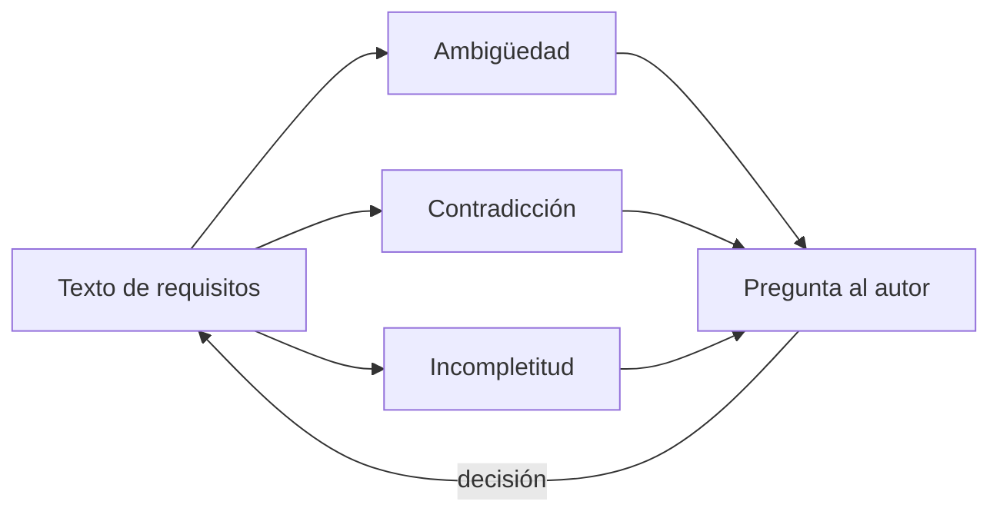
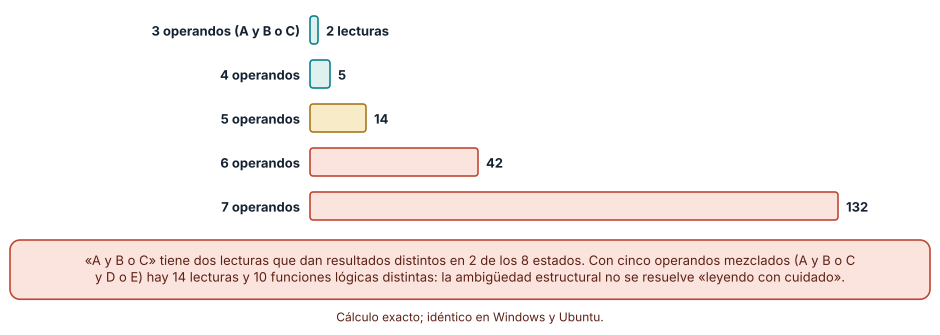
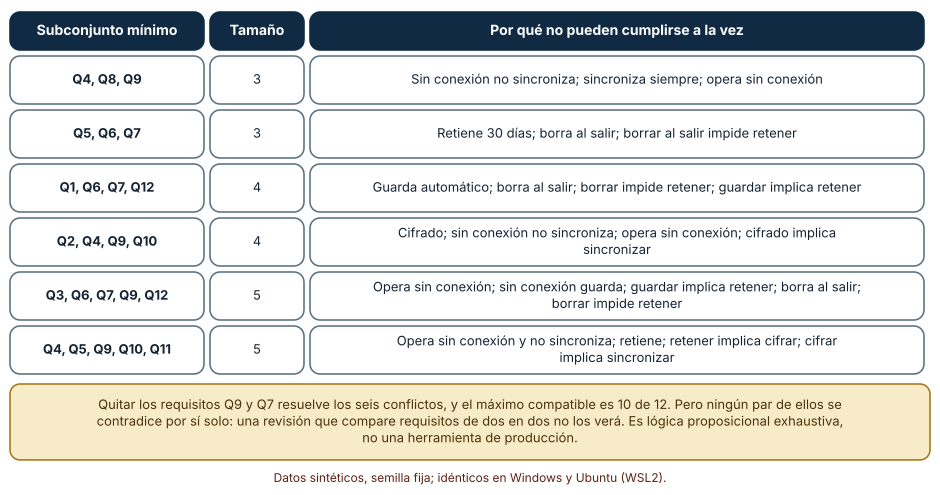
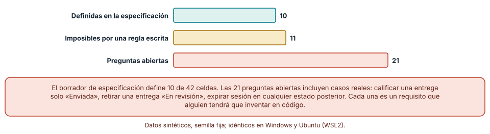

# SE-154 — Ambigüedad, contradicción e incompletitud

[← SE-153 — Gestión de cambios y líneas base](../../classes/part-12-ingenieria-de-requisitos/se-153-gestion-de-cambios-y-lineas-base/README.md) · [↑ Parte 12](../../classes/part-12-ingenieria-de-requisitos/README.md) · [📚 Índice completo](../../classes/README.md) · [🌐 Portal](../../site/classes/SE-154.html) · [SE-155 — Taller: reparar requisitos no verificables →](../../classes/part-12-ingenieria-de-requisitos/se-155-taller-reparar-requisitos-no-verificables/README.md)

## Punto profesional y fundamento pedagógico

**Punto profesional.** La clase existe para que los tres defectos más caros de un texto de requisitos —que admita dos lecturas, que se contradiga o que calle un caso— se busquen con una técnica propia cada uno, y no con la esperanza de que alguien lo note al leer.

**Por qué aparece aquí.** Se sitúa después de **Gestión de cambios y líneas base** y antes de **Taller: reparar requisitos no verificables**: `SE-153` dejó una línea base con cambios controlados; esta clase examina qué defectos sobreviven a ese control porque ningún cambio individual los muestra, y deja un inventario de defectos que `SE-155` reparará y `SE-156` verificará en una especificación completa.

**Error conceptual que debe corregir.** Creer que una revisión cuidadosa encuentra ambigüedades, contradicciones y huecos, y que si dos requisitos no se contradicen de dos en dos entonces son consistentes.

**Secuencia de aprendizaje.** Antes de leer el resultado, predices en cuántos estados difieren dos lecturas de una frase con «y» y «o», si un conjunto de doce requisitos contiene pares contradictorios y cuántas celdas de una tabla de estados quedan sin definir; después calculas, explicas cada resultado, comparas qué técnica detectó qué defecto y reconstruyes sin apoyo cómo se busca cada tipo. La secuencia usa predicción, explicación propia, contraste y recuperación. [ICAP](https://icap.education.asu.edu/research) distingue participación de construcción de conocimiento; [How People Learn II](https://nap.nationalacademies.org/catalog/24783/how-people-learn-ii-learners-contexts-and-cultures) exige conectar conocimiento previo, contexto y transferencia; la [práctica de recuperación](https://pubmed.ncbi.nlm.nih.gov/16507066/) respalda producir de nuevo la explicación tras una demora; y [Education for Life and Work](https://nap.nationalacademies.org/resource/13398/dbasse_084153.pdf) exige devolución que explique la causa del error.

**Evidencia de aprendizaje.** `defect-inventory.md` con las frases ambiguas del expediente y sus lecturas, los conjuntos mínimos de requisitos incompatibles, la tabla estado–evento con celdas definidas, imposibles y abiertas, y la decisión sobre cada una. Debe contener predicción previa, observación, explicación causal, contraejemplo, criterio de aceptación y una nota de qué dato haría cambiar la conclusión.

**Límite de la conclusión.** Los doce requisitos, las seis variables y la tabla de seis estados por siete eventos los escribió el autor. La búsqueda exhaustiva por subconjuntos solo es viable con pocos requisitos y no sustituye a un verificador formal ni a la lectura de una persona.

### Trazabilidad fuente → afirmación

| Fuente primaria u oficial | Afirmación que respalda | Lo que no prueba |
|---|---|---|
| [Berry, Kamsties y Krieger, «From contract drafting to software specification: linguistic sources of ambiguity» (2003)](https://cs.uwaterloo.ca/~dberry/handbook/ambiguityHandbook.pdf) | Clasifica las fuentes lingüísticas de ambigüedad (léxica, sintáctica, de alcance, referencial, entre otras) en textos de requisitos. | No ofrece un detector automático fiable. |
| [Mavin et al., «Easy Approach to Requirements Syntax (EARS)» (2009)](https://doi.org/10.1109/RE.2009.9) | Propone plantillas que reducen ambigüedad al fijar estructura de condición y respuesta. | No demuestra que eliminen la ambigüedad. |
| [Heitmeyer, Jeffords y Labaw, «Automated consistency checking of requirements specifications» (1996)](https://doi.org/10.1145/234426.234431) | Describe la verificación automática de consistencia y completitud de requisitos expresados como tablas. | Su método exige una notación formal. |
| [Harel, «Statecharts: a visual formalism for complex systems» (1987)](https://doi.org/10.1016/0167-6423%2887%2990035-9) | Presenta una notación de estados y transiciones para especificar comportamiento reactivo. | No dice cuáles transiciones faltan en tu sistema. |
| [Zave y Jackson, «Four dark corners of requirements engineering» (1997)](https://doi.org/10.1145/237432.237434) | Separa requisitos, supuestos y especificación, lo que permite ubicar de dónde viene una contradicción. | No es un algoritmo de detección. |
| [Python: itertools](https://docs.python.org/3/library/itertools.html) | Ofrece combinaciones y producto para enumerar estados y subconjuntos. | No decide qué enumerar. |

## Antes de empezar

Retomas el expediente de la Parte 12 con su línea base. Las solicitudes de cambio se aprobaron una a una, y el conjunto sigue teniendo problemas que ninguna solicitud tocó. Recupera lo aprendido en `SE-146`: una tabla de decisión reveló huecos y conflictos que las reglas individuales ocultaban. La pregunta activa es: **¿qué técnica encuentra una frase con dos lecturas, un grupo de requisitos incompatibles y un caso que nadie contempló, y qué defecto escapa a cada una?**

## Prerrequisitos

- Haber completado `SE-153` o poder explicar cómo se identifica una línea base.
- Python 3.11 o posterior.
- Trabajar solo con requisitos y estados sintéticos.

## Problema auténtico

La especificación dice: «El sistema notificará al docente y al estudiante cuando la entrega o la revisión falle si el archivo es inválido o está vencido y no hay prórroga». Dos personas la implementan de forma distinta. Otros doce requisitos, cada uno razonable, no pueden cumplirse a la vez, y nadie lo ha notado porque ninguna pareja se contradice. Y la tabla de estados de la entrega no dice qué pasa si alguien intenta retirar una entrega que ya está en revisión.

## Objetivos observables

Al terminar podrás:

1. distinguir ambigüedad, contradicción e incompletitud con un ejemplo y un contraejemplo de la plataforma;
2. contar las lecturas de una frase con conectores y medir en cuántos casos difieren;
3. encontrar los conjuntos mínimos de requisitos incompatibles en un conjunto pequeño y explicar por qué una revisión por pares no los ve;
4. enumerar una tabla estado–evento y clasificar sus celdas en definidas, imposibles y abiertas;
5. decidir qué técnica aplicar a cada tipo de defecto y qué escapa a todas.

## Mapa conceptual



El mapa se lee de izquierda a derecha: cada tipo de defecto se busca con su técnica y todos terminan en una pregunta con nombre y apellido. El retorno indica que la decisión modifica el texto y obliga a repetir la búsqueda, porque un arreglo puede introducir un defecto nuevo.

## Temas y por qué importan

| Tema | Por qué cambia una decisión profesional | Evidencia mínima |
|---|---|---|
| Ambigüedad | Una frase con dos lecturas se implementará de dos maneras. | Predicción, traza causal y contraejemplo de **Ambigüedad** en `defect-inventory.md` |
| Contradicción | Requisitos incompatibles hacen imposible cumplirlos todos. | Predicción, traza causal y contraejemplo de **Contradicción** en `defect-inventory.md` |
| Incompletitud | Lo no dicho se decide en el código por quien programa. | Predicción, traza causal y contraejemplo de **Incompletitud** en `defect-inventory.md` |
| Técnicas de detección | Cada defecto se busca de forma distinta y ninguna técnica encuentra todos. | Predicción, traza causal y contraejemplo de **Técnicas de detección** en `defect-inventory.md` |
| Resolución | Una pregunta sin responsable queda sin respuesta. | Predicción, traza causal y contraejemplo de **Resolución** en `defect-inventory.md` |

## Conceptos y decisiones

### 1. Ambigüedad

Una frase es ambigua si admite más de una lectura razonable. Berry y colegas distinguen fuentes: léxica (una palabra con varios sentidos), sintáctica (agrupación de la frase), de alcance (qué abarca «todos» o «no»), referencial (a qué se refiere «lo» o «esto») y de elipsis. La ambigüedad estructural con «y» y «o» es la más fácil de contar y la más fácil de pasar por alto, porque cada persona lee una sola versión y no sabe que existe otra.

### 2. Contradicción

Dos requisitos se contradicen si no pueden cumplirse a la vez. La contradicción directa («guardar» frente a «no guardar») es rara; la frecuente es indirecta: requiere varias premisas para aparecer. Un conjunto puede ser inconsistente sin que ningún par lo sea. Por eso la revisión por pares, que compara requisitos de dos en dos, no encuentra las contradicciones más costosas. La detección sistemática traduce los requisitos a una forma donde se pueda decidir si existe algún estado que los cumpla todos.

### 3. Incompletitud

Un conjunto es incompleto si omite una situación que debería contemplar. Las tablas de estado–evento lo hacen visible: si hay 6 estados y 7 eventos, hay 42 combinaciones y cada una debe tener un comportamiento (una transición, «se ignora» o «es imposible») o una pregunta abierta. No saber qué pasa si una estudiante retira una entrega en revisión es un hueco que alguien llenará en el código sin preguntar.

### 4. Técnicas de detección

Para la ambigüedad estructural, enumerar las lecturas y comparar sus resultados; para la léxica, un glosario y una lista de términos prohibidos sin criterio. Para la contradicción, convertir los requisitos en condiciones sobre variables y buscar un estado que los cumpla todos o, si no existe, los subconjuntos mínimos que lo impiden. Para la incompletitud, enumerar combinaciones de estado y evento o de condiciones. Cada técnica encuentra el defecto para el que fue diseñada; ninguna encuentra uno de otro tipo.

### 5. Resolución

Encontrar el defecto es la mitad: la otra mitad es decidir quién lo resuelve. Una pregunta debe ir a quien tiene autoridad (producto para un comportamiento, privacidad para una retención), con las alternativas y sus consecuencias, y con una fecha. Resolver puede significar reescribir, eliminar un requisito, separar casos o aceptar el riesgo; no resolver significa que la decisión la tomó el código. Registrar la respuesta en el expediente evita que se pregunte otra vez.

### Una frase, catorce lecturas

El número de maneras de agrupar n operandos unidos por conectores binarios es el número de Catalan C(n−1). Predicción: crece muy rápido y solo una parte de las lecturas da resultados distintos. Se enumeraron todas las agrupaciones de tres frases y se comparó su tabla de verdad sobre todos los estados.

```python
def lecturas(ops):
    n = (len(ops) + 1) // 2
    def rec(i, j):
        if i == j:
            return [lambda v, i=i: v[i]]
        resultado = []
        for k in range(i, j):
            for izq in rec(i, k):
                for der in rec(k + 1, j):
                    if ops[2*k + 1] == "y":
                        resultado.append(lambda v, L=izq, R=der: L(v) and R(v))
                    else:
                        resultado.append(lambda v, L=izq, R=der: L(v) or R(v))
        return resultado
    return rec(0, n - 1), n
```

Resultado, idéntico en Windows y Ubuntu: los números de lecturas para 3, 4, 5, 6 y 7 operandos son 2, 5, 14, 42 y 132. «A y B o C» tiene 2 lecturas que difieren en 2 de los 8 estados; «A o B y C y D» tiene 5 lecturas y 3 funciones distintas; «A y B o C y D o E» tiene 14 lecturas y 10 funciones lógicas distintas. Aunque algunas lecturas coincidan, la frase del problema (cuatro conectores mezclados) tiene 14 maneras de leerse y 10 de ellas no son equivalentes. Una revisión cuidadosa elige una y no sabe que hay otras.



**Cómo leer la figura.** Cada barra es un número de operandos y su longitud el número de agrupaciones posibles; la frase «A y B o C» ya difiere en 2 de 8 estados. **Dónde deja de valer:** el análisis supone que los conectores son binarios y que el lector podría agrupar de cualquier manera; en español, la prosodia y la costumbre eliminan algunas lecturas. La ambigüedad léxica y la referencial, que no se enumeran así, no entran en este conteo.

### Seis conflictos entre doce requisitos

Doce requisitos del módulo de borradores se traducen a condiciones sobre seis variables lógicas (guarda automáticamente, cifra el borrador, opera sin conexión, sincroniza, retiene 30 días, borra al salir): por ejemplo, «sin conexión no sincroniza» (si sin conexión, entonces no sincroniza), «sincroniza siempre», «opera sin conexión», «retiene 30 días», «borra al salir», «borrar al salir impide retener», «cifrado implica sincronizar», «retener implica cifrar», «guardar implica retener». Predicción: el conjunto completo será insatisfacible y habrá pocos pares incompatibles.

```python
estados = list(itertools.product([0, 1], repeat=6))
def satisfacible(subconjunto):
    return any(all(req(s) for req in subconjunto) for s in estados)
# subconjuntos mínimos insatisfacibles: por tamaño creciente, sin contener otro ya hallado
```

Resultado: el conjunto completo es insatisfacible. Se hallaron seis subconjuntos mínimos insatisfacibles: dos de tres requisitos, dos de cuatro y dos de cinco. Ninguno es un par: «sin conexión no sincroniza», «sincroniza siempre» y «opera sin conexión» (3); «retiene 30 días», «borra al salir» y «borrar al salir impide retener» (3); los cuatro y los cinco son cadenas más largas. El máximo subconjunto compatible tiene 10 de 12, y quitar «opera sin conexión» y «borrar al salir impide retener» hace consistente el conjunto, aunque no dice cuál quitar. Una revisión que compare requisitos de dos en dos no ve ninguna de las seis.



**Cómo leer la figura.** Cada fila es un subconjunto mínimo que no puede cumplirse a la vez, con su tamaño y una explicación. **Dónde deja de valer:** la búsqueda exhaustiva sobre 2^12 subconjuntos y 2^6 estados solo es viable para conjuntos pequeños; con cientos de requisitos se usan solucionadores SAT o SMT. Además, traducir un requisito a una condición lógica es una interpretación que el análisis no verifica.

### Cuarenta y dos celdas, diez definidas

El ciclo de una entrega tiene seis estados (borrador, enviada, en revisión, calificada, reabierta, anulada) y siete eventos (enviar, retirar, iniciar revisión, calificar, reabrir, anular, expirar sesión): 42 celdas. La especificación define 10 transiciones. Una regla escrita declara 11 combinaciones imposibles (por ejemplo, ningún evento puede ocurrir en una entrega anulada, y no se puede calificar un borrador). Predicción: la mayoría de las celdas quedará sin definir y una parte importante serán preguntas abiertas, no imposibilidades.

```python
sin_definir = [(s, e) for s in estados for e in eventos if (s, e) not in especificacion]
imposibles = [c for c in sin_definir if c in regla_de_imposibles]
abiertas = [c for c in sin_definir if c not in regla_de_imposibles]
```

Resultado: 10 celdas definidas, 11 imposibles por la regla escrita y 21 preguntas abiertas. Entre las abiertas: qué pasa al enviar una entrega ya enviada, al calificar una entrega solo «enviada», al retirar una entrega en revisión, al reabrir una entrega en revisión o al expirar la sesión en cualquier estado posterior al borrador. Cada una es un requisito que alguien está inventando en el código en este momento.



**Cómo leer la figura.** Cada barra es una categoría de celdas; las 21 abiertas son preguntas pendientes con responsable. **Dónde deja de valer:** que una celda sea «imposible» es una afirmación sobre el sistema, no un hecho de la tabla; si la interfaz permite el evento, deja de serlo. La regla de imposibles es del autor y debe ser revisada por quien conoce el proceso. La tabla supone un solo objeto: con varios actores y concurrencia hay más estados.

## Definiciones de trabajo

- **ambigüedad:** propiedad de un texto que admite más de una lectura razonable con consecuencias distintas.
- **contradicción:** relación entre requisitos que no pueden cumplirse todos a la vez, directa o a través de otros.
- **incompletitud:** ausencia de un comportamiento para una situación que el sistema podrá encontrar.
- **técnicas de detección:** procedimientos para buscar un tipo de defecto, cada uno ciego a los demás.
- **resolución:** decisión registrada, con responsable, que elimina un defecto o acepta el riesgo.

Las definiciones son operativas para la plataforma de entregas. No convierten términos con una historia más amplia en sinónimos y deben contrastarse con la documentación primaria enlazada al final.

## Ejemplo mínimo

El fragmento siguiente compara dos lecturas de una frase. Antes de ejecutarlo, predice en cuántos estados difieren.

```python
import itertools
difieren = [s for s in itertools.product([0, 1], repeat=3)
            if ((s[0] and s[1]) or s[2]) != (s[0] and (s[1] or s[2]))]
assert len(difieren) == 2          # A=0,B=0,C=1 y A=0,B=1,C=1
```

Las lecturas «(A y B) o C» y «A y (B o C)» difieren cuando A es falso y C es verdadero. Registra versión del intérprete, comando y salida. La corrección no está en el código sino en una pregunta al autor: ¿cuál de las dos?

## Ejemplo profesional

Un inventario de defectos del expediente, con su tipo, su técnica de hallazgo y su responsable:

```text
DEF-01  Ambigüedad  REQ-031 «notificará al docente y al estudiante cuando falle la entrega o la revisión»   Lecturas: 2 (¿falla de entrega o de revisión?)   Técnica: enumeración.   Pregunta a: producto.
DEF-02  Contradicción  REQ-004, REQ-008, REQ-009   (cifrado, sincronizar siempre, funcionar sin conexión)   Técnica: conjunto mínimo.   Pregunta a: producto y seguridad.
DEF-03  Incompletitud  Estado «en revisión», evento «retirar» no definido.   Técnica: tabla estado–evento.   Pregunta a: docencia.
Resolución DEF-03: se rechaza el retiro en revisión y se muestra el motivo.   Decidió: docencia, 2026-03-12.   Cambio: CR-03.
```

Los identificadores, las fechas y los requisitos son ilustrativos. Compara con la ambigüedad que desaparece al añadir un ejemplo, la contradicción que solo aparece tras un cambio de `SE-153` y la celda abierta que resultó imposible por una regla de la interfaz. El inventario es apropiado cuando cada defecto tiene tipo, técnica y responsable; es peligroso cuando es una lista de observaciones sin dueño.

## Práctica guiada

1. Elige tres frases de tu expediente con «y» u «o» y predice cuáles tienen más de una lectura.
2. Enumera las lecturas y compara sus tablas de verdad con el código de la clase; guarda la salida bajo `evidence/`.
3. Traduce doce requisitos a condiciones sobre variables y busca los subconjuntos mínimos incompatibles.
4. Construye la tabla estado–evento de una entidad de tu caso y clasifica sus celdas.
5. Redacta tres defectos con tipo, técnica y responsable, y una resolución para uno.
6. Aplica una técnica distinta a cada defecto y registra cuál no lo habría encontrado.
7. Pide a otra persona que reproduzca tu inventario solo con `defect-inventory.md`.

## Ejercicios

1. **Lecturas:** calcula las lecturas de una frase con seis operandos y explica cuántas esperas que difieran.
2. **Conflicto:** añade un decimotercer requisito que resuelva uno de los seis conflictos sin crear otro y comprueba el resultado.
3. **Celdas:** añade un estado «en apelación» y recalcula cuántas celdas nuevas quedan abiertas.
4. **Ciego:** escribe un defecto que ninguna de las tres técnicas encuentre y explica qué otra revisión lo detectaría.

## Reto verificable

Entrega `defect-inventory.md` con tres frases ambiguas y sus lecturas, los conjuntos mínimos incompatibles de tus requisitos, la tabla estado–evento clasificada y una resolución registrada. Se aprueba si otra persona ejecuta el código desde un checkout limpio, obtiene los mismos recuentos y puede señalar qué defecto escaparía a las tres técnicas. No se aprueba por la cantidad de defectos ni por una lista sin responsable.

## Caso conductor

La plataforma de entregas sigue siendo el caso de la parte. Esta clase añade al expediente un inventario con una ambigüedad, un conflicto y un hueco, cada uno con su responsable. Las clases siguientes repararán requisitos no verificables (`SE-155`) y los reunirán en una especificación revisable (`SE-156`). Cambia después una sola decisión —por ejemplo, quitar «funciona sin conexión»— y repite la búsqueda para ver si aparece un conflicto nuevo.

## Preguntas frecuentes

### ¿No bastaría con una buena revisión por pares?

Encuentra mucho, pero no los defectos que exigen comparar más de dos requisitos a la vez: ninguno de los seis conflictos era un par. Tampoco encuentra la lectura alternativa de una frase que cada revisor lee de una sola manera. La revisión y la enumeración se complementan.

### ¿Se resuelve la ambigüedad prohibiendo palabras vagas?

Ayuda con la ambigüedad léxica («rápido», «adecuado») y no con la estructural. «A y B o C» no contiene ninguna palabra vaga y admite dos lecturas. Un glosario y una plantilla de redacción reducen ambos tipos, pero ninguna regla léxica sustituye a una pregunta al autor.

### ¿Hay que completar todas las celdas de la tabla de estados?

Hay que decidir todas, no implementar todas. Una celda puede quedar como «imposible», «se ignora» o «se rechaza con un mensaje», pero esa decisión debe estar escrita. Una celda abierta no es neutral: se resuelve en el código, sin responsable.

### ¿Puede un modelo de lenguaje encontrar contradicciones?

Puede señalar candidatos y a veces acierta; no ofrece garantía de exhaustividad y puede inventar conflictos que no existen. Úsalo para proponer sospechas y verifícalas con enumeración o con un solucionador. Un «no encuentro contradicciones» de un modelo no equivale a consistencia.

## Fallo controlado y diagnóstico

Reproduce el fallo clásico de la clase: **creer que un conjunto de requisitos es consistente porque ningún par lo contradice**. Compara los doce requisitos de dos en dos y declara «sin conflictos»; luego ejecuta la búsqueda de subconjuntos.

Registra síntoma, entrada mínima, hipótesis, observación que descarta cada hipótesis, causa, corrección y prueba de regresión. **Síntoma:** el equipo implementa los doce y descubre que el módulo no puede cumplir «sin conexión no sincroniza», «sincroniza siempre» y «opera sin conexión». **Hipótesis rivales:** (a) un requisito está mal escrito; (b) los tres son correctos por separado y juntos incompatibles. **Prueba:** comprueba los tres de dos en dos (todos pasan) y los tres juntos (insatisfacibles). **Conclusión:** la inconsistencia era de orden tres y la revisión por pares no podía verla. **Regresión:** añade al proceso una comprobación de satisfacibilidad sobre las condiciones de cada módulo, que falle al introducir un conjunto insatisfacible. No cambies a la vez los requisitos y la traducción a variables.

## Errores comunes y cómo corregirlos

| Síntoma | Causa probable | Corrección |
|---|---|---|
| Dos equipos implementan la misma frase de maneras distintas | La frase admite varias lecturas | Enumerar las lecturas y preguntar al autor, o reescribir con una plantilla estructurada |
| Los requisitos se revisaron de dos en dos y el módulo no se puede construir | Hay una contradicción de orden tres o más | Buscar subconjuntos mínimos incompatibles sobre las condiciones |
| El código tiene comportamientos que nadie pidió | Se rellenaron huecos de la especificación | Enumerar estados y eventos y registrar cada celda con una decisión |
| Una palabra prohibida se reemplaza por otra equivalente | La regla es léxica y el problema es estructural | Combinar un glosario con revisión de la estructura de la frase |
| Un defecto reaparece tras un cambio | La resolución no se registró o se repitió el análisis | Guardar cada decisión con responsable y repetir las búsquedas tras cada cambio |

## Entorno y archivos clave

```text
work/SE-154/
├── README.md
├── defectos/
│   ├── lecturas.py
│   ├── conflictos.py
│   └── estados.py
├── fixtures/requisitos.csv
├── tests/test_defectos.py
└── evidence/defect-inventory.md
```

El `README` declara plataforma, versión de Python y comandos. Los experimentos usan solo `itertools` y funciones propias, y se ejecutaron con CPython 3.12.9 en Windows 11 y 3.12.3 en Ubuntu bajo WSL2; las salidas fueron idénticas. Si añades una dependencia (por ejemplo, un solucionador SAT), fija procedencia y versión.

## Seguridad, ética y accesibilidad

- una ambigüedad en un requisito de seguridad o privacidad puede abrir una brecha: escala esos defectos antes que los demás;
- una celda abierta resuelta en el código puede decidir quién ve las notas o cuándo se pierde una entrega: la decisión debe tener responsable;
- usa lenguaje claro y evita el lenguaje jurídico innecesario que aumenta la ambigüedad para quienes no son especialistas;
- publica las tablas en un formato accesible, no solo como imágenes;
- no uses un modelo de lenguaje con requisitos confidenciales sin una política de datos que lo permita;
- respeta licencias de glosarios y plantillas y atribuye adaptaciones.

## Puente hacia el trabajo con agentes

Un agente al que se le pide «revisa estos requisitos y busca problemas» devolverá observaciones plausibles sobre palabras vagas y quizá un par de contradicciones evidentes. Pídele en cambio que enumere las lecturas de las frases con conectores, que traduzca cada requisito a una condición explícita sobre variables nombradas, que ejecute la búsqueda de subconjuntos mínimos y que construya la tabla estado–evento con las celdas abiertas. Revisa especialmente si afirma «no hay contradicciones» sin ejecutar una comprobación: es una opinión, no un resultado.

## Transferencia

Traslada las tres técnicas a otro dominio (por ejemplo, las reglas de un sistema de reservas): cambia las frases, las variables y los estados, conserva la enumeración de lecturas, la búsqueda de subconjuntos mínimos y la clasificación de celdas, y comprueba si de nuevo ninguna contradicción es un par. La transferencia está lograda cuando puedes explicar qué parte del método dependía del dominio y cuál no, no cuando el código se parece.

## Evaluación y evidencia

| Criterio | Evidencia para aprobar |
|---|---|
| comprensión | explicación causal de la diferencia entre ambigüedad, contradicción e incompletitud, con ejemplo y contraejemplo |
| corrección | recuentos de lecturas, subconjuntos mínimos y celdas reproducibles |
| diseño | inventario de defectos con tipo, técnica y responsable |
| diagnóstico | reproducción del fallo «ningún par se contradice» con regresión |
| incertidumbre | declaración de qué tipos de defecto escapan a cada técnica |
| reproducibilidad | versiones, comandos, salida y límites declarados |

## Fuentes

- [Berry, Kamsties y Krieger: From contract drafting to software specification, linguistic sources of ambiguity (2003)](https://cs.uwaterloo.ca/~dberry/handbook/ambiguityHandbook.pdf) — tipos de ambigüedad en requisitos; autoridad: Universidad de Waterloo.
- [Mavin et al.: Easy Approach to Requirements Syntax, EARS (2009)](https://doi.org/10.1109/RE.2009.9) — plantillas de redacción; autoridad: IEEE International Requirements Engineering Conference.
- [Heitmeyer, Jeffords y Labaw: Automated consistency checking of requirements specifications (1996)](https://doi.org/10.1145/234426.234431) — verificación de consistencia y completitud; autoridad: ACM Transactions on Software Engineering and Methodology.
- [Harel: Statecharts, a visual formalism for complex systems (1987)](https://doi.org/10.1016/0167-6423%2887%2990035-9) — estados y transiciones; autoridad: Science of Computer Programming.
- [Zave y Jackson: Four dark corners of requirements engineering (1997)](https://doi.org/10.1145/237432.237434) — requisitos, supuestos y especificación; autoridad: ACM Transactions on Software Engineering and Methodology.
- [ISO/IEC/IEEE 29148:2018](https://www.iso.org/standard/72089.html) — características de un buen requisito, incluida la ausencia de ambigüedad; autoridad: ISO, IEC e IEEE.

Cada fuente respalda el mecanismo indicado; ninguna demuestra que el expediente de la plataforma de entregas esté libre de defectos. Esa afirmación depende de las técnicas aplicadas, de las respuestas de los responsables y de la revisión de otra persona.

- [Python: `itertools`](https://docs.python.org/3/library/itertools.html) — producto y combinaciones usados para enumerar estados y subconjuntos.

## Límites y siguiente paso

Se ejecutaron tres experimentos con datos sintéticos en Windows y Ubuntu (WSL2) con resultados idénticos. Los requisitos, las variables y la tabla de estados son ejemplos del autor, la búsqueda exhaustiva no escala y la traducción a lógica es una interpretación no verificada. La siguiente clase aplica todo esto a un taller: reparar requisitos que no se pueden verificar.

## Glosario

- **ambigüedad:** propiedad de un texto que admite más de una lectura razonable con consecuencias distintas.
- **contradicción:** relación entre requisitos que no pueden cumplirse todos a la vez, directa o a través de otros.
- **incompletitud:** ausencia de un comportamiento para una situación que el sistema podrá encontrar.
- **técnicas de detección:** procedimientos para buscar un tipo de defecto, cada uno ciego a los demás.
- **resolución:** decisión registrada, con responsable, que elimina un defecto o acepta el riesgo.

---

[← SE-153 — Gestión de cambios y líneas base](../../classes/part-12-ingenieria-de-requisitos/se-153-gestion-de-cambios-y-lineas-base/README.md) · [↑ Parte 12](../../classes/part-12-ingenieria-de-requisitos/README.md) · [📚 Índice completo](../../classes/README.md) · [🌐 Portal](../../site/classes/SE-154.html) · [SE-155 — Taller: reparar requisitos no verificables →](../../classes/part-12-ingenieria-de-requisitos/se-155-taller-reparar-requisitos-no-verificables/README.md)
