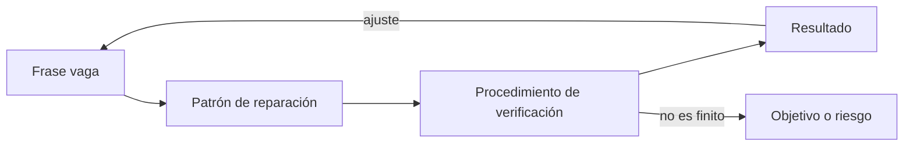
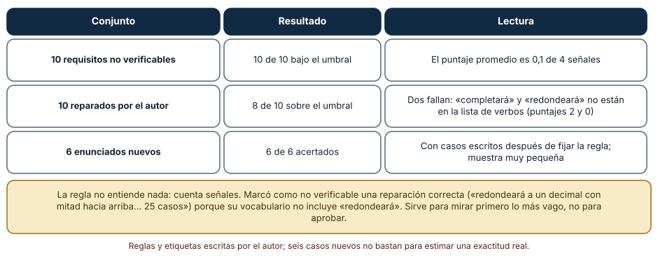
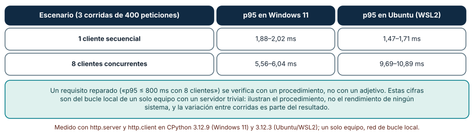
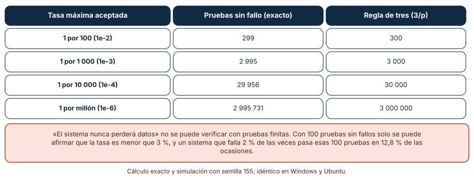

# SE-155 — Taller: reparar requisitos no verificables

[← SE-154 — Ambigüedad, contradicción e incompletitud](../../classes/part-12-ingenieria-de-requisitos/se-154-ambiguedad-contradiccion-e-incompletitud/README.md) · [↑ Parte 12](../../classes/part-12-ingenieria-de-requisitos/README.md) · [📚 Índice completo](../../classes/README.md) · [🌐 Portal](../../site/classes/SE-155.html) · [SE-156 — Proyecto: especificación de requisitos revisable →](../../classes/part-12-ingenieria-de-requisitos/se-156-proyecto-especificacion-de-requisitos-revisable/README.md)

## Punto profesional y fundamento pedagógico

**Punto profesional.** El taller existe para practicar el oficio central de la parte: tomar una frase que suena bien («fácil de usar», «nunca perderá un borrador») y devolver un requisito del que se pueda decir, con un procedimiento y un resultado, que se cumple o no, o reconocer que no se puede y reformularlo como objetivo o como riesgo.

**Por qué aparece aquí.** Se sitúa después de **Ambigüedad, contradicción e incompletitud** y antes de **Proyecto: especificación de requisitos revisable**: `SE-154` dio técnicas para encontrar defectos; este taller aplica todo lo anterior —origen, calidad, ejemplos, medida— a diez requisitos vagos, y deja el material y los criterios de reparación que `SE-156` usará en una especificación completa.

**Error conceptual que debe corregir.** Creer que agregar una cifra a una frase la vuelve verificable, y que cualquier requisito puede verificarse con pruebas.

**Secuencia de aprendizaje.** Antes de reparar, predices cuáles de diez frases tienen reparación posible con cifras y cuáles no; después reparas, puntúas las reparaciones con una regla que cuenta señales de verificabilidad, miras qué reparaciones la regla pasa por alto, mides un percentil en un servidor local para ver qué significa «verificar» y calculas cuántas pruebas sin fallos exige un requisito del tipo «nunca». La secuencia usa predicción, explicación propia, contraste y recuperación. [ICAP](https://icap.education.asu.edu/research) distingue participación de construcción de conocimiento; [How People Learn II](https://nap.nationalacademies.org/catalog/24783/how-people-learn-ii-learners-contexts-and-cultures) exige conectar conocimiento previo, contexto y transferencia; la [práctica de recuperación](https://pubmed.ncbi.nlm.nih.gov/16507066/) respalda producir de nuevo la explicación tras una demora; y [Education for Life and Work](https://nap.nationalacademies.org/resource/13398/dbasse_084153.pdf) exige devolución que explique la causa del error.

**Evidencia de aprendizaje.** `repairs.md` con diez requisitos originales, su reparación o su reformulación, el procedimiento de verificación de cada uno, el resultado de la regla de puntuación sobre ellos y la lista de los que no pueden verificarse con pruebas y cómo se tratan. Debe contener predicción previa, observación, explicación causal, contraejemplo, criterio de aceptación y una nota de qué dato haría cambiar la conclusión.

**Límite de la conclusión.** Los diez requisitos, sus reparaciones, las señales de la regla y los seis casos de comprobación los escribió el autor y la regla se ajustó viendo los diez primeros; la exactitud de 6 de 6 en casos nuevos no estima su exactitud real. Las latencias provienen del bucle local de un solo equipo con un servidor trivial.

### Trazabilidad fuente → afirmación

| Fuente primaria u oficial | Afirmación que respalda | Lo que no prueba |
|---|---|---|
| [ISO/IEC/IEEE 29148:2018](https://www.iso.org/standard/72089.html) | Entre las características de un buen requisito figura que sea verificable, singular y no ambiguo. | El texto completo es de pago. |
| [Mavin et al., «Easy Approach to Requirements Syntax (EARS)» (2009)](https://doi.org/10.1109/RE.2009.9) | Las plantillas fijan disparador, condición y respuesta, que son las partes que se verifican. | No garantiza que la respuesta sea medible. |
| [Hanley y Lippman-Hand, «If nothing goes wrong, is everything all right?» (1983)](https://doi.org/10.1001/jama.1983.03330370053031) | Explica la regla de tres: con cero fallos en n pruebas, la cota superior de la tasa con 95 % de confianza es de unos 3/n. | No dice qué tasa es aceptable para tu sistema. |
| [Google SRE: Service Level Objectives](https://sre.google/sre-book/service-level-objectives/) | Recomienda objetivos con percentil, ventana y método de medición. | No fija los valores adecuados. |
| [Python: http.server](https://docs.python.org/3/library/http.server.html) | Documenta el servidor HTTP de la biblioteca estándar, usado para el experimento local. | No es un servidor de producción. |
| [Python: re](https://docs.python.org/3/library/re.html) | Define las expresiones regulares de la regla de puntuación. | No juzga el significado de una frase. |

## Antes de empezar

Retomas el expediente de la Parte 12 con su inventario de defectos. Varios requisitos que parecían razonables no se pueden probar: «seguro», «rápido», «fácil», «nunca». Recupera lo aprendido en `SE-147`: un adjetivo se vuelve verificable con estadístico, población y ventana, y en `SE-149`: un criterio se vuelve verificable con ejemplos en las fronteras. La pregunta activa es: **¿qué procedimiento, ejecutado por alguien que no escribió la frase, daría un sí o un no, y qué hago cuando ningún procedimiento finito puede darlo?**

## Prerrequisitos

- Haber completado `SE-154` o poder explicar los tres tipos de defecto.
- Python 3.11 o posterior; los tiempos se leen como razones.
- Trabajar solo con requisitos, solicitudes y casos sintéticos.

## Problema auténtico

La revisión de la especificación marca diez requisitos como «no verificables». El equipo los repara añadiendo números a las frases, y ocho semanas después, en la demostración, un docente dice que el sistema «sigue sin ser fácil de usar» aunque la prueba de «completar la revisión en 10 minutos» pasa. Otro pide la garantía de que «nunca se pierde un borrador», y el equipo no sabe cuántas pruebas bastarían para poder decirlo.

## Objetivos observables

Al terminar podrás:

1. distinguir un requisito verificable, uno medible, uno probable y uno solo deseable con un ejemplo y un contraejemplo de la plataforma;
2. reparar una frase vaga con patrones (cuantificar, acotar, condicionar, separar) y escribir su procedimiento de verificación;
3. usar una regla de puntuación como filtro previo y declarar qué reparaciones correctas pasa por alto;
4. ejecutar un procedimiento de medición de percentil y leer su variación entre corridas;
5. reconocer los requisitos «nunca» y «siempre», calcular cuántas pruebas harían falta y reformularlos como objetivos con tasa o como riesgos.

## Mapa conceptual



El mapa se lee de izquierda a derecha: una frase vaga se repara con un patrón, la reparación tiene un procedimiento que produce un resultado. Cuando el procedimiento no puede ser finito (un «nunca»), la salida es reformular como objetivo con tasa o como riesgo aceptado. El retorno indica que un resultado inesperado puede mostrar que la reparación no capturó lo que se quería.

## Temas y por qué importan

| Tema | Por qué cambia una decisión profesional | Evidencia mínima |
|---|---|---|
| Qué hace verificable a un requisito | Distingue lo que puede resolverse con un procedimiento de lo que es una intención. | Predicción, traza causal y contraejemplo de **Qué hace verificable a un requisito** en `repairs.md` |
| Patrones de reparación | Ofrecen movimientos repetibles para convertir adjetivos en criterios. | Predicción, traza causal y contraejemplo de **Patrones de reparación** en `repairs.md` |
| Procedimientos de verificación | Convierten un criterio en una medición con método y variación conocidos. | Predicción, traza causal y contraejemplo de **Procedimientos de verificación** en `repairs.md` |
| Requisitos universales y negativos | «Nunca» y «siempre» no se verifican con pruebas finitas. | Predicción, traza causal y contraejemplo de **Requisitos universales y negativos** en `repairs.md` |
| Cuando la reparación no basta | Algunos requisitos son objetivos o riesgos y deben tratarse como tales. | Predicción, traza causal y contraejemplo de **Cuando la reparación no basta** en `repairs.md` |

## Conceptos y decisiones

### 1. Qué hace verificable a un requisito

Un requisito es verificable si existe un procedimiento finito que, ejecutado por alguien distinto del autor, produce un resultado que todos aceptan como «cumple» o «no cumple». Esa definición exige observables (algo que se puede ver o medir), umbrales (qué cuenta como cumplir), condiciones (en qué circunstancias) y método (cómo se mide). Una frase puede tener cifras y seguir sin ser verificable si no dice cómo se mide ni en qué condiciones; puede no tener cifras y serlo si el criterio es un conjunto de ejemplos.

### 2. Patrones de reparación

Hay cuatro movimientos recurrentes. Cuantificar: sustituir un adjetivo por un número con unidad («rápido» por «p95 ≤ 1 500 ms»). Acotar: decir bajo qué carga o entorno («con 200 usuarios concurrentes»). Condicionar: separar el estímulo de la respuesta («cuando la sesión expira…»). Separar: dividir una frase con varios compromisos en requisitos singulares. Estos movimientos no inventan el valor: lo toman de una necesidad, una norma o una medición previa. Un número sin origen es una decisión que nadie tomó.

### 3. Procedimientos de verificación

Un procedimiento dice qué se ejecuta, con qué datos, en qué entorno, cuántas veces y cómo se decide. Una medición de percentil tiene variación entre corridas: la decisión debe indicar cuánta tolerancia acepta y cuántas repeticiones hacen falta. Un procedimiento no es una prueba automatizada necesariamente: una inspección con criterios, una prueba con personas con una tarea y un umbral, o una revisión de un artefacto pueden ser procedimientos válidos si el resultado es repetible.

### 4. Requisitos universales y negativos

«El sistema nunca perderá un borrador» es un enunciado universal sobre infinitas ejecuciones futuras; ninguna cantidad finita de pruebas puede demostrarlo. Lo que sí puede decirse es una cota: con n pruebas sin fallos, con 95 % de confianza, la tasa de fallo es menor que aproximadamente 3/n. Para decir «menos de 1 por cada 10 000» hacen falta unas 30 000 pruebas sin ningún fallo. Los requisitos universales son legítimos como intención, pero como criterio de aceptación deben convertirse en una tasa, una cota y una forma de aprender del fallo.

### 5. Cuando la reparación no basta

Algunas frases no se reparan; se reclasifican. «Fácil de usar» se verifica con una tarea y un umbral con un grupo de personas, no con una medición de la máquina; si no hay presupuesto para ello, es un objetivo de diseño, no un requisito de aceptación. «Seguro» es un conjunto de requisitos derivados de amenazas (`SE-152`), no uno solo. Una reparación aceptable puede ser una lista de requisitos, un objetivo con revisión o un riesgo aceptado con responsable; lo inaceptable es dejar la frase como estaba.

### El taller: diez frases y sus reparaciones

| Frase original | Reparación | Procedimiento |
|---|---|---|
| El sistema debe ser rápido. | Cuando una estudiante abre una tarea, el sistema responderá en un percentil 95 de 1 500 ms con 200 usuarios concurrentes. | Prueba de carga con registro de latencias |
| La interfaz será fácil de usar. | Un docente nuevo completará la revisión de una entrega en 10 minutos como máximo, sin ayuda, en una prueba con 5 docentes. | Sesión de uso con tarea y cronómetro |
| El sistema soportará muchos usuarios. | El sistema registrará 200 entregas concurrentes sin errores durante 10 minutos. | Prueba de carga |
| Los datos estarán seguros. | Cuando otra estudiante solicite un borrador ajeno, el sistema lo rechazará y registrará el intento en 100 % de 20 casos de prueba de acceso cruzado. | Pruebas de acceso cruzado |
| El sistema nunca perderá un borrador. | Si una sesión expira, el sistema conservará el borrador de los últimos 30 segundos y lo mostrará al volver a entrar. | Pruebas de recuperación y objetivo de tasa |
| La plataforma estará siempre disponible. | La disponibilidad mensual medida en la ruta de entrega será de al menos 99,5 %. | Sonda sintética externa |
| Se avisará al estudiante oportunamente. | Si falta menos de 24 horas para el plazo, el sistema enviará un aviso al estudiante una sola vez. | Prueba con reloj controlado |
| El sistema será escalable. | Al duplicar la carga de 100 a 200 usuarios, el percentil 95 no aumentará más de 30 %. | Prueba de carga comparativa |
| Las notas se calcularán correctamente. | El cálculo de la nota final redondeará a un decimal con mitad hacia arriba y coincidirá con 25 casos de ejemplo. | Tabla de ejemplos |
| La carga de archivos funcionará bien. | Cuando un archivo supere 10 MB, el sistema lo rechazará y mostrará el límite en el mensaje. | Ejemplos de frontera |

Predicción antes de continuar: la reparación de «fácil de usar» es la menos satisfactoria de la tabla, porque mide una tarea y no la facilidad; y la de «nunca perderá un borrador» sustituye un universal por un caso, lo que habrá que completar con una tasa.

### Una regla que cuenta señales

Para filtrar antes de leer, se escribió una regla que puntúa un enunciado con cuatro señales: una cantidad con unidad, una condición («cuando», «si», «ante»), una cota o estadístico («percentil», «como máximo», «al menos») y un verbo de respuesta observable («rechazará», «registrará», «mostrará»). Con tres o más señales se considera verificable. La regla se escribió mirando los diez originales.

```python
def puntos(texto):
    t = texto.lower()
    return sum([
        bool(re.search(r"\d+(?:[.,]\d+)?\s*(?:%|ms|s\b|segundos|minutos|min\b|h\b|horas|mb|días|dias|veces|intentos|usuarios)", t)),
        bool(re.search(r"\b(?:cuando|si|ante|después de|despues de|durante|al )\b", t)),
        bool(re.search(r"\b(?:p9[0-9]|percentil|máximo|maximo|como mínimo|como minimo|al menos|no más de|no mas de|exactamente)\b", t)),
        bool(re.search(r"\b(?:mostrará|rechazará|registrará|enviará|guardará|devolverá|conservará|responderá)\b", t)),
    ])
```

Resultado, idéntico en Windows y Ubuntu: los 10 originales puntúan 0 (uno puntúa 1 por coincidir con «al » en «al estudiante»); los 10 reparados puntúan 4, 2, 3, 3, 3, 3, 3, 3, 0 y 3. La regla clasifica bien 10 de 10 originales y 8 de 10 reparados. Las dos que falla son reparaciones correctas: «completará la revisión» (puntúa 2) porque «completará» no está en su lista de verbos, y la de redondeo (puntúa 0) porque «redondeará» tampoco y «25 casos» no es una unidad reconocida. Con seis enunciados nuevos escritos después de fijar la regla, acierta 6 de 6 (tres verificables y tres no); muestra demasiado pequeña para estimar su exactitud y que ya exhibe el sesgo de léxico. Sirve para mirar primero lo más vago; no para aprobar.



**Cómo leer la figura.** Cada fila es un conjunto de enunciados con el resultado de la regla y una lectura de sus fallos. **Dónde deja de valer:** la regla no entiende nada, cuenta palabras; un enunciado puede tener las cuatro señales y ser un sinsentido, y uno bien reparado puede quedar fuera por usar sinónimos. Las etiquetas «verificable» y «no verificable» son juicios del autor, no un criterio externo.

### Medir un percentil: qué significa «verificar»

Una reparación como «p95 ≤ X ms» exige un procedimiento. Se levantó un servidor HTTP mínimo (`http.server.ThreadingHTTPServer`) en el mismo equipo y se midieron 400 peticiones con `http.client`, con un cliente secuencial y con ocho hilos, tres corridas por escenario. Predicción: el percentil 95 cambiará entre corridas y bajo concurrencia aumentará.

```python
t = time.perf_counter()
c = http.client.HTTPConnection("127.0.0.1", puerto); c.request("GET", "/"); c.getresponse().read(); c.close()
ms = (time.perf_counter() - t) * 1000
```

Resultado: con un cliente, el percentil 95 fue de 1,88 a 2,02 ms en Windows 11 y de 1,47 a 1,71 ms en Ubuntu bajo WSL2; con ocho clientes, de 5,56 a 6,04 ms y de 9,69 a 10,89 ms. La variación entre corridas es de 7 % a 15 % del valor, y la diferencia entre sistemas operativos cambia de signo con la concurrencia. Un requisito «p95 ≤ 800 ms» se verifica con este tipo de procedimiento, pero debe decir cuántas corridas, qué tolerancia y en qué entorno. Las cifras de esta tabla no dicen nada sobre la plataforma de entregas: el servidor es trivial y la red es el bucle local.



**Cómo leer la figura.** Cada fila es un escenario de carga y las columnas muestran el rango de percentiles 95 observado en tres corridas en cada sistema. **Dónde deja de valer:** un solo equipo, una sola respuesta de dos bytes, bucle local sin red y sin base de datos; el valor absoluto es irrelevante. Lo que ilustra es que verificar es ejecutar un procedimiento con variación conocida, no comparar con un número.

### Cuántas pruebas sin fallos hacen falta para un «nunca»

Con n pruebas independientes sin ningún fallo, la cota superior de la tasa de fallo con 95 % de confianza es 1 − 0,05^(1/n), aproximadamente 3/n (regla de tres). Se calculó cuántas pruebas hacen falta para que la cota sea p y se simuló un sistema que falla 2 % de las veces. Predicción: hacen falta del orden de 3/p pruebas y un sistema defectuoso pasará una suite corta con frecuencia.

```python
n = math.ceil(math.log(0.05) / math.log(1 - p))
pasa = sum(all(rng.random() > 0.02 for _ in range(100)) for _ in range(20000)) / 20000
```

Resultado: para acotar la tasa por debajo de 1 por 100 hacen falta 299 pruebas sin fallos; por debajo de 1 por 1 000, 2 995; de 1 por 10 000, 29 956; de 1 por millón, 2 995 731. La regla de tres da 300, 3 000, 30 000 y 3 000 000. Con 100 pruebas sin fallos solo se puede afirmar que la tasa es menor que 2,95 % (exacto) o 3 % (regla de tres). Un sistema que falla 2 % de las veces supera esas 100 pruebas en 12,8 % de las ocasiones, y uno que falla 0,5 % las supera en 60,3 %. «Nunca» es una intención; «menos de 1 por 10 000 con 30 000 pruebas sin fallos» es un criterio.



**Cómo leer la figura.** Cada fila es una tasa máxima aceptada y las columnas el número exacto de pruebas sin fallo y la aproximación 3/p. **Dónde deja de valer:** supone pruebas independientes e idénticamente distribuidas y ningún fallo observado; con fallos observados el cálculo cambia, y las pruebas sobre un sistema que cambia entre ejecuciones no son una muestra. La confianza del 95 % es una convención, no una propiedad del sistema.

## Definiciones de trabajo

- **verificabilidad:** existencia de un procedimiento finito, ejecutable por otra persona, que produce un veredicto aceptado de cumple o no cumple.
- **patrones de reparación:** movimientos repetibles para volver verificable una frase: cuantificar, acotar, condicionar y separar.
- **procedimientos de verificación:** descripción de qué se ejecuta, con qué datos, en qué entorno, cuántas veces y cómo se decide.
- **requisitos universales y negativos:** enunciados sobre todas las ejecuciones futuras («nunca», «siempre») que ninguna prueba finita puede demostrar.
- **reformulación:** conversión de un requisito no verificable en un objetivo con revisión o en un riesgo aceptado con responsable.

Las definiciones son operativas para la plataforma de entregas. No convierten términos con una historia más amplia en sinónimos y deben contrastarse con la documentación primaria enlazada al final.

## Ejemplo mínimo

El fragmento siguiente calcula cuántas pruebas sin fallos hacen falta para una cota. Antes de ejecutarlo, predice si son más o menos de 3 000 para 1 por mil.

```python
import math
def pruebas_necesarias(p, confianza=0.95):
    return math.ceil(math.log(1 - confianza) / math.log(1 - p))
assert pruebas_necesarias(1e-3) == 2995
```

Para acotar la tasa por debajo de 1 por 1 000 hacen falta 2 995 pruebas sin ningún fallo, no 100 ni 1 000. Registra versión del intérprete, comando y salida. La conclusión no es «prueba más» sino «el requisito debe decir qué tasa se compromete a lograr».

## Ejemplo profesional

La reparación de un requisito, con su procedimiento y la decisión sobre lo que no se repara:

```text
ORIG-04  Los datos estarán seguros.                                         Estado: no verificable (adjetivo sin amenaza).
REP-04a  Cuando otra estudiante solicite un borrador ajeno, el sistema lo rechazará y registrará el intento.   Procedimiento: 20 casos de acceso cruzado en CI.
REP-04b  El borrador se cifra en reposo con una clave gestionada.           Procedimiento: inspección de configuración + prueba de lectura directa del almacén.
REF-04   «Seguro» en general se trata como el inventario de amenazas de SE-152, no como un requisito.   Responsable: seguridad.
ORIG-05  El sistema nunca perderá un borrador.   → OBJ-05: tasa de pérdida < 1 por 10 000 recuperaciones; criterio: 30 000 recuperaciones sin pérdida en el entorno de pruebas; revisión trimestral con datos de producción.
```

Los identificadores y las tasas son ilustrativos. Compara con la frase que se repara con una cifra inventada, la reparación que se cumple y no satisface a nadie, el requisito que se reclasifica como objetivo y el que se acepta como riesgo. La reparación es apropiada cuando otra persona puede ejecutar el procedimiento sin preguntar; es peligrosa cuando solo añade números a una intención.

## Práctica guiada

1. Copia diez frases vagas de un documento tuyo o de la tabla del taller y escribe su procedimiento de verificación esperado.
2. Predice cuáles no se pueden reparar con una cifra y por qué.
3. Repara cada una con uno o más patrones y escribe el procedimiento de verificación.
4. Puntúa originales y reparaciones con la regla; guarda la salida bajo `evidence/` y anota los falsos negativos.
5. Mide el percentil 95 de un servidor local con tres corridas y registra el rango.
6. Calcula cuántas pruebas sin fallos haría falta para el «nunca» de tu lista y reformúlalo.
7. Pide a otra persona que ejecute dos de tus procedimientos sin consultarte.

## Ejercicios

1. **Patrón:** repara la frase «el sistema avisará a tiempo» con los cuatro patrones y explica cuál no pudo aplicarse sin un dato nuevo.
2. **Regla:** escribe tres reparaciones correctas que la regla puntúe por debajo de 3 y propón qué ampliarías y qué no se arregla con palabras.
3. **Variación:** repite la medición con 16 hilos y explica cómo debería decidir un criterio «p95 ≤ X» con tres corridas.
4. **Cota:** calcula las pruebas sin fallos necesarias con una confianza del 99 % para 1 por 1 000 y compara con la del 95 %.

## Reto verificable

Entrega `repairs.md` con diez frases originales, sus reparaciones con procedimiento, el resultado de la regla (con los falsos negativos explicados), la medición de percentil con sus corridas y la reformulación de un «nunca» con su cota. Se aprueba si otra persona ejecuta dos procedimientos y obtiene un veredicto sin consultarte, y si puede señalar qué reparación no basta. No se aprueba por añadir cifras ni por una reparación sin procedimiento.

## Caso conductor

La plataforma de entregas sigue siendo el caso de la parte. Esta clase añade al expediente diez requisitos reparados con procedimiento, una medición de percentil y la reformulación del «nunca perderá un borrador» como objetivo con tasa. La clase siguiente reúne todo en una especificación revisable (`SE-156`), donde estas reparaciones, el inventario de defectos y la trazabilidad se verifican juntos. Cambia después una sola decisión —por ejemplo, de 10 a 15 minutos en la prueba de uso— y revisa qué procedimientos deben repetirse.

## Preguntas frecuentes

### ¿Basta con añadir una cifra para que un requisito sea verificable?

No. «El sistema responde en 2 segundos» tiene una cifra y no dice qué estadístico, qué carga ni cómo se mide. Una frase se vuelve verificable cuando alguien distinto de su autor puede ejecutar un procedimiento y obtener un veredicto. Las cifras son un ingrediente, no el plato.

### ¿Hay requisitos que no se puedan verificar nunca?

Los universales, como pruebas finitas. Se tratan convirtiéndolos en una cota de tasa con una cantidad de pruebas definida, o aceptándolos como riesgo con un responsable y un plan de aprendizaje. Otros, como la facilidad de uso, se verifican con personas y umbrales, no con una máquina, y requieren presupuesto para ello.

### ¿Para qué sirve una regla automática si falla con sinónimos?

Para ordenar el trabajo: puntúa miles de frases en un segundo y señala las más vagas. No decide: sus falsos negativos (reparaciones correctas con otro vocabulario) y positivos (frases con las cuatro señales y sin sentido) obligan a una lectura humana. Úsala para priorizar la revisión y registra cada fallo para ajustarla.

### ¿Puede un modelo de lenguaje reparar los requisitos?

Puede proponer reparaciones fluidas, sobre todo patrones de cuantificación. Lo que no puede es conocer el origen del número: si el 1 500 ms viene de una necesidad o de la nada. Exige que cada cifra propuesta cite su origen o se marque como hipótesis pendiente de validación.

## Fallo controlado y diagnóstico

Reproduce el fallo clásico de la clase: **dar por verificable un requisito universal**. Toma «el sistema nunca perderá un borrador», escribe una suite de 100 pruebas que lo cumplan y declara el requisito verificado.

Registra síntoma, entrada mínima, hipótesis, observación que descarta cada hipótesis, causa, corrección y prueba de regresión. **Síntoma:** la suite pasa y en producción se pierden borradores. **Hipótesis rivales:** (a) la suite no representaba el uso real; (b) 100 pruebas no pueden demostrar un «nunca». **Prueba:** simula un sistema que falla 2 % de las veces: pasa las 100 pruebas en 12,8 % de las ocasiones; calcula la cota con 100 pruebas sin fallos: 2,95 %. **Conclusión:** la suite solo demuestra «menos de 3 %», no «nunca». **Regresión:** exige que todo requisito con «nunca» o «siempre» se reformule como una tasa con confianza y número de pruebas, y que el informe de aceptación cite la cota alcanzada. No cambies a la vez la tasa y el entorno.

## Errores comunes y cómo corregirlos

| Síntoma | Causa probable | Corrección |
|---|---|---|
| Se repara una frase con una cifra y nadie sabe de dónde salió | El número no tiene origen | Registrar la necesidad o la medición de la que proviene y marcarlo como hipótesis si falta |
| La prueba pasa y las personas siguen quejándose | La reparación mide un proxy de lo que importa | Validar con personas el umbral y revisar si el proxy refleja la necesidad |
| «Nunca» y «siempre» aparecen en los criterios de aceptación | Se confunde intención con criterio | Convertir en tasa con confianza y número de pruebas, o aceptar el riesgo |
| Una prueba de percentil da resultados distintos cada vez | No se declaró cuántas corridas ni la tolerancia | Fijar corridas, tolerancia y entorno en el procedimiento |
| Una regla automática aprueba frases sin sentido | Solo cuenta señales léxicas | Usarla como filtro previo y exigir lectura humana de lo que pasa |

## Entorno y archivos clave

```text
work/SE-155/
├── README.md
├── reparaciones/
│   ├── regla.py
│   ├── latencia_local.py
│   └── cota.py
├── fixtures/frases.csv
├── tests/test_reparaciones.py
└── evidence/repairs.md
```

El `README` declara plataforma, versión de Python, semilla y comandos. Los experimentos usan `re`, `math`, `random`, `http.server`, `http.client`, `threading` y `time`, y se ejecutaron con CPython 3.12.9 en Windows 11 y 3.12.3 en Ubuntu bajo WSL2; las salidas deterministas fueron idénticas y las latencias difirieron por sistema. El servidor escucha solo en el bucle local. Si añades una dependencia, fija procedencia y versión.

## Seguridad, ética y accesibilidad

- una prueba de carga contra un servicio real puede causar daño: ejecútala solo contra el servidor local o un entorno propio y aislado;
- un requisito de facilidad de uso se verifica con personas: obtén consentimiento, minimiza los datos y compensa su tiempo;
- incluye en la prueba de uso a personas con lectores de pantalla y con distintos niveles de experiencia;
- un «seguro» sin amenaza ni procedimiento puede dar una falsa sensación de protección: no lo aceptes como criterio;
- no uses un modelo de lenguaje con requisitos confidenciales sin una política de datos que lo permita;
- respeta licencias de plantillas y atribuye adaptaciones.

## Puente hacia el trabajo con agentes

Un agente al que se le pide «hace verificables estos requisitos» añadirá cifras redondas y verbos observables a cada frase y devolverá reparaciones fluidas con números sin origen. Pídele en cambio que cite el origen de cada cifra o la marque como hipótesis, que escriba el procedimiento de verificación de cada reparación, que identifique los requisitos universales y los reformule como tasas con número de pruebas, y que ejecute la regla de puntuación mostrando los falsos negativos. Revisa especialmente si deja pasar frases que «suenan precisas» sin un procedimiento: es el mismo error de la frase vaga con otro disfraz.

## Transferencia

Traslada el taller a otro dominio (por ejemplo, un servicio de reservas): cambia las diez frases, conserva los cuatro patrones, la regla de puntuación, la medición de percentil y el cálculo de la cota, y comprueba qué frases se resisten a toda reparación. La transferencia está lograda cuando puedes explicar qué parte del método dependía del dominio y cuál no, no cuando el código se parece.

## Evaluación y evidencia

| Criterio | Evidencia para aprobar |
|---|---|
| comprensión | explicación causal de qué hace verificable a un requisito, con ejemplo y contraejemplo |
| corrección | puntuaciones, percentiles y cotas reproducibles con sus semillas y tolerancias |
| diseño | reparaciones con patrón, origen del valor y procedimiento de verificación |
| diagnóstico | reproducción del fallo «universal verificado con 100 pruebas» con regresión |
| incertidumbre | variación entre corridas y confianza de la cota declaradas |
| reproducibilidad | versiones, comandos, salida y límites declarados |

## Fuentes

- [ISO/IEC/IEEE 29148:2018](https://www.iso.org/standard/72089.html) — características de un buen requisito, entre ellas ser verificable; autoridad: ISO, IEC e IEEE.
- [Mavin et al.: Easy Approach to Requirements Syntax, EARS (2009)](https://doi.org/10.1109/RE.2009.9) — plantillas de redacción; autoridad: IEEE International Requirements Engineering Conference.
- [Hanley y Lippman-Hand: If nothing goes wrong, is everything all right? (1983)](https://doi.org/10.1001/jama.1983.03330370053031) — regla de tres para cero fallos; autoridad: JAMA.
- [Google SRE: Service Level Objectives](https://sre.google/sre-book/service-level-objectives/) — objetivos con percentil, ventana y medición; autoridad: Google.
- [SWEBOK Guide v4.0a](https://www.computer.org/education/bodies-of-knowledge/software-engineering) — verificación y validación de requisitos; autoridad: IEEE Computer Society.

Cada fuente respalda el mecanismo indicado; ninguna demuestra que las reparaciones de la plataforma de entregas capturen lo que las personas quieren. Esa afirmación depende de la validación con quienes tienen la necesidad y de la revisión de otra persona.

- [Python: `http.server`](https://docs.python.org/3/library/http.server.html) — servidor local usado en la medición.
- [Python: `re`](https://docs.python.org/3/library/re.html) — expresiones regulares de la regla de puntuación.
- [Python: `random`](https://docs.python.org/3/library/random.html) — generador con semilla de la simulación de pruebas.

## Límites y siguiente paso

Se ejecutaron tres experimentos en Windows y Ubuntu (WSL2): el cálculo y la regla con salidas idénticas y la medición de latencia con tiempos propios de cada sistema. Las frases, las reparaciones y las etiquetas son del autor, la regla se ajustó viendo los diez primeros enunciados, el servidor es trivial y no se probó con personas. La siguiente clase reúne todo el material de la parte en una especificación que otra persona pueda revisar.

## Glosario

- **verificabilidad:** existencia de un procedimiento finito, ejecutable por otra persona, que produce un veredicto aceptado de cumple o no cumple.
- **patrones de reparación:** movimientos repetibles para volver verificable una frase: cuantificar, acotar, condicionar y separar.
- **procedimientos de verificación:** descripción de qué se ejecuta, con qué datos, en qué entorno, cuántas veces y cómo se decide.
- **requisitos universales y negativos:** enunciados sobre todas las ejecuciones futuras («nunca», «siempre») que ninguna prueba finita puede demostrar.
- **reformulación:** conversión de un requisito no verificable en un objetivo con revisión o en un riesgo aceptado con responsable.

---

[← SE-154 — Ambigüedad, contradicción e incompletitud](../../classes/part-12-ingenieria-de-requisitos/se-154-ambiguedad-contradiccion-e-incompletitud/README.md) · [↑ Parte 12](../../classes/part-12-ingenieria-de-requisitos/README.md) · [📚 Índice completo](../../classes/README.md) · [🌐 Portal](../../site/classes/SE-155.html) · [SE-156 — Proyecto: especificación de requisitos revisable →](../../classes/part-12-ingenieria-de-requisitos/se-156-proyecto-especificacion-de-requisitos-revisable/README.md)
