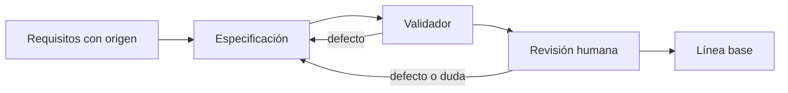
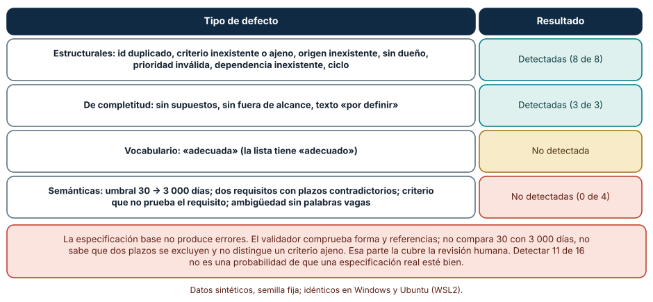
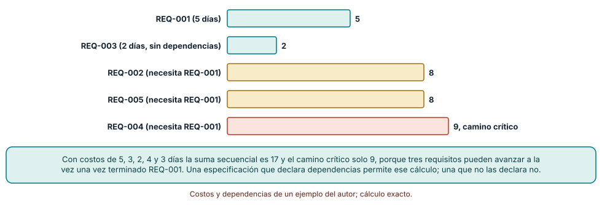
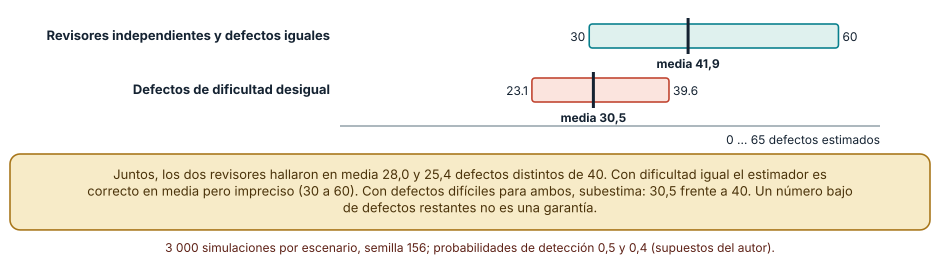

# SE-156 — Proyecto: especificación de requisitos revisable

[← SE-155 — Taller: reparar requisitos no verificables](../../classes/part-12-ingenieria-de-requisitos/se-155-taller-reparar-requisitos-no-verificables/README.md) · [↑ Parte 12](../../classes/part-12-ingenieria-de-requisitos/README.md) · [📚 Índice completo](../../classes/README.md) · [🌐 Portal](../../site/classes/SE-156.html) · [SE-157 — Especificación informal, semiformal y formal →](../../classes/part-13-especificaciones-contratos-y-modelos/se-157-especificacion-informal-semiformal-y-formal/README.md)

## Punto profesional y fundamento pedagógico

**Punto profesional.** El proyecto existe para reunir en un solo expediente lo que las once clases anteriores produjeron por separado —origen, reglas, calidad, relatos, ejemplos, orden, trazabilidad, obligaciones, línea base y defectos— de modo que otra persona pueda revisarlo, encontrar lo que falta y decidir si se puede construir sobre él sin pedir contexto.

**Por qué aparece aquí.** Se sitúa después de **Taller: reparar requisitos no verificables** y antes de la Parte 13 (**Especificación informal, semiformal y formal**): la Parte 12 enseñó a producir y a depurar requisitos; este proyecto los integra en una especificación con un validador y una revisión medida, y entrega a la Parte 13 un texto que se puede formalizar porque sus afirmaciones tienen origen, criterio y responsable.

**Error conceptual que debe corregir.** Creer que una especificación revisable es una especificación revisada, y que haber encontrado pocos defectos en una revisión prueba que quedan pocos.

**Secuencia de aprendizaje.** Antes de construir, predices qué defectos detectará un validador de estructura y cuáles escaparán, cuánto acorta el camino crítico declarar dependencias y cuántos defectos quedan si dos revisoras encontraron casi los mismos; después aplicas mutaciones, calculas, estimas por captura–recaptura y reconstruyes sin apoyo qué debe contener el expediente. La secuencia usa predicción, explicación propia, contraste y recuperación. [ICAP](https://icap.education.asu.edu/research) distingue participación de construcción de conocimiento; [How People Learn II](https://nap.nationalacademies.org/catalog/24783/how-people-learn-ii-learners-contexts-and-cultures) exige conectar conocimiento previo, contexto y transferencia; la [práctica de recuperación](https://pubmed.ncbi.nlm.nih.gov/16507066/) respalda producir de nuevo la explicación tras una demora; y [Education for Life and Work](https://nap.nationalacademies.org/resource/13398/dbasse_084153.pdf) exige devolución que explique la causa del error.

**Evidencia de aprendizaje.** `spec.md` (la especificación con problema, supuestos, fuera de alcance, requisitos con origen, criterio, dueño y prioridad, dependencias y línea base), `validate_spec.py` con sus pruebas, un registro de mutaciones detectadas y no detectadas, el cálculo del camino crítico y un informe de revisión por dos personas con la estimación de defectos restantes. Debe contener predicción previa, observación, explicación causal, contraejemplo, criterio de aceptación y una nota de qué dato haría cambiar la conclusión.

**Límite de la conclusión.** La especificación base de cinco requisitos, las 16 mutaciones, los costos y los parámetros de detección de las revisoras son sintéticos o supuestos del autor. No se revisó ninguna especificación real ni participó ninguna revisora humana.

### Trazabilidad fuente → afirmación

| Fuente primaria u oficial | Afirmación que respalda | Lo que no prueba |
|---|---|---|
| [ISO/IEC/IEEE 29148:2018](https://www.iso.org/standard/72089.html) | Define el contenido de una especificación de requisitos de software y las características de cada requisito. | El texto completo es de pago. |
| [Fagan, «Design and code inspections to reduce errors in program development» (1976)](https://doi.org/10.1147/sj.153.0182) | Describe una inspección con roles y criterios de entrada y salida. | No da una tasa de detección para otro equipo. |
| [Eick et al., «Estimating software fault content before coding» (1992)](https://doi.org/10.1145/143062.143090) | Aplica la captura–recaptura a las revisiones de diseño para estimar defectos remanentes. | Sus supuestos de independencia raras veces se cumplen. |
| [Zave y Jackson, «Four dark corners of requirements engineering» (1997)](https://doi.org/10.1145/237432.237434) | Distingue requisitos, supuestos y especificación, que el expediente debe mostrar por separado. | No es una plantilla. |
| [SWEBOK Guide v4.0a](https://www.computer.org/education/bodies-of-knowledge/software-engineering) | Sitúa la revisión de requisitos y su gestión dentro del conocimiento de la disciplina. | No fija un procedimiento. |
| [Python: unittest](https://docs.python.org/3/library/unittest.html) | Documenta las pruebas automatizadas del validador. | No define qué probar. |

## Antes de empezar

Retomas todo el expediente de la Parte 12: requisito conductor con origen (`SE-145`), reglas (`SE-146`), escenarios de calidad (`SE-147`), historias (`SE-148`), ejemplos (`SE-149`), orden (`SE-150`), trazabilidad (`SE-151`), obligaciones (`SE-152`), línea base (`SE-153`), defectos (`SE-154`) y reparaciones (`SE-155`). Recupera lo aprendido en `SE-132` (Parte 10): un validador de briefs detectó lo estructural y no lo semántico. La pregunta activa es: **¿qué debe tener este expediente para que otra persona decida, sin preguntarme, si se puede construir sobre él, y cómo estimo qué defectos le quedan?**

## Prerrequisitos

- Haber completado `SE-155` o poder explicar cómo se repara un requisito no verificable.
- Python 3.11 o posterior; `unittest` de la biblioteca estándar.
- Trabajar solo con requisitos, revisoras y defectos sintéticos.

## Problema auténtico

El equipo entrega a la Parte 13 un documento de 40 páginas. La primera lectora tarda un día en descubrir que un requisito cita un criterio que no existe, que otro tiene prioridad «Alta» (valor que la escala no admite) y que dos tienen plazos incompatibles. Pregunta: «¿cuántos defectos más hay?». Nadie sabe, y el equipo contesta que dos personas lo revisaron y encontraron casi lo mismo, lo cual suena tranquilizador.

## Objetivos observables

Al terminar podrás:

1. distinguir especificación, expediente de evidencia y línea base con un ejemplo y un contraejemplo de la plataforma;
2. escribir un validador de estructura, probarlo con mutaciones y declarar con una tabla qué defectos escapan;
3. calcular el camino crítico de los requisitos a partir de sus dependencias y explicar qué aporta declararlas;
4. estimar los defectos remanentes con captura–recaptura y explicar por qué la estimación subestima cuando los defectos son desiguales;
5. entregar un expediente que otra persona pueda revisar y decidir sin contexto adicional.

## Mapa conceptual



El mapa se lee de izquierda a derecha como un camino de calidad: la especificación se somete a un validador automático, luego a una revisión humana, y solo después se fija como línea base. Los retornos indican que cualquier defecto encontrado en un paso devuelve al texto; no hay paso final que libere sin la revisión humana.

## Temas y por qué importan

| Tema | Por qué cambia una decisión profesional | Evidencia mínima |
|---|---|---|
| Contenido de una especificación | Determina qué debe poder responder quien la lee sin preguntar. | Predicción, traza causal y contraejemplo de **Contenido de una especificación** en `spec.md` |
| Validador de estructura | Detecta defectos mecánicos y barre lo repetitivo antes de la revisión humana. | Predicción, traza causal y contraejemplo de **Validador de estructura** en `spec.md` |
| Dependencias y camino crítico | Muestran qué trabajo es secuencial y qué puede avanzar a la vez. | Predicción, traza causal y contraejemplo de **Dependencias y camino crítico** en `spec.md` |
| Revisión por pares | Encuentra lo que el validador no ve, con límites que hay que conocer. | Predicción, traza causal y contraejemplo de **Revisión por pares** en `spec.md` |
| Decisión de entrega | Define cuándo la especificación es lo bastante buena para construir sobre ella. | Predicción, traza causal y contraejemplo de **Decisión de entrega** en `spec.md` |

## Conceptos y decisiones

### 1. Contenido de una especificación

Una especificación revisable responde, sin que su autor esté presente: cuál es el problema y a quién afecta; qué se supone del mundo; qué queda fuera; cuáles son los requisitos, cada uno con origen, texto singular y verificable, criterio de aceptación, dueño y prioridad; cómo se relacionan (dependencias); qué obligaciones externas hay y quién las interpretó; qué línea base representa; y qué defectos conocidos quedan abiertos. Falta cualquiera y la lectora tendrá que preguntar, que es exactamente lo que el expediente debe evitar.

### 2. Validador de estructura

Un validador comprueba lo que una máquina puede decidir: identificadores únicos, referencias que existen, campos obligatorios, valores de una escala, ausencia de ciclos, marcadores como «por definir». Su valor es liberar a las personas de lo mecánico para que lean lo que importa; su límite es que no entiende el contenido. Una especificación que pasa el validador no está bien: está bien formada. Las pruebas del validador, con defectos inyectados, son la forma de saber qué cubre.

### 3. Dependencias y camino crítico

Si los requisitos declaran de qué dependen y cuánto cuesta cada uno, el camino crítico —la cadena de dependientes más larga— es el mínimo de tiempo con recursos ilimitados, y el resto del trabajo puede avanzar en paralelo. Es una consecuencia directa de haber escrito el grafo; sin él, la planificación supone que todo es secuencial o que todo es independiente. Un ciclo en el grafo es un defecto de la especificación, no del plan.

### 4. Revisión por pares

Una revisión estructurada, con lectoras que usan criterios distintos, encuentra lo que el validador no puede: contradicciones semánticas, umbrales absurdos, criterios que no prueban el requisito. Para saber cuánto falta, la captura–recaptura toma prestada una idea de la ecología: si dos revisoras encuentran n₁ y n₂ defectos y coinciden en m, el total estimado es n₁·n₂/m. Funciona si las revisoras son independientes y todos los defectos son igual de fáciles de encontrar; cuando algunos son difíciles para ambas, subestima.

### 5. Decisión de entrega

Entregar una especificación es una decisión con riesgo, no un hito de calendario. Los criterios de salida deben ser comprobables: el validador no produce errores, las mutaciones no detectadas están documentadas, las dos revisiones se hicieron con criterios distintos, los defectos abiertos tienen responsable y el defecto estimado restante es conocido con su incertidumbre. Lo que se entrega incluye lo que se sabe que falta.

### Un validador y dieciséis defectos inyectados

La especificación base sintética tiene un problema, supuestos, un fuera de alcance, cinco requisitos (`REQ-001` a `REQ-005`) con origen, criterio, dueño, prioridad y dependencias, y sus cinco criterios. El validador comprueba: identificadores únicos; criterio existente y que apunte al requisito; origen existente; dueño presente; prioridad en {Must, Should, Could, Won't}; texto sin palabras de una lista (rápido, fácil, adecuado, etc., oportunamente…) ni marcadores «por definir»; dependencias existentes; ausencia de ciclos; presencia de supuestos y fuera de alcance; problema de al menos seis palabras. La base no produce errores. Se aplican 16 mutaciones, una a una. Predicción: detectará las estructurales y las de completitud, y no las semánticas.

```python
def validar(s):
    errores = []
    ids = [r["id"] for r in s["requisitos"]]
    if len(ids) != len(set(ids)): errores.append("id duplicado")
    criterios = {c["id"]: c for c in s["criterios"]}
    for r in s["requisitos"]:
        if r["criterio"] not in criterios: errores.append(f"{r['id']}: criterio inexistente")
        elif criterios[r["criterio"]]["req"] != r["id"]: errores.append(f"{r['id']}: criterio de otro requisito")
        # origen, dueño, prioridad, palabras vagas, TBD, dependencias, ciclos...
    return errores
```

Resultado, idéntico en Windows y Ubuntu: detecta 11 de las 16. Detecta las ocho estructurales (id duplicado, criterio inexistente, criterio de otro requisito, origen inexistente, sin dueño, prioridad inválida, dependencia inexistente, ciclo) y las tres de completitud (sin supuestos, sin fuera de alcance, «por definir»). No detecta: «de forma adecuada» (la lista tiene «adecuado», no «adecuada»), cambiar el plazo de 30 a 3 000 días, añadir un requisito que fija 365 días mientras otro fija 30 (cada uno bien formado), un criterio que no prueba su requisito y una frase ambigua sin palabras vagas. Cinco defectos escapan: uno por vocabulario y cuatro semánticos. Detectar 11 de 16 no es una probabilidad de que una especificación real esté bien.



**Cómo leer la figura.** Cada fila agrupa mutaciones de un tipo; la columna derecha dice si el validador las detectó. **Dónde deja de valer:** las 16 mutaciones las eligió el autor para ilustrar categorías; un equipo comete otros defectos. La lista de palabras vagas es un ejemplo de por qué una regla léxica fracasa con la flexión; añadir «adecuada» arregla ese caso y no la clase. El validador no sustituye a la lectura.

### Declarar dependencias da un camino crítico

Los cinco requisitos tienen costos supuestos de 5, 3, 2, 4 y 3 días y dependencias: `REQ-002`, `REQ-004` y `REQ-005` dependen de `REQ-001`; `REQ-003` es independiente. Predicción: el camino crítico será mucho menor que la suma porque tres requisitos pueden avanzar a la vez.

```python
def largo(x):
    r = indice[x]
    return costo[x] + max((largo(d) for d in r["depende"]), default=0)
```

Resultado: acumulados mínimos de 5 días para `REQ-001`, 8 para `REQ-002`, 2 para `REQ-003`, 9 para `REQ-004` y 8 para `REQ-005`. La suma secuencial es 17 días y el camino crítico 9 (`REQ-001` seguido de `REQ-004`). Con ilimitados recursos, el trabajo se termina en 9 días en lugar de 17; con recursos limitados el resultado cae en medio. Si alguien introduce el ciclo `REQ-001` → `REQ-002` → `REQ-001`, el validador lo señala y el cálculo recursivo no termina (agota la pila). El grafo no solo ordena, también informa de dónde está el riesgo de calendario.



**Cómo leer la figura.** Cada barra es un requisito y su longitud el tiempo acumulado mínimo hasta terminarlo; la barra coral marca el camino crítico. **Dónde deja de valer:** costos y dependencias son un ejemplo del autor y no consideran recursos limitados, riesgo ni trabajo parcial entre requisitos. El camino crítico es un mínimo teórico, no una predicción de fecha.

### Dos revisoras y los defectos que quedan

Una especificación sintética tiene 40 defectos reales (el autor lo sabe; las revisoras no). Dos revisoras los buscan de forma independiente: la primera encuentra cada defecto con probabilidad 0,5 y la segunda con 0,4. Si n₁ y n₂ son los hallados por cada una y m los comunes, el estimador de Lincoln–Petersen da n₁·n₂/m. Predicción: con defectos igual de fáciles el estimador será correcto en promedio pero impreciso; con dificultad desigual, subestimará.

```python
a = {i for i in range(N) if rng.random() < q1[i]}
b = {i for i in range(N) if rng.random() < q2[i]}
estimacion = len(a) * len(b) / len(a & b)    # si hay al menos un defecto en común
```

Con 3 000 simulaciones por escenario (semilla 156): con defectos de igual dificultad, la estimación media es 41,9 (percentil 5: 30,0; percentil 95: 60,0) y en promedio las dos revisoras encuentran juntas 28,0 defectos distintos de los 40; con dificultad desigual (probabilidad proporcional a 1 − d, con d uniforme), la estimación media es 30,5 (23,1 a 39,6) y encuentran juntas 25,4. El estimador acierta en promedio en el primer caso, pero con un rango de 30 a 60 no sirve para decir «quedan pocos». En el segundo caso subestima de forma sistemática: dice que hay 30 cuando hay 40, porque los difíciles no los ve ninguna de las dos y por tanto no cuentan en el cociente.



**Cómo leer la figura.** Cada barra es el rango del 5 al 95 por ciento de la estimación del total de defectos y la marca negra su media; el total real es 40. **Dónde deja de valer:** las probabilidades de 0,5 y 0,4 y la forma de la dificultad son supuestos del autor; revisoras reales no son independientes (leen lo mismo y se influyen). La estimación es un argumento para pedir una tercera revisión con otro criterio, no un recuento de lo que falta.

## Definiciones de trabajo

- **contenido de una especificación:** conjunto de elementos que permite a una lectora decidir sin preguntar: problema, supuestos, alcance, requisitos con origen y criterio, dependencias y línea base.
- **validador de estructura:** programa que comprueba propiedades mecánicas de la especificación y falla con un mensaje identificable.
- **camino crítico:** cadena de requisitos dependientes de mayor duración acumulada, que fija el mínimo de tiempo con recursos ilimitados.
- **revisión por pares:** lectura estructurada por personas con criterios distintos, que busca los defectos que una máquina no ve.
- **decisión de entrega:** juicio explícito, con criterios de salida comprobables y defectos conocidos, sobre si se puede construir sobre la especificación.

Las definiciones son operativas para la plataforma de entregas. No convierten términos con una historia más amplia en sinónimos y deben contrastarse con la documentación primaria enlazada al final.

## Ejemplo mínimo

El fragmento siguiente estima defectos con dos revisoras. Antes de ejecutarlo, predice si la estimación es mayor o menor que lo hallado en total.

```python
a = {1, 2, 3, 4, 5, 6, 7, 8}      # revisora 1: 8 defectos
b = {5, 6, 7, 8, 9, 10}           # revisora 2: 6 defectos, 4 comunes
estimado = len(a) * len(b) / len(a & b)     # 8 * 6 / 4 = 12
assert estimado == 12 and len(a | b) == 10
```

Se hallaron 10 defectos distintos y la estimación total es 12: quedarían unos 2 sin encontrar. Registra versión del intérprete, comando y salida. La conclusión no es «faltan 2» sino «hay una cota inferior de 10 y una estimación de 12 con mucha incertidumbre».

## Ejemplo profesional

El encabezado de la especificación entregada y el registro de revisión que la acompaña:

```text
SPEC-PLAT-01  Línea base 2 (etiqueta baseline-2).  Hash normalizado: registrado.   Validador: 0 errores (versión 1.3).
Problema: los estudiantes pierden el borrador cuando la sesión expira.   Supuestos: SUP-01 (sesión de 30 min), SUP-02 (almacenamiento local persistente).
Fuera de alcance: edición colaborativa.   Obligaciones: OBL-02 (interpretación: privacidad).
Revisión: R1 (criterio funcional) 14 defectos, R2 (criterio de seguridad y datos) 11, comunes 6 → estimado 25.7, hallados 19, remanentes estimados ≈ 7 (con alta incertidumbre).
Mutaciones: 16, detectadas 11; las 5 no detectadas están en el registro con la revisión que debe cubrirlas.
Defectos abiertos: DEF-03 (retiro en revisión), responsable docencia, fecha 2026-03-20.
```

Los identificadores, los números de la revisión y las fechas son ilustrativos. Compara con la especificación que se entrega sin el registro de lo que el validador no cubre, con la revisión hecha por dos personas con el mismo criterio y con la entrega que oculta los defectos abiertos. El expediente es apropiado cuando una lectora nueva puede decidir; es peligroso cuando la calidad se afirma sin evidencia.

## Práctica guiada

1. Reúne el expediente de la Parte 12 en `spec.md` y lista qué falta para cada campo obligatorio.
2. Predice qué defectos detectará tu validador y cuáles no, antes de ejecutarlo.
3. Escribe `validate_spec.py` y sus pruebas; aplica las 16 mutaciones y guarda el registro bajo `evidence/`.
4. Declara dependencias y costos, y calcula el camino crítico.
5. Pide a dos personas que revisen con criterios distintos y calcula la estimación de defectos remanentes.
6. Registra los defectos abiertos con responsable y fecha, y fija la línea base.
7. Pide a otra persona que decida si se puede construir sobre `spec.md`, sin consultarte.

## Ejercicios

1. **Mutación:** añade dos mutaciones que tu validador no detecte y una que sí; actualiza el registro.
2. **Vocabulario:** corrige la regla léxica para cubrir la flexión de «adecuado» y explica por qué no resuelve la clase de defectos.
3. **Camino:** cambia el costo de `REQ-001` a 10 días y explica cómo cambia el camino crítico y la ventaja del paralelismo.
4. **Revisión:** repite la estimación con tres revisoras y explica qué información adicional aporta y qué supuesto sigue sin cumplirse.

## Reto verificable

Entrega `spec.md`, `validate_spec.py` con sus pruebas, el registro de 16 mutaciones con detectadas y no detectadas, el camino crítico y el informe de dos revisiones con la estimación de remanentes. Se aprueba si otra persona ejecuta el validador y las pruebas desde un checkout limpio, obtiene los mismos resultados y decide, solo con el expediente, si puede construir sobre él y qué riesgos acepta. No se aprueba por un validador sin pruebas, una revisión de una sola persona ni por ocultar los defectos abiertos.

## Caso conductor

La plataforma de entregas llega aquí a su especificación revisable: el requisito conductor de `SE-145` tiene origen, reglas, calidad, relatos, ejemplos, prioridad, trazabilidad, obligaciones, línea base, defectos y reparaciones. La Parte 13 tomará este expediente y se preguntará cómo expresarlo con mayor formalidad: especificaciones informales, semiformales y formales, contratos y modelos. Cambia después una sola decisión —por ejemplo, la política de retención— y revisa qué partes del expediente, de las pruebas y de la línea base deben actualizarse.

## Preguntas frecuentes

### ¿Si el validador no da errores, la especificación es correcta?

No. Da por buena la forma, no el contenido. En el experimento, 5 de 16 defectos pasaron limpios: un plazo absurdo, dos requisitos incompatibles bien formados, un criterio ajeno al requisito y una frase ambigua. El validador libera tiempo para la revisión humana; no la reemplaza.

### ¿Cuántas revisoras hacen falta?

Al menos dos, con criterios distintos, para poder estimar los defectos que quedan. Con tres o más la estimación mejora, pero el supuesto de independencia seguirá sin cumplirse. Lo importante es que los criterios difieran (funcional, seguridad y datos, pruebas) y que se registre qué cubrió cada una.

### ¿Cuándo es lo bastante buena para entregarla?

Cuando se cumplen los criterios de salida que acordaste antes de empezar: validador sin errores, mutaciones no detectadas documentadas, dos revisiones con criterios distintos, defectos abiertos con responsable y una estimación de remanentes con su incertidumbre. No hay un número de defectos «aceptable» universal; lo hay para tu contexto y riesgo.

### ¿Puede un modelo de lenguaje revisar la especificación?

Puede hacer una tercera lectura con un criterio más y proponer candidatos de defecto, y su aporte se evalúa igual que el de una revisora: cuántos defectos reales encuentra y cuántos inventa. No lo cuentes como independiente de las otras si tiene acceso a sus notas, y no le entregues especificaciones confidenciales sin una política de datos.

## Fallo controlado y diagnóstico

Reproduce el fallo clásico del proyecto: **entregar una especificación que pasa el validador y confiar en que está bien**. Toma la especificación base, aplica la mutación «umbral 30 → 3 000 días» y ejecuta el validador.

Registra síntoma, entrada mínima, hipótesis, observación que descarta cada hipótesis, causa, corrección y prueba de regresión. **Síntoma:** el validador informa cero errores y el requisito de borrado ahora exige conservar el borrador 3 000 días. **Hipótesis rivales:** (a) el validador falló; (b) el validador no mira valores. **Prueba:** ejecuta el validador sobre la base y sobre la mutación: ambas dan cero errores; lee las reglas: ninguna compara valores con una fuente. **Conclusión:** el defecto era semántico, fuera del alcance del validador. **Regresión:** añade a la lista de revisión humana la comprobación «los valores numéricos coinciden con la obligación o el escenario de origen» y a las pruebas una verificación que compare el valor con el de la obligación enlazada. No cambies a la vez el validador y el criterio de revisión.

## Errores comunes y cómo corregirlos

| Síntoma | Causa probable | Corrección |
|---|---|---|
| La lectora tarda un día en entender qué falta | El expediente no responde sin su autor | Revisar el contenido contra la lista de elementos obligatorios |
| El validador pasa y la especificación tiene errores graves | Solo comprueba estructura | Documentar su cobertura con mutaciones y completar con revisión humana |
| Las dos revisiones encuentran lo mismo y se concluye que no hay más | Mismo criterio y dificultad desigual | Cambiar el criterio de la segunda revisora y no tomar la coincidencia como cobertura |
| El plan supone que todo es secuencial | Las dependencias no están declaradas | Escribir el grafo y calcular el camino crítico |
| Se entrega ocultando lo que no se sabe | El expediente solo registra lo resuelto | Incluir defectos abiertos, mutaciones no detectadas y la estimación de remanentes |

## Entorno y archivos clave

```text
work/SE-156/
├── README.md
├── spec.md
├── validador/
│   ├── validate_spec.py
│   ├── mutaciones.py
│   └── camino_critico.py
├── fixtures/spec.json
├── tests/test_validate_spec.py
└── evidence/
    ├── mutations.md
    └── review-report.md
```

El `README` declara plataforma, versión de Python, semilla y comandos. El validador, las pruebas y las simulaciones usan solo la biblioteca estándar (`copy`, `re`, `random`, `unittest`) y se ejecutaron con CPython 3.12.9 en Windows 11 y 3.12.3 en Ubuntu bajo WSL2; las salidas fueron idénticas. Esta parte no tiene laboratorio propio en `labs/`; este proyecto define el contrato y la evidencia. Si añades una dependencia, fija procedencia y versión.

## Seguridad, ética y accesibilidad

- una especificación puede contener información confidencial de la organización: define con quién se comparte y en qué formato;
- revisar a personas por los defectos que encuentran puede convertir una práctica de calidad en vigilancia: mide la revisión, no a las revisoras;
- los defectos abiertos que afectan a seguridad, privacidad o accesibilidad deben escalarse, no archivarse;
- entrega el expediente en un formato accesible y con lenguaje claro, con alternativa textual para cada figura;
- no uses un modelo de lenguaje con especificaciones confidenciales sin una política de datos que lo permita;
- respeta licencias de plantillas y atribuye adaptaciones.

## Puente hacia el trabajo con agentes

Un agente al que se le pide «revisa esta especificación y dime si está lista» devolverá una lista de observaciones y probablemente concluirá que está en buen estado. Pídele en cambio que ejecute el validador y reporte sus errores, que proponga mutaciones nuevas y mida cuáles detecta, que haga una revisión con un criterio que le indiques y que entregue sus defectos con la línea de origen, para estimar su aporte con los de las otras revisoras. Revisa especialmente si declara «lista» sin la evidencia del validador, las mutaciones y la estimación de remanentes: es un veredicto, no un resultado.

## Transferencia

Traslada el proyecto a otro dominio (por ejemplo, un servicio de reservas): cambia el problema, los requisitos y las obligaciones, conserva el validador con mutaciones, el camino crítico y la estimación de remanentes, y comprueba qué defectos escapan en el nuevo contexto. La transferencia está lograda cuando puedes explicar qué parte del método dependía del dominio y cuál no, no cuando el código se parece.

## Evaluación y evidencia

| Criterio | Evidencia para aprobar |
|---|---|
| comprensión | explicación causal de qué hace revisable a una especificación, con ejemplo y contraejemplo |
| corrección | resultados reproducibles del validador, las mutaciones, el camino crítico y la estimación |
| diseño | expediente con problema, supuestos, requisitos con origen y criterio, dependencias y línea base |
| diagnóstico | reproducción del fallo «pasa el validador y está mal» con regresión |
| incertidumbre | estimación de defectos remanentes con rango y supuestos declarados |
| reproducibilidad | versiones, comandos, salida y límites declarados |

## Fuentes

- [ISO/IEC/IEEE 29148:2018](https://www.iso.org/standard/72089.html) — contenido de una especificación y características de los requisitos; autoridad: ISO, IEC e IEEE.
- [Fagan: Design and code inspections to reduce errors in program development (1976)](https://doi.org/10.1147/sj.153.0182) — inspecciones con roles; autoridad: IBM Systems Journal.
- [Eick et al.: Estimating software fault content before coding (1992)](https://doi.org/10.1145/143062.143090) — captura–recaptura aplicada a revisiones; autoridad: ACM, International Conference on Software Engineering.
- [Zave y Jackson: Four dark corners of requirements engineering (1997)](https://doi.org/10.1145/237432.237434) — requisitos, supuestos y especificación; autoridad: ACM Transactions on Software Engineering and Methodology.
- [SWEBOK Guide v4.0a](https://www.computer.org/education/bodies-of-knowledge/software-engineering) — revisión y gestión de requisitos; autoridad: IEEE Computer Society.

Cada fuente respalda el mecanismo indicado; ninguna demuestra que la especificación de la plataforma de entregas sea correcta o completa. Esa afirmación depende de la revisión de personas con criterios distintos y de la evidencia que acompaña al expediente.

- [Python: `unittest`](https://docs.python.org/3/library/unittest.html) — pruebas automatizadas del validador.
- [Python: `random`](https://docs.python.org/3/library/random.html) — generador con semilla de la simulación de revisoras.
- [Python: `re`](https://docs.python.org/3/library/re.html) — expresiones regulares del validador.

## Límites y siguiente paso

Se ejecutaron tres experimentos con datos sintéticos en Windows y Ubuntu (WSL2) con resultados idénticos. La especificación base, las 16 mutaciones, los costos y las probabilidades de detección son supuestos del autor, la lista de palabras vagas es un ejemplo mínimo y no participó ninguna revisora real. La Parte 13 toma este expediente y estudia cómo expresarlo con mayor formalidad: especificaciones, contratos y modelos.

## Glosario

- **contenido de una especificación:** conjunto de elementos que permite a una lectora decidir sin preguntar: problema, supuestos, alcance, requisitos con origen y criterio, dependencias y línea base.
- **validador de estructura:** programa que comprueba propiedades mecánicas de la especificación y falla con un mensaje identificable.
- **camino crítico:** cadena de requisitos dependientes de mayor duración acumulada, que fija el mínimo de tiempo con recursos ilimitados.
- **revisión por pares:** lectura estructurada por personas con criterios distintos, que busca los defectos que una máquina no ve.
- **decisión de entrega:** juicio explícito, con criterios de salida comprobables y defectos conocidos, sobre si se puede construir sobre la especificación.

---

[← SE-155 — Taller: reparar requisitos no verificables](../../classes/part-12-ingenieria-de-requisitos/se-155-taller-reparar-requisitos-no-verificables/README.md) · [↑ Parte 12](../../classes/part-12-ingenieria-de-requisitos/README.md) · [📚 Índice completo](../../classes/README.md) · [🌐 Portal](../../site/classes/SE-156.html) · [SE-157 — Especificación informal, semiformal y formal →](../../classes/part-13-especificaciones-contratos-y-modelos/se-157-especificacion-informal-semiformal-y-formal/README.md)
