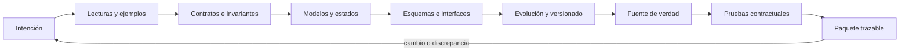

# Parte 13 — Especificaciones, contratos y modelos

La Parte 12 terminó con requisitos que otra persona puede revisar. La pregunta cambia de «qué se espera» a «cuánta libertad deja a quien lo implementa y cómo lo comprobaríamos». Esta parte trabaja sobre la **plataforma de entregas de tareas**, un caso sintético cuya regla de penalización por entrega tardía recorre las doce clases: una frase con dieciséis lecturas, ejemplos que separan variantes, afirmaciones válidas para todos los casos, entidades y estados, esquemas, interfaces, cambios que no rompen a nadie, una fuente de verdad, pruebas que ejecutan la especificación y un paquete que otra persona revisa siguiendo enlaces.

## Pregunta rectora

> ¿Qué comportamiento se promete, qué queda fuera y cómo evoluciona sin romper a quien lo usa?

## Antes del recorrido clase por clase

Esta parte no enseña una notación. Enseña a medir cuánta ambigüedad queda en una redacción, a elegir ejemplos por lo que separan, a escribir afirmaciones que se ejecutan, a explorar todos los estados de una entidad, a validar datos sin abrir una vía de ataque, a describir interfaces síncronas y asíncronas, a cambiar un contrato sin romper a nadie, a decidir qué papel tiene la especificación frente al código, a proteger a los consumidores con pruebas contractuales y a entregar un paquete cuyos enlaces se comprueban. Cada clase ejecuta experimentos con datos sintéticos que muestran un mecanismo (un ejemplo típico que elimina la mitad de las lecturas, un patrón que tarda segundos, una huella distinta entre sistemas) y declara lo que ese experimento no demuestra.

El diagrama se lee de izquierda a derecha y no es un proceso obligatorio. El retorno indica que un cambio de política, una discrepancia entre especificación y código o una prueba que falla reabre la intención; un paquete aprobado no cierra el contrato, lo fecha.

## Resultados acumulativos

Podrás contar las lecturas que admite un enunciado y medir cuántas elimina cada ejemplo; elegir ejemplos que matan variantes defectuosas; escribir precondiciones, postcondiciones e invariantes y aplicar la regla de subtipado conductual; comprobar un modelo y su deriva respecto del código; explorar los estados de una entidad y obtener la traza más corta de una violación; escribir un esquema y reconocer qué no valida; describir una interfaz y simular eventos duplicados y reordenados; clasificar cambios de contrato según el lector; decidir el nivel de uso de la especificación por artefacto; escribir contratos de consumidor y propiedades con reducción; convertir una intención en cláusulas y un contrato con un revisor cuyas fallas conoces; y entregar un paquete con identificadores, enlaces, huellas y decisiones humanas abiertas.

Al finalizar podrás defender un contrato con ejemplos que separan, comprobaciones mecánicas con sus límites medidos, una política de evolución, un responsable y una lista de lo que ninguna herramienta ve, y podrás indicar qué parte de tu conclusión es observación, cuál es inferencia y cuál es suposición.

## Prerrequisitos enlazados

- [Parte 4 — Pensamiento computacional](../../classes/part-04-pensamiento-computacional-y-resolucion-de-problemas/): modelado, invariantes y razonamiento sobre evidencia.
- [Parte 7 — Estructuras de datos y algoritmos](../../classes/part-07-estructuras-de-datos-y-algoritmos/): medir, comparar y no confundir un resultado con un modelo.
- [Parte 9 — Bibliotecas, paquetes, SDK y automatización](../../classes/part-09-bibliotecas-paquetes-sdk-y-automatizacion/): contratos que otra persona consume y compatibilidad entre versiones.
- [Parte 12 — Ingeniería de requisitos](../../classes/part-12-ingenieria-de-requisitos/): requisitos revisables que esta parte convierte en contratos comprobables.
- Python 3.11+ y terminal; los experimentos usan solo la biblioteca estándar y datos sintéticos.

## Bloques y progresión

1. **Precisar la promesa:** las clases 157–159 pasan de la prosa al ejemplo y a la afirmación válida para todos los casos, midiendo cuánta ambigüedad queda en cada nivel.
2. **Modelar y verificar:** las clases 160–161 describen estructura, información y comportamiento, y exploran todos los estados alcanzables.
3. **Describir lo que viaja:** las clases 162–164 describen la forma de los datos, las interfaces y la evolución de los contratos sin romper a los consumidores.
4. **Mantener la verdad y probarla:** las clases 165–166 deciden el papel de la especificación frente al código y la ejecutan con pruebas contractuales.
5. **Aplicar e integrar:** las clases 167–168 convierten una intención en un contrato comprobable y reúnen todo en un paquete trazable.

## Evidencia medida y límites

Las figuras y los ejemplos de esta parte usan experimentos ejecutados con CPython 3.12.9 en Windows 11 y repetidos con CPython 3.12.3 en Ubuntu bajo WSL2. Los datos son **sintéticos** y las semillas están fijadas: las salidas fueron idénticas en ambos sistemas salvo cuatro tipos de diferencia que se informan como resultados: los tiempos de enumeración, de sobrecoste de contratos, de expresiones regulares y de cálculo de huellas (medidas de un equipo), la versión de SQLite (3.45.3 en Windows y 3.45.1 en Ubuntu, con las mismas cifras), la latencia de un servidor HTTP local (de 0,5 a 0,9 ms según la ejecución, frente a 0,2 a 0,3 µs de un doble en proceso) y la huella de un paquete de 200 archivos, que con el modo de texto por defecto fue `480485af12cf44f9` en Windows y `55f841e9f3d4b56f` en Ubuntu, y con el salto de línea fijado fue `55f841e9f3d4b56f` en ambos.

Los experimentos son: dieciséis lecturas de una frase, huecos y solapes de una tabla de decisión y detección de un defecto de frontera con muestreo y con enumeración (`SE-157`); once variantes defectuosas frente a tres suites, un ejecutor mínimo de Gherkin y cobertura de pares (`SE-158`); nueve defectos de una clase con contratos, un subtipo que refuerza una precondición y la frecuencia de comprobación de un invariante (`SE-159`); un comprobador estructural con 300 mutaciones, la deriva entre modelo y código con `ast` y la normalización en SQLite (`SE-160`); una búsqueda en anchura con contraejemplo, la explosión de estados con y sin simetría y todos los intercalados de una carrera frente a hilos reales (`SE-161`); un esquema con reglas entre campos, esquemas abiertos y cerrados y una expresión regular con retroceso (`SE-162`); un linter de un documento OpenAPI, bytes y resolvedores de una consulta y eventos duplicados y reordenados (`SE-163`); diez cambios de esquema y tres tipos de lector, consumidores rotos por lanzamiento y una ventana de deprecación (`SE-164`); duración de la deriva, regeneración sobre ediciones manuales y un generador que depende de la semilla de hash (`SE-165`); contratos de consumidor frente a pruebas del proveedor, reducción de contraejemplos y un servidor local frente a un doble (`SE-166`); un linter de cláusulas, un bucle de contraejemplos y la mutación de un contrato (`SE-167`); y un validador de trazabilidad con 240 mutaciones, el alcance de un cambio y la huella de un paquete (`SE-168`).

Los parámetros (las dieciséis lecturas, los once y los 255 mutantes, los cinco consumidores, la mezcla de cambios, el 10 % de consumidores abandonados, el 15 % de duplicados y el 20 % de reordenamientos de eventos, el 8 % de deriva por commit, los grafos de cinco capas) son supuestos del autor, no datos de un producto, una institución ni de personas reales. Las reglas léxicas se ajustaron con pocos ejemplos y se evaluaron con casos nuevos mínimos (seis cláusulas): su exactitud real es desconocida. No se usó ninguna herramienta de producción (Cucumber, TLA+, SPIN, Pact, Hypothesis, un linter OpenAPI, un broker), no se auditó ninguna API ni se entrevistó a nadie. Esta parte no tiene laboratorio propio en `labs/`; el proyecto integrador `SE-168` define el paquete y la evidencia. Cada clase termina con un puente hacia el trabajo con agentes.

## Guía razonada clase por clase

La plataforma de entregas mantiene una regla, un conjunto de ejemplos y un paquete estables mientras cambian las decisiones. Cada clase explica qué ambigüedad reduce, qué experimento la muestra, qué no demuestra y qué evidencia permite abandonar la conclusión.

### Bloque 1 — Precisar la promesa

#### SE-157 — Especificación informal, semiformal y formal

Una frase como «la entrega tardía se penaliza» admite varios comportamientos y la prosa, la tabla y el predicado reducen esa ambigüedad a costos distintos. La clase ejecuta dieciséis lecturas de una frase, mide qué elimina un ejemplo típico, comprueba una tabla de decisión por enumeración y compara el muestreo con la comprobación exhaustiva.

El estudiante escribe la regla en tres niveles y declara por qué eligió cada uno. `SE-158` pregunta cómo se eligen los ejemplos que separan las lecturas.

#### SE-158 — Specification by Example y BDD

Un conjunto de ejemplos no es una especificación completa: vale por lo que separa. La clase mide qué variantes defectuosas matan tres suites, comprueba la forma de unos escenarios con un ejecutor mínimo y reduce una tabla de 81 filas a 9 con cobertura de pares, declarando lo que esa reducción deja sin cubrir.

El estudiante escribe escenarios declarativos y una suite elegida por su poder de discriminación. `SE-159` generaliza lo que esos ejemplos tienen en común.

#### SE-159 — Contratos, invariantes y diseño por contrato

Una afirmación que vale para todos los casos se ejecuta y localiza el defecto donde ocurre. La clase mide qué detectan los contratos frente a cinco pruebas de ejemplo, calcula qué rompe un subtipo que refuerza una precondición y compara comprobar un invariante en cada operación, cada veinte o al final.

El estudiante escribe los contratos de una clase y descubre qué afirmación faltaba. `SE-160` pasa de una clase a las entidades del sistema y a sus relaciones.

### Bloque 2 — Modelar y verificar

#### SE-160 — Modelos estructurales, conductuales y de información

Un modelo útil responde a una pregunta y se comprueba contra el sistema. La clase mide qué defectos detecta un comprobador estructural y cuáles no, compara dos criterios de deriva con `ast` y mide en SQLite qué elimina la normalización y qué cuesta.

El estudiante entrega un modelo comprobable y declara qué pregunta responde. `SE-161` toma la entidad `Entrega` y pregunta cómo se explora su comportamiento.

#### SE-161 — Máquinas de estado y model checking introductorio

Explorar todos los estados da certeza dentro del modelo y un contraejemplo mínimo si falla. La clase obtiene la traza de cuatro pasos de un defecto de apelación, mide cómo crece el número de estados con la concurrencia y compara todos los intercalados de una carrera con diez ejecuciones de hilos reales.

El estudiante entrega la tabla de transiciones, el verificador y la traza. `SE-162` pasa a lo que viaja entre esas entidades.

### Bloque 3 — Describir lo que viaja

#### SE-162 — Esquemas de datos y validación

Un esquema comprueba forma, no verdad, y la validación puede ser una vía de ataque. La clase mide qué fracción de documentos válidos viola una regla entre campos, qué atrapa un esquema abierto frente a uno cerrado y cuánto tarda un patrón con retroceso.

El estudiante escribe el esquema, las reglas entre campos y una defensa de longitud. `SE-163` coloca ese esquema dentro de contratos de interfaz.

#### SE-163 — OpenAPI, AsyncAPI, GraphQL y contratos de eventos

Un documento de interfaz puede mentir con sintaxis válida, y un evento llega duplicado o desordenado salvo que el contrato diga otra cosa. La clase mide qué defectos de un documento OpenAPI atrapa un linter, calcula bytes y resolvedores de una consulta y simula eventos con consumidores ingenuos e idempotentes.

El estudiante entrega el contrato de la API, las garantías de entrega de los eventos y una política de coste. `SE-164` pregunta cómo cambia ese contrato.

#### SE-164 — Compatibilidad, versionado y evolución de contratos

La compatibilidad depende de la dirección del cambio y del tipo de lector. La clase mide diez cambios con tres lectores, estima cuántos consumidores rompe una mezcla de cambios según la proporción de lectores estrictos y simula cuánto tarda en vaciarse una versión.

El estudiante escribe la política de versionado con criterio de ruptura, aviso y ventana. `SE-165` pregunta quién es dueño del contrato, la especificación o el código.

### Bloque 4 — Mantener la verdad y probarla

#### SE-165 — Spec-first, spec-anchored y spec-as-source

El papel de la especificación se elige por artefacto y exige un mecanismo que lo sostenga. La clase mide cuánto dura una deriva según la frecuencia de comprobación, qué se pierde al regenerar sobre ediciones manuales y qué cambia en un generador que no ordena su salida.

El estudiante declara el nivel de cada artefacto y su mecanismo. `SE-166` convierte la comprobación de firmas en pruebas que ejecutan la especificación.

#### SE-166 — Especificaciones ejecutables y pruebas contractuales

Un proveedor que genera su esquema desde su código siempre se aprueba a sí mismo, y un doble puede seguir pasando después del cambio. La clase mide qué consumidores rompe cada uno de ocho cambios, reduce un contraejemplo de 22 elementos a tres y compara un servidor local real con un doble.

El estudiante entrega contratos de consumidor, una propiedad con reductor y una verificación del doble. `SE-167` los integra en un taller.

### Bloque 5 — Aplicar e integrar

#### SE-167 — Taller: convertir intención en contrato comprobable

Ningún revisor mecánico ve el contrato más permisivo ni el mensaje que miente. El taller recorre intención, cláusulas, ejemplos por contraejemplo y mutación del contrato, y evalúa con casos nuevos un linter que acertó 8 de 8 con su conjunto de ajuste.

El estudiante deja el contrato, el registro de mutaciones y una lista de decisiones humanas abiertas. `SE-168` lo empaqueta con trazabilidad.

#### SE-168 — Proyecto: paquete de especificaciones trazables

Un paquete es trazable si sus enlaces se comprueban y no se confunde la huella con el sentido. El proyecto valida 41 artefactos con 240 mutaciones, estima el alcance de un cambio según la densidad de enlaces y calcula la huella del paquete en dos sistemas.

El estudiante entrega el paquete, el validador y la lista de lo que no detecta. La Parte 14 diseña la experiencia de las personas que usarán la plataforma cuyo comportamiento ya está especificado.

## Resumen operativo del recorrido

| Clase | Capacidad que construye | Pregunta que resuelve | Evidencia acumulativa |
|---|---|---|---|
| [SE-157](../../classes/part-13-especificaciones-contratos-y-modelos/se-157-especificacion-informal-semiformal-y-formal/) | Especificación informal, semiformal y formal | ¿Cuántos comportamientos caben en esta frase? | `spec-log.md` con lecturas, tabla y frontera |
| [SE-158](../../classes/part-13-especificaciones-contratos-y-modelos/se-158-specification-by-example-y-bdd/) | Specification by Example y BDD | ¿Qué ejemplos separan las variantes que importan? | `examples-log.md` con suite mínima y pares |
| [SE-159](../../classes/part-13-especificaciones-contratos-y-modelos/se-159-contratos-invariantes-y-diseno-por-contrato/) | Contratos, invariantes y diseño por contrato | ¿Qué vale para todos los casos y quién lo cumple? | `contracts-log.md` con defectos detectados |
| [SE-160](../../classes/part-13-especificaciones-contratos-y-modelos/se-160-modelos-estructurales-conductuales-y-de-informacion/) | Modelos estructurales, conductuales y de información | ¿Qué entidades hay y siguen siendo ciertas? | `models-log.md` con comprobador y deriva |
| [SE-161](../../classes/part-13-especificaciones-contratos-y-modelos/se-161-maquinas-de-estado-y-model-checking-introductorio/) | Máquinas de estado y model checking | ¿Qué estados alcanza una entrega y cuáles violan lo prometido? | `states-log.md` con traza y crecimiento |
| [SE-162](../../classes/part-13-especificaciones-contratos-y-modelos/se-162-esquemas-de-datos-y-validacion/) | Esquemas de datos y validación | ¿Qué forma tiene lo que entra y qué no comprueba el esquema? | `schema-log.md` con reglas entre campos |
| [SE-163](../../classes/part-13-especificaciones-contratos-y-modelos/se-163-openapi-asyncapi-graphql-y-contratos-de-eventos/) | OpenAPI, AsyncAPI, GraphQL y eventos | ¿Qué promete la interfaz y quién lo comprueba? | `interface-log.md` con linter y eventos |
| [SE-164](../../classes/part-13-especificaciones-contratos-y-modelos/se-164-compatibilidad-versionado-y-evolucion-de-contratos/) | Compatibilidad, versionado y evolución | ¿Qué cambios no rompen a nadie y cuánto dura lo viejo? | `evolution-log.md` con política y ventana |
| [SE-165](../../classes/part-13-especificaciones-contratos-y-modelos/se-165-spec-first-spec-anchored-y-spec-as-source/) | Spec-first, spec-anchored y spec-as-source | ¿Quién es dueño del contrato, la especificación o el código? | `spec-role-log.md` con deriva y huellas |
| [SE-166](../../classes/part-13-especificaciones-contratos-y-modelos/se-166-especificaciones-ejecutables-y-pruebas-contractuales/) | Especificaciones ejecutables y pruebas contractuales | ¿Quién escribe la prueba que protege a un consumidor? | `contract-tests-log.md` con matriz y reducción |
| [SE-167](../../classes/part-13-especificaciones-contratos-y-modelos/se-167-taller-convertir-intencion-en-contrato-comprobable/) | Taller: intención a contrato comprobable | ¿Qué ve el revisor y qué queda para una persona? | `workshop-log.md` con mutaciones y decisiones |
| [SE-168](../../classes/part-13-especificaciones-contratos-y-modelos/se-168-proyecto-paquete-de-especificaciones-trazables/) | Proyecto: paquete de especificaciones trazables | ¿Puede otra persona revisar y seguir cada afirmación? | `package-log.md`, validador, alcance y huella |

## Proyecto integrador

El proyecto **SE-168** entrega un paquete de intenciones, requisitos, contratos, ejemplos y pruebas con identificadores estables, enlaces de tipos permitidos, un manifiesto con huellas, un validador con sus mutaciones, la estimación del alcance de un cambio, la huella reproducible entre sistemas y la lista de decisiones humanas abiertas con responsable y fecha. Se acompaña de los límites declarados: qué cambios de sentido no detecta el validador y qué parte del paquete no se ejecutó con herramientas de producción.

## Criterios de salida

- las doce clases explican todos sus temas mediante mecanismos, ejemplos y límites;
- cada regla del paquete aparece en prosa, en ejemplos, en un contrato y en una prueba que se ejecutan;
- el número de lecturas, los mutantes y los consumidores son declarados como supuestos y nunca como mediciones de un producto;
- los contratos de consumidor fijan solo lo que cada consumidor usa y los dobles se verifican contra el proveedor;
- las decisiones humanas abiertas tienen responsable, fecha y evidencia que las modificaría;
- otra persona reproduce comandos y resultados desde un checkout limpio, incluida la huella en dos sistemas;
- el informe declara lo observado, lo inferido y lo no ejecutado.

## Preguntas de control por bloque

- ¿Cuántas lecturas distintas admite este enunciado y qué ejemplo elimina cada una?
- ¿Qué afirmación vale para todos los casos, quién debe cumplirla y dónde se comprueba?
- ¿Qué estado ilegal podría alcanzarse y qué invariante lo detectaría?
- ¿Este cambio es compatible para un lector tolerante, para uno estricto y para los datos viejos?
- ¿Qué parte del paquete depende de que una persona lea el sentido y no de una comprobación?

## Fuentes de la parte

- [Meyer, «On formalism in specifications» (IEEE Software, 1985)](https://doi.org/10.1109/MS.1985.229776) — defectos de las especificaciones en lenguaje natural; autoridad: IEEE Software.
- [Meyer, «Applying design by contract» (IEEE Computer, 1992)](https://doi.org/10.1109/2.161279) — precondiciones, postcondiciones e invariantes; autoridad: IEEE Computer.
- [Liskov y Wing, «A behavioral notion of subtyping» (TOPLAS, 1994)](https://doi.org/10.1145/197320.197383) — sustitución entre tipos y contratos; autoridad: ACM TOPLAS.
- [JSON Schema 2020-12: Validation](https://json-schema.org/draft/2020-12/json-schema-validation) — vocabulario de validación de datos; autoridad: proyecto JSON Schema.
- [OpenAPI Specification](https://spec.openapis.org/oas/latest.html) — descripción de interfaces HTTP; autoridad: OpenAPI Initiative.
- [Semantic Versioning 2.0.0](https://semver.org/) — convención de versiones; autoridad: especificación de SemVer.
- [Fowler: Consumer-Driven Contracts](https://martinfowler.com/articles/consumerDrivenContracts.html) — contratos expresados por el consumidor; autoridad: martinfowler.com.
- [Gotel y Finkelstein, «An analysis of the requirements traceability problem» (ICRE, 1994)](https://doi.org/10.1109/ICRE.1994.292398) — definición y problemas de la trazabilidad; autoridad: IEEE ICRE.
- [SWEBOK Guide v4.0a](https://www.computer.org/education/bodies-of-knowledge/software-engineering) — requisitos, diseño y pruebas como áreas de conocimiento; autoridad: IEEE Computer Society.

Las fuentes se vinculan también dentro de cada clase. Definen vocabulario y mecanismos; la adecuación de las decisiones de la plataforma de entregas se demuestra con el caso, la evidencia trazable y la revisión de otra persona, no con la autoridad de la fuente.
