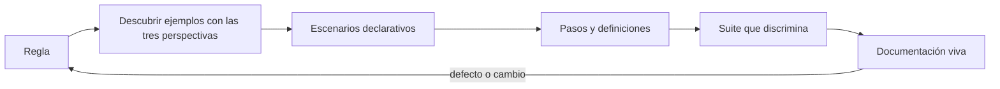
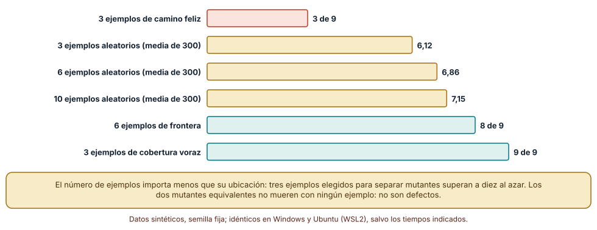
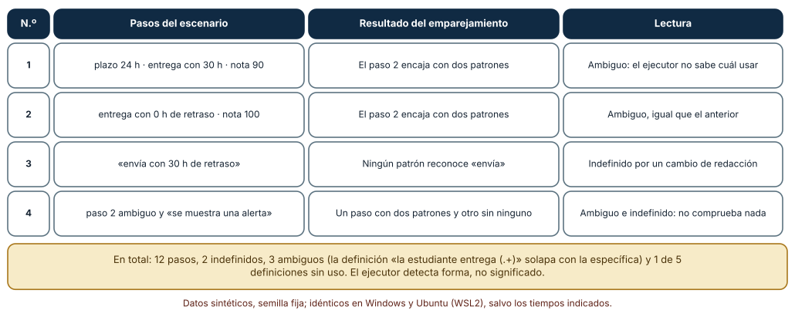
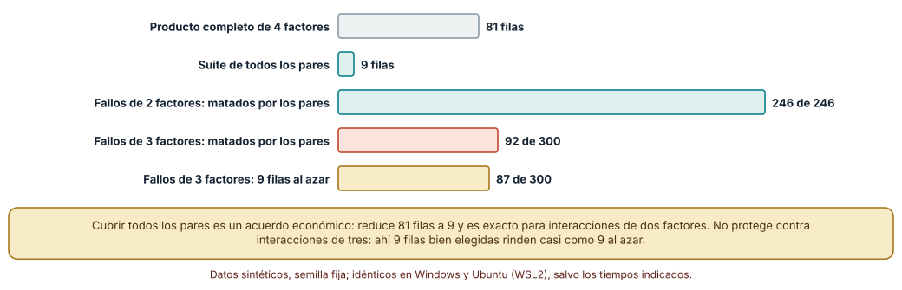

# SE-158 — Specification by Example y BDD

[← SE-157 — Especificación informal, semiformal y formal](../../classes/part-13-especificaciones-contratos-y-modelos/se-157-especificacion-informal-semiformal-y-formal/README.md) · [↑ Parte 13](../../classes/part-13-especificaciones-contratos-y-modelos/README.md) · [📚 Índice completo](../../classes/README.md) · [🌐 Portal](../../site/classes/SE-158.html) · [SE-159 — Contratos, invariantes y diseño por contrato →](../../classes/part-13-especificaciones-contratos-y-modelos/se-159-contratos-invariantes-y-diseno-por-contrato/README.md)

## Punto profesional y fundamento pedagógico

**Punto profesional.** La clase existe para convertir una regla en ejemplos concretos que negocio, desarrollo y pruebas lean igual, y para saber cuándo esos ejemplos son una especificación suficiente y cuándo solo un recuerdo del camino feliz.

**Por qué aparece aquí.** Se sitúa después de **Especificación informal, semiformal y formal** y antes de **Contratos, invariantes y diseño por contrato**: `SE-157` mostró que una frase admite dieciséis lecturas y que el ejemplo típico apenas elimina la mitad; esta clase pregunta cómo elegir, redactar y mantener los ejemplos que sí discriminan. Deja un conjunto de escenarios con significado que `SE-159` generalizará en afirmaciones válidas para todos los casos.

**Error conceptual que debe corregir.** Creer que escribir escenarios en Given-When-Then es especificar: el formato no aporta precisión por sí mismo, y un conjunto de escenarios de camino feliz pasa en verde mientras el producto es incorrecto en las fronteras.

**Secuencia de aprendizaje.** Antes de leer la solución, predices cuántos defectos detectan tres ejemplos típicos; después ejecutas una regla contra once variantes defectuosas, mides qué suite las mata, validas la forma de unos escenarios con un ejecutor mínimo y cuentas cuántas filas necesita una tabla de ejemplos con cuatro factores. La secuencia usa predicción, explicación propia, contraste y recuperación. [ICAP](https://icap.education.asu.edu/research) distingue participación de construcción de conocimiento; [How People Learn II](https://nap.nationalacademies.org/catalog/24783/how-people-learn-ii-learners-contexts-and-cultures) exige conectar conocimiento previo, contexto y transferencia; la [práctica de recuperación](https://pubmed.ncbi.nlm.nih.gov/16507066/) respalda producir de nuevo la explicación tras una demora; y [Education for Life and Work](https://nap.nationalacademies.org/resource/13398/dbasse_084153.pdf) exige devolución que explique la causa del error.

**Evidencia de aprendizaje.** `examples-log.md` con el archivo de escenarios, la función de referencia, las once variantes, la suite que las mata, la salida del ejecutor mínimo y la tabla de ejemplos con su cobertura de pares. Debe contener predicción previa, observación, explicación causal, contraejemplo y qué hallazgo haría descartar un escenario.

**Límite de la conclusión.** Los once mutantes son variaciones que el autor escribió de una regla pequeña; no representan la distribución de defectos de un producto. El ejecutor de Gherkin es una réplica mínima, no Cucumber, y los fallos de 2 y 3 factores son sorteos con semilla fija.

### Trazabilidad fuente → afirmación

| Fuente primaria u oficial | Afirmación que respalda | Lo que no prueba |
|---|---|---|
| [Cucumber: Gherkin Reference](https://cucumber.io/docs/gherkin/reference/) | Define las palabras clave de Gherkin (`Feature`, `Scenario`, `Given`, `When`, `Then`, `Scenario Outline`, `Examples`) y su semántica: los pasos se emparejan con definiciones y el documento es ejecutable. | No dice cuántos escenarios hacen falta ni qué ejemplos elegir. |
| [North, «Introducing BDD»](https://dannorth.net/introducing-bdd/) | Origen del vocabulario de comportamiento: describir lo que el sistema debe hacer con ejemplos en lenguaje de dominio en lugar de pruebas centradas en métodos. | No demuestra que BDD reduzca defectos en un proyecto concreto. |
| [NIST: Automated Combinatorial Testing for Software](https://csrc.nist.gov/projects/automated-combinatorial-testing-for-software) | Presenta la prueba combinatoria (cobertura de t-factores) y datos de que la mayoría de los fallos estudiados involucra pocos factores. | No garantiza que los fallos de tu sistema involucren pocos factores. |

## Antes de empezar

Recupera lo aprendido en `SE-157`: la regla de penalización por entrega tardía tiene dieciséis lecturas y el ejemplo más natural elimina solo la mitad. La pregunta activa es: **¿qué ejemplos separan de verdad las lecturas que importan, y cómo se mantienen legibles cuando el producto cambia?**

## Prerrequisitos

- Haber completado `SE-157` o poder explicar por qué el ejemplo típico discrimina poco.
- Python 3.11 o posterior y un terminal; no se instala ningún marco de BDD, el ejecutor de la clase es un fragmento de la biblioteca estándar.
- Trabajar con la regla de penalización y notas sintéticas.

## Problema auténtico

El equipo de la plataforma acordó la regla con un ejemplo: «si la entrega llega 30 horas tarde con nota 80, la nota final es 72». Escribió además dos escenarios de camino feliz y los ejecutó en verde durante meses. Un día la secretaría descubre que una entrega con seis días de retraso perdió el 60 % de la nota y no el 50 % del tope. Los escenarios nunca tocaron el tope, y nadie se preguntó si bastaban.

## Objetivos observables

Al terminar podrás:

1. redactar un escenario declarativo en Given-When-Then, con un ejemplo y un contraejemplo de escenario imperativo acoplado a la interfaz;
2. medir cuántas variantes defectuosas de una regla mata cada suite de ejemplos y elegir ejemplos por su poder de discriminación;
3. comprobar la forma de un conjunto de escenarios (pasos indefinidos, ambiguos y definiciones sin uso) con un ejecutor mínimo;
4. reducir una tabla de ejemplos con cobertura de pares y declarar qué interacciones deja sin cubrir;
5. decidir cuándo un ejemplo es documentación viva y cuándo se vuelve una carga de mantenimiento.

## Mapa conceptual



El mapa se lee como un ciclo de trabajo: los ejemplos nacen de una conversación sobre la regla, se escriben en el lenguaje del dominio, se emparejan con código y se evalúan por lo que discriminan. La flecha de retorno indica que un defecto hallado o un cambio de política reabre la conversación; actualizar solo el código deja el ejemplo mintiendo.

## Temas y por qué importan

| Tema | Por qué cambia una decisión profesional | Evidencia mínima |
|---|---|---|
| Ejemplos como especificación | Un ejemplo con valores concretos elimina lecturas que la prosa deja abiertas. | Predicción, traza causal y contraejemplo de **Ejemplos como especificación** en `examples-log.md` |
| Given-When-Then | La estructura separa contexto, acción y resultado observable y hace que el escenario sea revisable por personas no técnicas. | Predicción, traza causal y contraejemplo de **Given-When-Then** en `examples-log.md` |
| Descubrimiento colaborativo | Los ejemplos salen de una conversación entre negocio, desarrollo y pruebas, no de una persona sola. | Predicción, traza causal y contraejemplo de **Descubrimiento colaborativo** en `examples-log.md` |
| Escenarios declarativos | Un escenario que habla de la interfaz se rompe con cada rediseño; uno que habla del dominio sobrevive. | Predicción, traza causal y contraejemplo de **Escenarios declarativos** en `examples-log.md` |
| Cobertura y mantenimiento | El número de ejemplos crece multiplicativamente; hay que elegir cuáles escribir y cuáles dejar. | Predicción, traza causal y contraejemplo de **Cobertura y mantenimiento** en `examples-log.md` |

## Conceptos y decisiones

### 1. Ejemplos como especificación

Un ejemplo con valores concretos (30 horas de retraso, nota 80, resultado 72) obliga a decidir los puntos que la frase deja abiertos: cómo se redondea, qué base se usa, qué pasa en el límite. Su fortaleza es que cualquiera lo verifica con una calculadora; su debilidad, que cada ejemplo cubre un punto del dominio y nada más. Un conjunto de ejemplos no es una especificación completa: es un conjunto de puntos que una buena regla debe satisfacer. La pregunta útil no es «¿cuántos ejemplos tengo?» sino «¿qué lecturas distintas de la regla pasarían todos mis ejemplos?».

### 2. Given-When-Then

La estructura de [Gherkin](https://cucumber.io/docs/gherkin/reference/) ordena un escenario en contexto (`Dado`), acción (`Cuando`) y resultado observable (`Entonces`). La utilidad no es sintáctica: obliga a separar lo que ya era verdad de lo que ocurre y de lo que debe observarse. Un escenario con dos acciones o con una verificación en el contexto suele indicar que son dos escenarios. Los pasos se redactan en el lenguaje del dominio («la entrega llega 30 horas tarde») y se emparejan con código mediante expresiones; esa separación permite que cambie la implementación sin tocar el texto.

### 3. Descubrimiento colaborativo

North y la tradición de la especificación por ejemplos insisten en que los ejemplos nacen de una conversación entre quien conoce la regla de negocio, quien la implementa y quien la prueba, porque cada perspectiva ve casos distintos. Una práctica concreta es escribir cada regla en una tarjeta, sus ejemplos en otra y las preguntas abiertas en una tercera; si hay muchas preguntas, la regla no está lista. El producto de esa conversación son ejemplos acordados, no un guion para pruebas posteriores. Un escenario escrito solo por pruebas a partir de un documento no cumple esa función: transcribe una lectura.

### 4. Escenarios declarativos

Un escenario imperativo describe pasos de interfaz («hago clic en “Enviar tarea”, escribo en el campo “Respuesta”…»); uno declarativo describe el comportamiento del dominio («la estudiante entrega fuera de plazo»). El primero se rompe cuando cambia una etiqueta y mezcla el qué con el cómo; el segundo traslada el cómo a las definiciones de pasos, que se cambian en un lugar. El coste del declarativo es que alguien debe mantener esas definiciones y que oculta el recorrido de interfaz, que puede ser justamente lo que se quiere probar en un escenario de extremo a extremo.

### 5. Cobertura y mantenimiento

Los ejemplos se multiplican: cuatro factores de tres valores dan 81 combinaciones. Elegirlos es una decisión de riesgo, y mantenerlos es un coste continuo, porque cada escenario es código que alguien debe leer cuando falla. Una suite grande que nadie lee deja de ser documentación viva para ser una prueba lenta. Conviene tratar cada escenario como una afirmación sobre el comportamiento que se quiere mantener: si ya no es cierta o ya no importa, se elimina.

### Qué defectos mata cada suite de ejemplos

Se escribió la regla de referencia (`penalizar(h, nota)`, 10 % por día de 24 horas, tope del 50 %, redondeo al entero más cercano) y once variantes con un cambio cada una: usar división entera en lugar de redondeo hacia arriba, tratar `h < 0` en lugar de `h <= 0`, topar al 60 %, penalizar 15 % por día, quitar el tope, truncar, restar puntos en lugar de porcentaje, conceder una hora de gracia, topar al 40 %, forzar nota mínima 1 y comparar con `== 0` en lugar de `<= 0`. De las once, **dos son equivalentes** en el dominio (`h` entre 0 y 200, nota entre 0 y 100) y nueve se pueden distinguir.

Tres suites compiten. La de **camino feliz** (retraso 0 con 90, 30 horas con 80, 50 horas con 60) mata 3 de los 9. La de **frontera** (0 horas, 1, 24, 25, 121 con nota 80 y 200 con nota 0) mata 8. Un algoritmo voraz de cobertura de conjuntos (elige el ejemplo que mata más variantes aún vivas) halla una suite de **3 ejemplos** que mata los 9: (1 hora, nota 11), (121 horas, nota 6) y (1 hora, nota 0). Con ejemplos al azar, el promedio de variantes matadas es 6,12 con tres, 6,86 con seis y 7,15 con diez (300 semillas por tamaño). Las salidas fueron idénticas en Windows (CPython 3.12.9) y Ubuntu bajo WSL2 (3.12.3).

```python
def kills(suite):
    return sum(1 for m in matables if any(m(h, n) != ref(h, n) for h, n in suite))
```



**Cómo leer la figura.** Cada barra es el número de variantes (de las nueve distinguibles) que mata esa suite; las coral son suites que se quedan cortas y las verdes las que cubren casi todo. **Dónde deja de valer:** los once mutantes los escribió el autor conociendo la regla; los defectos reales de un producto no son cambios de una línea ni se conocen de antemano, y la suite voraz usa precisamente ese conocimiento. La conclusión transferible es cualitativa: elegir ejemplos por lo que separan supera a escribir más ejemplos típicos.

### Un ejecutor mínimo: forma, no significado

Cinco definiciones de pasos (`que el plazo vence en (\d+) horas`, `la estudiante entrega con (\d+) horas de retraso`, `la nota final es (\d+)`, `la estudiante entrega (.+)` y `hay una prórroga de (\d+) horas`) se emparejan con cuatro escenarios de tres pasos. El ejecutor cuenta, con `re.fullmatch`, los pasos sin definición, los que encajan con más de una y las definiciones que nadie usa. Resultado: de 12 pasos, **2 indefinidos**, **3 ambiguos** y **1 de 5 definiciones sin uso**. Los tres ambiguos son pasos como «la estudiante entrega con 30 horas de retraso», que encajan con la definición específica y con la genérica `entrega (.+)`; los dos indefinidos son «la estudiante envía…» (un cambio de redacción) y «se muestra una alerta» (un paso sin respaldo).

```python
m = [p for p in steps_defs if re.fullmatch(p, paso)]
indefinido = not m
ambiguo = len(m) > 1
```



**Cómo leer la figura.** Cada fila es un escenario y las dos últimas columnas dicen qué encontró el ejecutor; la nota inferior resume los totales. **Dónde deja de valer:** el ejecutor mira forma. Un escenario sin pasos indefinidos ni ambiguos puede afirmar un resultado falso, o no afirmar nada (un `Entonces` que solo comprueba que no hubo excepción). Conviene tratar los pasos ambiguos como errores de construcción y los indefinidos como señal de redacciones que derivaron, y complementar con revisión humana.

### Todos los pares, no todas las combinaciones

Se modelaron cuatro factores de tres valores: rol de la persona, prórroga concedida (ninguna, 24 h o 72 h), canal de envío y estado del archivo (válido, grande o vacío). El producto completo tiene **81 filas**; una suite que cubre cada **par** de valores de dos factores (54 pares posibles) se construye con un algoritmo voraz y tiene **9 filas**. Se sortearon con semilla fija fallos que se disparan solo cuando coinciden dos valores concretos (246 fallos válidos de 300 sorteos) y fallos que exigen tres (300). La suite de pares mata **los 246** de dos factores, como era de esperar, pero solo **92 de 300** de tres factores; nueve filas al azar matan 87,0 en media (20 sorteos).

```python
def pares(fila):
    return {((i, fila[i]), (j, fila[j])) for i in range(4) for j in range(i + 1, 4)}
```



**Cómo leer la figura.** Las dos barras superiores comparan el tamaño de la tabla; las tres inferiores cuentan fallos matados. **Dónde deja de valer:** la cobertura de pares es exacta para interacciones de dos factores y casi inútil frente a las de tres; los datos que motivan la técnica indican que muchos fallos involucran pocos factores, pero eso lo debe comprobar cada proyecto con su historial. Y los sorteos usan fallos hipotéticos, no los de la plataforma.

## Definiciones de trabajo

- **ejemplo como especificación:** caso con valores concretos de entrada y resultado esperado que toda implementación aceptable debe satisfacer.
- **escenario:** ejemplo estructurado en contexto, acción y resultado observable, escrito en el lenguaje del dominio.
- **paso ambiguo:** paso de un escenario que encaja con más de una definición ejecutable.
- **mutante:** variante de un programa con un cambio deliberado cuyo objetivo es comprobar si la suite lo detecta.
- **cobertura de pares:** suite en la que cada combinación de valores de cada par de factores aparece al menos una vez.

Las definiciones son operativas para la plataforma de entregas. No convierten términos con historia más amplia en sinónimos y deben contrastarse con la documentación primaria enlazada al final.

## Ejemplo mínimo

El escenario siguiente describe una entrega con retraso de un día y se verifica con una función. Antes de ejecutarlo, predice si el límite de 24 horas exactas da el mismo resultado.

```gherkin
Característica: Penalización por entrega tardía
  Escenario: Un día de retraso
    Dado que el plazo venció hace 20 horas
    Cuando la estudiante entrega una tarea que vale 80
    Entonces la nota final es 72
```

```python
import math
def penalizar(h, nota):
    if h <= 0: return nota
    return int(nota * (1 - min(0.10 * math.ceil(h / 24), 0.5)) + 0.5)
assert penalizar(20, 80) == 72
assert penalizar(24, 80) == 72   # el límite: sigue siendo un día
assert penalizar(25, 80) == 64
```

El escenario fija el caso típico y no dice nada de 24 y 25 horas; esas dos líneas añaden el límite que ningún escenario fijaba. Registra versión del intérprete y salida.

## Ejemplo profesional

En la plataforma, los escenarios viven en el repositorio junto al código de la regla. Cada escenario tiene un título que dice la intención («Una entrega a las 24 horas exactas es de un día»), usa solo vocabulario del dominio y nombra en su `Dado` los datos relevantes y nada más. Las definiciones de pasos están en un módulo único, y un guardián de integración continua falla si hay pasos indefinidos, ambiguos o definiciones sin uso. La tabla de ejemplos del escenario con esquema cubre los pares de los cuatro factores y una lista aparte de combinaciones sospechosas elegidas por el equipo.

Compara el caso normal con un escenario que cambia de redacción («envía» en lugar de «entrega»), con una definición genérica que absorbe pasos específicos, y con un escenario cuyo `Entonces` no verifica nada. Una suite es apropiada cuando esas tres situaciones fallan en integración continua; es peligrosa cuando pasan en silencio.

## Práctica guiada

1. Escribe la regla de penalización como cuatro escenarios declarativos en el lenguaje del dominio.
2. Predice cuántas variantes defectuosas mata un conjunto de tres ejemplos típicos y escribe el número.
3. Escribe diez variantes de la regla (un cambio cada una), comprueba cuáles son equivalentes y cuenta cuántas mata cada suite.
4. Aplica un algoritmo voraz para hallar la suite más pequeña que mata todas las distinguibles.
5. Escribe cinco definiciones de pasos y ejecuta el comprobador de forma sobre tus escenarios.
6. Modela cuatro factores y calcula la suite de pares; sortea fallos de dos y tres factores y cuenta cuántos mata.
7. Entrega `examples-log.md` y pide a otra persona que añada un escenario sin leer el código.

## Ejercicios

1. **Mutantes:** escribe tres variantes más de la regla (por ejemplo, redondear hacia arriba) y comprueba qué suite de las tres de la clase las mata.
2. **Declarativo:** transforma un escenario imperativo con cinco clics en uno declarativo de tres líneas y lista qué definiciones de pasos hay que escribir.
3. **Pares:** añade un quinto factor de tres valores y calcula cuántas filas necesita la suite de pares frente a las 243 del producto.
4. **Mantenimiento:** estima cuántos escenarios cambian si la política pasa de 10 % a 15 % por día, y qué diseño de escenarios reduce ese número.

## Reto verificable

Entrega `examples-log.md` con los escenarios, las once variantes (o las tuyas), la suite mínima que las mata, la salida del comprobador de forma y la tabla de pares. Se aprueba si otra persona ejecuta el código desde un checkout limpio, obtiene los mismos conteos y puede señalar qué escenario eliminaría y por qué. No se aprueba por el número de escenarios ni por que todos pasen.

## Caso conductor

La plataforma de entregas es el caso conductor de la Parte 13. Esta clase deja los escenarios de la regla de penalización con una suite que separa las lecturas de `SE-157` y un comprobador de forma. `SE-159` convertirá lo que esos ejemplos tienen en común en afirmaciones válidas para todos los casos, como «la nota final nunca supera la nota entregada». Cambia después una sola decisión, el tope del 50 % al 30 %, y revisa qué escenarios deben cambiar y cuáles no.

## Preguntas frecuentes

### ¿Los escenarios de BDD son pruebas o documentación?

Son las dos cosas si se mantienen: la documentación es el texto legible en lenguaje de dominio y la prueba es la ejecución contra el producto. Si dejan de ejecutarse, la documentación miente; si se escriben en términos de interfaz, la prueba se rompe con cada rediseño.

### ¿Cuántos escenarios hacen falta?

Los que separen las lecturas y los riesgos que importan, no una cantidad. El experimento de la clase muestra que tres ejemplos elegidos para separar superan a diez típicos. Medirlo con variantes defectuosas de tu regla da una respuesta específica en lugar de una cifra universal.

### ¿Qué pasa si el equipo no tiene a una persona de negocio disponible?

Los ejemplos escritos sin ella son hipótesis sobre su regla. Regístralos como tales con una fecha y alguien que los confirmará; un escenario no confirmado no debe presentarse como acuerdo.

### ¿Un modelo de lenguaje puede escribir los escenarios?

Puede proponerlos, y suele proponer los típicos. Pídele que sugiera fronteras y variantes defectuosas, y revisa cada escenario contra la regla acordada; un escenario generado y no leído repite el defecto de los tres ejemplos típicos.

## Fallo controlado y diagnóstico

Reproduce el fallo clásico de la clase: **creer que una suite en verde especifica la regla**. Toma los tres ejemplos del camino feliz y las once variantes, y mide cuántas sobreviven.

Registra síntoma, entrada mínima, hipótesis, observación que descarta cada hipótesis, causa, corrección y prueba de regresión. **Síntoma:** la secretaría informa de que una entrega con seis días de retraso perdió el 60 %. **Hipótesis rivales:** (a) la implementación cambió recientemente; (b) los escenarios nunca cubrieron el tope. **Prueba:** ejecuta la suite de camino feliz contra las nueve variantes distinguibles: 6 sobreviven, entre ellas la que topa al 60 %, la que trunca y la que concede una hora de gracia. **Conclusión:** la causa estaba en los escenarios que no separaban las lecturas, no en el cambio. **Regresión:** añade los ejemplos en 24, 25 y 121 horas (el tope) y la nota 0, y una comprobación que falle si la suite mata menos variantes que antes. No cambies a la vez la regla y la suite.

## Errores comunes y cómo corregirlos

| Síntoma | Causa probable | Corrección |
|---|---|---|
| Todos los escenarios pasan y un defecto de frontera llega a producción | Los ejemplos son del camino típico y no separan las lecturas | Elegir ejemplos por las variantes que matan y añadir fronteras (24 h, 25 h, tope, nota 0) |
| Cada rediseño de la interfaz rompe veinte escenarios | Los escenarios son imperativos y describen clics | Reescribirlos en lenguaje de dominio y mover el cómo a las definiciones de pasos |
| El ejecutor elige una definición al azar para un paso | Una definición genérica absorbe pasos específicos | Hacer las expresiones mutuamente excluyentes y fallar en integración continua si un paso es ambiguo |
| La tabla de ejemplos tiene 243 filas y nadie la lee | Producto completo de todos los factores | Reducir con cobertura de pares y añadir a mano las combinaciones de riesgo |
| Los escenarios no se actualizaron tras un cambio de política | Nadie era responsable de la documentación viva | Asignar un responsable y ejecutar los escenarios en cada cambio de regla |

## Entorno y archivos clave

```text
work/SE-158/
├── README.md
├── features/
│   └── penalizacion.feature
├── bdd/
│   ├── regla.py
│   ├── mutantes.py
│   └── ejecutor.py
├── tests/test_suite.py
└── evidence/examples-log.md
```

El `README` declara plataforma, versión de Python, semillas y comandos. Los experimentos usan solo la biblioteca estándar (`math`, `itertools`, `random`, `re`) y se ejecutaron con CPython 3.12.9 en Windows 11 y 3.12.3 en Ubuntu bajo WSL2 con salidas idénticas. Si adoptas una herramienta como Cucumber o behave, fija procedencia y versión.

## Seguridad, ética y accesibilidad

- los ejemplos usan notas y horas sintéticas; no copies casos reales de estudiantes a los escenarios, que viven en el repositorio y circulan;
- un escenario que decide una nota afecta a una persona: evita nombres reales y datos académicos identificables;
- redacta los escenarios con lenguaje comprensible y ofrece una alternativa textual a las tablas de ejemplos;
- si un modelo de lenguaje propone escenarios con datos de la organización, aplica la política de datos que corresponda;
- respeta las licencias de las herramientas de BDD y atribuye adaptaciones.

## Puente hacia el trabajo con agentes

Un agente al que se le pide «escribe los escenarios de la regla de penalización» devolverá una docena de escenarios plausibles, casi todos del camino típico. Pídele que proponga, además, variantes defectuosas de la regla y que indique qué escenario mata cada una, que declare los términos que dejó ambiguos y que use definiciones de pasos únicas. Revisa especialmente si el `Entonces` de cada escenario afirma un valor concreto: un escenario que no puede fallar es un ejemplo decorativo con apariencia de prueba.

## Transferencia

Traslada el experimento a otro de los dominios persistentes (por ejemplo, un servicio de entregas a domicilio con tarifas por franja horaria): escribe la regla, diez variantes y busca la suite mínima. La transferencia está lograda cuando puedes explicar qué parte del método dependía de la regla y cuál no, no cuando el formato de los escenarios se parece.

## Evaluación y evidencia

| Criterio | Evidencia para aprobar |
|---|---|
| comprensión | explicación de por qué un conjunto de ejemplos no es una especificación completa |
| corrección | variantes y suite reproducibles con las mismas semillas |
| diseño | escenarios declarativos con definiciones de pasos sin ambigüedad |
| diagnóstico | reproducción del fallo «suite en verde que no especifica» con regresión |
| incertidumbre | declaración de qué interacciones deja sin cubrir la suite de pares |
| reproducibilidad | versiones, comandos, salida y límites declarados |

## Fuentes

- [Cucumber: Gherkin Reference](https://cucumber.io/docs/gherkin/reference/) — palabras clave y semántica de Gherkin; autoridad: proyecto Cucumber.
- [Cucumber: Better Gherkin](https://cucumber.io/docs/bdd/better-gherkin/) — guía para redactar escenarios declarativos y breves; autoridad: proyecto Cucumber.
- [North, «Introducing BDD»](https://dannorth.net/introducing-bdd/) — origen del vocabulario de comportamiento; autoridad: autor del término.
- [Adzic, Specification by Example](https://gojko.net/books/specification-by-example/) — ejemplos colaborativos como especificación viva; autoridad: autor del libro.
- [NIST: Automated Combinatorial Testing for Software](https://csrc.nist.gov/projects/automated-combinatorial-testing-for-software) — prueba combinatoria y cobertura de t-factores; autoridad: NIST.
- [Jia y Harman, «An analysis and survey of the development of mutation testing» (IEEE TSE, 2011)](https://doi.org/10.1109/TSE.2010.62) — mutantes equivalentes y uso de mutación para evaluar suites; autoridad: IEEE Transactions on Software Engineering.

Cada fuente respalda el mecanismo indicado; ninguna demuestra que los ejemplos de la regla de penalización agoten las lecturas posibles. Esa afirmación depende de la regla, de quién la acuerda y de las variantes que se consideren.

- [Python: `re`, expresiones regulares](https://docs.python.org/3/library/re.html) — `fullmatch` y los límites de emparejar pasos con patrones.
- [Python: `itertools.product`](https://docs.python.org/3/library/itertools.html#itertools.product) — producto de factores para la tabla de ejemplos.
- [Python: `random`](https://docs.python.org/3/library/random.html) — semillas para los sorteos de fallos.

## Límites y siguiente paso

Se ejecutaron tres experimentos con datos sintéticos en Windows y Ubuntu (WSL2) con resultados idénticos. No se usó Cucumber ni ningún marco de BDD, las once variantes y los fallos de 2 y 3 factores son construcciones del autor y no se midió a ningún equipo. La siguiente clase pregunta qué afirmaciones se cumplen para todos los casos y cómo se comprueban.

## Glosario

- **ejemplo como especificación:** caso con valores concretos de entrada y resultado esperado que toda implementación aceptable debe satisfacer.
- **escenario:** ejemplo estructurado en contexto, acción y resultado observable, escrito en el lenguaje del dominio.
- **paso ambiguo:** paso de un escenario que encaja con más de una definición ejecutable.
- **mutante:** variante de un programa con un cambio deliberado cuyo objetivo es comprobar si la suite lo detecta.
- **cobertura de pares:** suite en la que cada combinación de valores de cada par de factores aparece al menos una vez.

---

[← SE-157 — Especificación informal, semiformal y formal](../../classes/part-13-especificaciones-contratos-y-modelos/se-157-especificacion-informal-semiformal-y-formal/README.md) · [↑ Parte 13](../../classes/part-13-especificaciones-contratos-y-modelos/README.md) · [📚 Índice completo](../../classes/README.md) · [🌐 Portal](../../site/classes/SE-158.html) · [SE-159 — Contratos, invariantes y diseño por contrato →](../../classes/part-13-especificaciones-contratos-y-modelos/se-159-contratos-invariantes-y-diseno-por-contrato/README.md)
