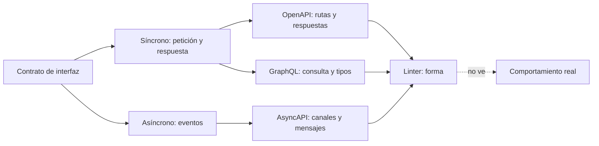
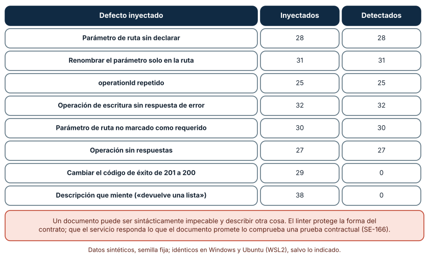
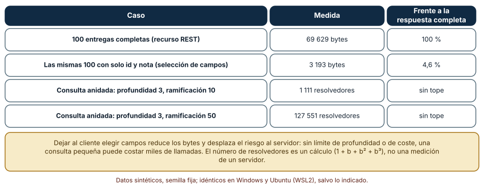
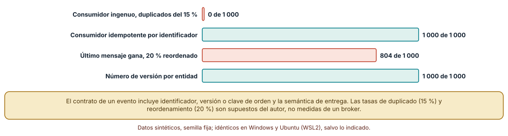

# SE-163 — OpenAPI, AsyncAPI, GraphQL y contratos de eventos

[← SE-162 — Esquemas de datos y validación](../../classes/part-13-especificaciones-contratos-y-modelos/se-162-esquemas-de-datos-y-validacion/README.md) · [↑ Parte 13](../../classes/part-13-especificaciones-contratos-y-modelos/README.md) · [📚 Índice completo](../../classes/README.md) · [🌐 Portal](../../site/classes/SE-163.html) · [SE-164 — Compatibilidad, versionado y evolución de contratos →](../../classes/part-13-especificaciones-contratos-y-modelos/se-164-compatibilidad-versionado-y-evolucion-de-contratos/README.md)

## Punto profesional y fundamento pedagógico

**Punto profesional.** La clase existe para describir una interfaz (rutas, consultas o eventos) en un documento que otra persona o herramienta pueda leer, y para saber qué parte de esa descripción se comprueba mecánicamente y cuál depende de que el servicio la cumpla.

**Por qué aparece aquí.** Se sitúa después de **Esquemas de datos y validación** y antes de **Compatibilidad, versionado y evolución de contratos**: `SE-162` describió la forma de un documento; esta clase la coloca dentro de contratos de interfaz síncronos (OpenAPI, GraphQL) y asíncronos (AsyncAPI, eventos). Deja el contrato de la API de entregas con un linter medido y las reglas de entrega de eventos que `SE-164` hará evolucionar.

**Error conceptual que debe corregir.** Creer que un documento de interfaz que pasa un linter describe lo que el servicio hace, o que un contrato de eventos hereda las garantías de una llamada síncrona: la descripción puede mentir con sintaxis impecable, y un evento llega duplicado, tarde o desordenado salvo que el contrato diga otra cosa.

**Secuencia de aprendizaje.** Antes de leer la solución, predices qué defectos de un documento OpenAPI atrapa un linter y cuáles se le escapan; después mides cuántos bytes ahorra elegir campos y cuántos resolvedores cuesta una consulta anidada, y simulas eventos duplicados y reordenados con consumidores ingenuos e idempotentes. La secuencia usa predicción, explicación propia, contraste y recuperación. [ICAP](https://icap.education.asu.edu/research) distingue participación de construcción de conocimiento; [How People Learn II](https://nap.nationalacademies.org/catalog/24783/how-people-learn-ii-learners-contexts-and-cultures) exige conectar conocimiento previo, contexto y transferencia; la [práctica de recuperación](https://pubmed.ncbi.nlm.nih.gov/16507066/) respalda producir de nuevo la explicación tras una demora; y [Education for Life and Work](https://nap.nationalacademies.org/resource/13398/dbasse_084153.pdf) exige devolución que explique la causa del error.

**Evidencia de aprendizaje.** `interface-log.md` con el documento OpenAPI mínimo, el linter, las 240 mutaciones, el cálculo de bytes y de resolvedores y la simulación de eventos. Debe contener predicción previa, observación, explicación causal, contraejemplo y qué hallazgo haría retirar el contrato.

**Límite de la conclusión.** El documento OpenAPI es un fragmento de cuatro operaciones, el linter es una réplica mínima de unas pocas reglas, la medición de GraphQL es un cálculo y no una medición de un servidor, y las tasas de duplicado (15 %) y reordenamiento (20 %) de los eventos son supuestos del autor.

### Trazabilidad fuente → afirmación

| Fuente primaria u oficial | Afirmación que respalda | Lo que no prueba |
|---|---|---|
| [OpenAPI Specification](https://spec.openapis.org/oas/latest.html) | Define el formato de descripción de interfaces HTTP: rutas, operaciones, parámetros, respuestas y esquemas. | No garantiza que el servicio se comporte como el documento describe. |
| [GraphQL Specification](https://spec.graphql.org/) | Define el lenguaje de consultas, el sistema de tipos y las reglas de ejecución, con selección de campos por el cliente. | No fija límites de profundidad o de coste: los deja a la implementación. |
| [AsyncAPI Specification](https://www.asyncapi.com/docs/reference/specification/latest) | Define un formato de descripción para interfaces basadas en mensajes (canales, operaciones, cargas útiles). | No describe las garantías de entrega del broker concreto. |

## Antes de empezar

Recupera lo aprendido en `SE-162`: el esquema comprueba forma y deja fuera reglas entre campos. La pregunta activa es: **¿qué promete la interfaz, quién la comprueba y qué ocurre con los mensajes que viajan sin respuesta inmediata?**

## Prerrequisitos

- Haber completado `SE-162` o poder explicar qué comprueba un esquema y qué no.
- Python 3.11 o posterior y un terminal; el linter y las simulaciones usan la biblioteca estándar.
- Trabajar con la API de la plataforma de entregas y datos sintéticos.

## Problema auténtico

La plataforma publica una API HTTP para la aplicación móvil y emite eventos de «entrega calificada» para el sistema de notificaciones. El documento de la API dice que `POST /entregas` responde 201; el servicio responde 200 desde hace dos versiones y el linter lo da por bueno. Los eventos llegan a veces dos veces y las notificaciones se envían duplicadas.

## Objetivos observables

Al terminar podrás:

1. leer y escribir un documento de interfaz con rutas, parámetros, respuestas de éxito y de error y esquemas;
2. medir qué defectos de un documento detecta un linter y cuáles se le escapan;
3. comparar lo que cambia entre un recurso fijo y una consulta con selección de campos y estimar el coste de una consulta anidada;
4. distinguir un contrato de eventos de uno de petición y respuesta, y decidir con qué garantías se diseña un consumidor;
5. declarar qué parte del contrato comprueba una herramienta y qué parte una prueba contractual.

## Mapa conceptual



El mapa se lee desde el contrato: según el estilo de interacción se elige el formato; todos se pasan por un linter que comprueba forma y ninguno, por sí solo, comprueba el comportamiento. La flecha punteada marca la parte que depende de pruebas contra el servicio (`SE-166`).

## Temas y por qué importan

| Tema | Por qué cambia una decisión profesional | Evidencia mínima |
|---|---|---|
| OpenAPI | Describe operaciones HTTP con parámetros, respuestas y esquemas, y habilita documentación y generación. | Predicción, traza causal y contraejemplo de **OpenAPI** en `interface-log.md` |
| GraphQL | Deja al cliente elegir campos y desplaza al servidor el control del coste. | Predicción, traza causal y contraejemplo de **GraphQL** en `interface-log.md` |
| AsyncAPI y eventos | Describe canales y mensajes; la semántica de entrega (duplicados, orden) debe declararse. | Predicción, traza causal y contraejemplo de **AsyncAPI y eventos** en `interface-log.md` |
| Respuestas de error | Un contrato sin errores describe solo el camino feliz del servicio. | Predicción, traza causal y contraejemplo de **Respuestas de error** en `interface-log.md` |
| Lo que el documento no dice | La descripción puede mentir con sintaxis válida; hace falta contrastarla con el servicio. | Predicción, traza causal y contraejemplo de **Lo que el documento no dice** en `interface-log.md` |

## Conceptos y decisiones

### 1. OpenAPI

Un documento OpenAPI describe una interfaz HTTP: rutas con sus operaciones, parámetros (ruta, consulta, cabecera), cuerpos y respuestas por código, con esquemas para las cargas. Su valor es doble: es legible por personas y por herramientas, que generan documentación, clientes y pruebas. Su límite es que describe, no obliga: el servicio puede responder otra cosa y el documento seguirá siendo válido. Un contrato de este tipo incluye también la semántica HTTP (métodos, códigos, cabeceras) definida en el RFC 9110, y es en esos detalles donde aparecen las discrepancias.

### 2. GraphQL

GraphQL expone un sistema de tipos y un único punto de entrada; el cliente escribe una consulta que elige campos y relaciones. Esto reduce el sobreenvío de datos y los viajes de ida y vuelta, y traslada responsabilidad al servidor: una consulta anidada puede costar miles de llamadas. La especificación no fija límites de profundidad ni de coste, de modo que las guías de seguridad recomiendan imponerlos. El contrato no es solo el esquema de tipos sino también las reglas de coste que el servidor aplica.

### 3. AsyncAPI y eventos

En una interfaz asíncrona el productor emite mensajes a canales y el consumidor reacciona sin que haya respuesta inmediata. AsyncAPI describe canales, operaciones y cargas; los formatos como CloudEvents estandarizan la envoltura (identificador, tipo, origen, tiempo). Lo decisivo es lo que el documento suele omitir: con entrega «al menos una vez» un mensaje puede llegar duplicado, y sin garantía de orden dos eventos del mismo objeto pueden invertirse. El contrato debe decir qué garantías ofrece el canal y qué debe hacer el consumidor.

### 4. Respuestas de error

Un documento que solo describe el código 200 deja sin especificar el 400, el 404 y el 409, que son los casos donde el cliente más necesita saber qué esperar. Los errores forman parte del contrato: código, cuerpo y significado. Describirlos permite que los clientes distingan lo reintentable de lo definitivo, y permite pruebas contractuales para el camino de fallo, que es el menos probado.

### 5. Lo que el documento no dice

Un linter comprueba forma: operaciones con identificador único, parámetros de ruta declarados, respuestas presentes. No sabe si el código de éxito es el que el servicio devuelve, si la descripción es verdadera ni si el esquema de la respuesta coincide con los datos. Cerrar esa brecha exige pruebas contra el servicio real (pruebas de contrato) o un servicio generado desde el documento. Mientras tanto, el documento es una afirmación, no una garantía.

### Qué defectos de un documento atrapa un linter

El documento mínimo tiene cuatro operaciones (`crearEntrega`, `leerEntrega`, `anularEntrega`, `listarEntregas`) con parámetros de ruta y respuestas. El linter comprueba: que los parámetros de ruta declarados coincidan con los de la plantilla, que sean requeridos, que cada operación tenga respuestas y una de éxito, que las de escritura tengan una respuesta de error y que los `operationId` sean únicos. Se aplicaron 240 mutaciones con semilla fija de ocho tipos.

Detectó **todos** los defectos de estructura: parámetro sin declarar (28 de 28), renombrar el parámetro solo en la ruta (31 de 31), `operationId` repetido (25 de 25), escritura sin error (32 de 32), parámetro de ruta no requerido (30 de 30) y sin respuestas (27 de 27): 173 en total. No detectó **ninguno** de los que cambian el significado: cambiar el código de éxito de 201 a 200 (0 de 29) y una descripción falsa (0 de 38). Los resultados fueron idénticos en Windows y Ubuntu.

```python
if met in ("post", "put", "patch", "delete") and not any(c.startswith("4") for c in codes):
    errores.add("sin respuesta de error")
```



**Cómo leer la figura.** Cada fila es un tipo de defecto con cuántas veces se inyectó y cuántas se detectó; las dos últimas cambian el significado. **Dónde deja de valer:** el linter es una réplica mínima de cinco reglas; los linters reales cubren más, pero ninguno sabe qué responde el servicio. Esa brecha es el objeto de las pruebas contractuales de `SE-166`.

### Quién decide qué viaja y qué cuesta una consulta

Se generaron 100 entregas sintéticas con identificador, nota, fechas, tres archivos con su huella y dos comentarios. Serializadas completas pesan **69 629 bytes**; con solo `id` y `nota`, lo que un cliente que muestra una lista necesita, pesan **3 193** (4,6 %). Es la ventaja de elegir campos. La contrapartida es de coste: una consulta de profundidad *d* con *b* hijos por nivel invoca 1 + *b* + *b*² + … + *b*^*d* resolvedores; con *b* = 10 son 111, 1 111, 11 111 y 111 111 para profundidades 2, 3, 4 y 5, y con *b* = 50 y profundidad 3 son **127 551**.

```python
def llamadas(b, d):
    return sum(b ** i for i in range(d + 1))
```



**Cómo leer la figura.** Las dos primeras filas comparan bytes; las dos últimas, resolvedores invocados. **Dónde deja de valer:** los bytes son de un generador sintético con huellas de 64 caracteres y no de un servicio real; el número de resolvedores es un cálculo del peor caso y no mide un servidor, donde cachés y agrupación de consultas pueden reducirlo. Sin embargo, la dirección es sólida: sin límite de profundidad o de coste, el servidor queda expuesto a consultas pequeñas y caras.

### Eventos duplicados y desordenados

Se simularon 60 eventos de «nota calificada» con la propiedad de que cada evento suma un delta a una clave (20 claves). La entrega es «al menos una vez»: cada evento se duplica con probabilidad 0,15 y el 20 % de los pares adyacentes se intercambia. Un consumidor **ingenuo** que suma cada mensaje obtiene el total correcto en **0 de 1 000** corridas; uno **idempotente**, que ignora identificadores ya vistos, lo obtiene en **1 000 de 1 000**. Para el orden se simularon 10 versiones de un valor con intercambios del 20 %: si el último mensaje gana, el estado final es correcto en **804 de 1 000** corridas; si se compara el número de versión y se descarta el que llega con versión menor, en **1 000 de 1 000**.

```python
if idempotente:
    if e["id"] in visto: continue
    visto.add(e["id"])
total += e["delta"]
```



**Cómo leer la figura.** Cada barra cuenta, de 1 000 corridas, las que terminan con el estado correcto; las verdes usan identificador o versión. **Dónde deja de valer:** 15 % de duplicados y 20 % de reordenamientos son supuestos del autor, no medidas de un broker; con tasas menores el consumidor ingenuo acertaría más veces, pero el problema permanece porque basta un duplicado. Y la idempotencia por identificador exige guardar los identificados vistos, un coste que crece con el tiempo.

## Definiciones de trabajo

- **contrato de interfaz:** descripción de las operaciones o los mensajes que un servicio ofrece, con sus entradas, salidas, errores y garantías.
- **OpenAPI:** formato de descripción de interfaces HTTP con rutas, operaciones, parámetros, respuestas y esquemas.
- **GraphQL:** lenguaje de consulta con sistema de tipos en el que el cliente elige los campos que recibe.
- **evento:** mensaje que comunica que algo ocurrió y que el emisor no espera que se responda de inmediato.
- **consumidor idempotente:** consumidor cuyo efecto no cambia si recibe el mismo mensaje más de una vez.

Las definiciones son operativas para la plataforma de entregas. No convierten términos con historia más amplia en sinónimos y deben contrastarse con la documentación primaria enlazada al final.

## Ejemplo mínimo

El fragmento describe una operación y comprueba que el parámetro de la ruta esté declarado. Antes de ejecutarlo, predice si pasa.

```python
import re
spec = {"/entregas/{id}": {"get": {"operationId": "leerEntrega",
        "parameters": [{"name": "id", "in": "path", "required": True}],
        "responses": {"200": {}, "404": {}}}}}
for ruta, item in spec.items():
    esperado = set(re.findall(r"{(\w+)}", ruta))
    declarado = {p["name"] for p in item["get"]["parameters"]}
    assert esperado == declarado
```

Si renombras `{id}` a `{entrega_id}` en la ruta sin tocar el parámetro, el `assert` falla: es el defecto «parámetro de ruta sin declarar» que el linter detectó 31 de 31 veces. Registra versión del intérprete y salida.

## Ejemplo profesional

En la plataforma, el documento OpenAPI de la API de entregas y el documento AsyncAPI de los eventos viven en el repositorio, versionados con el código. Un linter de integración continua verifica la forma (identificadores únicos, parámetros, respuestas de error). Una prueba contractual (`SE-166`) comprueba que el servicio responda lo que el documento promete, incluida la respuesta 201 de `crearEntrega`. El documento de eventos declara la semántica de entrega («al menos una vez», sin orden global) y exige identificador y versión en cada mensaje; los consumidores son idempotentes por diseño. La política de GraphQL, donde se use, fija profundidad máxima y coste máximo.

Compara el caso normal con un código de éxito distinto del documentado, un evento duplicado y una consulta con profundidad 8. Un contrato es apropiado cuando esos tres casos tienen una comprobación; es peligroso cuando el documento los ignora.

## Práctica guiada

1. Escribe el documento OpenAPI de las cuatro operaciones con respuestas de éxito y de error.
2. Predice qué defectos detectará un linter y cuáles no, y escribe la lista.
3. Implementa el linter con las cinco reglas y aplica 240 mutaciones con semilla fija.
4. Calcula bytes de 100 entregas completas y con selección de campos, y los resolvedores de una consulta con profundidad 3 y ramificaciones 10 y 50.
5. Simula 60 eventos con duplicados y reordenamientos y compara un consumidor ingenuo con uno idempotente y con versión.
6. Escribe qué garantías de entrega declara el contrato de eventos y qué debe hacer un consumidor.
7. Entrega `interface-log.md` y pide a otra persona que añada una operación guiándose solo por el documento.

## Ejercicios

1. **Linter:** añade una regla (por ejemplo, que todo `GET` tenga respuesta 200 con esquema) y mide cuántas mutaciones nuevas detecta.
2. **Coste:** define un límite de coste para consultas GraphQL de la plataforma y calcula qué profundidad y ramificación permite.
3. **Eventos:** diseña el identificador y la versión de un evento «nota calificada» y explica cómo un consumidor descarta duplicados y eventos antiguos.
4. **Brecha:** escribe tres afirmaciones del documento OpenAPI que ningún linter puede verificar y la prueba que lo haría.

## Reto verificable

Entrega `interface-log.md` con el documento OpenAPI, el linter, las 240 mutaciones, los cálculos de bytes y de resolvedores y la simulación de eventos. Se aprueba si otra persona ejecuta el código desde un checkout limpio, obtiene los mismos conteos y puede señalar qué parte del contrato no comprueba el linter. No se aprueba por el tamaño del documento ni por que el linter no encuentre nada.

## Caso conductor

La plataforma de entregas es el caso conductor de la Parte 13. Esta clase deja el contrato de la API de entregas (OpenAPI), una política de coste de consultas y las reglas de entrega de los eventos de calificación. `SE-164` hará evolucionar ese contrato sin romper a los consumidores y `SE-166` comprobará que el servicio lo cumple. Cambia después una sola decisión, responder 200 en lugar de 201 al crear, y revisa qué consumidores, ejemplos y pruebas dependían de ello.

## Preguntas frecuentes

### ¿OpenAPI o GraphQL?

Depende de quién consume y de qué se necesita controlar. OpenAPI describe recursos HTTP estables y se presta a caché y herramientas; GraphQL da flexibilidad al cliente y exige que el servidor controle el coste. Ninguno sustituye una prueba contractual.

### ¿Cómo evito eventos duplicados?

No se evitan: con entrega «al menos una vez» se diseñan consumidores idempotentes. Un identificador único por evento y una tabla de identificadores vistos con una ventana de retención es el patrón habitual.

### ¿Se puede generar el servidor desde el documento?

Se puede generar un esqueleto y a veces un servidor de prueba; mantener el documento como fuente evita la deriva pero exige disciplina (se trata en `SE-165`). Un servidor generado no demuestra que la lógica sea correcta.

### ¿Un modelo de lenguaje puede redactar el documento?

Puede proponer rutas y esquemas razonables, y suele omitir respuestas de error y ejemplos. Pídele que incluya errores, `operationId` únicos y ejemplos, y ejecuta el linter y una prueba contra el servicio.

## Fallo controlado y diagnóstico

Reproduce el fallo clásico de la clase: **dar por cierto un documento de interfaz que pasa el linter**. Cambia el código de éxito de `crearEntrega` de 201 a 200 en el documento y comprueba el linter.

Registra síntoma, entrada mínima, hipótesis, observación que descarta cada hipótesis, causa, corrección y prueba de regresión. **Síntoma:** un cliente generado espera 201 y trata el 200 como un error. **Hipótesis rivales:** (a) el cliente generado tiene un defecto; (b) el documento y el servicio difieren. **Prueba:** ejecuta el linter (no detecta nada: 0 de 29) y una petición real contra el servicio de prueba (responde 200). **Conclusión:** la causa es una brecha entre el documento y el servicio. **Regresión:** añade una prueba contractual que verifique el código de éxito y los esquemas de respuesta. No cambies a la vez el servicio y el documento.

## Errores comunes y cómo corregirlos

| Síntoma | Causa probable | Corrección |
|---|---|---|
| Un cliente generado falla contra el servicio real | El documento y el servicio divergieron | Añadir pruebas contractuales contra el servicio y ejecutarlas en integración continua |
| Las notificaciones salen duplicadas | El consumidor no es idempotente y la entrega es «al menos una vez» | Identificador único por evento y descarte de identificadores vistos |
| El estado final depende del orden de llegada | El último mensaje gana | Número de versión por entidad y descarte de los menores |
| Una consulta GraphQL pequeña tarda segundos | No hay límite de profundidad ni de coste | Fijar profundidad máxima, coste máximo y paginación |
| El contrato no describe qué hacer ante un error | Solo se documentó el éxito | Describir 4xx y 5xx con cuerpo y significado, y probarlos |

## Entorno y archivos clave

```text
work/SE-163/
├── README.md
├── interfaz/
│   ├── entregas.openapi.json
│   ├── linter.py
│   └── eventos.py
├── tests/test_interfaz.py
└── evidence/interface-log.md
```

El `README` declara plataforma, versión de Python, semillas y comandos. Los experimentos usan solo la biblioteca estándar (`json`, `random`, `re`) y se ejecutaron con CPython 3.12.9 en Windows 11 y 3.12.3 en Ubuntu bajo WSL2 con salidas idénticas. Si adoptas un linter o un generador reales, fija procedencia y versión.

## Seguridad, ética y accesibilidad

- una consulta GraphQL sin límites es una vía de denegación de servicio: fija profundidad, coste y tiempo máximos;
- los eventos de calificación contienen datos académicos: envía solo los campos necesarios y no incluyas datos personales innecesarios en el canal;
- los ejemplos del documento deben ser sintéticos; no copies datos reales de estudiantes a un archivo versionado;
- redacta las descripciones de operaciones con lenguaje comprensible y ofrece una alternativa textual a las tablas;
- respeta las licencias de las herramientas y los generadores y atribuye adaptaciones.

## Puente hacia el trabajo con agentes

Un agente al que se le pide «genera el documento OpenAPI de esta API» devolverá un documento válido y casi siempre incompleto: sin respuestas de error, sin ejemplos y con el código de éxito que supuso. Pídele que incluya respuestas de error por operación, que marque cada afirmación como observada en el servicio o inferida y que ejecute el linter y una petición real. Revisa especialmente los códigos de éxito y la semántica de entrega de los eventos: es la brecha que el linter no ve, ahora escrita con convicción.

## Transferencia

Traslada el experimento a otro de los dominios persistentes (por ejemplo, un servicio de entregas a domicilio con una API de pedidos y eventos de cambio de estado): escribe el documento, inyecta defectos y simula eventos con duplicados. La transferencia está lograda cuando puedes explicar qué parte del método dependía de la interfaz y cuál no, no cuando el documento se parece.

## Evaluación y evidencia

| Criterio | Evidencia para aprobar |
|---|---|
| comprensión | explicación de lo que comprueba un linter y de lo que depende del servicio |
| corrección | conteos reproducibles de mutaciones, bytes, resolvedores y corridas con las mismas semillas |
| diseño | documento con errores, ejemplos y semántica de entrega de eventos |
| diagnóstico | reproducción del fallo «documento válido pero falso» con regresión |
| incertidumbre | declaración de las tasas supuestas y de lo que el linter no cubre |
| reproducibilidad | versiones, comandos, salida y límites declarados |

## Fuentes

- [OpenAPI Specification](https://spec.openapis.org/oas/latest.html) — formato de descripción de interfaces HTTP; autoridad: OpenAPI Initiative.
- [GraphQL Specification](https://spec.graphql.org/) — lenguaje, tipos y ejecución; autoridad: GraphQL Foundation.
- [AsyncAPI Specification](https://www.asyncapi.com/docs/reference/specification/latest) — descripción de interfaces basadas en mensajes; autoridad: AsyncAPI Initiative.
- [CloudEvents](https://cloudevents.io/) — envoltura estándar de eventos con identificador, tipo y origen; autoridad: CNCF.
- [RFC 9110: HTTP Semantics](https://www.rfc-editor.org/rfc/rfc9110) — métodos, códigos de estado y cabeceras; autoridad: IETF.
- [OWASP: GraphQL Cheat Sheet](https://cheatsheetseries.owasp.org/cheatsheets/GraphQL_Cheat_Sheet.html) — límites de profundidad y de coste y otras defensas; autoridad: OWASP.
- [Apache Kafka: message delivery semantics](https://kafka.apache.org/documentation/#semantics) — entrega «al menos una vez», «como máximo una» y «exactamente una»; autoridad: Apache Software Foundation.

Cada fuente respalda el mecanismo indicado; ninguna demuestra que el contrato de la API de entregas de la clase describa lo que un servicio real hace. Esa afirmación depende del servicio, de las pruebas contractuales y de quién las revisa.

- [Python: `json`](https://docs.python.org/3/library/json.html) — serialización usada para medir bytes.
- [Python: `re`](https://docs.python.org/3/library/re.html) — extracción de parámetros de ruta.

## Límites y siguiente paso

Se ejecutaron tres experimentos con datos sintéticos en Windows y Ubuntu (WSL2) con resultados idénticos. No se usó ningún linter real ni un servidor GraphQL o un broker, la medición de resolvedores es un cálculo y las tasas de duplicado y reordenamiento son supuestos. La siguiente clase pregunta cómo cambia un contrato sin romper a quien ya lo usa.

## Glosario

- **contrato de interfaz:** descripción de las operaciones o los mensajes que un servicio ofrece, con sus entradas, salidas, errores y garantías.
- **OpenAPI:** formato de descripción de interfaces HTTP con rutas, operaciones, parámetros, respuestas y esquemas.
- **GraphQL:** lenguaje de consulta con sistema de tipos en el que el cliente elige los campos que recibe.
- **evento:** mensaje que comunica que algo ocurrió y que el emisor no espera que se responda de inmediato.
- **consumidor idempotente:** consumidor cuyo efecto no cambia si recibe el mismo mensaje más de una vez.

---

[← SE-162 — Esquemas de datos y validación](../../classes/part-13-especificaciones-contratos-y-modelos/se-162-esquemas-de-datos-y-validacion/README.md) · [↑ Parte 13](../../classes/part-13-especificaciones-contratos-y-modelos/README.md) · [📚 Índice completo](../../classes/README.md) · [🌐 Portal](../../site/classes/SE-163.html) · [SE-164 — Compatibilidad, versionado y evolución de contratos →](../../classes/part-13-especificaciones-contratos-y-modelos/se-164-compatibilidad-versionado-y-evolucion-de-contratos/README.md)
