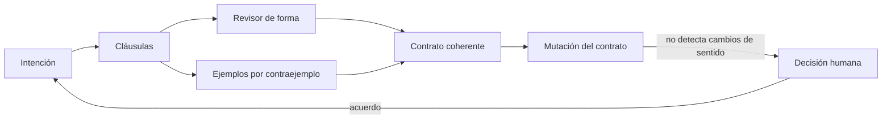
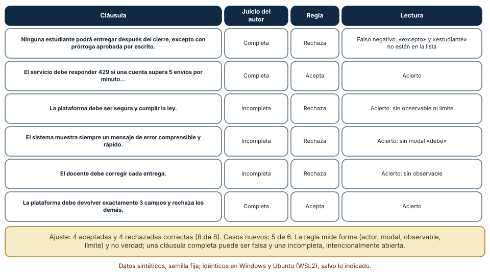
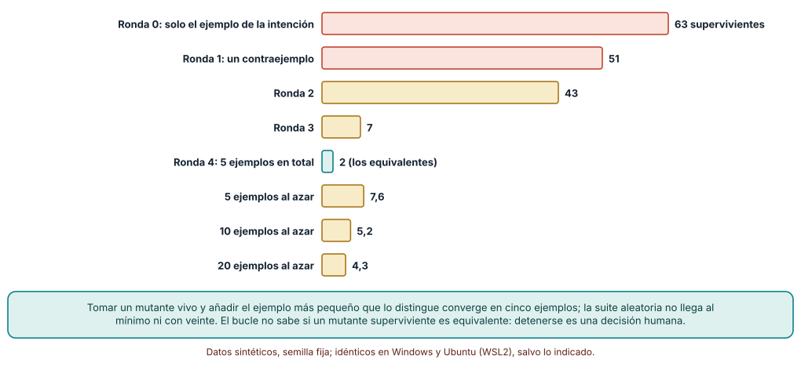
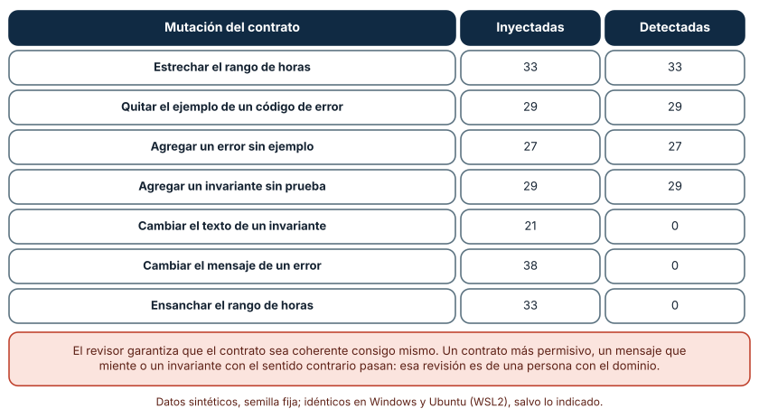

# SE-167 — Taller: convertir intención en contrato comprobable

[← SE-166 — Especificaciones ejecutables y pruebas contractuales](../../classes/part-13-especificaciones-contratos-y-modelos/se-166-especificaciones-ejecutables-y-pruebas-contractuales/README.md) · [↑ Parte 13](../../classes/part-13-especificaciones-contratos-y-modelos/README.md) · [📚 Índice completo](../../classes/README.md) · [🌐 Portal](../../site/classes/SE-167.html) · [SE-168 — Proyecto: paquete de especificaciones trazables →](../../classes/part-13-especificaciones-contratos-y-modelos/se-168-proyecto-paquete-de-especificaciones-trazables/README.md)

## Punto profesional y fundamento pedagógico

**Punto profesional.** El taller existe para recorrer, de principio a fin y con una sola regla, el camino que las seis clases anteriores desarmaron: de una intención en prosa a un contrato con cláusulas completas, ejemplos que separan variantes, un revisor mecánico y una decisión humana sobre lo que ningún revisor ve.

**Por qué aparece aquí.** Se sitúa después de **Especificaciones ejecutables y pruebas contractuales** y antes de **Proyecto: paquete de especificaciones trazables**: `SE-157` a `SE-166` enseñaron niveles de especificación, ejemplos, contratos, modelos, estados, esquemas, interfaces, evolución, fuentes de verdad y pruebas; este taller las usa juntas, bajo restricciones de tiempo, y deja el procedimiento y las medidas que `SE-168` empaquetará como entrega final.

**Error conceptual que debe corregir.** Creer que un contrato está terminado cuando todas sus comprobaciones automáticas pasan: un revisor mecánico verifica coherencia interna y forma, y deja pasar el contrato más permisivo, el mensaje que miente y el invariante con el sentido contrario.

**Secuencia de aprendizaje.** Antes de leer la solución, predices qué cláusulas completa un linter y cuáles rechaza injustamente; después conviertes una intención en cláusulas, construyes ejemplos con un bucle de contraejemplos y mutas el propio contrato para ver qué cambios de sentido no detecta nadie. La secuencia usa predicción, explicación propia, contraste y recuperación. [ICAP](https://icap.education.asu.edu/research) distingue participación de construcción de conocimiento; [How People Learn II](https://nap.nationalacademies.org/catalog/24783/how-people-learn-ii-learners-contexts-and-cultures) exige conectar conocimiento previo, contexto y transferencia; la [práctica de recuperación](https://pubmed.ncbi.nlm.nih.gov/16507066/) respalda producir de nuevo la explicación tras una demora; y [Education for Life and Work](https://nap.nationalacademies.org/resource/13398/dbasse_084153.pdf) exige devolución que explique la causa del error.

**Evidencia de aprendizaje.** `workshop-log.md` con la intención de partida, las cláusulas, el linter con su evaluación en casos nuevos, la serie de rondas de contraejemplos, la tabla de mutaciones del contrato y una lista de decisiones humanas. Debe contener predicción previa, observación, explicación causal, contraejemplo y qué hallazgo haría rechazar el contrato.

**Límite de la conclusión.** El linter se afinó con ocho cláusulas escritas por el autor y se probó con seis nuevas, por lo que su exactitud real es desconocida; el bucle de contraejemplos usa 255 variantes paramétricas de una función de penalización y no los defectos de un producto; las mutaciones del contrato son siete tipos escogidos por el autor.

### Trazabilidad fuente → afirmación

| Fuente primaria u oficial | Afirmación que respalda | Lo que no prueba |
|---|---|---|
| [Jia y Harman, «An analysis and survey of the development of mutation testing» (IEEE TSE, 2011)](https://doi.org/10.1109/TSE.2010.62) | Describe la mutación como técnica para evaluar la calidad de un conjunto de pruebas y el problema de los mutantes equivalentes. | No dice cuántos mutantes basta considerar ni que los mutantes de un artefacto representen sus defectos reales. |
| [Meyer, «On formalism in specifications» (IEEE Software, 1985)](https://doi.org/10.1109/MS.1985.229776) | Cataloga defectos de la especificación en lenguaje natural (silencio, ambigüedad, contradicción) que un contrato debe reducir. | No ofrece un procedimiento para convertir una intención concreta en un contrato. |
| [Python: `doctest`](https://docs.python.org/3/library/doctest.html) | Permite que ejemplos incrustados en la documentación se ejecuten como pruebas. | No decide qué ejemplos separan variantes. |

## Antes de empezar

Recupera lo aprendido en `SE-166`: un contrato de consumidor fija lo que se usa, y un doble sin verificar es una creencia. La pregunta activa es: **¿cómo se pasa de «la entrega tardía se penaliza» a un contrato que otra persona pueda comprobar, y cuál es el último paso que ninguna herramienta da?**

## Prerrequisitos

- Haber completado `SE-166` o poder explicar qué protege cada tipo de prueba contractual.
- Python 3.11 o posterior y un terminal; las simulaciones usan la biblioteca estándar.
- Trabajar con la regla de penalización por entrega tardía de la plataforma y datos sintéticos.

## Problema auténtico

La secretaría pide por escrito que «las entregas fuera de plazo se penalicen según la política». El taller dura una sesión: hay que producir un contrato que desarrolladores, pruebas y secretaría acepten, con cláusulas sin ambigüedad evidente, ejemplos que separen variantes y una lista de lo que queda para decisión humana. Dos grupos hacen el ejercicio por separado y presentan contratos con el mismo número de cláusulas y comportamientos distintos.

## Objetivos observables

Al terminar podrás:

1. convertir una intención en cláusulas con actor, modal, resultado observable y límite, y revisarlas con una regla mecánica declarando su exactitud real;
2. construir un conjunto de ejemplos con un bucle de contraejemplos y comparar su convergencia con la de ejemplos al azar;
3. mutar el propio contrato y medir qué cambios de sentido ningún revisor mecánico detecta;
4. registrar las decisiones humanas que el contrato deja abiertas, con responsable y fecha;
5. defender el contrato resultante con evidencia y con una lista de límites.

## Mapa conceptual



El mapa se lee como un taller: de la intención salen cláusulas, que pasan por un revisor de forma y por un bucle de ejemplos; el contrato coherente se somete a mutaciones para ver qué no detecta nadie, y eso va a una persona con el dominio. La flecha de retorno indica que un acuerdo humano modifica la intención.

## Temas y por qué importan

| Tema | Por qué cambia una decisión profesional | Evidencia mínima |
|---|---|---|
| De la intención a las cláusulas | Cada cláusula con actor, modal, observable y límite elimina una familia de lecturas. | Predicción, traza causal y contraejemplo de **De la intención a las cláusulas** en `workshop-log.md` |
| Revisión mecánica de forma | Un revisor barato detecta cláusulas incompletas y se equivoca con vocabulario nuevo. | Predicción, traza causal y contraejemplo de **Revisión mecánica de forma** en `workshop-log.md` |
| Ejemplos por contraejemplo | Añadir el ejemplo más pequeño que separa un mutante vivo converge más rápido que sumar casos típicos. | Predicción, traza causal y contraejemplo de **Ejemplos por contraejemplo** en `workshop-log.md` |
| Mutar el contrato | Mutar las cláusulas y ejemplos muestra qué cambios de sentido pasan inadvertidos. | Predicción, traza causal y contraejemplo de **Mutar el contrato** en `workshop-log.md` |
| Decisión humana | Lo que ninguna comprobación ve se registra con responsable, no se oculta. | Predicción, traza causal y contraejemplo de **Decisión humana** en `workshop-log.md` |

## Conceptos y decisiones

### 1. De la intención a las cláusulas

Una cláusula útil responde cuatro preguntas: **quién** (el actor: la plataforma, la estudiante, el docente), **qué obligación** (un modal: debe, no debe, podrá), **qué se observa** (un resultado comprobable: un código, un valor, un plazo) y **hasta dónde** (un límite: como máximo, salvo, siempre). «La plataforma debe ser segura» no responde ninguna salvo la primera; «el servicio debe responder 429 si una misma cuenta supera 5 envíos por minuto» responde las cuatro. Escribir cláusulas así convierte el contrato en una lista revisable, no en un texto de intención.

### 2. Revisión mecánica de forma

Una regla simple puede comprobar que cada cláusula tenga actor, modal, observable y límite con expresiones regulares. Es barata y repetible, y es frágil: reconoce las palabras que se le dieron y rechaza redacciones válidas con otro vocabulario («ninguna estudiante podrá… excepto…»). Como cualquier clasificador, debe evaluarse con casos que no se usaron para ajustarla, y su exactitud declararse con ese número, no con el del conjunto de ajuste. Su papel es filtrar lo obviamente incompleto antes de que una persona lea.

### 3. Ejemplos por contraejemplo

Un ejemplo vale por lo que separa. El bucle de contraejemplos parte de los ejemplos de la intención, busca una variante defectuosa que todavía pasa, encuentra el ejemplo más pequeño que la distingue de la regla y lo añade; repite hasta que solo sobreviven variantes que ningún ejemplo puede separar (las equivalentes). Es el mismo principio de la verificación guiada por contraejemplos, aplicado a los ejemplos del contrato. Su límite es que no sabe si una variante superviviente es equivalente: detenerse es una decisión humana.

### 4. Mutar el contrato

El contrato mismo tiene defectos posibles: un rango estrechado o ensanchado, un ejemplo de error eliminado, un error sin ejemplo, un invariante sin prueba, un mensaje que miente. Un revisor de coherencia interna detecta los que rompen la relación entre partes (ejemplos y rangos, errores y ejemplos, invariantes y pruebas) y no los que cambian el sentido sin romper la coherencia (un rango más permisivo, un invariante con la condición contraria, un mensaje distinto). Mutar el contrato y medir da el mapa de lo que debe revisar una persona.

### 5. Decisión humana

Todo contrato deja decisiones abiertas: qué entiende la secretaría por «día», si una prórroga se suma o se sustituye, quién puede conceder excepciones. El taller no las cierra con código; las registra con quién decide, para cuándo y qué evidencia la modificaría. Una decisión no registrada se resuelve por defecto, en código, sin que nadie la elija.

### Un linter de cláusulas y su prueba con casos nuevos

La regla tiene cuatro expresiones regulares (actor reconocido, modal, observable y límite) y una cláusula es «completa» si cumple las cuatro. Se ajustó con ocho cláusulas escritas por el autor, cuatro completas y cuatro incompletas, y acertó **8 de 8**: 4 aceptadas y 4 rechazadas correctamente. La prueba real son seis cláusulas nuevas que la regla no conocía. Resultado: **5 de 6**. Rechazó una cláusula completa («Ninguna estudiante podrá entregar después del cierre, excepto con una prórroga aprobada por escrito»), porque ni «estudiante» sin artículo, ni «después del cierre», ni «excepto» estaban en sus listas. Las otras cinco (dos aceptadas y tres rechazadas correctas) coincidieron con el juicio del autor.

```python
def completa(c):
    c = c.lower()
    return all(re.search(p, c) for p in (ACTORES, MODAL, OBSERVABLE, LIMITE))
```



**Cómo leer la figura.** Cada fila es una cláusula con el juicio del autor, el resultado de la regla y la lectura; la fila superior es el falso negativo. **Dónde deja de valer:** seis cláusulas son una muestra mínima y el autor las etiquetó, de modo que 5 de 6 no es una estimación de exactitud; la regla mide forma y no verdad, y una cláusula completa puede ser falsa. Úsala como revisión previa y registra cada falso negativo.

### Un bucle de contraejemplos para los ejemplos del contrato

La regla de penalización se parametrizó con cinco decisiones (horas de gracia, tasa por día, tope, redondeo y si el límite es inclusivo). Se generaron **255 mutantes** variando los parámetros, de los cuales **253** se pueden separar de la regla con alguna entrada del dominio y **2** son equivalentes. Con el único ejemplo de la intención (48 h, nota 80), sobreviven **63** mutantes. Se aplicó el bucle: tomar un mutante vivo distinguible, añadir el ejemplo más pequeño que lo separa de la regla y repetir. Los supervivientes tras cada ronda fueron **63, 51, 43, 7 y 2**: con **5 ejemplos** solo quedan los 2 equivalentes. Con ejemplos al azar, cinco dejan en media **7,6** supervivientes, diez **5,2** y veinte **4,3** (100 semillas por tamaño).

```python
m = next(x for x in vivos if x in matables)
cand = [(h, n) for h, n in dominio if f(h, n, m) != f(h, n, REF)]
suite.append(min(cand, key=lambda d: (d[0] + d[1], d)))   # el contraejemplo más pequeño
```



**Cómo leer la figura.** Las cinco primeras barras son las rondas del bucle; las tres últimas, ejemplos al azar. La barra verde es el mínimo alcanzable. **Dónde deja de valer:** el bucle usa conocimiento de la regla de referencia para encontrar el contraejemplo, algo que en un proyecto real se obtiene de una conversación con quien conoce la política; y los 255 mutantes son variantes de cinco parámetros, no los defectos que producirá un equipo.

### Mutar el propio contrato

El contrato de la operación `entregar` tiene un rango de entrada (horas 0–720, nota 0–100), dos errores con mensaje (400 y 409), tres ejemplos (uno válido y uno por error), dos invariantes y las pruebas que los respaldan. El revisor comprueba que el ejemplo válido esté dentro del rango y el de error fuera, que cada error tenga ejemplo y que cada invariante tenga prueba. Se aplicaron 210 mutaciones de siete tipos con semilla fija: estrechar el rango (33), quitar el ejemplo de un error (29), agregar un error (27), agregar un invariante (29), cambiar el texto de un invariante (21), cambiar el mensaje de un error (38) y ensanchar el rango (33). Detectó **118 de 118** de los cuatro primeros tipos y **0 de 92** de los tres últimos.

```python
if cod == "ok" and not dentro: e.add("ejemplo valido fuera de rango")
if {c for c, _ in c["ejemplos"]} < set(c["errores"]) | {"ok"}: e.add("error sin ejemplo")
if set(c["invariantes"]) - set(c["pruebas"]): e.add("invariante sin prueba")
```



**Cómo leer la figura.** Cada fila es un tipo de mutación con cuántas se inyectaron y cuántas se detectaron; las tres últimas cambian el sentido sin romper la coherencia. **Dónde deja de valer:** el revisor es mínimo y los tipos de mutación los eligió el autor; un revisor con más reglas detectaría otras. La conclusión que importa es el mapa: lo que no detecta (92 de 210) es lo que una persona con el dominio debe leer.

## Definiciones de trabajo

- **cláusula completa:** afirmación de un contrato con actor, modal, resultado observable y límite.
- **bucle de contraejemplos:** procedimiento que añade el ejemplo más pequeño que distingue a la regla de un mutante superviviente y repite.
- **mutante superviviente:** variante defectuosa que pasa todos los ejemplos del conjunto.
- **revisor de coherencia:** comprobación que verifica que las partes de un contrato (rangos, ejemplos, errores, invariantes) concuerdan entre sí.
- **decisión humana abierta:** punto que el contrato no cierra, registrado con responsable, fecha y evidencia que lo modificaría.

Las definiciones son operativas para la plataforma de entregas. No convierten términos con historia más amplia en sinónimos y deben contrastarse con la documentación primaria enlazada al final.

## Ejemplo mínimo

El fragmento comprueba una cláusula contra los cuatro rasgos. Antes de ejecutarlo, predice cuál falla.

```python
import re

def rasgos(c):
    c = c.lower()
    return {
        "actor": bool(re.search(r"\b(la plataforma|el sistema|el servicio)\b", c)),
        "modal": bool(re.search(r"\b(debe|no debe)\b", c)),
        "observable": bool(re.search(r"\d+\s*(horas|segundos)|responde|rechaza", c)),
        "limite": bool(re.search(r"\b(como máximo|salvo|siempre|nunca)\b", c)),
    }

assert all(rasgos("El servicio debe responder 429 si una cuenta supera 5 envíos, como máximo 100 por hora").values())
assert not rasgos("La plataforma debe ser segura")["observable"]
```

La segunda cláusula tiene actor y modal pero ni observable ni límite. Registra versión del intérprete y salida.

## Ejemplo profesional

En el taller, cada grupo recibe la intención de la secretaría y produce un archivo de contrato con cláusulas, ejemplos y errores. El archivo pasa tres revisiones automáticas: forma de las cláusulas (con su exactitud declarada), coherencia interna (rangos, ejemplos, errores, invariantes) y supervivencia de mutantes de la regla de referencia (con el bucle de contraejemplos). Una cuarta revisión, humana, lee lo que las tres no ven: una persona de la secretaría firma cada cláusula que cambie lo que se debe a una estudiante y el contrato registra las decisiones abiertas con responsable y fecha.

Compara el caso normal con una cláusula incompleta, un contrato sin ejemplo para un error y un rango ensanchado sin que nadie lo note. Un contrato es apropiado cuando los dos primeros casos fallan en la revisión automática y el tercero llega a una persona con el dominio; es peligroso cuando el tercero se da por revisado.

## Práctica guiada

1. Escribe la intención de la secretaría en una frase y subraya lo que otra persona podría interpretar distinto.
2. Convierte la frase en cláusulas con actor, modal, observable y límite y predice cuáles rechazará un linter de forma.
3. Evalúa el linter con cláusulas nuevas escritas por otra persona y registra su exactitud real.
4. Construye el conjunto de ejemplos con el bucle de contraejemplos y compáralo con ejemplos al azar.
5. Escribe el contrato completo (rango, errores, ejemplos, invariantes, pruebas) y aplica 210 mutaciones.
6. Lista lo que el revisor no detecta y asigna un responsable a cada punto.
7. Entrega `workshop-log.md` y pide a otra persona que reconstruya la regla solo desde el contrato.

## Ejercicios

1. **Linter:** escribe tres cláusulas completas que el linter rechace y tres incompletas que acepte, y decide qué ampliarías y qué no se arregla con palabras.
2. **Bucle:** cambia el criterio de «ejemplo más pequeño» por «ejemplo con nota más alta» y compara la convergencia.
3. **Mutación:** añade una regla al revisor que detecte el ensanchamiento de rango comparando con un rango esperado y explica qué nueva dependencia introduces.
4. **Decisiones:** escribe cinco decisiones humanas abiertas del contrato con responsable, fecha y evidencia que las modificaría.

## Reto verificable

Entrega `workshop-log.md` con la intención, las cláusulas, el linter y su evaluación con casos nuevos, la serie de rondas, las mutaciones del contrato y las decisiones humanas abiertas. Se aprueba si otra persona ejecuta el código desde un checkout limpio, obtiene los mismos conteos y puede señalar qué cambio de sentido del contrato nadie detecta. No se aprueba por el número de cláusulas ni por que el revisor dé verde.

## Caso conductor

La plataforma de entregas es el caso conductor de la Parte 13. Este taller deja un contrato de la regla de penalización con cláusulas revisadas, cinco ejemplos que separan las variantes distinguibles, un revisor de coherencia y una lista de decisiones humanas. `SE-168` lo empaquetará con el resto de artefactos de la parte, con enlaces entre intención, requisitos, contratos, ejemplos y pruebas. Cambia después una sola decisión, el tope del 50 % al 30 %, y revisa qué cláusulas, ejemplos y pruebas deben cambiar.

## Preguntas frecuentes

### ¿Cuánto debe durar el taller?

Lo suficiente para recorrer las cinco etapas con una sola regla; los experimentos de la clase se ejecutan en segundos y la conversación con la persona que decide es lo que consume el tiempo. Si una etapa no cabe, se pasa a la siguiente y se registra lo que quedó pendiente.

### ¿Por qué evaluar el linter con casos nuevos?

Porque acertar con los ejemplos con que se ajustó no dice nada de su exactitud real. En el experimento acertó 8 de 8 con su conjunto de ajuste y 5 de 6 con los nuevos, y la falla fue un vocabulario que no conocía.

### ¿Un modelo de lenguaje puede escribir las cláusulas?

Puede proponerlas y suele producir cláusulas fluidas con observables vagos. Pídele que complete las cuatro preguntas por cláusula, que proponga un ejemplo de frontera para cada una y que marque lo que dejó abierto; luego revisa con el linter y con una persona.

### ¿Qué hago con las decisiones humanas abiertas?

Se registran con responsable, fecha y evidencia que las modificaría, y no se resuelven por defecto en código. Si nadie las asume, el contrato debe decir que están abiertas.

## Fallo controlado y diagnóstico

Reproduce el fallo clásico del taller: **dar por terminado un contrato porque el revisor da verde**. Ensancha el rango de horas de 720 a 7 200 y pasa el revisor.

Registra síntoma, entrada mínima, hipótesis, observación que descarta cada hipótesis, causa, corrección y prueba de regresión. **Síntoma:** la secretaría descubre que se aceptan entregas con diez meses de retraso. **Hipótesis rivales:** (a) el revisor tiene un error; (b) el revisor solo comprueba coherencia interna. **Prueba:** ejecuta las 33 mutaciones de ensanchar el rango: 0 detectadas. **Conclusión:** la causa es un cambio de sentido sin pérdida de coherencia. **Regresión:** añade un ejemplo de frontera fuera del rango real (721 horas) que debe rechazarse y una firma humana del rango. No cambies a la vez el rango y el revisor.

## Errores comunes y cómo corregirlos

| Síntoma | Causa probable | Corrección |
|---|---|---|
| El linter acepta cláusulas vacías o rechaza buenas | Se evaluó solo con los casos de ajuste | Evaluar con cláusulas nuevas y declarar la exactitud medida |
| Se añaden ejemplos sin que bajen los supervivientes | Los ejemplos son típicos y no separan mutantes | Añadir el contraejemplo más pequeño de un mutante vivo |
| El bucle no termina | Los supervivientes son equivalentes | Detenerse con una decisión humana sobre los equivalentes |
| El contrato pasa todas las revisiones y la secretaría lo rechaza | Un cambio de sentido no rompe la coherencia | Leer con una persona con el dominio y firmar las cláusulas sensibles |
| Las decisiones abiertas se resuelven en el código | No se registraron con responsable | Registrarlas con responsable, fecha y evidencia |

## Entorno y archivos clave

```text
work/SE-167/
├── README.md
├── taller/
│   ├── clausulas.py
│   ├── contraejemplos.py
│   └── mutar_contrato.py
├── tests/test_taller.py
└── evidence/workshop-log.md
```

El `README` declara plataforma, versión de Python, semillas y comandos. Los experimentos usan solo la biblioteca estándar (`re`, `itertools`, `math`, `random`) y se ejecutaron con CPython 3.12.9 en Windows 11 y 3.12.3 en Ubuntu bajo WSL2 con salidas idénticas. Si adoptas una herramienta de mutación o de especificación, fija procedencia y versión.

## Seguridad, ética y accesibilidad

- un contrato de penalización decide notas de personas: las cláusulas que cambian lo que se debe a una estudiante exigen una firma humana, no solo una comprobación;
- las intenciones, cláusulas y ejemplos son sintéticos: no copies casos reales de estudiantes a un contrato que circula;
- redacta las cláusulas con lenguaje comprensible para la secretaría y ofrece una alternativa textual a las tablas;
- registra quién decidió cada punto abierto para que la responsabilidad no se disuelva en el sistema;
- respeta las licencias de las herramientas de especificación y mutación y atribuye adaptaciones.

## Puente hacia el trabajo con agentes

Un agente al que se le pide «convierte esta intención en un contrato» devolverá un contrato fluido y plausible, con cláusulas que parecen completas y rangos elegidos por él. Pídele que complete las cuatro preguntas de cada cláusula, que liste las decisiones que tomó por su cuenta con su motivo, que proponga un ejemplo de frontera por cláusula y que ejecute el revisor de forma y el bucle de contraejemplos. Revisa especialmente los rangos y los mensajes: es lo que ningún revisor detecta, ahora con apariencia de contrato completo.

## Transferencia

Traslada el taller a otro de los dominios persistentes (por ejemplo, un servicio de entregas a domicilio con un recargo por espera): escribe la intención, las cláusulas, los ejemplos y el contrato, y mide qué detecta el revisor. La transferencia está lograda cuando puedes explicar qué parte del procedimiento dependía de la regla y cuál no, no cuando el contrato se parece.

## Evaluación y evidencia

| Criterio | Evidencia para aprobar |
|---|---|
| comprensión | explicación de qué comprueba cada revisión y qué deja a una persona |
| corrección | conteos reproducibles de linter, rondas y mutaciones con las mismas semillas |
| diseño | contrato con cláusulas completas, ejemplos que separan y decisiones abiertas registradas |
| diagnóstico | reproducción del fallo «verde sin sentido» con regresión |
| incertidumbre | exactitud del linter con casos nuevos y mutaciones no detectadas declaradas |
| reproducibilidad | versiones, comandos, salida y límites declarados |

## Fuentes

- [Jia y Harman, «An analysis and survey of the development of mutation testing» (IEEE TSE, 2011)](https://doi.org/10.1109/TSE.2010.62) — mutación y mutantes equivalentes; autoridad: IEEE Transactions on Software Engineering.
- [Meyer, «On formalism in specifications» (IEEE Software, 1985)](https://doi.org/10.1109/MS.1985.229776) — defectos de las especificaciones en lenguaje natural; autoridad: IEEE Software.
- [Hall, «Seven myths of formal methods» (IEEE Software, 1990)](https://doi.org/10.1109/52.57887) — qué aportan y qué no los métodos formales; autoridad: IEEE Software.
- [Cucumber: Better Gherkin](https://cucumber.io/docs/bdd/better-gherkin/) — redacción de escenarios declarativos y breves; autoridad: proyecto Cucumber.
- [Fowler: Consumer-Driven Contracts](https://martinfowler.com/articles/consumerDrivenContracts.html) — contratos expresados por el consumidor; autoridad: martinfowler.com.
- [SWEBOK Guide v4.0a](https://www.computer.org/education/bodies-of-knowledge/software-engineering) — requisitos y pruebas como áreas de conocimiento; autoridad: IEEE Computer Society.

Cada fuente respalda el mecanismo indicado; ninguna demuestra que el contrato del taller sea el que la secretaría necesita. Esa afirmación depende de las personas que deciden y de la evidencia que registran.

- [Python: `re`, expresiones regulares](https://docs.python.org/3/library/re.html) — patrones usados en el revisor de forma.
- [Python: `itertools.product`](https://docs.python.org/3/library/itertools.html#itertools.product) — producto de parámetros para generar los mutantes.

## Límites y siguiente paso

Se ejecutaron tres experimentos con datos sintéticos en Windows y Ubuntu (WSL2) con resultados idénticos. El linter se ajustó con ocho cláusulas y se probó con seis, los mutantes y las mutaciones del contrato son construcciones del autor y no se trabajó con ninguna secretaría ni persona real. La siguiente clase empaqueta todos los artefactos con su trazabilidad.

## Glosario

- **cláusula completa:** afirmación de un contrato con actor, modal, resultado observable y límite.
- **bucle de contraejemplos:** procedimiento que añade el ejemplo más pequeño que distingue a la regla de un mutante superviviente y repite.
- **mutante superviviente:** variante defectuosa que pasa todos los ejemplos del conjunto.
- **revisor de coherencia:** comprobación que verifica que las partes de un contrato (rangos, ejemplos, errores, invariantes) concuerdan entre sí.
- **decisión humana abierta:** punto que el contrato no cierra, registrado con responsable, fecha y evidencia que lo modificaría.

---

[← SE-166 — Especificaciones ejecutables y pruebas contractuales](../../classes/part-13-especificaciones-contratos-y-modelos/se-166-especificaciones-ejecutables-y-pruebas-contractuales/README.md) · [↑ Parte 13](../../classes/part-13-especificaciones-contratos-y-modelos/README.md) · [📚 Índice completo](../../classes/README.md) · [🌐 Portal](../../site/classes/SE-167.html) · [SE-168 — Proyecto: paquete de especificaciones trazables →](../../classes/part-13-especificaciones-contratos-y-modelos/se-168-proyecto-paquete-de-especificaciones-trazables/README.md)
