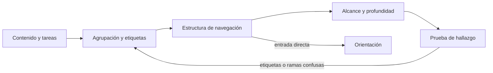
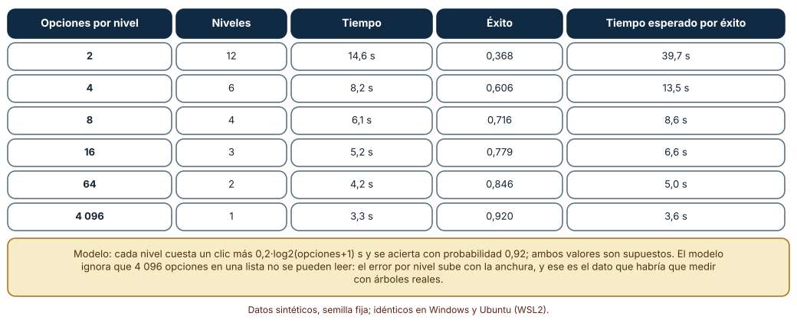
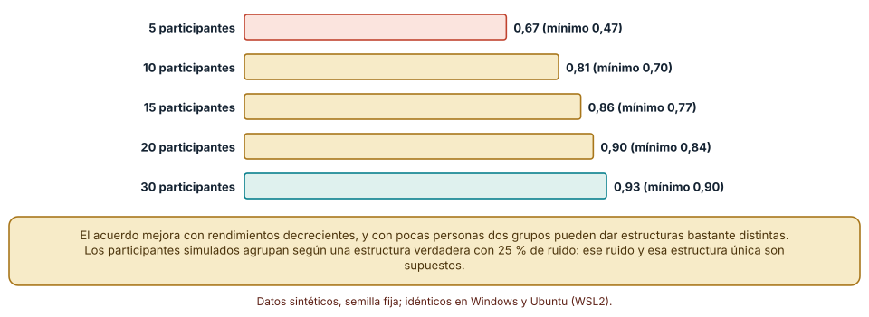
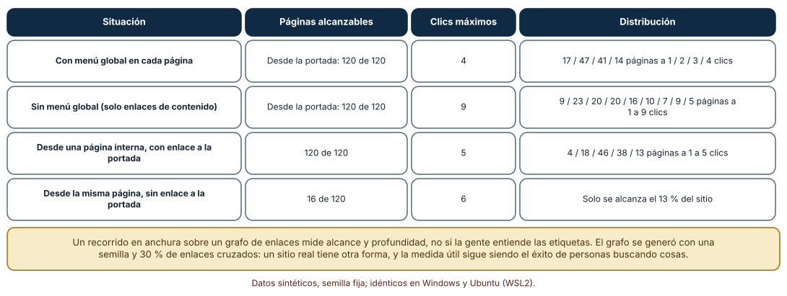

# SE-170 — Arquitectura de información y navegación

[← SE-169 — Diseño centrado en personas y tareas](../../classes/part-14-experiencia-accesibilidad-e-internacionalizacion/se-169-diseno-centrado-en-personas-y-tareas/README.md) · [↑ Parte 14](../../classes/part-14-experiencia-accesibilidad-e-internacionalizacion/README.md) · [📚 Índice completo](../../classes/README.md) · [🌐 Portal](../../site/classes/SE-170.html) · [SE-171 — Interacción, affordances y retroalimentación →](../../classes/part-14-experiencia-accesibilidad-e-internacionalizacion/se-171-interaccion-affordances-y-retroalimentacion/README.md)

## Punto profesional y fundamento pedagógico

**Punto profesional.** La clase existe para que decidas cómo se agrupa, nombra y enlaza la información de modo que una persona encuentre lo que busca y sepa dónde está, y para que midas esa decisión en vez de defenderla por intuición.

**Por qué aparece aquí.** Se sitúa después de **Diseño centrado en personas y tareas** y antes de **Interacción, affordances y retroalimentación**: `SE-169` dejó las tareas y la etapa que más pierde gente; esta clase pregunta dónde vive cada tarea en la estructura y cuántos pasos cuesta llegar a ella. Deja el esquema de navegación que `SE-171` llenará de controles y respuestas.

**Error conceptual que debe corregir.** Creer que una buena arquitectura de información es un menú bonito o un árbol con pocos niveles: es un acuerdo entre cómo la gente agrupa y nombra las cosas y cómo está enlazada la información, y se comprueba con personas buscando, no con un organigrama interno.

**Secuencia de aprendizaje.** Antes de leer la solución, predices qué anchura de menú minimiza el costo de llegar a una página entre 4 096, cuántas personas hacen falta para que un ordenamiento de tarjetas sea estable y qué pasa con el alcance del sitio al quitar el menú global; después calculas, simulas y mides en un grafo sintético. La secuencia usa predicción, explicación propia, contraste y recuperación. [ICAP](https://icap.education.asu.edu/research) distingue participación de construcción de conocimiento; [How People Learn II](https://nap.nationalacademies.org/catalog/24783/how-people-learn-ii-learners-contexts-and-cultures) exige conectar conocimiento previo, contexto y transferencia; la [práctica de recuperación](https://pubmed.ncbi.nlm.nih.gov/16507066/) respalda producir de nuevo la explicación tras una demora; y [Education for Life and Work](https://nap.nationalacademies.org/resource/13398/dbasse_084153.pdf) exige devolución que explique la causa del error.

**Evidencia de aprendizaje.** `ia-log.md` con el esquema de la plataforma, el cálculo de anchura y profundidad, la simulación de ordenamiento de tarjetas y el análisis del grafo de enlaces. Debe distinguir lo que mide la estructura (alcance, profundidad) de lo que solo puede observarse con personas (comprensión de etiquetas). Debe contener predicción previa, observación, explicación causal, contraejemplo y qué hallazgo haría retirar la conclusión.

**Límite de la conclusión.** El error por nivel, la estructura verdadera del ordenamiento y el grafo de 120 páginas son supuestos del autor; ningún número mide a una persona real ni un sitio real, y las etiquetas no se probaron con nadie.

### Trazabilidad fuente → afirmación

| Fuente primaria u oficial | Afirmación que respalda | Lo que no prueba |
|---|---|---|
| [Nielsen Norman Group: heurísticas de usabilidad](https://www.nngroup.com/articles/ten-usability-heuristics/) | Recoge el principio de que el sistema debe usar el lenguaje de la persona y mostrar dónde está. | No dice cuántos niveles ni qué etiquetas convienen a un sitio concreto. |
| [Hick, «On the rate of gain of information» (QJEP, 1952)](https://doi.org/10.1080/17470215208416600) | El tiempo de elegir crece con el logaritmo del número de alternativas equiprobables. | No cubre listas largas leídas de arriba abajo ni errores de comprensión. |
| [W3C: WCAG 2.2, 3.2.3 Navegación coherente](https://www.w3.org/WAI/WCAG22/Understanding/consistent-navigation.html) | Exige que los mecanismos de navegación repetidos aparezcan en el mismo orden relativo. | No evalúa si la navegación elegida es la adecuada. |

## Antes de empezar

Recupera lo aprendido en `SE-169`: la etapa que más pierde gente orienta el esfuerzo. La pregunta activa es: **¿dónde vive cada tarea, cuántos pasos cuesta llegar y qué hace la persona cuando se equivoca de rama?**

## Prerrequisitos

- Haber completado `SE-169` o poder explicar qué es una tarea y por qué el promedio no sirve.
- Python 3.11 o posterior y un terminal; los cálculos usan solo la biblioteca estándar.
- Trabajar con la plataforma de entregas, un sitio sintético de 120 páginas y datos sintéticos.

## Problema auténtico

La plataforma de entregas creció: 120 páginas entre cursos, tareas, calificaciones, ayuda y configuración. Estudiantes escriben a soporte para preguntar «dónde veo mi nota» y docentes no encuentran «reabrir una entrega». Una propuesta es un menú gigante con todo; otra, un árbol de seis niveles ordenado por la organización interna; una tercera, buscar y listo. Nadie sabe cuántos clics cuesta cada una ni qué pasa con quien llega a una página desde un enlace de correo.

## Objetivos observables

Al terminar podrás:

1. comparar estructuras de navegación por profundidad, anchura y costo esperado con supuestos declarados;
2. estimar cuántas personas necesita un ordenamiento de tarjetas para dar una estructura estable;
3. analizar un grafo de enlaces para obtener alcance y profundidad y detectar páginas huérfanas;
4. decidir qué elementos de navegación son globales, locales y contextuales y por qué;
5. escribir un esquema de información con etiquetas, agrupaciones y una prueba de hallazgo que otra persona pueda repetir.

## Mapa conceptual



El mapa se lee como un lazo de ajuste: se agrupa y etiqueta, se estructura, se mide el alcance y se comprueba si la gente encuentra; una prueba fallida devuelve a las agrupaciones. La entrada directa (un enlace de correo, una búsqueda) obliga a que cada página oriente por sí misma; el mapa no es un orden de entrega.

## Temas y por qué importan

| Tema | Por qué cambia una decisión profesional | Evidencia mínima |
|---|---|---|
| Agrupación y etiquetado | Decide qué va junto y cómo se llama, que es lo que la persona usa para decidir dónde mirar. | Predicción, traza causal y contraejemplo de **Agrupación y etiquetado** en `ia-log.md` |
| Profundidad y anchura | Fija cuántas decisiones toma una persona y cuántas opciones ve en cada una. | Predicción, traza causal y contraejemplo de **Profundidad y anchura** en `ia-log.md` |
| Navegación global, local y contextual | Reparte la orientación entre lo que está siempre, lo que depende de la sección y lo que aparece según la tarea. | Predicción, traza causal y contraejemplo de **Navegación global, local y contextual** en `ia-log.md` |
| Descubrimiento y búsqueda | Combina explorar con encontrar y define qué pasa cuando una de las dos falla. | Predicción, traza causal y contraejemplo de **Descubrimiento y búsqueda** en `ia-log.md` |
| Orientación y entrada directa | Garantiza que una persona que llega a una página por un enlace sepa dónde está y adónde ir. | Predicción, traza causal y contraejemplo de **Orientación y entrada directa** en `ia-log.md` |

## Conceptos y decisiones

### 1. Agrupación y etiquetado

Una agrupación responde a un modelo mental y una etiqueta es la promesa de qué hay detrás. Las dos fallan de modos distintos: una agrupación por el organigrama interno separa lo que la persona junta, y una etiqueta propia del equipo («Gestión de artefactos») no se entiende sin su contexto. Un ordenamiento de tarjetas abierto muestra cómo agrupa la gente y un ordenamiento cerrado comprueba si una estructura propuesta encaja. Ninguno decide por sí solo: aporta evidencia que se combina con restricciones de negocio.

### 2. Profundidad y anchura

Un árbol de N destinos con b opciones por nivel tiene log_b(N) niveles. Menos niveles significa menos decisiones, pero más opciones por decisión, y esa anchura cuesta tiempo de elección (la ley de Hick: logarítmico en el número de opciones) y errores de lectura. Más niveles significa decisiones simples pero más oportunidades de equivocarse de rama, y el error se multiplica por nivel. El óptimo depende de cuánto crece el error con la anchura, que es un dato que hay que medir en el contenido real.

### 3. Navegación global, local y contextual

La navegación global (siempre visible) acorta el recorrido y da un punto de referencia; la local organiza una sección; la contextual (enlaces dentro del contenido, «relacionados») sigue la tarea. Un sitio con solo navegación contextual depende de que los enlaces de contenido formen un camino conexo: si uno falla, páginas enteras se vuelven inaccesibles. La coherencia importa: cambiar de orden o de etiqueta entre páginas obliga a releer en cada una.

### 4. Descubrimiento y búsqueda

Quien sabe lo que busca escribe; quien explora navega. Una estructura clara ayuda a la búsqueda (los resultados se agrupan, los filtros se entienden) y una búsqueda buena compensa estructuras imperfectas, pero no las sustituye: los resultados fuera de contexto desorientan. Medir las búsquedas sin resultado y las búsquedas repetidas da pistas de etiquetas que faltan, siempre que se traten como datos agregados y anónimos.

### 5. Orientación y entrada directa

Muchas visitas no empiezan en la portada. Cada página necesita decir en qué sección está (migas, estado de la navegación actual), cómo subir (enlace al nivel superior) y cómo salir (a la portada o a la búsqueda). El criterio práctico: desde cualquier página, ¿se puede llegar a todo el sitio? Si no, hay una isla de contenido, y el tiempo y la paciencia de la persona se gastan en buscar un camino.

### Anchura frente a profundidad en un menú de 4 096 destinos

Se modeló cada nivel con un costo de 0,9 s por clic más 0,2·log2(opciones + 1) s de elección y una probabilidad de acierto de 0,92 por nivel (supuesto). Con 2 opciones por nivel hay 12 niveles, 14,6 s y 0,368 de éxito; con 4, 6 niveles, 8,2 s y 0,606; con 8, 4 niveles, 6,1 s y 0,716; con 16, 3 niveles, 5,2 s y 0,779; con 64, 2 niveles, 4,2 s y 0,846; con una lista de 4 096, 1 nivel, 3,3 s y 0,92. El tiempo esperado por éxito (tiempo ÷ éxito) baja de 39,7 s a 3,6 s: con error constante por nivel, ganan los árboles anchos.

```python
import math
def arbol(b, N=4096, p_err=0.08, clic=0.9, hick=0.2):
    niveles = math.ceil(math.log(N, b))
    t = niveles * (clic + hick * math.log2(b + 1))
    exito = (1 - p_err) ** niveles
    return niveles, round(t, 1), round(exito, 3), round(t / exito, 1)
```



**Cómo leer la figura.** Cada fila es una anchura; léela de arriba abajo para ver cómo bajan los niveles, el tiempo y el costo por éxito. **Dónde deja de valer:** el modelo mantiene el error por nivel en 0,08 sin importar la anchura, y eso es falso para una lista de 4 096 elementos: ahí el error de lectura sube. Por eso el resultado a favor de lo ancho es un límite del supuesto y no una recomendación; lo que se mide en un menú real es cómo cambia el error con la anchura.

### ¿Cuántas personas para un ordenamiento de tarjetas estable?

Se simularon participantes que ordenan 24 tarjetas en 4 categorías según una estructura verdadera con un 25 % de ruido (cada tarjeta se coloca al azar con esa probabilidad), y se midió la correlación entre las matrices de coocurrencia de dos grupos independientes del mismo tamaño en 100 repeticiones. Con 5 participantes por grupo la correlación media es 0,67 y el peor caso 0,47; con 10, 0,81 (mínimo 0,70); con 15, 0,86; con 20, 0,90 (mínimo 0,84); con 30, 0,93 (mínimo 0,90). Los rendimientos decrecen y con pocas personas dos grupos pueden proponer estructuras bastante distintas.

```python
mia = t if rnd.random() > 0.25 else rnd.randrange(4)   # categoría puesta por un participante
co[i][j] += (mia_i == mia_j)                              # coocurrencia
r = statistics.correlation(v1, v2)                       # estabilidad entre dos grupos
```



**Cómo leer la figura.** Cada barra es la correlación media entre dos grupos del mismo tamaño; más alta significa que un grupo reproduce la estructura del otro. **Dónde deja de valer:** los participantes simulados comparten una estructura única con ruido uniforme; las personas reales discrepan por razones sistemáticas (dominio, idioma, rol), y entonces más participantes no convergen a una sola estructura sino a varias.

### El menú global y el enlace a la portada, medidos en un grafo

Se generó un sitio de 120 páginas con una semilla: un árbol de contenido, 8 secciones enlazadas desde la portada y un 30 % de enlaces cruzados. Con el menú global, un recorrido en anchura desde la portada alcanza las 120 páginas, con 17, 47, 41 y 14 páginas a 1, 2, 3 y 4 clics. Sin el menú global, se alcanzan las mismas 120, pero la profundidad llega a 9 clics. Desde una página interna con un enlace a la portada en todas las páginas se llega a las 120 en 5 clics como máximo; sin ese enlace, solo a 16 de 120 (13 %).

```python
def bfs(adj, origen):
    dist, cola = {origen: 0}, [origen]
    for u in cola:
        for v in adj[u]:
            if v not in dist:
                dist[v] = dist[u] + 1
                cola.append(v)
    return dist
```



**Cómo leer la figura.** Cada fila es una configuración; compara las columnas de alcance y de clics máximos entre filas. **Dónde deja de valer:** un recorrido en anchura mide cuántas páginas se alcanzan y a cuántos clics, no si la persona entiende las etiquetas ni elige la rama correcta. El grafo es sintético con 30 % de enlaces cruzados; en un sitio real, la forma y los enlaces rotos cambian los números.

## Definiciones de trabajo

- **arquitectura de información:** organización, etiquetado y enlazado de la información para que las personas la encuentren y la entiendan.
- **ordenamiento de tarjetas:** técnica en la que participantes agrupan tarjetas con conceptos y revelan cómo los organizan.
- **profundidad:** número de niveles o clics entre un punto de partida y una página.
- **anchura:** número de opciones que se ofrecen en un nivel de navegación.
- **página huérfana:** página sin ningún enlace entrante desde el resto de la estructura.

Las definiciones son operativas para la plataforma de entregas. No convierten términos con historia más amplia en sinónimos y deben contrastarse con la documentación primaria enlazada al final.

## Ejemplo mínimo

El fragmento calcula la profundidad de cada página con un recorrido en anchura sobre un grafo pequeño. Antes de ejecutarlo, predice cuál es la profundidad de `ayuda`.

```python
adj = {'inicio': ['cursos', 'ayuda'], 'cursos': ['tarea'], 'tarea': ['entrega'], 'ayuda': [], 'entrega': []}
dist, cola = {'inicio': 0}, ['inicio']
for u in cola:
    for v in adj[u]:
        if v not in dist:
            dist[v] = dist[u] + 1
            cola.append(v)
print(dist)   # {'inicio': 0, 'cursos': 1, 'ayuda': 1, 'tarea': 2, 'entrega': 3}
```

La entrega está a tres clics de la portada. Añade un enlace de `inicio` a `entrega` y observa cómo cambia solo esa distancia; registra versión y salida.

## Ejemplo profesional

En la plataforma, el equipo mantiene el esquema de información como un archivo de agrupaciones y etiquetas con la evidencia que las respalda (un ordenamiento de tarjetas abierto con participantes voluntarios, una prueba de hallazgo con tareas concretas). El grafo de enlaces se genera en cada despliegue, y una comprobación falla si aparece una página sin enlace entrante o si el alcance desde la portada baja del 100 %. Las etiquetas nuevas pasan por una revisión de personas ajenas al equipo.

Compara el caso normal con una entrada por un enlace de correo a una página profunda, una búsqueda sin resultados y una sección con 90 elementos. Una estructura es apropiada cuando esos tres casos tienen un camino y un mensaje; es peligrosa cuando solo se probó recorriéndola desde la portada.

## Práctica guiada

1. Lista las tareas de `SE-169` y las páginas donde vive cada una.
2. Predice cuántos clics cuesta llegar a «ver mi nota» y a «reabrir una entrega» en la estructura actual.
3. Calcula el costo esperado para las anchuras de 4, 8 y 16 y anota qué supuesto sostiene el resultado.
4. Simula el ordenamiento de tarjetas con 5, 10 y 20 participantes y registra la estabilidad.
5. Construye el grafo, calcula alcance y profundidad con y sin menú global e identifica páginas huérfanas.
6. Elimina el enlace a la portada de las páginas internas y mide cuánto del sitio queda a alcance.
7. Pide a otra persona que reconstruya la estructura solo desde `ia-log.md`.

## Ejercicios

1. **Costo con error creciente:** modifica el modelo para que el error por nivel suba con la anchura (0,02 por cada 10 opciones) y encuentra la anchura que minimiza el tiempo por éxito.
2. **Estabilidad:** repite el ordenamiento de tarjetas con 40 % de ruido y explica qué cambia en el número de participantes necesario.
3. **Alcance:** añade una sección de 10 páginas enlazada solo desde otra sección y calcula su profundidad y la fracción alcanzable sin ese enlace.
4. **Etiquetas:** propón dos etiquetas alternativas para una sección y diseña una prueba de hallazgo con cinco tareas que decida entre ellas.

## Reto verificable

Entrega `ia-log.md` con el esquema de agrupaciones y etiquetas, el cálculo de anchura y profundidad con su supuesto de error, la simulación de tarjetas y el análisis del grafo. Se aprueba si otra persona reproduce los números con las mismas semillas y señala qué prueba con personas cambiaría la estructura. No se aprueba por un diagrama bonito ni por un conteo de páginas.

## Caso conductor

La plataforma de entregas es el caso conductor de la Parte 14. Esta clase deja el esquema de información de las tareas de `SE-169` y las comprobaciones de alcance y huérfanas. `SE-171` decidirá cómo responden los controles de cada página; `SE-172` qué ocurre cuando una página no tiene datos o falla. Cambia después una sola etiqueta, «Calificaciones» por «Mis notas», y revisa qué búsquedas, enlaces y soportes dependían de ella.

## Preguntas frecuentes

### ¿Menos clics siempre es mejor?

No: el costo de un clic depende de cuán claro sea. Tres decisiones fáciles pueden ser más rápidas y menos propensas al error que una lista larga que hay que leer entera. La regla de «tres clics» no tiene respaldo en este modelo; lo que importa es el error por decisión.

### ¿La búsqueda reemplaza a la navegación?

No: quien explora no sabe qué escribir y quien busca necesita que los resultados tengan contexto. Una buena búsqueda alivia estructuras imperfectas, y una buena estructura hace que la búsqueda sea más fácil de usar.

### ¿Cuántas personas necesita un ordenamiento de tarjetas?

En la simulación, 15 a 20 dan una estructura bastante estable con ruido del 25 %; con personas reales depende de cuánto discrepen. Dos grupos pequeños que difieren son una señal y no un ruido que promediar.

### ¿Qué hago con las páginas huérfanas?

Decide si son contenido que debería estar enlazado (añadir enlace), contenido obsoleto (retirar con redirección) o contenido deliberadamente privado. Un detector no decide cuál es; lo que hace es obligar a decidir.

## Fallo controlado y diagnóstico

Reproduce el fallo clásico de la clase: **una isla de contenido por navegación solo contextual**. Usa el grafo sin enlace a la portada.

Registra síntoma, entrada mínima, hipótesis, observación que descarta cada hipótesis, causa, corrección y prueba de regresión. **Síntoma:** una persona llega por un enlace de correo a la página 7 y no puede ir a ninguna otra parte del sitio salvo 16 páginas. **Hipótesis rivales:** (a) el menú global está roto; (b) la página no enlaza hacia arriba ni hacia la portada. **Prueba:** recorre el grafo desde la página 7 con y sin enlace a la portada: 16 páginas frente a 120. **Conclusión:** la causa es la falta de salida, no el menú. **Regresión:** añade una comprobación que falla si alguna página no alcanza al menos el 100 % del sitio. No cambies a la vez las etiquetas y los enlaces.

## Errores comunes y cómo corregirlos

| Síntoma | Causa probable | Corrección |
|---|---|---|
| La gente pregunta por soporte dónde está algo que existe | Etiqueta propia del equipo o agrupación por organigrama | Ordenamiento de tarjetas y prueba de hallazgo con etiquetas alternativas |
| Una sección desaparece de la navegación tras un cambio | Se movió el contenido sin comprobar alcance | Comprobar alcance y huérfanas en cada despliegue |
| Se elige la anchura por una regla de «tres clics» | No se midió el error por nivel | Medir el error con árboles reales y decidir con tiempo por éxito |
| Un enlace de correo lleva a una página sin salida | Navegación solo contextual | Enlace a la portada y al nivel superior en toda página |
| Dos grupos de tarjetas proponen estructuras distintas y se promedian | Se trató la discrepancia como ruido | Analizar quién discrepa y por qué antes de decidir |

## Entorno y archivos clave

```text
work/SE-170/
├── README.md
├── ia/
│   ├── arbol.py
│   ├── tarjetas.py
│   └── grafo.py
├── tests/test_ia.py
└── evidence/ia-log.md
```

El `README` declara plataforma, versión de Python, semillas y comandos. Los experimentos usan solo la biblioteca estándar y se ejecutaron con CPython 3.12.9 en Windows 11 y 3.12.3 en Ubuntu bajo WSL2: las salidas fueron idénticas. No se usó ninguna herramienta de análisis de sitios ni se hizo un ordenamiento de tarjetas con personas.

## Seguridad, ética y accesibilidad

- las búsquedas de las personas pueden contener datos personales: se agregan, se anonimizan y no se conservan textos libres;
- las etiquetas no deben revelar la existencia de contenido restringido a quien no debe saberlo;
- los participantes de un ordenamiento de tarjetas dan su consentimiento informado y pueden retirarse; no se recogen datos innecesarios;
- ofrece una alternativa textual a cada tabla y figura y no uses el color como única señal;
- respeta las licencias de las herramientas de análisis y atribuye las adaptaciones.

## Puente hacia el trabajo con agentes

Un agente al que se le pide «propón la navegación de la plataforma» devolverá un menú ordenado por las secciones del código, con etiquetas técnicas y ningún análisis de alcance. Pídele que agrupe a partir de las tareas de `SE-169`, que proponga dos etiquetas alternativas por sección y que escriba la comprobación de alcance y huérfanas. Revisa especialmente si dedujo agrupaciones de los nombres de los módulos: es la misma organización interna, ahora con apariencia de estructura de usuario.

## Transferencia

Traslada el análisis a otra estructura (la ayuda de una aplicación bancaria o el catálogo de una tienda): calcula la anchura que minimiza el tiempo por éxito con un error que crece con las opciones y mide alcance y huérfanas de un grafo propio. La transferencia está lograda cuando puedes explicar qué parte dependía de la plataforma de entregas y cuál no.

## Evaluación y evidencia

| Criterio | Evidencia para aprobar |
|---|---|
| comprensión | explicación de por qué la anchura óptima depende del error por decisión |
| corrección | cifras de costo, estabilidad y alcance reproducibles con las mismas semillas |
| diseño | esquema con agrupaciones, etiquetas alternativas y evidencia |
| diagnóstico | reproducción del fallo «isla de contenido» con su comprobación de regresión |
| incertidumbre | supuestos de error, ruido y grafo declarados |
| reproducibilidad | versiones, comandos, salida y límites declarados |

## Fuentes

- [Nielsen Norman Group: 10 heurísticas de usabilidad](https://www.nngroup.com/articles/ten-usability-heuristics/) — correspondencia con el lenguaje de la persona y visibilidad del estado; autoridad: Nielsen Norman Group.
- [Hick, «On the rate of gain of information» (QJEP, 1952)](https://doi.org/10.1080/17470215208416600) — tiempo de elección y número de alternativas; autoridad: Quarterly Journal of Experimental Psychology.
- [Miller, «The magical number seven, plus or minus two» (Psychological Review, 1956)](https://doi.org/10.1037/h0043158) — límites de capacidad de procesamiento; autoridad: Psychological Review.
- [Nielsen Norman Group: cuántos participantes en un ordenamiento de tarjetas](https://www.nngroup.com/articles/card-sorting-how-many-users-to-test/) — criterio práctico de tamaño de muestra; autoridad: Nielsen Norman Group.
- [W3C: WCAG 2.2, 2.4.1 Evitar bloques](https://www.w3.org/WAI/WCAG22/Understanding/bypass-blocks.html) — saltar contenido repetido en la navegación; autoridad: W3C.
- [W3C: WCAG 2.2, 3.2.3 Navegación coherente](https://www.w3.org/WAI/WCAG22/Understanding/consistent-navigation.html) — orden estable de los mecanismos repetidos; autoridad: W3C.

Cada fuente respalda el mecanismo indicado; ninguna demuestra que la estructura de la plataforma de entregas sea la adecuada. Esa afirmación depende de que personas reales encuentren lo que buscan.

- [Python: `statistics.correlation`](https://docs.python.org/3/library/statistics.html) — correlación entre dos matrices de coocurrencia.
- [Python: `random`](https://docs.python.org/3/library/random.html) — semillas de los participantes y del grafo.

## Límites y siguiente paso

Se ejecutaron tres experimentos con datos sintéticos en Windows y Ubuntu (WSL2) con resultados idénticos. No se hizo un ordenamiento de tarjetas con personas, no se usó ninguna herramienta de análisis de sitios y el error por nivel, el ruido y el grafo son supuestos del autor. La siguiente clase pregunta cómo debe responder cada control cuando alguien lo usa.

## Glosario

- **arquitectura de información:** organización, etiquetado y enlazado de la información para que las personas la encuentren y la entiendan.
- **ordenamiento de tarjetas:** técnica en la que participantes agrupan tarjetas con conceptos y revelan cómo los organizan.
- **profundidad:** número de niveles o clics entre un punto de partida y una página.
- **anchura:** número de opciones que se ofrecen en un nivel de navegación.
- **página huérfana:** página sin ningún enlace entrante desde el resto de la estructura.

---

[← SE-169 — Diseño centrado en personas y tareas](../../classes/part-14-experiencia-accesibilidad-e-internacionalizacion/se-169-diseno-centrado-en-personas-y-tareas/README.md) · [↑ Parte 14](../../classes/part-14-experiencia-accesibilidad-e-internacionalizacion/README.md) · [📚 Índice completo](../../classes/README.md) · [🌐 Portal](../../site/classes/SE-170.html) · [SE-171 — Interacción, affordances y retroalimentación →](../../classes/part-14-experiencia-accesibilidad-e-internacionalizacion/se-171-interaccion-affordances-y-retroalimentacion/README.md)
