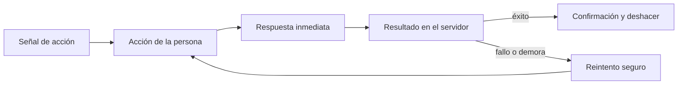
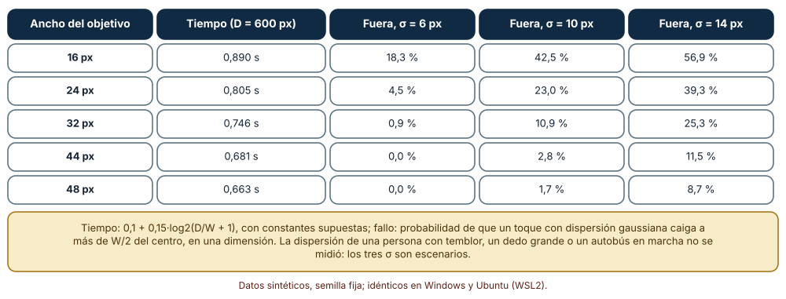
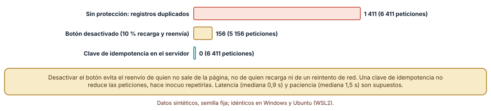
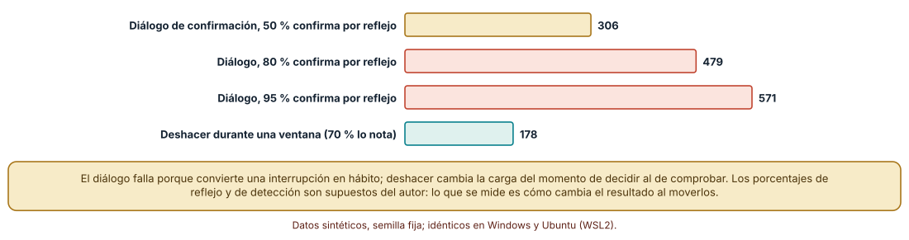

# SE-171 — Interacción, affordances y retroalimentación

[← SE-170 — Arquitectura de información y navegación](../../classes/part-14-experiencia-accesibilidad-e-internacionalizacion/se-170-arquitectura-de-informacion-y-navegacion/README.md) · [↑ Parte 14](../../classes/part-14-experiencia-accesibilidad-e-internacionalizacion/README.md) · [📚 Índice completo](../../classes/README.md) · [🌐 Portal](../../site/classes/SE-171.html) · [SE-172 — Estados vacíos, carga, error y recuperación →](../../classes/part-14-experiencia-accesibilidad-e-internacionalizacion/se-172-estados-vacios-carga-error-y-recuperacion/README.md)

## Punto profesional y fundamento pedagógico

**Punto profesional.** La clase existe para que decidas cómo se ve, se alcanza y responde cada control de modo que la persona sepa qué puede hacer, qué pasó y cómo deshacerlo, y para que midas el costo de esas decisiones en errores y duplicados.

**Por qué aparece aquí.** Se sitúa después de **Arquitectura de información y navegación** y antes de **Estados vacíos, carga, error y recuperación**: `SE-170` dejó dónde vive cada tarea; esta clase pregunta cómo responde el control que la ejecuta. Fija el contrato de interacción del botón «Enviar entrega» y deja los estados que `SE-172` tratará cuando algo no salga bien.

**Error conceptual que debe corregir.** Creer que una interfaz es intuitiva si un equipo la entiende o si «parece un botón»: la señal de una acción posible se comprueba con quien no la diseñó, el tamaño del objetivo se calcula y la respuesta a una acción se diseña como parte del contrato con el servidor.

**Secuencia de aprendizaje.** Antes de leer la solución, predices cuánto cambia el fallo de un toque al pasar de 24 a 44 píxeles, cuántos registros duplicados deja un envío sin protección y cuántos errores permanentes quedan con un diálogo de confirmación frente a una ventana de deshacer; después calculas y simulas cada caso con supuestos declarados. La secuencia usa predicción, explicación propia, contraste y recuperación. [ICAP](https://icap.education.asu.edu/research) distingue participación de construcción de conocimiento; [How People Learn II](https://nap.nationalacademies.org/catalog/24783/how-people-learn-ii-learners-contexts-and-cultures) exige conectar conocimiento previo, contexto y transferencia; la [práctica de recuperación](https://pubmed.ncbi.nlm.nih.gov/16507066/) respalda producir de nuevo la explicación tras una demora; y [Education for Life and Work](https://nap.nationalacademies.org/resource/13398/dbasse_084153.pdf) exige devolución que explique la causa del error.

**Evidencia de aprendizaje.** `interaction-log.md` con el contrato de interacción del envío, la tabla de tamaño de objetivo, la simulación de envío doble y la comparación entre confirmar y deshacer. Debe distinguir lo que sale del modelo de lo que depende de un supuesto de comportamiento. Debe contener predicción previa, observación, explicación causal, contraejemplo y qué hallazgo haría retirar la conclusión.

**Límite de la conclusión.** Las constantes de la ley de Fitts, la dispersión de los toques, la latencia y la paciencia y los porcentajes de confirmación por reflejo son supuestos del autor; no se midió a ninguna persona ni a ningún dispositivo, y los resultados describen mecanismos y no frecuencias reales.

### Trazabilidad fuente → afirmación

| Fuente primaria u oficial | Afirmación que respalda | Lo que no prueba |
|---|---|---|
| [Norman, «Affordance, conventions, and design» (Interactions, 1999)](https://doi.org/10.1145/301153.301168) | Distingue la posibilidad real de acción de la señal percibida y sostiene que el diseño depende de la segunda. | No indica qué señal concreta entiende una población dada. |
| [Fitts, «The information capacity of the human motor system» (J. Exp. Psychol., 1954)](https://doi.org/10.1037/h0055392) | El tiempo de apuntar crece con el logaritmo de la razón entre distancia y tamaño del objetivo. | No mide errores de toque en pantallas táctiles ni el efecto de un temblor. |
| [Nielsen Norman Group: límites de tiempo de respuesta](https://www.nngroup.com/articles/response-times-3-important-limits/) | Describe órdenes de magnitud (0,1 s, 1 s, 10 s) en los que cambia la percepción de respuesta. | No es una medición de tu producto ni de tu población. |

## Antes de empezar

Recupera lo aprendido en `SE-170`: una página debe orientar a quien llega por un enlace directo. La pregunta activa es: **¿qué señal dice que esto se puede usar, qué responde al usarlo y cómo se deshace?**

## Prerrequisitos

- Haber completado `SE-170` o poder explicar qué mide el alcance de un grafo de enlaces.
- Python 3.11 o posterior y un terminal; los cálculos usan solo la biblioteca estándar.
- Trabajar con la plataforma de entregas y datos sintéticos; no se mide a ninguna persona.

## Problema auténtico

El botón «Enviar entrega» tiene 16 px de alto en el teléfono, el servidor tarda 0,9 s de mediana y sin respuesta visible la gente vuelve a pulsar. El soporte recibe tickets por entregas duplicadas, y un docente borró una entrega confirmando un diálogo sin leerlo. Una propuesta agranda el botón; otra añade un diálogo de confirmación; otra desactiva el botón al pulsar. Nadie sabe cuánto reduce cada medida ni qué problema deja sin resolver.

## Objetivos observables

Al terminar podrás:

1. calcular el tiempo y la tasa de fallo de un objetivo según su tamaño con supuestos declarados;
2. explicar qué hace una señal percibida frente a una posibilidad real de acción;
3. diseñar una respuesta a una acción con un tiempo de retroalimentación y un contrato de idempotencia;
4. comparar confirmar y deshacer según el hábito que provocan y el costo del error;
5. escribir un contrato de interacción para un control que otra persona pueda revisar.

## Mapa conceptual



El mapa se lee de izquierda a derecha: la señal invita, la acción desencadena una respuesta inmediata y un resultado, y el fallo o la demora llevan a un reintento que debe ser seguro. No es un orden de implementación: la respuesta inmediata y la idempotencia se diseñan a la vez.

## Temas y por qué importan

| Tema | Por qué cambia una decisión profesional | Evidencia mínima |
|---|---|---|
| Affordances y señales | Distingue lo que un objeto permite de lo que su aspecto comunica. | Predicción, traza causal y contraejemplo de **Affordances y señales** en `interaction-log.md` |
| Tamaño del objetivo | Convierte «pequeño» en tiempo y fallos calculables. | Predicción, traza causal y contraejemplo de **Tamaño del objetivo** en `interaction-log.md` |
| Retroalimentación y latencia | Da a la persona una señal de que su acción fue recibida antes de saber el resultado. | Predicción, traza causal y contraejemplo de **Retroalimentación y latencia** en `interaction-log.md` |
| Prevención de errores: confirmar frente a deshacer | Decide si el costo del error se paga antes o después de la acción. | Predicción, traza causal y contraejemplo de **Prevención de errores: confirmar frente a deshacer** en `interaction-log.md` |
| Idempotencia y reintento seguro | Hace que repetir una acción no duplique su efecto. | Predicción, traza causal y contraejemplo de **Idempotencia y reintento seguro** en `interaction-log.md` |

## Conceptos y decisiones

### 1. Affordances y señales

Norman corrigió el uso de «affordance» en diseño: lo que importa es la señal percibida. Un div con clic permite la acción para quien conoce la página y no la comunica a nadie más; un botón con borde, etiqueta verbal y estado de foco comunica «esto se pulsa». Las convenciones (subrayado para enlaces, casillas cuadradas para múltiples) reducen el costo de aprender. Romperlas tiene un costo que debe justificarse con una ganancia concreta.

### 2. Tamaño del objetivo

La ley de Fitts relaciona el tiempo con log2(D/W + 1): duplicar el tamaño ahorra un bit de dificultad. En una pantalla táctil, además del tiempo importa la probabilidad de caer fuera: con dispersión gaussiana de los toques, la proporción fuera del objetivo cae rápido al crecer W. Las pautas de accesibilidad fijan un mínimo (24 px o espaciado suficiente en WCAG 2.2) y las de plataforma suelen recomendar más; el cálculo ayuda a decidir cuánto margen se necesita para una dispersión mayor.

### 3. Retroalimentación y latencia

Una respuesta inmediata (estado pulsado, indicador) evita que la persona repita la acción por incertidumbre. Los órdenes de magnitud de la literatura (una décima de segundo se percibe como instantáneo, un segundo mantiene el hilo de pensamiento, diez segundos agotan la atención) orientan cuándo un indicador debe aparecer y cuándo hace falta mostrar progreso. La señal no sustituye al resultado: avisar «enviado» antes de saber si se guardó es mentir.

### 4. Prevención de errores: confirmar frente a deshacer

Un diálogo de confirmación interrumpe y, usado a menudo, se vuelve un hábito: la persona confirma por reflejo. Deshacer cambia la carga: la acción se hace sin fricción y se ofrece una ventana para revertirla, lo que funciona cuando la acción es reversible y la persona nota el error. Para acciones irreversibles, la fricción debe ser específica (escribir el nombre de lo que se borra), no genérica.

### 5. Idempotencia y reintento seguro

Una operación idempotente produce el mismo estado final al aplicarse una o varias veces. Las peticiones PUT y DELETE lo son por definición en HTTP; un POST no. Para un envío, una clave de idempotencia generada en el cliente permite al servidor reconocer un reintento y devolver el resultado anterior. Desactivar el botón protege de un doble clic en la misma página, no de una recarga ni de un reintento de red; la garantía real vive en el servidor.

### Tamaño del objetivo: tiempo y fallos

Con una distancia de 600 px y constantes supuestas (a = 0,1 s, b = 0,15 s/bit), el tiempo baja de 0,890 s con 16 px a 0,805 con 24, 0,746 con 32, 0,681 con 44 y 0,663 con 48. La probabilidad de que un toque con dispersión gaussiana de σ = 10 px caiga fuera del objetivo es 42,5 % con 16 px, 23,0 % con 24, 10,9 % con 32, 2,8 % con 44 y 1,7 % con 48; con σ = 6 px, 18,3 %, 4,5 %, 0,9 %, 0 % y 0 %; con σ = 14 px, 56,9 %, 39,3 %, 25,3 %, 11,5 % y 8,7 %. El tiempo mejora poco al crecer y el fallo cae mucho.

```python
def tiempo(D, W, a=0.1, b=0.15):
    return a + b * math.log2(D / W + 1)

def fuera(W, sigma, n=20000, semilla=171):
    r = random.Random(semilla)
    return sum(abs(r.gauss(0, sigma)) > W / 2 for _ in range(n)) / n
```



**Cómo leer la figura.** Cada fila es un tamaño; las tres columnas de la derecha son la fracción de toques fuera con tres dispersiones distintas. **Dónde deja de valer:** la dispersión es un supuesto y se modela en una sola dimensión; una persona con temblor, un dedo ancho o un autobús en marcha tienen σ distintas. El experimento muestra la forma de la curva, no el tamaño que necesita una población dada.

### El doble envío y la clave de idempotencia

Se simularon 5 000 envíos con latencia lognormal (mediana 0,9 s) y paciencia lognormal (mediana 1,5 s): quien espera más de su paciencia vuelve a pulsar. Sin protección, 1 411 personas repiten y se crean 1 411 registros duplicados (6 411 peticiones). Con el botón desactivado, solo repiten quienes recargan la página (un 10 % supuesto): 156 duplicados (5 156 peticiones). Con una clave de idempotencia, el servidor recibe las mismas 6 411 peticiones y crea 5 000 registros: ningún duplicado.

```python
reenvia = latencia > paciencia
if modo == 'deshabilitado' and r.random() > 0.10:   # solo el 10 % recarga
    reenvia = False
recibidas += 2 if reenvia else 1
registros += 1 if modo == 'clave' else (2 if reenvia else 1)
```



**Cómo leer la figura.** Cada barra cuenta registros duplicados creados; el texto añade cuántas peticiones llegó a recibir el servidor. **Dónde deja de valer:** la latencia, la paciencia y el 10 % de recargas son supuestos; la simulación no incluye reintentos automáticos de red ni la caída de la conexión entre el envío y la respuesta, que son los casos donde la clave de idempotencia es más valiosa.

### Confirmar por reflejo o deshacer

En 100 series de 200 operaciones con un 3 % de errores (600 errores en total), un diálogo de confirmación donde el 50 % confirma por reflejo deja 306 errores permanentes; con el 80 %, 479; con el 95 %, 571. Una ventana de deshacer donde el 70 % nota el error y lo revierte deja 178. El diálogo pierde cuando la confirmación se hace hábito; deshacer, cuando la persona no mira lo que hizo.

```python
error = r.random() < 0.03
if error and r.random() < habito:   # confirma sin leer
    permanentes_dialogo += 1
if error and r.random() > 0.70:     # no nota el error en la ventana
    permanentes_deshacer += 1
```



**Cómo leer la figura.** Cada barra es cuántos de los 600 errores terminan sin corregirse; las coral son los diálogos con alta confirmación por reflejo. **Dónde deja de valer:** los porcentajes de reflejo y de detección son supuestos del autor, no mediciones; lo que muestra el experimento es la sensibilidad del resultado. Una acción irreversible o que afecta a terceros no admite una ventana de deshacer.

## Definiciones de trabajo

- **affordance percibida:** señal de una acción posible que la persona reconoce a partir del aspecto y el contexto del objeto.
- **ley de Fitts:** relación entre el tiempo de apuntar a un objetivo y el logaritmo de la razón entre la distancia y su tamaño.
- **retroalimentación:** respuesta perceptible de un sistema a una acción de la persona.
- **operación idempotente:** operación cuyo efecto en el estado es el mismo al aplicarla una vez o varias.
- **clave de idempotencia:** identificador único de una intención enviado con la petición para reconocer reintentos.

Las definiciones son operativas para la plataforma de entregas. No convierten términos con historia más amplia en sinónimos y deben contrastarse con la documentación primaria enlazada al final.

## Ejemplo mínimo

El fragmento calcula el tiempo de apuntar con la ley de Fitts. Antes de ejecutarlo, predice si pasar de 24 a 48 px ahorra más o menos de 0,2 s.

```python
import math

def tiempo(D, W, a=0.1, b=0.15):
    return a + b * math.log2(D / W + 1)

for w in (24, 48):
    print(w, round(tiempo(600, w), 3))   # 24 0.805  48 0.663
```

La diferencia es de 0,14 s: duplicar el tamaño ahorra poco tiempo y mucho fallo. Cambia `b` y anota qué parte de la conclusión depende de una constante supuesta.

## Ejemplo profesional

En la plataforma, el contrato de interacción de «Enviar entrega» fija un objetivo de al menos 44 px, una respuesta visible antes de 0,1 s (estado pulsado), un indicador de progreso si pasa de un segundo, una clave de idempotencia generada por el cliente y una ventana de deshacer de 30 s para el retiro de una entrega. Las pruebas comprueban que dos peticiones con la misma clave crean un solo registro y que un reintento tras un fallo de red devuelve el resultado anterior.

Compara el caso normal con un doble clic, una recarga tras el envío y un reintento automático tras un corte de red. Un control es apropiado cuando esos tres casos dejan un solo registro y un mensaje claro; es peligroso cuando solo se probó con un clic.

## Práctica guiada

1. Describe cada señal del botón (forma, etiqueta, foco) y qué pasa si una falta.
2. Predice cuánto bajan los toques fallidos al pasar de 24 a 44 px y calcula con tres dispersiones.
3. Simula el envío con tres protecciones y registra peticiones y registros.
4. Simula confirmar frente a deshacer con tres niveles de reflejo y anota el punto en que se cruzan.
5. Escribe el contrato de interacción del botón con sus tiempos y sus garantías.
6. Introduce el fallo controlado y registra el síntoma antes de corregirlo.
7. Pide a otra persona que reconstruya el contrato solo desde `interaction-log.md`.

## Ejercicios

1. **Objetivos:** calcula el tamaño mínimo que mantiene los toques fallidos por debajo del 5 % con σ = 14 px y explica qué lo hace inviable en una barra con 8 iconos.
2. **Idempotencia:** diseña la tabla del servidor para guardar claves y decide cuánto tiempo se conservan y qué responde ante una clave repetida con datos distintos.
3. **Deshacer:** para el retiro de una entrega, define la ventana de deshacer y qué ocurre si la persona cierra la página dentro de ella.
4. **Reflejo:** diseña una confirmación específica para borrar un curso que no se pueda confirmar por reflejo y explica qué costo añade.

## Reto verificable

Entrega `interaction-log.md` con el contrato de interacción del botón, la tabla de tamaños, la simulación del envío doble y la comparación entre confirmar y deshacer. Se aprueba si otra persona reproduce los números con las mismas semillas y puede indicar qué medición real cambiaría una constante. No se aprueba por el tamaño de un botón ni por una animación de carga.

## Caso conductor

La plataforma de entregas es el caso conductor de la Parte 14. Esta clase deja el contrato de interacción de «Enviar entrega», con tamaño, respuesta, idempotencia y deshacer. `SE-172` tratará qué ve la persona cuando no hay datos, cuando se espera y cuando algo falla; `SE-173` verificará si todo esto es accesible. Cambia después una sola constante, la paciencia mediana de 1,5 s a 3 s, y revisa qué duplicados desaparecen y cuáles no.

## Preguntas frecuentes

### ¿Un botón desactivado basta para evitar duplicados?

No: protege de un doble clic en la misma página y no de una recarga, de un reintento de red ni de dos pestañas. La garantía se pone en el servidor y el botón desactivado es una ayuda.

### ¿Siempre hace falta un diálogo antes de borrar?

No: si la acción es reversible, deshacer es mejor porque no entrena el reflejo. Si es irreversible, la confirmación debe ser específica y costosa de hacer por reflejo.

### ¿44 px es una norma?

No es una constante universal: es un valor de referencia de algunas plataformas, y WCAG 2.2 exige un mínimo de 24 px o espaciado. La cifra apropiada depende de la dispersión de las personas y del contexto de uso.

### ¿Qué pasa con el diseño plano sin bordes?

Un diseño sin señales puede ser tan claro como uno con ellas si hay otras pistas consistentes, y es una apuesta cuando solo el color o la posición las dan. Se comprueba con personas que no conocen la página.

## Fallo controlado y diagnóstico

Reproduce el fallo clásico de la clase: **desactivar el botón y dar por resuelto el doble envío**. Usa la simulación con 10 % de recargas.

Registra síntoma, entrada mínima, hipótesis, observación que descarta cada hipótesis, causa, corrección y prueba de regresión. **Síntoma:** tras desactivar el botón, aún aparecen 156 entregas duplicadas de 5 000. **Hipótesis rivales:** (a) el botón no se desactiva en algunos navegadores; (b) quienes recargan o reintentan envían de nuevo sin pasar por ese botón. **Prueba:** la simulación sin recarga da 0 duplicados con el botón desactivado; con recarga, 156. **Conclusión:** la causa es una protección en el cliente para un problema del servidor. **Regresión:** añade una clave de idempotencia y una prueba que envía dos veces la misma clave y exige un registro. No cambies a la vez el botón y el servidor.

## Errores comunes y cómo corregirlos

| Síntoma | Causa probable | Corrección |
|---|---|---|
| Entregas duplicadas pese a un botón desactivado | La protección vive solo en el cliente | Clave de idempotencia en el servidor |
| La gente confirma sin leer | Diálogo genérico usado a menudo | Deshacer para acciones reversibles y confirmación específica para las irreversibles |
| Los toques fallan en teléfonos | Objetivos pequeños y juntos | Calcular tamaño y espacio con una dispersión realista |
| Un indicador «enviado» aparece y el envío falla | La respuesta inmediata se confundió con el resultado | Separar «recibido» de «guardado» y mostrar el resultado real |
| Un control con aspecto de texto no se usa | La señal de acción faltaba | Añadir borde, verbo y estado de foco y probar con quien no conoce la página |

## Entorno y archivos clave

```text
work/SE-171/
├── README.md
├── interaccion/
│   ├── fitts.py
│   ├── envio_doble.py
│   └── deshacer.py
├── tests/test_interaccion.py
└── evidence/interaction-log.md
```

El `README` declara plataforma, versión de Python, semillas y comandos. Los experimentos usan solo la biblioteca estándar y se ejecutaron con CPython 3.12.9 en Windows 11 y 3.12.3 en Ubuntu bajo WSL2: las salidas fueron idénticas. No se probó ningún dispositivo táctil ni se midió a ninguna persona.

## Seguridad, ética y accesibilidad

- una clave de idempotencia no debe contener datos personales ni ser predecible para quien no debería reproducirla;
- una confirmación específica no debe filtrar en pantalla datos que no corresponde mostrar;
- una acción destructiva debe registrarse en un historial auditado, aunque exista deshacer;
- ofrece alternativas a los gestos y a los controles pequeños y no uses el color como única señal de estado;
- atribuye las fuentes y respeta las licencias de las bibliotecas de interfaz.

## Puente hacia el trabajo con agentes

Un agente al que se le pide «haz que el botón de enviar no genere duplicados» desactivará el botón con un controlador y declarará el problema resuelto. Pídele que explique en qué casos aún se duplica, que añada una clave de idempotencia y una prueba con dos peticiones iguales, y que defina la respuesta al usuario en cada caso. Revisa especialmente si añadió un diálogo de confirmación genérico donde bastaba deshacer: es la misma fricción que se vuelve hábito.

## Transferencia

Traslada el análisis a otro control (el botón «Pagar» de una tienda o «Reservar» de un hotel): calcula el tamaño mínimo para una dispersión dada, simula duplicados y decide entre confirmar y deshacer. La transferencia está lograda cuando puedes explicar qué parte del método dependía de la plataforma de entregas y cuál no.

## Evaluación y evidencia

| Criterio | Evidencia para aprobar |
|---|---|
| comprensión | explicación de la señal percibida, la curva del tamaño y la diferencia entre protección de cliente y de servidor |
| corrección | cifras de fallo, duplicados y errores permanentes reproducibles con las mismas semillas |
| diseño | contrato de interacción con tamaño, respuesta, idempotencia y deshacer |
| diagnóstico | reproducción del fallo «botón desactivado» con su prueba de regresión |
| incertidumbre | supuestos de dispersión, latencia, paciencia y reflejo declarados |
| reproducibilidad | versiones, comandos, salida y límites declarados |

## Fuentes

- [Norman, «Affordance, conventions, and design» (Interactions, 1999)](https://doi.org/10.1145/301153.301168) — affordance real frente a percibida; autoridad: ACM Interactions.
- [Fitts, «The information capacity of the human motor system» (J. Exp. Psychol., 1954)](https://doi.org/10.1037/h0055392) — ley de apuntar; autoridad: Journal of Experimental Psychology.
- [MacKenzie, «Fitts\' law as a research and design tool in HCI» (Human–Computer Interaction, 1992)](https://doi.org/10.1207/s15327051hci0701_3) — uso de la ley de Fitts en diseño; autoridad: Human–Computer Interaction.
- [Nielsen Norman Group: límites de tiempo de respuesta](https://www.nngroup.com/articles/response-times-3-important-limits/) — órdenes de magnitud de la percepción de respuesta; autoridad: Nielsen Norman Group.
- [Nielsen Norman Group: diálogos de confirmación](https://www.nngroup.com/articles/confirmation-dialog/) — cuándo confirmar y cuándo no; autoridad: Nielsen Norman Group.
- [W3C: WCAG 2.2, 2.5.8 Tamaño del objetivo (mínimo)](https://www.w3.org/WAI/WCAG22/Understanding/target-size-minimum.html) — tamaño y espacio mínimos; autoridad: W3C.
- [IETF RFC 9110: semántica de HTTP](https://www.rfc-editor.org/rfc/rfc9110.html) — métodos idempotentes; autoridad: IETF.

Cada fuente respalda el mecanismo indicado; ninguna demuestra que las constantes de las simulaciones sean las de la población de la plataforma. Esa afirmación depende de medir a esas personas.

- [Stripe: peticiones idempotentes](https://docs.stripe.com/api/idempotent_requests) — ejemplo de una clave de idempotencia en una API pública (documentación de un proveedor, no un estándar).
- [Python: `random`](https://docs.python.org/3/library/random.html) — semillas y distribuciones de las simulaciones.

## Límites y siguiente paso

Se ejecutaron tres experimentos con datos sintéticos en Windows y Ubuntu (WSL2) con resultados idénticos. No se midió a ninguna persona, no se usó ningún dispositivo táctil y las constantes de Fitts, las dispersiones, la latencia, la paciencia y los porcentajes de reflejo son supuestos del autor. La siguiente clase pregunta qué ve la persona cuando no hay datos, cuando se espera o cuando algo falla.

## Glosario

- **affordance percibida:** señal de una acción posible que la persona reconoce a partir del aspecto y el contexto del objeto.
- **ley de Fitts:** relación entre el tiempo de apuntar a un objetivo y el logaritmo de la razón entre la distancia y su tamaño.
- **retroalimentación:** respuesta perceptible de un sistema a una acción de la persona.
- **operación idempotente:** operación cuyo efecto en el estado es el mismo al aplicarla una vez o varias.
- **clave de idempotencia:** identificador único de una intención enviado con la petición para reconocer reintentos.

---

[← SE-170 — Arquitectura de información y navegación](../../classes/part-14-experiencia-accesibilidad-e-internacionalizacion/se-170-arquitectura-de-informacion-y-navegacion/README.md) · [↑ Parte 14](../../classes/part-14-experiencia-accesibilidad-e-internacionalizacion/README.md) · [📚 Índice completo](../../classes/README.md) · [🌐 Portal](../../site/classes/SE-171.html) · [SE-172 — Estados vacíos, carga, error y recuperación →](../../classes/part-14-experiencia-accesibilidad-e-internacionalizacion/se-172-estados-vacios-carga-error-y-recuperacion/README.md)
