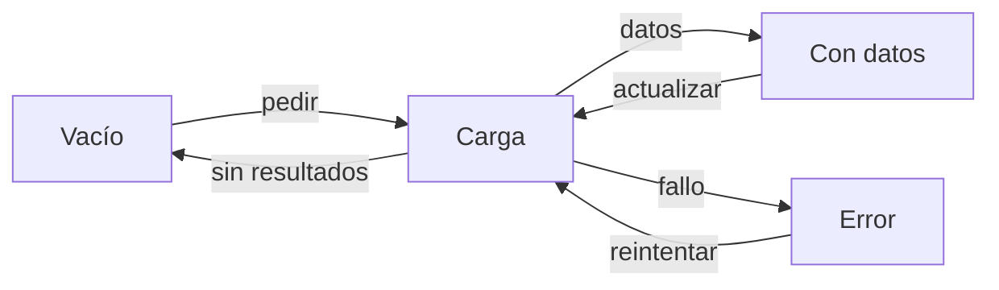
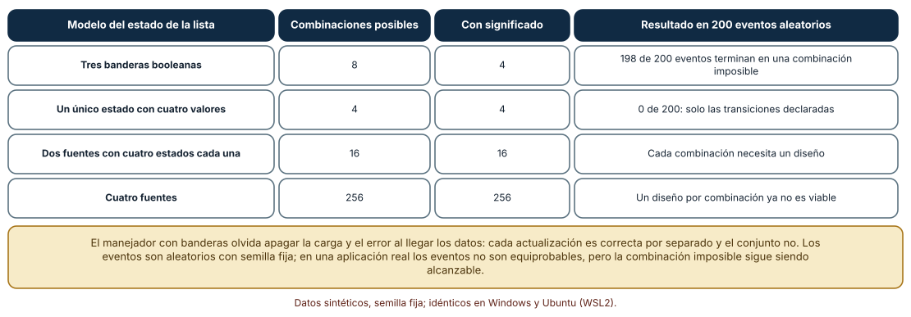
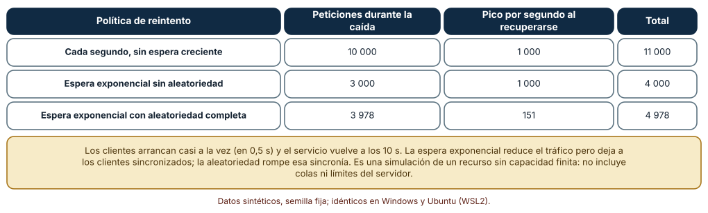
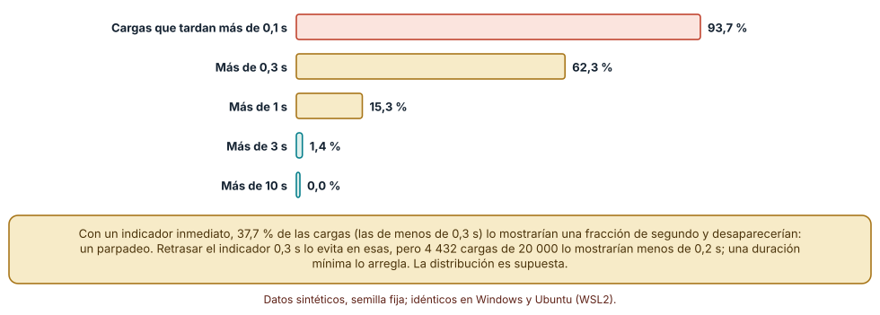

# SE-172 — Estados vacíos, carga, error y recuperación

[← SE-171 — Interacción, affordances y retroalimentación](../../classes/part-14-experiencia-accesibilidad-e-internacionalizacion/se-171-interaccion-affordances-y-retroalimentacion/README.md) · [↑ Parte 14](../../classes/part-14-experiencia-accesibilidad-e-internacionalizacion/README.md) · [📚 Índice completo](../../classes/README.md) · [🌐 Portal](../../site/classes/SE-172.html) · [SE-173 — Accesibilidad perceptible, operable y comprensible →](../../classes/part-14-experiencia-accesibilidad-e-internacionalizacion/se-173-accesibilidad-perceptible-operable-y-comprensible/README.md)

## Punto profesional y fundamento pedagógico

**Punto profesional.** La clase existe para que diseñes lo que ve y puede hacer una persona cuando una vista no tiene datos, está esperando, falló o se recuperó, y para que representes esos casos como estados explícitos y no como un montón de banderas que pueden contradecirse.

**Por qué aparece aquí.** Se sitúa después de **Interacción, affordances y retroalimentación** y antes de **Accesibilidad perceptible, operable y comprensible**: `SE-171` dejó cómo responde un control a una acción; esta clase pregunta qué muestra la vista cuando la respuesta no llega, llega vacía o llega rota. Deja los estados y mensajes que `SE-173` comprobará para que también sean perceptibles y comprensibles.

**Error conceptual que debe corregir.** Creer que los estados vacío, de carga y de error son detalles de acabado que se añaden al final: son parte del contrato de la vista, aparecen más a menudo de lo que parece y, mal modelados con banderas independientes, producen combinaciones imposibles que nadie diseñó.

**Secuencia de aprendizaje.** Antes de leer la solución, predices cuántas combinaciones de tres banderas booleanas tienen significado, qué política de reintentos evita un pico de carga al volver un servicio y cuántas cargas de una distribución dada muestran un indicador que parpadea; después enumeras, simulas y comparas. La secuencia usa predicción, explicación propia, contraste y recuperación. [ICAP](https://icap.education.asu.edu/research) distingue participación de construcción de conocimiento; [How People Learn II](https://nap.nationalacademies.org/catalog/24783/how-people-learn-ii-learners-contexts-and-cultures) exige conectar conocimiento previo, contexto y transferencia; la [práctica de recuperación](https://pubmed.ncbi.nlm.nih.gov/16507066/) respalda producir de nuevo la explicación tras una demora; y [Education for Life and Work](https://nap.nationalacademies.org/resource/13398/dbasse_084153.pdf) exige devolución que explique la causa del error.

**Evidencia de aprendizaje.** `states-log.md` con la lista de estados de la vista de entregas, la enumeración de combinaciones, la simulación de reintentos y la distribución de latencias. Debe distinguir el cálculo exacto (combinaciones) de las simulaciones con supuestos (reintentos y latencias). Debe contener predicción previa, observación, explicación causal, contraejemplo y qué hallazgo haría retirar la conclusión.

**Límite de la conclusión.** Los eventos aleatorios no son equiprobables en una aplicación real, los clientes de la simulación arrancan casi a la vez, no hay colas ni límites del servicio y la latencia es lognormal por supuesto; ninguna cifra describe a un servicio ni a una población.

### Trazabilidad fuente → afirmación

| Fuente primaria u oficial | Afirmación que respalda | Lo que no prueba |
|---|---|---|
| [Harel, «Statecharts: a visual formalism for complex systems» (Sci. Comput. Program., 1987)](https://doi.org/10.1016/0167-6423%2887%2990035-9) | Muestra que las combinaciones de condiciones independientes explotan y propone estados jerárquicos con transiciones explícitas. | No dice cómo modelar una vista concreta ni cuántos estados necesita. |
| [AWS Architecture Blog: Exponential backoff and jitter](https://aws.amazon.com/blogs/architecture/exponential-backoff-and-jitter/) | Compara reintentos con espera creciente con y sin aleatoriedad y muestra que la aleatoriedad reduce la competencia entre clientes. | Es un análisis de un proveedor para sus propios sistemas; no es una norma. |
| [W3C: WCAG 2.2, 3.3.1 Identificación de errores](https://www.w3.org/WAI/WCAG22/Understanding/error-identification.html) | Exige que un error detectado se identifique y se describa en texto. | No define cómo debe redactarse un mensaje útil. |

## Antes de empezar

Recupera lo aprendido en `SE-171`: separar «recibido» de «guardado» y hacer seguros los reintentos. La pregunta activa es: **¿qué ve la persona cuando no hay datos, cuando espera, cuando falla y cuando se recupera?**

## Prerrequisitos

- Haber completado `SE-171` o poder explicar qué es una operación idempotente.
- Python 3.11 o posterior y un terminal; los cálculos usan solo la biblioteca estándar.
- Trabajar con la vista «mis entregas» de la plataforma y datos sintéticos.

## Problema auténtico

La vista «mis entregas» muestra una lista que a veces queda en blanco: tras cargar muestra «No tienes entregas» durante un segundo y luego aparecen las entregas; otras veces muestra a la vez un indicador de carga y un mensaje de error; y cuando el servicio vuelve de una caída, los clientes reintentan al mismo tiempo y lo tumban de nuevo. Una propuesta añade más banderas; otra reintenta cada segundo; otra pone un indicador siempre.

## Objetivos observables

Al terminar podrás:

1. enumerar los estados de una vista y distinguir los que tienen significado de los que no;
2. representar un estado como unión con transiciones explícitas y mostrar qué evita;
3. comparar políticas de reintento por carga durante la caída y pico al recuperarse;
4. decidir cuándo mostrar un indicador de carga a partir de una distribución de latencias;
5. escribir los estados y mensajes de una vista de modo que otra persona los revise.

## Mapa conceptual



El mapa se lee como una máquina de cuatro estados: solo se puede estar en uno a la vez y cada flecha es una transición declarada. Lo que no tiene flecha no puede ocurrir; ese es el punto del modelo. Un estado parcial (algunos datos, un fallo) se añade como un quinto estado y no como dos banderas.

## Temas y por qué importan

| Tema | Por qué cambia una decisión profesional | Evidencia mínima |
|---|---|---|
| Los estados de una vista | Fija qué se muestra cuando no hay datos, cuando se espera, cuando falla y cuando todo va bien. | Predicción, traza causal y contraejemplo de **Los estados de una vista** en `states-log.md` |
| Estado como unión, no como banderas | Evita combinaciones que nadie diseñó. | Predicción, traza causal y contraejemplo de **Estado como unión, no como banderas** en `states-log.md` |
| Mensajes de error y recuperación | Dice qué pasó, por qué y qué puede hacer la persona. | Predicción, traza causal y contraejemplo de **Mensajes de error y recuperación** en `states-log.md` |
| Reintentos y competencia entre clientes | Evita que un servicio recién recuperado reciba todos los reintentos a la vez. | Predicción, traza causal y contraejemplo de **Reintentos y competencia entre clientes** en `states-log.md` |
| Percepción de la espera | Decide cuándo y cómo mostrar que algo está pasando. | Predicción, traza causal y contraejemplo de **Percepción de la espera** en `states-log.md` |

## Conceptos y decisiones

### 1. Los estados de una vista

Una vista que depende de datos remotos tiene al menos cuatro estados: carga, vacío (se pidió y no hay nada), error y con datos. Cada uno necesita un diseño: el vacío explica por qué no hay nada y qué hacer; la carga, que algo ocurre; el error, qué falló y cómo seguir. El estado vacío es la oportunidad de orientar, no un texto de relleno, y el estado de carga inicial no es el vacío: confundirlos produce el parpadeo de «no tienes entregas».

### 2. Estado como unión, no como banderas

Con tres banderas (cargando, hay error, hay datos) hay ocho combinaciones y solo cuatro tienen significado. Cada actualización puede ser correcta en aislamiento y el conjunto, imposible: al llegar los datos se olvida apagar el indicador de carga. Una unión etiquetada (un único valor entre carga, error, vacío, datos) hace imposible representar lo que no tiene sentido, y las transiciones se declaran en un solo lugar. Es la idea de los diagramas de estados de Harel aplicada a una vista.

### 3. Mensajes de error y recuperación

Un buen mensaje identifica el problema en texto, lo explica sin culpar, no expone detalles internos y ofrece un camino (reintentar, corregir, contactar). WCAG exige identificar los errores en texto y no solo con color o iconos. La recuperación cuenta tanto como el aviso: reintentar sin perder lo escrito, conservar un borrador y no pedir de nuevo lo que ya se dio.

### 4. Reintentos y competencia entre clientes

Reintentar cada segundo multiplica la carga durante la caída. Una espera creciente (exponencial) la reduce, pero deja a los clientes sincronizados: si todos empezaron juntos, todos reintentan juntos en cada potencia de dos. Añadir aleatoriedad a la espera rompe esa sincronía y reparte la carga en el tiempo. El reintento solo es seguro si la operación es idempotente (`SE-171`) y si hay un tope de intentos y un mensaje a la persona.

### 5. Percepción de la espera

Una carga que tarda menos de una fracción de segundo no necesita indicador, y mostrarlo produce un parpadeo molesto. Retrasar el indicador unos cientos de milisegundos y mantenerlo un mínimo cuando aparece evita el parpadeo. Para esperas largas conviene mostrar progreso real o un esqueleto del contenido, y para las muy largas, permitir cancelar y volver más tarde. Las cifras dependen de la distribución de latencias de tu servicio, que hay que medir.

### Combinaciones imposibles con banderas independientes

Tres banderas booleanas dan 8 combinaciones de las que solo 4 tienen significado (cargando; error; con datos; vacío). Se aplicaron 200 eventos aleatorios con semilla fija (empezar, éxito, fallo, reintentar, limpiar) a un manejador que cambia cada bandera por separado y olvida apagar el estado anterior: 198 de 200 eventos terminaron en una combinación imposible, y el manejador visitó solo 5 combinaciones. Con una unión de cuatro estados y transiciones declaradas, los mismos eventos dejan la vista en 4 estados con significado y ninguna combinación imposible: carga 70, datos 16, error 37 y vacío 77 veces. Con cuatro fuentes de datos de cuatro estados cada una, las combinaciones son 256.

```python
validos = {(1,0,0): 'carga', (0,1,0): 'error', (0,0,1): 'datos', (0,0,0): 'vacío'}
transiciones = {('vacío','empezar'): 'carga', ('carga','ok'): 'datos',
                ('carga','fallo'): 'error', ('error','reintentar'): 'carga'}
estado = transiciones.get((estado, evento), estado)
```



**Cómo leer la figura.** Cada fila es un modelo del estado de la lista; la última columna dice qué ocurre con 200 eventos aleatorios. **Dónde deja de valer:** los eventos son equiprobables por construcción; en una aplicación real algunos son raros y las combinaciones imposibles tardan en aparecer, pero siguen siendo alcanzables. La unión evita representarlas, no evita que haya eventos mal manejados.

### Tres políticas de reintento tras una caída

Mil clientes empiezan en un intervalo de 0,5 s, el servicio cae durante 10 s y vuelve. Reintentar cada segundo suma 10 000 peticiones durante la caída y un pico de 1 000 por segundo al recuperarse (total 11 000). La espera exponencial sin aleatoriedad suma 3 000 durante la caída y mantiene el pico de 1 000 al recuperarse: los clientes están sincronizados (total 4 000). La espera exponencial con aleatoriedad completa suma 3 978 durante la caída y baja el pico al recuperarse a 151 por segundo (total 4 978). La aleatoriedad cuesta algo más de tráfico y reparte la carga.

```python
if politica == 'fijo':    t += 1.0
elif politica == 'exp':    t += min(60, 2 ** intento)
elif politica == 'jitter': t += r.uniform(0, min(60, 2 ** intento))
```



**Cómo leer la figura.** Cada fila es una política; compara la carga durante la caída con el pico por segundo al recuperarse. **Dónde deja de valer:** la simulación no modela capacidad del servicio, colas ni clientes que se rinden. Los clientes que arrancan casi a la vez son el peor caso de sincronía; en un sistema real el efecto depende de cuántos clientes y cuán dispersos.

### ¿Cuándo mostrar un indicador de carga?

Con una latencia lognormal de mediana 0,4 s y dispersión 0,9, el 93,7 % de las 20 000 cargas supera 0,1 s, el 62,3 % supera 0,3 s, el 15,3 % supera 1 s, el 1,4 % supera 3 s y ninguna supera 10 s (p50 0,40 s, p95 1,75 s, p99 3,37 s). Un indicador inmediato aparece en las cargas de menos de 0,3 s: 7 541, el 37,7 %, y parpadea. Con un retardo de 0,3 s ese parpadeo desaparece, pero 4 432 cargas mostrarían el indicador menos de 0,2 s; una duración mínima de 0,6 s elimina esos parpadeos a costa de prolongar la espera.

```python
parpadean = sum(x < 0.3 for x in latencias)                 # indicador inmediato
breves = sum(1 for x in latencias if 0.3 <= x < 0.5)             # indicador visible <0,2 s con retardo
```



**Cómo leer la figura.** Cada barra es la fracción de cargas que tardan más que el umbral; la altura da una idea de cuántas cargas mostrarían un indicador con cada retardo. **Dónde deja de valer:** la distribución lognormal es un supuesto; una latencia real tiene colas pesadas, picos por arranque en frío y variación por conexión. Hay que medir la distribución propia antes de fijar un retardo.

## Definiciones de trabajo

- **estado vacío:** estado de una vista que pidió datos y no recibió ninguno, distinto del estado de carga inicial.
- **estado imposible:** combinación de valores que el modelo permite representar y que no corresponde a ninguna situación del producto.
- **unión etiquetada:** tipo cuyo valor es exactamente uno de varios casos con nombre.
- **espera exponencial con aleatoriedad:** política de reintento cuya espera crece de forma exponencial con un componente aleatorio.
- **indicador de carga:** señal visible de que una operación está en curso.

Las definiciones son operativas para la plataforma de entregas. No convierten términos con historia más amplia en sinónimos y deben contrastarse con la documentación primaria enlazada al final.

## Ejemplo mínimo

El fragmento define una vista con un único estado y una tabla de transiciones. Antes de ejecutarlo, predice qué ocurre si llega el evento `ok` estando en `vacío`.

```python
T = {('vacío', 'pedir'): 'carga', ('carga', 'ok'): 'datos',
     ('carga', 'fallo'): 'error', ('error', 'reintentar'): 'carga',
     ('datos', 'actualizar'): 'carga'}

estado = 'vacío'
for e in ('ok', 'pedir', 'fallo', 'reintentar', 'ok'):
    estado = T.get((estado, e), estado)
    print(e, '->', estado)
```

El primer `ok` se ignora porque no hay transición desde `vacío`: la vista no puede mostrar datos que nadie pidió. Añade un estado `parcial` y registra qué transiciones nuevas hacen falta.

## Ejemplo profesional

En la plataforma, cada vista con datos remotos declara sus estados en una tabla (carga, vacío, error, con datos, parcial), el texto de cada uno y la acción de recuperación. Los componentes usan un único valor de estado, y una prueba recorre las transiciones declaradas y falla si aparece un par no declarado. Los reintentos usan espera exponencial con aleatoriedad, tope de cinco intentos y clave de idempotencia; el indicador de carga espera 300 ms y dura al menos 600 ms.

Compara el caso normal con una lista sin entregas, un fallo de red a mitad de una actualización y una recarga con la sesión caducada. Una vista es apropiada cuando esos tres casos tienen un texto, una acción y un estado; es peligrosa cuando el estado vacío y el de carga se ven igual.

## Práctica guiada

1. Lista los estados de «mis entregas» y escribe el texto y la acción de cada uno.
2. Predice cuántas combinaciones de tres banderas tienen significado y comprueba con una enumeración.
3. Simula 200 eventos con banderas independientes y con transiciones declaradas y compara.
4. Simula tres políticas de reintento y registra carga y pico al recuperarse.
5. Genera la distribución de latencias y decide un retardo y una duración mínima del indicador.
6. Introduce el fallo controlado y registra el síntoma antes de corregirlo.
7. Pide a otra persona que reconstruya la tabla de estados solo desde `states-log.md`.

## Ejercicios

1. **Estado parcial:** añade el estado «parcial» (llegaron algunas entregas y falló la carga de otras) y escribe sus transiciones y su mensaje.
2. **Reintentos:** calcula con una simulación cuántas peticiones totales y qué pico produce un tope de tres intentos en lugar de ilimitados.
3. **Retardo:** con una mediana de latencia de 1,2 s, decide el retardo y la duración mínima del indicador y explica qué cambia.
4. **Mensajes:** reescribe un mensaje «Error 500» para que identifique el problema, no culpe a la persona y ofrezca una acción.

## Reto verificable

Entrega `states-log.md` con la tabla de estados de la vista, la enumeración de combinaciones, las tres simulaciones y la política de indicador. Se aprueba si otra persona reproduce los números con las mismas semillas y puede indicar qué estado no está cubierto. No se aprueba por un diseño bonito del vacío ni por un reintento sin tope.

## Caso conductor

La plataforma de entregas es el caso conductor de la Parte 14. Esta clase deja los estados de «mis entregas», la política de reintento y la del indicador. `SE-173` comprobará que esos estados son perceptibles y comprensibles para todos, `SE-174` que tienen estructura semántica y foco. Cambia después un solo evento, añadir «sin conexión», y revisa qué transiciones, textos y pruebas necesita.

## Preguntas frecuentes

### ¿El vacío y la carga inicial son lo mismo?

No: en la carga se espera algo y en el vacío no hay nada. Mostrar «no tienes entregas» antes de que llegue la respuesta es información falsa durante un instante; basta un estado explícito de carga.

### ¿Cuántos reintentos son razonables?

Los suficientes para absorber un fallo corto y pocos para no sostener una caída: un tope pequeño con espera creciente y aleatoria, y un mensaje que explique que no se pudo. La cifra depende de la operación y de su costo.

### ¿Un esqueleto es mejor que un indicador?

Un esqueleto comunica la forma del contenido y evita saltos de maquetación, y sirve cuando la espera es de uno a diez segundos; para esperas más cortas es ruido y para más largas conviene un progreso real. Se decide con tus latencias.

### ¿Es necesario modelar un estado «sin conexión»?

Si la aplicación puede usarse con la conexión intermitente, sí: se añade como estado con su texto y sus transiciones y se prueba. Si no, su ausencia debe ser una decisión y no un olvido.

## Fallo controlado y diagnóstico

Reproduce el fallo clásico de la clase: **dos banderas que se contradicen tras una actualización parcial**. Usa el manejador con banderas independientes.

Registra síntoma, entrada mínima, hipótesis, observación que descarta cada hipótesis, causa, corrección y prueba de regresión. **Síntoma:** la vista muestra a la vez el indicador de carga y la lista con datos, y a veces el mensaje de error. **Hipótesis rivales:** (a) el servidor devuelve datos corruptos; (b) el manejador no apaga las banderas anteriores al cambiar de estado. **Prueba:** aplica 200 eventos aleatorios: 198 terminan en una combinación imposible con banderas y 0 con transiciones declaradas. **Conclusión:** la causa es el modelo de estado, no el servidor. **Regresión:** reemplaza las banderas por un único estado y escribe una prueba que recorre todas las transiciones. No cambies a la vez el modelo y los textos.

## Errores comunes y cómo corregirlos

| Síntoma | Causa probable | Corrección |
|---|---|---|
| «No tienes entregas» parpadea antes de aparecer la lista | El estado de carga inicial se trató como vacío | Estado de carga explícito y vacío solo tras una respuesta sin datos |
| Indicador y error visibles a la vez | Banderas independientes sin transiciones | Unión de estados con transiciones declaradas |
| El servicio cae de nuevo al recuperarse | Reintentos sincronizados | Espera exponencial con aleatoriedad y tope de intentos |
| El indicador parpadea en cargas rápidas | Se muestra sin retardo ni duración mínima | Retrasar unos cientos de milisegundos y fijar una duración mínima |
| Un mensaje de error dice «Algo salió mal» | No identifica el problema ni la acción | Texto que describe el problema y ofrece una acción de recuperación |

## Entorno y archivos clave

```text
work/SE-172/
├── README.md
├── estados/
│   ├── combinaciones.py
│   ├── reintentos.py
│   └── latencias.py
├── tests/test_estados.py
└── evidence/states-log.md
```

El `README` declara plataforma, versión de Python, semillas y comandos. Los experimentos usan solo la biblioteca estándar y se ejecutaron con CPython 3.12.9 en Windows 11 y 3.12.3 en Ubuntu bajo WSL2: las salidas fueron idénticas. No se usó ningún servicio real ni se midió ninguna latencia propia.

## Seguridad, ética y accesibilidad

- los mensajes de error no deben exponer rutas, consultas, identificadores internos ni datos de otras personas;
- los reintentos automáticos de operaciones con efectos exigen idempotencia y un tope para no multiplicar cargos o envíos;
- un estado «sin conexión» no debe guardar localmente datos sensibles sin cifrado y sin decisión informada;
- los cambios de estado deben anunciarse de manera perceptible para tecnologías de apoyo (se retoma en `SE-174`) y no depender del color;
- atribuye las fuentes y respeta las licencias de las bibliotecas de interfaz.

## Puente hacia el trabajo con agentes

Un agente al que se le pide «muestra un spinner mientras carga y un error si falla» añadirá dos banderas y un spinner inmediato, y dejará la combinación de ambas sin definir. Pídele que enumere los estados de la vista, que los represente como un único valor con transiciones, que defina la política de reintento con tope y aleatoriedad y que escriba una prueba que recorra las transiciones. Revisa especialmente si el estado vacío y el de carga se ven igual: es la misma información falsa, ahora con apariencia de pantalla completa.

## Transferencia

Traslada el análisis a otra vista con datos remotos (un buzón de mensajes o el historial de pedidos de una tienda): enumera estados, simula reintentos y decide el retardo del indicador con tu distribución de latencias. La transferencia está lograda cuando puedes explicar qué parte dependía de la plataforma de entregas y cuál no.

## Evaluación y evidencia

| Criterio | Evidencia para aprobar |
|---|---|
| comprensión | explicación de por qué las banderas independientes producen estados imposibles |
| corrección | conteos de combinaciones, cargas y picos reproducibles con las mismas semillas |
| diseño | tabla de estados con texto, acción y transiciones |
| diagnóstico | reproducción del fallo de banderas contradictorias con su regresión |
| incertidumbre | supuestos de eventos, sincronía y latencia declarados |
| reproducibilidad | versiones, comandos, salida y límites declarados |

## Fuentes

- [Harel, «Statecharts: a visual formalism for complex systems» (Science of Computer Programming, 1987)](https://doi.org/10.1016/0167-6423%2887%2990035-9) — estados jerárquicos y explosión de combinaciones; autoridad: Science of Computer Programming.
- [AWS Architecture Blog: Exponential backoff and jitter](https://aws.amazon.com/blogs/architecture/exponential-backoff-and-jitter/) — comparación de políticas de reintento; autoridad: Amazon Web Services (análisis de un proveedor).
- [Nielsen Norman Group: diseño de estados vacíos](https://www.nngroup.com/articles/empty-state-interface-design/) — contenido y propósito del estado vacío; autoridad: Nielsen Norman Group.
- [Nielsen Norman Group: guía de mensajes de error](https://www.nngroup.com/articles/error-message-guidelines/) — qué debe contener un mensaje de error; autoridad: Nielsen Norman Group.
- [Nielsen Norman Group: indicadores de progreso](https://www.nngroup.com/articles/progress-indicators/) — cuándo y cómo mostrar progreso; autoridad: Nielsen Norman Group.
- [W3C: WCAG 2.2, 3.3.1 Identificación de errores](https://www.w3.org/WAI/WCAG22/Understanding/error-identification.html) — texto que identifica el error; autoridad: W3C.
- [W3C: WCAG 2.2, 4.1.3 Mensajes de estado](https://www.w3.org/WAI/WCAG22/Understanding/status-messages.html) — anunciar cambios de estado sin mover el foco; autoridad: W3C.

Cada fuente respalda el mecanismo indicado; ninguna demuestra que la política de reintento o el retardo del indicador de la plataforma sean los adecuados. Esa afirmación depende de medir su propio servicio.

- [Python: `random`](https://docs.python.org/3/library/random.html) — semillas y distribuciones de las simulaciones.
- [Python: `itertools.product`](https://docs.python.org/3/library/itertools.html#itertools.product) — enumeración de combinaciones de banderas.

## Límites y siguiente paso

Se ejecutaron tres experimentos con datos sintéticos en Windows y Ubuntu (WSL2) con resultados idénticos. No se usó ningún servicio ni se midió ninguna latencia propia, y los eventos, la sincronía de los clientes y la latencia lognormal son supuestos del autor. La siguiente clase pregunta si todo lo anterior es perceptible, operable y comprensible para toda la población.

## Glosario

- **estado vacío:** estado de una vista que pidió datos y no recibió ninguno, distinto del estado de carga inicial.
- **estado imposible:** combinación de valores que el modelo permite representar y que no corresponde a ninguna situación del producto.
- **unión etiquetada:** tipo cuyo valor es exactamente uno de varios casos con nombre.
- **espera exponencial con aleatoriedad:** política de reintento cuya espera crece de forma exponencial con un componente aleatorio.
- **indicador de carga:** señal visible de que una operación está en curso.

---

[← SE-171 — Interacción, affordances y retroalimentación](../../classes/part-14-experiencia-accesibilidad-e-internacionalizacion/se-171-interaccion-affordances-y-retroalimentacion/README.md) · [↑ Parte 14](../../classes/part-14-experiencia-accesibilidad-e-internacionalizacion/README.md) · [📚 Índice completo](../../classes/README.md) · [🌐 Portal](../../site/classes/SE-172.html) · [SE-173 — Accesibilidad perceptible, operable y comprensible →](../../classes/part-14-experiencia-accesibilidad-e-internacionalizacion/se-173-accesibilidad-perceptible-operable-y-comprensible/README.md)
