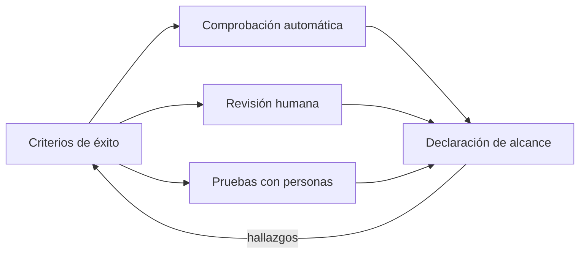
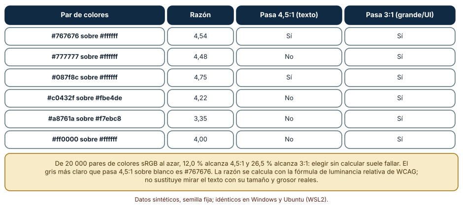
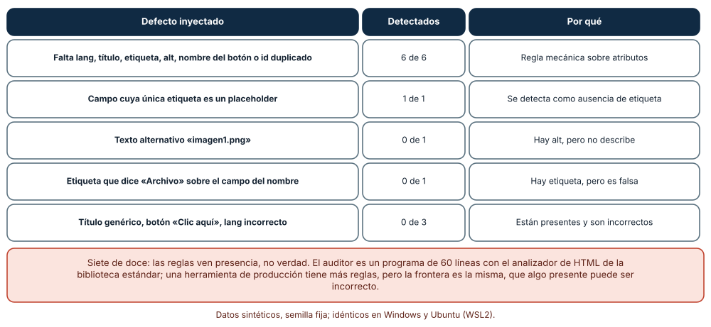
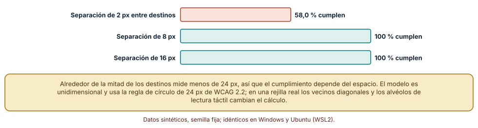

# SE-173 — Accesibilidad perceptible, operable y comprensible

[← SE-172 — Estados vacíos, carga, error y recuperación](../../classes/part-14-experiencia-accesibilidad-e-internacionalizacion/se-172-estados-vacios-carga-error-y-recuperacion/README.md) · [↑ Parte 14](../../classes/part-14-experiencia-accesibilidad-e-internacionalizacion/README.md) · [📚 Índice completo](../../classes/README.md) · [🌐 Portal](../../site/classes/SE-173.html) · [SE-174 — Semántica, teclado, foco y tecnologías de asistencia →](../../classes/part-14-experiencia-accesibilidad-e-internacionalizacion/se-174-semantica-teclado-foco-y-tecnologias-de-asistencia/README.md)

## Punto profesional y fundamento pedagógico

**Punto profesional.** La clase existe para que interpretes qué exigen las pautas de accesibilidad, calcules lo que se puede calcular (contraste, tamaño de destino) y sepas qué parte de un defecto una herramienta automática no puede ver, de modo que no declares cumplimiento por el resultado de un escáner.

**Por qué aparece aquí.** Se sitúa después de **Estados vacíos, carga, error y recuperación** y antes de **Semántica, teclado, foco y tecnologías de asistencia**: `SE-172` dejó estados y mensajes; esta clase pregunta si cualquiera puede percibirlos, operarlos y comprenderlos. Fija los criterios y un auditor mínimo, y deja la parte técnica de estructura y foco que `SE-174` desarrolla.

**Error conceptual que debe corregir.** Creer que la accesibilidad es una lista de comprobaciones que una herramienta automática pasa o no pasa: las pautas organizan criterios verificables en cuatro principios, una herramienta ve la presencia de atributos pero no su verdad, y el cumplimiento se declara con evidencia de revisión humana y con personas, no con un puntaje.

**Secuencia de aprendizaje.** Antes de leer la solución, predices cuántos pares de colores elegidos al azar pasan el contraste mínimo, cuántos de doce defectos inyectados detecta un auditor de reglas y cuántos destinos pequeños cumplen según el espacio que los separa; después calculas, ejecutas el auditor y mides. La secuencia usa predicción, explicación propia, contraste y recuperación. [ICAP](https://icap.education.asu.edu/research) distingue participación de construcción de conocimiento; [How People Learn II](https://nap.nationalacademies.org/catalog/24783/how-people-learn-ii-learners-contexts-and-cultures) exige conectar conocimiento previo, contexto y transferencia; la [práctica de recuperación](https://pubmed.ncbi.nlm.nih.gov/16507066/) respalda producir de nuevo la explicación tras una demora; y [Education for Life and Work](https://nap.nationalacademies.org/resource/13398/dbasse_084153.pdf) exige devolución que explique la causa del error.

**Evidencia de aprendizaje.** `a11y-log.md` con los criterios aplicables a la entrega, las razones de contraste, el resultado del auditor sobre doce defectos y el cálculo de tamaño de destino. Debe distinguir lo que el auditor detectó de lo que requiere revisión humana. Debe contener predicción previa, observación, explicación causal, contraejemplo y qué hallazgo haría retirar la conclusión.

**Límite de la conclusión.** El auditor es un programa pequeño con reglas sobre atributos; los doce defectos, los anchos de destino y la disposición en una dimensión son construcciones del autor. Ningún resultado equivale a una evaluación de conformidad ni a un dictamen legal.

### Trazabilidad fuente → afirmación

| Fuente primaria u oficial | Afirmación que respalda | Lo que no prueba |
|---|---|---|
| [W3C: WCAG 2.2](https://www.w3.org/TR/WCAG22/) | Define criterios de éxito verificables agrupados en perceptible, operable, comprensible y robusto, con niveles A, AA y AAA. | No es un dictamen de que un producto sea accesible para todas las personas. |
| [W3C: Comprender 1.4.3 Contraste (mínimo)](https://www.w3.org/WAI/WCAG22/Understanding/contrast-minimum.html) | Exige 4,5:1 para texto normal y 3:1 para texto grande, calculado con luminancia relativa. | No cubre fondos con imagen, degradados ni texto sobre vídeo con total precisión. |
| [W3C: WCAG-EM, metodología de evaluación de conformidad](https://www.w3.org/WAI/test-evaluate/conformance/wcag-em/) | Describe cómo definir el alcance, explorar, muestrear y reportar una evaluación. | No sustituye la revisión por personas con experiencia ni por usuarios con discapacidad. |

## Antes de empezar

Recupera lo aprendido en `SE-172`: cada estado necesita un texto y una acción. La pregunta activa es: **¿puede una persona percibir, operar y comprender este estado, y qué parte de la respuesta depende de una revisión humana?**

## Prerrequisitos

- Haber completado `SE-172` o poder explicar qué es un estado explícito de una vista.
- Python 3.11 o posterior y un terminal; el auditor usa solo `html.parser` de la biblioteca estándar.
- Trabajar con el formulario de entrega de la plataforma y datos sintéticos; no se evalúa un sitio real.

## Problema auténtico

La plataforma pasa el escáner automático «sin errores» y una estudiante con lector de pantalla no puede enviar su tarea: el botón no tiene nombre útil, la etiqueta del campo apunta a otro, el texto gris del aviso no se lee con sol y los iconos de ayuda miden 16 px. Una propuesta compra un escáner mejor; otra declara «cumple AA» con base en el escáner; otra espera a que alguien se queje.

## Objetivos observables

Al terminar podrás:

1. explicar los cuatro principios y qué significa un criterio de éxito verificable;
2. calcular la razón de contraste con la fórmula de luminancia relativa y decidir si un par cumple;
3. construir un auditor de reglas y medir cuántos defectos reales detecta y cuáles no;
4. evaluar el tamaño y el espacio de un destino según el criterio vigente;
5. redactar una declaración de alcance que distinga lo comprobado, lo revisado y lo no cubierto.

## Mapa conceptual



El mapa se lee como tres fuentes de evidencia que alimentan una declaración: lo que se comprueba por regla, lo que revisa una persona con el criterio delante y lo que observan personas usando el producto. Una sola no basta; el retorno indica que cada hallazgo vuelve a los criterios. No es un orden de ejecución.

## Temas y por qué importan

| Tema | Por qué cambia una decisión profesional | Evidencia mínima |
|---|---|---|
| Los cuatro principios | Organiza las pautas en preguntas que se pueden comprobar. | Predicción, traza causal y contraejemplo de **Los cuatro principios** en `a11y-log.md` |
| Niveles y qué significa cumplir | Evita confundir «sin errores del escáner» con conformidad. | Predicción, traza causal y contraejemplo de **Niveles y qué significa cumplir** en `a11y-log.md` |
| Contraste y color | Convierte «se lee bien» en un cálculo. | Predicción, traza causal y contraejemplo de **Contraste y color** en `a11y-log.md` |
| Destinos y operabilidad | Hace que los controles se puedan activar con precisión. | Predicción, traza causal y contraejemplo de **Destinos y operabilidad** en `a11y-log.md` |
| Lo que automatizar puede ver | Fija la frontera de una herramienta. | Predicción, traza causal y contraejemplo de **Lo que automatizar puede ver** en `a11y-log.md` |

## Conceptos y decisiones

### 1. Los cuatro principios

Perceptible: la información se presenta de un modo que se puede percibir (alternativas de texto, contraste, subtítulos). Operable: los componentes se pueden usar (teclado, tiempo suficiente, destinos). Comprensible: el contenido y el funcionamiento se entienden (idioma, etiquetas, errores). Robusto: el contenido se interpreta de forma fiable por distintos agentes, incluidas las tecnologías de apoyo. Los criterios de éxito concretan cada principio con una condición comprobable y un nivel de conformidad.

### 2. Niveles y qué significa cumplir

Los niveles A, AA y AAA acumulan criterios; AA es el objetivo habitual de normas y contratos. Un criterio se cumple para una página, un proceso completo o un sitio según el alcance declarado, y un proceso (la entrega de una tarea) debe cumplirse de principio a fin. La declaración debe decir qué páginas se evaluaron, con qué herramientas y qué personas, y qué quedó fuera: un puntaje sin alcance no dice nada.

### 3. Contraste y color

La razón de contraste es (L1 + 0,05) / (L2 + 0,05) con L la luminancia relativa del color más claro y del más oscuro. El mínimo es 4,5:1 para texto normal y 3:1 para texto grande y componentes de interfaz. El color no puede ser la única señal de un estado: un error solo en rojo no se distingue para personas con daltonismo ni en una impresión en gris. Elegir colores sin calcular falla a menudo: en un sorteo de pares de colores aleatorios, solo una pequeña fracción alcanza 4,5:1.

### 4. Destinos y operabilidad

WCAG 2.2 pide un tamaño mínimo de 24 por 24 px para los destinos o un espacio suficiente alrededor de los más pequeños (un círculo de 24 px centrado en cada destino no debe solaparse con otro). El criterio protege a quien tiene temblor, usa el dedo o un puntero impreciso. Combinado con lo visto en `SE-171`, el tamaño y el espacio se deciden con un cálculo y no con una impresión.

### 5. Lo que automatizar puede ver

Una regla ve presencia: un atributo, un elemento, una razón de contraste. No ve verdad: que el texto alternativo describa la imagen, que la etiqueta corresponda al campo, que el título sea informativo o que el idioma declarado sea el del texto. Por eso una herramienta automática encuentra una parte de los problemas y el resto exige revisión humana y personas. Ese límite se mide: con defectos conocidos se cuenta qué detecta la regla.

### Razones de contraste y la base de elegir al azar

Con la fórmula de WCAG, el gris #767676 sobre blanco da 4,54:1 y pasa; #777777 da 4,48:1 y no pasa. El verde azulado #087f8c sobre blanco da 4,75, el coral #c0432f sobre su fondo claro #fbe4de da 4,22 (falla texto normal), el ámbar #a8761a sobre #f7ebc8 da 3,35 y el rojo puro #ff0000 sobre blanco, 4,00. De 20 000 pares de colores sRGB al azar, solo el 12,0 % llega a 4,5:1 y el 26,5 % a 3:1; el gris más claro que pasa sobre blanco es #767676. Elegir colores sin calcular falla en la mayoría de los casos.

```python
def lin(c):
    c /= 255
    return c / 12.92 if c <= 0.04045 else ((c + 0.055) / 1.055) ** 2.4

def lum(rgb): r, g, b = map(lin, rgb); return 0.2126*r + 0.7152*g + 0.0722*b

def razon(a, b):
    la, lb = sorted((lum(a), lum(b)), reverse=True)
    return (la + 0.05) / (lb + 0.05)
```



**Cómo leer la figura.** Cada fila es un par de colores; las dos columnas de la derecha dicen si cumple cada umbral. **Dónde deja de valer:** la fórmula supone colores sólidos en sRGB; no cubre degradados, fondos con imagen ni texto de grosor muy fino, donde un 4,5:1 puede ser ilegible. Es una condición necesaria que debe mirarse con el texto real.

### Un auditor de reglas frente a doce defectos

Se escribió un auditor con el analizador de HTML de la biblioteca estándar que comprueba idioma, título, etiquetas de campos, texto alternativo, nombre de botones e identificadores duplicados. Sobre un formulario de entrega sin defectos no reporta nada. Se inyectaron doce defectos, uno por vez: seis son ausencias (sin idioma, sin título, sin etiqueta, sin alt, botón vacío, id duplicado) y los detecta todos; un campo con solo placeholder lo detecta como ausencia de etiqueta; los cinco restantes están presentes pero son incorrectos (alt «imagen1.png», una etiqueta que dice «Archivo» sobre el campo del nombre, un título «Documento», un botón «Clic aquí», un idioma «de» en un texto en español) y no los detecta ninguno. Total: 7 de 12.

```python
class Audit(HTMLParser):
    def handle_starttag(self, tag, a):
        a = dict(a)
        if tag == 'img' and 'alt' not in a:
            self.hallazgos.append('img sin alt')
        if tag == 'input' and not (a.get('id') in self.labels_for or a.get('aria-label')):
            self.hallazgos.append('campo sin etiqueta')
```



**Cómo leer la figura.** Cada fila agrupa defectos del mismo tipo; la columna «Detectados» dice cuántos señaló el auditor. **Dónde deja de valer:** el auditor es mínimo (seis reglas) y los defectos los eligió quien lo escribió; una herramienta de producción tiene más reglas y detecta otros defectos. La frontera, sin embargo, es la misma: algo presente puede ser incorrecto.

### Tamaño de destino y espacio entre destinos

Se generaron 600 destinos con anchos entre 16 y 44 px dispuestos en filas de seis. Alrededor de la mitad mide menos de 24 px (285 con 2 px de separación, 311 con 8 y 299 con 16). Con 2 px de separación, cumplen el criterio (tamaño mínimo o excepción por espacio) el 58,0 %; con 8 px y con 16 px, el 100 %. El espacio, y no solo el tamaño, decide el cumplimiento: un destino de 16 px con 8 px de aire a cada lado cumple, y el mismo destino apretado contra otros no.

```python
if ancho >= 24:
    cumple = True
else:
    c = centro(destino)
    cumple = all(abs(c - centro(otro)) >= 24 or ancho(otro) >= 24 and not solapa(c, otro)
                 for otro in vecinos)
```



**Cómo leer la figura.** Cada barra es el porcentaje de destinos que cumple con una separación distinta; la coral es la que deja destinos sin cumplir. **Dónde deja de valer:** el modelo es unidimensional y simplifica la regla del círculo de 24 px; en una rejilla, los vecinos diagonales y los márgenes cambian el cálculo. Sirve para ver que el espacio importa, no para certificar una pantalla.

## Definiciones de trabajo

- **criterio de éxito:** condición verificable de una pauta de accesibilidad con un nivel de conformidad.
- **razón de contraste:** cociente (L1 + 0,05) / (L2 + 0,05) entre las luminancias relativas del color claro y del oscuro.
- **texto alternativo:** texto que sustituye a una imagen para quien no la percibe y que describe su función o contenido.
- **tecnología de apoyo:** software o dispositivo que usa una persona con discapacidad para acceder a un producto, como un lector de pantalla.
- **declaración de alcance:** texto que dice qué se evaluó, cómo, con qué criterios y qué quedó fuera.

Las definiciones son operativas para la plataforma de entregas. No convierten términos con historia más amplia en sinónimos y deben contrastarse con la documentación primaria enlazada al final.

## Ejemplo mínimo

El fragmento calcula la razón de contraste de un par de colores. Antes de ejecutarlo, predice si #777777 sobre blanco pasa 4,5:1.

```python
def lin(c):
    c /= 255
    return c / 12.92 if c <= 0.04045 else ((c + 0.055) / 1.055) ** 2.4

def lum(rgb):
    r, g, b = map(lin, rgb)
    return 0.2126 * r + 0.7152 * g + 0.0722 * b

def razon(a, b):
    la, lb = sorted((lum(a), lum(b)), reverse=True)
    return (la + 0.05) / (lb + 0.05)

print(round(razon((0x77, 0x77, 0x77), (255, 255, 255)), 2))   # 4.48
```

Falla por una centésima: 4,48 no alcanza 4,5. Cambia a #767676 (4,54) y anota qué conclusión se conserva; registra versión del intérprete y salida.

## Ejemplo profesional

En la plataforma, la entrega se evalúa con un procedimiento de tres capas: reglas automáticas en cada cambio (idioma, etiquetas, alt, contraste de la paleta, tamaño de destinos), una revisión manual con una lista de criterios por proceso y una sesión con personas que usan tecnologías de apoyo. La declaración indica el proceso completo evaluado (abrir, completar, enviar, ver el recibo), la fecha, las herramientas y las personas, y enumera lo que no se probó.

Compara el caso normal con una entrega desde un lector de pantalla, con zoom del 200 % y con un puntero impreciso. Una declaración es apropiada cuando esos tres casos tienen evidencia de revisión; es peligrosa cuando solo hay un puntaje automático.

## Práctica guiada

1. Elige los criterios aplicables a la entrega y clasifícalos por principio.
2. Predice cuántos de doce defectos detectará un auditor de reglas y cuáles no.
3. Calcula la razón de contraste de la paleta de la plataforma y marca los pares que fallan.
4. Escribe el auditor, inyecta los doce defectos y registra qué detecta.
5. Mide el cumplimiento de destinos con tres separaciones.
6. Redacta una declaración de alcance que distinga lo comprobado, lo revisado y lo no cubierto.
7. Pide a otra persona que reconstruya la declaración solo desde `a11y-log.md`.

## Ejercicios

1. **Contraste:** ajusta un par que falla (#c0432f sobre #fbe4de) cambiando el menor número de canales hasta que pase 4,5:1 y explica el criterio.
2. **Regla nueva:** añade al auditor una regla de enlaces sin texto y mide qué defectos nuevos detecta y cuáles falsos positivos produce.
3. **Destinos:** calcula con 16 px de ancho la separación mínima que cumple el criterio en tu modelo y compara con el valor de referencia de una plataforma.
4. **Alcance:** redacta la declaración para un proceso de dos pasos y marca tres cosas que no se evaluaron.

## Reto verificable

Entrega `a11y-log.md` con los criterios aplicables, las razones de contraste de la paleta, el resultado del auditor sobre los doce defectos, la medición de destinos y la declaración de alcance. Se aprueba si otra persona reproduce los números y puede nombrar un defecto que el auditor no ve. No se aprueba por un puntaje, ni por «cumple AA» sin alcance ni evidencia humana.

## Caso conductor

La plataforma de entregas es el caso conductor de la Parte 14. Esta clase deja los criterios aplicables a la entrega, el auditor de reglas y la declaración de alcance. `SE-174` baja a la estructura semántica, el teclado y el foco; `SE-175` a la tipografía y el color. Cambia después un solo criterio, el tamaño de destino, y revisa qué controles y qué evidencia dependían de él.

## Preguntas frecuentes

### ¿Si el escáner da cero errores cumplo AA?

No: el escáner ve presencia de atributos y razones de contraste, y no verdad ni experiencia de uso. Cero errores significa que las reglas no encontraron nada; la conformidad exige revisión humana y personas.

### ¿Cuántos problemas detecta una herramienta automática?

Depende de la herramienta y del producto, y no hay una cifra universal. Lo que se puede hacer es medirlo con defectos conocidos, como hace esta clase con doce: 7 de 12, con todos los incorrectos fuera.

### ¿Qué nivel debo exigirme?

Lo habitual es AA, porque es el que suelen exigir normas y contratos, y los criterios de AAA se aplican de forma selectiva. La norma aplicable depende de tu jurisdicción y de tu contrato; consulta a una persona competente.

### ¿Por qué evaluar un proceso completo?

Porque un fallo en un paso bloquea el resto: una página aislada puede cumplir y el proceso de entrega no. Los criterios de conformidad incluyen explícitamente procesos completos.

## Fallo controlado y diagnóstico

Reproduce el fallo clásico de la clase: **declarar accesibilidad únicamente por el resultado de una herramienta automática**. Usa el auditor con los cinco defectos presentes pero incorrectos.

Registra síntoma, entrada mínima, hipótesis, observación que descarta cada hipótesis, causa, corrección y prueba de regresión. **Síntoma:** el auditor no reporta nada en una página cuya imagen tiene alt «imagen1.png» y cuyo campo del nombre se etiqueta «Archivo». **Hipótesis rivales:** (a) la página es accesible; (b) las reglas solo ven presencia. **Prueba:** inyecta cada defecto en la página base: los cinco incorrectos pasan sin reporte, y una persona con lector de pantalla no puede completar el formulario. **Conclusión:** la causa es el límite de las reglas, no la página. **Regresión:** añade una lista de revisión manual por criterio con responsable y fecha, y una sesión con una persona usuaria de tecnologías de apoyo. No cambies a la vez el auditor y la página.

## Errores comunes y cómo corregirlos

| Síntoma | Causa probable | Corrección |
|---|---|---|
| Se declara «cumple AA» con un puntaje | Se confundió presencia con verdad | Declarar alcance, evidencia humana y lo no cubierto |
| Texto legible para el equipo e ilegible al sol | No se calculó el contraste | Calcular razones y fijar la paleta en un archivo comprobable |
| El error solo se distingue por el color | El color era la única señal | Añadir texto, icono con nombre y patrón |
| Controles que fallan con el dedo | Destinos pequeños y apretados | Aplicar tamaño o espacio mínimo y comprobarlo |
| Un cambio rompe lo arreglado | No hay regresión automática | Reglas en cada cambio y lista manual periódica |

## Entorno y archivos clave

```text
work/SE-173/
├── README.md
├── a11y/
│   ├── contraste.py
│   ├── auditor.py
│   └── destinos.py
├── tests/test_a11y.py
└── evidence/a11y-log.md
```

El `README` declara plataforma, versión de Python, semillas y comandos. El auditor usa solo `html.parser` y los experimentos se ejecutaron con CPython 3.12.9 en Windows 11 y 3.12.3 en Ubuntu bajo WSL2: las salidas fueron idénticas. No se usó ningún escáner de producción, lector de pantalla ni persona usuaria de tecnologías de apoyo.

## Seguridad, ética y accesibilidad

- una declaración de conformidad no es un dictamen legal: la obligación depende de la jurisdicción y de los contratos, y debe consultarse a una persona competente;
- las pruebas con personas usuarias de tecnologías de apoyo exigen consentimiento informado, pago justo y no exponer datos personales;
- un auditor no debe enviar el contenido de las páginas a servicios externos sin decisión informada;
- ofrece una alternativa textual a cada tabla y figura y no uses el color como única señal;
- atribuye las fuentes y respeta las licencias de las herramientas de análisis.

## Puente hacia el trabajo con agentes

Un agente al que se le pide «haz que la página sea accesible» añadirá atributos ARIA y textos alternativos genéricos y declarará que cumple, porque el escáner no reporta nada. Pídele que enumere los criterios aplicables, que calcule los contrastes de la paleta, que explique qué comprobó cada regla y qué no puede ver, y que deje una lista de revisión manual. Revisa especialmente si inventó textos alternativos sin mirar la imagen o puso `aria-label` donde faltaba una etiqueta visible: es el mismo atributo presente pero incorrecto, ahora con apariencia de corrección.

## Transferencia

Traslada el análisis a otra pantalla (un formulario de reserva o un panel de control): calcula los contrastes de su paleta, ejecuta un auditor con doce defectos y mide qué detecta. La transferencia está lograda cuando puedes explicar qué parte del método dependía de la plataforma de entregas y cuál no.

## Evaluación y evidencia

| Criterio | Evidencia para aprobar |
|---|---|
| comprensión | explicación de los cuatro principios y de la diferencia entre presencia y verdad |
| corrección | razones de contraste, defectos detectados y cumplimiento de destinos reproducibles |
| diseño | auditor con reglas explícitas y declaración de alcance |
| diagnóstico | reproducción del fallo «solo la herramienta» con su regresión |
| incertidumbre | lista de lo que el auditor no ve y de lo no evaluado |
| reproducibilidad | versiones, comandos, salida y límites declarados |

## Fuentes

- [W3C: Web Content Accessibility Guidelines (WCAG) 2.2](https://www.w3.org/TR/WCAG22/) — criterios de éxito y niveles de conformidad; autoridad: W3C.
- [W3C: Comprender 1.4.3 Contraste (mínimo)](https://www.w3.org/WAI/WCAG22/Understanding/contrast-minimum.html) — razones de contraste y excepciones; autoridad: W3C.
- [W3C: Comprender 2.5.8 Tamaño del objetivo (mínimo)](https://www.w3.org/WAI/WCAG22/Understanding/target-size-minimum.html) — tamaño y espacio de los destinos; autoridad: W3C.
- [W3C: Comprender 1.4.1 Uso del color](https://www.w3.org/WAI/WCAG22/Understanding/use-of-color.html) — el color no como única señal; autoridad: W3C.
- [W3C: Comprender 1.1.1 Contenido no textual](https://www.w3.org/WAI/WCAG22/Understanding/non-text-content.html) — alternativas de texto; autoridad: W3C.
- [W3C: WCAG-EM, evaluación de conformidad](https://www.w3.org/WAI/test-evaluate/conformance/wcag-em/) — metodología de alcance, muestreo y reporte; autoridad: W3C.
- [ETSI EN 301 549 v3.2.1](https://www.etsi.org/deliver/etsi_en/301500_301599/301549/03.02.01_60/en_301549v030201p.pdf) — norma europea de accesibilidad de productos y servicios TIC; autoridad: ETSI.

Cada fuente respalda el mecanismo indicado; ninguna demuestra que la entrega de la plataforma cumpla un nivel de conformidad ni constituye asesoría legal. Esa afirmación depende de evaluar el proceso con personas y de las obligaciones de cada jurisdicción.

- [Python: `html.parser`](https://docs.python.org/3/library/html.parser.html) — analizador de HTML usado por el auditor.
- [Python: `random`](https://docs.python.org/3/library/random.html) — semillas del sorteo de colores y anchos.

## Límites y siguiente paso

Se ejecutaron tres experimentos con datos sintéticos en Windows y Ubuntu (WSL2) con resultados idénticos. No se usó ningún escáner de producción, lector de pantalla ni persona usuaria de tecnologías de apoyo, y los doce defectos, los anchos de destino y el modelo en una dimensión son construcciones del autor. La siguiente clase baja a la estructura semántica, el teclado y el foco.

## Glosario

- **criterio de éxito:** condición verificable de una pauta de accesibilidad con un nivel de conformidad.
- **razón de contraste:** cociente (L1 + 0,05) / (L2 + 0,05) entre las luminancias relativas del color claro y del oscuro.
- **texto alternativo:** texto que sustituye a una imagen para quien no la percibe y que describe su función o contenido.
- **tecnología de apoyo:** software o dispositivo que usa una persona con discapacidad para acceder a un producto, como un lector de pantalla.
- **declaración de alcance:** texto que dice qué se evaluó, cómo, con qué criterios y qué quedó fuera.

---

[← SE-172 — Estados vacíos, carga, error y recuperación](../../classes/part-14-experiencia-accesibilidad-e-internacionalizacion/se-172-estados-vacios-carga-error-y-recuperacion/README.md) · [↑ Parte 14](../../classes/part-14-experiencia-accesibilidad-e-internacionalizacion/README.md) · [📚 Índice completo](../../classes/README.md) · [🌐 Portal](../../site/classes/SE-173.html) · [SE-174 — Semántica, teclado, foco y tecnologías de asistencia →](../../classes/part-14-experiencia-accesibilidad-e-internacionalizacion/se-174-semantica-teclado-foco-y-tecnologias-de-asistencia/README.md)
