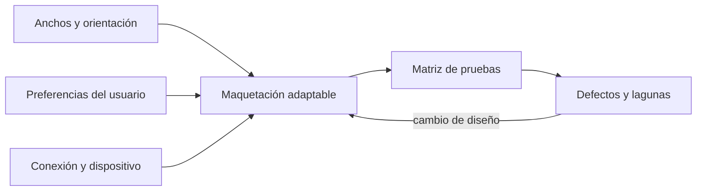
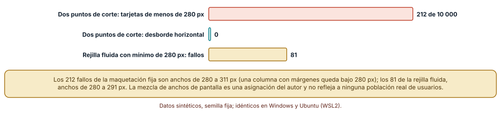
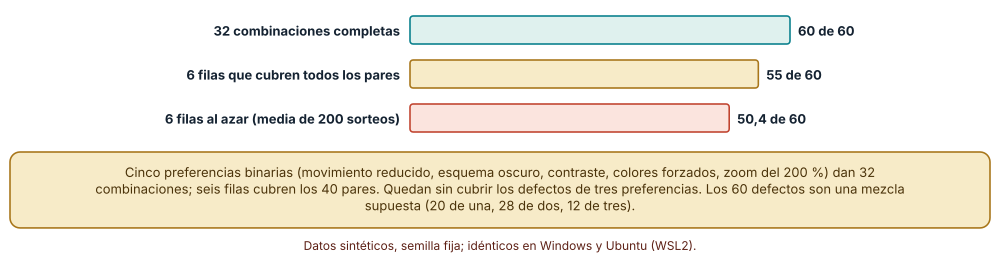
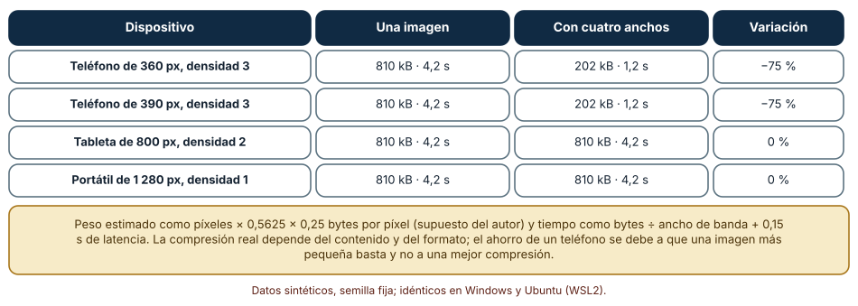

# SE-176 — Responsive, adaptativo y preferencias del usuario

[← SE-175 — Diseño visual, tipografía, color y contraste](../../classes/part-14-experiencia-accesibilidad-e-internacionalizacion/se-175-diseno-visual-tipografia-color-y-contraste/README.md) · [↑ Parte 14](../../classes/part-14-experiencia-accesibilidad-e-internacionalizacion/README.md) · [📚 Índice completo](../../classes/README.md) · [🌐 Portal](../../site/classes/SE-176.html) · [SE-177 — Internacionalización, localización y formatos culturales →](../../classes/part-14-experiencia-accesibilidad-e-internacionalizacion/se-177-internacionalizacion-localizacion-y-formatos-culturales/README.md)

## Punto profesional y fundamento pedagógico

**Punto profesional.** La clase existe para que adaptes la interfaz a anchos de pantalla, preferencias del usuario y conexiones distintas con un plan de pruebas que cubra las combinaciones que importan, y para que midas qué fallos deja cada estrategia.

**Por qué aparece aquí.** Se sitúa después de **Diseño visual, tipografía, color y contraste** y antes de **Internacionalización, localización y formatos culturales**: `SE-175` dejó tokens y reflujo; esta clase pregunta cómo se adaptan a anchos, preferencias y redes. Deja la matriz de pruebas de adaptación que `SE-179` y `SE-180` reutilizarán.

**Error conceptual que debe corregir.** Creer que ser responsive es tener dos o tres puntos de corte para teléfono, tableta y escritorio: los anchos son continuos, las preferencias se combinan y la conexión varía; una adaptación se comprueba con los anchos y combinaciones que existen, no con tres dispositivos tipo.

**Secuencia de aprendizaje.** Antes de leer la solución, predices cuántos anchos de una población sintética fallan con dos puntos de corte frente a una rejilla fluida, cuántos defectos de preferencias encuentran seis filas bien elegidas y cuánto pesa una imagen única frente a varias; después simulas anchos, cubres pares de preferencias y calculas bytes. La secuencia usa predicción, explicación propia, contraste y recuperación. [ICAP](https://icap.education.asu.edu/research) distingue participación de construcción de conocimiento; [How People Learn II](https://nap.nationalacademies.org/catalog/24783/how-people-learn-ii-learners-contexts-and-cultures) exige conectar conocimiento previo, contexto y transferencia; la [práctica de recuperación](https://pubmed.ncbi.nlm.nih.gov/16507066/) respalda producir de nuevo la explicación tras una demora; y [Education for Life and Work](https://nap.nationalacademies.org/resource/13398/dbasse_084153.pdf) exige devolución que explique la causa del error.

**Evidencia de aprendizaje.** `adaptive-log.md` con la comparación de maquetaciones sobre una población de anchos, la matriz de preferencias con su cobertura de pares y el peso de las imágenes por dispositivo. Debe distinguir qué se calcula con exactitud (pares, bytes) de lo que depende de supuestos (mezcla de anchos, defectos). Debe contener predicción previa, observación, explicación causal, contraejemplo y qué hallazgo haría retirar la conclusión.

**Límite de la conclusión.** La mezcla de anchos de pantalla, los 60 defectos inyectados, los bytes por píxel y el ancho de banda son supuestos del autor; ningún resultado describe dispositivos, usuarios ni redes reales, y no se usó ningún navegador.

### Trazabilidad fuente → afirmación

| Fuente primaria u oficial | Afirmación que respalda | Lo que no prueba |
|---|---|---|
| [W3C: Media Queries Level 4](https://www.w3.org/TR/mediaqueries-4/) | Define las características de medios, incluidas las de preferencia del usuario (movimiento, esquema, contraste, colores forzados). | No dice qué valor de ancho es el correcto para un diseño. |
| [MDN: `prefers-reduced-motion`](https://developer.mozilla.org/en-US/docs/Web/CSS/@media/prefers-reduced-motion) | Describe la preferencia de la persona de reducir el movimiento y cómo consultarla. | No indica qué animaciones son seguras ni cuáles son esenciales. |
| [web.dev: imágenes responsivas](https://web.dev/articles/responsive-images) | Explica `srcset` y `sizes` para que el navegador elija el tamaño de imagen adecuado. | No mide la mejora en una página concreta. |

## Antes de empezar

Recupera lo aprendido en `SE-175`: el ancho útil al ampliar es 320 px CSS y un diseño fijo desborda. La pregunta activa es: **¿para qué anchos, preferencias y conexiones se ha comprobado esta maquetación y cuáles quedan sin cubrir?**

## Prerrequisitos

- Haber completado `SE-175` o poder explicar el reflujo al 400 %.
- Python 3.11 o posterior y un terminal; los cálculos usan solo la biblioteca estándar.
- Trabajar con la maquetación de la plataforma y poblaciones sintéticas de anchos.

## Problema auténtico

La plataforma tiene una maquetación con puntos de corte en 768 y 1 024 px. Una prueba con tres dispositivos pasa. Pero una estudiante con un teléfono de 290 px ve tarjetas cortadas, un docente con zoom del 200 % y esquema oscuro pierde un borde, y una persona que prefiere movimiento reducido ve una animación que no debería. Cada una se arregla por separado y se rompe en combinación. Una propuesta añade más puntos de corte; otra una versión móvil aparte; otra mantiene tres dispositivos tipo.

## Objetivos observables

Al terminar podrás:

1. comparar maquetaciones con puntos de corte y con rejilla fluida sobre una población de anchos y contar fallos;
2. listar las preferencias que se combinan y construir una matriz que cubra todos los pares;
3. medir cuántos defectos de una y de varias preferencias detecta cada matriz;
4. calcular el peso y el tiempo de descarga de imágenes con y sin variantes por ancho;
5. escribir un plan de pruebas de adaptación con sus lagunas declaradas.

## Mapa conceptual



El mapa se lee como tres fuentes de variación que entran en la maquetación y se comprueban con una matriz; los defectos y lagunas vuelven al diseño. Las tres fuentes se combinan, no se suman. No es un orden de entrega.

## Temas y por qué importan

| Tema | Por qué cambia una decisión profesional | Evidencia mínima |
|---|---|---|
| Diseño responsive y adaptativo | Distingue cómo se ajusta la interfaz a lo que hay. | Predicción, traza causal y contraejemplo de **Diseño responsive y adaptativo** en `adaptive-log.md` |
| Puntos de corte y diseño intrínseco | Decide dónde cambia el diseño y por qué. | Predicción, traza causal y contraejemplo de **Puntos de corte y diseño intrínseco** en `adaptive-log.md` |
| Preferencias del usuario | Respeta lo que la persona configuró en su sistema. | Predicción, traza causal y contraejemplo de **Preferencias del usuario** en `adaptive-log.md` |
| Combinaciones y cobertura | Evita tanto el producto completo como la prueba de tres dispositivos. | Predicción, traza causal y contraejemplo de **Combinaciones y cobertura** en `adaptive-log.md` |
| Conexión, dispositivo y peso | Hace que la adaptación incluya lo que se descarga. | Predicción, traza causal y contraejemplo de **Conexión, dispositivo y peso** en `adaptive-log.md` |

## Conceptos y decisiones

### 1. Diseño responsive y adaptativo

Un diseño responsive reacciona de forma continua al ancho disponible (rejillas que envuelven, unidades relativas, texto que fluye); uno adaptativo elige entre diseños predefinidos según condiciones. En la práctica se combinan: un esqueleto fluido con algunas decisiones por umbral. La ventaja de lo continuo es que no hay anchos que caigan entre dos casos; el riesgo de lo adaptativo es que aparecen huecos donde ningún diseño encaja, como los 290 px de la clase.

### 2. Puntos de corte y diseño intrínseco

Un punto de corte fijado por dispositivo (768, 1 024) envejece y deja anchos intermedios sin comprobar. Un criterio más duradero es cambiar donde el contenido deja de funcionar: cuando una columna baja de un ancho útil, cuando una línea supera una longitud cómoda o cuando un título se corta. Las rejillas que envuelven con un mínimo por columna producen ese comportamiento sin escribir un punto de corte por caso.

### 3. Preferencias del usuario

Las características de medios consultan preferencias: movimiento reducido, esquema claro u oscuro, contraste, colores forzados, ahorro de datos. Son una petición, no una orden de la plataforma, y el diseño debe honrarla: una animación que no es esencial se elimina o se atenúa con movimiento reducido, y un tema oscuro responde al sistema. Más allá de las consultas, el zoom y el tamaño de texto son preferencias que el diseño solo respeta si usa unidades relativas.

### 4. Combinaciones y cobertura

Cinco preferencias binarias dan 32 combinaciones; la mayoría de los defectos depende de una o dos a la vez. Una matriz que cubre todos los pares reduce las filas a unas pocas y encuentra casi todos los defectos de uno o dos factores, pero no los de tres. La decisión es económica: más filas para lo crítico (una entrega) y menos para lo secundario. Lo que se omite debe quedar escrito.

### 5. Conexión, dispositivo y peso

Un teléfono con una conexión lenta no necesita una imagen de 2 400 px. Las variantes por ancho (`srcset` y `sizes`) permiten al navegador elegir la adecuada, y el ahorro es proporcional a los píxeles que no se descargan. Para quien usa una conexión limitada, el peso es un criterio de accesibilidad, no solo de rendimiento: una página que no carga no es utilizable.

### Dos puntos de corte frente a una rejilla fluida

Se generó una población de 10 000 anchos de pantalla (45 % teléfonos de 360 a 430 px, 10 % de 600 a 900, 20 % de 900 a 1 300, 20 % de escritorio de 1 366 a 1 920 y 5 % de 280 a 360, asignación del autor). Con puntos de corte en 768 y 1 024 px y tarjetas de ancho fijo, ninguna maquetación desborda pero 212 anchos (280 a 311 px) dejan una tarjeta menor de 280 px. Una rejilla fluida con mínimo de 280 px por columna falla en 81 anchos (280 a 291 px), cuando ni siquiera cabe una columna con márgenes. La rejilla fluida reduce los fallos, pero no los elimina: el mínimo de columna también tiene un límite.

```python
def falla_fluida(w):
    cols = max(1, int((w - 16) // (280 + 16)))
    cw = (w - 16 * (cols + 1)) / cols
    return cw < 260
```



**Cómo leer la figura.** Cada barra cuenta anchos de la población que fallan con una de las maquetaciones; menos es mejor. **Dónde deja de valer:** la mezcla de anchos es del autor y no representa ninguna población real de dispositivos; los umbrales de «falla» (280 y 260 px) son criterios arbitrarios. Lo que se muestra es la forma de los fallos: aparecen en los extremos.

### Cobertura de pares de cinco preferencias

Cinco preferencias binarias (movimiento reducido, esquema oscuro, contraste más alto, colores forzados y zoom del 200 %) dan 32 combinaciones. Un algoritmo voraz de cobertura de pares cubre los 40 pares (10 pares de preferencias × 4 valores) con 6 filas. Se inyectaron 60 defectos que se disparan con una, dos o tres preferencias a la vez (20, 28 y 12): las 32 combinaciones encuentran los 60, las 6 filas de pares 55 y 6 filas al azar, 50,4 de media en 200 sorteos. Los 5 que se escapan a los pares son defectos de tres preferencias.

```python
faltan = {(i, j, a, b) for i, j in combinations(range(5), 2) for a in (0, 1) for b in (0, 1)}
while faltan:
    fila = max(todas, key=lambda r: sum((i, j, r[i], r[j]) in faltan for i, j in combinations(range(5), 2)))
    elegidas.append(fila)
```



**Cómo leer la figura.** Cada barra es cuántos de los 60 defectos encuentra cada diseño de matriz; la verde es la de referencia exhaustiva. **Dónde deja de valer:** los 60 defectos son una mezcla supuesta (20, 28 y 12) y no una medición de un producto; con otra proporción de defectos de tres factores, la ventaja de los pares cambia.

### Una imagen de 2 400 px frente a cuatro variantes

Una imagen de 2 400 px de ancho y relación 16:9 pesa, con 0,25 bytes por píxel (supuesto), 810 kB y tarda 4,2 s en una conexión de 1,6 Mbit/s con 0,15 s de latencia. Con variantes de 480, 800, 1 200 y 2 400 px, un teléfono de 360 px con densidad 3 (1 080 px necesarios) descarga la de 1 200 px: 202 kB y 1,2 s, un 75 % menos. Una tableta de 800 px con densidad 2 necesita 1 600 px y recibe la de 2 400 px: 0 % de ahorro. El ahorro depende de que exista una variante cercana a lo necesario.

```python
def kb(w_px, bpp=0.25, aspecto=0.5625):
    return w_px * w_px * aspecto * bpp / 1000

variante = min((v for v in (480, 800, 1200, 2400) if v >= ancho_css * dpr), default=2400)
segundos = kb(variante) * 1000 * 8 / 1.6e6 + 0.15
```



**Cómo leer la figura.** Cada fila es un dispositivo; compara el peso y el tiempo de la imagen única con los de la variante elegida. **Dónde deja de valer:** los bytes por píxel y el ancho de banda son supuestos; la compresión real depende del contenido y del formato, y la elección del navegador depende de `sizes`. Es un cálculo del orden de magnitud.

## Definiciones de trabajo

- **diseño responsive:** diseño que se ajusta de forma continua al ancho disponible.
- **punto de corte:** ancho a partir del cual cambia una regla de maquetación.
- **característica de preferencia:** consulta de medios que expresa una elección del usuario, como el movimiento reducido o el esquema oscuro.
- **cobertura de pares:** conjunto de combinaciones que incluye todos los pares de valores de dos factores.
- **srcset:** atributo que ofrece al navegador varias fuentes de una imagen para elegir según el ancho y la densidad.

Las definiciones son operativas para la plataforma de entregas. No convierten términos con historia más amplia en sinónimos y deben contrastarse con la documentación primaria enlazada al final.

## Ejemplo mínimo

El fragmento elige la variante de imagen que necesita un dispositivo. Antes de ejecutarlo, predice cuál recibe un teléfono de 390 px con densidad 3.

```python
variantes = (480, 800, 1200, 2400)

def elegir(ancho_css, dpr):
    return min((v for v in variantes if v >= ancho_css * dpr), default=variantes[-1])

print(elegir(390, 3))   # 1200
```

Necesita 1 170 px y recibe la de 1 200. Añade una variante de 1 600 y observa qué dispositivos cambian; registra versión y salida.

## Ejemplo profesional

En la plataforma, la maquetación usa una rejilla que envuelve con un mínimo por columna, unidades relativas y puntos de corte donde el contenido lo exige. Una matriz de pruebas cubre los pares de cinco preferencias (movimiento reducido, esquema, contraste, colores forzados, zoom) en el proceso de entrega, con capturas a 320, 768 y 1 280 px CSS; los pares que no se prueban quedan listados con su riesgo. Las imágenes se sirven con variantes por ancho y un presupuesto de peso por página.

Compara el caso normal con un teléfono de 290 px, el zoom del 200 % con esquema oscuro y una conexión lenta con ahorro de datos. Una maquetación es apropiada cuando esos tres casos tienen evidencia; es peligrosa cuando solo se probó con tres dispositivos tipo.

## Práctica guiada

1. Lista las preferencias y los anchos que tu población puede tener y descarta de forma explícita los que no cubres.
2. Predice cuántos anchos fallan con dos puntos de corte y con rejilla fluida y calcula con una población sintética.
3. Construye la matriz de pares y cuenta los defectos que encuentra frente a filas al azar.
4. Calcula el peso de la imagen para cuatro dispositivos con y sin variantes.
5. Escribe el plan de pruebas con las lagunas declaradas.
6. Introduce el fallo controlado y registra el síntoma antes de corregirlo.
7. Pide a otra persona que reconstruya la matriz y sus lagunas solo desde `adaptive-log.md`.

## Ejercicios

1. **Mínimo de columna:** calcula con tu población qué mínimo de columna minimiza los fallos y qué pasa con 320 px.
2. **Pares y tríos:** añade una sexta preferencia y calcula cuántas filas necesita la cobertura de pares y cuántos defectos de tres factores quedan sin cubrir.
3. **Movimiento:** elige una animación de la plataforma y define su versión con movimiento reducido sin perder la información que transmite.
4. **Presupuesto:** calcula el peso máximo de una página para cargarse en 3 s a 1,6 Mbit/s y qué recortarías primero.

## Reto verificable

Entrega `adaptive-log.md` con la comparación de maquetaciones, la matriz de pares con sus defectos, el cálculo de peso y el plan de pruebas con lagunas. Se aprueba si otra persona reproduce los números y puede nombrar una combinación que no se probó. No se aprueba por una captura a tres dispositivos ni por una lista de puntos de corte.

## Caso conductor

La plataforma de entregas es el caso conductor de la Parte 14. Esta clase deja la maquetación adaptable de la entrega, la matriz de pruebas de preferencias y el presupuesto de peso. `SE-177` añadirá idiomas y formatos, cuya expansión de texto tensiona la misma maquetación, y `SE-179` auditará todo el flujo. Cambia después una sola preferencia, añadir «colores forzados», y revisa qué filas, capturas y defectos aparecen.

## Preguntas frecuentes

### ¿Cuántos puntos de corte debo tener?

Los que el contenido pida: donde una columna baja de su ancho útil o una línea supera una longitud cómoda. Un número fijado de antemano por dispositivo envejece; una rejilla con mínimo por columna reduce la necesidad de puntos de corte.

### ¿Debo probar todas las combinaciones de preferencias?

No siempre: 32 es asumible, 2^10 no. La cobertura de pares es un acuerdo económico que encuentra casi todo lo de uno o dos factores y deja lo de tres sin cubrir; decide según el riesgo del proceso.

### ¿El movimiento reducido es opcional?

Es una preferencia de la persona que el diseño debe honrar para el movimiento no esencial; el movimiento que transmite información necesaria se sustituye por otra señal. Ignorarlo puede provocar molestias o mareos.

### ¿Por qué importa el peso para la accesibilidad?

Porque una página que no carga o tarda demasiado excluye a quienes tienen conexiones limitadas o dispositivos antiguos. El peso es una barrera real y medible, aunque no figure como criterio en las pautas.

## Fallo controlado y diagnóstico

Reproduce el fallo clásico de la clase: **probar solo con tres dispositivos tipo**. Usa la población de 10 000 anchos.

Registra síntoma, entrada mínima, hipótesis, observación que descarta cada hipótesis, causa, corrección y prueba de regresión. **Síntoma:** la maquetación pasa las pruebas en 390, 820 y 1 440 px y una persona con 290 px ve tarjetas cortadas. **Hipótesis rivales:** (a) el dispositivo de 290 px es una rareza; (b) los puntos de corte dejan huecos en los extremos. **Prueba:** la población marca 212 anchos con tarjetas menores de 280 px, todos entre 280 y 311 px. **Conclusión:** la causa es el diseño por dispositivos tipo, no un dispositivo raro. **Regresión:** añade una prueba que renderiza a todos los anchos de un barrido de 280 a 1 920 y falla si una tarjeta baja del mínimo. No cambies a la vez los puntos de corte y el mínimo.

## Errores comunes y cómo corregirlos

| Síntoma | Causa probable | Corrección |
|---|---|---|
| Una tarjeta se corta en teléfonos pequeños | Puntos de corte por dispositivo tipo | Rejilla con mínimo por columna y barrido de anchos en las pruebas |
| Un defecto aparece solo con zoom y esquema oscuro | No se probaron combinaciones | Matriz de pares y lista de lagunas |
| Una animación molesta pese a la preferencia | No se consultó `prefers-reduced-motion` | Consultar la preferencia y ofrecer alternativa estática |
| La página tarda 12 s en un teléfono | Una sola imagen grande para todos | Variantes por ancho y presupuesto de peso |
| El texto no se amplía | Tamaños fijos en píxeles | Unidades relativas y reflujo |

## Entorno y archivos clave

```text
work/SE-176/
├── README.md
├── adaptacion/
│   ├── anchos.py
│   ├── matriz.py
│   └── imagenes.py
├── tests/test_adaptacion.py
└── evidence/adaptive-log.md
```

El `README` declara plataforma, versión de Python, semillas y comandos. Los cálculos usan solo la biblioteca estándar y se ejecutaron con CPython 3.12.9 en Windows 11 y 3.12.3 en Ubuntu bajo WSL2: las salidas fueron idénticas. No se usó ningún navegador ni dispositivo real ni se midió ninguna red.

## Seguridad, ética y accesibilidad

- las preferencias de la persona (esquema, movimiento, contraste) pueden usarse para identificarla: no las registres ni las envíes a servicios externos sin una decisión informada;
- no desactives el zoom del navegador ni bloquees la orientación: son barreras para quien las necesita;
- una versión móvil separada duplica la superficie de ataque y de defectos: mantén una sola base cuando sea posible;
- ofrece una alternativa textual a cada tabla y figura y no uses el color como única señal;
- atribuye las fuentes y respeta las licencias de las imágenes y tipografías.

## Puente hacia el trabajo con agentes

Un agente al que se le pide «hazlo responsive» añadirá dos puntos de corte, probará con tres anchos y declarará resuelto. Pídele que use una rejilla con mínimo por columna, que barra anchos de 280 a 1 920 px en una prueba, que consulte las preferencias de movimiento y esquema y que liste las combinaciones que no probó. Revisa especialmente si fijó anchos en píxeles o desactivó el zoom: es la misma adaptación frágil, ahora con apariencia de responsive.

## Transferencia

Traslada el análisis a otra interfaz (un tablero de control o un catálogo de productos): genera una población de anchos, compara maquetaciones, construye la matriz de preferencias y calcula el peso de las imágenes. La transferencia está lograda cuando puedes explicar qué parte dependía de la plataforma de entregas y cuál no.

## Evaluación y evidencia

| Criterio | Evidencia para aprobar |
|---|---|
| comprensión | explicación de por qué los anchos son continuos y las preferencias se combinan |
| corrección | fallos de ancho, defectos hallados y bytes reproducibles con las mismas semillas |
| diseño | maquetación con mínimo por columna y plan de pruebas de adaptación |
| diagnóstico | reproducción del fallo «tres dispositivos tipo» con su regresión |
| incertidumbre | lagunas de la matriz y supuestos de población declarados |
| reproducibilidad | versiones, comandos, salida y límites declarados |

## Fuentes

- [W3C: Media Queries Level 4](https://www.w3.org/TR/mediaqueries-4/) — características de medios y de preferencia del usuario; autoridad: W3C.
- [W3C: CSS Grid Layout Module Level 1](https://www.w3.org/TR/css-grid-1/) — rejillas con mínimos y envoltura; autoridad: W3C.
- [MDN: `prefers-reduced-motion`](https://developer.mozilla.org/en-US/docs/Web/CSS/@media/prefers-reduced-motion) — preferencia de movimiento reducido; autoridad: Mozilla.
- [MDN: `prefers-color-scheme`](https://developer.mozilla.org/en-US/docs/Web/CSS/@media/prefers-color-scheme) — preferencia de esquema; autoridad: Mozilla.
- [MDN: `prefers-contrast`](https://developer.mozilla.org/en-US/docs/Web/CSS/@media/prefers-contrast) — preferencia de contraste; autoridad: Mozilla.
- [web.dev: imágenes responsivas](https://web.dev/articles/responsive-images) — `srcset` y `sizes`; autoridad: Google (guía de buenas prácticas).
- [W3C: Comprender 1.4.10 Reflujo](https://www.w3.org/WAI/WCAG22/Understanding/reflow.html) — contenido sin desplazamiento en dos dimensiones; autoridad: W3C.
- [W3C: Comprender 2.2.2 Pausar, detener, ocultar](https://www.w3.org/WAI/WCAG22/Understanding/pause-stop-hide.html) — control del movimiento y de la información que se mueve; autoridad: W3C.

Cada fuente respalda el mecanismo indicado; ninguna demuestra que la maquetación de la plataforma funcione en los dispositivos de su población. Esa afirmación depende de probarla con esos anchos y preferencias.

- [Python: `itertools.combinations`](https://docs.python.org/3/library/itertools.html#itertools.combinations) — pares de preferencias de la matriz.
- [Python: `random`](https://docs.python.org/3/library/random.html) — semillas de la población y de los defectos.

## Límites y siguiente paso

Se ejecutaron tres experimentos con datos sintéticos en Windows y Ubuntu (WSL2) con resultados idénticos. No se usó ningún navegador, dispositivo o red reales, y la mezcla de anchos, los 60 defectos, los bytes por píxel y el ancho de banda son supuestos del autor. La siguiente clase añade idiomas y formatos, que tensionan la misma maquetación.

## Glosario

- **diseño responsive:** diseño que se ajusta de forma continua al ancho disponible.
- **punto de corte:** ancho a partir del cual cambia una regla de maquetación.
- **característica de preferencia:** consulta de medios que expresa una elección del usuario, como el movimiento reducido o el esquema oscuro.
- **cobertura de pares:** conjunto de combinaciones que incluye todos los pares de valores de dos factores.
- **srcset:** atributo que ofrece al navegador varias fuentes de una imagen para elegir según el ancho y la densidad.

---

[← SE-175 — Diseño visual, tipografía, color y contraste](../../classes/part-14-experiencia-accesibilidad-e-internacionalizacion/se-175-diseno-visual-tipografia-color-y-contraste/README.md) · [↑ Parte 14](../../classes/part-14-experiencia-accesibilidad-e-internacionalizacion/README.md) · [📚 Índice completo](../../classes/README.md) · [🌐 Portal](../../site/classes/SE-176.html) · [SE-177 — Internacionalización, localización y formatos culturales →](../../classes/part-14-experiencia-accesibilidad-e-internacionalizacion/se-177-internacionalizacion-localizacion-y-formatos-culturales/README.md)
