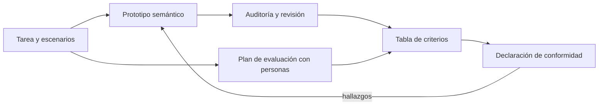
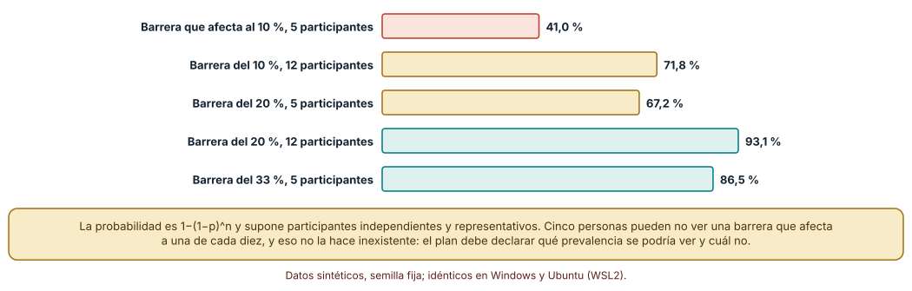
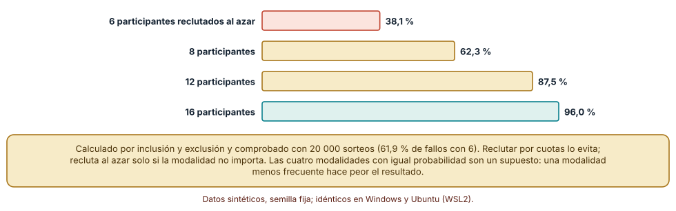
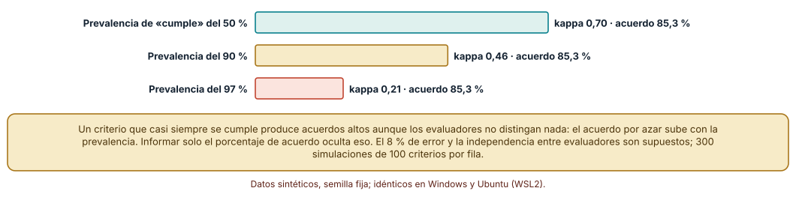

# SE-180 — Proyecto: prototipo accesible evaluado con usuarios

[← SE-179 — Taller: auditar y reparar un flujo excluyente](../../classes/part-14-experiencia-accesibilidad-e-internacionalizacion/se-179-taller-auditar-y-reparar-un-flujo-excluyente/README.md) · [↑ Parte 14](../../classes/part-14-experiencia-accesibilidad-e-internacionalizacion/README.md) · [📚 Índice completo](../../classes/README.md) · [🌐 Portal](../../site/classes/SE-180.html) · [SE-181 — Modelos predictivos, iterativos e incrementales →](../../classes/part-15-procesos-planificacion-y-estimacion/se-181-modelos-predictivos-iterativos-e-incrementales/README.md)

## Punto profesional y fundamento pedagógico

**Punto profesional.** El proyecto existe para que entregues un prototipo accesible de la entrega de una tarea, junto con el plan de evaluación con personas, la evidencia y una declaración de conformidad que distinga lo comprobado, lo revisado y lo no cubierto, de modo que otra persona pueda repetir y cuestionar cada afirmación.

**Por qué aparece aquí.** Cierra la Parte 14 después de **Taller: auditar y reparar un flujo excluyente** y antes de la Parte 15 (**Modelos predictivos, iterativos e incrementales**): reúne la tarea y los escenarios de `SE-169`, la estructura de `SE-170`, la interacción y los estados de `SE-171` y `SE-172`, los criterios, la semántica y lo visual de `SE-173` a `SE-175`, la adaptación y el idioma de `SE-176` y `SE-177`, el protocolo de `SE-178` y el método de `SE-179`. Deja un artefacto que la Parte 15 tratará como trabajo con estimación y plan.

**Error conceptual que debe corregir.** Creer que un prototipo accesible es uno que pasó una herramienta, o que una evaluación con cinco personas autoriza a afirmar conformidad: la conformidad se declara con alcance, evidencia de cada criterio y una política explícita para lo no probado, y la evaluación con personas planifica su reclutamiento, su tamaño y su incertidumbre.

**Secuencia de aprendizaje.** Antes de leer la solución, predices con qué probabilidad una muestra de cinco personas ve una barrera que afecta al 10 % de la población, con qué probabilidad cuatro modalidades de uso quedan todas representadas con ocho participantes, y qué ocurre con el acuerdo entre dos evaluadores cuando casi todo cumple; después calculas, simulas y decides el plan. La secuencia usa predicción, explicación propia, contraste y recuperación. [ICAP](https://icap.education.asu.edu/research) distingue participación de construcción de conocimiento; [How People Learn II](https://nap.nationalacademies.org/catalog/24783/how-people-learn-ii-learners-contexts-and-cultures) exige conectar conocimiento previo, contexto y transferencia; la [práctica de recuperación](https://pubmed.ncbi.nlm.nih.gov/16507066/) respalda producir de nuevo la explicación tras una demora; y [Education for Life and Work](https://nap.nationalacademies.org/resource/13398/dbasse_084153.pdf) exige devolución que explique la causa del error.

**Evidencia de aprendizaje.** `project-log.md` con el prototipo, la tabla de criterios con su estado (pasa, falla, no probado, no aplica), el plan de reclutamiento con su probabilidad de cobertura, el acuerdo entre evaluadores con kappa y la declaración de alcance. Debe contener lo observado, lo inferido y lo no ejecutado. Debe contener predicción previa, observación, explicación causal, contraejemplo y qué hallazgo haría retirar la conclusión.

**Límite de la conclusión.** Las prevalencias de las barreras, las cuatro modalidades con igual probabilidad, el 8 % de error de los evaluadores y los porcentajes de la política de conformidad son supuestos del autor; no se reclutó a nadie ni se evaluó un producto real, y el prototipo es un ejemplo mínimo.

### Trazabilidad fuente → afirmación

| Fuente primaria u oficial | Afirmación que respalda | Lo que no prueba |
|---|---|---|
| [W3C: WCAG-EM, metodología de evaluación de conformidad](https://www.w3.org/WAI/test-evaluate/conformance/wcag-em/) | Estructura una evaluación con alcance, muestra, auditoría y reporte e incluye cómo declarar lo que se evaluó. | No fija qué personas deben participar en una prueba de usuarios. |
| [Cohen, «A coefficient of agreement for nominal scales» (Educ. Psychol. Meas., 1960)](https://doi.org/10.1177/001316446002000104) | Define kappa, un acuerdo corregido por el azar entre dos evaluadores. | No dice qué valor de kappa es suficiente para una decisión. |
| [Landis y Koch, «The measurement of observer agreement for categorical data» (Biometrics, 1977)](https://doi.org/10.2307/2529310) | Propone una escala convencional para interpretar kappa. | Los límites de esa escala son convenciones, no umbrales justificados. |

## Antes de empezar

Recupera lo aprendido en `SE-179`: cero hallazgos no es accesibilidad y la regresión protege solo lo que ve. La pregunta activa es: **¿qué afirmo, con qué evidencia, para qué alcance y a quién dejo fuera?**

## Prerrequisitos

- Haber completado `SE-169` a `SE-179` o poder explicar sus resultados y límites.
- Python 3.11 o posterior y un terminal; los cálculos usan solo la biblioteca estándar.
- Un navegador, un teclado y un editor; el prototipo es un archivo HTML sin dependencias y no se recluta a nadie en la clase.

## Problema auténtico

La plataforma necesita una versión de la entrega que pueda defender ante una revisión: un prototipo del formulario con sus estados, un informe de conformidad y un plan para evaluarlo con personas, incluidas personas que usan tecnologías de apoyo. Una propuesta dice «cumple AA» porque el escáner da cero; otra evalúa con cinco estudiantes del equipo; otra posterga la evaluación hasta tener el producto terminado.

## Objetivos observables

Al terminar podrás:

1. construir un prototipo de la entrega con estructura semántica, estados y mensajes comprobables;
2. calcular la probabilidad de ver una barrera y de representar las modalidades de uso con un tamaño de muestra y un reclutamiento dados;
3. medir el acuerdo entre dos evaluadores con kappa y explicar por qué el porcentaje de acuerdo no basta;
4. aplicar una política de conformidad que trate lo no probado de forma explícita y calcular cómo cambia la afirmación;
5. entregar un paquete (prototipo, criterios, plan, evidencia y límites) que otra persona pueda revisar.

## Mapa conceptual



El mapa se lee como dos fuentes de evidencia, la auditoría del prototipo y la evaluación con personas, que alimentan una tabla de criterios y de ahí una declaración. Los hallazgos vuelven al prototipo. El plan con personas se escribe antes de construir, no después.

## Temas y por qué importan

| Tema | Por qué cambia una decisión profesional | Evidencia mínima |
|---|---|---|
| Del requisito al prototipo | Convierte las decisiones de la parte en algo que se puede abrir y comprobar. | Predicción, traza causal y contraejemplo de **Del requisito al prototipo** en `project-log.md` |
| Plan de evaluación con personas | Decide quién participa, con qué tareas y con qué límites antes de empezar. | Predicción, traza causal y contraejemplo de **Plan de evaluación con personas** en `project-log.md` |
| Prevalencia, tamaño de muestra y lo que no se ve | Hace explícito qué barreras podría ver cada plan. | Predicción, traza causal y contraejemplo de **Prevalencia, tamaño de muestra y lo que no se ve** en `project-log.md` |
| Declarar conformidad con una política para lo no probado | Evita que lo que no se probó cuente como cumplido. | Predicción, traza causal y contraejemplo de **Declarar conformidad con una política para lo no probado** en `project-log.md` |
| Acuerdo entre evaluadores | Mide si dos personas distinguen lo mismo. | Predicción, traza causal y contraejemplo de **Acuerdo entre evaluadores** en `project-log.md` |

## Conceptos y decisiones

### 1. Del requisito al prototipo

El prototipo es un archivo HTML con estructura semántica (región principal, encabezado, etiquetas, botón nativo), estados (vacío, carga, éxito, error y recuperación), mensajes en texto, un esquema de colores con contraste calculado y una maquetación que no desborda a 320 px. Cada decisión referencia el hallazgo, la clase o el criterio que la motiva, y una prueba la comprueba. Un prototipo sin trazabilidad no se puede revisar.

### 2. Plan de evaluación con personas

El plan define la pregunta, las tareas con criterio de éxito, las modalidades de uso que deben estar representadas (teclado, lector de pantalla, ampliación, voz, sin tecnologías de apoyo), cuántas personas por modalidad y cómo se reclutan, y qué se registra. Un reclutamiento al azar deja modalidades sin representar con una probabilidad calculable; una cuota lo evita. El plan también declara lo que no podrá concluirse con ese tamaño.

### 3. Prevalencia, tamaño de muestra y lo que no se ve

Con n personas independientes, una barrera que afecta a una fracción p se ve al menos una vez con probabilidad 1 − (1 − p)^n. Con cinco personas, una barrera del 10 % se ve con probabilidad 41 %; una del 20 %, con 67 %. Por eso un estudio pequeño no demuestra la ausencia de una barrera poco frecuente, y la lista de lo que no podría ver forma parte del plan. Eso no resta valor a la sesión: encuentra las barreras frecuentes y da evidencia cualitativa de las causas.

### 4. Declarar conformidad con una política para lo no probado

Una tabla de criterios asigna a cada uno un estado (pasa, falla, no probado, no aplica). La declaración depende de cómo se trate lo no probado: si se ignora, un producto con 24 % de criterios sin probar puede declarar «sin fallos»; con una política estricta, no puede declarar conformidad hasta probarlos. Esa política se escribe antes de evaluar y la declaración indica cuántos criterios quedaron sin probar.

### 5. Acuerdo entre evaluadores

El porcentaje de acuerdo infla el resultado cuando casi todo cumple: dos evaluadores que siempre dicen «cumple» coinciden casi siempre sin distinguir nada. Kappa corrige por el acuerdo esperado por azar. Con una tasa de error del 8 % en cada evaluador, el acuerdo medio es del 85 % en cualquier prevalencia, pero kappa baja de 0,70 a 0,21 al subir la prevalencia de «cumple» del 50 % al 97 %. Informar ambos y la prevalencia es la forma honesta.

### ¿Con qué probabilidad se ve una barrera?

Para una barrera que afecta a una fracción p de la población, la probabilidad de verla al menos una vez con n participantes es 1 − (1 − p)^n. Con p = 0,10: 27,1 % con 3, 41,0 % con 5, 57,0 % con 8, 71,8 % con 12 y 79,4 % con 15. Con p = 0,20: 48,8 %, 67,2 %, 83,2 %, 93,1 % y 96,5 %. Con p = 0,33: 69,9 %, 86,5 %, 95,9 %, 99,2 % y 99,8 %. Cinco personas pueden no ver una barrera que afecta a una de cada diez, y no por eso deja de existir.

```python
def ve_la_barrera(p, n):
    return 1 - (1 - p) ** n

for n in (3, 5, 8, 12, 15):
    print(n, round(ve_la_barrera(0.10, n) * 100, 1))
```



**Cómo leer la figura.** Cada barra es la probabilidad de ver al menos una vez la barrera indicada con ese número de participantes; las coral son las que más probablemente pasan desapercibidas. **Dónde deja de valer:** supone participantes independientes y representativos de la población y que quien encuentra la barrera la reconoce; una persona con una necesidad concreta no es una muestra aleatoria, y la prevalencia real de una barrera se desconoce.

### ¿Cuántas personas para tener todas las modalidades?

Con cuatro modalidades de uso con igual probabilidad (teclado, lector de pantalla, ampliación, voz), la probabilidad de que todas estén representadas en un reclutamiento al azar de n personas es, por inclusión y exclusión, 38,1 % con 6, 62,3 % con 8, 87,5 % con 12 y 96,0 % con 16. Una simulación de 20 000 sorteos da 61,9 % de reclutamientos con alguna modalidad ausente con 6 personas, coherente con el cálculo. Con cuotas (una persona por modalidad como mínimo), la probabilidad es 1 con 4 o más. La cuota no garantiza representatividad dentro de cada modalidad.

```python
def todas(n, k=4):
    return sum((-1) ** j * math.comb(k, j) * ((k - j) / k) ** n for j in range(k + 1))

print(round(todas(8) * 100, 1))   # 62.3
```



**Cómo leer la figura.** Cada barra es la probabilidad de que las cuatro modalidades aparezcan al menos una vez; la verde es la más cercana a una cobertura segura. **Dónde deja de valer:** supone cuatro modalidades con igual probabilidad; con modalidades menos frecuentes (el voz o la ampliación alta) la probabilidad de representarlas baja, y las personas pueden combinar modalidades.

### Acuerdo entre evaluadores y kappa

Dos evaluadores se equivocan de manera independiente en el 8 % de 100 criterios. En 300 simulaciones por fila, el acuerdo medio es 85,3 % cuando la prevalencia de «cumple» es del 50 %, del 90 % y del 97 %. Kappa, en cambio, vale 0,70, 0,46 y 0,21. Con la misma tasa de error, un criterio casi siempre cumplido parece generar acuerdo y casi no distingue nada. En una evaluación de accesibilidad, donde la mayoría de los criterios cumple, kappa y la prevalencia deben informarse junto con el porcentaje.

```python
po = sum(x == y for x, y in zip(a, b)) / n
pe = pa * pb + (1 - pa) * (1 - pb)
kappa = (po - pe) / (1 - pe)
```



**Cómo leer la figura.** Cada barra es el valor medio de kappa con una prevalencia distinta de «cumple»; el texto de cada fila recuerda que el acuerdo bruto fue el mismo. **Dónde deja de valer:** los errores son independientes y simétricos y la tasa del 8 % es un supuesto; evaluadores reales comparten sesgos y tienen errores asimétricos, y kappa tiene sus propias limitaciones con prevalencias extremas.

## Definiciones de trabajo

- **prototipo:** versión mínima de un producto que permite comprobar decisiones de diseño con personas y con pruebas.
- **modalidad de uso:** manera en que una persona interactúa con un producto, como teclado, lector de pantalla, ampliación o voz.
- **declaración de conformidad:** afirmación con alcance, evidencia y política para lo no probado sobre el cumplimiento de criterios.
- **kappa de Cohen:** medida del acuerdo entre dos evaluadores corregida por el acuerdo esperado por azar.
- **política de lo no probado:** regla escrita que decide cómo cuenta un criterio sin probar en una declaración.

Las definiciones son operativas para la plataforma de entregas. No convierten términos con historia más amplia en sinónimos y deben contrastarse con la documentación primaria enlazada al final.

## Ejemplo mínimo

El fragmento calcula kappa de dos evaluadores. Antes de ejecutarlo, predice si el acuerdo bruto será alto y kappa bajo.

```python
a = [1] * 95 + [0] * 5
b = [1] * 92 + [0] * 3 + [0] * 3 + [1] * 2

n = len(a)
po = sum(x == y for x, y in zip(a, b)) / n
pa, pb = sum(a) / n, sum(b) / n
pe = pa * pb + (1 - pa) * (1 - pb)
print(round(po, 2), round((po - pe) / (1 - pe), 2))   # 0.95 0.52
```

El acuerdo es del 95 % y kappa 0,52: casi todo cumple, así que gran parte de la coincidencia es esperable por azar. Cambia las listas para que haya más «no cumple» y observa cómo sube kappa; registra versión y salida.

## Ejemplo profesional

En la plataforma, el paquete del proyecto tiene el prototipo del formulario de entrega (un HTML con sus estados), `accessibility.md` con la tabla de criterios y su política de lo no probado, `usability-notes.md` con el plan de evaluación y sus resultados, y un registro de hallazgos y decisiones. La evaluación con personas usa cuotas por modalidad, consentimiento informado y compensación; el acuerdo entre dos evaluadores se informa con kappa y prevalencia. La declaración dice qué se evaluó, cómo, cuántas personas, qué criterios quedaron sin probar y quién los revisará.

Compara el caso normal con un envío con teclado, una persona con lector de pantalla que comete un error de validación y una persona con ampliación que cambia de idioma. Un paquete es apropiado cuando esos tres casos tienen evidencia; es peligroso cuando solo hay una captura del camino feliz.

## Práctica guiada

1. Elige tres tareas y tres escenarios de `SE-169` y el criterio de éxito de cada una.
2. Construye el prototipo con estructura semántica y los estados de `SE-172` y audítalo con el auditor de `SE-179`.
3. Completa la tabla de criterios con estados y la política de lo no probado.
4. Escribe el plan de evaluación: modalidades, cuotas, tamaño, tareas y lo que no podrá concluirse.
5. Calcula la probabilidad de ver barreras de 10 % y 20 % y de cubrir las modalidades con tu plan.
6. Simula el acuerdo entre dos evaluadores con tu prevalencia y calcula kappa.
7. Pide a otra persona que reconstruya la declaración de conformidad solo desde el paquete.

## Ejercicios

1. **Cuotas:** diseña un reclutamiento para 10 personas y cuatro modalidades con cuotas y calcula qué barreras de 10 % y de 20 % podrías ver.
2. **Política:** aplica una política estricta y una optimista a tu tabla de criterios y explica cómo cambia la declaración.
3. **Kappa:** repite la simulación con un error del 4 % y del 15 % y explica cómo cambian el acuerdo y kappa.
4. **Informe:** redacta la declaración de alcance con tres cosas no comprobadas, su responsable y su fecha.

## Reto verificable

Entrega `prototype.html`, `accessibility.md`, `usability-notes.md` y `project-log.md` con la tabla de criterios, el plan y los cálculos de este proyecto. Se aprueba si otra persona abre el prototipo, reproduce los números con las mismas semillas, reconstruye la declaración de conformidad solo desde el paquete y puede nombrar una barrera que el plan no podría ver. No se aprueba por una declaración sin alcance, por una puntuación automática ni por una evaluación sin plan.

## Caso conductor

La plataforma de entregas es el caso conductor de la Parte 14 y este proyecto lo cierra: reúne el modelo de tarea, la estructura, la interacción, los estados, los criterios, la semántica, lo visual, la adaptación, el idioma, la evaluación y la auditoría en un prototipo con su evidencia. La Parte 15 estima y planifica el trabajo de llevarlo a producción. Cambia después un solo supuesto, la prevalencia de una barrera, y revisa qué parte del plan y de la declaración cambia.

## Preguntas frecuentes

### ¿Cuántas personas con tecnologías de apoyo necesito?

Depende de la pregunta: para encontrar barreras frecuentes de una modalidad, pocas por modalidad con tareas bien elegidas; para estimar un porcentaje, muchas más. El plan debe decir qué puede y qué no puede concluir con su tamaño.

### ¿Puedo declarar conformidad AA con una auditoría?

Puedes declarar lo que evaluaste con su alcance y su método, indicando lo no probado. Una declaración de conformidad completa exige criterios probados y una política explícita; consulta a una persona competente si la declaración tiene consecuencias legales.

### ¿Qué hago con un criterio que no se puede probar?

Se marca «no probado» con la razón, el responsable y la fecha y no se cuenta como cumplido. Si el criterio no aplica al producto, se marca «no aplica» con su justificación.

### ¿Debo compensar a quienes participan?

Sí: su tiempo y su experiencia tienen valor, y la compensación justa es parte de una evaluación ética. El consentimiento, el derecho a retirarse y el tratamiento de los datos se acuerdan antes de empezar.

## Fallo controlado y diagnóstico

Reproduce el fallo clásico del proyecto: **declarar conformidad sin una política para lo no probado**. Usa la tabla de criterios simulada con un 24 % sin probar.

Registra síntoma, entrada mínima, hipótesis, observación que descarta cada hipótesis, causa, corrección y prueba de regresión. **Síntoma:** la declaración dice «sin fallos de criterio» y una revisión posterior encuentra una barrera en un criterio que nadie probó. **Hipótesis rivales:** (a) la revisión posterior es excesiva; (b) la declaración contó lo no probado como cumplido. **Prueba:** en 1 000 evaluaciones simuladas de 50 criterios (66 % pasa, 2 % falla, 24 % sin probar, 8 % no aplica), 368 declaran «sin fallos» al ignorar lo no probado y ninguna declara conformidad con una política estricta. **Conclusión:** la causa es la política implícita de lo no probado. **Regresión:** escribe la política antes de evaluar, informa cuántos criterios quedaron sin probar y exige que la declaración los liste. No cambies a la vez la política y los criterios.

## Errores comunes y cómo corregirlos

| Síntoma | Causa probable | Corrección |
|---|---|---|
| La declaración dice «cumple» y falta evidencia de varios criterios | Lo no probado se contó como cumplido | Política escrita para lo no probado e informe de cuántos quedaron |
| El estudio no ve una barrera que luego aparece | Muestra pequeña para una prevalencia baja | Declarar lo que el plan podría ver y lo que no |
| Falta una modalidad en la evaluación | Reclutamiento al azar | Cuotas por modalidad |
| Los evaluadores «coinciden» y no distinguen nada | Se informó solo el porcentaje de acuerdo | Informar kappa y la prevalencia |
| El prototipo no se puede revisar | Sin trazabilidad entre decisión, criterio y prueba | Registro de decisiones con enlace al hallazgo y a la prueba |

## Entorno y archivos clave

```text
work/SE-180/
├── README.md
├── prototype.html
├── accessibility.md
├── usability-notes.md
├── proyecto/
│   ├── barreras.py
│   ├── modalidades.py
│   └── kappa.py
├── tests/test_proyecto.py
├── activity.yaml
└── evidence/project-log.md
```

El `README` declara plataforma, versión de Python, semillas y comandos. El prototipo es un archivo HTML sin dependencias y los cálculos usan solo la biblioteca estándar; se ejecutaron con CPython 3.12.9 en Windows 11 y 3.12.3 en Ubuntu bajo WSL2: las salidas fueron idénticas. No se usó ningún escáner de producción ni se recluta a nadie.

## Seguridad, ética y accesibilidad

- una evaluación con personas exige consentimiento informado, derecho a retirarse, compensación justa y protección de los datos y las grabaciones;
- las personas con discapacidad no son un recurso para validar un producto: se les consulta pronto, se les paga y se comparte lo aprendido;
- una declaración de conformidad puede tener consecuencias legales: debe ser veraz, indicar su alcance y no ocultar lo no probado;
- los hallazgos de seguridad que aparezcan durante la evaluación se tratan por su canal y no en el informe público;
- atribuye las fuentes y respeta las licencias de las herramientas y los materiales de evaluación.

## Puente hacia el trabajo con agentes

Un agente al que se le pide «prepara el informe de accesibilidad del prototipo» producirá una tabla con todos los criterios en «cumple» y un párrafo de conformidad, sin distinguir qué probó. Pídele que complete la tabla con los cuatro estados, que aplique la política de lo no probado, que calcule la probabilidad de ver barreras con el plan y que deje las modalidades sin representar como límite. Revisa especialmente si dejó criterios sin evidencia marcados como cumplidos: es el mismo «no probado contado como cumplido», ahora con apariencia de informe.

## Transferencia

Traslada el proyecto a otro producto (la reserva de una cita o el pago de un servicio): construye el prototipo, define las tareas y los criterios, calcula el plan de muestra y modalidades y declara la conformidad con su política. La transferencia está lograda cuando puedes explicar qué parte dependía de la plataforma de entregas y cuál no.

## Evaluación y evidencia

| Criterio | Evidencia para aprobar |
|---|---|
| comprensión | explicación de la política de lo no probado, la probabilidad de ver una barrera y kappa |
| corrección | probabilidades, cobertura de modalidades y kappa reproducibles con las mismas semillas |
| diseño | prototipo semántico con estados, tabla de criterios y plan de evaluación |
| diagnóstico | reproducción del fallo «no probado contado como cumplido» con su regresión |
| incertidumbre | lista de lo que el plan no podría ver y de los criterios no probados |
| reproducibilidad | versiones, comandos, salida, paquete revisable y límites declarados |

## Fuentes

- [W3C: WCAG-EM, metodología de evaluación de conformidad](https://www.w3.org/WAI/test-evaluate/conformance/wcag-em/) — alcance, muestra y reporte; autoridad: W3C.
- [W3C: Web Content Accessibility Guidelines (WCAG) 2.2](https://www.w3.org/TR/WCAG22/) — criterios de éxito y niveles; autoridad: W3C.
- [Cohen, «A coefficient of agreement for nominal scales» (Educational and Psychological Measurement, 1960)](https://doi.org/10.1177/001316446002000104) — kappa; autoridad: Educational and Psychological Measurement.
- [Landis y Koch, «The measurement of observer agreement for categorical data» (Biometrics, 1977)](https://doi.org/10.2307/2529310) — interpretación convencional de kappa; autoridad: Biometrics.
- [Virzi, «Refining the test phase of usability evaluation» (Human Factors, 1992)](https://doi.org/10.1177/001872089203400407) — tamaño de muestra y problemas hallados; autoridad: Human Factors.
- [Faulkner, «Beyond the five-user assumption» (Behavior Research Methods, 2003)](https://doi.org/10.3758/BF03195514) — variabilidad con pocos participantes; autoridad: Behavior Research Methods.
- [W3C: principios de accesibilidad](https://www.w3.org/WAI/fundamentals/accessibility-principles/) — accesibilidad como diversidad de capacidades y contextos; autoridad: W3C.
- [ETSI EN 301 549 v3.2.1](https://www.etsi.org/deliver/etsi_en/301500_301599/301549/03.02.01_60/en_301549v030201p.pdf) — norma europea de accesibilidad TIC; autoridad: ETSI.

Cada fuente respalda el mecanismo indicado; ninguna demuestra que el prototipo cumpla un nivel de conformidad ni constituye asesoría legal. Esa afirmación depende de la evidencia del paquete, de la revisión humana y de la evaluación con personas.

- [Python: `math.comb`](https://docs.python.org/3/library/math.html) — combinaciones del cálculo por inclusión y exclusión.
- [Python: `random`](https://docs.python.org/3/library/random.html) — semillas de los sorteos de modalidades y evaluadores.

## Límites y siguiente paso

Se ejecutaron tres experimentos con datos sintéticos en Windows y Ubuntu (WSL2) con resultados idénticos. No se reclutó a nadie, no se usó ningún escáner de producción ni se evaluó un producto real, y las prevalencias, las cuatro modalidades con igual probabilidad, el 8 % de error y los porcentajes de la política de conformidad son supuestos del autor. La Parte 15 estima y planifica el trabajo de llevar el prototipo a producción.

## Glosario

- **prototipo:** versión mínima de un producto que permite comprobar decisiones de diseño con personas y con pruebas.
- **modalidad de uso:** manera en que una persona interactúa con un producto, como teclado, lector de pantalla, ampliación o voz.
- **declaración de conformidad:** afirmación con alcance, evidencia y política para lo no probado sobre el cumplimiento de criterios.
- **kappa de Cohen:** medida del acuerdo entre dos evaluadores corregida por el acuerdo esperado por azar.
- **política de lo no probado:** regla escrita que decide cómo cuenta un criterio sin probar en una declaración.

---

[← SE-179 — Taller: auditar y reparar un flujo excluyente](../../classes/part-14-experiencia-accesibilidad-e-internacionalizacion/se-179-taller-auditar-y-reparar-un-flujo-excluyente/README.md) · [↑ Parte 14](../../classes/part-14-experiencia-accesibilidad-e-internacionalizacion/README.md) · [📚 Índice completo](../../classes/README.md) · [🌐 Portal](../../site/classes/SE-180.html) · [SE-181 — Modelos predictivos, iterativos e incrementales →](../../classes/part-15-procesos-planificacion-y-estimacion/se-181-modelos-predictivos-iterativos-e-incrementales/README.md)
