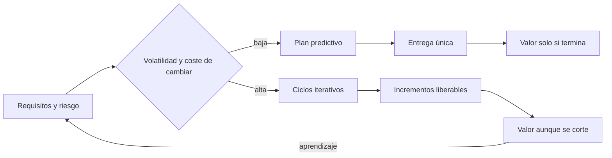
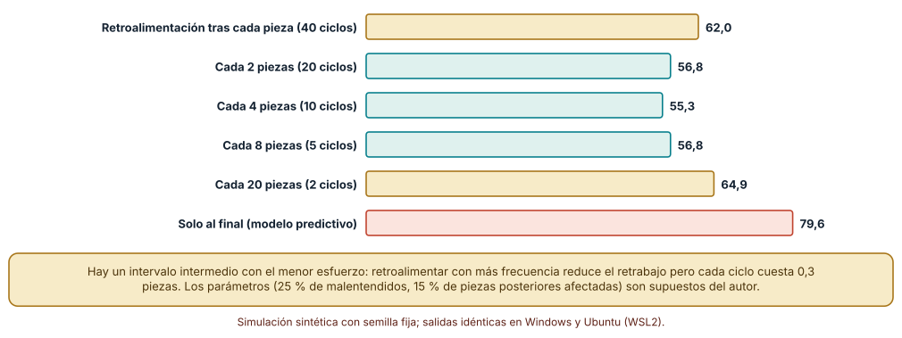
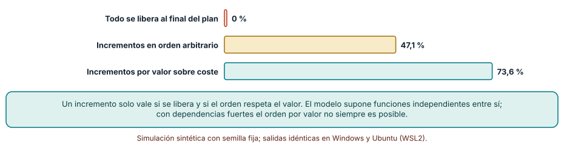
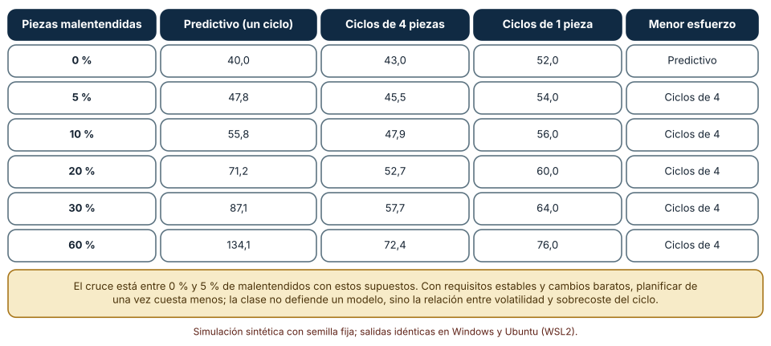

# SE-181 — Modelos predictivos, iterativos e incrementales

[← SE-180 — Proyecto: prototipo accesible evaluado con usuarios](../../classes/part-14-experiencia-accesibilidad-e-internacionalizacion/se-180-proyecto-prototipo-accesible-evaluado-con-usuarios/README.md) · [↑ Parte 15](../../classes/part-15-procesos-planificacion-y-estimacion/README.md) · [📚 Índice completo](../../classes/README.md) · [🌐 Portal](../../site/classes/SE-181.html) · [SE-182 — Agile como principios y no como ceremonia →](../../classes/part-15-procesos-planificacion-y-estimacion/se-182-agile-como-principios-y-no-como-ceremonia/README.md)

## Punto profesional y fundamento pedagógico

**Punto profesional.** La clase existe para que elijas un modelo de proceso por lo que cuesta equivocarse y por cuándo te enteras, no por la moda: un plan predictivo, un ciclo iterativo y una entrega incremental responden a tres preguntas distintas y se pueden combinar.

**Por qué aparece aquí.** Se sitúa después de **Proyecto: prototipo accesible evaluado con usuarios** y abre la **Parte 15**: la Parte 14 dejó un prototipo evaluado con personas; ahora hay que decidir cómo se organiza el trabajo que lo convertirá en producto. Esta clase fija el vocabulario (predictivo, iterativo, incremental), mide qué cambia al acortar el intervalo de retroalimentación y deja el caso conductor de la parte: el plan de lanzamiento de la plataforma de entregas de tareas.

**Error conceptual que debe corregir.** Creer que «iterativo» e «incremental» son sinónimos de «ágil», o que el modelo predictivo es un error histórico: el predictivo es razonable cuando los requisitos son estables y cambiar es caro; el iterativo reduce el coste de descubrir tarde; el incremental protege el valor si el proyecto se corta.

**Secuencia de aprendizaje.** Antes de ejecutar nada, predices a qué intervalo de retroalimentación el esfuerzo total es mínimo; después simulas seis intervalos, comparas liberar todo al final con liberar incrementos y buscas el cruce entre modelos al variar la volatilidad. La secuencia usa predicción, explicación propia, contraste y recuperación. [ICAP](https://icap.education.asu.edu/research) distingue participación de construcción de conocimiento; [How People Learn II](https://nap.nationalacademies.org/catalog/24783/how-people-learn-ii-learners-contexts-and-cultures) exige conectar conocimiento previo, contexto y transferencia; la [práctica de recuperación](https://pubmed.ncbi.nlm.nih.gov/16507066/) respalda producir de nuevo la explicación tras una demora; y [Education for Life and Work](https://nap.nationalacademies.org/resource/13398/dbasse_084153.pdf) exige devolución que explique la causa del error.

**Evidencia de aprendizaje.** `model-log.md` con la predicción previa, el esfuerzo simulado por intervalo, el valor entregado en un corte al azar, la tabla de volatilidad y una nota que diga qué observación te haría cambiar de modelo.

**Límite de la conclusión.** Las simulaciones usan parámetros del autor (25 % de malentendidos, 15 % de piezas posteriores afectadas, 0,3 piezas por ciclo). Muestran un mecanismo, no el tamaño del efecto en un equipo real; ninguna cifra de esta clase se midió en personas ni en un producto.

### Trazabilidad fuente → afirmación

| Fuente primaria u oficial | Afirmación que respalda | Lo que no prueba |
|---|---|---|
| [Boehm, «A spiral model of software development and enhancement» (IEEE Computer, 1988)](https://doi.org/10.1109/2.59) | Propone un modelo guiado por riesgo que repite ciclos de análisis, construcción y evaluación en lugar de una secuencia única. | No demuestra que el modelo espiral supere a otro en un proyecto concreto. |
| [Larman y Basili, «Iterative and incremental developments: a brief history» (IEEE Computer, 2003)](https://doi.org/10.1109/MC.2003.1204375) | Documenta que las prácticas iterativas e incrementales se usaron desde mediados del siglo XX, antes de los marcos actuales. | No mide su efecto relativo ni establece cuándo conviene cada una. |
| [Flyvbjerg, «From Nobel Prize to project management: getting risks right» (Project Management Journal, 2006)](https://doi.org/10.1177/875697280603700302) | Argumenta que las estimaciones de proyectos subestiman sistemáticamente costes y plazos y propone corregir con clases de referencia. | No cubre proyectos de software pequeños ni fija un modelo de proceso. |

## Antes de empezar

Esta clase abre la **Parte 15 sobre procesos, planificación y estimación**. El caso conductor es el equipo que planifica el lanzamiento de la plataforma de entregas de tareas, con la regla de penalización y la recuperación de borradores de las Partes 12 y 13 como trabajo pendiente. Recupera lo aprendido de la Parte 14: una evaluación con personas dice qué hay que cambiar, y cuándo te enteras decide cuánto cuesta. La pregunta activa es: **¿cada cuánto necesito saber si estoy construyendo lo correcto, y qué hago con lo que ya entregué si el proyecto se corta?**

## Prerrequisitos

- Haber completado `SE-180` o poder explicar qué descubrió su evaluación con personas.
- Python 3.11 o posterior y un terminal; todo el código usa solo la biblioteca estándar.
- Disponer de un editor de texto: los registros se escriben en Markdown.

## Problema auténtico

El equipo tiene 40 piezas de trabajo para el lanzamiento y dos propuestas: planificar las 40 de una vez, construir todo y validar con las usuarias al final, o construir de cuatro en cuatro y validar cada vez. La jefatura pregunta cuál cuesta menos. Nadie lo sabe: el predictivo parece más barato porque no tiene ceremonias, y el iterativo parece más seguro porque revisa. Ambas intuiciones son correctas en algún régimen.

## Objetivos observables

Al terminar podrás:

1. distinguir un modelo predictivo, uno iterativo y uno incremental con un ejemplo y un contraejemplo de la plataforma de entregas;
2. calcular con una simulación cómo cambia el esfuerzo total al variar el intervalo de retroalimentación y localizar el intervalo de menor esfuerzo;
3. comparar el valor entregado por una liberación única y por incrementos ordenados cuando el proyecto se corta en un momento imprevisto;
4. encontrar el cruce entre un modelo predictivo y uno iterativo al variar la volatilidad de los requisitos;
5. justificar un modelo de proceso por riesgo, reversibilidad y coste de equivocarse, y declarar qué observación lo cambiaría.

## Mapa conceptual



El mapa se lee como una decisión, no como una secuencia: la volatilidad y el coste de cambiar eligen entre un plan único y ciclos. El retorno indica que lo aprendido en un incremento modifica el riesgo con el que se planifica el siguiente.

## Temas y por qué importan

| Tema | Por qué cambia una decisión profesional | Evidencia mínima |
|---|---|---|
| Modelo predictivo | Compromete alcance, coste y plazo al inicio; es eficiente cuando lo desconocido es poco. | Predicción, traza causal y contraejemplo de **Modelo predictivo** en `model-log.md` |
| Modelo iterativo | Repite ciclos para descubrir qué construir; paga una sobrecarga por ciclo a cambio de errores más baratos. | Predicción, traza causal y contraejemplo de **Modelo iterativo** en `model-log.md` |
| Modelo incremental | Libera partes utilizables en orden de valor; protege lo entregado si el proyecto se corta. | Predicción, traza causal y contraejemplo de **Modelo incremental** en `model-log.md` |
| Volatilidad | Es la variable que decide el cruce: cuánto de lo planificado cambiará antes de entregarse. | Predicción, traza causal y contraejemplo de **Volatilidad** en `model-log.md` |
| Elección del modelo | Se justifica por riesgo y reversibilidad, y se revisa cuando cambia la evidencia. | Predicción, traza causal y contraejemplo de **Elección del modelo** en `model-log.md` |

## Conceptos y decisiones

### 1. Modelo predictivo

En un modelo predictivo se analiza, diseña, construye, prueba y entrega en fases con alcance fijado al inicio. Su fuerza es la coordinación: todos saben qué se hará y las dependencias se resuelven en el papel. Su debilidad es el momento en que se descubre un malentendido, que ocurre cuando alguien usa lo construido, y entonces todo lo hecho sobre ese malentendido se rehace. El modelo no es ingenuo ni obsoleto: funciona bien donde los requisitos son estables y la validación es temprana por otras vías, por ejemplo cuando se reconstruye un sistema cuyo comportamiento ya se conoce. Falla cuando el desconocimiento es el problema, no la ejecución.

### 2. Modelo iterativo

Iterar es repetir un ciclo completo de construir, mostrar y aprender, con la intención de revisar lo hecho. Boehm lo organizó alrededor del riesgo: cada vuelta ataca primero lo que más puede hacer fracasar el proyecto. El mecanismo económico es sencillo: el coste de rehacer una pieza malentendida crece con lo construido encima, de modo que descubrirlo después de cuatro piezas cuesta menos que después de cuarenta. La contrapartida es una sobrecarga por ciclo (preparar la demostración, reunir a las usuarias, decidir), de modo que existe un intervalo intermedio de menor esfuerzo total y no uno de «cuanto más corto, mejor».

### 3. Modelo incremental

Un incremento es una parte que se puede usar, no una capa técnica sin valor propio. Construir incrementalmente significa ordenar el trabajo de manera que cada entrega sea utilizable y que las primeras aporten la mayor parte del valor. Su efecto más visible aparece cuando el proyecto se interrumpe: un recorte presupuestario, una reorganización o un cambio de prioridades. Con una liberación única el valor entregado es cero hasta el último día; con incrementos es el acumulado hasta el corte. Iterativo e incremental son ortogonales: se puede iterar sin liberar nada y se puede liberar por partes sin revisar la dirección.

### 4. Volatilidad y coste de cambiar

La volatilidad es la proporción de lo planificado que cambiará o se revelará mal entendido antes de entregarse. No se conoce al inicio, pero se puede estimar con proyectos anteriores y se puede reducir con prototipos. El coste de cambiar, en cambio, es una propiedad del sistema: en uno con pruebas automáticas, integración continua y despliegue frecuente, rehacer cuesta poco; en uno con hardware o contratos cerrados, cuesta mucho. Un modelo se elige por el producto de ambos: volatilidad alta con cambio barato favorece ciclos cortos; volatilidad baja con cambio caro favorece planificar más.

### 5. Elección del modelo

La elección se documenta como cualquier decisión técnica: opciones, supuestos, evidencia, qué se acepta y qué observación la revertiría. Los marcos reales son híbridos: un plan predictivo para las dependencias externas (una auditoría de seguridad con fecha, un contrato) y ciclos iterativos dentro. Flyvbjerg recuerda además que quien planifica tiende al optimismo, por lo que conviene contrastar con casos parecidos antes de comprometer fechas; esa disciplina pertenece a la clase de estimación (`SE-185`), pero afecta ya a la elección: un modelo que promete certeza al inicio promete algo que nadie tiene.

### Cada cuánto retroalimentar: el intervalo de menor esfuerzo

El experimento modela 40 piezas de trabajo. Cada pieza tiene un 25 % de probabilidad de haberse entendido mal; el malentendido se descubre en la siguiente retroalimentación y rehacerlo cuesta una pieza más 0,15 por cada pieza construida después y antes del descubrimiento. Cada ciclo de retroalimentación cuesta 0,3 piezas. Se varía el intervalo de 1 a 40 piezas y se promedia sobre 2000 semillas.

```python
def rework(p, k, overhead, rng):
    fb = list(range(k, 41, k))          # puntos de retroalimentación
    cost = 0.0
    for i in range(40):
        if rng.random() < p:
            found = next(f for f in fb if f > i)
            cost += 1 + 0.15 * (found - i - 1)
    return cost + overhead * len(fb)
```

Resultado, idéntico en Windows (CPython 3.12.9) y en Ubuntu bajo WSL2 (3.12.3): el esfuerzo total medio es **62,0** si se retroalimenta tras cada pieza, **56,8** cada dos, **55,3** cada cuatro, **56,8** cada ocho, **64,9** cada veinte y **79,6** solo al final. Hay un mínimo intermedio, y el percentil 90 del retrabajo con retroalimentación al final es 55,0 frente a 19,7 con ciclos de cuatro: lo que más cambia es la cola.



**Cómo leer la figura.** Cada barra es el esfuerzo medio (40 piezas más retrabajo y ciclos); la verde marca los intervalos de menor esfuerzo y la coral la entrega única. **Dónde deja de valer:** el 25 % de malentendidos, el 15 % de piezas afectadas y el coste de 0,3 por ciclo son supuestos del autor. Con ciclos baratos (demostraciones automatizadas) el mínimo se mueve hacia intervalos más cortos; con ciclos caros, hacia más largos. La figura muestra la forma de la curva, no un intervalo recomendado.

### Valor entregado cuando el proyecto se corta

Veinte funciones con valor lognormal (σ = 1) y coste de 1 a 5 se construyen hasta un corte al azar. Se comparan tres políticas con 200 conjuntos y 100 cortes cada uno (20 000 cortes por política): liberar todo al final, liberar cada función al terminarla en orden arbitrario y liberar en orden de valor sobre coste.

```python
def delivered(order, items, cut):
    t = v = 0
    for i in order:
        val, c = items[i]
        if t + c > cut: break
        t += c; v += val
    return v
```

La liberación única entrega **0 %** del valor en cualquier corte anterior al final. Los incrementos en orden arbitrario entregan **47,1 %** del valor total de media y los incrementos por valor sobre coste, **73,6 %**. El orden importa tanto como liberar: con las mismas funciones, ordenar bien casi duplica lo entregado.



**Cómo leer la figura.** Cada barra es el valor medio entregado como porcentaje del total. **Dónde deja de valer:** el modelo supone funciones independientes y valores conocidos; con dependencias fuertes no siempre se puede ordenar por valor, y el valor real de una función solo se conoce después de usarla. Un corte «al azar uniforme» tampoco es lo habitual: los proyectos tienden a cortarse cuando se acaba el presupuesto, no en un instante cualquiera.

### Cuándo conviene cada modelo: el cruce según la volatilidad

Se repite el cálculo del primer experimento variando la proporción de piezas malentendidas y comparando tres estrategias: un ciclo único (sin sobrecoste), ciclos de cuatro piezas y ciclos de una pieza, estos dos con 0,3 por ciclo.

| Malentendidos | Predictivo | Ciclos de 4 | Ciclos de 1 |
|---:|---:|---:|---:|
| 0 % | 40,0 | 43,0 | 52,0 |
| 5 % | 47,8 | 45,5 | 54,0 |
| 10 % | 55,8 | 47,9 | 56,0 |
| 20 % | 71,2 | 52,7 | 60,0 |
| 60 % | 134,1 | 72,4 | 76,0 |

Sin cambios el plan predictivo gana (40 piezas, sin sobrecoste) y a partir de un 5 % de malentendidos ganan los ciclos de cuatro; con 60 % el predictivo cuesta 134,1, casi el doble. El cruce está entre 0 % y 5 % en este modelo. Lo que enseña no es el número sino la forma: el coste del modelo predictivo crece linealmente con la volatilidad y el del iterativo apenas.



**Cómo leer la figura.** Cada fila es una volatilidad; la última columna indica la estrategia de menor esfuerzo. **Dónde deja de valer:** un proyecto real no conoce su porcentaje de malentendidos de antemano; las estimaciones iniciales suelen ser bajas (Flyvbjerg), y el sobrecoste de un ciclo de una pieza (52,0 con volatilidad cero) es el precio de equivocarse al estimar. La tabla no dice que iterar siempre gane: dice que elegir sin estimar la volatilidad es apostar.

## Definiciones de trabajo

- **modelo predictivo:** organización del trabajo en fases con alcance, coste y plazo comprometidos al inicio, y retroalimentación concentrada hacia el final.
- **modelo iterativo:** organización del trabajo en ciclos que repiten construir, mostrar y aprender para revisar la dirección.
- **modelo incremental:** organización del trabajo en partes utilizables que se liberan en un orden elegido por valor y riesgo.
- **volatilidad:** proporción de lo planificado que cambia o se revela mal entendido antes de entregarse.
- **intervalo de retroalimentación:** cantidad de trabajo construido entre dos momentos en que se contrasta con quien lo usará.

Las definiciones son operativas para la plataforma de entregas. No convierten términos con una historia más amplia en sinónimos y deben contrastarse con la documentación primaria enlazada al final.

## Ejemplo mínimo

El fragmento calcula el retrabajo esperado de una pieza malentendida según cuándo se descubre. Antes de ejecutarlo, predice cuánto cuesta descubrirla después de 0 y de 30 piezas posteriores.

```python
def costo(piezas_despues):
    return 1 + 0.15 * piezas_despues

assert costo(0) == 1
assert round(costo(30), 2) == 5.5
```

Descubrirla de inmediato cuesta una pieza; descubrirla treinta piezas después cuesta 5,5, más de cinco veces. Registra versión del intérprete, comando y salida; cambia 0,15 por 0,05 y predice si el mínimo del experimento se desplaza hacia intervalos más largos o más cortos.

## Ejemplo profesional

El equipo de la plataforma de entregas divide el lanzamiento en tres bloques. La integración con el sistema de calificaciones de la secretaría tiene fecha fija y proveedor externo: se planifica de forma predictiva, con un contrato de interfaz acordado de antemano. La experiencia de entrega y recuperación del borrador tiene alta incertidumbre sobre lo que las estudiantes necesitan: se construye en ciclos de dos semanas con revisión de las usuarias. Y la regla de penalización se libera en incrementos: primero el cálculo con la lectura acordada, luego los casos de prórroga, luego las exportaciones.

Compara qué ocurre si la secretaría adelanta su fecha un mes: el primer bloque no cambia de método (cambia su calendario), el segundo recorta alcance y el tercero entrega los incrementos que existan. Una elección de proceso es adecuada cuando cada bloque tiene su modelo por una razón escrita; es débil cuando todo el proyecto usa el mismo marco «porque así se hace aquí».

## Práctica guiada

1. Lista las 40 piezas del lanzamiento (puedes inventarlas) y marca las que dependen de un tercero con fecha fija.
2. Predice a qué intervalo de retroalimentación el esfuerzo es menor y escribe el número antes de simular.
3. Implementa la simulación de esfuerzo y ejecútala con semilla fija para seis intervalos.
4. Implementa los tres órdenes de liberación y mide el valor entregado en cortes al azar.
5. Barre la proporción de malentendidos y localiza el cruce entre predictivo e iterativo.
6. Cambia el coste por ciclo de 0,3 a 1,0 y a 0,1 y describe cómo se mueve el mínimo.
7. Entrega `model-log.md` y pide a otra persona que decida el modelo de un bloque solo con tu registro.

## Ejercicios

1. **Intervalo:** con un coste de ciclo de 1,0, encuentra el intervalo de menor esfuerzo y explica por qué se mueve en esa dirección.
2. **Corte:** modifica el experimento para que el corte ocurra siempre entre el 60 % y el 90 % del coste total y calcula el valor entregado por cada política.
3. **Cruce:** estima la volatilidad de un proyecto anterior (cuántas piezas se rehicieron) y localiza en la tabla qué modelo habría costado menos.
4. **Híbrido:** divide un proyecto en tres bloques y asigna un modelo a cada uno con una razón de riesgo y una observación que lo cambiaría.

## Reto verificable

Entrega `model-log.md` con la predicción, el esfuerzo por intervalo, el valor por política de liberación y la tabla de volatilidad. Se aprueba si otra persona ejecuta el código desde un checkout limpio, obtiene los mismos números y puede decir qué parámetro, al cambiarlo, desplazaría el cruce. No se aprueba por la cantidad de modelos descritos ni por citar marcos.

## Caso conductor

La plataforma de entregas de tareas es el caso conductor de la Parte 15. Esta clase deja el primer artefacto: la asignación de un modelo a cada bloque del lanzamiento, con su razón y su señal de cambio. Las clases siguientes le sumarán principios y prácticas (`SE-182` y `SE-183`), flujo y colas (`SE-184`), estimaciones con rango (`SE-185`), dependencias (`SE-186`), riesgos (`SE-187`), criterios de listo y terminado (`SE-188`), métricas (`SE-189`), mejora (`SE-190`) y un plan completo (`SE-191` y `SE-192`). Cambia después una sola decisión, la fecha de la secretaría, y revisa qué bloques debe replanificar.

## Preguntas frecuentes

### ¿Iterativo es lo mismo que ágil?

No: iterar describe la forma de organizar el trabajo en ciclos, y «ágil» es una familia de valores y prácticas que suele iterar. Se puede iterar sin ser ágil (un ciclo espiral con documentación pesada) y se puede ser ágil sin ciclos fijos (flujo continuo, `SE-183`).

### ¿Cuándo es razonable un plan predictivo?

Cuando la incertidumbre sobre qué construir es baja y cambiar es caro: una migración con comportamiento conocido, un componente con homologación externa, un contrato con alcance cerrado. Aun entonces conviene validar los supuestos más riesgosos pronto.

### ¿El incremento tiene que ser una funcionalidad completa de cara a la usuaria?

Tiene que ser utilizable y aportar valor por sí mismo, pero puede ser pequeño: una estudiante que pueda recuperar su borrador aunque la interfaz sea mínima. Una capa técnica que nadie puede usar no es un incremento.

### ¿Qué hago si no conozco la volatilidad?

Estímala con proyectos parecidos: cuántas piezas se rehicieron o se cancelaron. Si no hay historia, asume que es mayor que la que crees y revisa el supuesto en cada ciclo; la clase `SE-185` desarrolla cómo usar la historia.

## Fallo controlado y diagnóstico

Reproduce el fallo clásico de la clase: **elegir el modelo de proceso por costumbre y descubrir el malentendido al final**. Construye las 40 piezas con retroalimentación solo al final, con la semilla de la clase, y registra cuánto retrabajo aparece.

Registra síntoma, entrada mínima, hipótesis, observación que descarta cada hipótesis, causa, corrección y prueba de regresión. **Síntoma:** el lanzamiento llega a la semana 14 de 12 porque el equipo rehace una quinta parte de las piezas. **Hipótesis rivales:** (a) el equipo estimó mal el esfuerzo de construir; (b) el equipo construyó con calidad insuficiente; (c) los malentendidos se descubrieron tarde. **Prueba:** separa el esfuerzo de construcción del de retrabajo y calcula cuántas piezas rehechas se habían construido antes de la primera demostración. **Conclusión:** la causa es el intervalo de retroalimentación, no la estimación. **Regresión:** fija un punto de contraste con las usuarias cada cuatro piezas y registra el retrabajo de la siguiente ejecución. No cambies a la vez el intervalo y el alcance.

## Errores comunes y cómo corregirlos

| Síntoma | Causa probable | Corrección |
|---|---|---|
| El proyecto «ágil» no libera nada utilizable hasta el último mes | Se iteró sin entregar incrementos | Definir qué puede usar una persona al final de cada ciclo y liberarlo |
| Los ciclos tienen tanta ceremonia que no queda tiempo para construir | Sobrecoste por ciclo no medido | Medir las horas por ciclo y ajustar el intervalo hasta el mínimo |
| Un plan predictivo se rehace por completo a mitad de camino | Volatilidad subestimada al elegir el modelo | Estimar la volatilidad con proyectos previos y planificar revisiones |
| Se prioriza por orden de aparición, y al recortar se pierde lo importante | Los incrementos no se ordenaron por valor | Ordenar por valor sobre coste y revisar el orden en cada ciclo |
| «Usamos Scrum» se presenta como justificación del modelo | Se confunde marco con decisión | Escribir riesgo, reversibilidad y señal de cambio del modelo elegido |

## Entorno y archivos clave

```text
work/SE-181/
├── README.md
├── models/
│   ├── retrabajo.py
│   ├── corte.py
│   └── volatilidad.py
├── tests/test_models.py
└── evidence/model-log.md
```

El `README` declara plataforma, versión de Python, semillas y comandos. Los experimentos usan solo la biblioteca estándar (`random`, `statistics`) y se ejecutaron con CPython 3.12.9 en Windows 11 y 3.12.3 en Ubuntu bajo WSL2: las salidas fueron idénticas. Si añades una dependencia, fija procedencia y versión.

## Seguridad, ética y accesibilidad

- una estimación de volatilidad no debe usarse para evaluar a personas del equipo: describe el problema, no a quien lo construye;
- los incrementos que se liberan a estudiantes reales deben cumplir los requisitos de accesibilidad desde el primero, no «en una iteración posterior»;
- las demostraciones con usuarias necesitan consentimiento y datos sintéticos; no uses entregas reales para ilustrar;
- documenta quién decidió el modelo y qué observación lo revertiría, para que la responsabilidad no se disuelva en el marco;
- respeta las licencias de las guías y marcos que adoptes, y atribuye lo adaptado.

## Puente hacia el trabajo con agentes

Un agente al que se le pide «planifica el lanzamiento» elegirá un modelo sin avisar, normalmente el más popular, y producirá un calendario ordenado con aire de certeza. Pídele en cambio que declare la volatilidad que supone, que separe los bloques con fecha externa de los inciertos, que proponga el orden de incrementos por valor sobre coste y que indique qué observación cambiaría su plan. Revisa especialmente si dio un único número de fechas sin rango: es la misma estimación sin supuestos que la clase `SE-185` desmonta.

## Transferencia

Traslada el experimento a otro dominio (por ejemplo, la migración de un sistema de reservas con comportamiento conocido): cambia la volatilidad y el coste de cambiar, y conserva el procedimiento de medir esfuerzo por intervalo y valor ante un corte. La transferencia está lograda cuando puedes explicar qué parte del método dependía del dominio y cuál no, no cuando el código se parece.

## Evaluación y evidencia

| Criterio | Evidencia para aprobar |
|---|---|
| comprensión | explicación de la diferencia entre iterativo e incremental con un ejemplo de la plataforma |
| corrección | esfuerzo por intervalo, valor por política y tabla de volatilidad reproducibles con las mismas semillas |
| diseño | modelo asignado a cada bloque con riesgo, reversibilidad y señal de cambio |
| diagnóstico | reproducción del fallo «malentendido descubierto al final» con regresión |
| incertidumbre | declaración de los parámetros supuestos y de qué cambiaría el mínimo |
| reproducibilidad | versiones, comandos, salida y límites declarados |

## Fuentes

- [Boehm, «A spiral model of software development and enhancement» (IEEE Computer, 1988)](https://doi.org/10.1109/2.59) — modelo de proceso guiado por riesgo; autoridad: IEEE Computer.
- [Larman y Basili, «Iterative and incremental developments: a brief history» (IEEE Computer, 2003)](https://doi.org/10.1109/MC.2003.1204375) — historia de las prácticas iterativas e incrementales; autoridad: IEEE Computer.
- [Flyvbjerg, «From Nobel Prize to project management: getting risks right» (Project Management Journal, 2006)](https://doi.org/10.1177/875697280603700302) — sesgo de optimismo en la planificación de proyectos; autoridad: Project Management Journal.
- [SWEBOK Guide v4.0a](https://www.computer.org/education/bodies-of-knowledge/software-engineering) — procesos de ingeniería de software; autoridad: IEEE Computer Society.
- [Manifiesto por el Desarrollo Ágil de Software](https://agilemanifesto.org/) — valores que motivan las prácticas iterativas actuales; autoridad: autores del manifiesto.

Cada fuente respalda el mecanismo indicado; ninguna demuestra que el intervalo mínimo de la clase, el 5 % de cruce o la ventaja del orden por valor se cumplan en un proyecto real. Esa afirmación depende de la volatilidad, del coste de cambiar y de la historia del equipo.

- [Python: `random`](https://docs.python.org/3/library/random.html) — generador con semilla para las simulaciones.
- [Python: `statistics`](https://docs.python.org/3/library/statistics.html) — media y percentiles de los resultados.

## Límites y siguiente paso

Se ejecutaron tres experimentos con datos sintéticos en Windows y Ubuntu (WSL2) con resultados idénticos. No se midió a ningún equipo ni producto: los porcentajes de malentendidos, el coste por ciclo y los valores de las funciones son construcciones del autor. La siguiente clase pregunta qué principios sostienen esa elección cuando se quita la ceremonia.

## Glosario

- **modelo predictivo:** organización del trabajo en fases con alcance, coste y plazo comprometidos al inicio, y retroalimentación concentrada hacia el final.
- **modelo iterativo:** organización del trabajo en ciclos que repiten construir, mostrar y aprender para revisar la dirección.
- **modelo incremental:** organización del trabajo en partes utilizables que se liberan en un orden elegido por valor y riesgo.
- **volatilidad:** proporción de lo planificado que cambia o se revela mal entendido antes de entregarse.
- **intervalo de retroalimentación:** cantidad de trabajo construido entre dos momentos en que se contrasta con quien lo usará.

---

[← SE-180 — Proyecto: prototipo accesible evaluado con usuarios](../../classes/part-14-experiencia-accesibilidad-e-internacionalizacion/se-180-proyecto-prototipo-accesible-evaluado-con-usuarios/README.md) · [↑ Parte 15](../../classes/part-15-procesos-planificacion-y-estimacion/README.md) · [📚 Índice completo](../../classes/README.md) · [🌐 Portal](../../site/classes/SE-181.html) · [SE-182 — Agile como principios y no como ceremonia →](../../classes/part-15-procesos-planificacion-y-estimacion/se-182-agile-como-principios-y-no-como-ceremonia/README.md)
