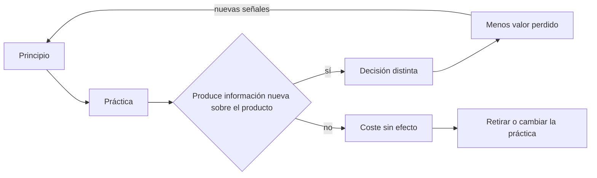
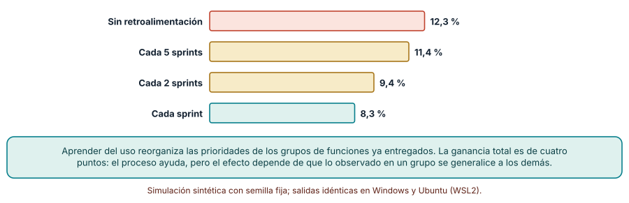
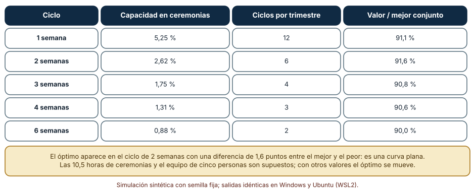
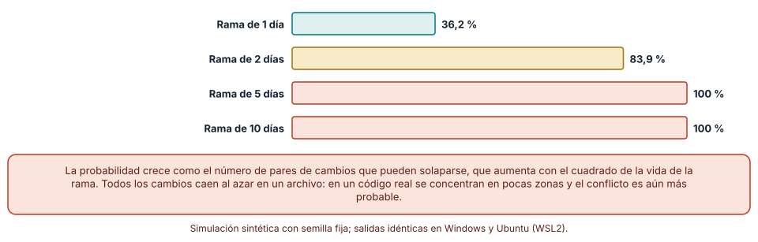

# SE-182 — Agile como principios y no como ceremonia

[← SE-181 — Modelos predictivos, iterativos e incrementales](../../classes/part-15-procesos-planificacion-y-estimacion/se-181-modelos-predictivos-iterativos-e-incrementales/README.md) · [↑ Parte 15](../../classes/part-15-procesos-planificacion-y-estimacion/README.md) · [📚 Índice completo](../../classes/README.md) · [🌐 Portal](../../site/classes/SE-182.html) · [SE-183 — Scrum, Kanban, XP y Shape Up →](../../classes/part-15-procesos-planificacion-y-estimacion/se-183-scrum-kanban-xp-y-shape-up/README.md)

## Punto profesional y fundamento pedagógico

**Punto profesional.** La clase existe para que distingas lo que un equipo hace (reuniones, tableros, nombres de roles) de lo que esas prácticas deben producir (retroalimentación real, entregas pequeñas, decisiones con evidencia), y puedas diagnosticar un proceso que cumple el ritual sin obtener el efecto.

**Por qué aparece aquí.** Se sitúa después de **Modelos predictivos, iterativos e incrementales** y antes de **Scrum, Kanban, XP y Shape Up**: la clase anterior mostró que acortar el intervalo de retroalimentación reduce el retrabajo hasta un punto; esta pregunta qué hace que un ciclo corto sirva de algo y cuándo solo suma reuniones. Fija el criterio con el que las clases siguientes evaluarán cada marco.

**Error conceptual que debe corregir.** Creer que «ser ágil» es adoptar un conjunto de ceremonias, o que un equipo con demostraciones quincenales ya aprende de sus usuarias: la ceremonia sin información nueva sobre el producto es un coste, no un aprendizaje.

**Secuencia de aprendizaje.** Antes de leer los resultados, predices cuánto valor se pierde por no aprender de lo entregado; después simulas cuatro frecuencias de aprendizaje, comparas el sobrecoste fijo de las ceremonias con el valor de aprender más veces y mides cómo crecen los conflictos de fusión con la vida de una rama. La secuencia usa predicción, explicación propia, contraste y recuperación. [ICAP](https://icap.education.asu.edu/research) distingue participación de construcción de conocimiento; [How People Learn II](https://nap.nationalacademies.org/catalog/24783/how-people-learn-ii-learners-contexts-and-cultures) exige conectar conocimiento previo, contexto y transferencia; la [práctica de recuperación](https://pubmed.ncbi.nlm.nih.gov/16507066/) respalda producir de nuevo la explicación tras una demora; y [Education for Life and Work](https://nap.nationalacademies.org/resource/13398/dbasse_084153.pdf) exige devolución que explique la causa del error.

**Evidencia de aprendizaje.** `agile-log.md` con una tabla de cada práctica del equipo, el efecto que debería producir, la señal observable de que lo produce y la salida de las tres simulaciones, más una nota de qué práctica retirarías primero.

**Límite de la conclusión.** El modelo de aprendizaje (seis grupos de funciones cuyo valor se aprende al entregar una) es una construcción del autor. Muestra por qué la retroalimentación vale y cuándo deja de valer, no cuánto aporta a un producto real.

### Trazabilidad fuente → afirmación

| Fuente primaria u oficial | Afirmación que respalda | Lo que no prueba |
|---|---|---|
| [Manifiesto por el Desarrollo Ágil de Software y sus principios](https://agilemanifesto.org/principles.html) | Declara valores y doce principios: entrega temprana y continua, aceptar cambios, colaboración, atención a la excelencia técnica, ciclos de reflexión. | No prescribe ceremonias ni garantiza que cumplirlas produzca esos efectos. |
| [Fowler, «The new methodology»](https://martinfowler.com/articles/newMethodology.html) | Explica que los procesos adaptativos cambian la planificación detallada por la retroalimentación y exigen disciplina técnica propia. | Es una exposición de autor, no un estudio de eficacia. |
| [Fowler, «Flaccid Scrum»](https://martinfowler.com/bliki/FlaccidScrum.html) | Describe la adopción de la gestión sin las prácticas técnicas que la sostienen y sus consecuencias. | No mide cuántos equipos caen en ello. |

## Antes de empezar

Recupera el resultado de `SE-181`: existe un intervalo de retroalimentación de menor esfuerzo. Esta clase agrega una condición: la retroalimentación solo reduce el retrabajo si trae información que cambia lo que se hace después. La pregunta activa es: **¿qué práctica de mi equipo produce información nueva sobre el producto y cuál solo ocupa horas?**

## Prerrequisitos

- Haber completado `SE-181` o poder explicar la relación entre intervalo de retroalimentación y retrabajo.
- Python 3.11 o posterior y un terminal; todo el código usa solo la biblioteca estándar.
- Haber participado o leído sobre un equipo con ceremonias periódicas.

## Problema auténtico

El equipo de la plataforma de entregas hace planificación, demostración y retrospectiva cada dos semanas desde hace seis meses. La demostración la ven los propios integrantes y la jefatura, pero nunca una estudiante ni una profesora. Cuando se lanza una versión de prueba, las usuarias piden cosas que nadie esperaba. El equipo «es ágil» según su lista de reuniones y, sin embargo, ha construido durante seis meses sin aprender de nadie que use el producto.

## Objetivos observables

Al terminar podrás:

1. relacionar cada principio ágil con el efecto que debe producir y la señal observable de ese efecto;
2. medir con una simulación cuánto valor se deja sin entregar según la frecuencia con que se aprende del uso real;
3. calcular el sobrecoste fijo de una ceremonia y localizar la duración de ciclo que equilibra aprender y gastar horas;
4. estimar cómo crece la probabilidad de conflicto de integración con la vida de una rama y qué práctica técnica la acota;
5. diagnosticar un proceso que cumple rituales sin obtener retroalimentación y proponer qué retirar o cambiar.

## Mapa conceptual



El mapa se lee desde el principio hacia la práctica y, a partir de ahí, por una pregunta: ¿esta práctica cambia alguna decisión? Si no, se retira o se cambia. El retorno indica que lo que funciona confirma el principio y lo que no, lo cuestiona.

## Temas y por qué importan

| Tema | Por qué cambia una decisión profesional | Evidencia mínima |
|---|---|---|
| Principios frente a prácticas | Los principios dicen qué efecto se busca; las prácticas son una de varias maneras de lograrlo. | Predicción, traza causal y contraejemplo de **Principios frente a prácticas** en `agile-log.md` |
| Retroalimentación con uso real | Aprender de lo entregado reordena las prioridades; aprender de una demostración interna no. | Predicción, traza causal y contraejemplo de **Retroalimentación con uso real** en `agile-log.md` |
| Coste de las ceremonias | Cada ciclo consume horas fijas; el ciclo se acorta mientras lo aprendido supere ese coste. | Predicción, traza causal y contraejemplo de **Coste de las ceremonias** en `agile-log.md` |
| Disciplina técnica | Entregar seguido exige integración frecuente, pruebas y ramas cortas; sin ellas el ciclo corto se rompe. | Predicción, traza causal y contraejemplo de **Disciplina técnica** en `agile-log.md` |
| Diagnóstico de un proceso ritual | Una práctica se evalúa por la decisión que cambia, no por su existencia en el calendario. | Predicción, traza causal y contraejemplo de **Diagnóstico de un proceso ritual** en `agile-log.md` |

## Conceptos y decisiones

### 1. Principios frente a prácticas

El manifiesto declara, entre otros, entregar software funcionando con frecuencia, aceptar requisitos cambiantes y reflexionar a intervalos regulares sobre cómo mejorar. Ninguna de esas frases dice «haz una reunión diaria». Las prácticas (reunión diaria, demostración, retrospectiva) son maneras históricas de lograr los efectos, y cada una funciona en un contexto. La pregunta útil nunca es «¿hacemos Scrum?» sino «¿qué principio sirve esta práctica y cómo lo sabríamos?». Cuando nadie puede responder, la práctica es ritual: se mantiene por inercia.

### 2. Retroalimentación con uso real

Una demostración tiene tres posibles públicos: el propio equipo, quien patrocina y quienes usarán el producto. Sólo el tercero revela si lo construido sirve. Un equipo que muestra solo a su jefatura confirma que cumplió lo pedido, no que lo pedido era lo correcto. En el modelo de la clase, cuando se entrega una función de un grupo, se aprende el valor del grupo entero y las funciones restantes se reordenan; sin ese aprendizaje se sigue un orden fijado con una creencia inicial ruidosa. El mecanismo es el de la clase anterior, ahora con la condición explícita: el ciclo vale por la información que trae.

### 3. Coste de las ceremonias

Cada ciclo tiene un coste fijo en horas (planificar, demostrar, mirar atrás, refinar) que no depende de cuánto se construyó. Si el ciclo es de una semana, ese coste es una fracción mayor de la capacidad que si es de cuatro. El óptimo no es «lo más corto» ni «lo más largo»: es el punto donde la ganancia marginal de aprender una vez más ya no supera las horas que cuesta. En equipos reales el coste se reduce automatizando lo mecánico (despliegue, informes) y manteniendo lo humano (qué construir después).

### 4. Disciplina técnica

El manifiesto pide atención continua a la excelencia técnica por una razón económica: si cada entrega requiere dos semanas de estabilización, el ciclo corto es imposible. La integración frecuente, las pruebas automatizadas y las ramas cortas mantienen bajo el coste de cada ciclo. Una rama que vive diez días acumula cambios de varias personas que se solapan, y el conflicto no es una molestia sino una señal de que dos entendimientos del mismo código divergieron. Fowler describe el patrón «Flaccid Scrum»: un equipo adopta la gestión de proyectos y omite las prácticas técnicas, con lo que la velocidad inicial cae pronto por deuda acumulada.

### 5. Diagnóstico de un proceso ritual

Un proceso ritual se reconoce por cuatro síntomas: las reuniones se celebran aunque nada dependa de ellas, las acciones acordadas no se ejecutan, nadie externo al equipo ve el producto antes de su lanzamiento y las métricas cuentan actividad (puntos, tarjetas movidas) en lugar de efectos (uso, errores evitados). El diagnóstico se hace con preguntas sobre decisiones: ¿qué decidimos distinto la última vez gracias a esta práctica? La respuesta puede ser «nada», y entonces retirarla es una mejora.

### Aprender del uso reduce el valor perdido

El modelo tiene 60 funciones en seis grupos. El valor de una función es el valor del grupo (lognormal, σ = 1) por una variación propia (σ = 0,3). El equipo comienza con una creencia ruidosa del valor de cada grupo (σ = 1) y entrega 3 funciones por sprint durante 10 sprints, siempre las de mayor valor creído. Con retroalimentación, tras cada ciclo los grupos ya entregados pasan a su valor real; sin ella, la creencia no cambia.

```python
def run(seed, per_sprint, sprints, feedback_every):
    fac, feats, belief = world(seed)
    for s in range(sprints):
        pool = sorted(pending, key=lambda i: -belief[feats[i][0]])
        deliver(pool[:per_sprint])
        if feedback_every and (s + 1) % feedback_every == 0:
            for c in touched:
                belief[c] = fac[c]          # se aprende el valor real del grupo
```

Resultado en 500 mundos sintéticos, idéntico en Windows y Ubuntu: el valor entregado equivale al **87,7 %** del mejor conjunto posible sin aprender, **88,6 %** si se aprende cada cinco sprints, **90,6 %** cada dos y **91,7 %** cada sprint; el percentil 10 sube de 71,9 % a 79,2 %. Es decir, el valor no entregado baja de 12,3 % a 8,3 %.



**Cómo leer la figura.** Cada barra es el porcentaje del valor del mejor conjunto posible que no se entregó; menos es mejor. **Dónde deja de valer:** el aprendizaje del modelo es perfecto (se conoce el valor real del grupo al entregar una función) y generalizable (lo aprendido de un grupo vale para las demás funciones). En un producto real, una función entregada produce señales ruidosas y a veces engañosas. La ganancia total son cuatro puntos: el proceso ayuda, pero la mayor parte del valor ya se obtiene con una creencia inicial aceptable, y el valor del aprendizaje crece cuando la creencia inicial es peor.

### Cuánto cuesta aprender: ceremonias y duración del ciclo

En un trimestre de 12 semanas, un equipo de cinco personas (200 horas semanales) invierte 10,5 horas fijas por ciclo en ceremonias (planificación, demostración, retrospectiva, refinamiento; supuesto del autor). La capacidad bruta es de 3 funciones por semana. Se simulan ciclos de 1, 2, 3, 4 y 6 semanas, descontando las horas de ceremonia y aprendiendo del uso al final de cada ciclo.

| Ciclo | Sobrecoste | Ciclos | Valor / mejor conjunto |
|---|---:|---:|---:|
| 1 semana | 5,25 % | 12 | 91,1 % |
| 2 semanas | 2,62 % | 6 | 91,6 % |
| 3 semanas | 1,75 % | 4 | 90,8 % |
| 4 semanas | 1,31 % | 3 | 90,6 % |
| 6 semanas | 0,88 % | 2 | 90,0 % |

El máximo aparece con ciclos de dos semanas, pero la curva es plana: el mejor y el peor difieren en 1,6 puntos. Con ciclos de una semana el sobrecoste del 5,25 % ya compensa lo que se gana aprendiendo una vez más.



**Cómo leer la figura.** Cada fila es una duración de ciclo; las dos últimas columnas permiten ver cuánto se gasta y cuánto se gana. **Dónde deja de valer:** las 10,5 horas de ceremonias, el equipo de cinco personas y el supuesto de aprendizaje perfecto son del autor. Un equipo que automatiza la demostración reduce el sobrecoste y desplaza el óptimo hacia ciclos más cortos; uno con muchas dependencias externas tiene ciclos efectivos más largos. Una diferencia de 1,6 puntos con 500 mundos no justifica reorganizar un calendario.

### Ramas largas y conflictos de integración

Seis desarrolladoras trabajan sobre un archivo de 2000 líneas; cada una toca 2 bloques de 8 líneas por día, en posiciones al azar, sin integrar hasta el final de la vida de su rama. Se calcula la probabilidad de que al menos dos ramas se solapen, con 3000 repeticiones por duración.

```python
def conflict(days, rng, devs=6, L=2000, hunks=2, size=8):
    areas = [touched_lines(days * hunks, L, size, rng) for _ in range(devs)]
    return any(areas[i] & areas[j] for i in range(devs) for j in range(i + 1, devs))
```

Con ramas de un día la probabilidad de algún conflicto es **36,2 %**; con dos días, **83,9 %**; con cinco, diez o veinte, **100 %**. La probabilidad sube como la cantidad de pares de bloques que pueden solaparse, que crece con el cuadrado de la vida de la rama.



**Cómo leer la figura.** Cada barra es el porcentaje de repeticiones en que al menos dos ramas tocaron las mismas líneas. **Dónde deja de valer:** los cambios caen al azar en el archivo; en un código real se concentran en pocas zonas y el solape es aún más probable. Y la figura no mide el coste de cada conflicto, que puede ser de segundos o de un día. Lo que muestra es por qué integrar con frecuencia es una condición de los ciclos cortos y no una preferencia.

## Definiciones de trabajo

- **principio ágil:** enunciado del efecto que una forma de trabajar debe producir (por ejemplo, entregar con frecuencia o aceptar cambios), independiente de la práctica que lo logre.
- **práctica:** actividad concreta y repetible que se adopta para lograr el efecto de un principio.
- **ceremonia ritual:** práctica que se mantiene sin que ninguna decisión del equipo dependa de ella.
- **retroalimentación con uso real:** información sobre el producto obtenida de personas que lo usan en su contexto, y no de quienes lo construyen o lo financian.
- **integración frecuente:** fusión de los cambios de cada persona en la línea principal en intervalos cortos, para que las diferencias se detecten mientras son pequeñas.

Las definiciones son operativas para la plataforma de entregas. No convierten términos con una historia más amplia en sinónimos y deben contrastarse con la documentación primaria enlazada al final.

## Ejemplo mínimo

El fragmento calcula la fracción de capacidad que consume una ceremonia fija. Antes de ejecutarlo, predice cuánto consume en ciclos de una y de cuatro semanas.

```python
def sobrecoste(horas_ceremonia, horas_semana, semanas):
    return horas_ceremonia / (horas_semana * semanas)

assert round(sobrecoste(10.5, 200, 1), 4) == 0.0525
assert round(sobrecoste(10.5, 200, 4), 4) == 0.0131
```

Las mismas 10,5 horas consumen el 5,25 % de la capacidad en un ciclo de una semana y el 1,31 % en uno de cuatro. Registra versión, comando y salida; cambia a 21 horas y predice si el ciclo de dos semanas sigue siendo el mejor.

## Ejemplo profesional

El equipo de la plataforma de entregas revisa sus prácticas con una tabla de cuatro columnas: principio, práctica, decisión que cambió la última vez y señal observable. La demostración quincenal ya no es interna: invita a dos profesoras y tres estudiantes distintas cada vez, con una versión desplegada que pueden usar. La retrospectiva exige que cada acción tenga persona responsable y una señal de comprobación. La reunión diaria se acorta a un tablero asíncrono porque nadie había cambiado una decisión gracias a ella en tres semanas. Las ramas viven como máximo un día; lo que no se integra se esconde detrás de un interruptor.

Compara el calendario antes y después: se retiran tres horas de reuniones por semana, se agregan dos sesiones de uso con personas. Un proceso es adecuado cuando cada práctica tiene una decisión que justifica su coste; es peligroso cuando la agenda está llena y el producto nunca ha pasado por manos ajenas.

## Práctica guiada

1. Lista las prácticas de un equipo (el tuyo o uno descrito) y asigna a cada una el principio que sirve.
2. Para cada práctica escribe la decisión que cambió la última vez que se aplicó; deja en blanco las que no recuerdes.
3. Predice cuánto valor se pierde por no aprender del uso real y escribe el número antes de simular.
4. Simula las cuatro frecuencias de aprendizaje con semilla fija.
5. Calcula el sobrecoste de tus ceremonias con tus propias horas y busca el ciclo de menor pérdida.
6. Simula la probabilidad de conflicto con la vida de rama de tu equipo.
7. Entrega `agile-log.md` y pide a otra persona que identifique la práctica que retiraría primero con tu registro.

## Ejercicios

1. **Principio:** elige tres principios del manifiesto y escribe para cada uno una práctica que lo sirve, otra que lo imita sin servirlo y la señal que las distingue.
2. **Ciclo:** con 21 horas de ceremonia por ciclo, recalcula el sobrecoste y estima en qué duración de ciclo cambia el óptimo.
3. **Rama:** calcula la probabilidad de conflicto para cuatro desarrolladoras y 3 bloques por día, y compárala con la de seis.
4. **Diagnóstico:** describe un proceso que conozcas y marca cuáles de los cuatro síntomas de ritual presenta; propón qué retirar.

## Reto verificable

Entrega `agile-log.md` con la tabla de prácticas, la predicción, las tres simulaciones y el diagnóstico. Se aprueba si otra persona ejecuta el código desde un checkout limpio, obtiene los mismos números y puede nombrar la práctica a retirar y la señal que mostraría si fue un error. No se aprueba por la cantidad de principios citados ni por describir un marco.

## Caso conductor

La plataforma de entregas de tareas continúa como caso conductor de la Parte 15. Esta clase deja el segundo artefacto: la tabla de prácticas del equipo con su decisión y su señal, y una duración de ciclo justificada. `SE-183` comparará cuatro marcos con ese mismo criterio. Cambia después una sola práctica, por ejemplo la demostración con usuarias, y observa qué otra decisión del calendario depende de ella.

## Preguntas frecuentes

### ¿Agile significa no planificar?

No. Significa planificar de forma que lo aprendido pueda cambiar el plan. Hay planes de largo plazo en equipos que trabajan con ciclos cortos; lo que cambia es que se tratan como hipótesis.

### ¿Se puede ser ágil sin Scrum?

Sí: los principios no nombran ningún marco. Scrum es una forma de organizar ciclos y roles; el flujo continuo con límites de trabajo (`SE-184`) sirve los mismos principios.

### ¿Qué hago si no puedo mostrar el producto a las usuarias?

Muestra a quien más se les parezca y declara que es un sustituto. Una prueba con tres personas con el mismo perfil vale más que diez demostraciones internas; si ni eso es posible, mide el uso de lo que ya entregaste.

### ¿Un equipo con muchas ceremonias es menos ágil?

No por la cantidad: depende de si cambian decisiones. Un equipo con tres reuniones que cambian el rumbo es más adaptable que uno con una reunión que nadie usa.

## Fallo controlado y diagnóstico

Reproduce el fallo clásico de la clase: **hacer demostraciones sin usuarias y creer que se está aprendiendo**. Ejecuta la simulación sin retroalimentación y compárala con aprender cada sprint.

Registra síntoma, entrada mínima, hipótesis, observación que descarta cada hipótesis, causa, corrección y prueba de regresión. **Síntoma:** tras seis meses y doce demostraciones aprobadas, la primera versión de prueba recibe pedidos de reordenar la mitad del trabajo. **Hipótesis rivales:** (a) las usuarias cambian de opinión; (b) el equipo ejecutó mal lo pedido; (c) las demostraciones no incluían a quien usa el producto. **Prueba:** revisa los asistentes de las doce demostraciones y cuántas decisiones de prioridad cambiaron después de cada una. **Conclusión:** la causa es que la demostración no trajo información sobre el valor, no que las usuarias cambiaran. **Regresión:** invita a tres usuarias en cada demostración y registra, para cada una, qué prioridad cambió; si ninguna cambia en tres ciclos, revisa a quién se invita. No cambies a la vez la frecuencia y el público.

## Errores comunes y cómo corregirlos

| Síntoma | Causa probable | Corrección |
|---|---|---|
| El equipo celebra todas las reuniones y nadie recuerda qué decidió | Las prácticas se mantienen por calendario y no por decisión | Registrar la decisión que cambió cada práctica y retirar las que no cambian ninguna |
| Las demostraciones solo las ven jefatura y el propio equipo | Retroalimentación sin uso real | Invitar a personas que usarán el producto, con una versión que puedan tocar |
| Las ramas viven semanas y la integración final se llama «cierre» | No hay integración frecuente | Limitar la vida de una rama a un día y esconder el trabajo incompleto tras un interruptor |
| Se acorta el ciclo a una semana y el equipo pierde el tiempo en preparar reuniones | El sobrecoste fijo no se midió | Calcular horas por ciclo y escoger la duración que equilibra |
| La velocidad cae tras seis meses de «buena gestión» | Se adoptó la gestión sin prácticas técnicas | Añadir pruebas automáticas, integración frecuente y refactorización continuas |

## Entorno y archivos clave

```text
work/SE-182/
├── README.md
├── agile/
│   ├── aprendizaje.py
│   ├── ciclos.py
│   └── ramas.py
├── tests/test_agile.py
└── evidence/agile-log.md
```

El `README` declara plataforma, versión de Python, semillas y comandos. Los experimentos usan solo la biblioteca estándar (`random`, `statistics`) y se ejecutaron con CPython 3.12.9 en Windows 11 y 3.12.3 en Ubuntu bajo WSL2: las salidas fueron idénticas. Si añades una dependencia, fija procedencia y versión.

## Seguridad, ética y accesibilidad

- no uses la tabla de prácticas para juzgar a personas: describe el proceso;
- las sesiones de uso con estudiantes necesitan consentimiento y no deben usar entregas reales de personas identificables;
- las ceremonias deben ser accesibles (subtítulos, notas escritas, horarios compatibles con distintas zonas) para que el aprendizaje no dependa de quien puede asistir;
- documenta quién retiró una práctica y con qué evidencia, para que sea reversible;
- respeta las licencias de las guías de marcos y atribuye lo adaptado.

## Puente hacia el trabajo con agentes

Un agente al que se le pide «configura un proceso ágil» generará un calendario de ceremonias con nombres reconocibles y ninguna señal de efecto. Pídele en cambio que parta de los principios, que para cada práctica proponga la decisión que cambiaría y la señal para comprobarlo, y que calcule el sobrecoste en horas. Revisa especialmente si propuso demostraciones con usuarias reales o solo internas: es el mismo vacío que dejó al equipo seis meses sin aprender.

## Transferencia

Traslada el análisis a otro entorno (por ejemplo, un equipo de operación que atiende incidentes): cambia las prácticas y conserva la pregunta «qué decisión cambió». La transferencia está lograda cuando puedes explicar qué parte de la tabla dependía del tipo de trabajo y cuál no, no cuando las columnas se parecen.

## Evaluación y evidencia

| Criterio | Evidencia para aprobar |
|---|---|
| comprensión | explicación de la diferencia entre principio y práctica con un ejemplo de la plataforma |
| corrección | tres simulaciones reproducibles con las mismas semillas |
| diseño | tabla de prácticas con decisión y señal, y una duración de ciclo justificada |
| diagnóstico | reproducción del fallo «demostración sin usuarias» con regresión |
| incertidumbre | declaración del supuesto de aprendizaje perfecto y del coste de ceremonias |
| reproducibilidad | versiones, comandos, salida y límites declarados |

## Fuentes

- [Manifiesto por el Desarrollo Ágil de Software](https://agilemanifesto.org/) — valores declarados por sus autores; autoridad: autores del manifiesto.
- [Principios del Manifiesto Ágil](https://agilemanifesto.org/principles.html) — los doce principios; autoridad: autores del manifiesto.
- [Fowler, «The new methodology»](https://martinfowler.com/articles/newMethodology.html) — procesos adaptativos y disciplina técnica; autoridad: martinfowler.com.
- [Fowler, «Flaccid Scrum»](https://martinfowler.com/bliki/FlaccidScrum.html) — adopción de la gestión sin prácticas técnicas; autoridad: martinfowler.com.
- [Fowler, «Continuous Integration»](https://martinfowler.com/articles/continuousIntegration.html) — integración frecuente y sus condiciones; autoridad: martinfowler.com.
- [Trunk Based Development](https://trunkbaseddevelopment.com/) — ramas cortas y desarrollo sobre la línea principal; autoridad: sitio de la práctica.

Cada fuente respalda el mecanismo indicado; ninguna demuestra que un ciclo de dos semanas sea el mejor ni que la vida de una rama determine el coste de un conflicto en la plataforma de entregas. Esa afirmación depende del equipo, del código y de la historia del proyecto.

- [Python: `random`](https://docs.python.org/3/library/random.html) — generador con semilla para las simulaciones.
- [Python: `statistics`](https://docs.python.org/3/library/statistics.html) — medias y percentiles.

## Límites y siguiente paso

Se ejecutaron tres experimentos con datos sintéticos en Windows y Ubuntu (WSL2) con resultados idénticos. No se midió a ningún equipo ni se observó una demostración real: el modelo de aprendizaje, las horas de ceremonia y los cambios en un archivo son construcciones del autor. La siguiente clase compara cuatro marcos concretos con este criterio.

## Glosario

- **principio ágil:** enunciado del efecto que una forma de trabajar debe producir (por ejemplo, entregar con frecuencia o aceptar cambios), independiente de la práctica que lo logre.
- **práctica:** actividad concreta y repetible que se adopta para lograr el efecto de un principio.
- **ceremonia ritual:** práctica que se mantiene sin que ninguna decisión del equipo dependa de ella.
- **retroalimentación con uso real:** información sobre el producto obtenida de personas que lo usan en su contexto, y no de quienes lo construyen o lo financian.
- **integración frecuente:** fusión de los cambios de cada persona en la línea principal en intervalos cortos, para que las diferencias se detecten mientras son pequeñas.

---

[← SE-181 — Modelos predictivos, iterativos e incrementales](../../classes/part-15-procesos-planificacion-y-estimacion/se-181-modelos-predictivos-iterativos-e-incrementales/README.md) · [↑ Parte 15](../../classes/part-15-procesos-planificacion-y-estimacion/README.md) · [📚 Índice completo](../../classes/README.md) · [🌐 Portal](../../site/classes/SE-182.html) · [SE-183 — Scrum, Kanban, XP y Shape Up →](../../classes/part-15-procesos-planificacion-y-estimacion/se-183-scrum-kanban-xp-y-shape-up/README.md)
