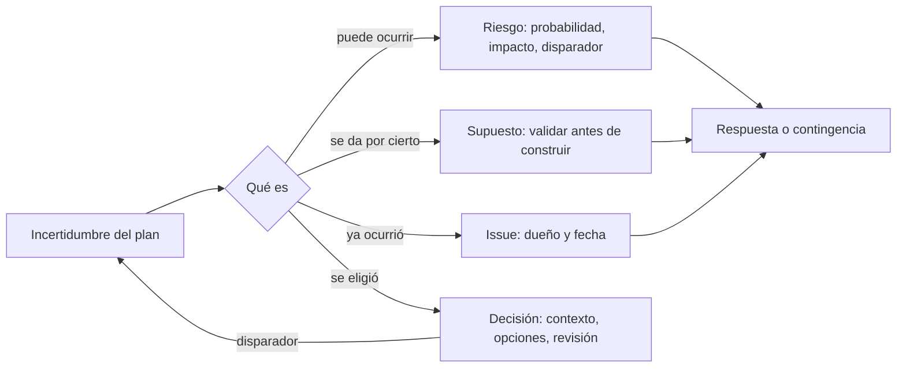
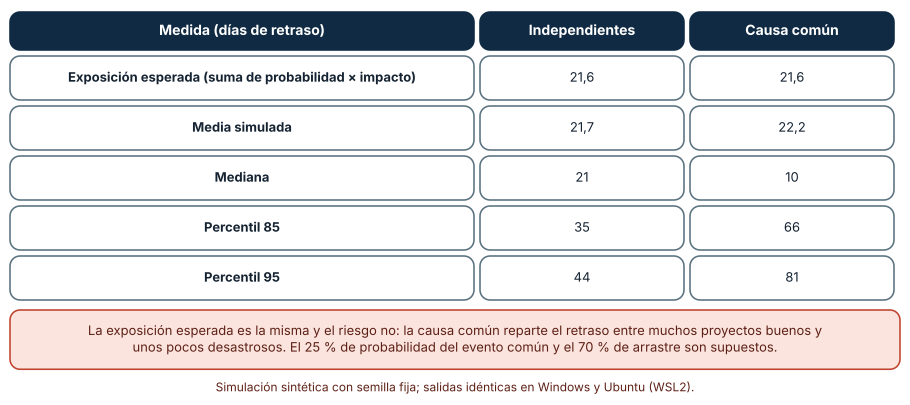
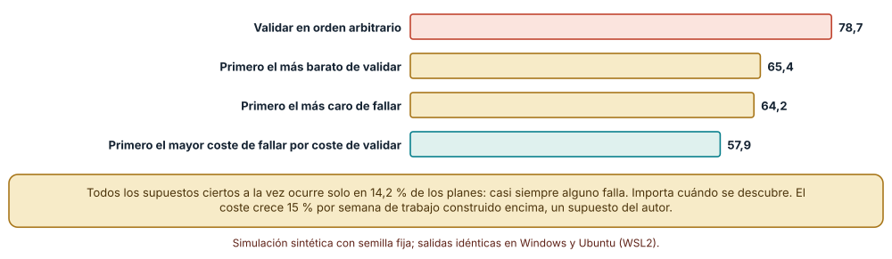
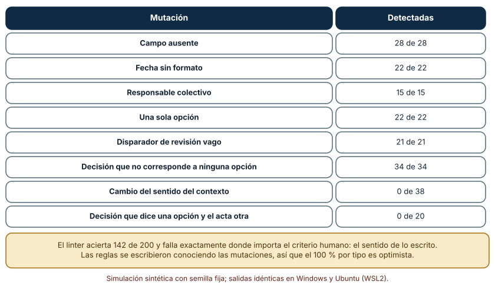

# SE-187 — Riesgos, supuestos, issues y decisiones

[← SE-186 — Planificación de entregas y gestión de dependencias](../../classes/part-15-procesos-planificacion-y-estimacion/se-186-planificacion-de-entregas-y-gestion-de-dependencias/README.md) · [↑ Parte 15](../../classes/part-15-procesos-planificacion-y-estimacion/README.md) · [📚 Índice completo](../../classes/README.md) · [🌐 Portal](../../site/classes/SE-187.html) · [SE-188 — Definition of Ready, Done y aceptación →](../../classes/part-15-procesos-planificacion-y-estimacion/se-188-definition-of-ready-done-y-aceptacion/README.md)

## Punto profesional y fundamento pedagógico

**Punto profesional.** La clase existe para que separes cuatro cosas que un plan mezcla —lo que podría ocurrir (riesgo), lo que damos por cierto sin comprobar (supuesto), lo que ya ocurrió (issue) y lo que elegimos (decisión)— y las trates con registros y disparadores distintos, de modo que cada una tenga responsable, señal y fecha.

**Por qué aparece aquí.** Se sitúa después de **Planificación de entregas y gestión de dependencias** y antes de **Definition of Ready, Done y aceptación**: la clase anterior terminó con un plan lleno de incertidumbres (dependencias que llegan tarde, duraciones que se dispersan); esta las convierte en registros accionables, y la siguiente fija los criterios con los que se acepta el trabajo.

**Error conceptual que debe corregir.** Creer que sumar las exposiciones de los riesgos (probabilidad por impacto) describe el retraso del proyecto, o que un supuesto es un riesgo con otro nombre: la exposición esperada ignora la cola cuando los riesgos tienen causa común, y un supuesto es una creencia que debe validarse antes de construir sobre ella.

**Secuencia de aprendizaje.** Antes de simular, predices cuánto retraso añaden diez riesgos si son independientes y si comparten una causa; después simulas ambos casos, mides cuánto cuesta descubrir tarde un supuesto falso según el orden de validación y pruebas un verificador de registros de decisión con doscientas mutaciones. La secuencia usa predicción, explicación propia, contraste y recuperación. [ICAP](https://icap.education.asu.edu/research) distingue participación de construcción de conocimiento; [How People Learn II](https://nap.nationalacademies.org/catalog/24783/how-people-learn-ii-learners-contexts-and-cultures) exige conectar conocimiento previo, contexto y transferencia; la [práctica de recuperación](https://pubmed.ncbi.nlm.nih.gov/16507066/) respalda producir de nuevo la explicación tras una demora; y [Education for Life and Work](https://nap.nationalacademies.org/resource/13398/dbasse_084153.pdf) exige devolución que explique la causa del error.

**Evidencia de aprendizaje.** `risk-log.md` con los cuatro registros del plan de la plataforma, la predicción, la tabla de riesgos con y sin causa común, el orden de validación de supuestos con su coste y la salida del verificador de decisiones, más una nota de qué falla el verificador y por qué.

**Límite de la conclusión.** Los riesgos (diez, con probabilidades de 0,17 a 0,34 e impactos de 3 a 15 días), los supuestos (doce con 85 % de ser ciertos) y el verificador (reglas escritas conociendo las mutaciones) son construcciones del autor. Muestran el mecanismo; no miden riesgos ni decisiones de un equipo real.

### Trazabilidad fuente → afirmación

| Fuente primaria u oficial | Afirmación que respalda | Lo que no prueba |
|---|---|---|
| [Boehm, «Software risk management: principles and practices» (IEEE Software, 1991)](https://doi.org/10.1109/52.62930) | Propone identificar, analizar y priorizar riesgos con exposición (probabilidad por pérdida) y planes de reducción, e incluye una lista de los diez riesgos principales de proyectos de software. | No dice que la exposición baste para decidir ni que los riesgos sean independientes. |
| [Nygard, «Documenting architecture decisions» (2011)](https://cognitect.com/blog/2011/11/15/documenting-architecture-decisions) | Propone registros cortos de decisiones con contexto, decisión y consecuencias, conservados con el código. | Es una propuesta de práctica; no mide su efecto en los equipos. |
| [Architectural Decision Records (comunidad ADR)](https://adr.github.io/) | Reúne plantillas y ejemplos de registros de decisión y su vocabulario. | Las plantillas no garantizan que la decisión registrada sea buena. |

## Antes de empezar

Recupera el plan de `SE-186`: una red con dependencias externas y fechas de aviso. Ahora cada incertidumbre necesita un nombre y un lugar. La pregunta activa es: **¿qué podría salir mal, qué estamos dando por cierto, qué ya salió mal y qué decidimos, y quién mira cada una cuándo?**

## Prerrequisitos

- Haber completado `SE-186` o poder explicar por qué un plan tiene dependencias que llegan tarde.
- Python 3.11 o posterior y un terminal; todo el código usa solo la biblioteca estándar.
- Manejar probabilidades y valores esperados a nivel básico.

## Problema auténtico

El plan de la plataforma de entregas tiene una hoja con 23 filas llamada «riesgos». Contiene un riesgo (el proveedor de identidad puede retrasarse), tres supuestos (el rendimiento será de 5 a 8 elementos por semana), cuatro problemas que ya ocurrieron (el entorno de pruebas se cayó dos veces), y quince tareas pendientes. Nadie revisa la hoja porque no hay un responsable ni una fecha por fila, y las decisiones tomadas en reuniones no figuran en ningún lado.

## Objetivos observables

Al terminar podrás:

1. distinguir riesgo, supuesto, issue y decisión con un ejemplo y un contraejemplo de la plataforma de entregas;
2. calcular la exposición esperada de un conjunto de riesgos y mostrar con una simulación cuándo la media esconde la cola;
3. ordenar la validación de supuestos por coste de fallar y coste de comprobar, y medir cuánto ahorra frente a un orden arbitrario;
4. escribir un registro de decisión con contexto, opciones, decisión, responsable, fecha y disparador de revisión;
5. evaluar un verificador de registros con mutaciones y declarar lo que no ve.

## Mapa conceptual



El mapa se lee como una clasificación con consecuencias: cada categoría tiene un registro, un responsable y un disparador distintos. El retorno indica que una decisión cuyo disparador se cumple vuelve a ser una incertidumbre.

## Temas y por qué importan

| Tema | Por qué cambia una decisión profesional | Evidencia mínima |
|---|---|---|
| Riesgos | Se gestionan con probabilidad, impacto, disparador y respuesta; la media no basta si hay causa común. | Predicción, traza causal y contraejemplo de **Riesgos** en `risk-log.md` |
| Supuestos | Son creencias sobre las que se construye; se validan por orden de coste de fallar y de comprobar. | Predicción, traza causal y contraejemplo de **Supuestos** en `risk-log.md` |
| Issues | Ya ocurrieron: necesitan responsable y fecha, no probabilidad. | Predicción, traza causal y contraejemplo de **Issues** en `risk-log.md` |
| Decisiones | Se registran con su contexto y su disparador para poder revisarlas sin culpar. | Predicción, traza causal y contraejemplo de **Decisiones** en `risk-log.md` |
| Verificación de registros | Un verificador atrapa fallos de forma; el sentido sigue requiriendo lectura humana. | Predicción, traza causal y contraejemplo de **Verificación de registros** en `risk-log.md` |

## Conceptos y decisiones

### 1. Riesgos

Un riesgo es un evento incierto que, si ocurre, afecta al proyecto. Se describe con una causa, un evento y un efecto («si el proveedor de identidad cambia su contrato, la integración se retrasa»), se estima con probabilidad e impacto, y se acompaña de un disparador (la señal de que se está materializando), una respuesta (reducir, evitar, aceptar, transferir) y un responsable. Boehm propuso ordenarlos por exposición, es decir, por el producto de probabilidad y pérdida, y revisar la lista de los principales cada vez. El valor de la lista es la conversación que obliga, no el número.

### 2. Supuestos

Un supuesto es algo que damos por cierto para poder planificar («las estudiantes usan navegadores actuales», «el rendimiento será de cinco a ocho elementos por semana»). A diferencia del riesgo, no es un evento futuro sino una creencia presente: si es falsa, el plan estaba mal desde el principio. Se registra con quién lo afirma, qué evidencia tiene y cómo se comprobaría, y se valida por orden: primero los que, si fallan, más cuestan y los que más barato se comprueban. Un supuesto que nadie puede validar es, en realidad, un riesgo que se está ignorando.

### 3. Issues

Un issue es un problema que ya ocurrió y requiere acción: el entorno de pruebas se cayó, un contrato se rompió. No tiene probabilidad, solo impacto presente. Necesita un responsable, una fecha y un criterio de cierre. La confusión habitual es llamar «riesgo» a todo lo que preocupa y dejar los issues en una hoja sin dueño. Un riesgo materializado se convierte en issue, y esa transición debe registrarse: es la señal de que el disparador funcionó o de que no existía.

### 4. Decisiones

Una decisión es una elección entre opciones con consecuencias que cuesta revertir. Se registra con el contexto en que se tomó, las opciones consideradas, la elegida, quién la tomó, cuándo y qué señal la haría revisar. El registro protege de dos cosas: de repetir una discusión ya resuelta y de juzgar la decisión con información que no existía entonces. Nygard propone que sea corto y que viva junto al código. Una decisión sin disparador de revisión es un dogma que nadie sabe cuándo abandonar.

### 5. Verificación de registros

Las reglas de forma (campos presentes, fechas legibles, responsable individual, al menos dos opciones, disparador con umbral) se pueden comprobar automáticamente y ahorran revisiones. Lo que no se puede comprobar es que el contexto describa el problema real, que la decisión sea la mejor ni que el acta diga lo que se acordó. Un verificador es útil porque libera atención humana para esas preguntas, y es peligroso cuando su aprobación se toma como validación del contenido.

### Diez riesgos: la exposición esperada no describe la cola

Diez riesgos con probabilidad entre 0,17 y 0,34 e impacto de 3 a 15 días (semilla fija); la exposición esperada es la suma de probabilidad por impacto: 21,6 días. Se simulan dos mundos con 20 000 proyectos. En el primero los riesgos son independientes. En el segundo existe un evento común (por ejemplo, la salida de una persona clave) con probabilidad de 0,25; con probabilidad de 0,7 cada riesgo sigue a ese evento en lugar de ocurrir por su cuenta.

```python
exposicion = sum(p * i for p, i in riesgos)          # 21,63
for p, i in riesgos:
    if rng.random() < rho:  hit = comun               # sigue al evento común
    else:                   hit = rng.random() < p    # ocurre por su cuenta
```

| Medida (días de retraso) | Independientes | Causa común |
|---|---:|---:|
| Exposición esperada | 21,6 | 21,6 |
| Media simulada | 21,7 | 22,2 |
| Mediana | 21 | 10 |
| Percentil 85 | 35 | 66 |
| Percentil 95 | 44 | 81 |

Resultado, idéntico en Windows (CPython 3.12.9) y en Ubuntu bajo WSL2 (3.12.3): la media apenas cambia, pero con una causa común la mediana baja a 10 y el percentil 85 sube de 35 a 66 días. La media describe un proyecto que casi no existe: la mayoría sale bien y unos pocos acumulan muchos retrasos a la vez.



**Cómo leer la figura.** Las dos columnas comparten la misma exposición; las filas inferiores muestran cómo cambia la distribución. **Dónde deja de valer:** el evento común (25 %) y el arrastre (70 %) son supuestos del autor; con dependencias parciales el efecto sería intermedio. La figura no recomienda cuánta contingencia reservar: muestra que un registro de riesgos debe incluir causas comunes y que se reserva contingencia según un percentil, no según la media.

### Doce supuestos: validar primero lo que más cuesta si falla

Un plan descansa en 12 supuestos, cada uno cierto con probabilidad 0,85; la probabilidad de que los doce sean ciertos es 14,2 %. Cada supuesto tiene un coste de fallar (de 2 a 20, que crece 15 % por cada semana de trabajo construido encima) y un coste de comprobar (de 1 a 5 semanas). Se validan de uno en uno en distintos órdenes y se promedia el coste de descubrir tarde los falsos en 6000 planes.

```python
for x in seq:
    semana += x["cost_test"]
    if not x["true"]:
        total += x["cost_fail"] * (1 + 0.15 * semana)
```

El orden arbitrario cuesta **78,7**; validar primero el más barato de comprobar, **65,4**; el más caro de fallar, **64,2**; y ordenar por coste de fallar dividido por coste de comprobar, **57,9**, una reducción del 26 % respecto del orden arbitrario.



**Cómo leer la figura.** Cada barra es el coste medio de descubrir tarde los supuestos que resultaron falsos; menor es mejor. **Dónde deja de valer:** los costes y la probabilidad de ser cierto son supuestos y se tratan como conocidos; en la práctica se conocen mal, y el crecimiento de 15 % por semana es un modelo simple. Validar también retrasa la construcción, y la figura no cuenta ese coste. Lo que enseña es que el orden de validación es una decisión con efecto medible.

### Un verificador de registros de decisión y lo que no ve

Se construye un registro de decisión correcto con seis campos (contexto, opciones, decisión, responsable, fecha, revisar si) y un verificador con reglas de forma. Se generan 200 mutaciones con semilla fija: ocho tipos, desde borrar un campo hasta cambiar el sentido del contexto.

```python
def lint(r):
    errs = set()
    for f in FIELDS:
        if not r.get(f, "").strip(): errs.add("falta " + f)
    if not re.fullmatch(r"\d{4}-\d{2}-\d{2}", r["Fecha"]): errs.add("fecha")
    ...
```

| Mutación | Detectadas |
|---|---:|
| Campo ausente | 28 de 28 |
| Fecha sin formato | 22 de 22 |
| Responsable colectivo | 15 de 15 |
| Una sola opción | 22 de 22 |
| Disparador de revisión vago | 21 de 21 |
| Decisión que no corresponde a ninguna opción | 34 de 34 |
| Cambio del sentido del contexto | 0 de 38 |
| Decisión que dice una opción y el acta otra | 0 de 20 |

El verificador detecta 142 de 200 mutaciones, y falla en las 58 que cambian el sentido. Esto es esperable: las reglas se escribieron conociendo las mutaciones, así que el 100 % por tipo es optimista, y el verificador no puede leer el contenido.



**Cómo leer la figura.** Cada fila es un tipo de mutación y cuántas de ellas dio por defectuosas el verificador. **Dónde deja de valer:** las 200 mutaciones son sintéticas y repartidas al azar entre ocho tipos; un registro real falla de maneras más sutiles, y las reglas, ajustadas con los mismos casos que se usaron para probarlas, no demuestran exactitud en registros nuevos. El 71 % de detección es una cifra de este montaje, no de los verificadores en general.

## Definiciones de trabajo

- **riesgo:** evento incierto futuro con una causa, un efecto, una probabilidad, un impacto, un disparador y una respuesta.
- **exposición:** producto de la probabilidad y el impacto de un riesgo; su suma mide el retraso esperado, no su dispersión.
- **supuesto:** creencia que se da por cierta para planificar y que puede comprobarse; si es falsa, el plan estaba mal.
- **issue:** problema que ya ocurrió y requiere acción, con responsable, fecha y criterio de cierre.
- **registro de decisión:** documento breve con contexto, opciones, decisión, responsable, fecha y condición de revisión.

Las definiciones son operativas para la plataforma de entregas. No convierten términos con una historia más amplia en sinónimos y deben contrastarse con la documentación primaria enlazada al final.

## Ejemplo mínimo

El fragmento calcula la exposición esperada de tres riesgos y la probabilidad de que ninguno ocurra. Antes de ejecutarlo, predice si la probabilidad de que no ocurra ninguno es mayor o menor que 50 %.

```python
riesgos = [(0.3, 10), (0.2, 5), (0.1, 15)]
exposicion = sum(p * i for p, i in riesgos)
ninguno = 1.0
for p, _ in riesgos:
    ninguno *= (1 - p)
assert round(exposicion, 1) == 5.5
assert round(ninguno, 3) == 0.504
```

La exposición es de 5,5 días, pero lo más probable (50,4 %) es que no ocurra nada; cuando algo ocurre, el retraso es de 5 a 30 días, ninguno cercano a la media. Registra versión, comando y salida; añade un cuarto riesgo de 0,2 y 8 días y predice cuánto cambia la probabilidad de que no ocurra ninguno.

## Ejemplo profesional

El equipo de la plataforma de entregas reorganiza su hoja de 23 filas en cuatro registros. En riesgos quedan seis, cada uno con causa, efecto, probabilidad, impacto, disparador, respuesta y responsable; dos de ellos comparten causa (la salida de una persona clave) y se registran juntos para estimar la contingencia por percentil. En supuestos quedan cinco, con quién los afirma, evidencia y fecha de validación, ordenados por coste de fallar sobre coste de comprobar. Los cuatro issues tienen responsable y fecha. Las siete decisiones tomadas en el trimestre se registran con contexto y disparador de revisión.

Compara con la hoja anterior: la persona que se va de vacaciones deja de ser un riesgo oculto, y la decisión de usar un doble para la identidad tiene un disparador («revisar cuando el proveedor publique su entorno de pruebas»). Un registro es adecuado cuando cada fila tiene un responsable y una señal; es una lista cuando solo describe preocupaciones.

## Práctica guiada

1. Toma una hoja de preocupaciones del equipo (real o inventada) y clasifica cada fila como riesgo, supuesto, issue, decisión o tarea.
2. Para cada riesgo escribe causa, efecto, probabilidad, impacto y disparador; identifica causas comunes.
3. Predice cuánto sube el percentil 85 con una causa común y escribe el número antes de simular.
4. Simula riesgos independientes y con causa común.
5. Ordena los supuestos por coste de fallar sobre coste de comprobar y valida el primero.
6. Escribe tres decisiones con el formato de registro y pásalas por el verificador.
7. Entrega `risk-log.md` y pide a otra persona que identifique el riesgo que más depende de una causa común.

## Ejercicios

1. **Clasificación:** clasifica diez frases de un proyecto (por ejemplo, «el proveedor puede retrasarse», «el entorno falló ayer») en riesgo, supuesto, issue, decisión o tarea y justifica las dudosas.
2. **Cola:** modifica la probabilidad del evento común a 0,1 y a 0,4 y describe cómo cambia el percentil 85.
3. **Validación:** simula con 20 supuestos y calcula si el orden por coste de fallar sobre coste de comprobar sigue siendo el mejor.
4. **Verificador:** añade una regla que detecte contexto demasiado corto y una mutación que la ponga a prueba; indica qué cambio de sentido sigue sin detectarse.

## Reto verificable

Entrega `risk-log.md` con los cuatro registros del plan, la predicción, las tablas de riesgos con y sin causa común, el orden de validación y la salida del verificador con sus mutaciones. Se aprueba si otra persona ejecuta el código desde un checkout limpio, obtiene los mismos números y puede señalar qué cambio de sentido el verificador no detecta. No se aprueba por la extensión de la lista de riesgos ni por afirmar que el verificador valida las decisiones.

## Caso conductor

La plataforma de entregas de tareas continúa como caso conductor de la Parte 15. Esta clase deja el séptimo artefacto: los cuatro registros del plan (riesgos con causas comunes, supuestos ordenados, issues con dueño y decisiones con disparador). `SE-188` definirá los criterios con los que se acepta el trabajo. Cambia después una sola decisión, el doble de identidad, y revisa qué riesgo, supuesto o issue deja de aplicar.

## Preguntas frecuentes

### ¿Cuál es la diferencia entre riesgo y supuesto?

El riesgo es un evento futuro que puede ocurrir; el supuesto es algo que ya damos por cierto. Si un supuesto resulta falso, no «ocurre»: el plan estaba mal. Por eso se validan, no se mitigan.

### ¿La exposición sirve para decidir cuánta contingencia reservar?

Sirve para ordenar riesgos. Para reservar contingencia conviene un percentil de la distribución simulada, porque la media ignora las causas comunes y las colas.

### ¿Todas las decisiones necesitan registro?

Solo las costosas de revertir o que otras personas heredarán. Un criterio práctico: si alguien preguntará «¿por qué hicimos esto?» dentro de seis meses, se registra.

### ¿Qué hago con un riesgo que nadie puede estimar?

Registra la incertidumbre de la estimación (rango de probabilidad e impacto) y trátalo como supuesto a validar o como motivo para hacer un experimento barato. Evita ponerle cero.

## Fallo controlado y diagnóstico

Reproduce el fallo clásico de la clase: **reservar contingencia con la media de riesgos que comparten una causa**. Simula los diez riesgos con y sin causa común y compara el percentil 85 con la exposición.

Registra síntoma, entrada mínima, hipótesis, observación que descarta cada hipótesis, causa, corrección y prueba de regresión. **Síntoma:** se reservaron 22 días de contingencia y el proyecto perdió 60 en un trimestre. **Hipótesis rivales:** (a) se subestimó la probabilidad de cada riesgo; (b) los riesgos eran más grandes de lo previsto; (c) los riesgos compartían una causa. **Prueba:** compara la media simulada (22,2) con el percentil 85 (66) bajo causa común. **Conclusión:** la causa es la correlación entre riesgos, no un error individual. **Regresión:** registra las causas comunes, calcula la contingencia con un percentil y revisa el registro cuando cambie la persona clave o el proveedor. No cambies a la vez las probabilidades y las causas.

## Errores comunes y cómo corregirlos

| Síntoma | Causa probable | Corrección |
|---|---|---|
| La hoja de riesgos mezcla tareas, problemas y creencias | Todo se llama «riesgo» | Clasificar en cuatro registros con campos distintos |
| La contingencia se agota con un único evento | Riesgos con causa común tratados como independientes | Registrar causas comunes y reservar por percentil |
| Un supuesto falso se descubre en la entrega | No se validó por coste de fallar | Ordenar la validación y comprobar primero los más caros de fallar |
| Una decisión se discute tres veces | No se registró con contexto | Escribir un registro corto con opciones y disparador |
| El verificador aprueba un registro engañoso | Se confundió la forma con el contenido | Leer el sentido y no tratar la aprobación como validación |

## Entorno y archivos clave

```text
work/SE-187/
├── README.md
├── registros/
│   ├── riesgos.py
│   ├── supuestos.py
│   └── decisiones.py
├── tests/test_registros.py
└── evidence/risk-log.md
```

El `README` declara plataforma, versión de Python, semillas y comandos. Los experimentos usan solo la biblioteca estándar (`random`, `statistics`, `re`, `collections`) y se ejecutaron con CPython 3.12.9 en Windows 11 y 3.12.3 en Ubuntu bajo WSL2: las salidas fueron idénticas. Si añades una dependencia, fija procedencia y versión.

## Seguridad, ética y accesibilidad

- los registros de riesgos no deben contener datos personales ni nombres de personas como causa de un riesgo: usa roles;
- un registro de decisión debe ser legible para quien no estuvo en la reunión y accesible para tecnologías de apoyo;
- la responsabilidad individual en un registro no debe usarse para culpar: sirve para que alguien actúe;
- documenta quién aceptó cada riesgo residual y hasta cuándo;
- respeta las licencias de las plantillas de registro y atribuye lo adaptado.

## Puente hacia el trabajo con agentes

Un agente al que se le pide «haz el registro de riesgos» producirá una lista larga, equilibrada y sin causas comunes. Pídele en cambio que clasifique cada fila como riesgo, supuesto, issue o decisión, que identifique causas comunes, que ordene la validación de supuestos por coste y que calcule la contingencia con un percentil simulado. Revisa especialmente si asigna responsables colectivos o disparadores sin umbral: son fallos que el verificador atrapa, y otros que no.

## Transferencia

Traslada el análisis a otro plan (por ejemplo, una migración de datos): cambia los riesgos y supuestos, y conserva el procedimiento de clasificar, simular con y sin causas comunes y ordenar la validación. La transferencia está lograda cuando puedes explicar qué parte del método dependía del proyecto y cuál no, no cuando las columnas se parecen.

## Evaluación y evidencia

| Criterio | Evidencia para aprobar |
|---|---|
| comprensión | explicación de la diferencia entre riesgo, supuesto, issue y decisión con ejemplos de la plataforma |
| corrección | simulaciones y mutaciones reproducibles con las mismas semillas |
| diseño | cuatro registros con responsable, señal y fecha, y causas comunes identificadas |
| diagnóstico | reproducción del fallo «contingencia con la media» con regresión |
| incertidumbre | declaración de los supuestos del modelo y de lo que el verificador no ve |
| reproducibilidad | versiones, comandos, salida y límites declarados |

## Fuentes

- [Boehm, «Software risk management: principles and practices» (IEEE Software, 1991)](https://doi.org/10.1109/52.62930) — identificación y priorización de riesgos de proyecto; autoridad: IEEE Software.
- [Nygard, «Documenting architecture decisions» (2011)](https://cognitect.com/blog/2011/11/15/documenting-architecture-decisions) — registros breves de decisiones; autoridad: autor de la práctica.
- [Architectural Decision Records](https://adr.github.io/) — plantillas y vocabulario de registros de decisión; autoridad: comunidad ADR.
- [SEI: Software risk management](https://www.sei.cmu.edu/library/software-risk-management/) — recursos de gestión de riesgos de software; autoridad: Software Engineering Institute, Carnegie Mellon University.
- [SWEBOK Guide v4.0a](https://www.computer.org/education/bodies-of-knowledge/software-engineering) — gestión de ingeniería de software; autoridad: IEEE Computer Society.

Cada fuente respalda el mecanismo indicado; ninguna demuestra que el percentil 85 de 66 días, el ahorro del 26 % o el 71 % de detección se cumplan en la plataforma de entregas. Esa afirmación depende de los riesgos reales, de sus causas comunes y de los registros del equipo.

- [Python: `random`](https://docs.python.org/3/library/random.html) — generador con semilla para las simulaciones.
- [Python: `re`](https://docs.python.org/3/library/re.html) — expresiones regulares del verificador.

## Límites y siguiente paso

Se ejecutaron tres experimentos con datos sintéticos en Windows y Ubuntu (WSL2) con resultados idénticos. No se analizó ningún riesgo ni decisión real: las probabilidades, los impactos, el evento común y los registros son construcciones del autor, y el verificador se afinó con las mismas mutaciones que lo evalúan. La siguiente clase fija los criterios con los que se acepta el trabajo.

## Glosario

- **riesgo:** evento incierto futuro con una causa, un efecto, una probabilidad, un impacto, un disparador y una respuesta.
- **exposición:** producto de la probabilidad y el impacto de un riesgo; su suma mide el retraso esperado, no su dispersión.
- **supuesto:** creencia que se da por cierta para planificar y que puede comprobarse; si es falsa, el plan estaba mal.
- **issue:** problema que ya ocurrió y requiere acción, con responsable, fecha y criterio de cierre.
- **registro de decisión:** documento breve con contexto, opciones, decisión, responsable, fecha y condición de revisión.

---

[← SE-186 — Planificación de entregas y gestión de dependencias](../../classes/part-15-procesos-planificacion-y-estimacion/se-186-planificacion-de-entregas-y-gestion-de-dependencias/README.md) · [↑ Parte 15](../../classes/part-15-procesos-planificacion-y-estimacion/README.md) · [📚 Índice completo](../../classes/README.md) · [🌐 Portal](../../site/classes/SE-187.html) · [SE-188 — Definition of Ready, Done y aceptación →](../../classes/part-15-procesos-planificacion-y-estimacion/se-188-definition-of-ready-done-y-aceptacion/README.md)
