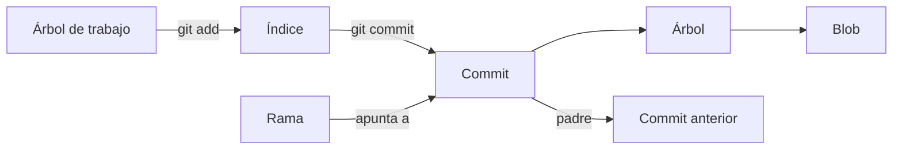
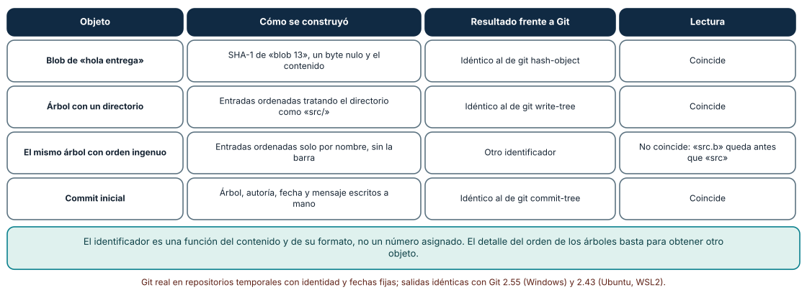
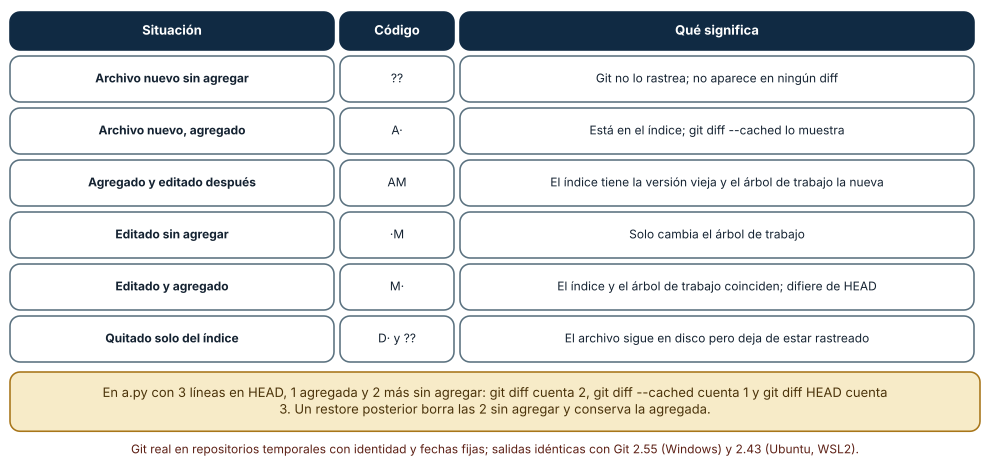
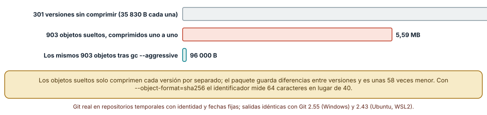

# SE-193 — Modelo de objetos y áreas de Git

[← SE-192 — Proyecto: plan adaptativo con evidencia y guardrails](../../classes/part-15-procesos-planificacion-y-estimacion/se-192-proyecto-plan-adaptativo-con-evidencia-y-guardrails/README.md) · [↑ Parte 16](../../classes/part-16-git-colaboracion-y-codigo-abierto/README.md) · [📚 Índice completo](../../classes/README.md) · [🌐 Portal](../../site/classes/SE-193.html) · [SE-194 — Commits atómicos, historial y recuperación →](../../classes/part-16-git-colaboracion-y-codigo-abierto/se-194-commits-atomicos-historial-y-recuperacion/README.md)

## Punto profesional y fundamento pedagógico

**Punto profesional.** La clase existe para que una persona deje de usar Git como una lista de comandos que a veces funciona y lo use como lo que es: una base de objetos direccionada por contenido, tres áreas donde un cambio puede estar y referencias que apuntan a commits. Con ese modelo se puede predecir qué hará un comando antes de ejecutarlo y saber qué se puede recuperar después de un error.

**Por qué aparece aquí.** Se sitúa después de **Proyecto: plan adaptativo con evidencia y guardrails** y antes de **Commits atómicos, historial y recuperación**. La Parte 15 dejó un plan que cambia con la evidencia; ese plan vive en un repositorio y cada cambio debe poder revisarse, deshacerse y atribuirse. Esta clase construye el modelo mental sobre el que las clases siguientes razonan: sin saber qué guarda un commit no se puede decidir qué significa «atómico», qué destruye un `reset` ni por qué una reescritura cambia tantos identificadores.

**Error conceptual que debe corregir.** Creer que Git guarda diferencias entre versiones y que un commit es «el cambio». Un commit apunta a una instantánea completa del árbol; las diferencias se calculan al mostrarlas y solo el empaquetado las usa para ahorrar espacio. De ese error nacen predicciones falsas sobre renombres, duplicados y recuperación.

**Secuencia de aprendizaje.** Antes de leer la solución, predices el identificador de un objeto y el código de estado de un archivo; después reconstruyes a mano un blob, un árbol y un commit y los comparas con Git, recorres seis estados de un archivo entre las tres áreas y mides cuánto ocupan trescientas versiones sueltas y empaquetadas. La secuencia usa predicción, explicación propia, contraste y recuperación. [ICAP](https://icap.education.asu.edu/research) distingue participación de construcción de conocimiento; [How People Learn II](https://nap.nationalacademies.org/catalog/24783/how-people-learn-ii-learners-contexts-and-cultures) exige conectar conocimiento previo, contexto y transferencia; la [práctica de recuperación](https://pubmed.ncbi.nlm.nih.gov/16507066/) respalda producir de nuevo la explicación tras una demora; y [Education for Life and Work](https://nap.nationalacademies.org/resource/13398/dbasse_084153.pdf) exige devolución que explique la causa del error.

**Evidencia de aprendizaje.** `objects-log.md` con la predicción de cada identificador, la reconstrucción a mano, la tabla de estados de los archivos, la medición de espacio y una explicación de por qué renombrar un archivo no crea un blob nuevo. Debe contener predicción previa, observación, causa y qué hallazgo haría revisar el modelo.

**Límite de la conclusión.** Los repositorios son temporales, generados con identidad, fechas y semilla fijas; el archivo de 1 000 líneas y las trescientas ediciones de una línea son un caso favorable al empaquetado; los tamaños dependen de la versión de zlib y de Git y no se midió ningún repositorio real ni la velocidad de ninguna operación.

### Trazabilidad fuente → afirmación

| Fuente primaria u oficial | Afirmación que respalda | Lo que no prueba |
|---|---|---|
| [Pro Git: Git Objects](https://git-scm.com/book/en/v2/Git-Internals-Git-Objects) | Describe blobs, árboles y commits como objetos direccionados por el hash de su contenido con una cabecera de tipo y tamaño. | No dice qué función de hash usará Git en el futuro ni cuánto ocupa un repositorio concreto. |
| [git-hash-object](https://git-scm.com/docs/git-hash-object) | Calcula el identificador de un contenido con el formato del objeto, de modo que se puede comparar con el cálculo a mano. | No describe el orden de las entradas de un árbol. |
| [Hash function transition](https://git-scm.com/docs/hash-function-transition) | Documenta el diseño para repositorios con SHA-256 y la convivencia con SHA-1. | No afirma que un repositorio SHA-256 pueda intercambiarse hoy con cualquier alojamiento. |

## Antes de empezar

Recupera lo aprendido en la Parte 15: una estimación o un plan es una afirmación que se revisa con evidencia. La pregunta activa es: **¿qué guarda exactamente Git cuando hago un commit, dónde puede estar un cambio antes de llegar ahí y qué queda si me equivoco?**

## Prerrequisitos

- Haber completado la Parte 15 o poder explicar cómo un plan se actualiza con evidencia.
- Python 3.11 o posterior, Git 2.40 o posterior y un terminal con acceso a ambos.
- Trabajar solo en repositorios temporales y con identidades de ejemplo; nada de lo que se hace aquí toca un remoto.

## Problema auténtico

El repositorio de la plataforma de entregas tiene el módulo `penal.py` con la regla de penalización. Una persona renombra el archivo y se pregunta si «perdió la historia»; otra ejecuta `git restore` sobre un archivo con cambios a medias y descubre que solo perdió una parte; una tercera no entiende por qué el mismo archivo copiado en veinte carpetas ocupa casi lo mismo que una copia. Las tres preguntas tienen respuesta en el mismo modelo.

## Objetivos observables

Al terminar podrás:

1. calcular a mano el identificador de un blob, de un árbol y de un commit y verificar que coincide con el de Git;
2. predecir el código de `git status --porcelain` y lo que muestran `git diff`, `git diff --cached` y `git diff HEAD` en cada paso;
3. explicar por qué dos archivos con el mismo contenido comparten un objeto y por qué un renombre no crea contenido nuevo;
4. medir la diferencia entre objetos sueltos y empaquetados y declarar qué parte de la cifra depende del caso;
5. decidir qué se puede recuperar tras un error según el área en la que estaba el cambio.

## Mapa conceptual



El mapa se lee de izquierda a derecha para el flujo de un cambio y de arriba abajo para el contenido de un commit: apunta a un árbol, que apunta a blobs y a otros árboles, y a su commit padre. Una rama es solo un nombre que apunta a un commit. No describe la velocidad ni el orden en que Git escribe los archivos en disco.

## Temas y por qué importan

| Tema | Por qué cambia una decisión profesional | Evidencia mínima |
|---|---|---|
| Objetos direccionados por contenido | Explica por qué un identificador cambia con cualquier byte y por qué dos contenidos iguales comparten objeto. | Predicción, reconstrucción a mano y contraejemplo de **Objetos direccionados por contenido** en `objects-log.md` |
| Blobs, árboles y commits | Separa contenido, estructura e historia; permite entender qué cambia al renombrar o mover. | Predicción, traza causal y contraejemplo de **Blobs, árboles y commits** en `objects-log.md` |
| Las tres áreas | Decide dónde está un cambio y qué comando lo mueve, lo copia o lo destruye. | Predicción, traza causal y contraejemplo de **Las tres áreas** en `objects-log.md` |
| Referencias | Una rama o una etiqueta son nombres; mover un nombre no borra objetos, pero puede dejarlos inalcanzables. | Predicción, traza causal y contraejemplo de **Referencias** en `objects-log.md` |
| Empaquetado y funciones de hash | Explica el tamaño del repositorio y el límite de lo que el identificador garantiza. | Predicción, traza causal y contraejemplo de **Empaquetado y funciones de hash** en `objects-log.md` |

## Conceptos y decisiones

### 1. Objetos direccionados por contenido

Git guarda cada objeto bajo el hash de su contenido precedido por una cabecera con el tipo y el tamaño. Por eso el identificador no se asigna: se calcula. Dos consecuencias prácticas: el mismo contenido en cualquier lugar del repositorio es un solo objeto, y cambiar un byte produce un identificador sin relación con el anterior. La propiedad también hace que los objetos sean inmutables: no se «edita» un commit, se crea otro, y lo que llamamos editar la historia es construir objetos nuevos y mover un nombre.

### 2. Blobs, árboles y commits

Un blob es el contenido de un archivo sin nombre ni permisos. Un árbol es una lista de entradas (modo, nombre, identificador) que da nombre y estructura a blobs y a otros árboles. Un commit apunta a un árbol, a cero o más padres y lleva autoría, fecha y mensaje. El nombre del archivo vive en el árbol, no en el blob: por eso un renombre cambia el árbol y deja intacto el blob. Y por eso un commit no «contiene un cambio»: contiene la instantánea completa, y el cambio es la diferencia con el padre calculada al pedirla.

### 3. Las tres áreas

Un cambio puede estar en el árbol de trabajo (archivos en disco), en el índice (la instantánea que se prepara para el próximo commit) o en HEAD (el último commit). `git add` copia del árbol de trabajo al índice, `git commit` convierte el índice en un commit, `git restore` sobrescribe el árbol de trabajo desde el índice y `git restore --staged` sobrescribe el índice desde HEAD. El código de dos letras de `git status --porcelain` es una comparación por pares: la primera letra es índice contra HEAD y la segunda árbol de trabajo contra índice. Saber en qué área está un cambio es saber qué comando puede perderlo.

### 4. Referencias

Una rama, una etiqueta y HEAD son archivos pequeños con un identificador (o con el nombre de otra referencia). Mover una rama no borra objetos: solo cambia a qué commit se llega desde ese nombre. Un objeto queda a salvo mientras sea alcanzable desde alguna referencia o desde el registro de movimientos (reflog); si deja de serlo, es candidato a la poda. Esta distinción entre «existe» y «es alcanzable» es la base de toda la recuperación de `SE-194`.

### 5. Empaquetado y funciones de hash

Los objetos recién creados se guardan sueltos, comprimidos uno a uno. Con `git gc` (o al transferir) Git los reúne en un paquete y almacena versiones parecidas como diferencias entre sí, de ahí que muchas versiones de un archivo ocupen poco más que una. El identificador de 40 caracteres es el SHA-1 del objeto; Git tiene un diseño de transición hacia SHA-256 con identificadores de 64 caracteres. Que dos contenidos distintos produzcan el mismo identificador es un fallo de la función de hash, no de Git; la propiedad que se usa en la práctica es que el identificador detecta cualquier alteración accidental del historial.

### Reconstruir los identificadores a mano

Un blob es `b"blob " + longitud + b"\0" + contenido` pasado por SHA-1. Un árbol es la concatenación de `modo + b" " + nombre + b"\0" +` el identificador binario de 20 bytes de cada entrada, ordenadas por nombre **tratando los directorios como si su nombre terminara en `/`**. Un commit es un texto con las líneas `tree`, `parent`, `author`, `committer`, una línea en blanco y el mensaje. Con un blob «hola entrega», un árbol con un directorio `src/`, dos archivos y un commit con autoría y fecha fijas, el cálculo a mano coincidió con el de Git en los tres objetos. Con el orden ingenuo (por nombre, sin la barra) el árbol tuvo otro identificador: `src.b` va antes de `src/` solo si el directorio se ordena como `src/`. En un repositorio de prueba con 200 archivos que repetían 20 contenidos, Git guardó 20 blobs, 11 árboles y 1 commit, y renombrar un archivo con `git mv` conservó el mismo blob.

```python
import hashlib
datos = b"hola entrega\n"
print(hashlib.sha1(b"blob %d\0" % len(datos) + datos).hexdigest()[:12])   # 1b4e1e83facf
```



**Cómo leer la figura.** Cada fila es un objeto construido con `hashlib` sin llamar a Git; la tercera columna dice si el identificador coincidió con el de Git. **Dónde deja de valer:** el cálculo vale para repositorios con SHA-1 y objetos sin compresión especial; un repositorio SHA-256 usa otro hash y otro tamaño de identificador, y los objetos con firma o con extensiones añaden cabeceras que el ejemplo no incluye.

### Dónde está un cambio

Sobre un repositorio con `a.py` de tres líneas se recorrieron seis situaciones. Un archivo nuevo sin agregar aparece como `??`; agregado, como `A·`; agregado y luego editado, como `AM` (el índice tiene la versión vieja y el árbol de trabajo la nueva); un archivo editado sin agregar, como `·M`; editado y agregado, como `M·`; y quitado solo del índice con `git rm --cached`, como `D·` más un `??` porque el archivo sigue en disco. Con `a.py` de 3 líneas en HEAD, 1 línea agregada y 2 líneas más sin agregar, `git diff` cuenta 2, `git diff --cached` cuenta 1 y `git diff HEAD` cuenta 3. Un `git restore a.py` posterior dejó el archivo con las 4 líneas: borró las 2 sin agregar y conservó la agregada.



**Cómo leer la figura.** El código tiene dos letras: la primera compara el índice con HEAD y la segunda el árbol de trabajo con el índice; el punto reemplaza al espacio que imprime Git. **Dónde deja de valer:** la tabla describe archivos de texto sin conflictos, sin submódulos y sin `assume-unchanged`; durante una fusión conflictiva aparecen otros códigos (como `UU`) y el índice contiene tres versiones del mismo archivo.

### Sueltos frente a empaquetados

Un archivo de 1 000 líneas (35 830 bytes) recibió 300 ediciones de una línea, cada una confirmada. El repositorio acumuló 903 objetos (301 blobs, 301 árboles, 301 commits) que ocupaban 5 588 961 bytes como archivos sueltos, frente a 10 784 830 bytes que sumarían las 301 versiones sin comprimir. Tras `git gc --aggressive --prune=now`, el paquete ocupó 96 000 bytes: unas 58 veces menos que los sueltos. Los números fueron idénticos con Git 2.55 en Windows y 2.43 en Ubuntu. Un repositorio creado con `--object-format=sha256` dio identificadores de 64 caracteres para el mismo contenido (`7c4ec9179e…`) frente a los 40 de SHA-1 (`5c1b149498…`).



**Cómo leer la figura.** La barra gris es lo que ocuparían las versiones sin comprimir, la coral los objetos sueltos y la verde el paquete; cada barra usa la misma escala en megabytes. **Dónde deja de valer:** editar una línea de 1 000 es el mejor caso para los deltas. Un archivo binario que cambia por completo, o cientos de archivos distintos, comprimen mucho menos; y el espacio en disco real redondea cada archivo suelto a bloques del sistema de archivos, de modo que 903 archivos pequeños ocupan más de lo que suman sus bytes.

## Definiciones de trabajo

- **objeto:** unidad inmutable de la base de Git (blob, árbol, commit o etiqueta anotada) identificada por el hash de su contenido.
- **blob:** contenido de un archivo, sin nombre ni permisos.
- **árbol:** lista de entradas con modo, nombre e identificador que da estructura a blobs y a otros árboles.
- **índice:** instantánea que se prepara para el próximo commit; vive entre el árbol de trabajo y HEAD.
- **referencia:** nombre (rama, etiqueta, HEAD) que apunta a un commit o a otra referencia.

Las definiciones son operativas para la plataforma de entregas. No convierten términos con historia más amplia en sinónimos y deben contrastarse con la documentación primaria enlazada al final.

## Ejemplo mínimo

El fragmento crea un repositorio temporal, guarda dos archivos con el mismo contenido y cuenta los blobs. Antes de ejecutarlo, predice cuántos objetos de cada tipo habrá.

```bash
git init -q demo && cd demo
printf 'hola entrega\n' > a.txt && cp a.txt b.txt
git add . && git -c user.name=Ejemplo -c user.email=ejemplo@example.invalid commit -q -m base
git cat-file --batch-all-objects --batch-check
```

Debe haber un blob (los dos archivos lo comparten), un árbol y un commit. Registra versión de Git y salida, y repite con `git mv a.txt c.txt` para comprobar que el blob no cambia.

## Ejemplo profesional

En el repositorio de la plataforma, el módulo `penal.py` se renombra a `reglas/penalizacion.py` en un commit que no cambia su contenido. La revisión muestra el renombre porque Git compara dos árboles y detecta que un blob desapareció de una ruta y apareció idéntico en otra. Una persona que quiere recuperar una versión anterior del archivo no necesita «deshacer el renombre»: pide el blob de ese commit con `git show <commit>:ruta` o restaura la ruta antigua desde ese árbol.

Compara el caso con un archivo reformateado completo: el blob cambia, el renombre ya no se detecta por identidad sino por similitud, y la revisión de `SE-196` verá un archivo borrado y otro añadido si la similitud cae bajo el umbral. Una práctica es apropiada cuando separa el renombre del reformateo en commits distintos; es peligrosa cuando los mezcla en uno.

## Práctica guiada

1. Calcula con `hashlib` el identificador del blob de un archivo de tu repositorio de prueba y predice si coincidirá con `git hash-object`.
2. Construye a mano un árbol con un directorio y dos archivos y compara con `git write-tree`; cambia el orden de las entradas y registra qué ocurre.
3. Escribe un commit a mano con autoría y fecha fijas y compáralo con `git commit-tree`.
4. Lleva un archivo por los seis estados de la figura y registra el código de `status` antes de mirar la salida.
5. Con un archivo agregado y editado, predice cuántas líneas contará cada variante de `git diff` y comprueba.
6. Crea 300 ediciones de una línea, mide el espacio de los sueltos y del paquete tras `git gc` y anota la versión de Git.
7. Pide a otra persona que reconstruya tu conclusión solo desde `objects-log.md` y registra qué dato le faltó.

## Ejercicios

1. **Etiqueta anotada:** calcula a mano el identificador de una etiqueta anotada y explica en qué se diferencia de un commit.
2. **Directorio vacío:** predice si Git puede guardar un directorio sin archivos y comprueba el resultado; explica qué dice sobre el modelo de árboles.
3. **Mismo contenido, distinto modo:** cambia el permiso de ejecución de un archivo y determina qué objeto cambia y cuál no.
4. **Límite del empaquetado:** repite la medición de espacio con un archivo binario aleatorio de 35 830 bytes que cambia por completo y compara la razón con la del archivo de texto.

## Reto verificable

Entrega `objects-log.md` con la reconstrucción de un blob, un árbol y un commit, la tabla de estados de los archivos, la medición de espacio con la versión de Git y una explicación del renombre. Se aprueba si otra persona ejecuta los comandos desde un directorio vacío, obtiene los mismos identificadores y puede decir qué parte de tu explicación dependió del caso favorable. No se aprueba por memorizar los nombres de los comandos.

## Caso conductor

El repositorio de la plataforma de entregas es el caso conductor de la Parte 16. Esta clase deja el modelo de objetos y de áreas con el que las siguientes razonan: `SE-194` pregunta cuándo un cambio es lo bastante pequeño para ser un commit y qué se recupera tras un error, y `SE-195` trata las ramas como nombres que se mueven. Cambia después un solo dato, el modo de un archivo, y revisa qué objetos cambian y qué commit lo mostraría.

## Preguntas frecuentes

### ¿Git guarda diferencias o copias completas?

Conceptualmente, instantáneas completas: cada commit apunta a un árbol entero. El empaquetado usa diferencias entre objetos parecidos para ahorrar espacio, pero eso es un detalle de almacenamiento que no cambia lo que Git muestra.

### ¿Por qué `git status` muestra a veces dos letras?

Porque compara dos pares: la primera letra es el índice frente a HEAD y la segunda el árbol de trabajo frente al índice. `AM` significa agregado y modificado después de agregarlo.

### ¿Un commit puede cambiar después de creado?

No: un cambio en su contenido produce otro identificador. Lo que se llama «editar un commit» crea un commit nuevo y mueve una referencia; el viejo sigue en la base hasta que nada lo alcanza y se poda.

### ¿Se puede perder un archivo que nunca se agregó?

Sí: si un archivo no rastreado se borra con `git clean` o un cambio sin agregar se sobrescribe con `git restore`, Git nunca lo guardó y no puede recuperarlo. Es la primera lección de `SE-194`.

## Fallo controlado y diagnóstico

Reproduce el fallo clásico de la clase: **creer que el nombre del archivo es parte del contenido**. Usa el renombre de `penal.py`.

Registra síntoma, entrada mínima, hipótesis, observación que descarta cada hipótesis, causa, corrección y prueba de regresión. **Síntoma:** tras renombrar el archivo, una persona afirma que «Git perdió la historia» porque `git log -- reglas/penalizacion.py` solo muestra los commits desde el renombre. **Hipótesis rivales:** (a) el renombre rompió el historial; (b) `git log` con una ruta filtra por esa ruta y los commits anteriores usaban otra. **Prueba:** `git cat-file --batch-all-objects --batch-check` muestra el mismo número de blobs antes y después, y `git log --follow reglas/penalizacion.py` recorre los commits anteriores. **Conclusión:** el contenido y el historial siguen; lo que cambió es el nombre en el árbol y el filtro de ruta. **Regresión:** añade al registro la regla «para seguir un archivo renombrado, usar `--follow` o pedir el blob por identificador» y una prueba que cuente blobs antes y después. No cambies a la vez el renombre y el contenido.

## Errores comunes y cómo corregirlos

| Síntoma | Causa probable | Corrección |
|---|---|---|
| Se pierde trabajo tras `git restore` | El cambio estaba solo en el árbol de trabajo | Agregar o confirmar antes de ejecutar comandos que sobrescriben |
| `git diff` aparece vacío pese a haber cambios | Los cambios ya están en el índice | Usar `git diff --cached` o `git diff HEAD` |
| Se cree que dos copias de un archivo ocupan el doble | Se supone que se guardan copias, no objetos por contenido | Contar objetos con `git cat-file --batch-all-objects --batch-check` |
| El repositorio crece más de lo esperado | Archivos binarios que cambian por completo no se comprimen como deltas | Medir antes y excluir artefactos generados del control de versiones |
| Se confía en el identificador para probar autoría | El hash detecta alteración, no quién lo escribió | Combinar con firmas, tema de `SE-202` |

## Entorno y archivos clave

```text
work/SE-193/
├── README.md
├── objetos/
│   ├── reconstruir.py
│   ├── areas.py
│   └── almacen.py
└── evidence/objects-log.md
```

El `README` declara sistema operativo, versión de Git y de Python, semillas y comandos. Los experimentos usan `hashlib`, `subprocess` y repositorios temporales con identidad y fechas fijas y se ejecutaron con CPython 3.12.9 y Git 2.55 en Windows 11 y con CPython 3.12.3 y Git 2.43 en Ubuntu bajo WSL2: las salidas fueron idénticas. Si automatizas con otra biblioteca, fija procedencia y versión.

## Seguridad, ética y accesibilidad

- un objeto confirmado, aunque se borre después, puede seguir en la base y en otros clones: nunca confirmes secretos esperando «deshacerlo»;
- el identificador de un commit no es una firma ni una prueba de autoría: no lo presentes como tal;
- no uses identidades reales en repositorios de práctica; los experimentos usan direcciones `example.invalid`;
- ofrece una alternativa textual a las tablas de estados y describe los códigos de dos letras en palabras;
- respeta las licencias de los archivos que copies a los repositorios de práctica.

## Puente hacia el trabajo con agentes

Un agente al que se le pide «deshaz el último cambio» suele elegir `git reset --hard` o `git checkout .` sin preguntar en qué área estaba el cambio. Pídele que primero ejecute `git status --porcelain=v1` y explique qué contiene cada área, que diga qué comando destruiría información no confirmada y que proponga una copia previa con `git stash` o una rama. Revisa especialmente cualquier comando que sobrescriba el árbol de trabajo: si el cambio nunca se agregó, no hay recuperación.

## Transferencia

Traslada el modelo a otro sistema con almacenamiento por contenido (por ejemplo, un caché de compilación por hash de entradas o un registro de imágenes de contenedor): identifica qué es el equivalente del blob, del árbol y de la referencia y qué ocurre cuando dos entradas iguales llegan por caminos distintos. La transferencia está lograda cuando puedes explicar qué parte del modelo dependía de Git y cuál no, no cuando los nombres se parecen.

## Evaluación y evidencia

| Criterio | Evidencia para aprobar |
|---|---|
| comprensión | explicación de qué guarda un commit y de dónde sale su identificador |
| corrección | identificadores reconstruidos a mano que coinciden con Git |
| diseño | tabla de áreas que predice el código de `status` y los tres `diff` |
| diagnóstico | reproducción del fallo «el nombre es parte del contenido» con regresión |
| incertidumbre | declaración de qué parte de la medición de espacio depende del caso favorable |
| reproducibilidad | versiones, comandos, salida y límites declarados |

## Fuentes

- [Pro Git: Git Objects](https://git-scm.com/book/en/v2/Git-Internals-Git-Objects) — formato de blobs, árboles y commits; autoridad: Pro Git.
- [git-hash-object](https://git-scm.com/docs/git-hash-object) — cálculo del identificador de un contenido; autoridad: documentación de Git.
- [git-status](https://git-scm.com/docs/git-status) — formato corto y significado de los códigos de dos letras; autoridad: documentación de Git.
- [git-gc](https://git-scm.com/docs/git-gc) — recolección de objetos y empaquetado; autoridad: documentación de Git.
- [Pro Git: Packfiles](https://git-scm.com/book/en/v2/Git-Internals-Packfiles) — almacenamiento con deltas; autoridad: Pro Git.
- [Hash function transition](https://git-scm.com/docs/hash-function-transition) — diseño de la transición a SHA-256; autoridad: documentación de Git.

Cada fuente respalda el mecanismo indicado; ninguna demuestra cuánto espacio ocupará un repositorio concreto ni que el modelo de la plataforma de entregas sea el adecuado para otro proyecto.

- [git-cat-file](https://git-scm.com/docs/git-cat-file) — inspección de objetos usada en los experimentos.
- [git-count-objects](https://git-scm.com/docs/git-count-objects) — recuento de objetos sueltos y empaquetados.

## Límites y siguiente paso

Se ejecutaron tres experimentos con repositorios temporales y datos sintéticos en Windows y Ubuntu (WSL2) con resultados idénticos. No se usó ningún repositorio real, el archivo de 1 000 líneas con ediciones de una línea es un caso favorable al empaquetado y no se midió el rendimiento de ninguna operación. La siguiente clase pregunta qué tamaño y qué forma debe tener un commit para que el historial sea útil y qué se puede recuperar cuando algo sale mal.

## Glosario

- **objeto:** unidad inmutable de la base de Git (blob, árbol, commit o etiqueta anotada) identificada por el hash de su contenido.
- **blob:** contenido de un archivo, sin nombre ni permisos.
- **árbol:** lista de entradas con modo, nombre e identificador que da estructura a blobs y a otros árboles.
- **índice:** instantánea que se prepara para el próximo commit; vive entre el árbol de trabajo y HEAD.
- **referencia:** nombre (rama, etiqueta, HEAD) que apunta a un commit o a otra referencia.

---

[← SE-192 — Proyecto: plan adaptativo con evidencia y guardrails](../../classes/part-15-procesos-planificacion-y-estimacion/se-192-proyecto-plan-adaptativo-con-evidencia-y-guardrails/README.md) · [↑ Parte 16](../../classes/part-16-git-colaboracion-y-codigo-abierto/README.md) · [📚 Índice completo](../../classes/README.md) · [🌐 Portal](../../site/classes/SE-193.html) · [SE-194 — Commits atómicos, historial y recuperación →](../../classes/part-16-git-colaboracion-y-codigo-abierto/se-194-commits-atomicos-historial-y-recuperacion/README.md)
