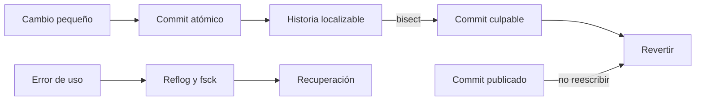
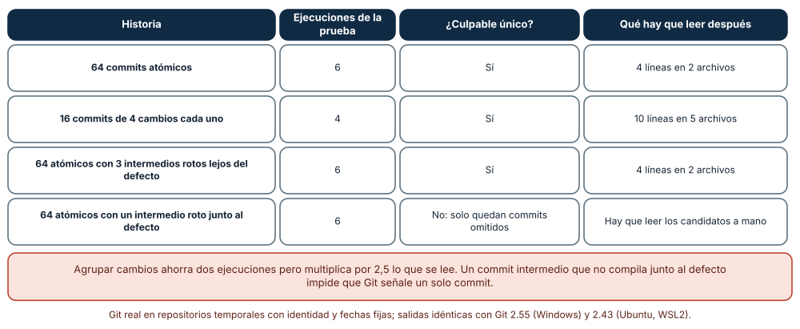
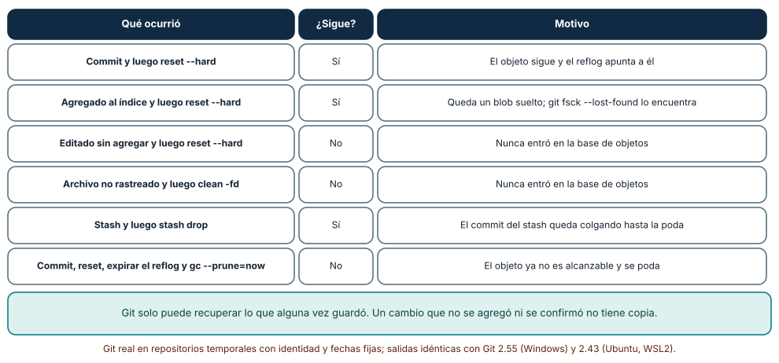
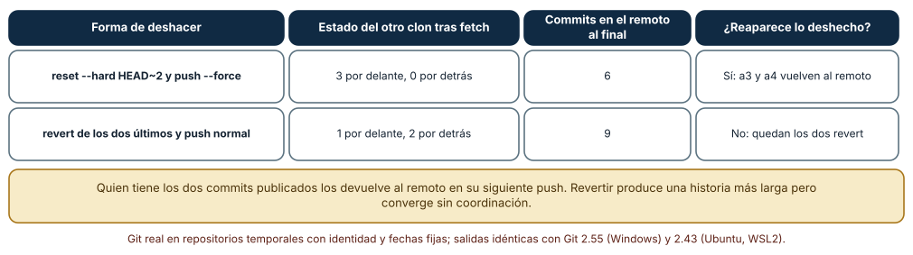

# SE-194 — Commits atómicos, historial y recuperación

[← SE-193 — Modelo de objetos y áreas de Git](../../classes/part-16-git-colaboracion-y-codigo-abierto/se-193-modelo-de-objetos-y-areas-de-git/README.md) · [↑ Parte 16](../../classes/part-16-git-colaboracion-y-codigo-abierto/README.md) · [📚 Índice completo](../../classes/README.md) · [🌐 Portal](../../site/classes/SE-194.html) · [SE-195 — Ramas, integración, rebase y conflictos →](../../classes/part-16-git-colaboracion-y-codigo-abierto/se-195-ramas-integracion-rebase-y-conflictos/README.md)

## Punto profesional y fundamento pedagógico

**Punto profesional.** La clase existe para que cada commit sea una unidad que se pueda revisar, localizar y deshacer, y para que, cuando alguien se equivoca, la respuesta sea una recuperación planificada y no una búsqueda a ciegas. Un historial es una herramienta de diagnóstico: su calidad se mide por lo que permite hacer después.

**Por qué aparece aquí.** Se sitúa después de **Modelo de objetos y áreas de Git** y antes de **Ramas, integración, rebase y conflictos**. `SE-193` dejó el modelo de qué guarda Git y dónde puede estar un cambio; esta clase usa ese modelo para decidir el tamaño de un commit y para distinguir lo que sigue en la base de objetos de lo que se perdió. Deja el historial de un solo carril sobre el que `SE-195` introduce la bifurcación.

**Error conceptual que debe corregir.** Creer que un buen historial es un historial corto o «limpio» y que deshacer es una operación única. Un commit útil es el que permite a `git bisect` señalar una causa con poco que leer; y «deshacer» son al menos tres operaciones distintas (revertir, reiniciar, restaurar) con efectos distintos sobre lo que otras personas ya tienen.

**Secuencia de aprendizaje.** Antes de leer la solución, predices cuántas ejecuciones necesita una bisección y qué sobrevive a seis errores; después mides cuatro historias con el mismo defecto, recorres los errores y observas qué contenido sigue en la base de objetos, y comparas reescribir con revertir cuando otra persona ya tiene los commits. La secuencia usa predicción, explicación propia, contraste y recuperación. [ICAP](https://icap.education.asu.edu/research) distingue participación de construcción de conocimiento; [How People Learn II](https://nap.nationalacademies.org/catalog/24783/how-people-learn-ii-learners-contexts-and-cultures) exige conectar conocimiento previo, contexto y transferencia; la [práctica de recuperación](https://pubmed.ncbi.nlm.nih.gov/16507066/) respalda producir de nuevo la explicación tras una demora; y [Education for Life and Work](https://nap.nationalacademies.org/resource/13398/dbasse_084153.pdf) exige devolución que explique la causa del error.

**Evidencia de aprendizaje.** `history-log.md` con las cuatro historias y sus ejecuciones de bisección, la tabla de recuperación con la predicción previa, el resultado de reescribir frente a revertir y la política de commits del equipo. Debe contener predicción previa, observación, explicación causal, contraejemplo y qué hallazgo haría cambiar la política.

**Límite de la conclusión.** Las historias son de 64 cambios de dos líneas con un defecto en el cambio 41, generadas por el autor; la bisección usa una prueba binaria perfecta; la recuperación se comprobó en repositorios locales sin remotos reales ni copias de seguridad; el número de líneas «a leer» es una medida de proxy y no se midió a ninguna persona leyendo.

### Trazabilidad fuente → afirmación

| Fuente primaria u oficial | Afirmación que respalda | Lo que no prueba |
|---|---|---|
| [git-bisect](https://git-scm.com/docs/git-bisect) | Describe la búsqueda binaria entre un commit bueno y uno malo, `bisect run` y la omisión de commits no comprobables. | No garantiza que haya un culpable único si hay commits omitidos junto al defecto. |
| [git-reflog](https://git-scm.com/docs/git-reflog) | El registro de movimientos de las referencias permite volver a commits que dejaron de ser alcanzables desde una rama. | No dice cuánto tiempo se conserva en un repositorio concreto ni cubre cambios nunca confirmados. |
| [Pro Git: Maintenance and Data Recovery](https://git-scm.com/book/en/v2/Git-Internals-Maintenance-and-Data-Recovery) | Explica cómo recuperar objetos con el reflog y `git fsck` y cuándo la poda los elimina. | No sustituye una copia de seguridad. |

## Antes de empezar

Recupera lo aprendido en `SE-193`: un cambio puede estar en el árbol de trabajo, en el índice o en un commit, y solo lo que entró en la base de objetos puede recuperarse. La pregunta activa es: **¿qué tamaño debe tener un commit para que alguien pueda localizar un defecto con él, y qué sé que puedo recuperar si me equivoco?**

## Prerrequisitos

- Haber completado `SE-193` o poder explicar qué guarda un commit y qué son las tres áreas.
- Python 3.11 o posterior, Git 2.40 o posterior y un terminal.
- Trabajar en repositorios temporales; las operaciones destructivas de la clase no deben ejecutarse en un repositorio con trabajo propio.

## Problema auténtico

Tras una entrega, las notas de la plataforma se penalizan 20 puntos por día en lugar de 10. El defecto se introdujo hace semanas. Una persona propone leer todos los cambios; otra, ejecutar `git bisect`. Después de resolverlo, alguien ejecuta `git reset --hard` para limpiar su copia y descubre que perdió una edición que no había confirmado, y un tercero «borra» dos commits publicados reescribiéndolos, para que reaparezcan cuando otro clon publica.

## Objetivos observables

Al terminar podrás:

1. localizar un defecto con `git bisect run` y explicar cuántas ejecuciones necesita y de qué depende;
2. decidir el tamaño y el contenido de un commit atómico y reconocer el commit intermedio que no compila;
3. predecir qué se puede recuperar tras seis errores de uso y qué comando lo recupera;
4. elegir entre revertir y reescribir cuando los commits ya son públicos y justificarlo;
5. redactar una política de commits de equipo con sus excepciones y su evidencia.

## Mapa conceptual



El mapa se lee de izquierda a derecha como una cadena de causas: commits pequeños hacen la historia localizable y un culpable localizado se revierte; un error de uso se recupera si el contenido llegó a la base. Un commit publicado se corrige con otro commit. No describe el tiempo que tarda cada paso.

## Temas y por qué importan

| Tema | Por qué cambia una decisión profesional | Evidencia mínima |
|---|---|---|
| Commits atómicos | Un commit que mezcla cambios obliga a leer todo para entender uno. | Predicción, traza causal y contraejemplo de **Commits atómicos** en `history-log.md` |
| Bisección | Convierte un historial en una búsqueda con coste logarítmico si cada punto es comprobable. | Predicción, traza causal y contraejemplo de **Bisección** en `history-log.md` |
| Mensajes de commit | Dicen el porqué y alimentan la trazabilidad y los registros de cambios. | Predicción, traza causal y contraejemplo de **Mensajes de commit** en `history-log.md` |
| Recuperación | Distingue lo que sigue en la base de lo que se perdió y qué comando lo trae de vuelta. | Predicción, traza causal y contraejemplo de **Recuperación** en `history-log.md` |
| Revertir o reescribir | Reescribir historia compartida impone trabajo a quien la tiene; revertir converge sin coordinación. | Predicción, traza causal y contraejemplo de **Revertir o reescribir** en `history-log.md` |

## Conceptos y decisiones

### 1. Commits atómicos

Un commit atómico hace una cosa, deja el repositorio en un estado que compila y pasa las pruebas y se puede describir en una frase. La atomicidad no es una cuestión de líneas: un renombre de cuarenta archivos puede ser atómico y una corrección de tres líneas que además cambia un formato no lo es. El criterio práctico es el uso: debe poder revertirse sin arrastrar otra cosa, revisarse sin leer lo ajeno y localizarse con una bisección.

### 2. Bisección

`git bisect` hace una búsqueda binaria sobre el historial: dado un commit bueno y uno malo, prueba el del medio y descarta la mitad. Con N commits necesita unas log₂ N ejecuciones, de modo que 64 commits se resuelven en 6 y mil en 10. Funciona si cada punto se puede probar: un commit que no compila no es ni bueno ni malo y se omite (código 125 en `bisect run`), y si el defecto está junto a commits omitidos Git solo puede señalar un conjunto de candidatos.

### 3. Mensajes de commit

El mensaje dice qué cambió en una línea y, en el cuerpo, por qué. El diff ya dice cómo. Un mensaje útil enlaza el cambio con su motivo (un issue, una decisión) con un pie como `Refs #42`, tema de `SE-198`, y deja una convención reconocible que `SE-199` formaliza. Un mensaje del tipo «arreglos» no permite filtrar, no ayuda a la bisección y no sirve en un registro de cambios.

### 4. Recuperación

Git solo puede recuperar lo que entró en su base de objetos. Un commit que dejó de ser alcanzable sigue ahí hasta que el reflog expira y se poda, y se encuentra con `git reflog`. Un archivo agregado al índice crea un blob que `git fsck --lost-found` puede hallar. Un cambio que nunca se agregó y un archivo sin rastrear no tienen copia. La política de recuperación empieza por esa frontera: lo confirmado se recupera, lo agregado a veces, lo demás no.

### 5. Revertir o reescribir

`git revert` crea un commit que deshace a otro y es seguro sobre historia compartida porque solo añade. `git reset` mueve una rama hacia atrás y, si ya se publicó, exige un `push --force` que reescribe la historia de todos los demás; quien tenga los commits viejos puede devolverlos al remoto en su siguiente publicación. Reescribir es razonable sobre commits propios aún no publicados; sobre historia compartida es una operación coordinada y excepcional.

### Cuatro historias con el mismo defecto

Se generaron cuatro historias de 64 cambios de dos líneas cada uno; el cambio 41 duplica la penalización. Con 64 commits atómicos, `git bisect run` necesitó **6 ejecuciones** de la prueba y señaló un commit de 4 líneas en 2 archivos. Las mismas 64 modificaciones agrupadas en 16 commits de 4 cambios necesitaron **4 ejecuciones** y el culpable tenía 10 líneas en 5 archivos: se ahorran dos ejecuciones y se multiplica por 2,5 lo que hay que leer. Con tres commits intermedios que no compilan lejos del defecto, la bisección omitió esos puntos y siguió con 6 ejecuciones y el mismo culpable. Con un intermedio roto justo antes del defecto, Git respondió que solo quedaban commits omitidos: no pudo señalar un único commit y dejó una lista de candidatos para leer.



**Cómo leer la figura.** Cada fila es una historia con el mismo contenido final; la segunda columna cuenta cuántas veces ejecutó Git la prueba y la cuarta cuánto queda por leer en el commit señalado. **Dónde deja de valer:** la prueba fue perfecta y rápida; con una prueba intermitente, la bisección puede señalar un commit inocente, y con commits de miles de líneas la lectura posterior domina cualquier ahorro de ejecuciones.

### Qué sobrevive a seis errores

En un repositorio con un archivo confirmado se simularon seis situaciones y se buscó el texto perdido en toda la base de objetos. Un commit seguido de `reset --hard HEAD~1`: **sigue** (y el reflog apunta a él). Un cambio agregado al índice y luego `reset --hard`: **sigue** como blob suelto. Un cambio editado sin agregar y luego `reset --hard`: **no sigue**. Un archivo no rastreado y luego `clean -fd`: **no sigue**. Un `stash` seguido de `stash drop`: **sigue** como commit colgante. Un commit, un `reset`, la expiración del reflog y `gc --prune=now`: **no sigue**. El resultado fue idéntico con Git 2.55 en Windows y 2.43 en Ubuntu.



**Cómo leer la figura.** La segunda columna responde solo a «¿está el contenido en la base?»; el comando que lo trae (`reflog`, `fsck --lost-found`) es la tercera. **Dónde deja de valer:** se buscó el texto en objetos locales; no se midió cuánto tarda en expirar un reflog real (que depende de la configuración) ni se cubrió un editor que guarde copias propias.

### Reescribir o revertir cuando otra persona ya tiene los commits

Una persona publicó cinco commits en un remoto local; otra clonó, hizo un commit propio y no se enteró de lo que sigue. En el primer caso la primera **reinició dos commits y forzó la publicación**: la segunda vio su rama 3 commits por delante y 0 por detrás (los dos «borrados» más el suyo), la fusión no tuvo conflictos y, al publicar, el remoto terminó con 6 commits **incluidos los dos que se habían borrado**. En el segundo caso la primera **revirtió** los dos commits y publicó normalmente: la segunda vio 1 por delante y 2 por detrás, fusionó y el remoto quedó con 9 commits, con los dos revert y sin que reapareciera nada.



**Cómo leer la figura.** Cada fila es una forma de deshacer los mismos dos commits; las columnas muestran lo que ve el otro clon y el estado final del remoto. **Dónde deja de valer:** el remoto era un repositorio local sin reglas de protección; en un alojamiento con protección contra el forzado, el `push --force` se rechazaría y el problema se vería antes, y con muchos clones el resultado depende de cuántos tengan los commits antiguos.

## Definiciones de trabajo

- **commit atómico:** commit que hace una cosa, deja el repositorio en un estado comprobable y puede revertirse sin arrastrar otra.
- **bisección:** búsqueda binaria en el historial entre un commit bueno y uno malo para localizar el que introdujo un cambio.
- **reflog:** registro local de los movimientos de las referencias, que permite volver a commits ya no alcanzables.
- **commit colgante:** objeto que ninguna referencia alcanza y que sigue en la base hasta la poda.
- **reescribir historia:** crear commits nuevos y mover una referencia, de modo que los identificadores cambian para todos los descendientes.

Las definiciones son operativas para la plataforma de entregas. No convierten términos con historia más amplia en sinónimos y deben contrastarse con la documentación primaria enlazada al final.

## Ejemplo mínimo

El fragmento localiza un cambio con una prueba sencilla. Antes de ejecutarlo, predice cuántas ejecuciones hará con 8 commits.

```bash
git bisect start HEAD <commit-bueno>
git bisect run python prueba.py        # prueba.py devuelve 0 bueno, 1 malo, 125 no comprobable
git bisect reset
```

Con 8 commits bastan 3 ejecuciones. Registra versión de Git y salida, y repite con un commit intermedio que devuelva 125 para ver el aviso.

## Ejemplo profesional

En la plataforma, cada cambio a `penal.py` va en un commit con una frase de resumen, un cuerpo que explica la regla de negocio afectada y un pie con el issue. Una prueba corta (`pytest -q tests/test_penal.py`) se ejecuta con `git bisect run` cuando una nota sale mal. El equipo exige que cada commit de una rama compile, de modo que la bisección no deba omitir puntos.

Compara el caso normal con una rama de refactor en tres commits donde el segundo deja el módulo sin compilar hasta el tercero. La práctica es apropiada cuando el refactor se reordena para que cada paso compile (por ejemplo, añadir el nombre nuevo, migrar las llamadas, eliminar el viejo); es peligrosa cuando se integra con un commit roto junto a un defecto posterior, porque la bisección no podrá señalar un solo commit.

## Práctica guiada

1. Genera una historia de 64 cambios con un defecto en el cambio 41 y predice cuántas ejecuciones hará la bisección.
2. Ejecuta `git bisect run` y registra las ejecuciones, el commit culpable y las líneas que hay que leer.
3. Agrupa los mismos cambios en 16 commits y repite; compara ejecuciones y líneas.
4. Introduce un commit intermedio que no compila junto al defecto y registra el resultado.
5. Simula los seis errores de la tabla y escribe tu predicción de recuperación antes de buscar el contenido.
6. Reinicia y fuerza frente a revierte con un segundo clon y registra los commits del remoto al final.
7. Pide a otra persona que reconstruya tu política de commits solo desde `history-log.md`.

## Ejercicios

1. **Más commits:** repite la bisección con 1 024 commits y verifica que son unas 10 ejecuciones; explica qué cambiaría si la prueba tardara un minuto.
2. **Commit mixto:** parte un commit que mezcla un renombre y un cambio de lógica en dos con `git add -p` y comprueba que cada uno pasa las pruebas.
3. **Reflog:** recupera un commit tras `reset --hard` y escribe el comando exacto; explica qué ocurre si el reflog expiró.
4. **Política:** decide cuándo un equipo permite `push --force` y con qué protección (por ejemplo, `--force-with-lease`), y qué métrica te haría endurecer la regla.

## Reto verificable

Entrega `history-log.md` con las cuatro historias y sus ejecuciones de bisección, la tabla de recuperación con tu predicción previa, la comparación de reescribir y revertir y una política de commits de una página. Se aprueba si otra persona ejecuta el código desde un directorio vacío, obtiene las mismas ejecuciones y puede decir qué commit de su rama no pasaría la política. No se aprueba por el número de commits ni por un historial «bonito».

## Caso conductor

El repositorio de la plataforma de entregas es el caso conductor de la Parte 16. Esta clase deja la política de commits y la lista de lo recuperable. `SE-195` abre ramas y exige decidir cómo se integran; `SE-196` revisa los cambios que esta política hace pequeños. Cambia después un solo dato, el tamaño máximo de un commit, y revisa qué commits de la historia dejarían de cumplir la política.

## Preguntas frecuentes

### ¿Un commit por archivo?

No: un commit es por intención, no por archivo. Un cambio de regla que toca el módulo, su prueba y su documentación es un commit; dos cambios de intención distinta en un mismo archivo son dos.

### ¿Cuándo es aceptable `git push --force`?

Sobre una rama propia que nadie más ha tomado, y preferiblemente con `--force-with-lease`, que se niega si el remoto cambió. Sobre una rama compartida, solo con coordinación previa y protección que lo registre.

### ¿Cuánto dura lo que recupera el reflog?

Depende de la configuración del repositorio y de las operaciones de mantenimiento; no es una copia de seguridad. En los experimentos se expiró a propósito y el contenido desapareció.

### ¿Reescribir antes de publicar es malo?

No: reordenar y limpiar commits propios antes de publicarlos mejora la historia sin afectar a nadie. El riesgo aparece al reescribir lo que otras personas ya tienen.

## Fallo controlado y diagnóstico

Reproduce el fallo clásico de la clase: **creer que `git reset --hard` deshace sin pérdida**. Usa el caso del cambio sin agregar.

Registra síntoma, entrada mínima, hipótesis, observación que descarta cada hipótesis, causa, corrección y prueba de regresión. **Síntoma:** tras «limpiar» con `reset --hard`, una edición de la regla ha desaparecido y `git reflog` no la muestra. **Hipótesis rivales:** (a) el reflog expiró; (b) la edición nunca llegó a la base de objetos. **Prueba:** busca el texto de la edición en todos los blobs con `git cat-file --batch-all-objects`: no está. **Conclusión:** la causa es (b): el cambio no se agregó ni se confirmó y por tanto no hay copia. **Regresión:** añade al flujo la regla «antes de un comando que sobrescribe, `git stash` o una rama temporal» y una prueba que cree una edición sin agregar, ejecute el comando y verifique que el flujo lo impide. No cambies a la vez el comando y el flujo.

## Errores comunes y cómo corregirlos

| Síntoma | Causa probable | Corrección |
|---|---|---|
| La bisección no señala un solo commit | Hay un commit que no compila junto al defecto | Reordenar la rama para que cada paso compile y repetir |
| Hay que leer cientos de líneas tras la bisección | El commit culpable mezcla varias intenciones | Dividir los commits con `git add -p` antes de publicarlos |
| Un commit «borrado» reaparece en el remoto | Otro clon lo tenía y lo publicó | Revertir en lugar de reescribir, o coordinar y avisar |
| Se pierde trabajo tras limpiar la copia | Los cambios no estaban agregados ni confirmados | Guardar con `stash` o una rama antes de sobrescribir |
| El mensaje no explica por qué | Se escribió el qué que ya muestra el diff | Añadir el motivo y el enlace al issue en el cuerpo y el pie |

## Entorno y archivos clave

```text
work/SE-194/
├── README.md
├── historias/
│   ├── generar.py
│   ├── bisect.py
│   └── recuperacion.py
└── evidence/history-log.md
```

El `README` declara sistema operativo, versión de Git y de Python, semillas y comandos. Los experimentos usan `subprocess`, repositorios temporales con identidad y fechas fijas y un remoto local `--bare`, y se ejecutaron con CPython 3.12.9 y Git 2.55 en Windows 11 y con CPython 3.12.3 y Git 2.43 en Ubuntu bajo WSL2: las salidas fueron idénticas. Si automatizas con otra biblioteca, fija procedencia y versión.

## Seguridad, ética y accesibilidad

- un secreto confirmado sigue en la base y en los clones aunque se revierta: rota la credencial en lugar de reescribir y avisa;
- reescribir historia compartida sin avisar traslada trabajo y riesgo a otras personas; registra quién lo decidió y por qué;
- los mensajes de commit son públicos si el repositorio lo es: no incluyas datos personales ni detalles de vulnerabilidades sin corregir;
- ofrece una alternativa textual a las tablas de recuperación y describe los estados en palabras;
- respeta las licencias del código que importas al historial.

## Puente hacia el trabajo con agentes

Un agente al que se le pide «deshaz estos dos commits» suele proponer `git reset --hard HEAD~2` seguido de `git push --force`. Pídele que primero compruebe si los commits ya están en un remoto, que proponga `git revert` si lo están, que enumere qué cambios sin confirmar se perderían y que use `--force-with-lease` solo con aprobación explícita. Revisa especialmente cualquier comando con `--hard`, `--force` o `clean`: son los que destruyen información, y un agente no sabe quién más tiene esos commits.

## Transferencia

Traslada el análisis a otra cadena de cambios con historial (por ejemplo, migraciones de una base de datos o versiones de una configuración): decide qué sería un cambio atómico, cómo localizarías el que introdujo un defecto y qué parte es recuperable si se aplica mal. La transferencia está lograda cuando puedes explicar qué parte de la bisección dependía de poder probar cada punto, no cuando los comandos se parecen.

## Evaluación y evidencia

| Criterio | Evidencia para aprobar |
|---|---|
| comprensión | explicación de por qué la bisección es logarítmica y qué la rompe |
| corrección | tabla reproducible de ejecuciones y de recuperación con las mismas semillas |
| diseño | política de commits con excepciones y evidencia |
| diagnóstico | reproducción del fallo «reset --hard no pierde nada» con regresión |
| incertidumbre | declaración de qué parte depende de una prueba perfecta y de un remoto sin protección |
| reproducibilidad | versiones, comandos, salida y límites declarados |

## Fuentes

- [git-bisect](https://git-scm.com/docs/git-bisect) — búsqueda binaria y `bisect run`; autoridad: documentación de Git.
- [git-reflog](https://git-scm.com/docs/git-reflog) — registro de movimientos de referencias; autoridad: documentación de Git.
- [git-revert](https://git-scm.com/docs/git-revert) — deshacer con un commit nuevo; autoridad: documentación de Git.
- [git-reset](https://git-scm.com/docs/git-reset) — mover una rama y sus efectos en el índice y el árbol de trabajo; autoridad: documentación de Git.
- [git-fsck](https://git-scm.com/docs/git-fsck) — objetos colgantes y `--lost-found`; autoridad: documentación de Git.
- [Pro Git: Maintenance and Data Recovery](https://git-scm.com/book/en/v2/Git-Internals-Maintenance-and-Data-Recovery) — recuperación y poda; autoridad: Pro Git.

Cada fuente respalda el mecanismo indicado; ninguna demuestra que la política de commits de la plataforma sea la adecuada para otro equipo. Esa afirmación depende de la prueba disponible y del tamaño del cambio.

- [git-commit](https://git-scm.com/docs/git-commit) — creación de commits y enmiendas.
- [git-cat-file](https://git-scm.com/docs/git-cat-file) — inspección de objetos usada en los experimentos.

## Límites y siguiente paso

Se ejecutaron tres experimentos con repositorios temporales en Windows y Ubuntu (WSL2) con resultados idénticos. La prueba de bisección fue determinista, el remoto no tenía protección, las historias son de 64 cambios de dos líneas y no se midió a ninguna persona leyendo ni un repositorio real. La siguiente clase pregunta qué pasa cuando varias personas hacen commits a la vez en ramas distintas y cómo se integran.

## Glosario

- **commit atómico:** commit que hace una cosa, deja el repositorio en un estado comprobable y puede revertirse sin arrastrar otra.
- **bisección:** búsqueda binaria en el historial entre un commit bueno y uno malo para localizar el que introdujo un cambio.
- **reflog:** registro local de los movimientos de las referencias, que permite volver a commits ya no alcanzables.
- **commit colgante:** objeto que ninguna referencia alcanza y que sigue en la base hasta la poda.
- **reescribir historia:** crear commits nuevos y mover una referencia, de modo que los identificadores cambian para todos los descendientes.

---

[← SE-193 — Modelo de objetos y áreas de Git](../../classes/part-16-git-colaboracion-y-codigo-abierto/se-193-modelo-de-objetos-y-areas-de-git/README.md) · [↑ Parte 16](../../classes/part-16-git-colaboracion-y-codigo-abierto/README.md) · [📚 Índice completo](../../classes/README.md) · [🌐 Portal](../../site/classes/SE-194.html) · [SE-195 — Ramas, integración, rebase y conflictos →](../../classes/part-16-git-colaboracion-y-codigo-abierto/se-195-ramas-integracion-rebase-y-conflictos/README.md)
