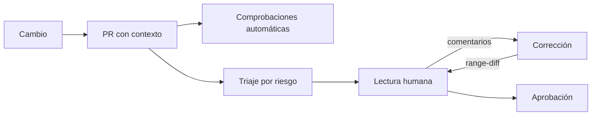
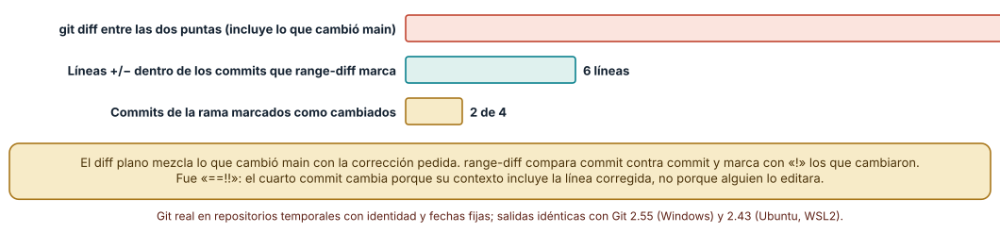
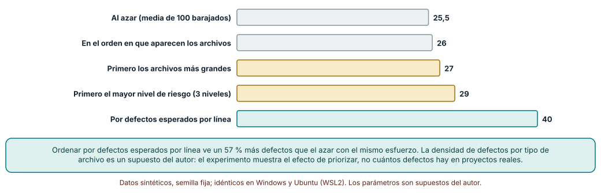
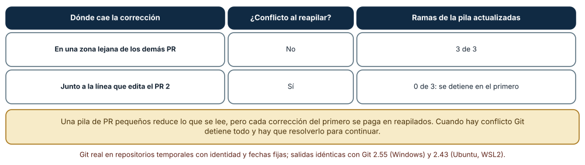

# SE-196 — Pull requests y revisión basada en riesgo

[← SE-195 — Ramas, integración, rebase y conflictos](../../classes/part-16-git-colaboracion-y-codigo-abierto/se-195-ramas-integracion-rebase-y-conflictos/README.md) · [↑ Parte 16](../../classes/part-16-git-colaboracion-y-codigo-abierto/README.md) · [📚 Índice completo](../../classes/README.md) · [🌐 Portal](../../site/classes/SE-196.html) · [SE-197 — Trunk-based, GitFlow y estrategias híbridas →](../../classes/part-16-git-colaboracion-y-codigo-abierto/se-197-trunk-based-gitflow-y-estrategias-hibridas/README.md)

## Punto profesional y fundamento pedagógico

**Punto profesional.** La clase existe para que una revisión de cambios sea una decisión sobre dónde poner la atención limitada de una persona y no un trámite ni una lectura lineal de un diff. Un pull request (PR) es una propuesta de cambio con contexto, y revisarlo bien es decidir qué mirar primero y qué parte confiar a una comprobación automática.

**Por qué aparece aquí.** Se sitúa después de **Ramas, integración, rebase y conflictos** y antes de **Trunk-based, GitFlow y estrategias híbridas**. `SE-195` dejó ramas que se integran con una estrategia conocida; esta clase pregunta cómo llega un cambio hasta esa integración: qué se pide al autor, qué se revisa, en qué orden y cómo se corrige tras una revisión sin perder el hilo. Deja los PR revisables sobre los que `SE-197` discute el flujo de ramas.

**Error conceptual que debe corregir.** Creer que revisar es leer todo el diff de arriba abajo y que un PR grande «bien revisado» es posible. La atención se agota y los defectos no se reparten por igual: se concentran en ciertos tipos de archivo y de cambio. Revisar bien es ordenar por riesgo, y un PR bien dividido es un cambio que se puede revisar.

**Secuencia de aprendizaje.** Antes de leer la solución, predices qué muestra una herramienta de comparación tras reordenar una rama y en qué orden leerías un PR; después comparas `diff` y `range-diff`, mides cuántos defectos plantados alcanza una lectura parcial con cuatro órdenes distintos y corriges el primer PR de una pila. La secuencia usa predicción, explicación propia, contraste y recuperación. [ICAP](https://icap.education.asu.edu/research) distingue participación de construcción de conocimiento; [How People Learn II](https://nap.nationalacademies.org/catalog/24783/how-people-learn-ii-learners-contexts-and-cultures) exige conectar conocimiento previo, contexto y transferencia; la [práctica de recuperación](https://pubmed.ncbi.nlm.nih.gov/16507066/) respalda producir de nuevo la explicación tras una demora; y [Education for Life and Work](https://nap.nationalacademies.org/resource/13398/dbasse_084153.pdf) exige devolución que explique la causa del error.

**Evidencia de aprendizaje.** `review-log.md` con la comparación de `diff` y `range-diff`, la tabla de órdenes de lectura con la predicción previa, el resultado de la pila de PR y una plantilla de PR con criterios de triaje. Debe contener predicción previa, observación, explicación causal, contraejemplo y qué hallazgo haría cambiar el orden de lectura.

**Límite de la conclusión.** Los 300 PR son sintéticos y la densidad de defectos por tipo de archivo es un supuesto del autor, no una medición; la lectura parcial se modela como un presupuesto de líneas, no como una persona real; no se midió a ningún revisor, ni el tiempo de revisión, ni la tasa de defectos de ningún proyecto.

### Trazabilidad fuente → afirmación

| Fuente primaria u oficial | Afirmación que respalda | Lo que no prueba |
|---|---|---|
| [Sadowski et al., «Modern code review: a case study at Google» (ICSE-SEIP, 2018)](https://doi.org/10.1145/3183519.3183525) | Describe la revisión de código como práctica con cambios pequeños, revisores pocos y objetivos de conocimiento compartido además de detección de defectos. | No muestra que el modelo sirva en un equipo distinto. |
| [Bacchelli y Bird, «Expectations, outcomes, and challenges of modern code review» (ICSE, 2013)](https://doi.org/10.1109/ICSE.2013.6606617) | Observa que las expectativas de la revisión (defectos) y sus resultados (comprensión, transferencia) difieren y que entender el cambio es una dificultad central. | No cuantifica el efecto del tamaño del cambio en un proyecto concreto. |
| [git-range-diff](https://git-scm.com/docs/git-range-diff) | Compara dos series de commits (antes y después de reescribir una rama) y marca los que cambiaron. | No dice si el cambio entre series es correcto. |

## Antes de empezar

Recupera lo aprendido en `SE-195`: rebasar reescribe commits y cambia sus identificadores. La pregunta activa es: **¿qué debe mirar primero una persona que revisa, qué le entrego para que lo vea y cómo muestro lo que cambió tras su comentario?**

## Prerrequisitos

- Haber completado `SE-195` o poder explicar qué conserva un rebase y qué reescribe.
- Python 3.11 o posterior, Git 2.40 o posterior y un terminal.
- Trabajar en repositorios temporales y datos sintéticos; ninguna revisión de la clase toca un alojamiento real.

## Problema auténtico

Un PR de la plataforma de entregas cambia el cálculo de la penalización, su configuración, tres archivos de prueba, un archivo SQL de migración y la documentación: 1 100 líneas. La persona revisora lee el diff en el orden en que aparece, comenta estilo en la mitad y el defecto está en la migración, que quedó al final. Cuando el autor corrige y rebasa, la revisora no sabe qué cambió desde su lectura.

## Objetivos observables

Al terminar podrás:

1. escribir un PR con contexto suficiente para que otra persona decida qué mirar primero;
2. ordenar los archivos de un PR por riesgo esperado y justificar el criterio;
3. mostrar a la revisora qué cambió tras reescribir una rama con `git range-diff`;
4. decidir cuándo dividir un cambio en una pila de PR y qué cuesta corregir el primero;
5. declarar qué parte de la revisión debe ser automática y qué parte debe ser humana.

## Mapa conceptual



El mapa se lee de izquierda a derecha: un cambio se presenta con contexto, se comprueba automáticamente, se prioriza y se lee; cada corrección vuelve a la lectura con una comparación de lo cambiado. No describe cuántas personas revisan ni cuánto dura cada paso.

## Temas y por qué importan

| Tema | Por qué cambia una decisión profesional | Evidencia mínima |
|---|---|---|
| Contenido de un PR | El contexto decide si una revisión es posible: qué cambia, por qué, cómo se probó. | Predicción, traza causal y contraejemplo de **Contenido de un PR** en `review-log.md` |
| Tamaño y división | Un cambio que no cabe en la atención de una persona no se revisa: se aprueba. | Predicción, traza causal y contraejemplo de **Tamaño y división** en `review-log.md` |
| Triaje por riesgo | Reparte la atención donde es más probable un defecto de alto costo. | Predicción, traza causal y contraejemplo de **Triaje por riesgo** en `review-log.md` |
| Comprobaciones automáticas | Liberan a la persona de lo que una máquina comprueba y dejan para ella el sentido. | Predicción, traza causal y contraejemplo de **Comprobaciones automáticas** en `review-log.md` |
| Rondas de corrección | Sin ver lo que cambió entre rondas, la revisión empieza de cero cada vez. | Predicción, traza causal y contraejemplo de **Rondas de corrección** en `review-log.md` |

## Conceptos y decisiones

### 1. Contenido de un PR

Un PR útil dice qué cambia, por qué, cómo se probó y qué queda fuera. El título resume la intención y la descripción enlaza el issue, los riesgos y las zonas donde el autor tiene dudas. La descripción es el único lugar donde se puede declarar lo que el diff no muestra: qué se decidió no hacer, qué se probó a mano y qué parte merece más atención. Un PR sin descripción obliga a la persona a reconstruir la intención desde el código.

### 2. Tamaño y división

La capacidad de atención de una persona es finita y un cambio grande se revisa por encima. Dividir no es solo partir un diff: cada parte debe tener sentido por sí misma, compilar y poder revertirse sola. Un PR de refactor mecánico (un renombre masivo) puede ser grande y revisable si se separa del cambio de lógica; uno de lógica no. Una pila de PR encadenados reduce lo que se lee pero tiene un costo: corregir el primero obliga a reapilar los demás.

### 3. Triaje por riesgo

Los archivos de un PR no tienen el mismo riesgo: una migración de datos, la autenticación y la configuración son más caras de equivocar que la documentación. El triaje ordena la lectura por riesgo esperado y no por orden alfabético: qué tocó cada archivo, cuánto cambió y cuánto cuesta equivocarse. Es una heurística con supuestos (qué tipos son riesgosos) que deben declararse y revisarse con los defectos reales que se escapen.

### 4. Comprobaciones automáticas

Compilación, pruebas, análisis estático, formato, licencias y secretos son comprobaciones que no necesitan a una persona. Deben ejecutarse antes de pedir una revisión humana, de modo que la lectura se dedique al sentido (¿es esta la regla correcta?, ¿se probó el caso límite?). Una comprobación automática detecta forma y no intención, y por eso no sustituye la lectura de los archivos de mayor riesgo.

### 5. Rondas de corrección

Tras una revisión, el autor corrige y a menudo reescribe la rama. Si la corrección se añade como commits nuevos, la revisora ve lo cambiado; si se reescribe con rebase, el diff entre las dos puntas mezcla la corrección con todo lo que cambió en la rama base. `git range-diff` compara la serie anterior con la nueva commit contra commit y muestra solo lo que el autor cambió. Es la herramienta que permite una historia limpia sin perder el hilo de la revisión.

### Qué muestra cada comparación

Una rama de 4 commits se rebasó sobre un `main` que avanzó 12 commits, y el autor corrigió el tercero con un `--fixup` y `--autosquash`. El `git diff` entre la punta antigua y la nueva cambia **26 líneas** (los 12 cambios de `main` más la corrección). `git range-diff` marcó la serie como `==!!`: los dos primeros commits idénticos, y los dos últimos cambiados, con **6 líneas** de diferencia entre ambas versiones. El cuarto aparece cambiado porque su contexto incluye la línea corregida, no porque alguien lo editara. Los resultados fueron idénticos con Git 2.55 en Windows y 2.43 en Ubuntu.



**Cómo leer la figura.** La barra coral es el diff que vería una persona al comparar las dos puntas; la verde, lo que muestra `range-diff` dentro de los commits que cambiaron; la dorada cuenta los commits marcados. **Dónde deja de valer:** el cambio de `main` fue de una línea por commit en otra región; si `main` toca las mismas regiones que la rama, el rebase tendrá conflictos y el `range-diff` mostrará también esas resoluciones, que hay que leer con atención.

### Dónde mirar primero

Se generaron 300 PR sintéticos (104 530 líneas, 91 defectos plantados) con archivos de seis tipos: documentación, pruebas, código, configuración, autenticación y migraciones. La probabilidad de defecto por 100 líneas fue un supuesto (0,8 % en documentación y 30 % en autenticación) y cada lectura alcanza solo el 30 % de las líneas de cada PR. Leer en el **orden en que aparecen** los archivos halló 26 defectos; al **azar** (media de 100 barajados), 25,5; **los archivos más grandes primero**, 27; **por tres niveles de riesgo**, 29; y **por defectos esperados por línea**, 40. Ordenar por riesgo esperado alcanzó un 57 % más de defectos que el azar con el mismo esfuerzo.



**Cómo leer la figura.** Cada barra es un criterio de orden aplicado a los mismos 300 PR con el mismo presupuesto de lectura; la verde es la mejor. **Dónde deja de valer:** las probabilidades de defecto por tipo son un supuesto del autor y el triaje usa los mismos tipos que el generador, lo que favorece al criterio por riesgo; en un proyecto real el criterio se calibra con los defectos que se escaparon, y los defectos no se distribuyen solo por tipo de archivo.

### Una pila de PR y la corrección del primero

Cuatro PR apilados cambian cada uno una línea distinta de un archivo de 60 líneas. El autor corrige el primero y reapila con `git rebase --update-refs --onto`. Con la corrección en **una zona lejana**, el reapilado no tuvo conflictos y actualizó las 3 ramas dependientes. Con la corrección **junto a la línea que edita el segundo PR**, Git se detuvo con conflicto y no actualizó ninguna de las 3.



**Cómo leer la figura.** Cada fila es una posición de la corrección respecto de los demás PR; las columnas dicen si hubo conflicto y cuántas ramas apiladas se actualizaron. **Dónde deja de valer:** se probó una sola pila de cuatro con ediciones de una línea; pilas más largas o con cambios que tocan los mismos archivos multiplican los reapilados, y las herramientas de apilado automatizan el reapilado pero no resuelven los conflictos.

## Definiciones de trabajo

- **pull request:** propuesta de integrar una rama que se revisa y se discute antes de aceptarse.
- **triaje por riesgo:** orden de lectura de un cambio según el riesgo esperado de cada parte, no según su orden de aparición.
- **range-diff:** comparación de dos series de commits que muestra qué cambió entre una versión y otra de una rama reescrita.
- **pila de PR:** serie de pull requests encadenados donde cada uno parte de la rama del anterior.
- **comprobación automática:** verificación ejecutada por una máquina antes o durante la revisión humana.

Las definiciones son operativas para la plataforma de entregas. No convierten términos con historia más amplia en sinónimos y deben contrastarse con la documentación primaria enlazada al final.

## Ejemplo mínimo

El fragmento muestra qué cambió entre dos versiones de una rama. Antes de ejecutarlo, predice qué commits aparecerán marcados.

```bash
git range-diff <base>..<punta-antigua> <base-nueva>..<punta-nueva>
git diff --stat <punta-antigua> <punta-nueva>    # para comparar con el diff plano
```

Registra versión de Git y salida, y repite sin el cambio pedido para comprobar que todos los commits salen con `=`.

## Ejemplo profesional

En la plataforma, la plantilla de PR pide qué cambia, por qué, cómo se probó y qué archivos merecen más atención. Un flujo de integración continua ejecuta formato, pruebas, análisis estático y búsqueda de secretos antes de asignar revisora. El CODEOWNERS, tema de `SE-199`, añade como revisor obligatorio al equipo dueño de las migraciones cuando un PR toca `migraciones/`. La revisora abre primero los archivos marcados como riesgo alto, lee la descripción y, tras las correcciones, usa `range-diff` para ver lo cambiado.

Compara el caso normal con un PR de 1 100 líneas que mezcla un refactor, un cambio de regla y una migración. La práctica es apropiada cuando el PR se divide en un refactor mecánico, el cambio de regla y la migración, cada uno revisable; es peligrosa cuando se aprueba entero porque «las pruebas pasan».

## Práctica guiada

1. Escribe la descripción de un PR para un cambio de la regla de penalización y marca los archivos de riesgo alto.
2. Predice qué commits marcará `range-diff` tras corregir uno con `--fixup` y comprueba.
3. Compara las líneas del `diff` plano con las del `range-diff` y registra la diferencia.
4. Genera 300 PR sintéticos con una semilla y fija tus supuestos de densidad de defectos antes de ejecutar.
5. Compara cuatro órdenes de lectura con el mismo presupuesto y registra los defectos alcanzados.
6. Apila cuatro PR, corrige el primero y registra el reapilado con la corrección lejos y cerca del segundo.
7. Pide a otra persona que reconstruya tu criterio de triaje solo desde `review-log.md` y registra qué supuesto le faltó.

## Ejercicios

1. **Presupuesto distinto:** repite la comparación de órdenes con un presupuesto del 15 % y del 60 % y explica cómo cambia la ventaja del triaje.
2. **Supuesto equivocado:** cambia la densidad de defectos de la documentación al valor de la autenticación y explica qué le pasa al criterio por riesgo de tres niveles.
3. **División:** parte un PR de 1 100 líneas en una pila de cuatro y escribe el criterio de corte y el costo de corregir el primero.
4. **Automático o humano:** decide qué comprobaciones de tu proyecto son automáticas, cuáles dejan de ser revisables por una persona y qué métrica te haría moverlas.

## Reto verificable

Entrega `review-log.md` con la plantilla de PR, el criterio de triaje con sus supuestos, la comparación de `diff` y `range-diff`, la tabla de órdenes de lectura y el resultado de la pila. Se aprueba si otra persona ejecuta el código desde un directorio vacío, obtiene los mismos conteos y puede decir qué supuesto del triaje cambiaría si se le escaparan defectos en documentación. No se aprueba por el número de comentarios.

## Caso conductor

El repositorio de la plataforma de entregas es el caso conductor de la Parte 16. Esta clase deja la plantilla de PR y el criterio de triaje. `SE-197` discute cuánto debe vivir la rama de un PR y `SE-199` automatiza la asignación de revisores. Cambia después un solo dato, el presupuesto de lectura del 30 % al 15 %, y revisa cuánto cambia la ventaja del criterio por riesgo.

## Preguntas frecuentes

### ¿Cuántas líneas debe tener un PR?

No hay una cifra universal. La regla útil es que una persona pueda leerlo entero con atención en una sesión y que el cambio tenga una sola intención. El tamaño efectivo depende de la complejidad: mil líneas de renombre mecánico se revisan; cien de lógica de autenticación pueden requerir más cuidado.

### ¿Las comprobaciones automáticas reemplazan la revisión?

No: detectan forma (formato, compilación, pruebas escritas) y no intención. Una afirmación vacía pasa todas las pruebas. La revisión humana decide si el cambio es el correcto.

### ¿Se puede rebasar un PR en revisión?

Sí, si la revisora puede ver qué cambió: con `range-diff` o añadiendo commits de corrección que se aplastan al integrar. Reescribir sin mostrar lo cambiado obliga a revisar de nuevo.

### ¿Quién debe aprobar?

La persona con el conocimiento del área tocada: de ahí los propietarios de código de `SE-199`. Un autor no aprueba su propio PR; en equipos pequeños se compensa con comprobaciones y una segunda lectura de lo riesgoso.

## Fallo controlado y diagnóstico

Reproduce el fallo clásico de la clase: **aprobar lo que no se leyó**. Usa el PR de 1 100 líneas con la migración al final.

Registra síntoma, entrada mínima, hipótesis, observación que descarta cada hipótesis, causa, corrección y prueba de regresión. **Síntoma:** un PR aprobado con diez comentarios de estilo llega a producción con una migración que borra una columna. **Hipótesis rivales:** (a) la revisora no sabía leer migraciones; (b) la migración quedó fuera del presupuesto de atención por aparecer al final. **Prueba:** reproduce la lectura con un presupuesto del 30 % en el orden de aparición: no alcanza la migración; con triaje por riesgo, la lee primero. **Conclusión:** la causa es (b): el orden de lectura dejó fuera lo más riesgoso. **Regresión:** añade al PR la lista de archivos de riesgo alto y una comprobación que exija revisión del equipo dueño de las migraciones. No cambies a la vez el tamaño del PR y el criterio de lectura.

## Errores comunes y cómo corregirlos

| Síntoma | Causa probable | Corrección |
|---|---|---|
| Comentarios de estilo y defectos que se escapan | La lectura sigue el orden del diff | Ordenar por riesgo y automatizar el estilo |
| Hay que releer todo tras cada corrección | La rama se reescribió sin mostrar lo cambiado | Usar `range-diff` o commits de corrección |
| El PR se aprueba sin lectura real | Es demasiado grande para la atención disponible | Dividir en cambios de una sola intención |
| Corregir el primer PR rompe la pila | Hay solapamiento entre los PR apilados | Reducir el solapamiento o integrar el primero antes |
| Las pruebas pasan y el comportamiento es erróneo | Una prueba débil o vacía | Revisar las pruebas con el mismo cuidado que el código |

## Entorno y archivos clave

```text
work/SE-196/
├── README.md
├── revision/
│   ├── rangediff.py
│   ├── triaje.py
│   └── pila.py
├── .github/pull_request_template.md
└── evidence/review-log.md
```

El `README` declara sistema operativo, versión de Git y de Python, semillas y comandos. Los experimentos usan `subprocess`, repositorios temporales con identidad y fechas fijas y un generador de PR con semilla fija, y se ejecutaron con CPython 3.12.9 y Git 2.55 en Windows 11 y con CPython 3.12.3 y Git 2.43 en Ubuntu bajo WSL2: las salidas fueron idénticas. Si automatizas con otra biblioteca, fija procedencia y versión.

## Seguridad, ética y accesibilidad

- la revisión es una barrera de seguridad: los cambios en autenticación, permisos y datos personales deben tener revisor con conocimiento del área;
- los comentarios se dirigen al código y no a la persona; formula observaciones accionables y explica el motivo;
- no pegues secretos ni datos reales en descripciones o comentarios de un PR: quedan en el historial del alojamiento;
- ofrece una alternativa textual a las tablas de resultados y describe los estados de revisión en palabras;
- respeta la carga de quien revisa: un PR que no cabe en su atención traslada el riesgo.

## Puente hacia el trabajo con agentes

Un agente al que se le pide «abre un PR con estos cambios» suele escribir una descripción genérica que repite el diff y mezcla varios cambios en un solo PR. Pídele que divida el cambio por intención, que escriba la descripción con el porqué y las dudas, que marque los archivos de riesgo alto y que ejecute las comprobaciones antes de pedir revisión. Revisa especialmente si el agente cambió pruebas para que pasen: es el mismo defecto de aprobar lo que no se leyó, con apariencia de verificación.

## Transferencia

Traslada el análisis a otra actividad de revisión (por ejemplo, la revisión de un documento de diseño o de un cambio de infraestructura como código): decide cómo ordenarías lo que se revisa por riesgo, qué comprobaciones serían automáticas y cómo mostrarías lo cambiado tras una corrección. La transferencia está lograda cuando puedes explicar qué parte del triaje dependía de los tipos de archivo, no cuando los pasos se parecen.

## Evaluación y evidencia

| Criterio | Evidencia para aprobar |
|---|---|
| comprensión | explicación de por qué el orden de lectura cambia los defectos hallados |
| corrección | conteos reproducibles de órdenes de lectura y de `range-diff` con las mismas semillas |
| diseño | plantilla de PR y criterio de triaje con supuestos declarados |
| diagnóstico | reproducción del fallo «aprobar lo no leído» con regresión |
| incertidumbre | declaración de qué parte depende de las densidades de defectos del autor |
| reproducibilidad | versiones, comandos, salida y límites declarados |

## Fuentes

- [Sadowski et al., «Modern code review: a case study at Google» (ICSE-SEIP, 2018)](https://doi.org/10.1145/3183519.3183525) — práctica de revisión en una organización grande; autoridad: ACM/IEEE ICSE-SEIP.
- [Bacchelli y Bird, «Expectations, outcomes, and challenges of modern code review» (ICSE, 2013)](https://doi.org/10.1109/ICSE.2013.6606617) — expectativas y dificultades de la revisión; autoridad: IEEE ICSE.
- [Google Engineering Practices: code review](https://google.github.io/eng-practices/review/) — guía de revisión y tamaño de cambios; autoridad: Google.
- [git-range-diff](https://git-scm.com/docs/git-range-diff) — comparación entre series de commits; autoridad: documentación de Git.
- [git-rebase](https://git-scm.com/docs/git-rebase) — `--update-refs`, `--onto` y `--autosquash`; autoridad: documentación de Git.
- [GitHub: pull requests](https://docs.github.com/en/pull-requests) — funcionamiento de los PR en el alojamiento; autoridad: GitHub Docs.

Cada fuente respalda el mecanismo indicado; ninguna demuestra que el criterio de triaje de la plataforma de entregas sea el adecuado para otro proyecto. Esa afirmación depende de los defectos que de verdad se escapen.

- [GitHub: plantillas de issues y PR](https://docs.github.com/en/communities/using-templates-to-encourage-useful-issues-and-pull-requests/about-issue-and-pull-request-templates) — plantillas para pedir contexto.
- [git-diff](https://git-scm.com/docs/git-diff) — comparación plana usada como referencia.

## Límites y siguiente paso

Se ejecutaron tres experimentos con repositorios temporales y datos sintéticos en Windows y Ubuntu (WSL2) con resultados idénticos. Las densidades de defectos y el presupuesto de lectura son supuestos del autor, el criterio por riesgo se evaluó con los mismos tipos que usó el generador y no se midió a ningún revisor ni un proyecto real. La siguiente clase pregunta cuánto debe vivir una rama y qué flujo de ramas encaja con una revisión así.

## Glosario

- **pull request:** propuesta de integrar una rama que se revisa y se discute antes de aceptarse.
- **triaje por riesgo:** orden de lectura de un cambio según el riesgo esperado de cada parte, no según su orden de aparición.
- **range-diff:** comparación de dos series de commits que muestra qué cambió entre una versión y otra de una rama reescrita.
- **pila de PR:** serie de pull requests encadenados donde cada uno parte de la rama del anterior.
- **comprobación automática:** verificación ejecutada por una máquina antes o durante la revisión humana.

---

[← SE-195 — Ramas, integración, rebase y conflictos](../../classes/part-16-git-colaboracion-y-codigo-abierto/se-195-ramas-integracion-rebase-y-conflictos/README.md) · [↑ Parte 16](../../classes/part-16-git-colaboracion-y-codigo-abierto/README.md) · [📚 Índice completo](../../classes/README.md) · [🌐 Portal](../../site/classes/SE-196.html) · [SE-197 — Trunk-based, GitFlow y estrategias híbridas →](../../classes/part-16-git-colaboracion-y-codigo-abierto/se-197-trunk-based-gitflow-y-estrategias-hibridas/README.md)
