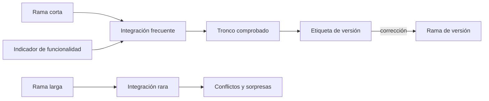
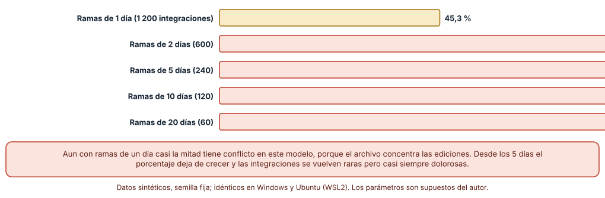
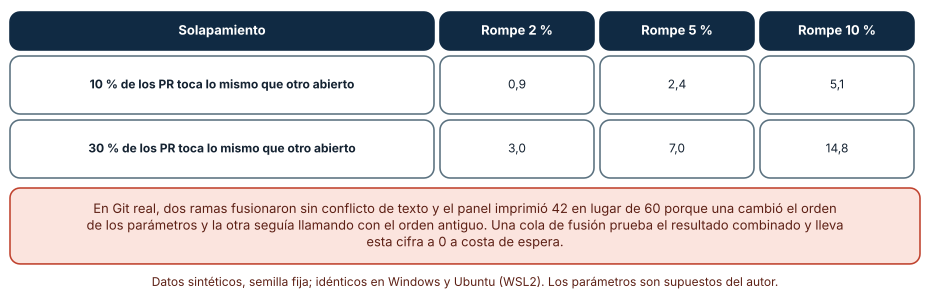
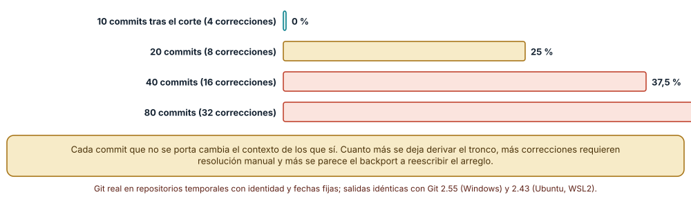

# SE-197 — Trunk-based, GitFlow y estrategias híbridas

[← SE-196 — Pull requests y revisión basada en riesgo](../../classes/part-16-git-colaboracion-y-codigo-abierto/se-196-pull-requests-y-revision-basada-en-riesgo/README.md) · [↑ Parte 16](../../classes/part-16-git-colaboracion-y-codigo-abierto/README.md) · [📚 Índice completo](../../classes/README.md) · [🌐 Portal](../../site/classes/SE-197.html) · [SE-198 — Issues, discusiones y trazabilidad del cambio →](../../classes/part-16-git-colaboracion-y-codigo-abierto/se-198-issues-discusiones-y-trazabilidad-del-cambio/README.md)

## Punto profesional y fundamento pedagógico

**Punto profesional.** La clase existe para elegir un flujo de ramas por lo que cuesta y por lo que protege, no por moda: cuánto vive una rama, dónde se integra, qué se libera y cómo se corrige una versión ya publicada. Cada flujo es una apuesta sobre dónde prefiere el equipo pagar: en integraciones frecuentes y pequeñas, o en integraciones raras y grandes.

**Por qué aparece aquí.** Se sitúa después de **Pull requests y revisión basada en riesgo** y antes de **Issues, discusiones y trazabilidad del cambio**. `SE-196` dejó cambios revisables; esta clase decide la cadencia con que llegan a la rama principal y qué ocurre con las versiones publicadas. Deja el flujo de ramas sobre el que `SE-198` ata cambios a su motivo.

**Error conceptual que debe corregir.** Creer que un flujo de ramas es una convención de nombres que se adopta entera. Cada flujo (trunk-based, GitHub flow, GitFlow) es una combinación de decisiones independientes: cuánto vive una rama, quién integra, si hay ramas de versión y cómo se ocultan los cambios no terminados. Copiar el nombre sin las decisiones produce el costo sin el beneficio.

**Secuencia de aprendizaje.** Antes de leer la solución, predices cómo cambia la frecuencia de conflictos con la vida de la rama y qué pasa cuando dos cambios aprobados se combinan; después simulas cinco personas integrando con ramas de 1 a 20 días, reproduces un conflicto semántico con Git real y mides los conflictos al portar correcciones a una rama de versión. La secuencia usa predicción, explicación propia, contraste y recuperación. [ICAP](https://icap.education.asu.edu/research) distingue participación de construcción de conocimiento; [How People Learn II](https://nap.nationalacademies.org/catalog/24783/how-people-learn-ii-learners-contexts-and-cultures) exige conectar conocimiento previo, contexto y transferencia; la [práctica de recuperación](https://pubmed.ncbi.nlm.nih.gov/16507066/) respalda producir de nuevo la explicación tras una demora; y [Education for Life and Work](https://nap.nationalacademies.org/resource/13398/dbasse_084153.pdf) exige devolución que explique la causa del error.

**Evidencia de aprendizaje.** `flow-log.md` con la tabla de conflictos por vida de la rama, el caso de conflicto semántico, la medición de backports y una decisión de flujo con sus condiciones de revisión. Debe contener predicción previa, observación, explicación causal, contraejemplo y qué hallazgo haría cambiar el flujo.

**Límite de la conclusión.** Las personas, el archivo de 400 líneas con zona caliente (70 % de las ediciones en el 20 % de las líneas) y los porcentajes de solapamiento son supuestos del autor; los conflictos se miden sobre texto con `git merge-file`; ningún dato procede de un equipo ni de un proyecto, y la comparación de flujos no mide productividad ni calidad de entrega.

### Trazabilidad fuente → afirmación

| Fuente primaria u oficial | Afirmación que respalda | Lo que no prueba |
|---|---|---|
| [Trunk Based Development](https://trunkbaseddevelopment.com/) | Describe el desarrollo con ramas de corta duración integradas con frecuencia en un tronco único. | No cuantifica los beneficios para un equipo concreto. |
| [Driessen, «A successful Git branching model»](https://nvie.com/posts/a-successful-git-branching-model/) | Presenta GitFlow con ramas de desarrollo, de versión y de corrección, e indica en qué contexto se pensó. | No afirma que sea adecuado para entrega continua. |
| [Fowler, «Continuous Integration»](https://martinfowler.com/articles/continuousIntegration.html) | Define la integración continua como integrar al menos a diario y comprobar cada integración. | No prueba que integrar a diario sea posible en cualquier base de código. |

## Antes de empezar

Recupera lo aprendido en `SE-196`: un cambio pequeño y bien descrito se puede revisar. La pregunta activa es: **¿cuánto debe vivir una rama, qué protege cada flujo y qué cuesta un cambio aprobado que choca con otro?**

## Prerrequisitos

- Haber completado `SE-196` o poder explicar por qué un PR pequeño es revisable.
- Python 3.11 o posterior, Git 2.40 o posterior y un terminal.
- Trabajar en repositorios temporales y con datos sintéticos.

## Problema auténtico

El equipo de la plataforma de entregas tiene una rama `desarrollo` y ramas de funcionalidad que viven tres semanas. Cada integración exige un día de resolver conflictos, y una vez dos ramas aprobadas se fusionaron sin conflicto de texto y dejaron roto el panel de notas. Alguien propone pasar a trunk-based; otro, mantener GitFlow «porque hay versiones que mantener».

## Objetivos observables

Al terminar podrás:

1. explicar cómo la vida de una rama afecta la frecuencia de los conflictos y medirlo en un modelo;
2. reconocer un conflicto semántico y decidir qué comprobación lo detecta;
3. describir las decisiones que componen un flujo (vida de rama, integración, ramas de versión, ocultación de cambios) y combinarlas;
4. estimar el costo de portar correcciones a una rama de versión según la deriva del tronco;
5. escribir una decisión de flujo con sus condiciones de revisión.

## Mapa conceptual



El mapa se lee de izquierda a derecha como dos apuestas: ramas cortas con integración frecuente, o ramas largas con integración rara; las versiones publicadas pueden necesitar una rama de mantenimiento, y un indicador de funcionalidad permite integrar sin activar. No describe cuántas personas hay ni el tamaño del equipo.

## Temas y por qué importan

| Tema | Por qué cambia una decisión profesional | Evidencia mínima |
|---|---|---|
| Vida de la rama | Es la variable que más afecta el costo de integrar. | Predicción, traza causal y contraejemplo de **Vida de la rama** en `flow-log.md` |
| Trunk-based | Pone la integración continua en el centro y exige disciplina de cambios pequeños. | Predicción, traza causal y contraejemplo de **Trunk-based** en `flow-log.md` |
| GitFlow | Separa desarrollo, versión y corrección; sirve a versiones que conviven. | Predicción, traza causal y contraejemplo de **GitFlow** en `flow-log.md` |
| Conflictos semánticos | Un cambio puede combinarse sin marcas y romper el sistema. | Predicción, traza causal y contraejemplo de **Conflictos semánticos** en `flow-log.md` |
| Versiones y backports | Mantener una versión publicada cuesta más cuanto más deriva el tronco. | Predicción, traza causal y contraejemplo de **Versiones y backports** en `flow-log.md` |

## Conceptos y decisiones

### 1. Vida de la rama

El costo de integrar crece con el tiempo que una rama vive aislada: más cambios acumulados en la rama y más cambios en el tronco que la rama no vio. Una rama de horas casi nunca choca; una de semanas casi siempre. La decisión de flujo es, en gran parte, decidir la vida máxima de una rama y qué hace el equipo para respetarla: dividir el trabajo, esconder lo no terminado y revisar rápido.

### 2. Trunk-based

El desarrollo sobre un tronco integra al menos a diario con ramas muy cortas o directamente al tronco. Exige comprobaciones rápidas y fiables, cambios pequeños, revisión ágil e indicadores para no activar lo inacabado. El beneficio es que el tronco siempre está cerca de lo liberable y que los conflictos son pequeños; el costo es la disciplina y la infraestructura de pruebas sin las cuales integrar a diario es imprudente.

### 3. GitFlow

GitFlow mantiene una rama de desarrollo y ramas de versión y de corrección. Surgió para software con versiones distribuidas que conviven, donde publicar es costoso y se mantienen varias versiones. Su costo es la distancia entre ramas y los backports; su beneficio es separar lo que se estabiliza de lo que se desarrolla. Para un servicio que se despliega continuamente, la rama de versión añade trabajo sin aportar protección.

### 4. Conflictos semánticos

Dos cambios pueden fusionarse sin conflicto de texto y ser incompatibles: uno cambia la firma de una función y otro añade una llamada con la firma vieja. Git no ve esto porque no entiende el programa. La defensa es probar el resultado de la combinación antes de aceptar, no solo cada rama por separado: integración continua sobre el tronco y, con volumen alto, una cola de fusión que prueba cada cambio sobre el estado actual.

### 5. Versiones y backports

Cuando hay una versión publicada que recibe correcciones, cada corrección hecha en el tronco debe portarse con `cherry-pick`. Cuanto más ha derivado el tronco desde el corte, más cambia el contexto de la corrección y más probable es el conflicto. La decisión de cuántas versiones mantener, y durante cuánto tiempo, es de producto y de capacidad, no de Git.

### Vida de la rama y conflictos

Cinco personas editaron durante 40 días un archivo de 400 líneas, tres ediciones por persona y día, con el 70 % de las ediciones en el 20 % de las líneas. Cada persona integraba en el tronco al terminar su rama, con tres vías por `git merge-file`. Con ramas de **1 día**, 544 de 1 200 integraciones tuvieron conflicto (**45,3 %**); con **2 días**, 504 de 600 (**84,0 %**); con **5 días**, 234 de 240 (**97,5 %**); con **10 días**, 114 de 120 (**95,0 %**); y con **20 días**, 54 de 60 (**90,0 %**). Más allá de unos días el porcentaje deja de crecer: casi toda integración tiene conflicto, y lo que cambia es cuánto hay que resolver, que no se midió. Los resultados fueron idénticos en Windows y Ubuntu.



**Cómo leer la figura.** Cada barra es una vida de rama con las mismas cinco personas y la misma zona caliente; el número entre paréntesis es la cantidad de integraciones. **Dónde deja de valer:** el modelo concentra las ediciones en un solo archivo, lo que exagera el conflicto con ramas de un día; en un código con muchos módulos los porcentajes bajan, pero la tendencia (más vida, más conflicto) se conserva, y no se midió cuánto cuesta resolver cada conflicto.

### Conflicto semántico

En Git real, una rama invirtió el orden de los parámetros de `penalizar(nota, horas)` y actualizó `informe.py`; otra, desde la versión anterior, añadió `panel.py` con la llamada de orden antiguo. La segunda fusión terminó con **código de salida 0** (sin conflicto de texto) y `panel.py` imprimió **42** en lugar de **60**. Para estimar la frecuencia, se simularon 500 PR con una proporción de solapamiento y una probabilidad de incompatibilidad dada: con un 10 % de solapamiento, main se rompió 0,9 veces con una incompatibilidad del 2 %, 2,4 con el 5 % y 5,1 con el 10 %; con un 30 % de solapamiento, 3,0, 7,0 y 14,8 veces (media de 20 semillas). Una cola de fusión que prueba cada cambio sobre el estado actual reduce esa cifra a cero a costa de espera.



**Cómo leer la figura.** Las filas son proporciones de PR que tocan lo mismo que otro abierto; las columnas, la probabilidad de que ese solapamiento sea incompatible. **Dónde deja de valer:** ambas proporciones son supuestos del autor; el caso real prueba que ocurre, no con qué frecuencia, y en un proyecto el solapamiento se mide con los PR abiertos al mismo tiempo, que depende de cuánto tardan en integrarse.

### Portar correcciones a una versión

Se creó una rama de versión en un corte y el tronco avanzó 10, 20, 40 y 80 commits con una corrección de cada diez, cada una editando una línea al azar de un archivo de 120 líneas. Portar las correcciones con `cherry-pick` tuvo **0 conflictos de 4** con 10 commits de deriva, **2 de 8 (25 %)** con 20, **6 de 16 (37,5 %)** con 40 y **16 de 32 (50 %)** con 80 (cuatro semillas). Idéntico en Git 2.55 y 2.43.



**Cómo leer la figura.** Cada barra es una deriva del tronco desde el corte; la cifra cuenta cherry-picks con conflicto sobre correcciones portadas. **Dónde deja de valer:** las correcciones son de una línea y al azar; las reales tocan archivos que cambian más y arrastran dependencias, de modo que el costo sube, y el modelo no cubre correcciones que dependen de cambios no portados y por tanto fallan sin conflicto.

## Definiciones de trabajo

- **trunk-based development:** práctica de integrar en un tronco único con ramas de muy corta duración.
- **GitFlow:** modelo con ramas de desarrollo, de versión y de corrección, pensado para versiones que conviven.
- **conflicto semántico:** incompatibilidad entre dos cambios que se fusionan sin marcas de texto.
- **cola de fusión:** mecanismo que prueba cada cambio sobre el estado actual del tronco antes de integrarlo.
- **backport:** aplicación de una corrección hecha en el tronco a una versión publicada.

Las definiciones son operativas para la plataforma de entregas. No convierten términos con historia más amplia en sinónimos y deben contrastarse con la documentación primaria enlazada al final.

## Ejemplo mínimo

El fragmento porta una corrección a una rama de versión. Antes de ejecutarlo, predice si habrá conflicto.

```bash
git switch release/1.x
git cherry-pick <commit-de-la-correccion>     # puede detenerse con conflicto
git cherry-pick --abort                       # si no se puede resolver aquí
```

Registra versión de Git y salida, y repite con la corrección que toca una línea contigua a un cambio no portado para provocar el conflicto.

## Ejemplo profesional

La plataforma de entregas se despliega varias veces al día y mantiene una sola versión publicada. El equipo adopta ramas de un día integradas por PR, pruebas de menos de diez minutos, indicadores de funcionalidad para lo no terminado y una cola de fusión. No mantiene rama de desarrollo ni de versión: una corrección se hace en el tronco y se despliega. Para una integración con un cliente que fija versión, mantiene una rama de versión de la API con correcciones portadas durante seis meses.

Compara el caso normal con un componente distribuido como biblioteca que tiene tres versiones vivas: la práctica es apropiada cuando se usa una rama de versión por línea soportada y se acota su vida; es peligrosa cuando se mantiene GitFlow completo para un servicio que se despliega a diario, porque la rama de desarrollo añade distancia sin protección.

## Práctica guiada

1. Predice el porcentaje de integraciones con conflicto para ramas de 1, 5 y 20 días.
2. Simula las cinco personas con una semilla fija y registra los porcentajes; compara con la predicción.
3. Reproduce el conflicto semántico con Git real y registra el código de salida y la salida del programa.
4. Escribe una prueba que detecte el panel roto y explica en qué momento del flujo la ejecutarías.
5. Crea una rama de versión, deja derivar el tronco 20 commits y porta las correcciones; registra los conflictos.
6. Decide el flujo para la plataforma y escribe las condiciones que lo revisarían.
7. Pide a otra persona que reconstruya tu decisión solo desde `flow-log.md` y registra qué supuesto le faltó.

## Ejercicios

1. **Zona caliente:** repite la simulación con ediciones uniformes y compara con la zona caliente; explica qué cambia en la decisión.
2. **Cola de fusión:** estima, con un tiempo de prueba de 10 minutos y 30 PR al día, la espera de una cola serial y cuándo dejaría de ser viable.
3. **Indicador de funcionalidad:** diseña el indicador para ocultar el nuevo cálculo de penalización y lista los dos estados que hay que probar y cuándo se retira.
4. **Decisión:** escribe una decisión de flujo para un componente con tres versiones vivas y la métrica que la cambiaría.

## Reto verificable

Entrega `flow-log.md` con la tabla de conflictos por vida de la rama, el caso semántico, la medición de backports y una decisión de flujo de una página con sus condiciones de revisión. Se aprueba si otra persona ejecuta el código desde un directorio vacío, obtiene las mismas cifras y puede decir qué supuesto del modelo hace más favorable al flujo elegido. No se aprueba por adoptar un nombre de flujo.

## Caso conductor

El repositorio de la plataforma de entregas es el caso conductor de la Parte 16. Esta clase deja la decisión de flujo y las medidas de conflicto. `SE-198` ata cada cambio a su motivo y `SE-199` asigna propietarios al tronco. Cambia después un solo dato, la vida de la rama de 5 a 1 día, y revisa qué cambia en el tamaño de los PR y en la necesidad de indicadores de funcionalidad.

## Preguntas frecuentes

### ¿Trunk-based significa no tener ramas?

No: significa ramas de muy corta vida. Una rama de un día integrada por PR es compatible; lo que no lo es es una rama de semanas.

### ¿GitFlow está obsoleto?

Es una respuesta a un contexto (versiones distribuidas que conviven). Su autor señaló que para software de entrega continua conviene algo más simple. Si el contexto cambia, la decisión cambia.

### ¿Los indicadores de funcionalidad son gratis?

No: cada indicador duplica estados que probar y deja código muerto si no se retira. Deben tener dueño y fecha de retirada.

### ¿Cuántas versiones se deben mantener?

Las que el producto pueda soportar y los clientes necesiten; cada versión añade backports. Es una decisión de capacidad que debe tener una fecha de fin.

## Fallo controlado y diagnóstico

Reproduce el fallo clásico de la clase: **dar por buena una integración sin probar el resultado combinado**. Usa el caso del panel.

Registra síntoma, entrada mínima, hipótesis, observación que descarta cada hipótesis, causa, corrección y prueba de regresión. **Síntoma:** dos PR aprobados y con pruebas verdes por separado dejan en main un panel que muestra 42 en lugar de 60. **Hipótesis rivales:** (a) alguno de los PR tenía una prueba débil; (b) cada PR se probó contra una versión distinta de main. **Prueba:** ejecuta las pruebas sobre la combinación: el panel falla; sobre cada rama por separado, pasan. **Conclusión:** la causa es (b): nadie probó la combinación. **Regresión:** añade una prueba de humo del panel y exige que las pruebas se ejecuten sobre el resultado de la fusión (rama actualizada o cola de fusión). No cambies a la vez el orden de los parámetros y las pruebas.

## Errores comunes y cómo corregirlos

| Síntoma | Causa probable | Corrección |
|---|---|---|
| Cada integración exige un día de resolver conflictos | Las ramas viven semanas | Dividir el trabajo, acortar ramas e integrar a diario |
| Main queda roto tras dos PR verdes | No se probó la combinación | Probar el resultado de la fusión o usar una cola de fusión |
| Se mantienen ramas de versión que nadie usa | No hay fecha de fin de soporte | Fijar las versiones soportadas y la fecha de retirada |
| Los indicadores de funcionalidad se acumulan | Nadie los retira | Asignar dueño y fecha de retirada a cada indicador |
| Los backports fallan cada vez | El tronco derivó mucho desde el corte | Portar en cuanto se corrige o reducir la vida de la versión |

## Entorno y archivos clave

```text
work/SE-197/
├── README.md
├── flujo/
│   ├── vida_de_rama.py
│   ├── semantico.py
│   └── backports.py
└── evidence/flow-log.md
```

El `README` declara sistema operativo, versión de Git y de Python, semillas y comandos. Los experimentos usan `subprocess`, `git merge-file` y repositorios temporales con identidad y fechas fijas y se ejecutaron con CPython 3.12.9 y Git 2.55 en Windows 11 y con CPython 3.12.3 y Git 2.43 en Ubuntu bajo WSL2: las salidas fueron idénticas. Si automatizas con otra biblioteca, fija procedencia y versión.

## Seguridad, ética y accesibilidad

- las ramas de versión con correcciones de seguridad deben portarse con prioridad y registrar quién decidió no portarlas;
- un indicador de funcionalidad que esconde un cambio de datos personales sigue siendo un cambio: revísalo igual;
- no apliques un flujo a un equipo sin acordar quién asume los costos de integración y de guardia;
- ofrece una alternativa textual a las tablas de resultados y describe las ramas en palabras, no solo en diagramas;
- respeta la carga de quien mantiene versiones antiguas: fija una fecha de fin.

## Puente hacia el trabajo con agentes

Un agente que implementa un cambio grande suele trabajar en una rama larga y entregarlo de una vez. Pídele que divida el trabajo en cambios integrables, que use indicadores para lo no terminado, que ejecute las pruebas sobre la rama actualizada con el tronco y que declare qué cambios podrían chocar semánticamente con otros PR abiertos. Revisa especialmente si el agente probó contra una copia vieja de main: es el mismo defecto de no probar la combinación.

## Transferencia

Traslada el análisis a otra actividad con cambios concurrentes (por ejemplo, ediciones de una base de datos de configuración o de un documento compartido): decide cuánto debe vivir un cambio aislado, cómo se prueba la combinación y qué versiones antiguas hay que mantener. La transferencia está lograda cuando puedes explicar qué parte de la decisión dependía de la vida de la rama, no cuando los nombres se parecen.

## Evaluación y evidencia

| Criterio | Evidencia para aprobar |
|---|---|
| comprensión | explicación de cómo la vida de la rama afecta el costo de integrar |
| corrección | cifras reproducibles de conflictos y de backports con las mismas semillas |
| diseño | decisión de flujo con condiciones de revisión |
| diagnóstico | reproducción del fallo «no probar la combinación» con regresión |
| incertidumbre | declaración de qué parte depende de la zona caliente y del solapamiento supuestos |
| reproducibilidad | versiones, comandos, salida y límites declarados |

## Fuentes

- [Trunk Based Development](https://trunkbaseddevelopment.com/) — descripción de la práctica; autoridad: sitio de la comunidad de la práctica.
- [Driessen, «A successful Git branching model»](https://nvie.com/posts/a-successful-git-branching-model/) — origen de GitFlow; autoridad: el autor del modelo.
- [Fowler, «Continuous Integration»](https://martinfowler.com/articles/continuousIntegration.html) — definición y prácticas; autoridad: martinfowler.com.
- [Fowler, «Feature Toggles»](https://martinfowler.com/articles/feature-toggles.html) — tipos y costos de los indicadores; autoridad: martinfowler.com.
- [GitHub flow](https://docs.github.com/en/get-started/using-github/github-flow) — flujo de ramas cortas con PR; autoridad: GitHub Docs.
- [GitHub: cola de fusión](https://docs.github.com/en/repositories/configuring-branches-and-merges-in-your-repository/configuring-pull-request-merges/managing-a-merge-queue) — prueba de cada cambio sobre el estado actual; autoridad: GitHub Docs.

Cada fuente respalda el mecanismo indicado; ninguna demuestra que un flujo mejore la entrega de la plataforma. Esa afirmación depende de las pruebas disponibles y de la capacidad del equipo.

- [git-cherry-pick](https://git-scm.com/docs/git-cherry-pick) — aplicación de commits sueltos usada para los backports.
- [git-merge-file](https://git-scm.com/docs/git-merge-file) — herramienta usada para medir conflictos.

## Límites y siguiente paso

Se ejecutaron tres experimentos en Windows y Ubuntu (WSL2) con resultados idénticos. Las personas, la zona caliente y los solapamientos son supuestos del autor, los conflictos se miden sobre texto y no se midió el costo de resolverlos, ni productividad, ni ningún equipo. La siguiente clase pregunta cómo se ata cada cambio de este flujo a su motivo.

## Glosario

- **trunk-based development:** práctica de integrar en un tronco único con ramas de muy corta duración.
- **GitFlow:** modelo con ramas de desarrollo, de versión y de corrección, pensado para versiones que conviven.
- **conflicto semántico:** incompatibilidad entre dos cambios que se fusionan sin marcas de texto.
- **cola de fusión:** mecanismo que prueba cada cambio sobre el estado actual del tronco antes de integrarlo.
- **backport:** aplicación de una corrección hecha en el tronco a una versión publicada.

---

[← SE-196 — Pull requests y revisión basada en riesgo](../../classes/part-16-git-colaboracion-y-codigo-abierto/se-196-pull-requests-y-revision-basada-en-riesgo/README.md) · [↑ Parte 16](../../classes/part-16-git-colaboracion-y-codigo-abierto/README.md) · [📚 Índice completo](../../classes/README.md) · [🌐 Portal](../../site/classes/SE-197.html) · [SE-198 — Issues, discusiones y trazabilidad del cambio →](../../classes/part-16-git-colaboracion-y-codigo-abierto/se-198-issues-discusiones-y-trazabilidad-del-cambio/README.md)
