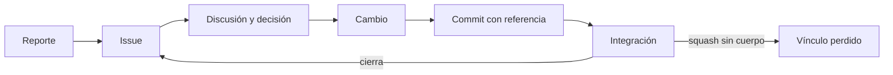
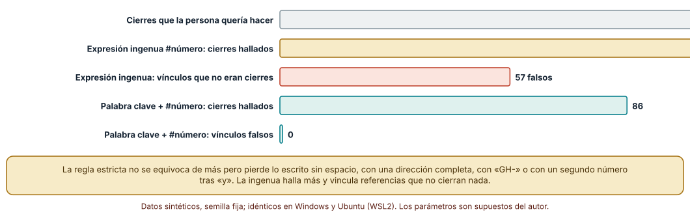
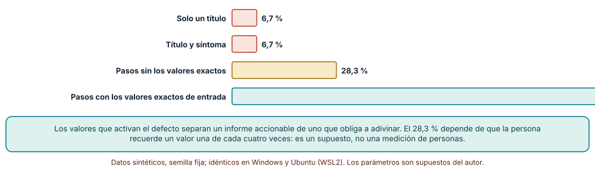
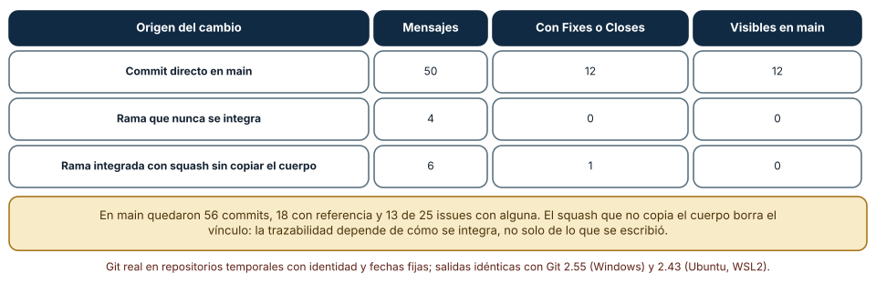

# SE-198 — Issues, discusiones y trazabilidad del cambio

[← SE-197 — Trunk-based, GitFlow y estrategias híbridas](../../classes/part-16-git-colaboracion-y-codigo-abierto/se-197-trunk-based-gitflow-y-estrategias-hibridas/README.md) · [↑ Parte 16](../../classes/part-16-git-colaboracion-y-codigo-abierto/README.md) · [📚 Índice completo](../../classes/README.md) · [🌐 Portal](../../site/classes/SE-198.html) · [SE-199 — Convenciones, ownership y CODEOWNERS →](../../classes/part-16-git-colaboracion-y-codigo-abierto/se-199-convenciones-ownership-y-codeowners/README.md)

## Punto profesional y fundamento pedagógico

**Punto profesional.** La clase existe para que cada cambio del repositorio se pueda atar al motivo que lo originó y cada motivo a los cambios que lo atendieron, de modo que alguien pueda preguntar «¿por qué está esto así?» y «¿qué falta de lo que se pidió?» sin depender de la memoria de nadie. Un issue es un registro de un problema o de una decisión; la trazabilidad es la propiedad de poder seguir el hilo en ambas direcciones.

**Por qué aparece aquí.** Se sitúa después de **Trunk-based, GitFlow y estrategias híbridas** y antes de **Convenciones, ownership y CODEOWNERS**. `SE-197` dejó un flujo con cambios pequeños e integrados con frecuencia; esta clase ata esos cambios a sus motivos. Deja el vínculo cambio–motivo sobre el que `SE-199` fija convenciones y propietarios.

**Error conceptual que debe corregir.** Creer que la trazabilidad es escribir «Fixes #12» en los mensajes y que con eso el historial queda trazable. El vínculo depende de la sintaxis exacta que reconozca la plataforma, de la rama a la que llega el cambio y de cómo se integra: un squash que descarta el cuerpo o un cambio que nunca llega a la rama por defecto borran el vínculo sin ningún error visible.

**Secuencia de aprendizaje.** Antes de leer la solución, predices qué mensajes vincularía una regla estricta y cuáles una ingenua y qué detalle de un informe permite reproducir un defecto; después extraes vínculos de 150 mensajes sintéticos con dos reglas, reproduces defectos a partir de informes con cuatro niveles de detalle y reconstruyes una matriz de trazabilidad sobre un repositorio con ramas, squash y ramas sin integrar. La secuencia usa predicción, explicación propia, contraste y recuperación. [ICAP](https://icap.education.asu.edu/research) distingue participación de construcción de conocimiento; [How People Learn II](https://nap.nationalacademies.org/catalog/24783/how-people-learn-ii-learners-contexts-and-cultures) exige conectar conocimiento previo, contexto y transferencia; la [práctica de recuperación](https://pubmed.ncbi.nlm.nih.gov/16507066/) respalda producir de nuevo la explicación tras una demora; y [Education for Life and Work](https://nap.nationalacademies.org/resource/13398/dbasse_084153.pdf) exige devolución que explique la causa del error.

**Evidencia de aprendizaje.** `trace-log.md` con la regla de extracción y su comparación con la ingenua, la tabla de reproducción según el detalle del informe, la matriz de trazabilidad con sus huecos y una plantilla de issue. Debe contener predicción previa, observación, explicación causal, contraejemplo y qué hallazgo haría cambiar la plantilla.

**Límite de la conclusión.** Los mensajes, los informes y el repositorio son sintéticos; la regla estricta modela las palabras clave y la sintaxis que documenta GitHub, no el comportamiento exacto de su analizador; la probabilidad de que un informe incluya los valores exactos es un supuesto del autor; no se midió ningún alojamiento real, a ninguna persona redactando informes ni un proyecto.

### Trazabilidad fuente → afirmación

| Fuente primaria u oficial | Afirmación que respalda | Lo que no prueba |
|---|---|---|
| [GitHub: vincular un PR con un issue](https://docs.github.com/en/issues/tracking-your-work-with-issues/using-issues/linking-a-pull-request-to-an-issue) | Lista las palabras clave de cierre, exige la sintaxis completa para cada issue y limita su interpretación a PR que llegan a la rama por defecto. | No describe cómo se comporta con otros alojamientos ni con historias de squash concretas. |
| [git-interpret-trailers](https://git-scm.com/docs/git-interpret-trailers) | Define los pies de un mensaje de commit como líneas `clave: valor` que se pueden añadir y leer con la herramienta. | No fija qué claves debe usar un proyecto. |
| [Gotel y Finkelstein, «An analysis of the requirements traceability problem» (ICRE, 1994)](https://doi.org/10.1109/ICRE.1994.292398) | Define la trazabilidad como la capacidad de seguir un elemento hacia su origen y hacia su uso y analiza por qué falla en la práctica. | No cuantifica el beneficio de ninguna herramienta. |

## Antes de empezar

Recupera lo aprendido en `SE-197`: un cambio pequeño integrado a menudo es revisable. La pregunta activa es: **¿cómo sé, desde el repositorio, por qué existe este cambio y qué cambios atendieron este problema?**

## Prerrequisitos

- Haber completado `SE-197` o poder explicar la diferencia entre una rama corta y una larga.
- Python 3.11 o posterior, Git 2.40 o posterior y un terminal.
- Trabajar en repositorios temporales y datos sintéticos; ningún issue de la clase es real.

## Problema auténtico

La plataforma de entregas recibe un reporte: «a veces la nota baja demasiado». Un commit dice «arregla penalización», otro «Fixes#42» y un tercero, integrado con squash, perdió su cuerpo con la referencia. Tres meses después alguien necesita saber por qué el tope es 72 horas, qué issue lo motivó y si el reporte original se cerró de verdad.

## Objetivos observables

Al terminar podrás:

1. escribir referencias a issues que una regla estricta reconozca y explicar cuáles pierde y por qué;
2. redactar un informe de defecto con los datos que permiten reproducirlo;
3. construir una matriz de trazabilidad commits↔issues desde el historial y detectar huérfanos;
4. explicar cómo la estrategia de integración puede borrar vínculos y cómo evitarlo;
5. decidir qué va en un issue, qué en una discusión y qué en el mensaje del commit.

## Mapa conceptual



El mapa se lee de izquierda a derecha: un reporte se convierte en issue, se discute, produce un cambio que lleva una referencia y, al integrarse, cierra el issue. El camino inferior muestra cómo se rompe el vínculo. No describe el orden temporal exacto de la discusión.

## Temas y por qué importan

| Tema | Por qué cambia una decisión profesional | Evidencia mínima |
|---|---|---|
| Qué es un issue | Registra un problema o una decisión pendiente, no una tarea suelta. | Predicción, traza causal y contraejemplo de **Qué es un issue** en `trace-log.md` |
| Informes reproducibles | Un informe sin los valores de entrada obliga a adivinar. | Predicción, traza causal y contraejemplo de **Informes reproducibles** en `trace-log.md` |
| Referencias en commits | Atan el cambio al motivo y permiten cerrar issues al integrar. | Predicción, traza causal y contraejemplo de **Referencias en commits** en `trace-log.md` |
| Discusiones y decisiones | Conservan el porqué que no cabe en un commit. | Predicción, traza causal y contraejemplo de **Discusiones y decisiones** en `trace-log.md` |
| Matriz de trazabilidad | Mide los huecos: cambios sin motivo y motivos sin cambio. | Predicción, traza causal y contraejemplo de **Matriz de trazabilidad** en `trace-log.md` |

## Conceptos y decisiones

### 1. Qué es un issue

Un issue es un registro de un problema, una propuesta o una decisión pendiente, con un identificador estable. Su valor está en que fija un lenguaje común sobre qué se quiere y permite medir qué falta. Mezclar varios problemas en un issue impide cerrarlos por separado, y un issue sin criterio de cierre queda abierto para siempre.

### 2. Informes reproducibles

Un buen informe de defecto dice qué se hizo, qué se esperaba, qué ocurrió, en qué versión y con qué entrada exacta. Lo decisivo es la entrada: un defecto que se activa con un valor concreto no se reproduce con una descripción vaga. La plantilla de issue existe para pedir esos datos antes de que alguien tenga que pedirlos en un comentario.

### 3. Referencias en commits

Un mensaje puede referenciar un issue (`Refs #42`) o cerrarlo (`Fixes #42`) con palabras clave que la plataforma reconoce. La documentación de GitHub lista `close`, `closes`, `closed`, `fix`, `fixes`, `fixed`, `resolve`, `resolves` y `resolved`, exige repetir la palabra para cada issue y solo las interpreta cuando el cambio llega a la rama por defecto. Los pies de commit estructurados (`Refs: #42`) son legibles por herramientas como `git interpret-trailers` y no dependen de una plataforma.

### 4. Discusiones y decisiones

El porqué de una decisión (por qué 72 horas y no 48) vive mejor en un lugar buscable con enlaces que en un commit. Una discusión larga debe terminar en una decisión registrada: qué se decidió, quién, cuándo y qué evidencia la cambiaría. Si el resultado solo existe en el código, la siguiente persona lo toma por accidente.

### 5. Matriz de trazabilidad

Una matriz de trazabilidad relaciona cambios con motivos y expone huérfanos en ambos sentidos: commits sin motivo (¿por qué existe esto?) e issues sin cambio (¿se atendió?). No exige que todo commit tenga issue, pero exige decidir cuáles pueden no tenerlo. Medirla desde el historial real es la única forma de saber si el proceso funciona, y es sensible a cómo se integran los cambios.

### Qué cierres reconoce cada regla

Se escribieron 150 mensajes sintéticos con doce plantillas (`Fixes #n`, `fixes: #n`, `Fixes#n`, `Fix #a and #b`, `Refs #n`, direcciones completas, `GH-n`, entre otras). Las personas querían cerrar 132 issues. La **expresión ingenua** (`#número`) halló 113 y vinculó además **57 referencias que no cerraban nada** (por ejemplo `Related to #12`); la **regla estricta** (palabra clave más `#número`, con dos puntos opcionales) halló 86 y **0 falsos**. Los 46 cierres que la estricta pierde vienen de cuatro plantillas: `Fixes#n` sin espacio (17), el segundo número tras «and» (10), `GH-n` (10) y una dirección completa (9). Los resultados fueron idénticos en Windows y Ubuntu.



**Cómo leer la figura.** La barra gris son los cierres intencionados; las doradas y las verdes, los hallados por cada regla; la coral, los vínculos falsos de la ingenua. **Dónde deja de valer:** la regla estricta modela la sintaxis documentada, no el analizador de ninguna plataforma, y las plantillas de mensajes son del autor; en un proyecto real se mide sobre sus propios mensajes y con la plataforma, que puede reconocer formas (como una dirección completa) que esta regla no ve.

### Cuánto detalle hace falta para reproducir

Se definieron seis defectos de la regla de penalización, cada uno activado por una entrada concreta (por ejemplo, exactamente 24 horas de retraso con nota 100). Para cada nivel de detalle se simularon 120 informes. Con **solo un título** o con **título y síntoma**, un script que intenta reproducir con cinco entradas al azar lo logró en 8 de 120 (**6,7 %**). Con **pasos pero sin los valores exactos** (la entrada correcta en uno de cada cuatro informes), 34 de 120 (**28,3 %**). Con **los valores exactos**, 120 de 120 (**100 %**).



**Cómo leer la figura.** Cada barra es un nivel de detalle con los mismos seis defectos y la misma semilla; el script reproduce solo con lo que dice el informe. **Dónde deja de valer:** que una de cada cuatro personas recuerde el valor es un supuesto, no una medición, y un script que prueba al azar no es una persona que investiga; la figura muestra el efecto de los datos, no cuánto tardaría alguien en reproducir.

### Matriz de trazabilidad sobre un repositorio con ramas

Se generaron 60 cambios sobre 25 issues, con tres orígenes: commits directos en `main` (50), ramas que nunca se integran (4) y ramas integradas con squash que descarta el cuerpo (6). Sobre `main` quedaron 56 commits, 18 con referencia a un issue y 13 de los 25 issues con alguna referencia. De los mensajes con `Fixes` o `Closes`, los 12 hechos en commits directos siguen visibles en `main`; el único con squash, **no** (el commit de integración dice solo «Integra rama»); y ninguna de las cuatro ramas sin integrar tenía cierres, pero sus cambios tampoco están en `main`.



**Cómo leer la figura.** Cada fila es un origen de cambio; las columnas cuentan mensajes totales, los que cierran un issue y los que siguen visibles en `main` tras la integración. **Dónde deja de valer:** el repositorio es pequeño y la proporción de squash es del autor; el ejemplo muestra el mecanismo (el vínculo depende de la integración), no cuántos vínculos pierde un proyecto, y no cubre los vínculos mantenidos en la descripción del PR, que el alojamiento puede conservar aparte.

## Definiciones de trabajo

- **issue:** registro con identificador estable de un problema, una propuesta o una decisión pendiente.
- **referencia de cierre:** palabra clave seguida del identificador de un issue que lo cierra al integrarse en la rama por defecto.
- **pie de commit:** línea `clave: valor` al final del mensaje de un commit, legible por herramientas.
- **trazabilidad:** propiedad de poder seguir un elemento hacia su origen y hacia sus usos.
- **huérfano:** commit sin motivo registrado o issue sin cambio asociado.

Las definiciones son operativas para la plataforma de entregas. No convierten términos con historia más amplia en sinónimos y deben contrastarse con la documentación primaria enlazada al final.

## Ejemplo mínimo

El fragmento extrae los cierres de un mensaje. Antes de ejecutarlo, predice cuántos números encontrará.

```python
import re
CIERRE = re.compile(r"\b(?:close[sd]?|fix(?:es|ed)?|resolve[sd]?):?\s+#(\d+)", re.I)
print(CIERRE.findall("Fixes #12, fixes #13 y refs #14"))   # ['12', '13']
```

Registra versión de Python y salida, y repite con `Fixes#12` y con `Fix #12 and #13` para ver qué pierde.

## Ejemplo profesional

En la plataforma, la plantilla de issue pide versión, pasos con los valores exactos, resultado esperado y observado. Los commits llevan un pie `Refs: #42` y la descripción del PR repite `Fixes #42` en la forma documentada. Un trabajo de integración continua construye la matriz de trazabilidad cada semana: cuenta commits de `main` sin referencia, issues cerrados sin commit en `main` y cierres cuyo PR se integró con squash sin cuerpo. El resultado alimenta una conversación sobre el proceso, no un indicador de personas.

Compara el caso normal con un repositorio donde todo se integra con squash y el mensaje final lo escribe la persona que integra: la práctica es apropiada cuando el mensaje del squash se genera a partir de la descripción del PR con sus referencias; es peligrosa cuando el cuerpo se descarta y el vínculo desaparece sin aviso.

## Práctica guiada

1. Escribe diez mensajes con formas distintas de referenciar un issue y predice cuántos reconocerá la regla estricta.
2. Implementa la regla estricta y la ingenua y compara cierres hallados y falsos.
3. Diseña una plantilla de issue y predice qué porcentaje de informes se reproducirá con cada nivel de detalle.
4. Simula los informes con una semilla fija y registra los porcentajes.
5. Genera un repositorio con commits directos, ramas sin integrar y squash sin cuerpo y construye la matriz.
6. Cambia la estrategia de integración para conservar las referencias y repite la matriz.
7. Pide a otra persona que reconstruya tu plantilla solo desde `trace-log.md` y registra qué dato le faltó.

## Ejercicios

1. **Más palabras clave:** añade `GH-n` a la regla y mide cuántos falsos nuevos aparecen en tus mensajes; decide si vale la pena.
2. **Pie estructurado:** sustituye la regla por `git interpret-trailers --parse` y compara qué reconoce.
3. **Descripción del PR:** diseña cómo conservarías las referencias de un PR integrado con squash y qué comprobarías cada semana.
4. **Dueño de la decisión:** escribe el registro de la decisión «tope de 72 horas» con responsable, fecha y evidencia que la cambiaría.

## Reto verificable

Entrega `trace-log.md` con la regla de extracción y su comparación, la tabla de reproducción, la matriz de trazabilidad con sus huecos y una plantilla de issue. Se aprueba si otra persona ejecuta el código desde un directorio vacío, obtiene los mismos conteos y puede decir qué vínculo perdería un cambio integrado con squash. No se aprueba por el número de issues ni por una cobertura del 100 % sin explicar qué se excluyó.

## Caso conductor

El repositorio de la plataforma de entregas es el caso conductor de la Parte 16. Esta clase deja la plantilla de issue, la regla de referencias y la matriz de trazabilidad. `SE-199` fija convenciones de mensajes y propietarios y `SE-200` extiende la trazabilidad a contribuciones externas. Cambia después un solo dato, la proporción de ramas integradas con squash, y revisa cuántos cierres quedan visibles.

## Preguntas frecuentes

### ¿Todo commit debe tener un issue?

No: un cambio de formato o de dependencias menores puede no tenerlo. La regla útil es decidir qué tipos pueden no tenerlo y medir el resto.

### ¿Dónde va el porqué, en el issue o en el commit?

En ambos con funciones distintas: el issue contiene la discusión y el contexto, y el commit lo resume en una línea y enlaza al issue. El commit viaja con el código si el repositorio cambia de alojamiento; el issue puede no hacerlo.

### ¿Un issue cerrado significa que el defecto está corregido?

Significa que alguien lo cerró. La corrección se comprueba con una prueba que falla antes y pasa después; un cierre automático solo prueba que un cambio con la palabra clave llegó a la rama por defecto.

### ¿Cómo se trazan los cambios sin issue?

Con un tipo de cambio reconocible (por ejemplo, un prefijo) y una regla que los permita. Lo que no debe pasar es que no haya forma de saber por qué existen.

## Fallo controlado y diagnóstico

Reproduce el fallo clásico de la clase: **dar por trazable un cambio cuyo vínculo no sobrevivió a la integración**. Usa el squash sin cuerpo.

Registra síntoma, entrada mínima, hipótesis, observación que descarta cada hipótesis, causa, corrección y prueba de regresión. **Síntoma:** un issue sigue abierto aunque el commit que lo corrige está en `main` y decía `Fixes #42`. **Hipótesis rivales:** (a) la sintaxis de la referencia era incorrecta; (b) el commit con la referencia no es el que llegó a `main`. **Prueba:** busca `Fixes #42` en `git log main`: no aparece; sí aparece en la rama original, y el commit de `main` dice «Integra rama». **Conclusión:** la causa es (b): el squash descartó el cuerpo. **Regresión:** añade al mensaje del squash la referencia (copiada de la descripción del PR) y una comprobación semanal que liste cierres presentes en ramas pero ausentes en `main`. No cambies a la vez la sintaxis y la estrategia de integración.

## Errores comunes y cómo corregirlos

| Síntoma | Causa probable | Corrección |
|---|---|---|
| El issue no se cierra al integrar | La sintaxis no es la reconocida o falta la palabra por cada issue | Repetir la palabra clave para cada número y usar la forma documentada |
| El vínculo desaparece tras el squash | El mensaje final no copia el cuerpo | Generar el mensaje del squash desde la descripción del PR |
| No se puede reproducir un defecto | El informe no tiene la entrada exacta | Usar una plantilla que pida los valores y la versión |
| Se vinculan cosas que no cierran nada | Regla ingenua sobre cualquier `#número` | Usar palabras clave y distinguir referencia de cierre |
| El issue se cierra sin que el defecto desaparezca | No hay prueba que falle antes y pase después | Añadir la prueba de regresión como criterio de cierre |

## Entorno y archivos clave

```text
work/SE-198/
├── README.md
├── trazabilidad/
│   ├── extraer.py
│   ├── reproducir.py
│   └── matriz.py
├── .github/ISSUE_TEMPLATE/defecto.md
└── evidence/trace-log.md
```

El `README` declara sistema operativo, versión de Git y de Python, semillas y comandos. Los experimentos usan `re`, `random` y repositorios temporales con identidad y fechas fijas y se ejecutaron con CPython 3.12.9 y Git 2.55 en Windows 11 y con CPython 3.12.3 y Git 2.43 en Ubuntu bajo WSL2: las salidas fueron idénticas. Si automatizas con otra biblioteca, fija procedencia y versión.

## Seguridad, ética y accesibilidad

- los issues y los mensajes de commit son públicos si el repositorio lo es: no incluyas datos personales, credenciales ni detalles de vulnerabilidades sin corregir;
- las vulnerabilidades se reportan por un canal privado, no en un issue público;
- una matriz de trazabilidad mide el proceso, no a las personas: no la uses para clasificar individuos;
- redacta las plantillas con lenguaje claro y ofrece una alternativa textual a las tablas de resultados;
- respeta la licencia de los fragmentos de código o de registros que adjunten los informes.

## Puente hacia el trabajo con agentes

Un agente al que se le pide «abre un issue para este error» suele escribir un título y un párrafo sin la entrada exacta ni la versión. Pídele que use la plantilla, que incluya el comando mínimo para reproducir, el resultado esperado y el observado y la versión, que proponga una prueba que falle antes del arreglo y que ponga la referencia de cierre en la descripción del PR en la forma documentada. Revisa especialmente si el issue contiene datos reales copiados de un registro: es el mismo defecto de informar sin pensar en quién lo lee.

## Transferencia

Traslada el análisis a otro sistema donde un cambio debe atarse a su motivo (por ejemplo, cambios de infraestructura y tickets de operación): decide qué sería la referencia, qué paso podría borrarla y cómo medirías los huérfanos. La transferencia está lograda cuando puedes explicar qué parte de la regla dependía de la plataforma, no cuando las palabras clave se parecen.

## Evaluación y evidencia

| Criterio | Evidencia para aprobar |
|---|---|
| comprensión | explicación de qué reconoce una regla estricta y qué pierde |
| corrección | conteos reproducibles de cierres, reproducción y matriz con las mismas semillas |
| diseño | plantilla de issue y regla de referencias |
| diagnóstico | reproducción del fallo «vínculo perdido por el squash» con regresión |
| incertidumbre | declaración de qué parte depende de las plantillas y probabilidades del autor |
| reproducibilidad | versiones, comandos, salida y límites declarados |

## Fuentes

- [GitHub: vincular un PR con un issue](https://docs.github.com/en/issues/tracking-your-work-with-issues/using-issues/linking-a-pull-request-to-an-issue) — palabras clave, sintaxis y condiciones; autoridad: GitHub Docs.
- [GitHub: plantillas de issues y PR](https://docs.github.com/en/communities/using-templates-to-encourage-useful-issues-and-pull-requests/about-issue-and-pull-request-templates) — plantillas para pedir contexto; autoridad: GitHub Docs.
- [git-interpret-trailers](https://git-scm.com/docs/git-interpret-trailers) — pies de commit estructurados; autoridad: documentación de Git.
- [Gotel y Finkelstein, «An analysis of the requirements traceability problem» (ICRE, 1994)](https://doi.org/10.1109/ICRE.1994.292398) — definición y problemas de la trazabilidad; autoridad: IEEE ICRE.
- [git-log](https://git-scm.com/docs/git-log) — consulta del historial para la matriz; autoridad: documentación de Git.

Cada fuente respalda el mecanismo indicado; ninguna demuestra que la plantilla de issue de la plataforma de entregas sea la adecuada para otro proyecto. Esa afirmación depende de los datos que sus defectos necesiten.

- [git-commit](https://git-scm.com/docs/git-commit) — mensajes y pies de commit.
- [Python: `re`](https://docs.python.org/3/library/re.html) — expresiones regulares usadas en la extracción.

## Límites y siguiente paso

Se ejecutaron tres experimentos con repositorios temporales y datos sintéticos en Windows y Ubuntu (WSL2) con resultados idénticos. La regla estricta modela la sintaxis documentada y no el analizador de ninguna plataforma, las plantillas y probabilidades son del autor y no se midió ningún alojamiento, proyecto ni persona. La siguiente clase pregunta cómo se acuerdan las convenciones que hacen estos vínculos coherentes y quién responde por cada parte del código.

## Glosario

- **issue:** registro con identificador estable de un problema, una propuesta o una decisión pendiente.
- **referencia de cierre:** palabra clave seguida del identificador de un issue que lo cierra al integrarse en la rama por defecto.
- **pie de commit:** línea `clave: valor` al final del mensaje de un commit, legible por herramientas.
- **trazabilidad:** propiedad de poder seguir un elemento hacia su origen y hacia sus usos.
- **huérfano:** commit sin motivo registrado o issue sin cambio asociado.

---

[← SE-197 — Trunk-based, GitFlow y estrategias híbridas](../../classes/part-16-git-colaboracion-y-codigo-abierto/se-197-trunk-based-gitflow-y-estrategias-hibridas/README.md) · [↑ Parte 16](../../classes/part-16-git-colaboracion-y-codigo-abierto/README.md) · [📚 Índice completo](../../classes/README.md) · [🌐 Portal](../../site/classes/SE-198.html) · [SE-199 — Convenciones, ownership y CODEOWNERS →](../../classes/part-16-git-colaboracion-y-codigo-abierto/se-199-convenciones-ownership-y-codeowners/README.md)
