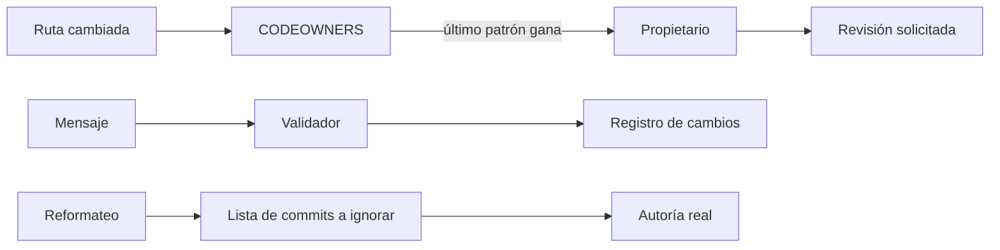
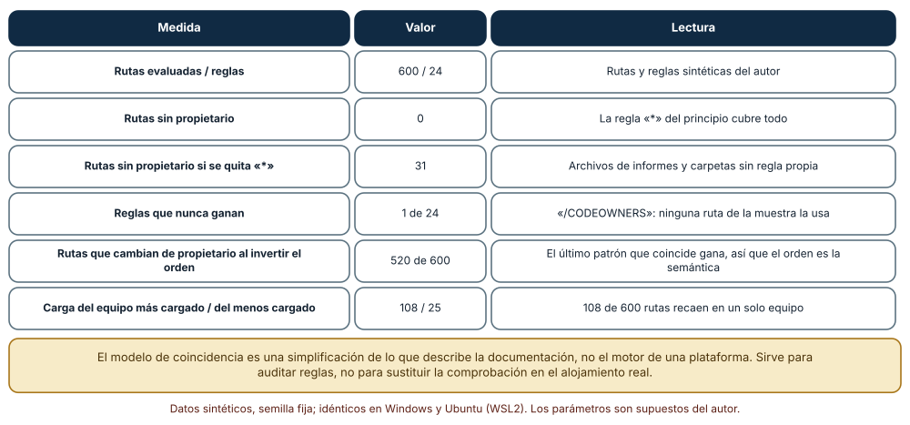
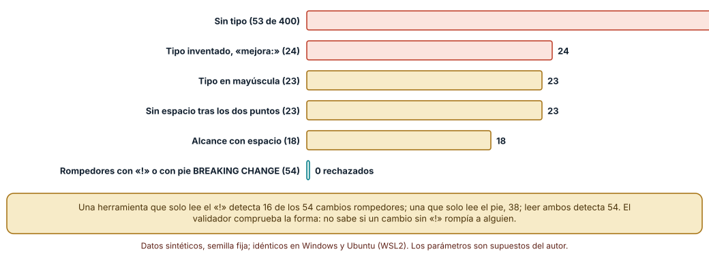
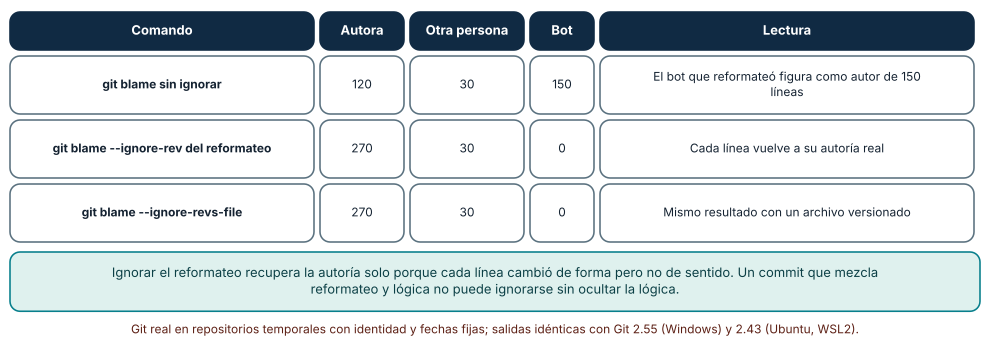

# SE-199 — Convenciones, ownership y CODEOWNERS

[← SE-198 — Issues, discusiones y trazabilidad del cambio](../../classes/part-16-git-colaboracion-y-codigo-abierto/se-198-issues-discusiones-y-trazabilidad-del-cambio/README.md) · [↑ Parte 16](../../classes/part-16-git-colaboracion-y-codigo-abierto/README.md) · [📚 Índice completo](../../classes/README.md) · [🌐 Portal](../../site/classes/SE-199.html) · [SE-200 — Contribución, gobernanza y comunidades abiertas →](../../classes/part-16-git-colaboracion-y-codigo-abierto/se-200-contribucion-gobernanza-y-comunidades-abiertas/README.md)

## Punto profesional y fundamento pedagógico

**Punto profesional.** La clase existe para que las reglas de colaboración (cómo se escribe un mensaje, quién responde por qué parte del código, quién debe revisar qué) sean explícitas, comprobables y auditables, y no un acuerdo tácito que solo conocen las personas que llevan tiempo en el equipo. Una convención sirve si una máquina puede comprobarla; un propietario sirve si una máquina puede encontrarlo.

**Por qué aparece aquí.** Se sitúa después de **Issues, discusiones y trazabilidad del cambio** y antes de **Contribución, gobernanza y comunidades abiertas**. `SE-198` dejó cambios atados a su motivo; esta clase añade quién debe ver cada cambio y cómo se escribe el historial para que las herramientas lo lean. Deja las reglas de propiedad y de formato sobre las que `SE-200` abre el proyecto a contribuciones externas.

**Error conceptual que debe corregir.** Creer que un archivo de propietarios o una convención de mensajes funcionan por existir. Un CODEOWNERS cuyas reglas se tapan entre sí, que deja rutas sin dueño o que depende del orden sin que nadie lo sepa produce una falsa sensación de control; y una convención de mensajes que solo valida la forma no sabe si un cambio rompía a alguien.

**Secuencia de aprendizaje.** Antes de leer la solución, predices cuántas rutas quedan sin propietario y qué pasa al reordenar las reglas; después evalúas un CODEOWNERS sintético de 24 reglas sobre 600 rutas, validas 400 mensajes con una convención y reconstruyes la autoría de un archivo reformateado con y sin la lista de commits a ignorar. La secuencia usa predicción, explicación propia, contraste y recuperación. [ICAP](https://icap.education.asu.edu/research) distingue participación de construcción de conocimiento; [How People Learn II](https://nap.nationalacademies.org/catalog/24783/how-people-learn-ii-learners-contexts-and-cultures) exige conectar conocimiento previo, contexto y transferencia; la [práctica de recuperación](https://pubmed.ncbi.nlm.nih.gov/16507066/) respalda producir de nuevo la explicación tras una demora; y [Education for Life and Work](https://nap.nationalacademies.org/resource/13398/dbasse_084153.pdf) exige devolución que explique la causa del error.

**Evidencia de aprendizaje.** `rules-log.md` con las reglas de propietarios y sus métricas, la convención de mensajes con su validador, la medición de autoría con y sin ignorar y una lista de qué reglas no comprueba ninguna máquina. Debe contener predicción previa, observación, explicación causal, contraejemplo y qué hallazgo haría cambiar una regla.

**Límite de la conclusión.** El modelo de coincidencia es una simplificación de lo que describe la documentación y no el motor de ninguna plataforma; las rutas, los equipos, los 400 mensajes y sus proporciones son del autor; el reformateo de la prueba cambia solo la sangría; no se midió el efecto de ninguna convención en ningún equipo.

### Trazabilidad fuente → afirmación

| Fuente primaria u oficial | Afirmación que respalda | Lo que no prueba |
|---|---|---|
| [GitHub: acerca de los propietarios de código](https://docs.github.com/en/repositories/managing-your-repositorys-settings-and-features/customizing-your-repository/about-code-owners) | El último patrón que coincide es el que manda, la sintaxis sigue la mayor parte de gitignore con excepciones (sin negación con `!`, sin rangos `[ ]`, sin escape de `#`) y el archivo debe pesar menos de 3 MB. | No describe el motor exacto ni cómo se comporta con rutas que tengan caracteres especiales. |
| [Conventional Commits 1.0.0](https://www.conventionalcommits.org/en/v1.0.0/) | Define un formato `tipo(alcance)!: descripción` y dos formas de marcar un cambio rompedor: el `!` y el pie `BREAKING CHANGE`. | No prueba que seguirla mejore un proyecto ni que el tipo refleje el impacto real. |
| [git-blame](https://git-scm.com/docs/git-blame) | Documenta `--ignore-rev` y `--ignore-revs-file` para saltar commits de reformateo al atribuir líneas. | No garantiza una atribución correcta cuando el reformateo cambia el sentido de las líneas. |

## Antes de empezar

Recupera lo aprendido en `SE-198`: un vínculo depende de la sintaxis exacta y de cómo se integra. La pregunta activa es: **¿qué regla de colaboración puede comprobar una máquina, quién responde por cada ruta y qué pasa cuando las reglas se tapan entre sí?**

## Prerrequisitos

- Haber completado `SE-198` o poder explicar por qué una referencia de cierre puede perderse.
- Python 3.11 o posterior, Git 2.40 o posterior y un terminal.
- Trabajar en repositorios temporales y con equipos y rutas ficticios.

## Problema auténtico

La plataforma de entregas tiene un archivo de propietarios con 24 reglas escritas por distintas personas a lo largo de un año. Un PR que toca la migración de notas no pidió revisión del equipo de datos y nadie supo por qué; otro sí pidió a un equipo que ya no existe. A la vez, el registro de cambios generado de los mensajes omite varias entradas, y el comando de autoría atribuye 150 líneas a un bot que solo reformateó.

## Objetivos observables

Al terminar podrás:

1. escribir un archivo de propietarios y evaluar sus huecos, reglas muertas y dependencia del orden sobre un conjunto de rutas;
2. definir una convención de mensajes y un validador y medir qué rechaza y qué no puede ver;
3. explicar qué cambios rompedores detecta una herramienta según qué marca lea;
4. recuperar la autoría real tras un reformateo y declarar cuándo no se puede;
5. decidir qué convenciones se comprueban en integración continua y cuáles quedan para una persona.

## Mapa conceptual



El mapa se lee como tres canales de reglas comprobables: de la ruta al propietario y a la revisión, del mensaje al registro de cambios y del reformateo a la autoría. En los tres, lo que no está escrito no se comprueba. No describe cuánto tarda cada comprobación.

## Temas y por qué importan

| Tema | Por qué cambia una decisión profesional | Evidencia mínima |
|---|---|---|
| Propietarios de código | Deciden quién debe ver cada cambio; un hueco deja un cambio sin revisión con dueño. | Predicción, traza causal y contraejemplo de **Propietarios de código** en `rules-log.md` |
| Orden y sombras | El último patrón gana: reordenar cambia el significado sin cambiar las reglas. | Predicción, traza causal y contraejemplo de **Orden y sombras** en `rules-log.md` |
| Convención de mensajes | Alimenta registros de cambios y versionado; una forma común se comprueba. | Predicción, traza causal y contraejemplo de **Convención de mensajes** en `rules-log.md` |
| Cambios rompedores | Si una herramienta no los ve, un consumidor se entera al romperse. | Predicción, traza causal y contraejemplo de **Cambios rompedores** en `rules-log.md` |
| Autoría y reformateo | Un reformateo masivo distorsiona quién conoce el código si no se ignora. | Predicción, traza causal y contraejemplo de **Autoría y reformateo** en `rules-log.md` |

## Conceptos y decisiones

### 1. Propietarios de código

Un archivo CODEOWNERS asocia patrones de ruta con personas o equipos. Cuando un PR toca una ruta, la plataforma pide revisión a los propietarios y, si la protección de rama lo exige, requiere su aprobación. Un propietario es una responsabilidad, no un privilegio: debe ser alguien que pueda revisar y que exista. Una ruta sin propietario es un cambio sin responsable, y la regla `*` al principio cubre ese riesgo a cambio de que todo caiga en el mismo equipo.

### 2. Orden y sombras

La documentación establece que el último patrón que coincide es el que manda. Esto convierte el orden en parte del significado: una regla específica debe ir después de una general. Una regla posterior más amplia puede tapar a una anterior más específica sin que nada avise, y una regla puede no ganar nunca porque las demás la cubren. La sintaxis imita gitignore con excepciones (no se pueden negar patrones con `!`), de modo que lo que un autor da por sabido de gitignore puede no valer aquí.

### 3. Convención de mensajes

Una convención como Conventional Commits fija una forma legible por máquinas: un tipo (`feat`, `fix`, `docs`…), un alcance opcional y una descripción. Sirve para generar registros de cambios, decidir el número de versión y filtrar el historial. Su valor depende de que se cumpla, y por eso se comprueba en un gancho local o en integración continua. Es una convención de forma: no sabe si el tipo es el correcto.

### 4. Cambios rompedores

Conventional Commits marca un cambio rompedor con un `!` tras el tipo o con un pie `BREAKING CHANGE:`. Si la herramienta que genera versiones o registros solo lee una de las dos marcas, ignora la otra. La marca la pone una persona: si no sabe que un cambio rompe a un consumidor, no la pone, y ninguna herramienta la añade por sí sola.

### 5. Autoría y reformateo

`git blame` atribuye cada línea al último commit que la tocó. Un commit que solo reformatea (cambia sangría o comillas) se queda con la autoría de miles de líneas y oculta quién conoce de verdad el código. Git permite ignorar commits concretos con `--ignore-rev` o un archivo de revisiones a ignorar. La técnica funciona cuando el reformateo no cambia el sentido; si mezcla cambios de lógica, ignorarlo también oculta esa lógica.

### Un archivo de propietarios evaluado

Se escribió un CODEOWNERS sintético de 24 reglas para nueve equipos y se evaluó sobre 600 rutas generadas con el modelo de coincidencia de la documentación (el último patrón que coincide gana). **Ninguna ruta** quedó sin propietario gracias a la regla `*` del principio; sin ella, **31 rutas** (informes, carpetas sin regla propia) no tendrían dueño. Una regla de las 24 (`/CODEOWNERS`) **nunca ganó**. Al **invertir el orden** de las reglas, **520 de las 600 rutas** cambiaron de propietario. El equipo más cargado respondió por 108 rutas y el menos cargado por 25.



**Cómo leer la figura.** Cada fila es una métrica del mismo archivo y las mismas rutas; la última columna dice qué significa. **Dónde deja de valer:** el modelo de coincidencia es una simplificación y las rutas son sintéticas; en un repositorio real hay que comprobar con la plataforma qué propietarios pide para un PR de prueba, y un equipo con 108 rutas puede ser el correcto si es el que conoce esa parte.

### Qué rechaza un validador de mensajes

Se generaron 400 mensajes con ocho categorías y proporciones del autor. El validador (un tipo de una lista, alcance opcional sin espacios, `!` opcional, dos puntos, espacio y descripción) aceptó 259 y rechazó 141: 53 sin tipo, 24 con un tipo inventado («mejora:»), 23 con el tipo en mayúscula, 23 sin espacio tras los dos puntos y 18 con un alcance con espacio. Aceptó los 54 mensajes de cambio rompedor bien formados. Sobre esos 54, una herramienta que solo lee el `!` detecta **16**, una que solo lee el pie `BREAKING CHANGE`, **38**, y una que lee ambos, **54**.



**Cómo leer la figura.** Cada barra cuenta mensajes rechazados por una categoría de error de forma; la última barra muestra que los rompedores bien formados no se rechazan. **Dónde deja de valer:** las categorías y proporciones son del autor, no un muestreo de mensajes reales, y un validador que acepta el mensaje no sabe si el tipo o la marca de cambio rompedor son correctos; el 100 % de detección con ambas marcas supone que las personas las pusieron.

### Autoría tras un reformateo

Un archivo de 300 líneas escrito por una persona recibió anotaciones en 30 líneas de otra y después un commit de un bot que cambió la sangría de 150 líneas. `git blame` sin ignorar atribuyó 120 líneas a la autora, 30 a la otra persona y **150 al bot**. Con `--ignore-rev` del commit de reformateo, la autoría fue 270 a la autora y 30 a la otra persona; con `--ignore-revs-file` y un archivo versionado con ese commit, el resultado fue idéntico. Idéntico con Git 2.55 en Windows y 2.43 en Ubuntu.



**Cómo leer la figura.** Cada fila es una forma de ejecutar `git blame` sobre el mismo archivo; las columnas cuentan las líneas atribuidas. **Dónde deja de valer:** el reformateo solo cambió la sangría y cada línea conservó su sentido; con un reformateo que parte líneas o renombra variables, la atribución a la autora original es una aproximación, y un commit que mezcla formato y lógica no puede ignorarse sin ocultar la lógica.

## Definiciones de trabajo

- **propietario de código:** persona o equipo responsable de una ruta y a quien se pide revisión cuando cambia.
- **regla muerta:** regla de propietarios que nunca gana porque otras, posteriores, cubren todo lo que ella cubre.
- **convención de mensajes:** forma común de los mensajes de commit legible por máquinas.
- **cambio rompedor:** cambio que puede romper a quien usa una interfaz y se marca con `!` o con el pie `BREAKING CHANGE`.
- **revisiones a ignorar:** lista de commits (normalmente reformateos) que `git blame` salta al atribuir líneas.

Las definiciones son operativas para la plataforma de entregas. No convierten términos con historia más amplia en sinónimos y deben contrastarse con la documentación primaria enlazada al final.

## Ejemplo mínimo

El fragmento muestra quién gana en un archivo de propietarios. Antes de ejecutarlo, predice el propietario de `src/penal/x.py`.

```text
*                  @equipo-plataforma
/src/              @equipo-plataforma
/src/penal/        @equipo-reglas
*.md               @equipo-docs
```

Gana `/src/penal/` (el último que coincide). Cambia el orden poniendo `/src/penal/` antes de `/src/` y registra qué propietario se pide ahora.

## Ejemplo profesional

En la plataforma, el archivo de propietarios tiene un comentario por regla con su motivo, una regla `*` al principio para que ninguna ruta quede sin dueño y reglas específicas al final. Un trabajo de integración continua carga el archivo, lo evalúa sobre las rutas del repositorio y falla si hay una ruta sin propietario, una regla que nunca gana o un propietario que no existe. Los mensajes se validan con un gancho y con integración continua, y un archivo de revisiones a ignorar lista los reformateos masivos con una explicación.

Compara el caso normal con un archivo editado a mano durante meses: la práctica es apropiada cuando las métricas de huecos y reglas muertas se revisan cada vez que cambia el archivo; es peligrosa cuando nadie sabe que reordenar dos líneas cambia a quién se pide revisión de 520 rutas.

## Práctica guiada

1. Escribe un archivo de propietarios de unas 20 reglas para el repositorio de la plataforma y predice cuántas rutas quedarán sin dueño.
2. Implementa el modelo de coincidencia y evalúalo sobre 600 rutas generadas con una semilla fija.
3. Invierte el orden de las reglas y cuenta las rutas que cambian de propietario.
4. Define la convención de mensajes, genera 400 mensajes con categorías y mide qué rechaza el validador.
5. Mide cuántos cambios rompedores detecta una herramienta que lee solo el `!`, solo el pie o ambos.
6. Reformatea la sangría de un archivo en un commit de un bot y compara `git blame` con y sin `--ignore-rev`.
7. Pide a otra persona que reconstruya tus reglas solo desde `rules-log.md` y registra qué motivo le faltó.

## Ejercicios

1. **Regla muerta:** escribe una regla que nunca gane y explica cómo la detectaría tu evaluador.
2. **Equipo sobrecargado:** reparte las 108 rutas del equipo más cargado y explica qué evidencia usarías para decidir quién las asume.
3. **Reformateo mixto:** crea un commit que reformatea y además cambia una línea de lógica y explica qué se pierde al ignorarlo.
4. **Qué automatizar:** decide qué convenciones de tu proyecto comprobaría una máquina y cuáles una persona, y qué métrica te haría cambiar.

## Reto verificable

Entrega `rules-log.md` con el archivo de propietarios y sus métricas, la convención de mensajes con su validador, la comparación de herramientas para cambios rompedores y la medición de autoría. Se aprueba si otra persona ejecuta el código desde un directorio vacío, obtiene los mismos conteos y puede decir qué regla deja un cambio sin revisión con dueño. No se aprueba por el número de reglas.

## Caso conductor

El repositorio de la plataforma de entregas es el caso conductor de la Parte 16. Esta clase deja el archivo de propietarios, la convención de mensajes y la lista de revisiones a ignorar. `SE-200` abre el proyecto a contribuciones externas y necesita estas reglas para recibirlas y `SE-202` protege la rama con ellas. Cambia después un solo dato, el orden de dos reglas, y revisa qué rutas cambian de propietario.

## Preguntas frecuentes

### ¿Un CODEOWNERS obliga a revisar?

Solo si la protección de rama exige la revisión de los propietarios; sin esa configuración, el archivo pide revisión pero no la exige. La documentación de la plataforma indica que, cuando se exige, basta la aprobación de uno de los propietarios de la regla.

### ¿Hace falta la regla `*`?

Garantiza que toda ruta tenga un propietario, a costa de concentrar lo no asignado en un equipo. Sin ella se deben cubrir todas las rutas con reglas específicas, que se desactualizan.

### ¿Seguir Conventional Commits es obligatorio?

No: es una convención. Su valor aparece si se usa para generar registros o versiones; si nadie los usa, la convención solo añade fricción.

### ¿Se puede reescribir la historia para corregir la autoría?

No hace falta ni conviene: el archivo de revisiones a ignorar corrige la atribución sin reescribir.

## Fallo controlado y diagnóstico

Reproduce el fallo clásico de la clase: **creer que el archivo de propietarios dice lo que su autor tenía en mente cuando las reglas se tapan entre sí**. Usa el cambio de orden de dos reglas.

Registra síntoma, entrada mínima, hipótesis, observación que descarta cada hipótesis, causa, corrección y prueba de regresión. **Síntoma:** un PR que modifica una migración de notas no pide revisión al equipo de datos. **Hipótesis rivales:** (a) el equipo de datos no tiene permisos de escritura; (b) otra regla posterior cubre la ruta y gana. **Prueba:** evalúa la ruta con el modelo: el último patrón que coincide es `/src/penal/` y no `/src/penal/migraciones/`, que quedó antes. **Conclusión:** la causa es (b): el orden de las reglas. **Regresión:** reordena para que lo específico vaya después de lo general y añade una prueba que evalúe rutas clave contra el propietario esperado. No cambies a la vez el orden y los equipos.

## Errores comunes y cómo corregirlos

| Síntoma | Causa probable | Corrección |
|---|---|---|
| Un PR no pide revisión a quien debería | Una regla posterior cubre la ruta | Poner lo específico después de lo general y probar rutas clave |
| Hay rutas sin propietario | No hay regla `*` ni reglas para esa carpeta | Añadir una regla por defecto y revisar las métricas |
| El validador acepta mensajes sin sentido | Solo valida la forma | Complementar con revisión y no usarlo como prueba de calidad |
| Un cambio rompedor no aparece en el registro | Se marcó con `!` y la herramienta lee solo el pie | Usar una herramienta que lea ambas marcas o fijar una |
| El bot de formato figura como autor | Su commit no se ignora en `blame` | Versionar la lista de revisiones a ignorar y configurar Git |

## Entorno y archivos clave

```text
work/SE-199/
├── README.md
├── reglas/
│   ├── codeowners.py
│   ├── mensajes.py
│   └── autoria.py
├── .github/CODEOWNERS
├── .git-blame-ignore-revs
└── evidence/rules-log.md
```

El `README` declara sistema operativo, versión de Git y de Python, semillas y comandos. Los experimentos usan `re`, `random`, `subprocess` y repositorios temporales con identidad y fechas fijas y se ejecutaron con CPython 3.12.9 y Git 2.55 en Windows 11 y con CPython 3.12.3 y Git 2.43 en Ubuntu bajo WSL2: las salidas fueron idénticas. Si automatizas con otra biblioteca, fija procedencia y versión.

## Seguridad, ética y accesibilidad

- los propietarios de rutas sensibles (autenticación, secretos, infraestructura) deben ser equipos con conocimiento y con relevo, no una sola persona;
- un archivo de propietarios con nombres de personas expone una estructura de la organización: usa equipos y revisa qué se publica;
- una métrica de «líneas por autor» no debe usarse para evaluar personas: mide un historial, no valor;
- escribe las convenciones con ejemplos y una alternativa textual a las tablas, y no excluyas a quien escribe en otro idioma;
- respeta la licencia de las plantillas de convenciones que adaptes.

## Puente hacia el trabajo con agentes

Un agente al que se le pide «añade un CODEOWNERS» suele copiar un ejemplo con patrones genéricos y no comprobar las rutas reales ni el orden. Pídele que enumere las carpetas del repositorio, que escriba reglas con un motivo, que evalúe todas las rutas y que informe de huecos y reglas muertas. Revisa especialmente si inventó nombres de equipos: es el mismo defecto de una regla que parece completa y no corresponde a nadie.

## Transferencia

Traslada el análisis a otra asignación de responsabilidad por patrones (por ejemplo, reglas de enrutamiento de alertas o de etiquetado de recursos): decide qué sería la regla general, la específica y el orden, y cómo detectarías huecos y reglas muertas. La transferencia está lograda cuando puedes explicar qué parte de la evaluación dependía de «el último gana», no cuando las reglas se parecen.

## Evaluación y evidencia

| Criterio | Evidencia para aprobar |
|---|---|
| comprensión | explicación de por qué el orden importa y qué detecta cada marca de cambio rompedor |
| corrección | métricas reproducibles de reglas, mensajes y autoría con las mismas semillas |
| diseño | archivo de propietarios con motivos y convención con validador |
| diagnóstico | reproducción del fallo «reglas que se tapan» con regresión |
| incertidumbre | declaración de qué parte depende del modelo simplificado de coincidencia |
| reproducibilidad | versiones, comandos, salida y límites declarados |

## Fuentes

- [GitHub: acerca de los propietarios de código](https://docs.github.com/en/repositories/managing-your-repositorys-settings-and-features/customizing-your-repository/about-code-owners) — sintaxis, precedencia y protección de rama; autoridad: GitHub Docs.
- [gitignore](https://git-scm.com/docs/gitignore) — formato de patrones del que parte la sintaxis de CODEOWNERS; autoridad: documentación de Git.
- [Conventional Commits 1.0.0](https://www.conventionalcommits.org/en/v1.0.0/) — especificación de la convención; autoridad: especificación de la convención.
- [git-blame](https://git-scm.com/docs/git-blame) — atribución e `--ignore-rev`; autoridad: documentación de Git.
- [Semantic Versioning 2.0.0](https://semver.org/) — relación entre cambios rompedores y versión mayor; autoridad: especificación de SemVer.

Cada fuente respalda el mecanismo indicado; ninguna demuestra que las reglas de la plataforma de entregas sean las adecuadas para otro proyecto. Esa afirmación depende de la estructura del repositorio y de quién conoce cada parte.

- [GitHub: pautas para contribuir](https://docs.github.com/en/communities/setting-up-your-project-for-healthy-contributions/setting-guidelines-for-repository-contributors) — dónde publicar las convenciones.
- [Python: `re`](https://docs.python.org/3/library/re.html) — expresiones regulares usadas en el validador.

## Límites y siguiente paso

Se ejecutaron tres experimentos con repositorios temporales y datos sintéticos en Windows y Ubuntu (WSL2) con resultados idénticos. El modelo de coincidencia simplifica el de una plataforma, las rutas, equipos y mensajes son del autor y no se midió el efecto de ninguna convención en ningún equipo. La siguiente clase pregunta qué cambia cuando quien contribuye no pertenece al equipo y cómo se gobierna un proyecto abierto.

## Glosario

- **propietario de código:** persona o equipo responsable de una ruta y a quien se pide revisión cuando cambia.
- **regla muerta:** regla de propietarios que nunca gana porque otras, posteriores, cubren todo lo que ella cubre.
- **convención de mensajes:** forma común de los mensajes de commit legible por máquinas.
- **cambio rompedor:** cambio que puede romper a quien usa una interfaz y se marca con `!` o con el pie `BREAKING CHANGE`.
- **revisiones a ignorar:** lista de commits (normalmente reformateos) que `git blame` salta al atribuir líneas.

---

[← SE-198 — Issues, discusiones y trazabilidad del cambio](../../classes/part-16-git-colaboracion-y-codigo-abierto/se-198-issues-discusiones-y-trazabilidad-del-cambio/README.md) · [↑ Parte 16](../../classes/part-16-git-colaboracion-y-codigo-abierto/README.md) · [📚 Índice completo](../../classes/README.md) · [🌐 Portal](../../site/classes/SE-199.html) · [SE-200 — Contribución, gobernanza y comunidades abiertas →](../../classes/part-16-git-colaboracion-y-codigo-abierto/se-200-contribucion-gobernanza-y-comunidades-abiertas/README.md)
