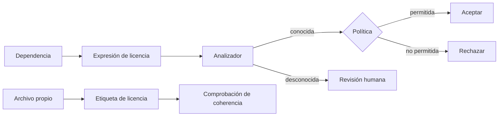
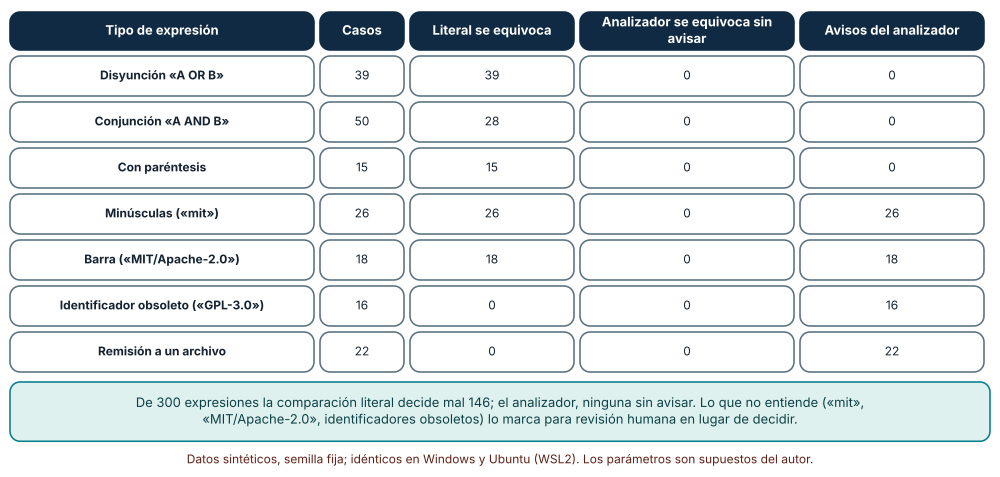
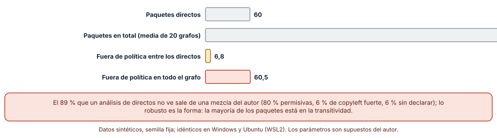
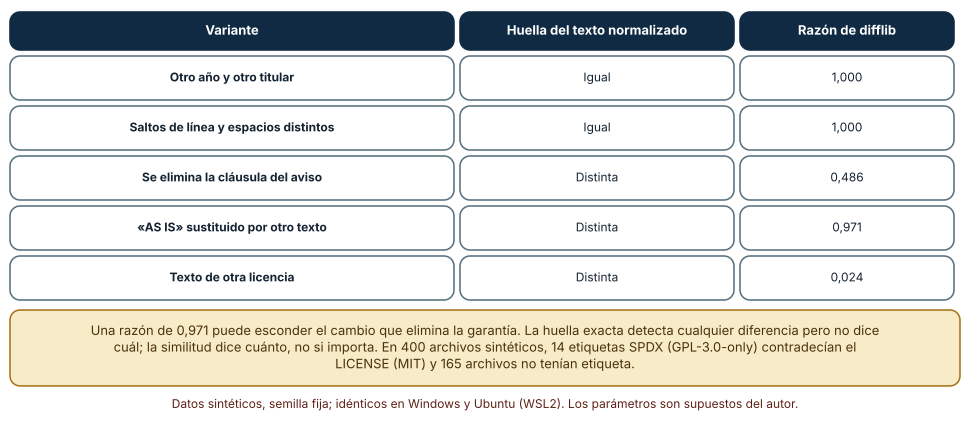

# SE-201 — Licencias de software y obligaciones básicas

[← SE-200 — Contribución, gobernanza y comunidades abiertas](../../classes/part-16-git-colaboracion-y-codigo-abierto/se-200-contribucion-gobernanza-y-comunidades-abiertas/README.md) · [↑ Parte 16](../../classes/part-16-git-colaboracion-y-codigo-abierto/README.md) · [📚 Índice completo](../../classes/README.md) · [🌐 Portal](../../site/classes/SE-201.html) · [SE-202 — Firmas, procedencia y protección del repositorio →](../../classes/part-16-git-colaboracion-y-codigo-abierto/se-202-firmas-procedencia-y-proteccion-del-repositorio/README.md)

## Punto profesional y fundamento pedagógico

**Punto profesional.** La clase existe para que una persona que usa, publica o recibe código de otras sepa qué licencia gobierna cada pieza, lo compruebe de forma repetible y reconozca cuándo la decisión ya no es técnica y requiere asesoría de alguien competente. Una licencia es el permiso que hace legal copiar, modificar y redistribuir; su ausencia no es libertad, es lo contrario.

**Por qué aparece aquí.** Se sitúa después de **Contribución, gobernanza y comunidades abiertas** y antes de **Firmas, procedencia y protección del repositorio**. `SE-200` abrió el proyecto a contribuciones externas; recibirlas y redistribuirlas exige saber bajo qué términos. Deja el inventario de licencias que `SE-202` complementa con la procedencia de lo que se publica.

**Error conceptual que debe corregir.** Creer que revisar licencias es leer el `LICENSE` del repositorio y que lo que importa son las dependencias directas. Las obligaciones llegan por la cadena completa de dependencias, por cada archivo con su propia etiqueta y por los identificadores mal escritos que una comparación literal no entiende. Y la comprobación automática no es una opinión legal.

**Secuencia de aprendizaje.** Antes de leer la solución, predices cuántas dependencias fuera de política ve un análisis de las directas y qué decisiones erróneas toma una comparación literal; después evalúas 300 expresiones de licencia con un analizador y con una comparación literal, estimas licencias fuera de política en un grafo de dependencias transitivas y comparas la huella de un texto de licencia con una razón de similitud. La secuencia usa predicción, explicación propia, contraste y recuperación. [ICAP](https://icap.education.asu.edu/research) distingue participación de construcción de conocimiento; [How People Learn II](https://nap.nationalacademies.org/catalog/24783/how-people-learn-ii-learners-contexts-and-cultures) exige conectar conocimiento previo, contexto y transferencia; la [práctica de recuperación](https://pubmed.ncbi.nlm.nih.gov/16507066/) respalda producir de nuevo la explicación tras una demora; y [Education for Life and Work](https://nap.nationalacademies.org/resource/13398/dbasse_084153.pdf) exige devolución que explique la causa del error.

**Evidencia de aprendizaje.** `license-log.md` con la política y su evaluación sobre 300 expresiones, el análisis transitivo, la comparación de huella y similitud y una lista de qué decisiones exigen asesoría. Debe contener predicción previa, observación, explicación causal, contraejemplo y qué hallazgo haría cambiar la política.

**Límite de la conclusión.** Esta clase no es asesoría legal y no interpreta ninguna licencia para un caso concreto. La lista de identificadores, la política (permisivas permitidas) y las expresiones son del autor; el grafo de dependencias y la mezcla de licencias son sintéticos; el analizador no cubre toda la gramática de la especificación; no se auditó ningún proyecto real ni se comprobó ninguna compatibilidad entre licencias.

### Trazabilidad fuente → afirmación

| Fuente primaria u oficial | Afirmación que respalda | Lo que no prueba |
|---|---|---|
| [SPDX: expresiones de licencia](https://spdx.github.io/spdx-spec/v2.3/SPDX-license-expressions/) | Define una sintaxis para combinar identificadores de licencia con operadores como `AND`, `OR` y `WITH` y paréntesis. | No dice cuáles son aceptables en un proyecto ni si dos licencias son compatibles. |
| [SPDX License List](https://spdx.org/licenses/) | Publica la lista de identificadores de licencia y excepciones reconocidos, incluidos los que están obsoletos. | No interpreta las obligaciones de cada licencia. |
| [REUSE specification](https://reuse.software/spec/) | Propone declarar la licencia de cada archivo con una etiqueta legible por máquinas y conservar los textos de licencia en el repositorio. | No garantiza que la licencia declarada sea la correcta. |

## Antes de empezar

Recupera lo aprendido en `SE-200`: un proyecto abierto recibe contribuciones de personas que no conoce. La pregunta activa es: **¿bajo qué licencia llega cada pieza que uso o recibo, cómo lo compruebo de forma repetible y cuándo debo pedir ayuda?**

## Prerrequisitos

- Haber completado `SE-200` o poder explicar cómo se recibe una contribución externa.
- Python 3.11 o posterior, Git 2.40 o posterior y un terminal.
- Trabajar con licencias, dependencias y archivos de ejemplo; esta clase no es asesoría legal.

## Problema auténtico

La plataforma de entregas usa 60 paquetes directos y publica su código. Una dependencia declara `MIT/Apache-2.0`, otra `GPL-3.0` (identificador obsoleto), otra «ver el archivo» y otra nada. Un análisis automático que compara textos aprueba o rechaza mal; uno que mira solo las dependencias directas no ve la mayor parte del grafo; y en el repositorio, 165 archivos de 400 no declaran licencia mientras 14 declaran otra distinta a la del `LICENSE`.

## Objetivos observables

Al terminar podrás:

1. leer una expresión de licencia con `AND`, `OR`, `WITH` y paréntesis y decidir si cumple una política;
2. explicar por qué una comparación literal decide mal y qué debe marcar un analizador para revisión;
3. estimar qué parte de las licencias de un proyecto está en la cadena transitiva y no en las dependencias directas;
4. declarar la licencia de cada archivo de forma legible por máquinas y comprobar contradicciones;
5. distinguir lo que una herramienta comprueba de lo que exige asesoría de una persona competente.

## Mapa conceptual



El mapa se lee de izquierda a derecha: una dependencia declara una expresión que un analizador entiende o marca; la política decide solo lo que se entiende; los archivos propios declaran su licencia y se comprueba su coherencia. No describe obligaciones jurídicas.

## Temas y por qué importan

| Tema | Por qué cambia una decisión profesional | Evidencia mínima |
|---|---|---|
| Qué otorga una licencia | Sin licencia no hay permiso de uso, copia ni redistribución. | Predicción, traza causal y contraejemplo de **Qué otorga una licencia** en `license-log.md` |
| Familias de licencias | Permisivas y con copyleft imponen obligaciones distintas al redistribuir. | Predicción, traza causal y contraejemplo de **Familias de licencias** en `license-log.md` |
| Expresiones SPDX | Permiten combinar licencias de forma comprobable por máquinas. | Predicción, traza causal y contraejemplo de **Expresiones SPDX** en `license-log.md` |
| Dependencias transitivas | Las obligaciones llegan por la cadena completa, no solo por lo que se declara. | Predicción, traza causal y contraejemplo de **Dependencias transitivas** en `license-log.md` |
| Etiquetas y textos | Declarar la licencia de cada archivo evita contradicciones y facilita la auditoría. | Predicción, traza causal y contraejemplo de **Etiquetas y textos** en `license-log.md` |

## Conceptos y decisiones

### 1. Qué otorga una licencia

El derecho de autor protege por defecto una obra y, sin una licencia, nadie más tiene permiso para copiarla, modificarla o redistribuirla. La licencia es la autorización, con condiciones. Publicar código sin licencia en un alojamiento público no lo vuelve libre: permite verlo según las condiciones del servicio, no reutilizarlo. Por eso `SE-200` pide una licencia desde el principio.

### 2. Familias de licencias

Las licencias permisivas (como MIT, BSD, ISC y Apache-2.0) permiten reutilizar con pocas condiciones, normalmente conservar el aviso de derechos y la licencia. Las de copyleft (como las GPL) exigen que ciertas obras derivadas se redistribuyan bajo condiciones similares. Las de copyleft débil (como MPL-2.0) lo limitan a los archivos modificados. La familia importa porque determina qué se puede combinar y cómo se redistribuye; si un caso concreto aplica una obligación es una interpretación que corresponde a quien tiene la competencia legal.

### 3. Expresiones SPDX

SPDX define identificadores cortos y una sintaxis de expresiones para combinarlos: `OR` ofrece una elección, `AND` exige cumplir todas, `WITH` añade una excepción y los paréntesis agrupan. Una expresión como `(MIT OR Apache-2.0) AND BSD-3-Clause` solo se evalúa correctamente con un analizador: una comparación de texto no ve la estructura. La lista oficial marca algunos identificadores como obsoletos, por ejemplo los que no distinguen «solo esta versión» de «esta versión o posteriores».

### 4. Dependencias transitivas

Un proyecto usa unas decenas de paquetes directos que arrastran cientos. Cada uno tiene su licencia y las obligaciones se acumulan. Mirar solo las directas deja fuera casi todo. El inventario debe recorrer el grafo completo y registrar tres estados distintos: licencia reconocida y permitida, reconocida y no permitida, y no declarada o ilegible, que es un resultado que exige revisión y no una aprobación.

### 5. Etiquetas y textos

Declarar la licencia en cada archivo con una etiqueta legible por máquinas, y conservar los textos completos en el repositorio, permite auditar sin leer cada archivo. Las contradicciones (un archivo con otra licencia que el `LICENSE`) deben detectarse y decidirse. La huella del texto de una licencia detecta cualquier alteración; una razón de similitud mide cuánto se parece, pero no dice si la diferencia importa.

### Una política frente a 300 expresiones

Se escribió una política (permisivas permitidas) y se evaluaron 300 expresiones sintéticas con dos métodos: **comparación literal** (¿el texto está en la lista de permitidas?) y un **analizador** que entiende `AND`, `OR`, `WITH`, paréntesis y marca lo que no reconoce. La comparación literal decidió mal **146** de 300: rechazó todas las expresiones con `OR` o con paréntesis aunque una alternativa fuera permitida, y rechazó 28 de 50 conjunciones aceptables. El analizador **no se equivocó en silencio en ninguna**: marcó para revisión 26 expresiones en minúsculas, 18 con barra (`MIT/Apache-2.0`), 16 con identificador obsoleto, 15 con `+` y 22 con una remisión («ver el archivo»). El analizador es estricto con las mayúsculas porque la lista de identificadores que usa lo es; no se afirma que la especificación lo exija.



**Cómo leer la figura.** Cada fila es un tipo de expresión; la tercera columna cuenta las decisiones erróneas de la comparación literal y la cuarta las del analizador sin avisar; la última, los avisos que emite. **Dónde deja de valer:** la política, los identificadores y las proporciones de cada tipo son del autor; el analizador cubre una parte de la gramática y no interpreta obligaciones; «cero errores en silencio» significa que lo que no entiende lo marca, no que su decisión sea jurídicamente correcta.

### Cuántas licencias están fuera de la vista

Se generaron 20 grafos de dependencias con 60 paquetes directos que arrastran hasta cuatro niveles, con una mezcla del autor (80 % permisivas, 8 % de copyleft débil, 6 % de copyleft fuerte y 6 % sin declarar). En promedio, un grafo tiene **514 paquetes** en total; una política que rechaza el copyleft fuerte y lo no declarado encuentra **6,8** paquetes fuera de política entre los directos y **60,5** en todo el grafo: un análisis solo de las directas **no ve el 89 %**.



**Cómo leer la figura.** Las barras grises son tamaños del grafo y las de color, paquetes fuera de política; la coral es lo que ve un análisis transitivo. **Dónde deja de valer:** la mezcla de licencias y la forma del grafo (hasta 0 a 3 hijos por nivel) son supuestos; los proyectos reales comparten dependencias entre ramas (se cuentan una sola vez), lo que reduce el total, y un paquete fuera de política puede estar solo en una parte que no se distribuye.

### La huella y la similitud

Se tomó el texto de la licencia MIT y se compararon cinco variantes con una huella SHA-256 del texto normalizado (minúsculas, espacios colapsados y año y titular enmascarados) y con la razón de `difflib`. Cambiar el **año y el titular** o los **saltos de línea y espacios** dio huella igual y razón 1,000. **Eliminar la cláusula del aviso** dio otra huella y razón 0,486. Sustituir «AS IS» por otro texto dio otra huella y razón **0,971**: parece casi igual y cambia la garantía. Un texto de **otra licencia** dio razón 0,024. En 400 archivos sintéticos con etiquetas SPDX, 221 declaraban `MIT`, **14 declaraban `GPL-3.0-only`** (contradiciendo al `LICENSE`) y **165 no declaraban nada**.



**Cómo leer la figura.** La columna central dice si la huella del texto normalizado coincide con la del original; la última, la razón de similitud de `difflib`. **Dónde deja de valer:** la normalización solo enmascara año y titular; un texto con otra forma de copyright produciría otra huella sin ser distinto, y una razón alta no prueba equivalencia. La etiqueta de un archivo es una declaración, no una verificación de su procedencia.

## Definiciones de trabajo

- **licencia de software:** autorización de su titular para usar, copiar, modificar o redistribuir una obra bajo ciertas condiciones.
- **expresión de licencia:** combinación de identificadores con `AND`, `OR`, `WITH` y paréntesis que describe bajo qué licencias se ofrece una pieza.
- **copyleft:** familia de licencias que condiciona la redistribución de obras derivadas a términos similares.
- **dependencia transitiva:** paquete que un proyecto usa indirectamente a través de otro.
- **huella de texto:** resumen criptográfico del texto normalizado de una licencia, sensible a cualquier cambio.

Las definiciones son operativas para la plataforma de entregas. No convierten términos con historia más amplia en sinónimos y deben contrastarse con la documentación primaria enlazada al final.

## Ejemplo mínimo

El fragmento marca archivos sin etiqueta de licencia. Antes de ejecutarlo, predice cuántos marcará.

```python
import re, pathlib
ETIQUETA = re.compile(r"SPDX-License-Identifier:\s*(\S+)")
sin = [p for p in pathlib.Path("src").rglob("*.py") if not ETIQUETA.search(p.read_text(encoding="utf-8"))]
print(len(sin), "archivos sin etiqueta")
```

Registra versión de Python y salida, y añade una comprobación que falle si la etiqueta contradice la licencia del `LICENSE`.

## Ejemplo profesional

En la plataforma, el `LICENSE` declara la licencia del proyecto, cada archivo de código lleva su etiqueta y un trabajo de integración continua construye el inventario de dependencias directas y transitivas, evalúa sus expresiones con un analizador y falla ante una licencia no permitida; ante una no reconocida o ilegible, abre una revisión con una persona designada. Las decisiones sobre licencias no permitidas pasan a asesoría y se registran con responsable y fecha.

Compara el caso normal con una dependencia que declara «ver el archivo»: la práctica es apropiada cuando el inventario la marca para revisión humana en lugar de aprobarla; es peligrosa cuando una herramienta la clasifica como «sin problemas» porque no encontró nada que rechazar.

## Práctica guiada

1. Escribe una política de licencias para la plataforma y predice cuántas de 15 expresiones de ejemplo decidirá mal una comparación literal.
2. Implementa un analizador de `AND`, `OR`, `WITH` y paréntesis y compara con la literal sobre 300 expresiones.
3. Añade el aviso para minúsculas, barras, identificadores obsoletos y remisiones y registra cuántos avisos emite.
4. Genera 20 grafos de dependencias con una semilla fija y mide lo que ve un análisis de las directas.
5. Calcula la huella de cinco variantes de un texto de licencia y compárala con la razón de similitud.
6. Escanea 400 archivos sintéticos y lista los que contradicen el `LICENSE` o no declaran licencia.
7. Pide a otra persona que reconstruya tu política solo desde `license-log.md` y registra qué decisión no pudo tomar sin asesoría.

## Ejercicios

1. **Gramática:** extiende el analizador a `WITH` con excepciones y a `LicenseRef-` y registra qué casos nuevos entiende.
2. **Política distinta:** cambia la política para permitir copyleft débil y explica qué cambia en el recuento fuera de política.
3. **Cadena compartida:** repite el grafo con dependencias compartidas entre ramas y explica cómo cambian los 514 paquetes.
4. **Quién decide:** lista tres decisiones de licencias de tu proyecto que no tomarías sin asesoría y quién las tomaría.

## Reto verificable

Entrega `license-log.md` con la política, la comparación literal y del analizador, el análisis transitivo, la comparación de huella y similitud y la lista de decisiones que exigen asesoría. Se aprueba si otra persona ejecuta el código desde un directorio vacío, obtiene las mismas cifras y puede decir qué licencia marcó el analizador para revisión y por qué. No se aprueba por clasificar licencias como «compatibles» sin competencia para hacerlo.

## Caso conductor

El repositorio de la plataforma de entregas es el caso conductor de la Parte 16. Esta clase deja la política de licencias, el inventario y la lista de decisiones para asesoría. `SE-202` pregunta cómo se prueba la procedencia de lo que se publica y `SE-204` empaqueta una contribución con su licencia. Cambia después un solo dato, la política de copyleft débil de «rechazar» a «permitir», y revisa cuántos paquetes cambian de estado.

## Preguntas frecuentes

### ¿Publicar código en un alojamiento público lo hace libre?

No: sin licencia, nadie tiene permiso para reutilizarlo. Hay que elegir una y añadir el texto al repositorio.

### ¿Cuál licencia debo elegir?

Depende de qué quiere permitir la persona o la organización y de las licencias de sus dependencias. Herramientas como las guías de elección ayudan a entender las diferencias; la decisión con consecuencias legales conviene consultarla.

### ¿Una herramienta puede decir si dos licencias son compatibles?

Puede aplicar una tabla que alguien escribió; no sustituye la interpretación de un caso concreto. En la clase se decide con una política y se marca lo ambiguo.

### ¿Qué hago con una dependencia sin licencia?

Tratarla como no autorizada hasta que la persona titular aclare, y no copiarla ni redistribuirla. Se puede pedir al titular que añada una licencia.

## Fallo controlado y diagnóstico

Reproduce el fallo clásico de la clase: **aprobar una dependencia porque la herramienta no encontró una licencia prohibida**. Usa la remisión «ver el archivo».

Registra síntoma, entrada mínima, hipótesis, observación que descarta cada hipótesis, causa, corrección y prueba de regresión. **Síntoma:** el informe de licencias de la plataforma dice «sin problemas» y una dependencia distribuye código con una licencia no permitida. **Hipótesis rivales:** (a) el analizador no conoce esa licencia; (b) la expresión de la dependencia era una remisión a un archivo y se contó como aprobada. **Prueba:** evalúa la expresión «SEE LICENSE IN LICENSE.txt»: el analizador emite un aviso de identificador desconocido; el informe cuenta los avisos como cero. **Conclusión:** la causa es (b): el informe ignoró los avisos. **Regresión:** el informe debe fallar o abrir revisión ante cualquier aviso, y una prueba debe incluir expresiones ilegibles. No cambies a la vez la política y el tratamiento de avisos.

## Errores comunes y cómo corregirlos

| Síntoma | Causa probable | Corrección |
|---|---|---|
| Se rechazan dependencias válidas | Comparación literal de texto | Analizar la expresión con sus operadores |
| Se aprueban dependencias que no se entendieron | Los avisos no se tratan como pendientes | Hacer que lo no reconocido exija revisión |
| Solo se revisan las dependencias directas | Se ignora el grafo transitivo | Recorrer el grafo completo y registrar su licencia |
| Un archivo contradice el `LICENSE` | No se comprueban las etiquetas | Comprobar coherencia en integración continua |
| Se copia un texto de licencia con cambios | No se compara contra el original | Usar la huella y revisar las diferencias |

## Entorno y archivos clave

```text
work/SE-201/
├── README.md
├── licencias/
│   ├── analizador.py
│   ├── grafo.py
│   └── huella.py
├── LICENSE
└── evidence/license-log.md
```

El `README` declara sistema operativo, versión de Python, semillas y comandos. Los experimentos usan `re`, `hashlib`, `difflib` y `random` y se ejecutaron con CPython 3.12.9 en Windows 11 y con 3.12.3 en Ubuntu bajo WSL2: las salidas fueron idénticas. Si adoptas una herramienta de inventario, fija procedencia y versión.

## Seguridad, ética y accesibilidad

- esta clase no es asesoría legal: las decisiones con consecuencias sobre licencias exigen consultar a una persona competente;
- una licencia no permitida puede ser también un riesgo de seguridad si el paquete no tiene mantenimiento: trátalo en el inventario;
- no copies código sin licencia a un repositorio, aunque sea público; pide permiso a su titular;
- escribe la política en un lenguaje comprensible para quien no es técnica y ofrece una alternativa textual a las tablas;
- atribuye a las personas autoras como exige cada licencia y conserva los avisos de derechos.

## Puente hacia el trabajo con agentes

Un agente que añade una dependencia o copia un fragmento suele hacerlo sin mirar su licencia. Pídele que, antes de proponer una dependencia nueva, lea su expresión de licencia, la evalúe con la política, informe de las transitivas que arrastra y se detenga ante cualquier aviso. Revisa especialmente fragmentos de código pegados desde otra fuente: un agente puede reproducir código con licencia sin saber de dónde viene, y la etiqueta del archivo no lo detectará.

## Transferencia

Traslada el análisis a otro tipo de obra con licencia (por ejemplo, conjuntos de datos o imágenes de un curso): decide qué sería la expresión, cómo se inventaría la cadena y qué decisiones exigen asesoría. La transferencia está lograda cuando puedes explicar qué parte del análisis dependía de la sintaxis SPDX, no cuando los términos se parecen.

## Evaluación y evidencia

| Criterio | Evidencia para aprobar |
|---|---|
| comprensión | explicación de qué otorga una licencia y por qué lo no declarado no es libre |
| corrección | decisiones del analizador y del inventario reproducibles con las mismas semillas |
| diseño | política con tres estados: permitida, no permitida y para revisión |
| diagnóstico | reproducción del fallo «aprobar lo que no se entendió» con regresión |
| incertidumbre | declaración de qué decisiones exigen asesoría y qué parte depende de la mezcla supuesta |
| reproducibilidad | versiones, comandos, salida y límites declarados |

## Fuentes

- [SPDX: expresiones de licencia](https://spdx.github.io/spdx-spec/v2.3/SPDX-license-expressions/) — sintaxis de las expresiones; autoridad: especificación SPDX.
- [SPDX License List](https://spdx.org/licenses/) — identificadores y excepciones reconocidos; autoridad: proyecto SPDX.
- [REUSE specification](https://reuse.software/spec/) — declaración de licencias por archivo; autoridad: REUSE.
- [Open Source Definition](https://opensource.org/osd) — criterios de una licencia de código abierto; autoridad: Open Source Initiative.
- [Choose a License](https://choosealicense.com/) — comparación didáctica de licencias; autoridad: GitHub.
- [Apache License 2.0](https://www.apache.org/licenses/LICENSE-2.0) — texto de una licencia permisiva con concesión de patentes; autoridad: Apache Software Foundation.
- [Licencia MIT](https://opensource.org/license/mit) — texto de una licencia permisiva; autoridad: Open Source Initiative.

Cada fuente respalda el mecanismo indicado; ninguna interpreta las obligaciones de una licencia para el caso de la plataforma de entregas. Esa afirmación depende de cómo se use y se redistribuya el código y corresponde a una persona competente.

- [GitHub: licenciar un repositorio](https://docs.github.com/en/repositories/managing-your-repositorys-settings-and-features/customizing-your-repository/licensing-a-repository) — cómo declarar la licencia en el alojamiento.
- [Python: `hashlib`](https://docs.python.org/3/library/hashlib.html) — huella del texto usada en el experimento.

## Límites y siguiente paso

Se ejecutaron tres experimentos con datos sintéticos en Windows y Ubuntu (WSL2) con resultados idénticos. La lista de identificadores, la política y la mezcla de licencias son del autor, el analizador cubre solo una parte de la gramática y no se interpretó ninguna licencia ni se auditó ningún proyecto; las decisiones con consecuencias jurídicas requieren asesoría. La siguiente clase pregunta cómo se prueba que lo que se publica procede de quien dice y no ha sido alterado.

## Glosario

- **licencia de software:** autorización de su titular para usar, copiar, modificar o redistribuir una obra bajo ciertas condiciones.
- **expresión de licencia:** combinación de identificadores con `AND`, `OR`, `WITH` y paréntesis que describe bajo qué licencias se ofrece una pieza.
- **copyleft:** familia de licencias que condiciona la redistribución de obras derivadas a términos similares.
- **dependencia transitiva:** paquete que un proyecto usa indirectamente a través de otro.
- **huella de texto:** resumen criptográfico del texto normalizado de una licencia, sensible a cualquier cambio.

---

[← SE-200 — Contribución, gobernanza y comunidades abiertas](../../classes/part-16-git-colaboracion-y-codigo-abierto/se-200-contribucion-gobernanza-y-comunidades-abiertas/README.md) · [↑ Parte 16](../../classes/part-16-git-colaboracion-y-codigo-abierto/README.md) · [📚 Índice completo](../../classes/README.md) · [🌐 Portal](../../site/classes/SE-201.html) · [SE-202 — Firmas, procedencia y protección del repositorio →](../../classes/part-16-git-colaboracion-y-codigo-abierto/se-202-firmas-procedencia-y-proteccion-del-repositorio/README.md)
