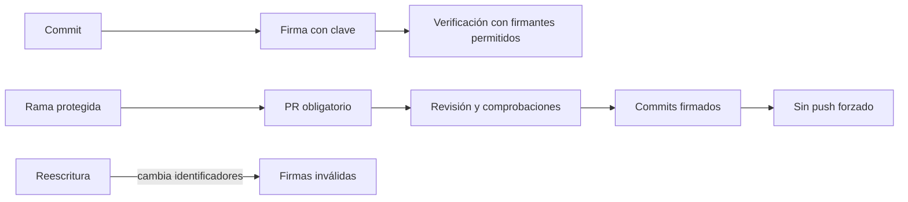
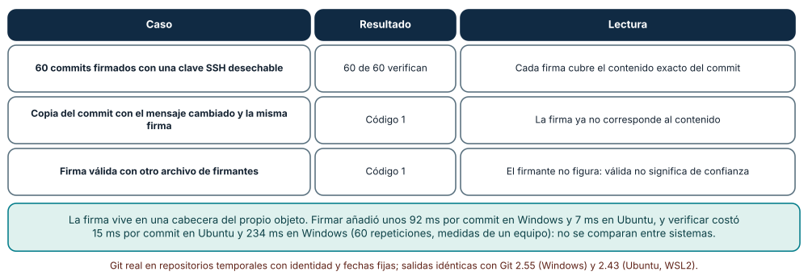
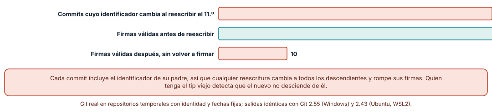
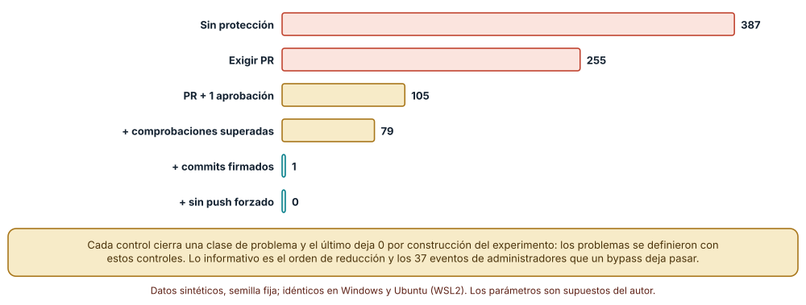

# SE-202 — Firmas, procedencia y protección del repositorio

[← SE-201 — Licencias de software y obligaciones básicas](../../classes/part-16-git-colaboracion-y-codigo-abierto/se-201-licencias-de-software-y-obligaciones-basicas/README.md) · [↑ Parte 16](../../classes/part-16-git-colaboracion-y-codigo-abierto/README.md) · [📚 Índice completo](../../classes/README.md) · [🌐 Portal](../../site/classes/SE-202.html) · [SE-203 — Taller: rescatar una integración conflictiva →](../../classes/part-16-git-colaboracion-y-codigo-abierto/se-203-taller-rescatar-una-integracion-conflictiva/README.md)

## Punto profesional y fundamento pedagógico

**Punto profesional.** La clase existe para que lo que un repositorio publica pueda atribuirse a quien dice haberlo escrito y no haya cambiado desde entonces, y para que las reglas que lo protegen (revisión obligatoria, comprobaciones, firmas) sean una política explícita y no una expectativa. Firmar y proteger no vuelve correcto un cambio: lo hace atribuible y más difícil de alterar sin que se note.

**Por qué aparece aquí.** Se sitúa después de **Licencias de software y obligaciones básicas** y antes de **Taller: rescatar una integración conflictiva**. `SE-201` dejó la pregunta de bajo qué términos llega cada pieza; esta clase pregunta si llega de quien dice y sin alterar. Reúne las reglas de `SE-199` (propietarios) y de `SE-196` (revisión) en una política de protección, y deja el repositorio listo para el taller de `SE-203`.

**Error conceptual que debe corregir.** Creer que un commit «verificado» o firmado es un commit confiable. La firma prueba que quien tiene la clave firmó ese contenido exacto; no prueba que la clave sea de quien se cree, que el contenido sea correcto ni que la persona no haya sido engañada. Y creer que un identificador de commit prueba la autoría: solo detecta la alteración.

**Secuencia de aprendizaje.** Antes de leer la solución, predices qué ocurre cuando se altera un commit firmado y cuántos commits cambian al reescribir uno antiguo; después firmas y verificas 60 commits con una clave desechable, reescribes un commit de una cadena de 50 y evalúas seis políticas de protección sobre 500 eventos sintéticos. La secuencia usa predicción, explicación propia, contraste y recuperación. [ICAP](https://icap.education.asu.edu/research) distingue participación de construcción de conocimiento; [How People Learn II](https://nap.nationalacademies.org/catalog/24783/how-people-learn-ii-learners-contexts-and-cultures) exige conectar conocimiento previo, contexto y transferencia; la [práctica de recuperación](https://pubmed.ncbi.nlm.nih.gov/16507066/) respalda producir de nuevo la explicación tras una demora; y [Education for Life and Work](https://nap.nationalacademies.org/resource/13398/dbasse_084153.pdf) exige devolución que explique la causa del error.

**Evidencia de aprendizaje.** `provenance-log.md` con las verificaciones de firma y sus fallos, el efecto de reescribir la cadena, la tabla de políticas con los eventos que dejan pasar y una lista de lo que ninguna de ellas comprueba. Debe contener predicción previa, observación, explicación causal, contraejemplo y qué hallazgo haría cambiar la política.

**Límite de la conclusión.** La clave es desechable y se creó para el experimento; no se probó ninguna infraestructura de confianza, ni de claves de organización, ni un servicio de firma; los 500 eventos y sus proporciones son sintéticos y el resultado «0» de la última política es consecuencia de cómo se definió un evento problemático; los tiempos de firma son de un equipo y no son comparables entre sistemas.

### Trazabilidad fuente → afirmación

| Fuente primaria u oficial | Afirmación que respalda | Lo que no prueba |
|---|---|---|
| [Pro Git: Signing Your Work](https://git-scm.com/book/en/v2/Git-Tools-Signing-Your-Work) | Explica cómo firmar y verificar commits y etiquetas y que la firma cubre el contenido del objeto. | No explica cómo se decide en quién confiar. |
| [ssh-keygen (OpenBSD)](https://man.openbsd.org/ssh-keygen) | Documenta el formato del archivo de firmantes permitidos (`allowed_signers`) y la verificación de firmas SSH. | No describe la distribución segura de claves en una organización. |
| [SLSA v1.0](https://slsa.dev/spec/v1.0/) | Define niveles y requisitos de procedencia de artefactos de software. | No afirma que un repositorio con commits firmados cumpla un nivel. |

## Antes de empezar

Recupera lo aprendido en `SE-201`: una etiqueta de licencia es una declaración, no una verificación. La pregunta activa es: **¿qué prueba una firma, qué rompe una reescritura de historia y qué cierra cada regla de protección?**

## Prerrequisitos

- Haber completado `SE-201` o poder explicar la diferencia entre declarar y verificar.
- Python 3.11 o posterior, Git 2.40 o posterior con soporte de firmas SSH y OpenSSH (`ssh-keygen`).
- Generar claves solo para el experimento y borrarlas al terminar; nunca firmar con una clave personal real en un repositorio de práctica.

## Problema auténtico

Un commit de la plataforma de entregas cambia el tope de prórroga de 72 a 720 horas. Aparece con el nombre de la mantenedora, pero ella dice que no lo hizo. Alguien propone reescribir la historia «para limpiarla» y otra persona reclama que no se puede saber qué commits ya habían sido revisados. A la vez, el equipo discute si exigir firma en todos los commits o solo en los de la rama principal.

## Objetivos observables

Al terminar podrás:

1. firmar commits con una clave SSH, verificarlos con un archivo de firmantes y explicar por qué una firma válida no implica confianza;
2. predecir qué commits cambian y qué firmas dejan de valer al reescribir uno antiguo;
3. evaluar una política de protección de rama por los problemas que deja pasar y los que cierra;
4. distinguir lo que prueban la firma, la revisión y las comprobaciones de lo que no prueban;
5. escribir una política de protección con sus excepciones y un procedimiento para las claves comprometidas.

## Mapa conceptual



El mapa se lee de izquierda a derecha: una firma se verifica contra una lista de firmantes permitidos, y una rama protegida encadena PR, revisión, comprobaciones, firma y ausencia de push forzado; una reescritura rompe las firmas de los commits afectados. No describe cómo se distribuyen las claves.

## Temas y por qué importan

| Tema | Por qué cambia una decisión profesional | Evidencia mínima |
|---|---|---|
| Firmar un commit | Permite atribuir un contenido exacto a una clave. | Predicción, traza causal y contraejemplo de **Firmar un commit** en `provenance-log.md` |
| Verificar y confiar | Una firma válida solo vale si la clave está en una lista que alguien administra. | Predicción, traza causal y contraejemplo de **Verificar y confiar** en `provenance-log.md` |
| Cadena de hashes | Reescribir un commit cambia todos sus descendientes. | Predicción, traza causal y contraejemplo de **Cadena de hashes** en `provenance-log.md` |
| Protección de rama | Convierte las reglas de revisión en condiciones técnicas. | Predicción, traza causal y contraejemplo de **Protección de rama** en `provenance-log.md` |
| Procedencia de artefactos | Lo que se publica debe poder atribuirse a una construcción conocida. | Predicción, traza causal y contraejemplo de **Procedencia de artefactos** en `provenance-log.md` |

## Conceptos y decisiones

### 1. Firmar un commit

Git puede firmar un commit con una clave GPG, X.509 o SSH. La firma se guarda en una cabecera del propio objeto y cubre su contenido (árbol, padres, autoría, mensaje). Cualquier cambio posterior invalida la firma. Firmar cuesta unos milisegundos y configuración; el costo real es la gestión de claves: quién las tiene, dónde, cómo se revocan.

### 2. Verificar y confiar

Verificar una firma comprueba que fue hecha por la clave y sobre ese contenido. Para que sea útil hay que decidir qué claves se aceptan: con firmas SSH, un archivo de firmantes permitidos asocia identidades con claves públicas. Una firma válida de una clave que no está en la lista no es de confianza. Y que la clave esté en la lista no prueba que la persona no haya sido engañada o que la clave no se haya filtrado.

### 3. Cadena de hashes

Cada commit incluye el identificador de su padre. Si se cambia el mensaje de un commit antiguo, ese commit tiene otro identificador, su hijo apunta ahora a un padre distinto y cambia también, y así hasta la punta. Por eso reescribir historia es detectable para quien conserva la punta antigua, y por eso las firmas de todos los descendientes dejan de valer. No impide reescribir: lo hace visible.

### 4. Protección de rama

Una rama protegida convierte reglas en condiciones técnicas: exigir PR, un número de aprobaciones, comprobaciones superadas, commits firmados y no permitir push forzado ni borrado. Cada regla cierra una clase de problema. Una política también tiene excepciones: las cuentas con permisos de administración pueden saltar reglas si la plataforma lo permite, y esas excepciones deben registrarse o desactivarse.

### 5. Procedencia de artefactos

El código firmado es una parte de la cadena. Lo que se despliega es un artefacto construido a partir de ese código, y la procedencia pregunta qué lo construyó, desde qué commit y con qué entradas. Marcos como SLSA describen niveles de garantía y exigen construcciones reproducibles o atestaciones. Firmar commits es necesario y no suficiente.

### Firmar y verificar con una clave desechable

Se generó una clave Ed25519 desechable y un archivo de firmantes, y se firmaron **60 commits** de un repositorio temporal. Los 60 verificaron con `git verify-commit`. Se creó una copia del objeto de un commit con el mensaje cambiado y la misma firma: la verificación devolvió el **código 1** (la firma ya no corresponde al contenido). Con otro archivo de firmantes que no incluía la clave, la verificación de una firma válida también devolvió el **código 1**: la firma era correcta y el firmante no estaba permitido. La firma ocupa unas 6 líneas de la cabecera `gpgsig` del objeto. Firmar añadió unos 92 ms por commit en Windows (178 frente a 86) y unos 7 ms en Ubuntu (14 frente a 7); verificar costó 234 ms por commit en Windows y 15 ms en Ubuntu (60 repeticiones, un equipo).



**Cómo leer la figura.** Cada fila es una comprobación con `git verify-commit` y el código que devolvió; la tercera columna dice qué significa. **Dónde deja de valer:** la clave y el archivo de firmantes se crearon para el experimento; en una organización la dificultad está en distribuir claves, revocarlas y decidir quién puede añadir a la lista, nada de lo cual se probó, y los tiempos dependen de la máquina.

### Reescribir un commit antiguo

Se creó una cadena de 50 commits firmados y se reescribió el mensaje del commit 11 (índice 10) con `git commit-tree`, conservando el resto. Cambiaron **40 de 50** identificadores (el commit y sus 39 descendientes). Las firmas válidas pasaron de **50** a **10**: los 10 commits anteriores al cambio. El tip antiguo **no** era ancestro del nuevo: quien tuviera la punta anterior detectaría que la historia cambió.



**Cómo leer la figura.** La barra coral superior cuenta los identificadores que cambian; las dos inferiores, las firmas válidas antes (verde) y después (coral) sin volver a firmar. **Dónde deja de valer:** la reescritura se hizo localmente y sin firmar de nuevo; quien tiene la clave puede volver a firmar todos los commits reescritos, y entonces las firmas serán válidas pero la historia habrá cambiado, de modo que la detección depende de que alguien conserve la punta anterior.

### Seis políticas sobre 500 eventos

Se generaron 500 eventos de integración: 25 % empujes directos, 10 % hechos por administradores, aprobaciones de 0 a 2, comprobaciones superadas en el 85 %, firmados el 60 % y push forzado el 4 %. Un evento se define como problemático si es directo, o sin aprobación, o sin comprobaciones, o sin firma, o forzado: 387 de 500. Con **ninguna protección** pasan los 387; **exigir PR**, 255; **PR más una aprobación**, 105; **más comprobaciones**, 79; **más commits firmados**, 1; y **más prohibir push forzado**, 0. Los eventos de administradores que un bypass deja pasar y que la política habría bloqueado son 14, 26, 30, 37 y 37 en las cinco políticas con alguna regla.



**Cómo leer la figura.** Cada barra es una política acumulativa aplicada a los mismos 500 eventos; la cifra cuenta eventos problemáticos que pasan. **Dónde deja de valer:** el cero final es por definición (los problemas se definieron con estos controles) y las proporciones son supuestos; lo informativo es el orden de reducción y que el bypass de administración deja pasar 37 eventos incluso con la política completa si no se desactiva o se registra.

## Definiciones de trabajo

- **firma de commit:** firma criptográfica del contenido de un commit guardada en una cabecera del objeto.
- **firmantes permitidos:** archivo que asocia identidades con claves públicas aceptadas para verificar firmas SSH.
- **rama protegida:** rama cuyas reglas de integración se imponen técnicamente.
- **bypass de administración:** excepción por la que cuentas con permisos elevados pueden saltarse las reglas de protección.
- **procedencia:** información sobre qué construyó un artefacto, desde qué entradas y con qué proceso.

Las definiciones son operativas para la plataforma de entregas. No convierten términos con historia más amplia en sinónimos y deben contrastarse con la documentación primaria enlazada al final.

## Ejemplo mínimo

El fragmento firma y verifica un commit con una clave SSH desechable. Antes de ejecutarlo, predice qué código devuelve la verificación sin el archivo de firmantes.

```bash
ssh-keygen -t ed25519 -N "" -C desechable -f clave
git -c gpg.format=ssh -c user.signingkey=clave commit -S -m "cambio firmado"
git -c gpg.format=ssh -c gpg.ssh.allowedSignersFile=firmantes verify-commit HEAD
```

Registra versión de Git y de OpenSSH y salida, y borra la clave al terminar. Repite con un archivo de firmantes sin la clave para ver el fallo.

## Ejemplo profesional

La plataforma exige PR, una aprobación del propietario de código (`SE-199`), comprobaciones superadas, commits firmados en la rama principal y prohíbe el push forzado. Las claves de firma están asociadas a identidades en un archivo de firmantes versionado y revisado como cualquier otro cambio; un procedimiento documenta qué hacer si una clave se compromete (revocar, revisar los commits firmados con ella, avisar). El bypass de administración está desactivado y las excepciones se registran.

Compara el caso normal con un repositorio donde todos los commits están firmados pero la rama principal permite empujar directo: la práctica es apropiada cuando la protección se verifica con un empuje de prueba rechazado; es peligrosa cuando se asume que «verificado» significa «revisado».

## Práctica guiada

1. Genera una clave desechable y un archivo de firmantes y firma cinco commits.
2. Predice el código de verificación de un commit con el mensaje alterado y comprueba.
3. Verifica con un archivo de firmantes sin la clave y explica la diferencia con el caso anterior.
4. Crea una cadena de 50 commits firmados, reescribe el 11.º y cuenta identificadores y firmas válidas.
5. Evalúa seis políticas sobre 500 eventos sintéticos con una semilla fija y registra los problemas que pasan.
6. Escribe el procedimiento de clave comprometida y qué commits revisarías.
7. Pide a otra persona que reconstruya tu política solo desde `provenance-log.md` y registra qué excepción no estaba documentada.

## Ejercicios

1. **Revocación:** añade una línea de revocación al archivo de firmantes y explica qué commits antiguos dejan de verificar.
2. **Refirmar:** vuelve a firmar los 40 commits reescritos y explica qué detecta y qué no detecta alguien que conserva la punta anterior.
3. **Bypass:** cuantifica los eventos de administradores que deja pasar cada política y decide cuál desactivarías.
4. **Procedencia:** describe qué información de construcción registrarías para un artefacto publicado y quién la firmaría.

## Reto verificable

Entrega `provenance-log.md` con las verificaciones de firma, la reescritura de la cadena, la tabla de políticas y una política de protección con su procedimiento de clave comprometida. Se aprueba si otra persona ejecuta el código desde un directorio vacío, obtiene los mismos conteos y puede decir qué problema deja pasar la política elegida. No se aprueba por contar commits «verificados».

## Caso conductor

El repositorio de la plataforma de entregas es el caso conductor de la Parte 16. Esta clase deja la política de protección y el procedimiento de claves. `SE-203` rescata una integración mal resuelta sobre una rama protegida y `SE-204` entrega una contribución con firma y procedencia. Cambia después un solo dato, desactivar el bypass de administración, y revisa qué eventos dejan de pasar.

## Preguntas frecuentes

### ¿Firmar commits es obligatorio?

No: es una decisión de política. Aporta atribución y detección de alteración; no sustituye la revisión ni las comprobaciones.

### ¿Qué diferencia hay entre firma SSH y firma GPG?

Ambas firman el mismo contenido. SSH reutiliza claves que muchas personas ya tienen y un archivo de firmantes sencillo; GPG tiene una infraestructura de confianza más rica y más compleja. La elección es de gestión de claves.

### ¿Si reescribo la historia y vuelvo a firmar, nadie se entera?

Quien conserve la punta anterior ve que la nueva no desciende de ella; quien no, solo ve commits firmados. La detección depende de copias y registros externos, por eso se protege la rama y se prohíbe el push forzado.

### ¿Un commit verificado es confiable?

Es atribuible a una clave. La confianza depende de quién controla la clave y de si el contenido se revisó.

## Fallo controlado y diagnóstico

Reproduce el fallo clásico de la clase: **tomar una firma válida como prueba de que el commit se revisó**. Usa el commit del tope de 720 horas.

Registra síntoma, entrada mínima, hipótesis, observación que descarta cada hipótesis, causa, corrección y prueba de regresión. **Síntoma:** el commit que cambia el tope aparece como verificado y nadie lo revisó. **Hipótesis rivales:** (a) la firma prueba la revisión; (b) la rama permite empujar directo y la firma solo atribuye. **Prueba:** consulta la regla de la rama: no exige PR ni aprobación; el commit fue empujado directo por una cuenta de administración. **Conclusión:** la causa es (b): la firma atribuye, no aprueba. **Regresión:** exige PR y aprobación del propietario, desactiva el bypass y añade un empuje de prueba que debe rechazarse. No cambies a la vez la firma y la regla de revisión.

## Errores comunes y cómo corregirlos

| Síntoma | Causa probable | Corrección |
|---|---|---|
| Un commit firmado no verifica | El archivo de firmantes no contiene la clave | Añadir la clave al archivo tras verificar la identidad |
| Se confía en «verificado» como revisión | Se confunde atribución con aprobación | Exigir PR y aprobación además de firma |
| Reescribir invalida muchas firmas | La reescritura cambia todos los descendientes | Evitarla en ramas compartidas o refirmar con aviso |
| Los administradores se saltan las reglas | El bypass está activado | Desactivarlo o registrar y auditar su uso |
| Una clave comprometida sigue en el archivo | No hay procedimiento de revocación | Documentar la revocación y revisar los commits firmados con ella |

## Entorno y archivos clave

```text
work/SE-202/
├── README.md
├── procedencia/
│   ├── firmar.py
│   ├── reescribir.py
│   └── politicas.py
├── firmantes
└── evidence/provenance-log.md
```

El `README` declara sistema operativo, versiones de Git, OpenSSH y Python, semillas y comandos. Los experimentos usan `subprocess`, una clave Ed25519 desechable creada y borrada por el script y repositorios temporales con identidad y fechas fijas y se ejecutaron con CPython 3.12.9 y Git 2.55 en Windows 11 y con CPython 3.12.3 y Git 2.43 en Ubuntu bajo WSL2: las salidas fueron idénticas salvo los tiempos. Si adoptas una herramienta de firma, fija procedencia y versión.

## Seguridad, ética y accesibilidad

- una clave privada no se comparte, no se confirma al repositorio y se protege con contraseña o con un almacén seguro; si se filtra, se revoca;
- las claves desechables de los experimentos se borran al terminar y no se reutilizan;
- los archivos de firmantes con correos reales exponen identidades: usa identificadores neutros y revisa qué se publica;
- una política que exige firma debe ofrecer una alternativa a quien no puede usar cierta tecnología, y documentarla;
- no presentes la firma como garantía de calidad: es un dato de atribución.

## Puente hacia el trabajo con agentes

Un agente con acceso al repositorio puede crear commits con la clave de la persona que lo ejecuta, y esos commits aparecerán como verificados. Pídele que no firme con la clave personal sin aprobación explícita, que use una identidad y una clave propias del agente en el archivo de firmantes y que deje constancia en el mensaje de qué escribió él. Revisa especialmente cualquier cambio en el archivo de firmantes y en las reglas de protección: son el punto donde una cuenta con demasiado permiso se vuelve invisible.

## Transferencia

Traslada el análisis a otra cadena de custodia (por ejemplo, los instaladores que publica un proyecto o las imágenes de contenedor): decide qué se firma, quién controla la clave y qué evidencia haría falta para decir que un artefacto procede de un commit concreto. La transferencia está lograda cuando puedes explicar qué parte de la verificación dependía de la lista de firmantes, no cuando los comandos se parecen.

## Evaluación y evidencia

| Criterio | Evidencia para aprobar |
|---|---|
| comprensión | explicación de qué prueba una firma y qué no |
| corrección | verificaciones y conteos reproducibles con las mismas semillas |
| diseño | política de protección con excepciones y procedimiento de claves |
| diagnóstico | reproducción del fallo «firma como revisión» con regresión |
| incertidumbre | declaración de qué parte depende del bypass y de la gestión de claves |
| reproducibilidad | versiones, comandos, salida y límites declarados |

## Fuentes

- [Pro Git: Signing Your Work](https://git-scm.com/book/en/v2/Git-Tools-Signing-Your-Work) — firma de commits y etiquetas; autoridad: Pro Git.
- [git-verify-commit](https://git-scm.com/docs/git-verify-commit) — verificación de firmas; autoridad: documentación de Git.
- [ssh-keygen (OpenBSD)](https://man.openbsd.org/ssh-keygen) — firmantes permitidos y firmas SSH; autoridad: OpenBSD.
- [GitHub: verificación de firmas de commits](https://docs.github.com/en/authentication/managing-commit-signature-verification/about-commit-signature-verification) — qué muestra el alojamiento como verificado; autoridad: GitHub Docs.
- [GitHub: ramas protegidas](https://docs.github.com/en/repositories/configuring-branches-and-merges-in-your-repository/managing-protected-branches/about-protected-branches) — reglas de protección disponibles; autoridad: GitHub Docs.
- [SLSA v1.0](https://slsa.dev/spec/v1.0/) — niveles de procedencia de artefactos; autoridad: proyecto SLSA, OpenSSF.

Cada fuente respalda el mecanismo indicado; ninguna demuestra que la política de la plataforma de entregas sea suficiente para otro proyecto. Esa afirmación depende del modelo de amenazas y de la gestión de claves.

- [OpenSSF Scorecard](https://scorecard.dev/) — comprobaciones automáticas de prácticas de seguridad de un repositorio.
- [Sigstore](https://docs.sigstore.dev/) — firma de artefactos sin claves de larga duración.

## Límites y siguiente paso

Se ejecutaron tres experimentos con repositorios temporales y datos sintéticos en Windows y Ubuntu (WSL2) con resultados idénticos salvo los tiempos de firma. La clave es desechable, los eventos y proporciones son del autor y no se probó ninguna infraestructura de claves, plataforma ni artefacto. La siguiente clase aplica todo lo anterior a un caso de rescate: una integración mal resuelta sobre una rama que otras personas ya tienen.

## Glosario

- **firma de commit:** firma criptográfica del contenido de un commit guardada en una cabecera del objeto.
- **firmantes permitidos:** archivo que asocia identidades con claves públicas aceptadas para verificar firmas SSH.
- **rama protegida:** rama cuyas reglas de integración se imponen técnicamente.
- **bypass de administración:** excepción por la que cuentas con permisos elevados pueden saltarse las reglas de protección.
- **procedencia:** información sobre qué construyó un artefacto, desde qué entradas y con qué proceso.

---

[← SE-201 — Licencias de software y obligaciones básicas](../../classes/part-16-git-colaboracion-y-codigo-abierto/se-201-licencias-de-software-y-obligaciones-basicas/README.md) · [↑ Parte 16](../../classes/part-16-git-colaboracion-y-codigo-abierto/README.md) · [📚 Índice completo](../../classes/README.md) · [🌐 Portal](../../site/classes/SE-202.html) · [SE-203 — Taller: rescatar una integración conflictiva →](../../classes/part-16-git-colaboracion-y-codigo-abierto/se-203-taller-rescatar-una-integracion-conflictiva/README.md)
