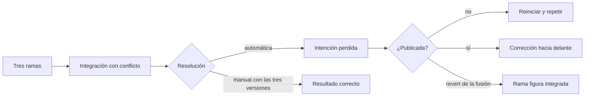
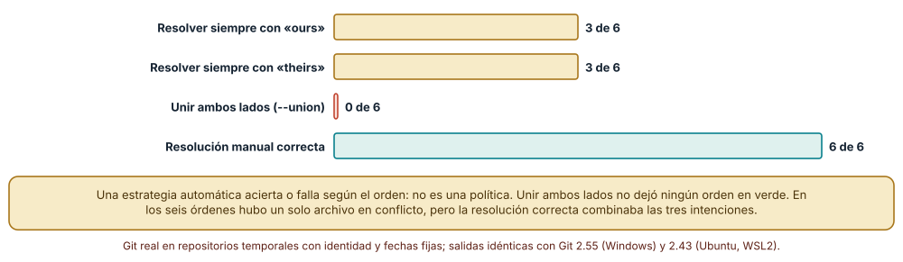
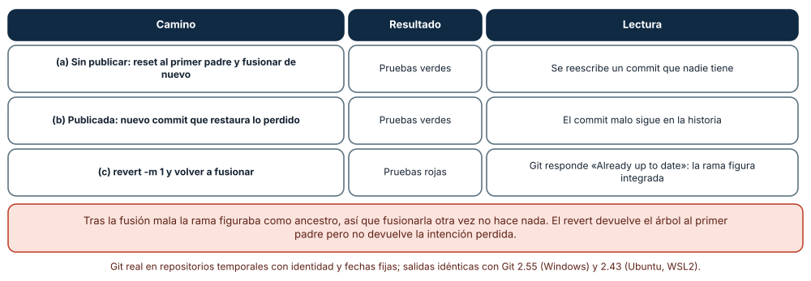
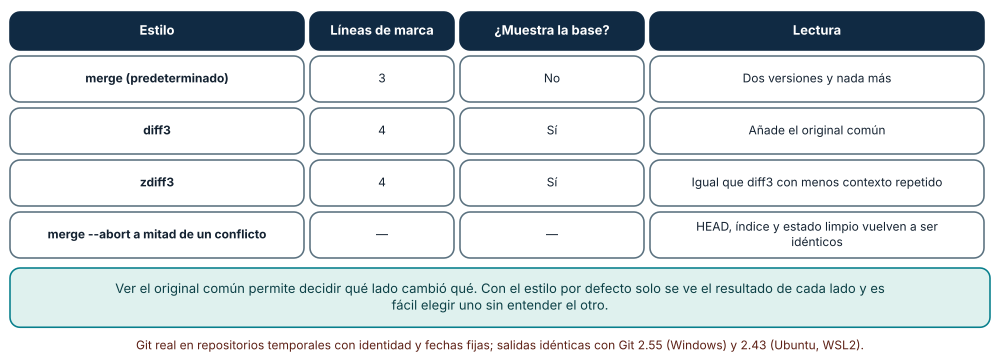

# SE-203 — Taller: rescatar una integración conflictiva

[← SE-202 — Firmas, procedencia y protección del repositorio](../../classes/part-16-git-colaboracion-y-codigo-abierto/se-202-firmas-procedencia-y-proteccion-del-repositorio/README.md) · [↑ Parte 16](../../classes/part-16-git-colaboracion-y-codigo-abierto/README.md) · [📚 Índice completo](../../classes/README.md) · [🌐 Portal](../../site/classes/SE-203.html) · [SE-204 — Proyecto: contribución revisable de extremo a extremo →](../../classes/part-16-git-colaboracion-y-codigo-abierto/se-204-proyecto-contribucion-revisable-de-extremo-a-extremo/README.md)

## Punto profesional y fundamento pedagógico

**Punto profesional.** El taller existe para practicar bajo presión lo que las clases anteriores explican por separado: una integración con conflictos que se resolvió mal, una rama que otras personas ya tienen y una decisión que hay que tomar con poco tiempo sobre cómo recuperar la intención perdida sin empeorar la historia. El criterio profesional es elegir el rescate por lo que ya se ha publicado, no por lo que sea más cómodo.

**Por qué aparece aquí.** Se sitúa después de **Firmas, procedencia y protección del repositorio** y antes de **Proyecto: contribución revisable de extremo a extremo**. Reúne el modelo de objetos (`SE-193`), la recuperación (`SE-194`), la integración (`SE-195`), la revisión (`SE-196`), el flujo (`SE-197`) y la protección (`SE-202`) en un único escenario con tres ramas que cambian la regla de penalización. Deja un procedimiento de rescate que el proyecto final de `SE-204` da por sabido.

**Error conceptual que debe corregir.** Creer que una resolución automática de conflictos («quedarse con el nuestro») es una política y que revertir una fusión mala devuelve la intención. Una estrategia automática acierta o falla según el orden, y revertir una fusión deja el repositorio convencido de que la rama ya está integrada.

**Secuencia de aprendizaje.** Antes de leer la solución, predices cuántas de las seis órdenes de fusión de tres ramas acierta cada estrategia y qué ocurre al volver a fusionar tras revertir; después ejecutas las seis permutaciones con cuatro estrategias, rescatas una fusión mala por tres caminos y comparas los estilos de marcas. La secuencia usa predicción, explicación propia, contraste y recuperación. [ICAP](https://icap.education.asu.edu/research) distingue participación de construcción de conocimiento; [How People Learn II](https://nap.nationalacademies.org/catalog/24783/how-people-learn-ii-learners-contexts-and-cultures) exige conectar conocimiento previo, contexto y transferencia; la [práctica de recuperación](https://pubmed.ncbi.nlm.nih.gov/16507066/) respalda producir de nuevo la explicación tras una demora; y [Education for Life and Work](https://nap.nationalacademies.org/resource/13398/dbasse_084153.pdf) exige devolución que explique la causa del error.

**Evidencia de aprendizaje.** `rescue-log.md` con la tabla de órdenes y estrategias, los tres rescates con sus resultados, la comparación de estilos de marcas y un procedimiento de rescate de una página. Debe contener predicción previa, observación, explicación causal, contraejemplo y qué hallazgo haría cambiar el procedimiento.

**Límite de la conclusión.** Hay tres ramas y un solo archivo en conflicto; la resolución «manual» se escribió conociendo las tres intenciones y su acierto es por construcción; el escenario no incluye firmas, protección de rama ni un remoto con más personas; no se midió el tiempo ni el error humano de resolver conflictos reales.

### Trazabilidad fuente → afirmación

| Fuente primaria u oficial | Afirmación que respalda | Lo que no prueba |
|---|---|---|
| [How to revert a faulty merge](https://git-scm.com/docs/howto/revert-a-faulty-merge) | Explica que revertir una fusión deshace sus cambios pero no su efecto en la historia, de modo que volver a fusionar la rama no la reincorpora. | No dice cuál es el mejor rescate en un equipo concreto. |
| [git-merge](https://git-scm.com/docs/git-merge) | Describe `--abort`, los estilos de marcas (`merge.conflictStyle`) y el efecto de los índices en un conflicto. | No prescribe cómo decidir una resolución. |
| [git-show](https://git-scm.com/docs/git-show) | Documenta `--remerge-diff`, que muestra lo que cambió una resolución respecto de una fusión automática. | No dice si la resolución mostrada es correcta. |

## Antes de empezar

Recupera lo aprendido en `SE-202`: la firma atribuye pero no aprueba, y reescribir una historia compartida invalida las firmas de los descendientes. La pregunta activa es: **¿qué ya se publicó, qué intención se perdió y qué rescate la recupera sin reescribir lo que otras personas tienen?**

## Prerrequisitos

- Haber completado `SE-195` y `SE-202` o poder explicar la diferencia entre revertir y reescribir y qué hace una rama protegida.
- Python 3.11 o posterior, Git 2.40 o posterior y un terminal.
- Trabajar en repositorios temporales; ninguna orden del taller debe ejecutarse sobre un repositorio con trabajo propio.

## Problema auténtico

Tres personas cambian la regla de penalización desde la misma base: una baja el tope de 72 a 48 horas, otra ajusta el cálculo de la pérdida y otra añade un periodo de gracia. Se integran con prisa, un conflicto en `penal.py` se resuelve «quedándose con el nuestro» y la fusión se confirma. Las pruebas fallan: el periodo de gracia se perdió. Dos personas ya han tomado la rama.

## Objetivos observables

Al terminar podrás:

1. predecir qué estrategias automáticas de resolución aciertan según el orden de fusión;
2. mostrar con `--remerge-diff` qué decidió una resolución y qué perdió;
3. rescatar una fusión mala por el camino adecuado según esté o no publicada;
4. explicar por qué revertir una fusión y volver a fusionar no recupera los cambios perdidos;
5. escribir un procedimiento de rescate con sus preguntas previas y sus verificaciones.

## Mapa conceptual



El mapa se lee de izquierda a derecha: una integración con conflicto se resuelve de forma automática o manual; una intención perdida se rescata según si la fusión se publicó, y revertir la fusión deja la rama marcada como integrada sin sus cambios. No describe el tiempo que cuesta cada camino.

## Temas y por qué importan

| Tema | Por qué cambia una decisión profesional | Evidencia mínima |
|---|---|---|
| Orden de fusión | El mismo conjunto de ramas produce conflictos distintos según el orden. | Predicción, traza causal y contraejemplo de **Orden de fusión** en `rescue-log.md` |
| Estrategias automáticas | Elegir un lado, o unirlos, no es una política. | Predicción, traza causal y contraejemplo de **Estrategias automáticas** en `rescue-log.md` |
| Detectar qué se decidió | `--remerge-diff` y las pruebas muestran qué se perdió. | Predicción, traza causal y contraejemplo de **Detectar qué se decidió** en `rescue-log.md` |
| Rescate según lo publicado | Lo no publicado se rehace; lo publicado se corrige hacia delante. | Predicción, traza causal y contraejemplo de **Rescate según lo publicado** en `rescue-log.md` |
| Abortar y leer la base | `--abort` y el estilo `diff3` evitan decidir a ciegas. | Predicción, traza causal y contraejemplo de **Abortar y leer la base** en `rescue-log.md` |

## Conceptos y decisiones

### 1. Orden de fusión

La fusión de tres ramas es una secuencia de fusiones de dos. El orden decide en qué paso aparece el conflicto y qué lado es «el nuestro» cuando aparece. Con tres ramas hay seis órdenes; cuando solo dos cambios chocan, el conflicto aparece siempre en la fusión de la segunda de ellas, y cuál de los dos lados es el de la rama actual depende de cuál se integró primero. Por eso una instrucción como «quédate con el nuestro» no tiene un significado estable.

### 2. Estrategias automáticas

Quedarse siempre con un lado (`--ours`, `--theirs`) acierta cuando ese lado resulta ser el que contiene la intención correcta, y falla en el resto. Unir ambos lados (`--union`) conserva el texto de los dos sin decidir cómo se combinan y rara vez produce código correcto. Una resolución correcta suele combinar las intenciones de ambas ramas, y eso exige entender qué quería cada una.

### 3. Detectar qué se decidió

Una fusión resuelta es un commit con dos padres cuyo árbol no coincide con ninguno. `git show --remerge-diff` rehace la fusión automática y muestra lo que cambió la resolución sobre ella: las líneas que la persona escribió o descartó. Es la herramienta para revisar una resolución, junto con las pruebas del resultado. Si las pruebas no cubren la intención perdida, nada la detecta.

### 4. Rescate según lo publicado

Si la fusión mala no se ha publicado, la solución más limpia es rehacerla: volver al primer padre y fusionar de nuevo con la resolución correcta; nadie más tiene ese commit. Si ya se publicó, reescribir impone trabajo a otras personas (`SE-194`) y el camino es un commit posterior que restaura lo perdido, dejando visible lo ocurrido. Revertir la fusión con `-m 1` devuelve el árbol al primer padre, pero Git sigue considerando integrada la rama, de modo que volver a fusionarla no hace nada.

### 5. Abortar y leer la base

Durante un conflicto, `git merge --abort` devuelve el repositorio al estado anterior a la fusión. El estilo de marcas `diff3` o `zdiff3` añade a cada región conflictiva el texto de la base común, que permite ver qué cambió cada lado. Decidir sin la base obliga a adivinar qué intentaba cada rama; leerla convierte el conflicto en una comparación.

### Seis órdenes, cuatro estrategias

Tres ramas parten de la misma base: `tope` (baja el tope a 48), `redondeo` (reescribe el cálculo de la pérdida de forma equivalente) y `gracia` (añade un periodo de gracia). En las seis permutaciones, **un solo archivo** (`penal.py`) entró en conflicto. Con la estrategia **«ours»**, las pruebas quedaron verdes en **3 de 6** órdenes (aquellas en las que `gracia` se fusiona antes que `tope`); con **«theirs»**, en **3 de 6** (las complementarias); con **`--union`**, en **0 de 6**; con la **resolución manual** que combina las tres intenciones, en **6 de 6**, por construcción. Los resultados fueron idénticos con Git 2.55 en Windows y 2.43 en Ubuntu.



**Cómo leer la figura.** Cada barra es una estrategia aplicada a los mismos seis órdenes; la cifra cuenta cuántos terminan con las cuatro pruebas verdes. **Dónde deja de valer:** el escenario tiene un solo conflicto entre dos ramas, que hace que «ours» y «theirs» sean complementarios; con más conflictos o en archivos distintos ninguna estrategia automática acierta de forma estable, y la resolución manual aquí se escribió conociendo las tres intenciones.

### Tres rescates de una fusión mala

Se fusionó `tope` y después `gracia` resolviendo con «ours»: 1 archivo en conflicto, pruebas rojas, y `--remerge-diff` mostró **6 líneas** (lo que la resolución decidió). La rama `gracia` figuraba como **ancestro de `main`** (Git la daba por integrada) y `penal.py` no tenía el parámetro `gracia`. Con **(c) `revert -m 1`**, el árbol coincidió con el del primer padre, pero al volver a fusionar `gracia` Git respondió **«Already up to date.»**, `penal.py` seguía sin el parámetro y las pruebas estaban rojas. Con **(a) reinicio al primer padre y nueva fusión con la resolución correcta**, las pruebas quedaron verdes y nadie más tenía el commit malo. Con **(b) un commit posterior que restaura lo perdido**, las pruebas quedaron verdes y el commit malo siguió en la historia como ancestro.



**Cómo leer la figura.** Cada fila es un camino de rescate sobre la misma fusión mala; la segunda columna dice si las pruebas quedaron verdes y la tercera lo que significa para el resto del equipo. **Dónde deja de valer:** el escenario no tiene un remoto con protección ni firmas; con ramas protegidas, el reinicio con empuje forzado se rechaza, y con commits firmados la reescritura invalida las firmas de los descendientes (`SE-202`).

### Abortar y elegir el estilo de marcas

Con `tope` ya fusionada, la fusión de `gracia` entró en conflicto en `penal.py`; `git merge --abort` dejó el HEAD igual, el índice igual (comparando `write-tree`) y el estado limpio. Con `merge.conflictStyle` en el valor por defecto, la región conflictiva tuvo **3** líneas de marca y no mostró la base; con **`diff3`**, **4** líneas e incluyó la base; con **`zdiff3`**, **4** líneas e incluyó la base.



**Cómo leer la figura.** Cada fila es un estilo o una operación sobre el mismo conflicto; las columnas cuentan líneas de marca y dicen si aparece el texto de la base. **Dónde deja de valer:** el conflicto es de una región pequeña; en regiones grandes `zdiff3` reduce el contexto repetido y la diferencia con `diff3` se ve más, y abortar solo es posible mientras la fusión no se haya confirmado.

## Definiciones de trabajo

- **fusión de tres ramas:** secuencia de fusiones de dos ramas cuyo resultado depende del orden en que se hacen.
- **`--ours` y `--theirs`:** resolución de un conflicto tomando el lado de la rama actual o el de la rama que se fusiona.
- **`--remerge-diff`:** vista que muestra lo que una resolución cambió respecto de la fusión automática.
- **corrección hacia delante:** commit posterior que restaura lo perdido sin reescribir la historia publicada.
- **`merge --abort`:** operación que devuelve el repositorio al estado anterior a una fusión con conflicto sin confirmar.

Las definiciones son operativas para la plataforma de entregas. No convierten términos con historia más amplia en sinónimos y deben contrastarse con la documentación primaria enlazada al final.

## Ejemplo mínimo

El fragmento revisa una resolución. Antes de ejecutarlo, predice cuántas líneas muestra.

```bash
git show --remerge-diff HEAD          # lo que cambió la resolución sobre la fusión automática
git -c merge.conflictStyle=zdiff3 merge otra-rama   # marcas con la base
git merge --abort                     # si se decide empezar de nuevo
```

Registra versión de Git y salida, y repite resolviendo con `--ours` para ver qué líneas decidió esa elección.

## Ejemplo profesional

En la plataforma, una fusión conflictiva se hace en una rama temporal, con `merge.conflictStyle=zdiff3`, y se resuelve leyendo las tres versiones. Antes de abrir el PR, la persona adjunta la salida de `git show --remerge-diff` y ejecuta las pruebas sobre el resultado; el PR añade una prueba para la intención que habría perdido «ours». El procedimiento de rescate del equipo pregunta primero «¿ya se publicó?» y asigna el camino: rehacer o corregir hacia delante, nunca reescribir una rama protegida.

Compara el caso normal con una fusión resuelta a prisa en `main` por una cuenta con bypass: la práctica es apropiada cuando la resolución es revisable y tiene una prueba; es peligrosa cuando la única evidencia es que «ya no hay marcas».

## Práctica guiada

1. Crea las tres ramas y predice, para cada una de las seis órdenes, qué estrategias darán pruebas verdes.
2. Ejecuta las seis órdenes con las cuatro estrategias y registra la tabla.
3. Provoca la fusión mala con «ours» y muestra qué decidió con `--remerge-diff`.
4. Rescátala sin publicar: reinicia al primer padre y fusiona con la resolución correcta.
5. Simula que está publicada y rescátala con un commit que restaura; registra el historial resultante.
6. Reviértela con `-m 1`, vuelve a fusionar y registra lo que responde Git y el estado de las pruebas.
7. Pide a otra persona que reconstruya el procedimiento solo desde `rescue-log.md` y registra qué pregunta previa faltaba.

## Ejercicios

1. **Más conflictos:** añade una cuarta rama que cambie otra región de `penal.py` y repite la tabla; explica qué estrategia cambia.
2. **Revertir el revert:** revierte el revert de la fusión y explica qué recupera y qué no.
3. **Prueba de la intención:** escribe la prueba que habría detectado la pérdida del periodo de gracia en la integración.
4. **Rama protegida:** explica qué parte del rescate (a) deja de ser posible si la rama exige PR y prohíbe el push forzado.

## Reto verificable

Entrega `rescue-log.md` con la tabla de órdenes y estrategias, los tres rescates con sus resultados, la comparación de estilos y un procedimiento de rescate de una página con sus preguntas previas. Se aprueba si otra persona ejecuta el código desde un directorio vacío, obtiene las mismas tablas y puede decir qué rescate elegiría si la fusión ya estuviera publicada en una rama protegida. No se aprueba por rescatar sin explicar qué se perdió.

## Caso conductor

El repositorio de la plataforma de entregas es el caso conductor de la Parte 16. El taller deja el procedimiento de rescate y la prueba de la intención. `SE-204` entrega una contribución completa que otra persona puede revisar y fusionar sin necesidad de este rescate. Cambia después un solo dato, la rama fusionada en último lugar, y revisa qué estrategias automáticas aciertan.

## Preguntas frecuentes

### ¿Cuándo es válido usar `--ours`?

Cuando se sabe que el lado actual contiene la intención correcta y que el otro es ruido (por ejemplo, un archivo generado). Se anota en la fusión y se comprueba con pruebas.

### ¿Por qué volver a fusionar no recupera los cambios tras un revert?

Porque la rama sigue siendo ancestro: Git considera que sus commits ya están integrados. Hay que revertir el revert o rehacer la fusión.

### ¿Se puede rescatar sin rama temporal?

Se puede, pero es más arriesgado: una rama temporal permite tirarla y empezar de nuevo sin tocar la principal.

### ¿Qué pasa si el conflicto es de un archivo binario?

Git no puede fusionar texto: hay que elegir una versión o regenerar el archivo. El estilo de marcas no aplica y la decisión es siempre manual.

## Fallo controlado y diagnóstico

Reproduce el fallo clásico de la clase: **resolver quedándose con un lado y dar la integración por buena sin ejecutar las pruebas**. Usa «ours» sobre `penal.py`.

Registra síntoma, entrada mínima, hipótesis, observación que descarta cada hipótesis, causa, corrección y prueba de regresión. **Síntoma:** la fusión de `gracia` terminó sin marcas pendientes y el panel de notas ignora el periodo de gracia. **Hipótesis rivales:** (a) `gracia` no se integró; (b) se integró con la resolución de «ours» y se perdió su cambio. **Prueba:** `git merge-base --is-ancestor gracia main` indica que sí es ancestro; `--remerge-diff` muestra que la resolución descartó el parámetro. **Conclusión:** la causa es (b). **Regresión:** añade la prueba del periodo de gracia, exige ejecutar las pruebas sobre el resultado de cualquier fusión resuelta y registra el rescate elegido. No cambies a la vez la resolución y la prueba.

## Errores comunes y cómo corregirlos

| Síntoma | Causa probable | Corrección |
|---|---|---|
| Una rama «integrada» no tiene sus cambios | Se resolvió con un lado o se revirtió la fusión | Comprobar con `--remerge-diff` y rehacer o corregir hacia delante |
| Volver a fusionar no hace nada | La rama es ancestro tras la fusión o su revert | Revertir el revert o rehacer la fusión desde el primer padre |
| Las pruebas pasan pero falta una intención | Ninguna prueba cubre lo perdido | Añadir una prueba por cada intención integrada |
| Se reescribe una rama publicada | No se preguntó si ya la tenían otras personas | Preguntar primero y usar una corrección hacia delante |
| Se decide sin ver la base | El estilo de marcas por defecto no la muestra | Usar `zdiff3` y leer los tres textos |

## Entorno y archivos clave

```text
work/SE-203/
├── README.md
├── rescate/
│   ├── ordenes.py
│   ├── rescates.py
│   └── marcas.py
└── evidence/rescue-log.md
```

El `README` declara sistema operativo, versión de Git y de Python, y los comandos. Los experimentos usan `subprocess`, `itertools` y repositorios temporales con identidad y fechas fijas y se ejecutaron con CPython 3.12.9 y Git 2.55 en Windows 11 y con CPython 3.12.3 y Git 2.43 en Ubuntu bajo WSL2: las salidas fueron idénticas. Si automatizas con otra herramienta, fija procedencia y versión.

## Seguridad, ética y accesibilidad

- una resolución que toca autenticación, permisos o reglas de nota requiere revisión humana aunque las pruebas pasen;
- no resuelvas conflictos de archivos con secretos copiando valores a mensajes o registros;
- reescribir historia publicada para «ocultar» un error traslada el riesgo a quienes la tienen: registra lo ocurrido y elige la corrección hacia delante;
- ofrece una alternativa textual a las tablas y describe los estados de las ramas en palabras;
- atribuye los cambios rescatados a quien los escribió.

## Puente hacia el trabajo con agentes

Un agente al que se le pide «resuelve los conflictos de la fusión» suele ejecutar `--ours` o `--theirs` hasta que las pruebas pasen, y puede cambiar las pruebas. Pídele que primero explique la intención de cada rama a partir de los mensajes y la base, que resuelva leyendo `zdiff3`, que muestre `--remerge-diff` y que añada una prueba por intención, sin modificar pruebas existentes. Revisa especialmente si decidió por su cuenta rehacer una fusión ya publicada: es el rescate que más impone trabajo a otras personas.

## Transferencia

Traslada el procedimiento a otra integración de cambios concurrentes con pérdida posible (por ejemplo, una migración de datos que se aplicó parcialmente o una configuración compartida): decide qué sería «ya publicado», qué rescate rehace y cuál corrige hacia delante. La transferencia está lograda cuando puedes explicar qué parte del rescate dependía de lo publicado, no cuando los comandos se parecen.

## Evaluación y evidencia

| Criterio | Evidencia para aprobar |
|---|---|
| comprensión | explicación de por qué volver a fusionar no recupera los cambios |
| corrección | tablas de órdenes y rescates reproducibles con las mismas ramas |
| diseño | procedimiento de rescate con la pregunta «¿ya se publicó?» al principio |
| diagnóstico | reproducción del fallo «dar por buena la resolución» con regresión |
| incertidumbre | declaración de qué parte depende de tener un solo conflicto entre dos ramas |
| reproducibilidad | versiones, comandos, salida y límites declarados |

## Fuentes

- [How to revert a faulty merge](https://git-scm.com/docs/howto/revert-a-faulty-merge) — efectos de revertir una fusión; autoridad: documentación de Git.
- [git-merge](https://git-scm.com/docs/git-merge) — `--abort`, estilos de marcas y estrategias; autoridad: documentación de Git.
- [git-show](https://git-scm.com/docs/git-show) — `--remerge-diff`; autoridad: documentación de Git.
- [git-reflog](https://git-scm.com/docs/git-reflog) — recuperación de estados previos; autoridad: documentación de Git.
- [git-revert](https://git-scm.com/docs/git-revert) — revertir commits y fusiones con `-m`; autoridad: documentación de Git.
- [Pro Git: Maintenance and Data Recovery](https://git-scm.com/book/en/v2/Git-Internals-Maintenance-and-Data-Recovery) — recuperación de objetos; autoridad: Pro Git.

Cada fuente respalda el mecanismo indicado; ninguna demuestra qué rescate conviene a un equipo concreto. Esa afirmación depende de lo que ya esté publicado y de las reglas de la rama.

- [git-rerere](https://git-scm.com/docs/git-rerere) — reutilización de resoluciones.
- [git-merge-file](https://git-scm.com/docs/git-merge-file) — fusión de tres versiones de un archivo.

## Límites y siguiente paso

Se ejecutaron tres experimentos con repositorios temporales y datos sintéticos en Windows y Ubuntu (WSL2) con resultados idénticos. El escenario tiene un único conflicto entre dos ramas, la resolución manual correcta se escribió conociendo las intenciones y no se midió ningún equipo, tiempo ni error humano. La siguiente clase reúne todo en un proyecto: una contribución que otra persona puede revisar, probar, atribuir y fusionar.

## Glosario

- **fusión de tres ramas:** secuencia de fusiones de dos ramas cuyo resultado depende del orden en que se hacen.
- **`--ours` y `--theirs`:** resolución de un conflicto tomando el lado de la rama actual o el de la rama que se fusiona.
- **`--remerge-diff`:** vista que muestra lo que una resolución cambió respecto de la fusión automática.
- **corrección hacia delante:** commit posterior que restaura lo perdido sin reescribir la historia publicada.
- **`merge --abort`:** operación que devuelve el repositorio al estado anterior a una fusión con conflicto sin confirmar.

---

[← SE-202 — Firmas, procedencia y protección del repositorio](../../classes/part-16-git-colaboracion-y-codigo-abierto/se-202-firmas-procedencia-y-proteccion-del-repositorio/README.md) · [↑ Parte 16](../../classes/part-16-git-colaboracion-y-codigo-abierto/README.md) · [📚 Índice completo](../../classes/README.md) · [🌐 Portal](../../site/classes/SE-203.html) · [SE-204 — Proyecto: contribución revisable de extremo a extremo →](../../classes/part-16-git-colaboracion-y-codigo-abierto/se-204-proyecto-contribucion-revisable-de-extremo-a-extremo/README.md)
