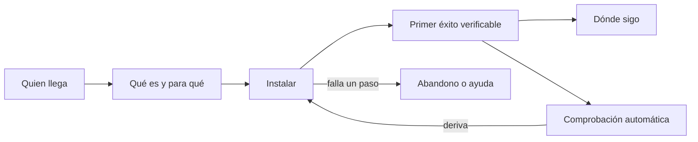
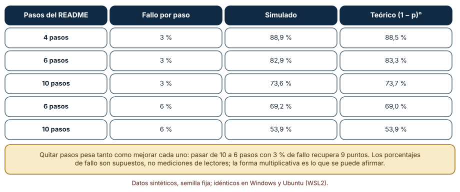
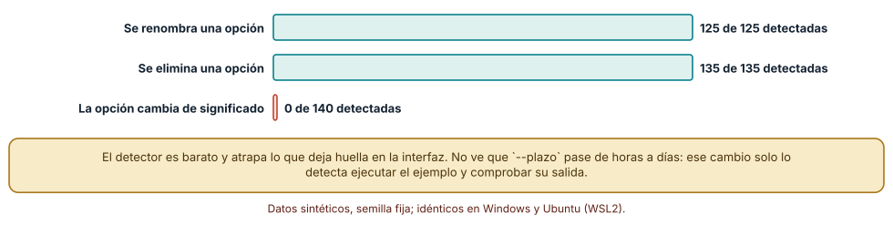
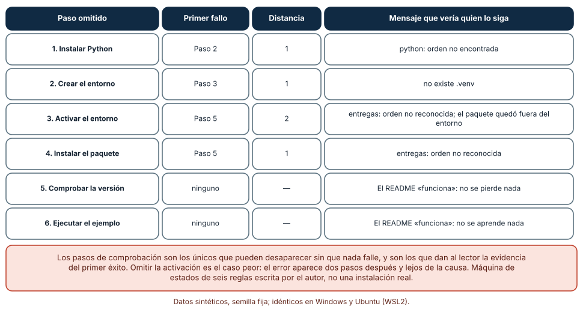

# SE-207 — README, instalación y primer éxito

[← SE-206 — Tutoriales, how-to, referencia y explicación](../../classes/part-17-documentacion-y-conocimiento-tecnico/se-206-tutoriales-how-to-referencia-y-explicacion/README.md) · [↑ Parte 17](../../classes/part-17-documentacion-y-conocimiento-tecnico/README.md) · [📚 Índice completo](../../classes/README.md) · [🌐 Portal](../../site/classes/SE-207.html) · [SE-208 — ADRs, RFCs y registro de decisiones →](../../classes/part-17-documentacion-y-conocimiento-tecnico/se-208-adrs-rfcs-y-registro-de-decisiones/README.md)

## Punto profesional y fundamento pedagógico

**Punto profesional.** La clase existe para que escribas el README como el camino más corto desde «acabo de llegar» hasta «ya vi funcionar algo», y para que sepas calcular cuánta gente se pierde en ese camino según el número de pasos y qué parte del README puede comprobarse automáticamente.

**Por qué aparece aquí.** Se sitúa después de **Tutoriales, how-to, referencia y explicación** y antes de **ADRs, RFCs y registro de decisiones**: la clase anterior distinguió los tipos de página; esta aplica la distinción a la página que casi todo el mundo lee primero y que casi todo el mundo mezcla. Deja la técnica de comprobar un README contra la interfaz real, que `SE-212` ampliará a todo el portal.

**Error conceptual que debe corregir.** Creer que un README completo es un buen README. Un README que enumera todas las opciones, la historia y la arquitectura pierde a quien solo quiere comprobar que el proyecto funciona, y un README que «funciona en mi máquina» pierde a todos los demás.

**Límite de la conclusión.** El embudo usa probabilidades de fallo por paso que son supuestos, el detector compara un README sintético con un analizador de argumentos de juguete y el experimento de omisión es una máquina de seis reglas. No se instaló ningún paquete real ni se observó a quien instala.

### Trazabilidad fuente → afirmación

| Fuente primaria u oficial | Afirmación que respalda | Lo que no prueba |
|---|---|---|
| [Make a README](https://www.makeareadme.com/) | Propone una estructura mínima de README (nombre, descripción, instalación, uso, contribución, licencia) y la justifica por la comodidad de quien llega. | No mide si esa estructura mejora la adopción. |
| [GitHub: acerca de los README](https://docs.github.com/en/repositories/managing-your-repositorys-settings-and-features/customizing-your-repository/about-readmes) | Documenta que GitHub muestra el README como portada del repositorio y qué archivos busca y en qué orden. | No dice qué debe contener. |
| [Python Packaging User Guide: instalar paquetes](https://packaging.python.org/en/latest/tutorials/installing-packages/) | Describe el uso de entornos virtuales y de `pip` para instalar paquetes y por qué se recomienda aislar. | No cubre los problemas de cada plataforma. |

## Antes de empezar

Retoma las cuatro páginas por tipo de `SE-206`. La pregunta activa es: **¿qué es lo mínimo que alguien debe hacer, y en cuántos pasos, para ver el proyecto funcionar, y qué pasa en cada paso que puede fallar?**

## Prerrequisitos

- Haber completado `SE-206` o poder explicar la diferencia entre tutorial y guía práctica.
- Python 3.11 o posterior, un terminal y conocimiento básico de entornos virtuales.
- Trabajar con la plataforma de entregas y un paquete sintético; no se instala nada real.

## Problema auténtico

El README de la plataforma tiene 600 líneas. La instalación está en la línea 380, tras la historia del proyecto y la tabla de configuración. Una colaboradora nueva ejecuta tres comandos de la línea 120, que eran de una versión anterior, y obtiene un error que atribuye a su equipo. Abandona. Otro colaborador copia los comandos de instalación pero omite el paso de activar el entorno virtual porque «ya lo tenía»; instala el paquete en su entorno global y el programa funciona, hasta que una actualización posterior lo rompe. Un tercero escribe el comando con una opción que se renombró hace dos versiones. Ninguno recibió un mensaje que dijera qué había pasado.

## Objetivos observables

Al terminar podrás:

1. definir el «primer éxito» de un proyecto como un resultado observable que cualquiera pueda comprobar en menos de diez minutos;
2. calcular qué fracción de personas llega al primer éxito según el número de pasos y la probabilidad de fallo de cada uno;
3. escribir un comprobador que contraste las opciones citadas en el README con las del analizador de argumentos y decir qué cambios no detecta;
4. predecir qué ocurre al omitir cada paso de un README y por qué los pasos de comprobación son los más prescindibles y los más valiosos;
5. decidir qué contenido del README se queda, cuál se enlaza y cuál se elimina.

## Mapa conceptual



El diagrama se lee de izquierda a derecha como el camino de quien llega: entender qué es, instalar, ver un resultado comprobable y saber dónde seguir. La rama hacia abajo muestra el coste de un paso fallido, que suele ser abandono; la de la derecha, que la comprobación automática alimenta la instalación cuando detecta deriva. El diagrama no dice cuántos pasos son demasiados; el primer experimento da una forma de estimarlo.

## Temas y por qué importan

| Tema | Por qué cambia una decisión profesional | Evidencia mínima |
|---|---|---|
| Función del README | Es la portada: decide si alguien sigue o se va, y desde dónde se deriva todo lo demás. | README de menos de una pantalla antes de «cómo instalar» |
| Primer éxito | Un resultado observable convierte «parece que funciona» en una comprobación. | Comando y salida esperada declarados |
| Instalación | Cada paso es una oportunidad de fallo y de diferencias entre sistemas. | Lista de pasos con precondiciones y sistemas probados |
| Comprobación contra la interfaz | Un README desactualizado es peor que ninguno: produce errores con apariencia de oficiales. | Comparación README–analizador en la integración continua |
| Qué enlazar | Todo lo que no es el camino al primer éxito pertenece a otra página. | Lista de enlaces a guías, referencia y explicación |

## Conceptos y decisiones

### 1. La función del README

El README es lo primero que ve quien llega a un repositorio y lo único que ve quien no sigue más. Su trabajo es contestar cinco preguntas en el orden en que se formulan: qué es esto, para qué sirve, cómo lo pruebo, dónde sigo y cómo contribuyo. No tiene que contestarlas a fondo; tiene que contestarlas rápido y enlazar el fondo. Un README que intenta ser manual, referencia y registro de cambios a la vez cae en el problema de la página mixta de `SE-206`. La regla práctica es que lo que no sirve al camino hacia el primer éxito se enlaza, no se incluye, y que el README cabe en dos pantallas antes de pasar a los enlaces.

### 2. El primer éxito

El primer éxito es el momento en que quien llegó ve funcionar algo y puede comprobarlo sin preguntar. Tiene tres propiedades: es observable (una salida concreta, no «debería funcionar»), es rápido (decenas de segundos tras terminar de instalar) y es honesto (muestra una función real del proyecto, no un «hola mundo» sin relación). En la plataforma, el primer éxito es calcular la nota de una entrega con 30 horas de retraso y ver 64 sobre 80. Declarar el resultado esperado permite a quien lo ejecuta distinguir un éxito de un éxito aparente, y permite a la integración continua comprobarlo.

### 3. Instalación: precondiciones, entornos y sistemas

La instalación tiene precondiciones (versión de Python, herramientas), un entorno (idealmente aislado) y diferencias entre sistemas. En Windows el entorno virtual se activa con `.venv\Scripts\activate`; en Linux y macOS, con `source .venv/bin/activate`. Un README que da solo uno de los dos cierra la puerta a la mitad de los lectores. Cada paso debe decir qué hace, qué comando lo ejecuta y qué se espera ver; si un paso puede fallar de forma común, el mensaje de error y su solución viven al lado, no en otra página. La decisión relevante es cuánto automatizar: un script de instalación reduce los pasos, pero oculta lo que hace, y por eso conviene dejar el equivalente manual documentado.

### 4. Pasos de comprobación y su valor

Los pasos que comprueban («ejecuta `entregas --version` y debes ver un número») parecen redundantes y son los más importantes: dan la evidencia de que el entorno quedó como se esperaba. Son también los que más se omiten, porque nada falla sin ellos. Cuando un paso de instalación falla en silencio (por ejemplo, instala en el entorno global), la omisión de la comprobación traslada el error a un momento posterior donde ya no se asocia a su causa. Por eso cada bloque de instalación termina con una comprobación, y la integración continua ejecuta esa comprobación en un entorno limpio.

### 5. Deriva: el README frente a lo que el programa acepta

Un README describe comandos y opciones que el programa acepta o rechaza. Cualquier cambio de interfaz (renombrar, eliminar, cambiar el significado de una opción) crea una diferencia entre el README y la realidad. Parte de esa diferencia puede detectarse comparando las opciones citadas con las que declara el analizador de argumentos; otra parte, no: si una opción conserva su nombre y cambia de unidades, solo ejecutar el ejemplo y comprobar su salida lo muestra. El coste de mantener un README es el coste de esa deriva, y la defensa es una combinación de comparación automática y ejecución de ejemplos.

### Cuántas personas llegan al primer éxito según el número de pasos

Se simulan 40 000 recorridos por escenario. Cada paso falla con una probabilidad fija e independiente; el recorrido llega al primer éxito solo si todos los pasos salen bien.

```python
ok = sum(all(rng.random() > p for _ in range(pasos)) for _ in range(40000))
print(round(100 * ok / 40000, 1), round(100 * (1 - p) ** pasos, 1))
```

Con 3 % de fallo por paso: 4 pasos llegan el 88,9 % (teoría 88,5), 6 pasos el 82,9 % (83,3) y 10 pasos el 73,6 % (73,7). Con 6 % de fallo por paso: 6 pasos llegan el 69,2 % (69,0) y 10 pasos el 53,9 % (53,9). Pasar de 10 a 6 pasos con 3 % de fallo recupera 9 puntos; reducir el fallo por paso del 6 % al 3 % con 10 pasos recupera 20.



**Cómo leer la figura.** Cada fila es una combinación de pasos y probabilidad de fallo por paso; las dos columnas finales son el valor simulado y la fórmula (1 − p)ⁿ. **Dónde deja de valer:** los pasos reales no fallan con la misma probabilidad ni de forma independiente: un error de versión de Python hace fallar varios; un paso difícil falla más. Los porcentajes de fallo son supuestos, no mediciones de personas; lo que la tabla sostiene es la forma multiplicativa, que dice que cada paso eliminado vale tanto como mejorar la fiabilidad de todos los demás.

### Un detector de deriva entre el README y el analizador de argumentos

Se define un programa con ocho opciones (`--plazo`, `--prorroga`, `--nota`, `--formato`, `--salida`, `--verbose`, `--semilla`, `--tope`) y un README con un ejemplo por opción. Se aplican 400 mutaciones al analizador: renombrar una opción (125), eliminarla (135) o cambiar su significado conservando el nombre (140). El detector extrae del README las opciones citadas y comprueba que existan en `parser._actions`.

```python
conocidas = {s for a in parser._actions for s in a.option_strings}
rotas = [tok for cmd in comandos for tok in cmd.split()
         if tok.startswith("--") and tok not in conocidas]
```

Resultado, idéntico en Windows y Ubuntu: detecta las 125 de 125 opciones renombradas y las 135 de 135 eliminadas, y ninguna de las 140 cuyo significado cambia. El detector es barato, determinista y atrapa todo lo que deja huella en la interfaz. No ve que `--plazo` pase de horas a días: ese cambio solo lo muestra ejecutar el ejemplo y comparar la salida.



**Cómo leer la figura.** Cada barra es el porcentaje de mutaciones de su tipo que el detector marcó; las dos verdes son cambios visibles en la interfaz y la coral es un cambio de significado. **Dónde deja de valer:** usa `parser._actions`, un atributo no documentado de `argparse` que puede cambiar entre versiones de Python; una herramienta real debería usar una interfaz estable o ejecutar `--help`. Y solo ve opciones largas citadas con `--`: una opción corta, un subcomando o un valor por defecto escapan.

### Omitir un paso: dónde aparece el primer fallo

Se modela un README de seis pasos como una máquina de estados: instalar Python, crear el entorno, activarlo, instalar el paquete, comprobar la versión, ejecutar un ejemplo. Se ejecuta seis veces, omitiendo cada vez uno, y se registra en qué paso aparece el primer fallo y a qué distancia de la omisión.

```python
def s4():                                   # instalar el paquete
    if not st["python"]:
        return "pip: orden no encontrada"
    st["venv_pkg" if st["active"] else "global_pkg"] = True
def s5():                                   # comprobar la versión
    if not st["venv_pkg"]:
        return "entregas: orden no reconocida"
```

Omitir los pasos 1 y 2 falla en el paso siguiente (distancia 1); omitir el 4 falla en el 5 (distancia 1); omitir el 3, la activación, falla dos pasos más tarde: el paquete se instala fuera del entorno y el error aparece en la comprobación, lejos de la causa. Omitir los pasos 5 o 6, los de comprobación, no falla: el README «funciona» sin que se vea nada.



**Cómo leer la figura.** Cada fila es el paso omitido; las columnas dan el primer fallo, su distancia y el mensaje que vería quien lo siga. **Dónde deja de valer:** son seis reglas escritas por el autor; en una máquina real, instalar en el entorno global podría funcionar sin ningún error si el directorio de scripts estuviera en la ruta de búsqueda, y la distancia sería infinita. La lección que sobrevive es que las comprobaciones son las únicas que pueden desaparecer sin ruido y las que dan evidencia.

## Definiciones de trabajo

- **README:** documento de portada de un proyecto que dice qué es, cómo se prueba y dónde seguir, en el menor espacio útil.
- **primer éxito:** resultado observable y comprobable que obtiene quien instala el proyecto por primera vez.
- **paso de comprobación:** comando cuyo único propósito es demostrar que el paso anterior dejó el entorno como se esperaba.
- **deriva del README:** diferencia entre lo que el README afirma y lo que el programa hace o acepta.
- **entorno aislado:** copia independiente del intérprete y sus paquetes que evita mezclar dependencias con las del sistema.

Las definiciones son operativas para el portal; no reemplazan las de la documentación de Python y de GitHub enlazadas abajo.

## Ejemplo mínimo

El fragmento comprueba que las opciones citadas en un README existan en un analizador. Antes de ejecutarlo, predice qué opción detecta como rota.

```python
import argparse, re

p = argparse.ArgumentParser(prog="entregas")
p.add_argument("--plazo")
p.add_argument("--nota")

readme = "entregas --plazo 48 --nota 80 --prorroga 24"
citadas = re.findall(r"--[a-z-]+", readme)
conocidas = {s for a in p._actions for s in a.option_strings}
print([c for c in citadas if c not in conocidas])   # esperado ['--prorroga']
```

La predicción correcta es `['--prorroga']`. Registra versión del intérprete y salida; si añades `--prorroga` al analizador, predice antes que la lista queda vacía.

## Ejemplo profesional

El README de la plataforma queda en 70 líneas: dos frases de descripción, un bloque de instalación con los comandos de Windows y de Linux, un bloque «Primer éxito» con `entregas penalizar --nota 80 --horas 30` y la salida esperada `64`, y una lista de cuatro enlaces (guía por tareas, referencia, explicación y cómo contribuir). La integración continua ejecuta el bloque de instalación en un entorno limpio de ambos sistemas, compara las opciones citadas con las del analizador y ejecuta el primer éxito comprobando la salida. Cuando alguien renombra una opción, la comparación falla en el pull request.

Compara el caso normal con tres casos límite: la persona con una versión de Python anterior a la requerida (el README declara la mínima y la comprobación del primer paso la muestra), el cambio que mantiene los nombres y cambia las unidades (lo detecta el ejemplo ejecutado, no la comparación) y la contribución que añade una opción nueva sin documentarla (la comparación inversa, de opciones del programa que no están en la referencia, la señala).

## Práctica guiada

1. Crea `work/SE-207/` y redacta el README de la plataforma en menos de 80 líneas con el primer éxito declarado.
2. Escribe los pasos de instalación para Windows y para Linux y anota qué difiere.
3. Construye el analizador de argumentos de ejemplo con ocho opciones.
4. Escribe el comparador de opciones y pruébalo con tres renombrados y tres eliminaciones.
5. Ejecuta el modelo de embudo con tus pasos y estima qué fracción llegaría al primer éxito con 3 % y 6 % de fallo por paso.
6. Omite cada paso de tu README en la máquina de estados y registra a qué distancia aparece el fallo.
7. Pide a una persona ajena a la clase que siga el README en un entorno limpio y anota dónde se detiene.
8. Entrega `recorrido.md` con lo observado y los cambios hechos.

## Ejercicios

1. **Primer éxito:** define un primer éxito para un proyecto que conozcas y justifica por qué es observable, rápido y honesto.
2. **Embudo:** calcula cuántos pasos puedes permitirte si quieres que el 90 % llegue con 2 % de fallo por paso, y explica qué supone la independencia.
3. **Detector:** extiende el comparador para detectar también opciones del programa que no figuran en el README y mide con 100 mutaciones cuántas detecta.
4. **Omisión:** añade un séptimo paso («configurar un token») a la máquina de estados y predice a qué distancia aparecería su omisión antes de ejecutarla.

## Reto verificable

Entrega el README de 80 líneas o menos, los comandos de ambos sistemas, el comparador, el modelo de embudo con tus parámetros y el registro de un recorrido real. Se aprueba si otra persona ejecuta el comparador desde un checkout limpio, obtiene las mismas detecciones y puede nombrar un cambio de interfaz que el comparador no ve.

## Caso conductor

El README del portal de la plataforma de entregas lleva ahora a un primer éxito concreto y deriva el resto a las páginas por tipo de `SE-206`. Esta clase deja el comparador de opciones, que `SE-212` integrará en la integración continua, y la lista de comprobaciones que `SE-210` ampliará a la documentación de la API.

## Preguntas frecuentes

### ¿Cuántos pasos debe tener la instalación?

Los menos posibles; el embudo muestra que cada paso eliminado vale tanto como mejorar la fiabilidad de todos los demás. Un comando único de instalación que oculte los pasos puede ser mejor, siempre que el equivalente manual esté documentado.

### ¿El README debe explicar la arquitectura?

No: una frase y un enlace. La arquitectura es una explicación (`SE-206`) y un diagrama (`SE-209`), y quien llega a probar el proyecto no la necesita en la portada.

### ¿Cómo se prueban los pasos en dos sistemas?

Con una matriz de integración continua que ejecute los mismos comandos en Windows y Ubuntu. Si no está disponible, declara qué sistemas se probaron y cuáles no; no escribas «funciona en todos».

### ¿Qué hago con las capturas de pantalla?

Úsalas con moderación, siempre con texto alternativo y con el comando equivalente al lado. Una captura envejece más rápido que un comando y no puede ejecutarse.

## Fallo controlado y diagnóstico

Reproduce el fallo clásico de la clase: **un README que cita una opción que ya no existe**. Renombra `--plazo` a `--limite` en el analizador y ejecuta el comparador.

Registra síntoma, entrada mínima, hipótesis, observación que descarta cada hipótesis, causa, corrección y prueba de regresión. **Síntoma:** quien sigue el README obtiene «unrecognized arguments: --plazo». **Hipótesis rivales:** (a) la persona escribió mal el comando; (b) su versión es distinta; (c) el README cita una opción retirada. **Observación que discrimina:** ejecuta `entregas --help` con la versión publicada; si no muestra `--plazo`, confirma (c). **Causa:** la opción se renombró y el README no se actualizó. **Corrección:** actualizar el README y mantener un alias con aviso de deprecación durante una versión. **Prueba de regresión:** el comparador en la integración continua. **Recuperación:** publicar una nota en el changelog y responder a quienes abrieron incidencias con el comando antiguo.

## Errores comunes y cómo corregirlos

| Síntoma | Causa probable | Corrección |
|---|---|---|
| La instalación funciona en Windows y falla en Linux | Solo se escribió el comando de activación de un sistema | Dar ambos comandos y probarlos en la integración continua |
| Quien sigue el README instala fuera del entorno | Se omitió la activación y nada lo comprueba | Añadir un paso de comprobación que muestre la ruta del intérprete |
| El README tiene 500 líneas y nadie llega al final | Mezcla portada, manual y referencia | Mover lo que no es camino al primer éxito a otras páginas y enlazar |
| El «hola mundo» funciona y el proyecto real no | El primer éxito no ejerce una función real | Elegir un primer éxito que use la función principal con una entrada conocida |
| El README es correcto pero los ejemplos dan otra salida | Cambió el significado de una opción sin cambiar el nombre | Ejecutar los ejemplos y comparar la salida en la integración continua |

## Entorno y archivos clave

```text
work/SE-207/
├── README.md
├── readme-plataforma.md
├── cli/entregas.py
├── experimentos/
│   ├── embudo.py
│   ├── deriva.py
│   └── omision.py
├── tests/test_readme.py
└── evidencia/recorrido.md
```

El `README` declara plataforma, versión de Python, semillas y comandos. Los experimentos usan solo la biblioteca estándar (`argparse`, `random`, `re`) y se ejecutaron con CPython 3.12.9 en Windows 11 y 3.12.3 en Ubuntu bajo WSL2 con resultados idénticos. No se instalaron paquetes: la máquina de estados modela los pasos.

## Seguridad, ética y accesibilidad

- un README que pide ejecutar `curl ... | sh` pide confianza total en el origen: ofrece la alternativa de descargar, leer y ejecutar;
- no pongas tokens, rutas privadas ni direcciones internas en los ejemplos; usa valores sintéticos y declara que lo son;
- los bloques de comandos deben poder copiarse sin símbolos de prompt y tener una alternativa textual en las capturas;
- evita instrucciones que dependan del color, y estructura el README con encabezados reales;
- declara la licencia y los requisitos de versión desde las primeras líneas;
- indica cómo desinstalar y qué queda en el sistema.

## Puente hacia el trabajo con agentes

Un agente al que se pide «actualiza el README» suele reescribirlo más largo y con comandos plausibles que nunca ejecutó. Pídele que cite el comando y la salida exacta de cada paso de instalación, que ejecute el bloque de primer éxito en un entorno limpio y que no cambie una opción sin comprobarla contra el analizador. Un agente también es un lector del README: si el primer éxito es claro y verificable, puede usar el proyecto sin ayuda. Quien revisa comprueba que la integración continua ejecutó los comandos y no solo que el texto parece correcto.

## Transferencia

Traslada el README a otro dominio (por ejemplo, un servicio de reparto con un comando de cálculo de tarifa): cambian el comando y la salida, se conserva la estructura de cinco preguntas, la comprobación de opciones y los pasos de verificación. La transferencia está lograda cuando puedes explicar qué parte del README depende del producto y cuál es estructura reutilizable.

## Evaluación y evidencia

| Criterio | Evidencia para aprobar |
|---|---|
| comprensión | definición del primer éxito con las tres propiedades y un ejemplo de la plataforma |
| corrección | conteos reproducibles del embudo y de las mutaciones detectadas con las mismas semillas |
| diseño | README de menos de 80 líneas con instalación en ambos sistemas y primer éxito comprobable |
| diagnóstico | reproducción del fallo «opción citada que ya no existe» con regresión |
| incertidumbre | declaración de que las probabilidades son supuestos y de que no se instaló ningún paquete real |
| reproducibilidad | versiones, comandos, salida y límites declarados |

## Fuentes

- [Make a README](https://www.makeareadme.com/) — estructura mínima de un README; autoridad: proyecto Make a README.
- [GitHub: acerca de los README](https://docs.github.com/en/repositories/managing-your-repositorys-settings-and-features/customizing-your-repository/about-readmes) — cómo se muestra un README en un repositorio; autoridad: GitHub Docs.
- [Python Packaging User Guide: instalar paquetes](https://packaging.python.org/en/latest/tutorials/installing-packages/) — instalación y entornos virtuales; autoridad: Python Packaging Authority.
- [Python: `venv`](https://docs.python.org/3/library/venv.html) — creación y activación de entornos virtuales en cada sistema; autoridad: documentación de Python.
- [Python: `argparse`](https://docs.python.org/3/library/argparse.html) — definición de opciones y subcomandos; autoridad: documentación de Python.

Cada fuente respalda el mecanismo indicado; ninguna demuestra que un README breve aumente la adopción ni que las probabilidades de fallo del embudo sean las de tu proyecto. Esa afirmación depende de observar instalaciones reales.

- [Diátaxis: tutoriales](https://diataxis.fr/tutorials/) — el primer éxito como parte de un recorrido guiado; autoridad: proyecto Diátaxis.

## Límites y siguiente paso

Se ejecutaron tres experimentos con datos sintéticos en Windows y Ubuntu (WSL2) con resultados idénticos. No se instaló ningún paquete real, no se observó a nadie instalando y el detector usa un atributo no documentado de `argparse`; las probabilidades de fallo son supuestos del autor. La siguiente clase pasa de las páginas que guían al registro de por qué el sistema es como es: las decisiones.

## Glosario

- **README:** documento de portada de un proyecto con lo mínimo para probarlo y seguir.
- **primer éxito:** resultado observable y comprobable que obtiene quien instala el proyecto por primera vez.
- **paso de comprobación:** comando que demuestra que el paso anterior dejó el entorno como se esperaba.
- **deriva del README:** diferencia entre lo que el README afirma y lo que el programa hace o acepta.
- **entorno aislado:** copia independiente del intérprete y sus paquetes.

---

[← SE-206 — Tutoriales, how-to, referencia y explicación](../../classes/part-17-documentacion-y-conocimiento-tecnico/se-206-tutoriales-how-to-referencia-y-explicacion/README.md) · [↑ Parte 17](../../classes/part-17-documentacion-y-conocimiento-tecnico/README.md) · [📚 Índice completo](../../classes/README.md) · [🌐 Portal](../../site/classes/SE-207.html) · [SE-208 — ADRs, RFCs y registro de decisiones →](../../classes/part-17-documentacion-y-conocimiento-tecnico/se-208-adrs-rfcs-y-registro-de-decisiones/README.md)
