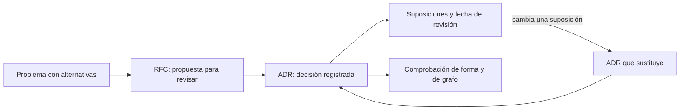
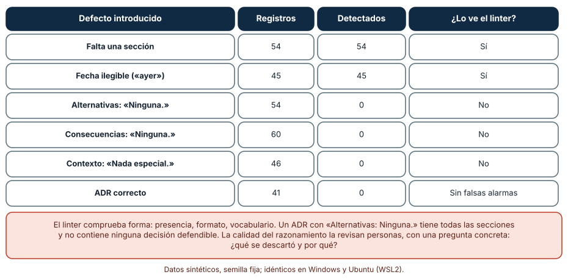
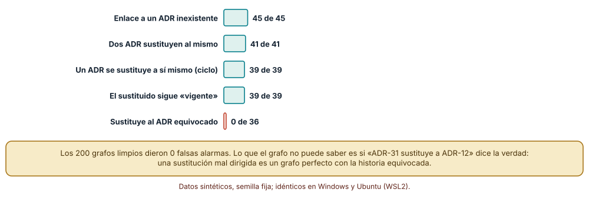
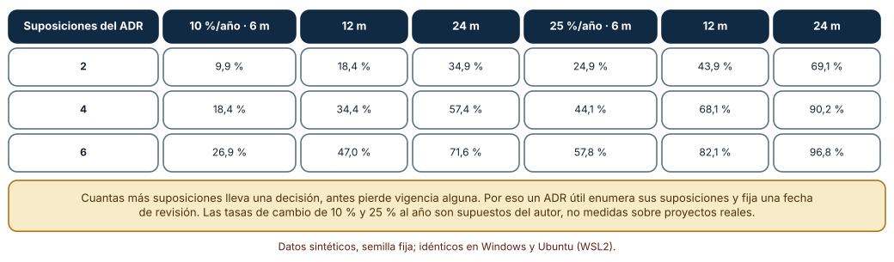

# SE-208 — ADRs, RFCs y registro de decisiones

[← SE-207 — README, instalación y primer éxito](../../classes/part-17-documentacion-y-conocimiento-tecnico/se-207-readme-instalacion-y-primer-exito/README.md) · [↑ Parte 17](../../classes/part-17-documentacion-y-conocimiento-tecnico/README.md) · [📚 Índice completo](../../classes/README.md) · [🌐 Portal](../../site/classes/SE-208.html) · [SE-209 — Diagramas, modelos y documentación visual →](../../classes/part-17-documentacion-y-conocimiento-tecnico/se-209-diagramas-modelos-y-documentacion-visual/README.md)

## Punto profesional y fundamento pedagógico

**Punto profesional.** La clase existe para que dejes por escrito por qué el sistema es como es, de forma que otra persona pueda revisar la decisión, saber cuándo dejó de valer y cambiarla sin repetir una discusión que ya se tuvo. Distingue qué comprueba una máquina de un registro de decisiones y qué solo puede comprobar una persona.

**Por qué aparece aquí.** Se sitúa después de **README, instalación y primer éxito** y antes de **Diagramas, modelos y documentación visual**: las dos clases anteriores documentaron cómo usar el sistema; esta documenta por qué existe como existe. Las decisiones son el conocimiento que más rápido se pierde y el que más cuesta reconstruir (lo retoma el taller `SE-215`), y esta clase fija el formato, el grafo de sustituciones y la caducidad que el portal usará.

**Error conceptual que debe corregir.** Creer que un ADR es un acta de reunión o que un registro completo es un registro bueno. Un ADR con todas las secciones puede no contener ninguna decisión defendible («Alternativas: ninguna»), y un registro sin grafo de sustituciones puede decir cosas contradictorias sin que nadie lo vea.

**Límite de la conclusión.** Los registros son sintéticos, las tasas de cambio de las suposiciones son supuestos del autor y los linters son reglas escritas para la clase. No se revisó ningún registro real ni se midió cuánto tiempo ahorra un ADR a un equipo.

### Trazabilidad fuente → afirmación

| Fuente primaria u oficial | Afirmación que respalda | Lo que no prueba |
|---|---|---|
| [Nygard, «Documenting Architecture Decisions» (2011)](https://cognitect.com/blog/2011/11/15/documenting-architecture-decisions) | Propone registrar cada decisión de arquitectura en un archivo breve con título, estado, contexto, decisión y consecuencias. | No demuestra que ese formato reduzca errores. |
| [Tyree y Akerman, «Architecture Decisions: Demystifying Architecture» (IEEE Software, 2005)](https://doi.org/10.1109/MS.2005.27) | Trata las decisiones como elementos de primer orden y propone una plantilla que incluye suposiciones, alternativas y consecuencias. | No fija un formato obligatorio. |
| [MADR, plantilla Markdown de registros de decisiones](https://adr.github.io/madr/) | Ofrece una plantilla Markdown con alternativas consideradas y resultado de la decisión. | No valida la calidad del razonamiento. |

## Antes de empezar

Retoma el README de `SE-207`. Un README dice cómo empezar; no dice por qué se eligió SQLite, ni por qué la penalización es diaria. La pregunta activa es: **¿qué decisión tomamos, qué otras había, qué suponíamos y qué tendría que cambiar para que esta decisión deje de valer?**

## Prerrequisitos

- Haber completado `SE-207` o poder explicar qué es un primer éxito y cómo se comprueba.
- Python 3.11 o posterior y un terminal; los experimentos usan solo la biblioteca estándar.
- Trabajar con la plataforma de entregas y registros sintéticos escritos para la clase.

## Problema auténtico

Un colaborador propone sustituir SQLite por PostgreSQL en la plataforma porque «SQLite no escala». La discusión dura dos semanas. Alguien encuentra después una nota de hace un año que ya evaluó la misma pregunta: se eligió SQLite porque había un solo proceso escritor, y se fijó migrar si aparecía un segundo. Esa condición no se había cumplido, pero nadie lo sabía. En otro rincón del repositorio, una decisión sobre la política de reintentos dice «sustituida por la 31», aunque la 31 trata de otra cosa. El registro existe y no ayuda.

## Objetivos observables

Al terminar podrás:

1. escribir un ADR con contexto, decisión, alternativas, suposiciones y consecuencias, y distinguirlo de un acta y de un RFC;
2. comprobar mecánicamente la forma de un registro y de su grafo de sustituciones, y nombrar lo que esas comprobaciones no ven;
3. calcular la probabilidad de que una decisión haya perdido alguna de sus suposiciones con el tiempo y justificar una fecha de revisión;
4. decidir cuándo una propuesta merece un RFC (con revisión previa) y cuándo basta un ADR (registro posterior);
5. explicar qué parte del razonamiento de un registro solo puede revisar una persona.

## Mapa conceptual



El diagrama se lee de izquierda a derecha: una propuesta con alternativas se discute como RFC; la decisión se registra como ADR con sus suposiciones; la fecha de revisión da el momento de volver a mirar; si cambia una suposición, un nuevo ADR sustituye al anterior. La comprobación de forma y de grafo vigila el conjunto. Un ADR no necesita RFC previo si la decisión es pequeña y reversible; el diagrama no impone ese camino.

## Temas y por qué importan

| Tema | Por qué cambia una decisión profesional | Evidencia mínima |
|---|---|---|
| Qué es un ADR | Fija en un lugar qué se decidió, por qué y qué se descartó; evita rediscutir lo ya evaluado. | ADR con las seis secciones y alternativas reales |
| RFC y ADR | Un RFC propone antes y se revisa; un ADR registra después; confundirlos retrasa o deja decisiones sin rastro. | Criterio escrito de cuándo usar cada uno |
| Estado y sustitución | Las decisiones cambian: un registro útil dice cuál es la vigente y enlaza la historia. | Grafo de sustituciones sin ciclos ni enlaces rotos |
| Suposiciones y caducidad | Una decisión vale mientras valgan sus suposiciones; más suposiciones, antes pierde vigencia alguna. | Lista de suposiciones y fecha de revisión |
| Qué comprueba una máquina | La forma se comprueba; la calidad del razonamiento no. | Linter y lista de lo que solo revisa una persona |

## Conceptos y decisiones

### 1. El ADR como registro mínimo

Un ADR es un documento breve que registra una decisión: título, estado (propuesta, aceptada, sustituida, rechazada), fecha, contexto (qué fuerzas empujaban), decisión (qué se hizo y en tiempo presente), alternativas consideradas y consecuencias (buenas y malas). El valor no está en el formato sino en que obliga a escribir las alternativas y las consecuencias negativas, que son lo primero que se olvida. Un ADR no es un acta: no narra la reunión ni atribuye opiniones. Y es inmutable en lo esencial: si cambia la decisión, se escribe otro ADR que sustituye al primero, de modo que la historia no se reescribe.

### 2. RFC y ADR: antes y después

Un RFC es una propuesta que se publica para recibir revisión antes de decidir; un ADR es el registro de lo decidido. Procesos como los PEP de Python o los RFC de Rust usan el primero para cambios con impacto en muchas personas, con estados, plazos y criterios de aceptación. Para decisiones locales y reversibles, el ADR basta. La regla práctica: si el coste de equivocarse recae en gente que no está en la conversación, publica un RFC; si recae en el equipo y se puede deshacer en un día, registra un ADR. El riesgo de usar solo RFC es la lentitud; el de usar solo ADR, que la revisión llegue cuando ya no puede cambiar nada.

### 3. Estado y grafo de sustituciones

Cada ADR tiene un estado, y los estados se relacionan: «sustituida por ADR-31» debe ser recíproco con «sustituye a ADR-12» en el otro. El conjunto forma un grafo dirigido que debe cumplir invariantes: cada enlace apunta a un ADR existente, ningún ADR se sustituye a sí mismo ni en cadena, cada ADR tiene a lo sumo un sucesor, y un ADR sustituido deja de estar «vigente». Estas propiedades se comprueban con un recorrido simple. Lo que no se comprueba es que el sucesor trate realmente del mismo tema: un grafo perfecto puede contar una historia equivocada.

### 4. Suposiciones y caducidad

Toda decisión descansa en suposiciones: el volumen esperado, el número de escritores, el presupuesto, una restricción legal. Cuando una cambia, la decisión puede dejar de valer sin que nadie lo note. Por eso un ADR útil las enumera y fija una condición o una fecha de revisión. La probabilidad de que al menos una haya cambiado crece con el número de suposiciones y con el tiempo: no se puede prevenir, pero sí vigilar. Una decisión con seis suposiciones y una tasa de cambio del 25 % anual tiene, a los doce meses, más de 8 de cada 10 probabilidades de haber perdido alguna.

### 5. Qué comprueba una máquina y qué una persona

Una máquina comprueba forma: que las secciones existan, que la fecha tenga formato, que los enlaces apunten a algo. No puede decir si las alternativas son reales, si las consecuencias negativas se dijeron con honestidad o si el contexto justifica la decisión. Esa revisión corresponde a personas, con preguntas concretas: ¿qué se descartó y por qué?, ¿qué haría falta para que esta decisión fuera un error?, ¿quién cargará con el coste? Un linter útil libera a la revisión de las comprobaciones mecánicas para que se dedique a las que no lo son.

### Un linter sobre 300 registros con defectos conocidos

Se generan 300 ADR sintéticos con seis condiciones: correcto (41), falta una sección (54), fecha ilegible (45), alternativas «Ninguna.» (54), consecuencias «Ninguna.» (60) y contexto sin razón (46). El linter exige las seis secciones y una fecha `AAAA-MM-DD`.

```python
def lint_adr(texto):
    problemas = []
    for s in ["Estado", "Fecha", "Contexto", "Decision", "Alternativas", "Consecuencias"]:
        if f"## {s}\n" not in texto:
            problemas.append("sin_" + s)
    m = re.search(r"## Fecha\n(.*)\n", texto)
    if m and not re.fullmatch(r"\d{4}-\d{2}-\d{2}", m.group(1)):
        problemas.append("fecha_mala")
    return problemas
```

Resultado, idéntico en Windows (CPython 3.12.9) y Ubuntu (3.12.3): detecta las 54 secciones ausentes y las 45 fechas ilegibles; no detecta ninguna de las 54 alternativas vacías, de las 60 consecuencias vacías ni de los 46 contextos sin razón; y no da ninguna falsa alarma sobre los 41 correctos. Los tres defectos que escapan son los que más importan para un lector: un ADR con «Alternativas: Ninguna.» tiene todas las secciones y no contiene una decisión defendible.



**Cómo leer la figura.** Cada fila es un tipo de defecto; las columnas dan cuántos registros lo tenían, cuántos detectó el linter y si lo ve. **Dónde deja de valer:** las tres últimas filas se sembraron con textos literales («Ninguna.», «Nada especial.»); un linter con una lista de frases vacías detectaría esos tres, y un redactor evitaría esas frases con otras igual de vacías. Un linter no sustituye la pregunta humana «¿qué se descartó?».

### Integridad del grafo de sustituciones

Se generan 200 registros de 40 ADR con sustituciones aleatorias (cada ADR sustituye, con probabilidad 0,35, a uno anterior que aún no tenía sucesor) y se aplica una mutación a cada uno: enlace a un ADR inexistente (45), dos ADR que sustituyen al mismo (41), un ADR que se sustituye a sí mismo (39), un ADR sustituido que sigue declarándose vigente (39) o un ADR que sustituye a otro estructuralmente válido pero equivocado (36).

```python
for i, j in sup.items():
    if j not in range(1, n + 1):          problemas.add("enlace_roto")
    if claims.get(j) != "Sustituida":      problemas.add("estado_incoherente")
for inicio in sup:                         # ciclo: seguir la cadena de sucesores
    vistos, actual = set(), inicio
    while actual in sup:
        if actual in vistos: problemas.add("ciclo"); break
        vistos.add(actual); actual = sup[actual]
```

La comprobación estructural detecta 45 de 45 enlaces rotos, 41 de 41 sustituciones dobles, 39 de 39 ciclos y 39 de 39 estados incoherentes, y 0 de 36 destinos equivocados. Sobre los 200 grafos sin mutar dio 0 falsas alarmas. En un registro de 40 ADR, en media 26,3 siguen vigentes y 13,7 están sustituidos.



**Cómo leer la figura.** Cada barra es el porcentaje de mutaciones de su tipo detectadas; las verdes son defectos estructurales y la coral es un destino equivocado. **Dónde deja de valer:** el 100 % de las cuatro primeras es consecuencia de que las mutaciones se sembraron como exactamente las violaciones que la comprobación busca; en un registro real aparecerían además combinaciones y errores de formato. El cero de la última fila es el límite verdadero: «ADR-31 sustituye a ADR-12» puede ser estructuralmente perfecto y falso.

### Cuándo caduca una decisión

Se calcula, con 20 000 simulaciones por celda, la probabilidad de que al menos una de `k` suposiciones haya cambiado tras `t` meses si cada una cambia con tasa anual `r`: cada suposición cambia con probabilidad `1 − (1 − r)^(t/12)`.

```python
p = 1 - (1 - r) ** (meses / 12)
cambio = any(rng.random() < p for _ in range(k))
```

Con 2 suposiciones y 10 % anual, la probabilidad de que alguna haya cambiado es 9,9 % a los 6 meses, 18,4 % a los 12 y 34,9 % a los 24. Con 4 suposiciones, 18,4 %, 34,4 % y 57,4 %. Con 6 suposiciones y 25 % anual, sube a 57,8 %, 82,1 % y 96,8 %. A igual tasa, tres veces más suposiciones multiplican casi por tres la probabilidad a corto plazo.



**Cómo leer la figura.** Cada fila es un número de suposiciones; las seis columnas combinan dos tasas anuales (10 % y 25 %) con tres plazos (6, 12 y 24 meses). **Dónde deja de valer:** las tasas son supuestos, las suposiciones se tratan como independientes y un cambio no implica que la decisión sea mala (una suposición cambiada puede ser irrelevante). La tabla justifica fijar una fecha de revisión y enumerar las suposiciones, no una periodicidad concreta.

## Definiciones de trabajo

- **ADR:** registro breve de una decisión con contexto, alternativas, decisión, consecuencias y estado.
- **RFC:** propuesta publicada para revisión antes de decidir, con un proceso de estados y criterios de aceptación.
- **suposición:** condición del entorno que la decisión da por cierta y cuyo cambio podría invalidarla.
- **sustitución:** relación entre dos ADR por la que el segundo reemplaza al primero sin borrarlo.
- **fecha de revisión:** momento o condición en que se vuelve a comprobar que las suposiciones siguen valiendo.

Las definiciones son operativas para el portal; no reemplazan las de las fuentes enlazadas abajo.

## Ejemplo mínimo

El fragmento comprueba que cada sucesor apunte a un ADR existente. Antes de ejecutarlo, predice qué ADR queda marcado.

```python
sustituye = {3: 1, 5: 2, 6: 9}     # 3 sustituye a 1, 5 a 2, 6 a 9
existentes = {1, 2, 3, 4, 5, 6}
print([k for k, v in sustituye.items() if v not in existentes])   # esperado [6]
```

La predicción correcta es `[6]`, porque 9 no existe. Registra la versión del intérprete; si añades `9` al conjunto, predice antes que la lista queda vacía.

## Ejemplo profesional

El portal de la plataforma de entregas guarda sus decisiones en `docs/decisiones/` con un ADR por archivo. ADR-007 registra «SQLite en el prototipo» con suposiciones («un solo proceso escritor», «menos de 5 000 entregas por semana») y la condición de revisión «cuando aparezca un segundo escritor». ADR-019 sustituye a ADR-007 cuando la secretaría empieza a importar notas en paralelo. Un RFC previo, publicado una semana antes, recibió dos objeciones que quedaron recogidas en las alternativas de ADR-019. La integración continua ejecuta el linter de forma y la comprobación del grafo en cada cambio.

Compara el caso normal con tres casos límite: la decisión pequeña y reversible que solo tiene ADR, la decisión que afecta a otros equipos y exige RFC, y el ADR cuyas suposiciones ya no se cumplen (se abre un RFC de sustitución, no se edita el original).

## Práctica guiada

1. Crea `work/SE-208/` y escribe tres ADR de la plataforma (base de datos, política de redondeo, formato de exportación) con seis secciones cada uno.
2. Añade a cada ADR dos suposiciones y una condición de revisión.
3. Escribe el linter de forma y pruébalo con cinco registros defectuosos.
4. Escribe la comprobación del grafo de sustituciones y pruébala con una cadena de cuatro ADR.
5. Calcula la probabilidad de caducidad de tus decisiones con las tasas que estimes y anota qué supones.
6. Haz que una persona ajena revise los tres ADR y anote qué alternativa le parece irreal.
7. Redacta un RFC corto para un cambio que afectaría a otro equipo.
8. Entrega `registro.md` con los hallazgos y los cambios.

## Ejercicios

1. **ADR:** reescribe una decisión de un proyecto que conozcas como ADR de seis secciones y marca qué suposición te costó más enunciar.
2. **Linter:** añade una lista de frases vacías («ninguna», «no aplica») y mide cuántos defectos de los 300 detectaría; explica qué evitaría un redactor.
3. **Grafo:** añade la reciprocidad (si A sustituye a B, B debe decir que fue sustituido por A) y calcula cuántas mutaciones nuevas detectas.
4. **Caducidad:** calcula cuántas suposiciones puede tener una decisión para que la probabilidad de caducidad a 12 meses se mantenga bajo el 20 % con tasa del 10 %.

## Reto verificable

Entrega los tres ADR con suposiciones, el linter, la comprobación del grafo, la tabla de caducidad con tus tasas y el RFC. Se aprueba si otra persona ejecuta ambas comprobaciones desde un checkout limpio, obtiene los mismos resultados y puede nombrar una alternativa de tus ADR que le parezca irreal y por qué.

## Caso conductor

Las decisiones del portal de la plataforma de entregas viven ahora en un registro con grafo de sustituciones. Esta clase deja el formato, el linter y la tabla de caducidad, que `SE-215` usa al reconstruir decisiones perdidas, y la necesidad de metadatos de responsable y fecha, que `SE-214` formaliza.

## Preguntas frecuentes

### ¿Cuántos ADR son demasiados?

Los que se escriben por costumbre y no por decisión. Un ADR vale la pena cuando la decisión es difícil de revertir, afecta a más gente que a quien la toma o tiene alternativas serias. Si el registro tiene cientos de entradas triviales, nadie lo leerá.

### ¿Se puede editar un ADR aceptado?

Para corregir erratas, sí; para cambiar la decisión, no: se escribe otro que lo sustituye. Editar el original destruye la historia y esconde que las suposiciones cambiaron.

### ¿Un ADR es lo mismo que un documento de diseño?

No. Un documento de diseño describe una solución completa y puede ser largo; un ADR registra una decisión concreta dentro de ella. Se complementan: el diseño dice cómo es, los ADR dicen por qué.

### ¿Qué hago con decisiones tomadas hace años que nadie registró?

Escribe ADR retrospectivos marcados como tales, con la fecha de escritura y las fuentes (commits, correos, conversaciones). No inventes alternativas que nadie consideró; si no se sabe, dilo. El taller `SE-215` trata este caso.

## Fallo controlado y diagnóstico

Reproduce el fallo clásico de la clase: **un registro que dice lo contrario de lo vigente**. Haz que ADR-31 declare sustituir a ADR-12 aunque trata de otro tema, y que ADR-12 siga vigente.

Registra síntoma, entrada mínima, hipótesis, observación que discrimina, causa, corrección y prueba de regresión. **Síntoma:** alguien aplica la política de reintentos del ADR-12 ya sustituida. **Hipótesis rivales:** (a) la persona no leyó el registro; (b) el estado de ADR-12 es incorrecto; (c) la sustitución apunta al destino equivocado. **Observación que discrimina:** abre ADR-31 y comprueba si trata del mismo tema que ADR-12; si trata de otro, confirma (c) y descarta (a). **Causa:** el enlace se escribió con el número equivocado y el grafo era estructuralmente válido. **Corrección:** apuntar la sustitución a ADR-27, que sí trata de reintentos, y marcar ADR-12 como sustituido. **Prueba de regresión:** la comprobación estructural no lo habría visto; añade una regla de revisión humana («el sucesor cita el tema del sustituido en su título») y una etiqueta de tema comprobable. **Recuperación:** avisar a quien aplicó la política equivocada y revisar los cambios hechos con ella.

## Errores comunes y cómo corregirlos

| Síntoma | Causa probable | Corrección |
|---|---|---|
| Los ADR tienen secciones pero ninguna alternativa real | Se completó la plantilla sin considerar opciones | Exigir al menos dos alternativas con una razón de descarte cada una |
| Una decisión parece vigente y sus suposiciones ya no se cumplen | No se enumeraron suposiciones ni se fijó revisión | Añadir suposiciones y fecha de revisión, y listar los ADR vencidos |
| Dos ADR contradictorios aparecen vigentes | El estado no se actualizó al sustituir | Comprobar el grafo y exigir que el sustituido cambie a «sustituida» |
| Nadie lee el registro | Tiene demasiadas entradas triviales | Limitar los ADR a decisiones difíciles de revertir o con impacto externo |
| Un RFC lleva meses abierto | No hay plazo ni criterio de cierre | Fijar plazo de revisión y quién decide |

## Entorno y archivos clave

```text
work/SE-208/
├── README.md
├── decisiones/
│   ├── adr-007-sqlite-en-el-prototipo.md
│   ├── adr-012-redondeo-hacia-arriba.md
│   └── adr-019-postgresql-con-importacion-paralela.md
├── rfc/rfc-004-formato-de-exportacion.md
├── experimentos/
│   ├── linter.py
│   ├── grafo.py
│   └── caducidad.py
└── evidencia/registro.md
```

El `README` declara plataforma, versión de Python, semillas y comandos. Los experimentos usan solo la biblioteca estándar (`re`, `random`, `statistics`) y se ejecutaron con CPython 3.12.9 en Windows 11 y 3.12.3 en Ubuntu bajo WSL2 con resultados idénticos.

## Seguridad, ética y accesibilidad

- un ADR puede revelar decisiones de seguridad (qué se acepta como riesgo): decide qué se publica y qué queda en un registro restringido;
- no incluyas nombres, correos ni datos de personas en las alternativas ni en las consecuencias; atribuye a roles, no a individuos;
- la decisión afecta a personas que no participaron: nombra a quién se traslada el coste;
- las plantillas deben tener estructura de encabezados y lenguaje claro para lectores de pantalla;
- evita lenguaje que presente como inevitable lo que fue una elección;
- conserva los ADR sustituidos: borrar la historia impide auditar por qué se cambió.

## Puente hacia el trabajo con agentes

Un agente al que se pide «escribe un ADR de esta decisión» producirá un texto bien formado con alternativas plausibles que nadie consideró. Pídele que cite las fuentes de cada alternativa (issues, commits, conversaciones), que marque como hipótesis lo que no pueda respaldar y que enumere las suposiciones de la decisión con una condición de revisión. Un agente también consulta los ADR para no repetir decisiones: si el grafo es coherente y las suposiciones son explícitas, puede decir «esto contradice ADR-19». Quien revisa comprueba las alternativas, no solo la forma.

## Transferencia

Traslada el registro a otro dominio (por ejemplo, una app de reparto con una decisión sobre el cálculo de tarifas): cambian el contenido y las suposiciones, se conservan las seis secciones, el grafo de sustituciones y la caducidad. La transferencia está lograda cuando puedes explicar qué parte del registro depende del dominio y cuál es estructura reutilizable.

## Evaluación y evidencia

| Criterio | Evidencia para aprobar |
|---|---|
| comprensión | explicación de la diferencia entre ADR, RFC y acta con un ejemplo de la plataforma |
| corrección | conteos reproducibles de defectos detectados por el linter y por la comprobación del grafo |
| diseño | tres ADR con alternativas reales, suposiciones y condición de revisión |
| diagnóstico | reproducción del fallo «sustitución al destino equivocado» con regresión |
| incertidumbre | declaración de que los linters ven forma y no razonamiento y de que las tasas son supuestos |
| reproducibilidad | versiones, comandos, salida y límites declarados |

## Fuentes

- [Nygard, «Documenting Architecture Decisions» (2011)](https://cognitect.com/blog/2011/11/15/documenting-architecture-decisions) — formato breve de registro de decisiones; autoridad: autor del formato.
- [Tyree y Akerman, «Architecture Decisions: Demystifying Architecture» (IEEE Software, 2005)](https://doi.org/10.1109/MS.2005.27) — decisiones como elementos de primer orden y plantilla con suposiciones; autoridad: IEEE Software.
- [MADR: Markdown Architectural Decision Records](https://adr.github.io/madr/) — plantilla Markdown con alternativas y resultado; autoridad: comunidad ADR.
- [Fowler, «Architecture Decision Record» (bliki)](https://martinfowler.com/bliki/ArchitectureDecisionRecord.html) — descripción del registro y de su carácter inmutable; autoridad: martinfowler.com.
- [PEP 1, propósito y guía de los PEP](https://peps.python.org/pep-0001/) — proceso de propuestas con estados para cambios en Python; autoridad: Python Software Foundation.
- [Rust RFCs](https://github.com/rust-lang/rfcs) — proceso de RFC de un proyecto abierto; autoridad: equipo de Rust.
- [Parnas y Clements, «A Rational Design Process: How and Why to Fake It» (IEEE TSE, 1986)](https://doi.org/10.1109/TSE.1986.6312940) — documentar el razonamiento aunque el proceso real no fuera lineal; autoridad: IEEE Transactions on Software Engineering.

Cada fuente respalda el mecanismo indicado; ninguna demuestra que llevar un registro de decisiones reduzca los errores de un proyecto concreto. Esa afirmación depende de leerlo y usarlo.

## Límites y siguiente paso

Se ejecutaron tres experimentos con datos sintéticos en Windows y Ubuntu (WSL2) con resultados idénticos. No se revisó ningún registro real ni se midió el ahorro de un ADR: los 300 registros, los 200 grafos y las tasas de cambio de suposiciones son construcciones del autor, y las frases vacías que escapan al linter se sembraron a propósito. La siguiente clase pasa del texto al dibujo: qué puede mostrar un diagrama que un párrafo no puede y cuándo deja de valer.

## Glosario

- **ADR:** registro breve de una decisión con contexto, alternativas, decisión, consecuencias y estado.
- **RFC:** propuesta publicada para revisión antes de decidir.
- **suposición:** condición del entorno que la decisión da por cierta y cuyo cambio podría invalidarla.
- **sustitución:** relación por la que un ADR reemplaza a otro sin borrarlo.
- **fecha de revisión:** momento o condición en que se comprueba que las suposiciones siguen valiendo.

---

[← SE-207 — README, instalación y primer éxito](../../classes/part-17-documentacion-y-conocimiento-tecnico/se-207-readme-instalacion-y-primer-exito/README.md) · [↑ Parte 17](../../classes/part-17-documentacion-y-conocimiento-tecnico/README.md) · [📚 Índice completo](../../classes/README.md) · [🌐 Portal](../../site/classes/SE-208.html) · [SE-209 — Diagramas, modelos y documentación visual →](../../classes/part-17-documentacion-y-conocimiento-tecnico/se-209-diagramas-modelos-y-documentacion-visual/README.md)
