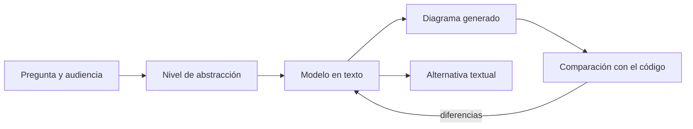
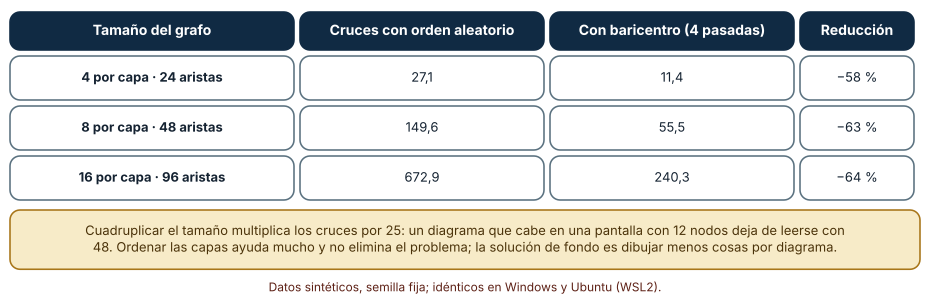
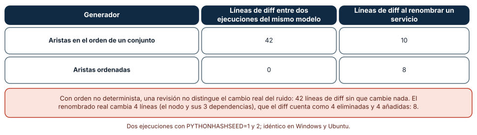
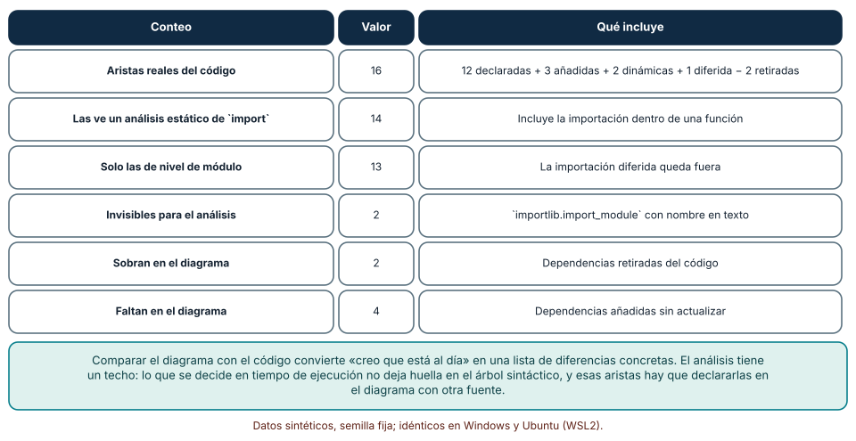

# SE-209 — Diagramas, modelos y documentación visual

[← SE-208 — ADRs, RFCs y registro de decisiones](../../classes/part-17-documentacion-y-conocimiento-tecnico/se-208-adrs-rfcs-y-registro-de-decisiones/README.md) · [↑ Parte 17](../../classes/part-17-documentacion-y-conocimiento-tecnico/README.md) · [📚 Índice completo](../../classes/README.md) · [🌐 Portal](../../site/classes/SE-209.html) · [SE-210 — API docs, ejemplos y contratos publicados →](../../classes/part-17-documentacion-y-conocimiento-tecnico/se-210-api-docs-ejemplos-y-contratos-publicados/README.md)

## Punto profesional y fundamento pedagógico

**Punto profesional.** La clase existe para que decidas cuándo un diagrama enseña algo que un párrafo no puede, cómo evitar que se vuelva ilegible o mentiroso, y cómo mantenerlo de forma que su diferencia con el código se pueda ver. Un diagrama es una afirmación sobre el sistema y debe poder contrastarse como cualquier otra.

**Por qué aparece aquí.** Se sitúa después de **ADRs, RFCs y registro de decisiones** y antes de **API docs, ejemplos y contratos publicados**: las decisiones dicen por qué, los diagramas muestran estructura y relaciones, y la clase siguiente documenta lo que otros consumen. Retoma los modelos de la Parte 13 desde el lado de la comunicación y adelanta el diagrama como código que `SE-212` automatiza.

**Error conceptual que debe corregir.** Creer que un diagrama más completo es un diagrama mejor, o que dibujar es documentar. Un diagrama con todo no responde a ninguna pregunta, y un dibujo hecho a mano sin una forma de compararlo con el sistema envejece sin que nadie lo note.

**Límite de la conclusión.** Los grafos son sintéticos (capas y paquetes de diez módulos), el generador es una función de quince líneas y las medidas de cruces usan una heurística clásica sin herramientas de producción. No se evaluó ningún diagrama real ni se midió cuánto comprende quien los lee.

### Trazabilidad fuente → afirmación

| Fuente primaria u oficial | Afirmación que respalda | Lo que no prueba |
|---|---|---|
| [Moody, «The Physics of Notations» (IEEE TSE, 2009)](https://doi.org/10.1109/TSE.2009.67) | Propone principios de diseño de notaciones visuales, como la economía gráfica y la gestión de la complejidad, con base en la ciencia cognitiva. | No evalúa las notaciones usadas por un equipo concreto. |
| [Kruchten, «The 4+1 View Model of Architecture» (IEEE Software, 1995)](https://doi.org/10.1109/52.469759) | Defiende describir la arquitectura mediante varias vistas, cada una para unas partes interesadas, unidas por escenarios. | No fija cuántas vistas necesita un sistema. |
| [Sugiyama, Tagawa y Toda (IEEE Trans. SMC, 1981)](https://doi.org/10.1109/TSMC.1981.4308636) | Describe métodos para ordenar grafos jerárquicos en capas reduciendo cruces, entre ellos el baricentro. | No garantiza el mínimo de cruces. |

## Antes de empezar

Retoma el registro de decisiones de `SE-208`. Una decisión dice «usamos una cola entre la plataforma y la secretaría»; un diagrama muestra cómo se conectan las piezas. La pregunta activa es: **¿qué pregunta responde este diagrama, para quién, y qué haría falta para saber que sigue siendo verdad?**

## Prerrequisitos

- Haber completado `SE-208` o poder explicar la diferencia entre una decisión y su estructura.
- Python 3.11 o posterior y un terminal; los experimentos usan solo la biblioteca estándar y `git` no es necesario.
- Trabajar con la plataforma de entregas y módulos sintéticos; no se analiza código real.

## Problema auténtico

El diagrama de arquitectura de la plataforma está en una presentación de hace dos años. Muestra doce cajas y treinta flechas que se cruzan como una red de pesca. Una colaboradora lo usa para decidir dónde añadir la importación de notas y descubre, al implementarla, que existe una dependencia entre dos módulos que el diagrama no dibuja, y que otra, que sí dibuja, se retiró hace un año. Cuando intenta actualizarlo, el programa de dibujo reordena todo y la diferencia con la versión anterior es ilegible. Nadie confía en el diagrama ni lo corrige.

## Objetivos observables

Al terminar podrás:

1. formular la pregunta que responde un diagrama y elegir su nivel de abstracción, su audiencia y lo que deja fuera;
2. medir cuántos cruces de aristas produce un dibujo y cuánto reduce una ordenación por capas al crecer el grafo;
3. generar un diagrama desde un modelo de forma determinista, de modo que su diferencia entre versiones refleje solo cambios reales;
4. comparar un diagrama de dependencias con las importaciones del código y nombrar las aristas que el análisis no ve;
5. añadir una alternativa textual a un diagrama y decidir qué parte de su información debe estar también en prosa.

## Mapa conceptual



El diagrama se lee de izquierda a derecha: la pregunta y la audiencia fijan el nivel de abstracción; el modelo vive en texto y de él se generan el dibujo y su descripción alternativa; una comparación con el código devuelve las diferencias al modelo. No es un flujo obligatorio: un diagrama puede nacer de una pizarra. Lo que el esquema propone es que, para el que se mantiene, el texto sea la fuente y el dibujo una vista.

## Temas y por qué importan

| Tema | Por qué cambia una decisión profesional | Evidencia mínima |
|---|---|---|
| Pregunta del diagrama | Un diagrama sin pregunta intenta mostrarlo todo y no sirve para nada. | Frase «este diagrama responde a…» en el encabezado |
| Nivel de abstracción | Contexto, contenedores, componentes y código son vistas distintas; mezclarlas confunde. | Diagrama marcado con su nivel |
| Legibilidad y cruces | Los cruces crecen más rápido que el grafo; pasado cierto tamaño, no se lee. | Número de cruces y límite de elementos por diagrama |
| Diagrama como código | El texto se revisa, se compara y se genera; el dibujo a mano no. | Generador determinista y diff estable |
| Vigencia y accesibilidad | Un diagrama que no se compara con el código miente, y uno sin alternativa textual excluye. | Comparación con importaciones y descripción textual |

## Conceptos y decisiones

### 1. Una pregunta y una audiencia

Un diagrama es útil cuando responde a una pregunta concreta de una audiencia concreta: «¿qué sistemas externos toca la plataforma?», «¿en qué orden se llaman estos servicios?», «¿qué módulos dependen de este?». Sin pregunta, el diagrama acumula elementos hasta que todo cabe y nada se distingue. La pregunta también marca lo que se deja fuera: un diagrama de contexto no dibuja módulos internos. Escribir la pregunta en el encabezado obliga a decidir antes de dibujar, y permite a quien revisa preguntarse si el diagrama la contesta.

### 2. Notación y economía gráfica

Moody propone principios para que una notación visual funcione con las capacidades del cerebro humano: que cada símbolo signifique una sola cosa, que los símbolos se distingan a simple vista, que haya mecanismos para gestionar la complejidad (dividir en subdiagramas) y que se use la menor cantidad de elementos gráficos posible. La consecuencia práctica es modesta: usa pocos tipos de caja y de flecha, dales un significado fijo con una leyenda, y no uses el color como único portador. Un diagrama que necesita cuatro leyendas para entenderse probablemente intenta decir cuatro cosas.

### 3. Vistas y niveles

Ningún dibujo captura un sistema. Kruchten propone cuatro vistas (lógica, de procesos, de desarrollo y física) unidas por escenarios; el modelo C4 propone cuatro niveles de zoom (contexto, contenedores, componentes y código). Ambos dicen lo mismo: cada diagrama debe declarar su vista o nivel y no mezclar. En la plataforma, el diagrama de contexto muestra a estudiantes, docentes y secretaría con la plataforma como una caja; el de contenedores separa la interfaz, el servicio de cálculo y la base de datos; el de componentes abre solo el servicio de cálculo. Un diagrama que mezcla niveles obliga a leer cada caja con una escala distinta.

### 4. Diagrama como código

Un diagrama escrito en texto (por ejemplo con Mermaid) se revisa en un pull request, se compara con el anterior y puede generarse desde un modelo. Esto resuelve el problema del dibujo que nadie se atreve a tocar, pero crea otro: la salida generada debe ser estable. Si el generador recorre un conjunto en un orden que cambia entre ejecuciones, cada regeneración produce un diff aunque el modelo no cambie, y la revisión se llena de ruido. La regla es que el generador ordene todo lo que emite y que el diagrama sea una vista del modelo, no una segunda fuente de verdad.

### 5. Vigencia y accesibilidad

Un diagrama afirma que dos cosas se relacionan; esa afirmación puede contrastarse con el código. Comparar un diagrama de dependencias con las importaciones reales convierte «creo que está al día» en una lista de diferencias. Y un diagrama es información que debe llegar a quien no lo ve: los lineamientos de accesibilidad piden una alternativa textual que transmita lo esencial, y para imágenes complejas, una descripción más larga junto a la figura. El texto alternativo no repite las cajas; dice qué relación importa.

### Cruces de aristas al crecer el grafo

Se generan 150 grafos de cuatro capas por tamaño, con 4, 8 y 16 nodos por capa, cada nodo conectado a dos de la capa siguiente. Se cuenta el número de pares de aristas que se cruzan entre capas contiguas con el orden aleatorio de nodos y con el método del baricentro (cada nodo se coloca en el promedio de las posiciones de sus vecinos, en cuatro pasadas).

```python
def cruces(capas, aristas):
    pos = {n: i for capa in capas for i, n in enumerate(capa)}
    total = 0
    for (a1, b1), (a2, b2) in combinations(aristas_entre_capas, 2):
        if (pos[a1] - pos[a2]) * (pos[b1] - pos[b2]) < 0:
            total += 1
    return total
```

Resultado, idéntico en Windows (CPython 3.12.9) y Ubuntu (3.12.3): con 4 nodos por capa (24 aristas), 27,1 cruces con orden aleatorio y 11,4 con baricentro; con 8 (48 aristas), 149,6 y 55,5; con 16 (96 aristas), 672,9 y 240,3. Cuadruplicar el número de nodos multiplica los cruces por unos 25.



**Cómo leer la figura.** Cada fila es un tamaño de grafo; las columnas dan los cruces medios con cada método y la reducción porcentual. **Dónde deja de valer:** el baricentro es una heurística, no un óptimo, y minimizar cruces es un problema difícil; con más densidad el resultado cambia. Los cruces miden una dimensión de la legibilidad, no la comprensión: un diagrama con pocos cruces puede ser confuso por otras razones (símbolos ambiguos, nivel mezclado).

### Un generador estable frente a uno que reordena

Se define un modelo de 12 servicios con 18 dependencias y un generador que emite Mermaid. Una versión recorre el conjunto de aristas en el orden de iteración de Python; la otra lo ordena. Se ejecuta cada una dos veces con `PYTHONHASHSEED` distinto sobre el mismo modelo, y después con un servicio renombrado, contando las líneas distintas con `difflib`.

```python
aristas = {(a, b) for a, b in modelo["edges"]}
if modo == "sorted":
    nodos, aristas = sorted(nodos), sorted(aristas)
lineas = ["flowchart LR"] + [f"    {n}[{n}]" for n in nodos] + [f"    {a} --> {b}" for a, b in aristas]
```

Con el generador que recorre un conjunto, dos ejecuciones del mismo modelo difieren en 42 líneas, sin ningún cambio real; renombrar un servicio produce 10 líneas de diff. Con el generador ordenado, dos ejecuciones del mismo modelo difieren en 0 líneas y renombrar un servicio produce 8 (4 líneas cambiadas, que el diff cuenta como 4 eliminadas y 4 añadidas). Los resultados fueron idénticos en Windows y Ubuntu.



**Cómo leer la figura.** Cada fila es un generador; las columnas son las líneas de diff entre dos ejecuciones del mismo modelo y tras renombrar un servicio. **Dónde deja de valer:** el ruido de 42 líneas depende de que el orden de un conjunto de cadenas varía con la semilla de hash por proceso; con claves enteras el orden sería estable y el problema no se vería. Ordenar da un diff mínimo, pero el orden alfabético puede no ser el que mejor lee el dibujo: estabilidad y estética son objetivos distintos.

### El diagrama frente a las importaciones del código

Se genera un paquete sintético de diez módulos con 12 dependencias declaradas en el diagrama. Luego se modifica el código: se añaden 3 importaciones nuevas, se retiran 2, se incluyen 2 importaciones dinámicas con `importlib.import_module` y una importación dentro de una función. Un análisis con `ast` recoge las importaciones y se compara con lo declarado.

```python
for nodo in ast.walk(ast.parse(codigo)):
    if isinstance(nodo, ast.ImportFrom) and nodo.module == "plat":
        for alias in nodo.names:
            vistas.add((modulo, alias.name))
```

De las 16 dependencias reales, el análisis ve 14 (13 si solo se miran las importaciones de nivel de módulo, porque la importación dentro de una función queda fuera). Las 2 dinámicas son invisibles. El diagrama declarado tiene 2 aristas de más (dependencias retiradas) y le faltan 4 (3 añadidas y la importación diferida). Los resultados fueron idénticos en ambos sistemas.



**Cómo leer la figura.** Cada fila cuenta un grupo de dependencias; la última columna dice qué incluye. **Dónde deja de valer:** el paquete es sintético y de solo una forma de importación; en uno real hay importaciones relativas, condicionales, de paquetes externos y cargas por configuración. Lo que se decide en ejecución no deja rastro sintáctico y se declara en el modelo con otra fuente, o se acepta como límite.

## Definiciones de trabajo

- **diagrama:** representación visual de una parte del sistema que responde a una pregunta de una audiencia.
- **nivel de abstracción:** grado de detalle de un diagrama, desde el contexto del sistema hasta el código.
- **cruce de aristas:** par de líneas de un dibujo de grafo que se intersecan sin ser vecinas.
- **diagrama como código:** diagrama definido en un texto del que se genera el dibujo, y que se versiona y revisa como código.
- **alternativa textual:** descripción en texto de lo esencial de un diagrama, disponible para quien no lo ve.

Las definiciones son operativas para el portal; no reemplazan las de las fuentes enlazadas abajo.

## Ejemplo mínimo

El fragmento genera un diagrama Mermaid ordenado desde un modelo. Antes de ejecutarlo, predice cuántas líneas tiene la salida.

```python
modelo = [("interfaz", "servicio"), ("servicio", "base"), ("servicio", "cola")]
nodos = sorted({n for e in modelo for n in e})
lineas = ["flowchart LR"] + [f"    {n}[{n}]" for n in nodos] + [f"    {a} --> {b}" for a, b in sorted(modelo)]
print("\n".join(lineas)); print(len(lineas))
```

La predicción correcta es 8 líneas: 1 de cabecera, 4 nodos y 3 aristas. Registra versión del intérprete y salida; si añades una dependencia, predice el nuevo número.

## Ejemplo profesional

El portal de la plataforma de entregas guarda un archivo `modelo.json` con servicios y dependencias, un generador que emite tres diagramas (contexto, contenedores y componentes del servicio de cálculo) y un comprobador que compara las aristas con las importaciones del paquete en cada pull request. Cada diagrama lleva una frase «responde a…» y una alternativa textual de tres líneas. Cuando alguien añade la importación de notas, el comprobador falla con «falta la arista servicio → importador en el modelo», y el cambio del modelo regenera los diagramas con un diff mínimo.

Compara el caso normal con tres casos límite: el diagrama con más de veinte elementos (se divide por nivel), la dependencia cargada por configuración (se declara en el modelo con una nota) y el diagrama de secuencia que cambia con el orden de llamadas (se comprueba con una traza en una prueba de integración, no con importaciones).

## Práctica guiada

1. Crea `work/SE-209/` y escribe el modelo de la plataforma con doce servicios y sus dependencias.
2. Escribe el generador y comprueba que dos ejecuciones con distinta semilla de hash producen la misma salida.
3. Genera el diagrama con orden aleatorio y con ordenación por baricentro y cuenta los cruces.
4. Añade a cada diagrama la frase «responde a…» y una alternativa textual de tres líneas.
5. Crea un paquete de diez módulos con importaciones y escribe el comparador con `ast`.
6. Modifica el código (añade, retira, importa dinámicamente) y lista las diferencias que ve y las que no.
7. Pide a una persona ajena que responda la pregunta del diagrama usando solo la alternativa textual.
8. Entrega `diagramas.md` con las diferencias y los cambios.

## Ejercicios

1. **Pregunta:** escribe tres preguntas distintas que un diagrama de la plataforma podría responder y elige a qué nivel respondería cada una.
2. **Cruces:** mide los cruces con 6 nodos por capa y 3 capas y compara con las predicciones de los tamaños de la clase; explica qué cambió.
3. **Generador:** modifica el generador para que ordene por grado de salida y compara el diff con el orden alfabético al renombrar un servicio.
4. **Comparador:** extiende el análisis para detectar importaciones relativas y mide cuántas aristas nuevas ve.

## Reto verificable

Entrega el modelo, el generador, tres diagramas con su pregunta y su alternativa textual, el comparador y el registro de diferencias. Se aprueba si otra persona regenera los diagramas desde un checkout limpio con distinta semilla de hash y obtiene una salida idéntica, reproduce los conteos de cruces y puede nombrar una arista del código que el comparador no vería.

## Caso conductor

Los diagramas del portal de la plataforma de entregas se generan del modelo y se comparan con el código. Esta clase deja el modelo en texto, el generador estable y el comparador, que `SE-212` integra en la integración continua, y la costumbre de acompañar cada figura de texto alternativo, que `SE-214` extiende a las máquinas.

## Preguntas frecuentes

### ¿Un diagrama en un programa gráfico es siempre peor?

No. Para explorar una idea o explicar en una pizarra, el dibujo libre es más rápido. Pierde cuando debe mantenerse: no se compara, no se revisa con diff y envejece sin aviso. Si un diagrama va a vivir años, su fuente debe ser texto.

### ¿Cuántos elementos caben en un diagrama?

Depende de la pregunta, pero los cruces crecen más rápido que los nodos: del experimento, cuadruplicar los nodos multiplica los cruces por 25. Como regla de partida, si no cabe en una pantalla sin que las líneas se crucen, divide por nivel o por pregunta.

### ¿El texto alternativo repite el diagrama?

No: dice lo esencial que quien ve el diagrama entendería. Para uno de dependencias, qué módulos dependen de cuáles y cuál es el punto central; para uno de secuencia, el orden de los pasos. Un diagrama complejo lleva además una descripción larga junto a la figura.

### ¿Cómo sé que un diagrama de secuencia es correcto?

Con una traza real: una prueba de integración que registre las llamadas y la compare con la secuencia dibujada. Las importaciones no sirven para eso, porque el orden de llamadas se decide en ejecución.

## Fallo controlado y diagnóstico

Reproduce el fallo clásico de la clase: **un diagrama con una dependencia que ya no existe**. Retira del código la importación del módulo `m04` desde `m09` y ejecuta el comparador.

Registra síntoma, entrada mínima, hipótesis, observación que discrimina, causa, corrección y prueba de regresión. **Síntoma:** alguien evita tocar `m04` porque el diagrama dice que `m09` depende de él. **Hipótesis rivales:** (a) la dependencia sigue existiendo por otra vía; (b) el diagrama está desactualizado; (c) el análisis no ve una importación dinámica. **Observación que discrimina:** busca importaciones dinámicas con `importlib` y revisa la configuración; si no hay, descarta (c); busca la arista en las importaciones reales, y si no aparece, confirma (b). **Causa:** la dependencia se retiró y el diagrama no se regeneró. **Corrección:** actualizar el modelo y regenerar. **Prueba de regresión:** el comparador en la integración continua, que marca las aristas «de más». **Recuperación:** avisar a quien tomó una decisión con el diagrama y revisarla.

## Errores comunes y cómo corregirlos

| Síntoma | Causa probable | Corrección |
|---|---|---|
| El diagrama tiene cuarenta cajas y no se entiende | No tiene pregunta ni nivel | Escribir la pregunta, dividir por nivel y dejar fuera lo que no la contesta |
| Cada regeneración produce un diff enorme | El generador no ordena su salida | Ordenar nodos y aristas, y fijar la semilla de hash en la comprobación |
| El diagrama muestra una dependencia retirada | Se dibujó a mano y no se compara con el código | Generarlo del modelo y comparar con las importaciones |
| Una flecha significa cosas distintas en el mismo dibujo | Notación sin leyenda ni significado fijo | Fijar un significado por símbolo y añadir una leyenda |
| Quien usa lector de pantalla no obtiene nada de la figura | No hay alternativa textual | Añadir una descripción de lo esencial y una larga si el diagrama es complejo |

## Entorno y archivos clave

```text
work/SE-209/
├── README.md
├── modelo.json
├── generador.py
├── diagramas/
│   ├── contexto.md
│   ├── contenedores.md
│   └── componentes-calculo.md
├── experimentos/
│   ├── cruces.py
│   ├── estable.py
│   └── importaciones.py
└── evidencia/diagramas.md
```

El `README` declara plataforma, versión de Python, semillas y comandos. Los experimentos usan solo la biblioteca estándar (`ast`, `difflib`, `itertools`, `random`, `subprocess`) y se ejecutaron con CPython 3.12.9 en Windows 11 y 3.12.3 en Ubuntu bajo WSL2 con resultados idénticos. El paquete de diez módulos se crea en un directorio temporal y se elimina al terminar.

## Seguridad, ética y accesibilidad

- un diagrama de arquitectura puede revelar superficie de ataque: decide qué se publica y qué queda restringido;
- no incluyas direcciones, nombres de máquinas ni rutas reales en los diagramas; usa nombres lógicos;
- escribe texto alternativo que transmita la relación esencial, no una lista de cajas, y añade una descripción larga junto a figuras complejas;
- no uses el color como único portador de significado: combina forma, etiqueta y estilo de línea;
- asegura un contraste suficiente y un tamaño de texto legible al ampliar;
- cita el nivel y la fecha del diagrama para que su vigencia sea comprobable.

## Puente hacia el trabajo con agentes

Un agente al que se pide «dibuja la arquitectura» producirá un diagrama plausible a partir de los nombres de archivos, con dependencias que nunca comprobó. Pídele que genere el diagrama desde el modelo, que ejecute el comparador con las importaciones y que liste las aristas que no puede verificar (dinámicas, de configuración). Un agente también consume diagramas en texto: un modelo estructurado le sirve más que una imagen. Quien revisa comprueba que el diagrama responde a su pregunta, que la salida es estable y que el comparador se ejecutó, no solo que el dibujo es agradable.

## Transferencia

Traslada la técnica a otro dominio (por ejemplo, un servicio de reparto con módulos de rutas, pagos y avisos): cambian los nodos y las dependencias, se conservan la pregunta explícita, el generador estable y la comparación con el código. La transferencia está lograda cuando puedes explicar qué parte del método depende del lenguaje de programación y cuál no.

## Evaluación y evidencia

| Criterio | Evidencia para aprobar |
|---|---|
| comprensión | explicación de la pregunta, el nivel y la audiencia de cada diagrama con un ejemplo de la plataforma |
| corrección | conteos reproducibles de cruces y de diferencias entre diagrama y código con las mismas semillas |
| diseño | modelo en texto, generador estable y tres diagramas con alternativa textual |
| diagnóstico | reproducción del fallo «dependencia retirada que sigue dibujada» con regresión |
| incertidumbre | declaración de las aristas que el análisis no ve y de que el paquete es sintético |
| reproducibilidad | versiones, comandos, salida y límites declarados |

## Fuentes

- [Moody, «The Physics of Notations» (IEEE TSE, 2009)](https://doi.org/10.1109/TSE.2009.67) — principios de diseño de notaciones visuales; autoridad: IEEE Transactions on Software Engineering.
- [Kruchten, «The 4+1 View Model of Architecture» (IEEE Software, 1995)](https://doi.org/10.1109/52.469759) — vistas de arquitectura unidas por escenarios; autoridad: IEEE Software.
- [Sugiyama, Tagawa y Toda, «Methods for Visual Understanding of Hierarchical System Structures» (IEEE Trans. SMC, 1981)](https://doi.org/10.1109/TSMC.1981.4308636) — ordenación por capas y reducción de cruces; autoridad: IEEE Transactions on Systems, Man, and Cybernetics.
- [Modelo C4](https://c4model.com/) — niveles de abstracción de diagramas de arquitectura; autoridad: proyecto C4 model.
- [Mermaid: introducción](https://mermaid.js.org/intro/) — diagramas definidos en texto; autoridad: proyecto Mermaid.
- [arc42](https://arc42.org/) — plantilla de documentación de arquitectura; autoridad: proyecto arc42.
- [W3C WAI: imágenes complejas](https://www.w3.org/WAI/tutorials/images/complex/) — alternativas textuales para diagramas; autoridad: W3C.
- [WCAG 2.2](https://www.w3.org/TR/WCAG22/) — criterios de accesibilidad de contenido; autoridad: W3C.
- [Python: `ast`](https://docs.python.org/3/library/ast.html) — análisis sintáctico del código para extraer importaciones; autoridad: documentación de Python.

Cada fuente respalda el mecanismo indicado; ninguna demuestra que generar diagramas desde un modelo mejore la comprensión en un equipo concreto ni que el baricentro sea óptimo. Esa afirmación depende del sistema y de quien lee.

## Límites y siguiente paso

Se ejecutaron tres experimentos con datos sintéticos en Windows y Ubuntu (WSL2) con resultados idénticos. No se evaluó ningún diagrama real ni la comprensión de ningún lector: los grafos de capas, el modelo de doce servicios y el paquete de diez módulos son construcciones del autor, y el análisis de importaciones solo cubre una forma de importar. La siguiente clase documenta lo que otros consumen: la API, sus ejemplos y sus contratos.

## Glosario

- **diagrama:** representación visual de una parte del sistema que responde a una pregunta de una audiencia.
- **nivel de abstracción:** grado de detalle de un diagrama, del contexto al código.
- **cruce de aristas:** par de líneas de un dibujo de grafo que se intersecan sin ser vecinas.
- **diagrama como código:** diagrama definido en texto del que se genera el dibujo y que se versiona como código.
- **alternativa textual:** descripción en texto de lo esencial de un diagrama.

---

[← SE-208 — ADRs, RFCs y registro de decisiones](../../classes/part-17-documentacion-y-conocimiento-tecnico/se-208-adrs-rfcs-y-registro-de-decisiones/README.md) · [↑ Parte 17](../../classes/part-17-documentacion-y-conocimiento-tecnico/README.md) · [📚 Índice completo](../../classes/README.md) · [🌐 Portal](../../site/classes/SE-209.html) · [SE-210 — API docs, ejemplos y contratos publicados →](../../classes/part-17-documentacion-y-conocimiento-tecnico/se-210-api-docs-ejemplos-y-contratos-publicados/README.md)
