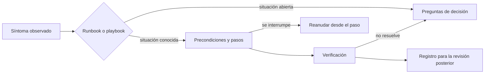
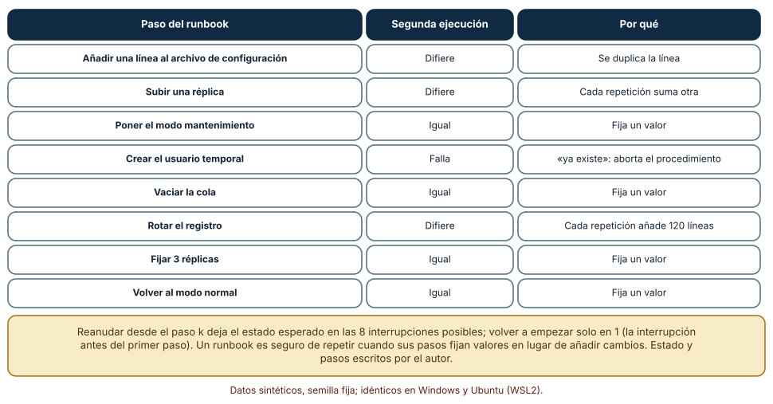
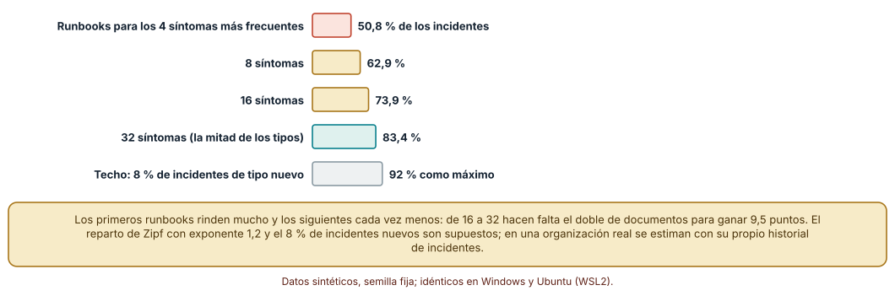
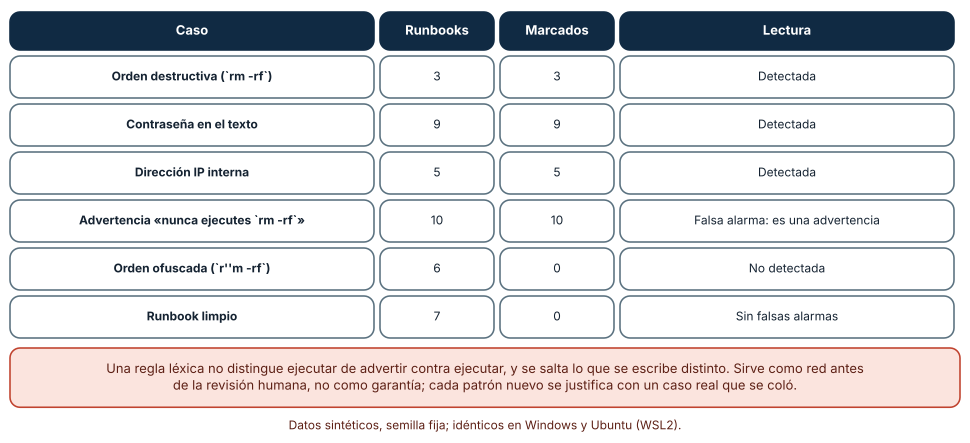

# SE-211 — Runbooks, playbooks y documentación operacional

[← SE-210 — API docs, ejemplos y contratos publicados](../../classes/part-17-documentacion-y-conocimiento-tecnico/se-210-api-docs-ejemplos-y-contratos-publicados/README.md) · [↑ Parte 17](../../classes/part-17-documentacion-y-conocimiento-tecnico/README.md) · [📚 Índice completo](../../classes/README.md) · [🌐 Portal](../../site/classes/SE-211.html) · [SE-212 — Docs as code, revisión y publicación →](../../classes/part-17-documentacion-y-conocimiento-tecnico/se-212-docs-as-code-revision-y-publicacion/README.md)

## Punto profesional y fundamento pedagógico

**Punto profesional.** La clase existe para que escribas documentación que alguien ejecutará con prisa y bajo presión, a deshoras y sin haber participado en su redacción. Un runbook se juzga por lo que pasa cuando se repite un paso, cuando se interrumpe a mitad y cuando el problema real no es el previsto.

**Por qué aparece aquí.** Se sitúa después de **API docs, ejemplos y contratos publicados** y antes de **Docs as code, revisión y publicación**: la clase anterior documentó lo que consumen los clientes, incluidos los errores que ven; esta documenta lo que hace quien opera el servicio cuando esos errores ocurren. Fija las propiedades de un procedimiento seguro (precondiciones, verificación, reversión, idempotencia) y un linter que `SE-212` automatizará.

**Error conceptual que debe corregir.** Creer que un runbook es una lista de comandos que alguien ya ejecutó una vez con éxito. Un procedimiento escrito para quien lo sabe ya hacer falla con quien no, y uno cuyos pasos acumulan efectos al repetirse puede empeorar el incidente que debía resolver.

**Límite de la conclusión.** El estado del sistema es un diccionario de Python, los incidentes se sortean de una distribución elegida por el autor y el linter son cinco expresiones regulares. No se operó ningún servicio ni se midió el tiempo de resolución de nadie.

### Trazabilidad fuente → afirmación

| Fuente primaria u oficial | Afirmación que respalda | Lo que no prueba |
|---|---|---|
| [Google SRE, capítulo «Managing Incidents»](https://sre.google/sre-book/managing-incidents/) | Describe la gestión de incidentes con roles claros y comunicación estructurada. | No dice cómo redactar un runbook concreto. |
| [NIST SP 800-61 Rev. 2, guía de manejo de incidentes de seguridad](https://csrc.nist.gov/pubs/sp/800/61/r2/final) | Describe el ciclo de manejo de incidentes: preparación, detección y análisis, contención, erradicación, recuperación y actividad posterior. | No reemplaza el procedimiento específico de cada servicio. |
| [PagerDuty, guía de respuesta a incidentes](https://response.pagerduty.com/) | Publica en abierto un proceso de respuesta a incidentes con las fases antes, durante y después. | No demuestra que ese proceso sirva a otro equipo. |

## Antes de empezar

Retoma la tabla de códigos observados de `SE-210`: cuando aparece un 413 o un 503 inesperado, alguien tiene que decidir qué hacer. La pregunta activa es: **si una persona que no escribió este procedimiento lo ejecuta de madrugada y se interrumpe en el paso cuatro, ¿qué estado deja y cómo continúa?**

## Prerrequisitos

- Haber completado `SE-210` o poder explicar qué códigos de error devuelve una API y qué debe hacer un cliente.
- Python 3.11 o posterior y un terminal; los experimentos usan solo la biblioteca estándar.
- Trabajar con la plataforma de entregas y un estado de servicio simulado; ningún experimento toca sistemas reales.

## Problema auténtico

Durante el cierre de un semestre, la cola de importación de notas de la plataforma se atasca. El runbook tiene ocho pasos. La persona de guardia sube una réplica (paso 2), pone el modo mantenimiento (3), crea un usuario temporal para diagnosticar (4) y, cuando la conexión se corta en el paso 5, vuelve a empezar desde el principio: ahora hay una réplica de más, la configuración tiene el parámetro duplicado, y el paso 4 aborta porque el usuario ya existe. En el mismo cierre aparece un síntoma que el runbook no menciona, y la persona de guardia improvisa. Nadie escribió nada falso: se escribió para el caso feliz, ejecutado una vez.

## Objetivos observables

Al terminar podrás:

1. distinguir un runbook (procedimiento para una situación conocida) de un playbook (guía de respuesta con decisiones) y escribir cada uno con precondiciones, pasos, verificación y reversión;
2. clasificar los pasos de un procedimiento según lo que ocurre al repetirlos y reescribir los que acumulan efectos;
3. estimar cuánta fracción de los incidentes cubren los primeros runbooks escritos y justificar cuándo dejar de escribir más;
4. escribir un linter que detecte órdenes destructivas, secretos y direcciones internas y describir lo que escapa a una regla léxica;
5. decidir qué debe incluir un procedimiento para el caso en que el problema real no sea el previsto.

## Mapa conceptual



El diagrama se lee de izquierda a derecha: un síntoma lleva a un runbook si la situación es conocida, o a un playbook de preguntas si no lo es; el runbook se ejecuta con verificación y puede interrumpirse y reanudarse; si la verificación no resuelve, se vuelve a las preguntas. Todo queda registrado para la revisión posterior. No se dibuja la escalada a otra persona, que es un paso más del playbook.

## Temas y por qué importan

| Tema | Por qué cambia una decisión profesional | Evidencia mínima |
|---|---|---|
| Runbook y playbook | Uno se ejecuta, el otro se piensa; confundirlos da procedimientos rígidos para casos abiertos. | Un runbook y un playbook de la plataforma |
| Estructura de un paso | Precondición, acción, verificación y reversión permiten ejecutar sin conocer el sistema. | Plantilla con los cuatro campos |
| Idempotencia y reanudación | Un paso que acumula efectos convierte un reintento en un segundo incidente. | Clasificación de pasos y plan de reanudación |
| Cobertura de incidentes | Los primeros runbooks cubren mucho; los siguientes, poco; hay un resto que ninguno cubre. | Curva de cobertura con el historial propio |
| Seguridad del documento | Un runbook contiene órdenes poderosas y a veces secretos: es un objetivo y un riesgo. | Linter y política de secretos |

## Conceptos y decisiones

### 1. Runbook y playbook

Un runbook es un procedimiento para una situación que ya se conoce: «la cola de importación está atascada y el servicio responde». Un playbook es una guía de respuesta para situaciones más abiertas: «el servicio devuelve errores y no sabemos por qué»; contiene preguntas, criterios de decisión y quién llamar. La diferencia práctica es el grado de libertad: el runbook pide ejecutar, el playbook pide pensar con una estructura. Confundirlos produce procedimientos que parecen precisos y se aplican a situaciones que no son las suyas. Un buen playbook lleva a un runbook cuando la situación se reconoce, y a escalar cuando no.

### 2. La estructura de un paso

Cada paso de un runbook debe poder ejecutarse sin conocer el sistema. Para eso necesita cuatro cosas: una precondición («el modo mantenimiento está activo»), una acción (el comando exacto), una verificación («el comando devuelve cero réplicas pendientes») y una reversión («si falla, ejecuta esto»). La verificación es la que más se omite, y la que permite saber que el paso funcionó sin interpretar la salida. La reversión es la que más se necesita cuando algo sale mal y la que menos se escribe. Un runbook sin ambas es una lista de comandos con optimismo.

### 3. Idempotencia y reanudación

Un paso es idempotente si ejecutarlo dos veces deja el sistema como ejecutarlo una. La semántica de los métodos de HTTP tiene la misma idea: PUT es idempotente y POST no. Fijar un valor («poner 3 réplicas») lo es; añadir al estado («subir una réplica») no, y crear un recurso que ya existe puede fallar. Los pasos que no son idempotentes son la causa de que reiniciar un procedimiento a mitad empeore las cosas. La regla de escritura es expresar los pasos como estados deseados siempre que sea posible, y marcar explícitamente cuáles no lo son para decidir dónde reanudar.

### 4. Cobertura de incidentes

Los incidentes no se reparten por igual: pocos tipos concentran la mayoría de los casos y muchos tipos aparecen rara vez. Eso hace que los primeros runbooks rindan mucho y los siguientes cada vez menos. Y siempre queda un resto de incidentes nuevos que ningún documento prevé. La decisión de cuántos runbooks escribir se toma con el historial propio de incidentes: se ordenan los tipos por frecuencia y se escriben primero los más frecuentes y los más costosos. Para el resto, un playbook con buenas preguntas vale más que cien runbooks parciales.

### 5. Seguridad del documento operacional

Un runbook contiene las órdenes más poderosas del sistema y, a menudo, ejemplos con credenciales, direcciones y nombres reales. Es un objetivo para quien quiera atacar y un riesgo para quien lo ejecute con prisa. Dos defensas se pueden automatizar: buscar patrones de órdenes destructivas, secretos y direcciones internas antes de publicar, y exigir que las órdenes peligrosas lleven una precondición explícita y una confirmación. Una regla léxica no distingue una advertencia («nunca ejecutes esto») de una instrucción, ni ve lo que se escribe distinto; por eso complementa a la revisión, no la sustituye.

### Ejecutar cada paso dos veces

Se modela el estado del servicio como un diccionario y ocho pasos del runbook como funciones: añadir una línea a la configuración, subir una réplica, poner el modo mantenimiento, crear un usuario temporal, vaciar la cola, rotar el registro, fijar 3 réplicas y volver al modo normal. Para cada paso se ejecuta una vez y luego otra, y se compara el estado.

```python
a = {}; paso(a)
b = copy.deepcopy(a)
try:
    paso(b); resultado = "igual" if a == b else "difiere"
except Exception:
    resultado = "falla"
```

Resultado, idéntico en Windows (CPython 3.12.9) y Ubuntu (3.12.3): cuatro pasos son idempotentes (modo mantenimiento, vaciar la cola, fijar 3 réplicas, volver al modo normal), tres difieren (la línea de configuración se duplica, la réplica extra se acumula, el registro rotado añade 120 líneas más) y uno falla al repetirse (crear el usuario temporal, porque ya existe). Después se interrumpe el procedimiento en cada uno de los 8 pasos: reanudar desde el paso interrumpido deja el estado esperado las 8 veces; volver a empezar desde el principio, solo 1 (cuando la interrupción ocurre antes de ejecutar nada).



**Cómo leer la figura.** Cada fila es un paso; la segunda columna dice qué ocurrió en la segunda ejecución y la tercera, por qué. **Dónde deja de valer:** el estado es un diccionario sin concurrencia, sin red y sin otros procesos; en un sistema real una réplica extra puede dispararse sola o una cola vaciarse en otro lugar. Muestra la clasificación de pasos y la regla de reanudación, no el comportamiento de ningún servicio.

### Cuántos runbooks bastan

Se simulan 64 tipos de incidente con frecuencia proporcional a 1 sobre el rango elevado a 1,2 (reparto de Zipf), y 300 incidentes por ronda, de los cuales el 8 % es de un tipo nuevo, no previsto. Se repite 200 veces y se mide qué fracción cubren los k tipos más frecuentes.

```python
pesos = [1 / (i + 1) ** 1.2 for i in range(64)]
incidentes = rng.choices(range(64), weights=pesos, k=300)
incidentes = [i if rng.random() > 0.08 else -1 for i in incidentes]
cobertura = sum(1 for i in incidentes if 0 <= i < k) / len(incidentes)
```

Con 4 runbooks se cubre el 50,8 % de los incidentes; con 8, el 62,9 %; con 16, el 73,9 %; con 32 (la mitad de los tipos), el 83,4 %. Los cuatro tipos más frecuentes concentran el 55,4 % de la masa de probabilidad y los 32 primeros el 90,7 %; el techo con un 8 % de incidentes nuevos es del 92 %. Pasar de 16 a 32 runbooks, el doble de trabajo, añade 9,5 puntos.



**Cómo leer la figura.** Cada barra es el porcentaje medio de incidentes cubiertos por los k tipos más frecuentes; la gris es el máximo alcanzable por el 8 % de incidentes de tipo nuevo. **Dónde deja de valer:** el exponente 1,2 y el 8 % son supuestos; una organización real los estima con su historial, y su reparto puede ser más plano o más concentrado. La forma, con rendimientos decrecientes y un resto sin cubrir, es lo que se sostiene.

### Un linter de runbooks

Se escriben 40 runbooks sintéticos de cuatro pasos; en cada uno se inserta, según el caso, una orden destructiva (3), una contraseña (9), una dirección IP interna (5), una advertencia que contiene la orden peligrosa dentro de una prohibición (10), una orden ofuscada con comillas vacías (6) o nada (7). El linter usa cinco patrones de órdenes destructivas, dos de secretos y dos de direcciones.

```python
PELIGRO = [r"\brm\s+-rf\b", r"\bDROP\s+(TABLE|DATABASE)\b", r"\bkill\s+-9\b"]
SECRETO = [r"(?i)\b(password|token|secret)\s*[:=]\s*\S{6,}", r"\bAKIA[0-9A-Z]{16}\b"]
```

Detecta las 3 órdenes destructivas, las 9 contraseñas y las 5 direcciones, marca como peligro las 10 advertencias («nunca ejecutes `rm -rf`»), no ve ninguna de las 6 órdenes ofuscadas y no da alarma en los 7 runbooks limpios. Los resultados fueron idénticos en Windows y Ubuntu.



**Cómo leer la figura.** Cada fila es un tipo de caso; las columnas dan cuántos runbooks lo contenían, cuántos marcó el linter y qué ocurre. **Dónde deja de valer:** los patrones se escribieron viendo los casos y se probaron con seis ofuscados que se construyeron para evadirlos; con nuevos casos fallaría más. Las diez falsas alarmas son un coste real: un linter con demasiado ruido se ignora, y entonces protege menos que ninguno.

## Definiciones de trabajo

- **runbook:** procedimiento paso a paso para una situación operacional conocida, ejecutable sin conocer el sistema.
- **playbook:** guía de respuesta con preguntas y criterios de decisión para situaciones abiertas o poco conocidas.
- **idempotencia:** propiedad de una operación cuyo segundo efecto sobre el estado es nulo respecto de la primera ejecución.
- **verificación:** comprobación observable de que un paso dejó el sistema en el estado esperado.
- **reversión:** conjunto de acciones que devuelve el sistema al estado anterior a un paso.

Las definiciones son operativas para el portal; no reemplazan las de las guías de manejo de incidentes enlazadas abajo.

## Ejemplo mínimo

El fragmento compara un paso que añade con uno que fija. Antes de ejecutarlo, predice el estado final.

```python
estado = {"replicas": 1}

def subir(s): s["replicas"] += 1          # acumula
def fijar(s): s["replicas"] = 3           # fija

for paso in (subir, fijar):
    s = {"replicas": 1}
    paso(s); paso(s)
    print(paso.__name__, s)
```

La predicción correcta es que ambos terminan en `{'replicas': 3}`, por razones distintas: `fijar` da 3 aunque lo ejecutes diez veces; `subir` da 3 solo porque se ejecutó dos veces desde 1, y con tres ejecuciones daría 4. Pruébalo con tres ejecuciones y registra la versión del intérprete y la salida.

## Ejemplo profesional

La plataforma de entregas mantiene tres runbooks (cola de importación atascada, certificado próximo a expirar, base de datos sin espacio) y un playbook («el servicio responde con errores»). Cada paso lleva precondición, acción, verificación y reversión, y está marcado como idempotente o no. Una integración continua ejecuta el linter en cada cambio y falla ante órdenes destructivas sin confirmación o secretos. Tras cada incidente, la revisión posterior registra qué paso falló o faltaba y si el síntoma estaba cubierto.

Compara el caso normal con tres casos límite: la ejecución interrumpida en el paso 5 (se reanuda desde el 5 con un estado conocido), el síntoma que ningún runbook cubre (el playbook pregunta, acota y escala) y el procedimiento que se vuelve peligroso por un cambio del sistema (la revisión programada de runbooks lo señala).

## Práctica guiada

1. Crea `work/SE-211/` y escribe un runbook de ocho pasos para la cola de importación con precondición, acción, verificación y reversión.
2. Implementa el estado simulado y las ocho funciones.
3. Ejecuta cada paso dos veces y clasifícalos como igual, difiere o falla.
4. Reescribe los pasos que difieren como estados deseados y vuelve a clasificar.
5. Simula la interrupción en cada paso y compara reanudar con volver a empezar.
6. Escribe el linter y pruébalo con una orden destructiva, una advertencia y una orden ofuscada.
7. Estima la cobertura de tus runbooks con el historial de incidentes que supongas y justifica el exponente.
8. Entrega `operacion.md` con la clasificación, las reanudaciones y los límites.

## Ejercicios

1. **Idempotencia:** reescribe «crear usuario temporal» para que repetirlo no falle y explica qué condición has añadido.
2. **Reanudación:** ordena los ocho pasos de otro modo y calcula en cuántas interrupciones reanudar desde el paso k deja de ser correcto; explica por qué.
3. **Cobertura:** calcula cuántos runbooks necesitas para cubrir el 80 % con exponente 1,0 y con 1,5 y explica qué supone cada exponente.
4. **Linter:** añade un patrón para direcciones de correo y mide qué falsas alarmas introduce en los 40 runbooks.

## Reto verificable

Entrega un runbook de ocho pasos con los cuatro campos, el estado simulado, la tabla de idempotencia, el plan de reanudación, el linter y la curva de cobertura. Se aprueba si otra persona ejecuta el estado simulado desde un checkout limpio, obtiene la misma clasificación y puede nombrar una orden que tu linter no detectaría.

## Caso conductor

El portal de la plataforma de entregas suma ahora documentación para quien opera. Esta clase deja la plantilla de paso con cuatro campos, la clasificación de idempotencia y el linter, que `SE-212` integra en la integración continua, y la lección de que las advertencias confunden a las reglas léxicas, que `SE-214` retoma al preparar documentos para máquinas.

## Preguntas frecuentes

### ¿Un runbook debe automatizarse siempre?

No siempre. Un procedimiento frecuente y estable se convierte en un script, y el runbook pasa a decir cuándo ejecutarlo y qué verificar. Uno raro o que exige juicio se queda como texto. Automatizar un paso que se ejecuta una vez al año cuesta más que mantenerlo escrito.

### ¿Cómo sé que mi runbook funciona sin esperar un incidente?

Ejecutándolo en un entorno de prueba o en un ejercicio de simulación con alguien que no lo escribió. Es la única forma de descubrir las precondiciones implícitas y los pasos que dependen de un conocimiento no escrito.

### ¿Qué hago con las credenciales que necesita un paso?

No las pongas en el documento: nómbralas («el token de operaciones del gestor de secretos») y explica cómo obtenerlas. Un runbook con secretos es un secreto más que hay que rotar.

### ¿Cada cuánto se revisan?

Con cada cambio relevante del sistema y, como mínimo, cuando se usan: cada incidente es una revisión. Una fecha de última revisión y un responsable permiten listar los que han caducado.

## Fallo controlado y diagnóstico

Reproduce el fallo clásico de la clase: **reiniciar un procedimiento a mitad con pasos que acumulan**. Interrumpe el runbook tras el paso 4 y vuelve a ejecutarlo desde el principio.

Registra síntoma, entrada mínima, hipótesis, observación que discrimina, causa, corrección y prueba de regresión. **Síntoma:** al repetir el procedimiento, el paso 4 aborta con «ya existe», el servicio tiene una réplica de más y la configuración repite un parámetro. **Hipótesis rivales:** (a) el servicio está corrupto; (b) el procedimiento tiene un error; (c) el reinicio repitió pasos que acumulan. **Observación que discrimina:** compara el estado actual con el esperado paso a paso; si la diferencia coincide con ejecutar dos veces los pasos 1 a 4, confirma (c). **Causa:** los pasos 1, 2 y 6 acumulan y el 4 falla al repetirse. **Corrección:** reescribir los pasos como estados deseados y marcar el plan de reanudación. **Prueba de regresión:** ejecutar cada paso dos veces en el estado simulado y exigir un estado igual. **Recuperación:** restaurar el estado esperado con los pasos de reversión y registrar la desviación.

## Errores comunes y cómo corregirlos

| Síntoma | Causa probable | Corrección |
|---|---|---|
| Reiniciar el procedimiento empeora el incidente | Los pasos acumulan efectos | Expresar los pasos como estados deseados y documentar dónde reanudar |
| El procedimiento «funciona» y nadie sabe si resolvió | No hay verificación por paso | Añadir un comando de comprobación con la salida esperada |
| Un incidente nuevo deja a la guardia sin guía | Solo hay runbooks, no playbook | Escribir un playbook de preguntas y criterios de escalada |
| El documento contiene una contraseña | Se copió un ejemplo real | Reemplazar por un nombre de secreto y rotar la credencial |
| El linter se ignora | Demasiadas falsas alarmas por advertencias | Distinguir advertencias de instrucciones o ajustar los patrones con casos reales |

## Entorno y archivos clave

```text
work/SE-211/
├── README.md
├── runbooks/
│   ├── cola-atascada.md
│   └── playbook-errores.md
├── experimentos/
│   ├── pasos.py
│   ├── cobertura.py
│   └── linter.py
└── evidencia/operacion.md
```

El `README` declara plataforma, versión de Python, semillas y comandos. Los experimentos usan solo la biblioteca estándar (`copy`, `random`, `re`, `statistics`) y se ejecutaron con CPython 3.12.9 en Windows 11 y 3.12.3 en Ubuntu bajo WSL2 con resultados idénticos. Ningún comando de los runbooks se ejecuta: el estado es un diccionario.

## Seguridad, ética y accesibilidad

- un runbook con órdenes destructivas debe llevar una precondición y una confirmación explícitas: la prisa es el peor momento para equivocarse de objetivo;
- nunca incluyas credenciales, direcciones reales ni nombres de máquinas; nombra el secreto y explica cómo obtenerlo;
- quien ejecuta bajo presión necesita frases cortas, comandos copiables y estados esperados inequívocos: escribe para la persona más cansada;
- evita instrucciones que dependan de color o de posición en una pantalla; usa texto y orden numerado;
- el registro posterior debe evitar atribuir culpas a personas y centrarse en pasos y condiciones;
- ejercita los runbooks en un entorno de prueba, nunca en el servicio de otros.

## Puente hacia el trabajo con agentes

Un agente al que se pide «escribe un runbook para esta alerta» producirá un procedimiento fluido con comandos plausibles que nunca ejecutó y sin distinguir los pasos que acumulan. Pídele que clasifique cada paso como idempotente o no, que escriba la verificación y la reversión de cada uno, que marque como no verificado lo que no pueda ejecutar y que no incluya ningún secreto. Un agente que ejecute un runbook necesita además límites: qué pasos puede hacer solo, cuáles requieren confirmación humana y cuáles no debe tocar. Quien revisa comprueba la clasificación de idempotencia, no solo la redacción.

## Transferencia

Traslada la técnica a otro dominio (por ejemplo, un servicio de reparto con una cola de pedidos atascada): cambian los pasos y los síntomas, se conservan la plantilla de cuatro campos, la clasificación de idempotencia, la cobertura por frecuencia y el linter. La transferencia está lograda cuando puedes explicar qué parte del procedimiento depende de la herramienta y cuál es estructura reutilizable.

## Evaluación y evidencia

| Criterio | Evidencia para aprobar |
|---|---|
| comprensión | explicación de la diferencia entre runbook y playbook y de la idempotencia con un ejemplo de la plataforma |
| corrección | clasificación reproducible de los ocho pasos y conteos del linter con las mismas semillas |
| diseño | runbook con cuatro campos por paso, plan de reanudación y playbook |
| diagnóstico | reproducción del fallo «reiniciar con pasos que acumulan» con regresión |
| incertidumbre | declaración de que el estado es simulado y de que la distribución de incidentes es un supuesto |
| reproducibilidad | versiones, comandos, salida y límites declarados |

## Fuentes

- [Google SRE, «Managing Incidents»](https://sre.google/sre-book/managing-incidents/) — gestión de incidentes con roles y comunicación; autoridad: Google SRE.
- [Google SRE, «Emergency Response»](https://sre.google/sre-book/emergency-response/) — respuesta a emergencias y lecciones de casos; autoridad: Google SRE.
- [NIST SP 800-61 Rev. 2](https://csrc.nist.gov/pubs/sp/800/61/r2/final) — ciclo de manejo de incidentes de seguridad; autoridad: NIST.
- [PagerDuty, guía de respuesta a incidentes](https://response.pagerduty.com/) — proceso de respuesta publicado en abierto; autoridad: PagerDuty.
- [RFC 9110, semántica de HTTP](https://www.rfc-editor.org/rfc/rfc9110) — define los métodos idempotentes y su significado; autoridad: IETF.
- [OWASP, Secrets Management Cheat Sheet](https://cheatsheetseries.owasp.org/cheatsheets/Secrets_Management_Cheat_Sheet.html) — gestión de secretos fuera del código y los documentos; autoridad: OWASP.
- [Newman, «Power laws, Pareto distributions and Zipf's law» (Contemporary Physics, 2005)](https://doi.org/10.1080/00107510500052444) — distribuciones con cola larga como la usada en la simulación; autoridad: Contemporary Physics.

Cada fuente respalda el mecanismo indicado; ninguna demuestra que el reparto de incidentes de tu organización siga una ley de Zipf ni que escribir runbooks reduzca el tiempo de resolución. Esa afirmación depende del servicio y se comprueba con su propio historial.

## Límites y siguiente paso

Se ejecutaron tres experimentos con datos sintéticos en Windows y Ubuntu (WSL2) con resultados idénticos. No se operó ningún servicio ni se midió el tiempo de resolución de nadie: el estado es un diccionario, el reparto de incidentes y el 8 % de tipos nuevos son supuestos, y el linter se afinó con los casos que luego se usaron para probarlo. La siguiente clase trata cómo mantener toda esta documentación con las prácticas del código: control de versiones, revisión y publicación.

## Glosario

- **runbook:** procedimiento paso a paso para una situación operacional conocida.
- **playbook:** guía de respuesta con preguntas y criterios de decisión para situaciones abiertas.
- **idempotencia:** propiedad de una operación cuya repetición no cambia el estado que dejó la primera ejecución.
- **verificación:** comprobación observable de que un paso dejó el sistema en el estado esperado.
- **reversión:** acciones que devuelven el sistema al estado anterior a un paso.

---

[← SE-210 — API docs, ejemplos y contratos publicados](../../classes/part-17-documentacion-y-conocimiento-tecnico/se-210-api-docs-ejemplos-y-contratos-publicados/README.md) · [↑ Parte 17](../../classes/part-17-documentacion-y-conocimiento-tecnico/README.md) · [📚 Índice completo](../../classes/README.md) · [🌐 Portal](../../site/classes/SE-211.html) · [SE-212 — Docs as code, revisión y publicación →](../../classes/part-17-documentacion-y-conocimiento-tecnico/se-212-docs-as-code-revision-y-publicacion/README.md)
