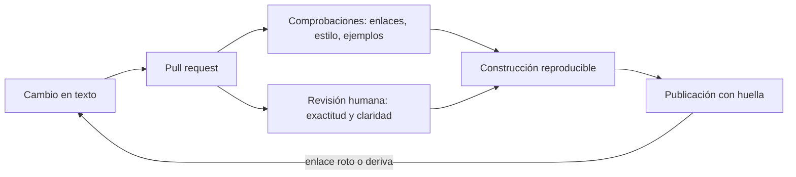
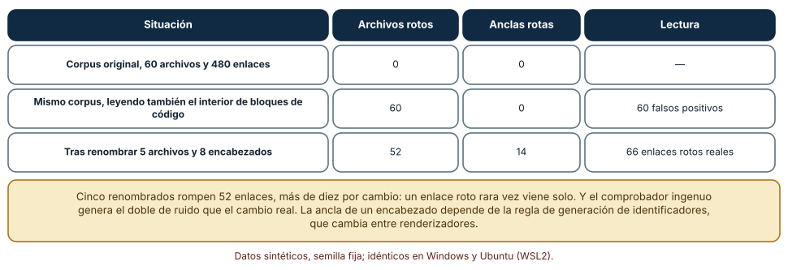
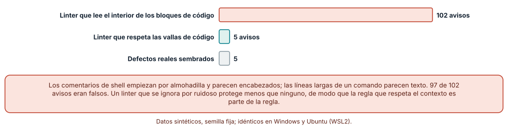
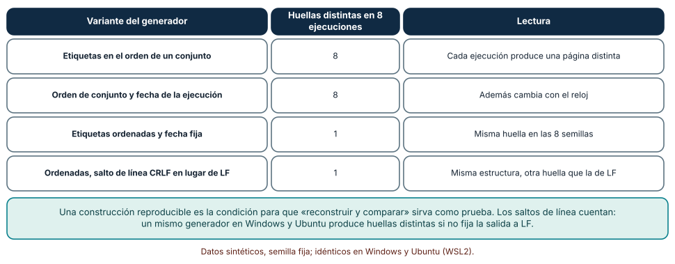

# SE-212 — Docs as code, revisión y publicación

[← SE-211 — Runbooks, playbooks y documentación operacional](../../classes/part-17-documentacion-y-conocimiento-tecnico/se-211-runbooks-playbooks-y-documentacion-operacional/README.md) · [↑ Parte 17](../../classes/part-17-documentacion-y-conocimiento-tecnico/README.md) · [📚 Índice completo](../../classes/README.md) · [🌐 Portal](../../site/classes/SE-212.html) · [SE-213 — Búsqueda, glosarios y arquitectura de conocimiento →](../../classes/part-17-documentacion-y-conocimiento-tecnico/se-213-busqueda-glosarios-y-arquitectura-de-conocimiento/README.md)

## Punto profesional y fundamento pedagógico

**Punto profesional.** La clase existe para que trates la documentación con las mismas prácticas que el código (control de versiones, revisión, comprobaciones automáticas, publicación reproducible) y para que sepas qué ganas, qué cuesta y qué sigue necesitando a una persona. Un enlace roto, una ancla que cambió o una página publicada que difiere de la revisada son defectos de software.

**Por qué aparece aquí.** Se sitúa después de **Runbooks, playbooks y documentación operacional** y antes de **Búsqueda, glosarios y arquitectura de conocimiento**: las clases anteriores produjeron piezas (páginas por tipo, README, decisiones, diagramas, API, runbooks) y esta las pone en un proceso. Reúne los comprobadores de las clases `SE-207`, `SE-209`, `SE-210` y `SE-211` en una canalización y fija las dos propiedades que `SE-216` exigirá del portal: comprobaciones que no cansen y construcciones reproducibles.

**Error conceptual que debe corregir.** Creer que «documentación como código» significa guardar Markdown en git. Sin comprobaciones, sin revisión de lo que importa y sin una construcción reproducible, la documentación versionada envejece igual que la que no lo está, solo que con historial.

**Límite de la conclusión.** El corpus de enlaces es sintético, el generador de la página mide el efecto de tres decisiones concretas y el linter implementa tres reglas. No se midió ninguna canalización real ni el tiempo de revisión de nadie.

### Trazabilidad fuente → afirmación

| Fuente primaria u oficial | Afirmación que respalda | Lo que no prueba |
|---|---|---|
| [Write the Docs: Docs as Code](https://www.writethedocs.org/guide/docs-as-code/) | Define la práctica como escribir la documentación con las herramientas del código: seguimiento de incidencias, control de versiones, texto plano, revisión y pruebas automáticas. | No mide su efecto en la calidad. |
| [CommonMark: especificación](https://spec.commonmark.org/) | Define la sintaxis de Markdown, incluidos enlaces, encabezados y bloques de código, y no define identificadores de ancla para los encabezados. | No cubre las extensiones de cada plataforma. |
| [Reproducible Builds: documentación](https://reproducible-builds.org/docs/) | Describe por qué una construcción debe dar el mismo resultado desde las mismas fuentes y las fuentes habituales de variación. | No garantiza que un proyecto concreto sea reproducible. |

## Antes de empezar

Retoma los comprobadores de las clases anteriores: la comparación de opciones del README, el linter de ADR, la comparación del diagrama con el código, los ejemplos ejecutables de la API y el linter de runbooks. La pregunta activa es: **¿qué pasa en un pull request que toca la documentación, quién comprueba qué, y cómo sé que lo publicado es lo que se revisó?**

## Prerrequisitos

- Haber completado `SE-211` o poder explicar la diferencia entre una comprobación mecánica y una revisión humana.
- Python 3.11 o posterior, un terminal y nociones de Git.
- Trabajar con un corpus sintético de páginas Markdown creadas por los experimentos.

## Problema auténtico

La documentación de la plataforma vive en un repositorio, y cada cambio pasa por un pull request. Aun así, tres semanas después de renombrar la página de penalización, doce enlaces siguen apuntando a la antigua; un cambio de título deja sin efecto las anclas que lo citaban; el linter de Markdown, que alguien activó en la integración continua, emite ciento treinta avisos por comentarios de shell dentro de bloques de código y el equipo aprende a ignorarlo; y la página publicada difiere de la del repositorio porque la construcción de ayer incluía una fecha y el orden de las etiquetas cambió. La documentación está versionada y nadie confía en ella.

## Objetivos observables

Al terminar podrás:

1. describir una canalización de documentación (revisión, comprobaciones, construcción, publicación) y decir qué comprueba cada etapa;
2. escribir un comprobador de enlaces y anclas, medir cuántos enlaces rompe un renombrado y explicar por qué la regla de anclas depende del renderizador;
3. escribir un linter que respete el contexto (bloques de código) y medir el ruido que evita;
4. construir una página de forma reproducible, identificar tres fuentes de variación y verificar la huella en dos sistemas;
5. decidir qué revisa una persona en un pull request de documentación y qué debe dejarse a las máquinas.

## Mapa conceptual



El diagrama se lee de izquierda a derecha: un cambio abre un pull request; las comprobaciones mecánicas y la revisión humana corren en paralelo; solo si ambas pasan se construye, de forma reproducible, y se publica con una huella que permite verificar qué se publicó. El retorno indica que un enlace roto descubierto después reabre el ciclo. El diagrama no dice cuánto debe tardar cada etapa; esa medida es del equipo.

## Temas y por qué importan

| Tema | Por qué cambia una decisión profesional | Evidencia mínima |
|---|---|---|
| Docs as code | Los mismos mecanismos que protegen el código protegen la documentación si se aplican con criterio. | Repositorio, pull request y comprobaciones definidas |
| Enlaces y anclas | Un enlace roto es el defecto más frecuente y el más barato de detectar. | Comprobador con recuento de enlaces rotos |
| Linter con contexto | Un linter que ignora el contexto genera ruido; el ruido se ignora; lo ignorado no protege. | Comparación de avisos con y sin contexto |
| Construcción reproducible | Si la construcción varía, no se puede comparar lo revisado con lo publicado. | Huellas iguales en distintas ejecuciones y sistemas |
| Revisión humana | La exactitud y la claridad no se comprueban con regex; la revisión debe dedicarse a ellas. | Lista de qué revisa una persona |

## Conceptos y decisiones

### 1. Qué es (y qué no es) documentación como código

Docs as code propone escribir la documentación con las herramientas de desarrollo: texto plano, control de versiones, pull requests, revisión y pruebas automáticas, de modo que escritores y desarrolladores trabajen en el mismo flujo. Lo que aporta es trazabilidad (quién cambió qué y por qué), revisión (otra persona mira antes de publicar) y automatización (las comprobaciones se ejecutan siempre). Lo que no aporta por sí mismo es calidad: un repositorio con Markdown sin comprobaciones solo guarda el historial de su deterioro. La ventaja se materializa cuando cada etapa de la canalización tiene un propósito claro.

### 2. La revisión: qué mira una persona

Una revisión de documentación tiene dos partes que no deben confundirse. Las comprobaciones mecánicas (enlaces, formato, ejemplos que se ejecutan) corren solas y fallan con un mensaje preciso. La revisión humana comprueba lo que una máquina no ve: si la explicación es correcta, si responde a la tarea de la audiencia, si el tono es el adecuado, si la página debería ser dos. Un pull request que obliga a una persona a señalar un espacio al final de una línea desperdicia su atención; uno que solo pasa las máquinas puede publicar una explicación falsa con la sintaxis perfecta.

### 3. Enlaces y anclas

Un enlace roto es la forma más frecuente de documentación que miente. Hay dos clases: el enlace a un archivo que se movió o renombró, y el enlace a un encabezado cuyo título cambió. La primera se detecta comprobando que la ruta exista; la segunda exige conocer cómo se genera la ancla de un encabezado, y ese algoritmo no está en la especificación de Markdown: cada renderizador convierte los títulos en identificadores con sus propias reglas (minúsculas, eliminación de signos, guiones por espacios, sufijos para duplicados). Un comprobador que use una regla distinta de la del sitio publicado dará falsas alarmas o dejará pasar enlaces rotos.

### 4. Linters con contexto

Un linter de estilo aplica reglas a líneas de texto. Sin contexto, trata como texto lo que no lo es: un comentario de shell dentro de un bloque de código empieza por almohadilla y parece un encabezado; una línea larga de comando parece un párrafo ilegible. El resultado es ruido, y el ruido enseña a ignorar el linter. La defensa es hacer que las reglas conozcan los bloques de código y apliquen cada comprobación solo a lo que corresponde. Esta decisión de diseño importa tanto como el catálogo de reglas: una regla correcta aplicada al lugar equivocado es una falsa alarma.

### 5. Construcción reproducible y huella

Para saber que lo publicado es lo revisado hace falta que la construcción sea determinista: las mismas fuentes producen los mismos bytes. Tres fuentes de variación son comunes: el orden de recorrido de colecciones (en Python, el de un conjunto de cadenas varía con la semilla de hash de cada proceso), las marcas de tiempo incrustadas y los saltos de línea del sistema. La huella (un resumen criptográfico del resultado) convierte la comparación en una igualdad de cadenas. La reproducibilidad no es un lujo: sin ella, cualquier diferencia entre dos construcciones es una pregunta sin respuesta.

### Un comprobador de enlaces sobre 60 archivos

Se genera un corpus de 60 archivos Markdown con cuatro encabezados cada uno y siete enlaces por archivo a otro archivo y a uno de sus encabezados (480 enlaces), más un bloque de código por archivo con un enlace de ejemplo que no debe contarse. El comprobador extrae los enlaces, calcula la ancla de cada encabezado (minúsculas, sin signos, espacios por guiones) y verifica que el archivo y la ancla existan. Después se renombran 5 archivos y se cambia el título de un encabezado en 8 archivos.

```python
def ancla(titulo):
    s = re.sub(r"[^\w\s-]", "", titulo.lower().strip())
    return re.sub(r"\s", "-", s)
...
if destino not in archivos:                 rotos_archivo += 1
elif ancla_enlace and ancla_enlace not in anclas[destino]:
                                            rotas_ancla += 1
```

Resultado, idéntico en Windows (CPython 3.12.9) y Ubuntu (3.12.3): el corpus original tiene 0 enlaces rotos. Si el comprobador lee también el interior de los bloques de código, marca 60 enlaces como rotos que eran ejemplos. Tras renombrar 5 archivos y cambiar 8 encabezados aparecen 52 enlaces a archivo rotos y 14 anclas rotas: 66 enlaces rotos reales, más de diez por cada archivo renombrado.



**Cómo leer la figura.** Cada fila es una situación del corpus; las columnas dan los enlaces a archivo rotos, las anclas rotas y la lectura. **Dónde deja de valer:** la regla de ancla es la del autor; si el sitio publicado genera otra, el comprobador dará resultados distintos. El corpus es sintético y uniforme (siete enlaces por archivo); uno real tiene enlaces externos, imágenes y rutas relativas con `..` que añaden casos.

### Un linter que respeta los bloques de código

Se generan 40 archivos con un título, una sección, texto, un bloque de código con comentarios de shell, una línea que parece un encabezado de nivel 3 y un comando largo (la mitad con más de 100 caracteres y con espacios al final). En 5 archivos se siembra un salto real de encabezado (de nivel 2 a 4). El linter aplica tres reglas: no saltar niveles de encabezado, no superar 100 caracteres por línea y no dejar espacios al final.

```python
if linea.startswith("```"):
    dentro = not dentro
    continue
if dentro and respeta_vallas:
    continue
```

El linter que lee el interior de los bloques emite 102 avisos; el que respeta las vallas emite 5, exactamente los 5 saltos sembrados. De los 102 avisos, 97 eran falsos. Los resultados fueron idénticos en ambos sistemas.



**Cómo leer la figura.** Cada barra es el número de avisos; la gris son los defectos sembrados. **Dónde deja de valer:** los bloques de código son del tipo más simple (valla de tres acentos graves); los bloques con sangría, las vallas de tilde o los bloques anidados en listas requieren un analizador completo, y la forma estable de lograrlo es usar uno de Markdown en lugar de expresiones regulares. El experimento muestra el efecto del contexto, no un linter listo para usar.

### La misma página en ocho ejecuciones

Se construye una página HTML con una lista de seis etiquetas y una fecha. Se prueban cuatro variantes: etiquetas en el orden de iteración de un conjunto, etiquetas en ese orden más la fecha de la ejecución, etiquetas ordenadas con fecha fija, y las ordenadas con saltos de línea CRLF en lugar de LF. Cada variante se ejecuta con ocho valores de `PYTHONHASHSEED` y se calcula el SHA-256 de la salida.

```python
items = list(etiquetas) if modo.startswith("set") else sorted(etiquetas)
fecha = datetime.now().isoformat() if modo == "set+fecha" else "2026-11-13"
```

Con las etiquetas en el orden de un conjunto, las ocho ejecuciones producen ocho huellas distintas; añadiendo la fecha de la ejecución, también ocho. Con las etiquetas ordenadas y la fecha fija, las ocho producen una única huella. Con CRLF en lugar de LF, la huella cambia aunque la estructura sea idéntica: un mismo generador en Windows y Ubuntu produce huellas distintas si no fija los saltos de línea. Los resultados fueron idénticos en ambos sistemas.



**Cómo leer la figura.** Cada fila es una variante del generador; la segunda columna es el número de huellas distintas en ocho ejecuciones. **Dónde deja de valer:** el experimento aísla tres fuentes de variación; las construcciones reales añaden otras (versiones de dependencias, rutas absolutas, orden del sistema de archivos, límites de zona horaria). Fijar el orden, la fecha y los saltos de línea es necesario y no suficiente.

## Definiciones de trabajo

- **documentación como código:** práctica de escribir y mantener la documentación con control de versiones, revisión y comprobaciones automáticas.
- **enlace roto:** referencia a un archivo o a una ancla que no existe en el conjunto publicado.
- **ancla:** identificador de un encabezado dentro de una página, generado por el renderizador a partir de su título.
- **construcción reproducible:** construcción que produce los mismos bytes a partir de las mismas fuentes.
- **huella:** resumen criptográfico de un resultado que permite comprobar su identidad.

Las definiciones son operativas para el portal; no reemplazan las de las fuentes enlazadas abajo.

## Ejemplo mínimo

El fragmento calcula la ancla de dos encabezados y detecta un enlace roto. Antes de ejecutarlo, predice qué enlace queda marcado.

```python
import re
def ancla(t):
    return re.sub(r"\s", "-", re.sub(r"[^\w\s-]", "", t.lower().strip()))

encabezados = {ancla("Penalización por retraso"), ancla("Cómo pedir una prórroga")}
enlaces = ["penalización-por-retraso", "como-pedir-una-prorroga"]
print([e for e in enlaces if e not in encabezados])
```

La predicción correcta es `['como-pedir-una-prorroga']`, porque la regla conserva las tildes: la ancla de «Cómo pedir una prórroga» es `cómo-pedir-una-prórroga`. Registra la versión del intérprete; si quitas las tildes del enlace y de la regla, predice antes el resultado.

## Ejemplo profesional

La documentación de la plataforma de entregas se construye en cada pull request: un comprobador de enlaces y anclas con la regla del sitio, un linter de Markdown consciente de los bloques de código, los comprobadores de las clases anteriores (opciones del README, grafo de ADR, diagrama frente a importaciones, ejemplos de la API, linter de runbooks) y una construcción reproducible cuya huella se publica junto a la página. La revisión humana mira exactitud, tarea de la audiencia y tipo de página, con una lista corta. Cuando alguien renombra la página de penalización, el comprobador lista los 12 enlaces que apuntan a ella y el pull request no se fusiona hasta corregirlos.

Compara el caso normal con tres casos límite: el cambio de título que rompe anclas (el comprobador lo detecta con la regla del sitio), el enlace externo que deja de responder (se comprueba aparte y con tolerancia, porque una caída momentánea no es un defecto del repositorio) y el cambio de saltos de línea por un editor (la huella lo detecta antes de publicar).

## Práctica guiada

1. Crea `work/SE-212/` y genera un corpus de 60 archivos Markdown con enlaces y encabezados.
2. Escribe el comprobador de enlaces y anclas y comprueba que el corpus original tiene cero rotos.
3. Renombra 5 archivos y cambia 8 títulos y cuenta los enlaces rotos.
4. Haz que el comprobador respete los bloques de código y mide la diferencia de falsas alarmas.
5. Escribe el linter de tres reglas con y sin contexto y cuenta los avisos en 40 archivos.
6. Construye la página de ejemplo con las cuatro variantes y ocho valores de `PYTHONHASHSEED`.
7. Repite la construcción ordenada en el otro sistema operativo y compara la huella.
8. Entrega `canalizacion.md` con los recuentos, las huellas y qué revisa una persona.

## Ejercicios

1. **Anclas:** modifica la regla de ancla para añadir un sufijo a los títulos duplicados y calcula cuántos enlaces del corpus de la clase cambian de ancla.
2. **Linter:** añade una regla de longitud de párrafo y mide cuántos avisos nuevos produce con y sin respeto de los bloques de código.
3. **Reproducibilidad:** añade a la página la ruta absoluta del directorio de trabajo y explica qué cambia entre dos máquinas.
4. **Revisión:** redacta una lista de seis preguntas para la revisión humana de una página de la plataforma, sin incluir ninguna que una máquina responda.

## Reto verificable

Entrega el corpus, el comprobador, el linter con y sin contexto, el generador de la página con sus cuatro variantes y las huellas en dos sistemas. Se aprueba si otra persona ejecuta todo desde un checkout limpio, obtiene los mismos recuentos y la misma huella ordenada, y puede nombrar una fuente de variación que tu construcción no controla.

## Caso conductor

El portal de la plataforma de entregas pasa de un conjunto de páginas a una canalización. Esta clase deja el comprobador de enlaces, el linter con contexto y la construcción reproducible, que `SE-213` aprovecha para validar glosarios y `SE-216` para publicar versiones con huella.

## Preguntas frecuentes

### ¿Cuántas comprobaciones debe tener un pull request de documentación?

Las que producen señal. Cada comprobación que falla por motivos irrelevantes enseña a ignorar todas. Empieza con enlaces, ejemplos ejecutables y un linter con contexto, y añade solo las que hayan atrapado un defecto real.

### ¿Los enlaces externos se comprueban en cada pull request?

No de forma bloqueante. Una caída de un sitio ajeno no es un defecto del cambio. Se comprueban en una tarea programada y con tolerancia a fallos temporales, y se corrigen aparte.

### ¿Qué hago si el linter no entiende un bloque de código?

Usa un analizador de Markdown en lugar de expresiones regulares, o exclúyelo de forma explícita con un comentario que lo justifique. Desactivar la regla globalmente pierde la protección que aporta.

### ¿La huella demuestra que la documentación es correcta?

No: demuestra que lo publicado es lo construido y que lo construido es lo revisado. La corrección sigue dependiendo de la revisión.

## Fallo controlado y diagnóstico

Reproduce el fallo clásico de la clase: **renombrar una página y dejar enlaces rotos**. Renombra `doc07.md` a `doc07_nuevo.md` y ejecuta el comprobador.

Registra síntoma, entrada mínima, hipótesis, observación que discrimina, causa, corrección y prueba de regresión. **Síntoma:** quien sigue un enlace obtiene un 404 en el sitio publicado. **Hipótesis rivales:** (a) el servidor de publicación falló; (b) el enlace tiene un error de escritura; (c) la página se renombró. **Observación que discrimina:** ejecuta el comprobador; si lista el enlace con destino inexistente y la página existe con otro nombre, confirma (c). **Causa:** el renombrado no actualizó los enlaces entrantes. **Corrección:** actualizar los enlaces o añadir una redirección. **Prueba de regresión:** el comprobador en la integración continua, que bloquea la fusión. **Recuperación:** añadir una redirección para los enlaces externos que no se pueden corregir.

## Errores comunes y cómo corregirlos

| Síntoma | Causa probable | Corrección |
|---|---|---|
| El linter emite cientos de avisos y nadie los lee | No respeta los bloques de código | Usar un analizador de Markdown o ignorar las vallas de forma explícita |
| Un cambio de título rompe enlaces internos sin aviso | No se comprueban las anclas | Añadir la comprobación con la regla de ancla del sitio |
| La página publicada difiere de la revisada | La construcción no es reproducible | Ordenar colecciones, fijar fechas y saltos de línea, y publicar la huella |
| Las huellas difieren entre Windows y Linux | Distintos saltos de línea al escribir | Fijar LF en el generador y en la configuración del repositorio |
| Los pull requests de documentación se revisan solo por forma | La revisión no tiene preguntas propias | Escribir una lista de preguntas de exactitud y tarea para el revisor |

## Entorno y archivos clave

```text
work/SE-212/
├── README.md
├── corpus/
├── experimentos/
│   ├── enlaces.py
│   ├── linter.py
│   └── construccion.py
├── .github/workflows/docs.yml
└── evidencia/canalizacion.md
```

El `README` declara plataforma, versión de Python, semillas y comandos. Los experimentos usan solo la biblioteca estándar (`re`, `pathlib`, `hashlib`, `subprocess`, `random`) y se ejecutaron con CPython 3.12.9 en Windows 11 y 3.12.3 en Ubuntu bajo WSL2 con resultados idénticos. El corpus se crea en un directorio temporal y se elimina al terminar.

## Seguridad, ética y accesibilidad

- una canalización de documentación ejecuta código (ejemplos, comprobadores): trátala como el resto del código, con permisos mínimos y sin secretos accesibles a los pull requests de terceros;
- no publiques documentación interna por error: la construcción debe declarar qué entra y qué no;
- el linter debe comprobar también accesibilidad básica: texto alternativo en las imágenes, encabezados en orden y enlaces con texto descriptivo;
- usa enlaces con texto que diga adónde llevan; evita «aquí» y «este enlace»;
- documenta quién aprueba la publicación y cómo se revierte una versión;
- respeta las licencias de las herramientas y de los contenidos que incorporas.

## Puente hacia el trabajo con agentes

Un agente al que se pide «arregla los enlaces rotos» puede reescribir texto para que el comprobador deje de quejarse, o borrar enlaces. Pídele que ejecute el comprobador antes y después, que no elimine enlaces sin proponer el destino correcto, que liste los cambios por archivo y que no modifique reglas del linter ni de la canalización sin aprobación. Un agente es también el autor de muchos cambios de documentación: las comprobaciones mecánicas son su red, y la revisión humana debe centrarse en lo que una máquina no ve. Quien revisa comprueba que las comprobaciones se ejecutaron y que no se debilitaron.

## Transferencia

Traslada la canalización a otro dominio (por ejemplo, la documentación de un servicio de reparto): cambian las páginas y los comprobadores específicos, se conservan el pull request, las comprobaciones con contexto, la construcción reproducible y la huella. La transferencia está lograda cuando puedes explicar qué parte de la canalización depende del renderizador y cuál no.

## Evaluación y evidencia

| Criterio | Evidencia para aprobar |
|---|---|
| comprensión | explicación de qué comprueba cada etapa de la canalización y por qué la revisión humana sigue siendo necesaria |
| corrección | recuentos reproducibles de enlaces rotos, avisos y huellas con las mismas semillas |
| diseño | comprobador de enlaces, linter con contexto y construcción reproducible |
| diagnóstico | reproducción del fallo «renombrado con enlaces rotos» con regresión |
| incertidumbre | declaración de que la regla de ancla y el corpus son del autor y de que no se midió ninguna canalización real |
| reproducibilidad | versiones, comandos, salida y límites declarados |

## Fuentes

- [Write the Docs: Docs as Code](https://www.writethedocs.org/guide/docs-as-code/) — práctica y herramientas; autoridad: Write the Docs.
- [CommonMark: especificación](https://spec.commonmark.org/) — sintaxis de Markdown; autoridad: proyecto CommonMark.
- [GitHub Flavored Markdown: especificación](https://github.github.com/gfm/) — extensiones de Markdown de GitHub; autoridad: GitHub.
- [markdownlint: reglas](https://github.com/DavidAnson/markdownlint/blob/main/doc/Rules.md) — catálogo de reglas de estilo de Markdown; autoridad: proyecto markdownlint.
- [Reproducible Builds: documentación](https://reproducible-builds.org/docs/) — causas de variación y prácticas; autoridad: proyecto Reproducible Builds.
- [Reproducible Builds: SOURCE_DATE_EPOCH](https://reproducible-builds.org/specs/source-date-epoch/) — fecha fija para construcciones; autoridad: proyecto Reproducible Builds.
- [Python: opciones de línea de comandos y variables de entorno](https://docs.python.org/3/using/cmdline.html) — `PYTHONHASHSEED` y su efecto en el orden; autoridad: documentación de Python.

Cada fuente respalda el mecanismo indicado; ninguna demuestra que una canalización de documentación reduzca los defectos publicados de tu proyecto. Esa afirmación depende del equipo y se comprueba con sus propios recuentos de enlaces rotos y de discrepancias.

## Límites y siguiente paso

Se ejecutaron tres experimentos con datos sintéticos en Windows y Ubuntu (WSL2) con resultados idénticos. No se midió ninguna canalización real ni el tiempo de revisión: el corpus de 60 archivos, la regla de ancla y el linter de tres reglas son construcciones del autor, y la construcción reproducible controla solo tres fuentes de variación. La siguiente clase pregunta cómo se encuentra lo que está publicado: búsqueda, glosarios y arquitectura de conocimiento.

## Glosario

- **documentación como código:** práctica de mantener la documentación con control de versiones, revisión y comprobaciones automáticas.
- **enlace roto:** referencia a un archivo o ancla que no existe en el conjunto publicado.
- **ancla:** identificador de un encabezado dentro de una página, generado a partir de su título.
- **construcción reproducible:** construcción que produce los mismos bytes a partir de las mismas fuentes.
- **huella:** resumen criptográfico de un resultado que permite comprobar su identidad.

---

[← SE-211 — Runbooks, playbooks y documentación operacional](../../classes/part-17-documentacion-y-conocimiento-tecnico/se-211-runbooks-playbooks-y-documentacion-operacional/README.md) · [↑ Parte 17](../../classes/part-17-documentacion-y-conocimiento-tecnico/README.md) · [📚 Índice completo](../../classes/README.md) · [🌐 Portal](../../site/classes/SE-212.html) · [SE-213 — Búsqueda, glosarios y arquitectura de conocimiento →](../../classes/part-17-documentacion-y-conocimiento-tecnico/se-213-busqueda-glosarios-y-arquitectura-de-conocimiento/README.md)
