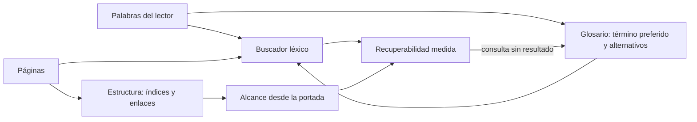
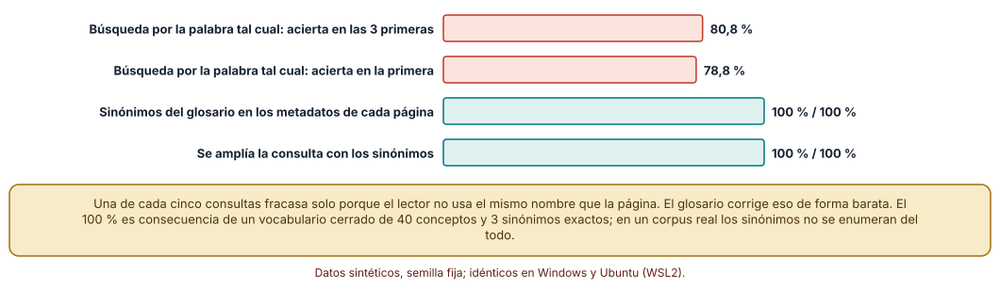
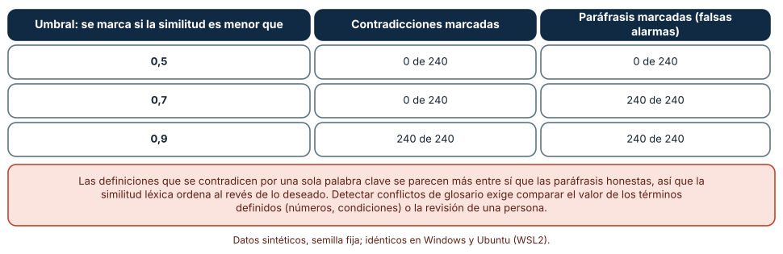
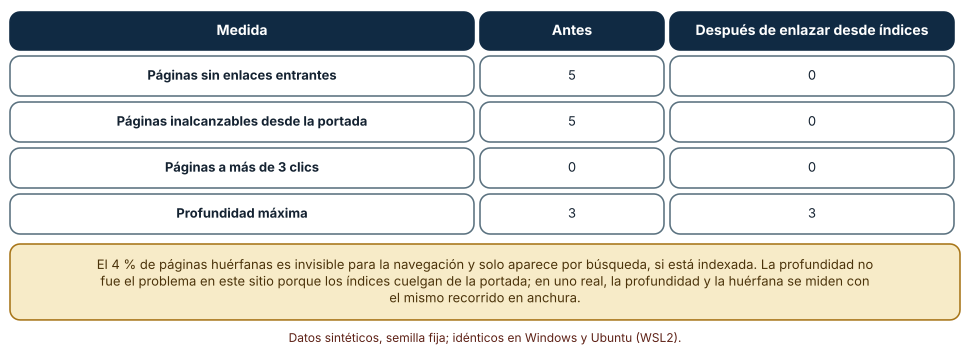

# SE-213 — Búsqueda, glosarios y arquitectura de conocimiento

[← SE-212 — Docs as code, revisión y publicación](../../classes/part-17-documentacion-y-conocimiento-tecnico/se-212-docs-as-code-revision-y-publicacion/README.md) · [↑ Parte 17](../../classes/part-17-documentacion-y-conocimiento-tecnico/README.md) · [📚 Índice completo](../../classes/README.md) · [🌐 Portal](../../site/classes/SE-213.html) · [SE-214 — Documentación para humanos, máquinas y LLM →](../../classes/part-17-documentacion-y-conocimiento-tecnico/se-214-documentacion-para-humanos-maquinas-y-llm/README.md)

## Punto profesional y fundamento pedagógico

**Punto profesional.** La clase existe para que trates la recuperabilidad como una propiedad de la documentación que se diseña y se mide: que lo escrito se encuentre con las palabras de quien busca, que los términos signifiquen lo mismo en todas partes y que ninguna página quede fuera del camino de nadie. Una página que existe y no se encuentra es una página que no existe para el lector.

**Por qué aparece aquí.** Se sitúa después de **Docs as code, revisión y publicación** y antes de **Documentación para humanos, máquinas y LLM**: la clase anterior aseguró que lo publicado es lo revisado y que los enlaces funcionan; esta pregunta si alguien llega a ello. Retoma el vocabulario de la audiencia de `SE-205` y prepara el terreno para que, en la clase siguiente, los mismos mecanismos (metadatos, glosario, estructura) sirvan también a las máquinas.

**Error conceptual que debe corregir.** Creer que instalar un buscador resuelve la recuperabilidad. Un buscador léxico encuentra las palabras que están en la página, no las que el lector usa para pensar el problema; y un glosario que define el mismo término de dos maneras distintas es peor que ninguno, porque la contradicción lleva autoridad.

**Límite de la conclusión.** El corpus de búsqueda tiene 40 conceptos con tres sinónimos exactos, las definiciones son listas de palabras sorteadas y el sitio de 120 páginas es un grafo aleatorio. No se midió a ningún lector, ningún buscador de producción ni ningún glosario real.

### Trazabilidad fuente → afirmación

| Fuente primaria u oficial | Afirmación que respalda | Lo que no prueba |
|---|---|---|
| [Robertson y Zaragoza, «The Probabilistic Relevance Framework: BM25 and Beyond» (2009)](https://doi.org/10.1561/1500000019) | Describe el marco probabilístico de relevancia y la función de ordenación BM25, basada en la frecuencia de términos y su rareza. | No cubre sinónimos ni semántica; BM25 es un modelo léxico. |
| [W3C, SKOS Reference](https://www.w3.org/TR/skos-reference/) | Define un modelo para vocabularios controlados con etiquetas preferidas y alternativas para un mismo concepto. | No dice cómo construir un vocabulario para un proyecto. |
| [Pirolli y Card, «Information Foraging» (Psychological Review, 1999)](https://doi.org/10.1037/0033-295X.106.4.643) | Propone que las personas siguen «rastros de información» y deciden por el olor de lo que ven, un modelo útil para pensar la navegación. | No mide la navegación en un portal concreto. |

## Antes de empezar

Retoma las comprobaciones de `SE-212`: los enlaces funcionan, los anclajes existen y las construcciones son reproducibles. La pregunta activa es: **si alguien busca «cuánto me quitan por entregar tarde», ¿llega a la página que habla de «penalización por retraso», y sé cuántas veces pasa?**

## Prerrequisitos

- Haber completado `SE-212` o poder explicar qué comprueba un comprobador de enlaces y qué no.
- Python 3.11 o posterior y un terminal; los experimentos usan solo la biblioteca estándar.
- Trabajar con un corpus sintético de páginas, un glosario sintético y un sitio de 120 páginas generado por los experimentos.

## Problema auténtico

El portal de la plataforma tiene 200 páginas y un buscador. Una estudiante escribe «descuento por tarde» y no obtiene resultados: las páginas hablan de «penalización por retraso». Un docente busca «prórroga» y encuentra tres páginas que la definen con plazos distintos: en una dice 48 horas, en otra 72, en la tercera «a criterio del docente». El índice de la secretaría enlaza a veinte páginas, pero cinco páginas recientes no tienen ningún enlace entrante: existen en el buscador solo si alguien acierta con una palabra de su título.

## Objetivos observables

Al terminar podrás:

1. medir la tasa de aciertos de un buscador léxico cuando el lector usa sinónimos y explicar qué mecanismos la recuperan;
2. diseñar un glosario con términos preferidos y alternativos, y decir cuándo un término debe tener una sola definición en toda la documentación;
3. detectar definiciones en conflicto y explicar por qué una similitud léxica alta no indica concordancia;
4. calcular qué páginas de un sitio son huérfanas o quedan lejos de la portada con un recorrido en anchura;
5. proponer una prueba de recuperabilidad con consultas reales y decir qué mide y qué no.

## Mapa conceptual



El diagrama se lee de izquierda a derecha: las palabras del lector llegan a un buscador que consulta las páginas; el glosario aporta sinónimos; la estructura aporta un segundo camino (los enlaces); ambos caminos se miden con consultas y recorridos. El retorno indica que una consulta sin resultado alimenta el glosario. No se dibuja el buscador semántico, que usa vectores en lugar de palabras y tiene otros fallos.

## Temas y por qué importan

| Tema | Por qué cambia una decisión profesional | Evidencia mínima |
|---|---|---|
| Búsqueda léxica | Encuentra lo que contiene las palabras de la consulta; el lector usa otras. | Tasa de aciertos con consultas por sinónimo |
| Glosario y vocabulario controlado | Un término preferido y alternativas conectan el vocabulario del lector con el de la página. | Glosario con etiquetas alternativas |
| Coherencia de definiciones | Una definición contradictoria con autoridad confunde más que ninguna. | Comparación de definiciones del mismo término |
| Estructura y alcance | La navegación es el segundo camino: una página sin enlaces entrantes depende solo de la búsqueda. | Recuento de huérfanas y distancia desde la portada |
| Medir la recuperabilidad | Sin consultas reales no se sabe qué falla; con ellas se corrige donde duele. | Registro de consultas sin resultado |

## Conceptos y decisiones

### 1. Búsqueda léxica y vocabulario del lector

Un buscador léxico, como los basados en BM25, puntúa cada página por la frecuencia con que contiene los términos de la consulta, ponderada por lo raros que son en el corpus. Es rápido, predecible y explicable. Su límite es estructural: si la consulta usa una palabra que la página no contiene, la página no existe para él. Quien busca «descuento por tarde» y la página dice «penalización por retraso» no obtiene nada, aunque el contenido sea exactamente lo que busca. La causa no es un error del buscador, sino la distancia entre el vocabulario del lector y el del autor.

### 2. Glosario y vocabulario controlado

Un glosario con vocabulario controlado asigna a cada concepto una etiqueta preferida y varias alternativas (sinónimos, formas coloquiales, abreviaturas). El modelo SKOS lo formaliza: un concepto tiene una etiqueta preferida y puede tener etiquetas alternativas. En un portal, las alternativas se añaden a los metadatos de la página o se expanden al consultar. El glosario también cumple otra función: fija una definición por término, de modo que «prórroga» signifique lo mismo en el manual del estudiante y en la guía del docente. Mantenerlo exige un responsable y una revisión, como cualquier otra pieza del portal.

### 3. Estructura, enlaces y olor de la información

La navegación es el segundo camino hacia una página. Las personas siguen rastros: deciden qué enlace pulsar por lo que sugiere su texto, el «olor» de la información. Una estructura que ofrece rastros claros (un índice por tareas, enlaces con texto descriptivo) reduce el esfuerzo; una página sin ningún enlace entrante solo se encuentra por búsqueda. Medir la estructura es sencillo con un recorrido en anchura desde la portada: cuántas páginas son inalcanzables, cuántas tienen cero enlaces entrantes y cuántos clics separan la portada de las más lejanas. Las pautas de accesibilidad piden además más de una forma de localizar una página dentro de un conjunto.

### 4. Definiciones en conflicto

Cuando un término se define en varias páginas, tarde o temprano discrepan. Dos casos son distintos: la paráfrasis (la misma definición con otras palabras) y el conflicto (una condición que cambia, como un plazo de 48 horas que pasa a 72). Detectarlos automáticamente es tentador y engañoso. Una medida de similitud léxica entre definiciones trata como cercanas a dos textos que comparten casi todas las palabras, y un conflicto que cambia una sola palabra clave (el número) es léxicamente más cercano que una paráfrasis honesta que cambia tres. La detección útil compara el valor de las condiciones (números, plazos, negaciones) o remite a una única definición.

### 5. Medir la recuperabilidad

La recuperabilidad se mide con consultas: las reales, tomadas del registro del buscador, y un conjunto de consultas de prueba por tarea. Para cada consulta se registra si una página relevante aparece entre las primeras posiciones, y se vigila la tasa de consultas sin resultado. Esa lista es el insumo del glosario y de los títulos. La medición tiene sus límites: depende de que alguien haya decidido qué página es relevante, y una consulta con resultado no prueba que el lector haya entendido la página.

### Búsqueda léxica con y sin sinónimos

Se genera un corpus de 200 páginas sobre 40 conceptos; cada concepto tiene tres sinónimos exactos y cada página usa uno al azar, repetido de dos a cuatro veces, junto a 40 palabras de relleno de un vocabulario de 300. Se implementa BM25 (k1 = 1,5, b = 0,75) y se lanzan 600 consultas: cada una elige un concepto y uno de sus tres sinónimos al azar. Se miden dos cosas: que una página relevante aparezca entre las tres primeras y que sea la primera. Se comparan tres sistemas: el léxico, el que añade los tres sinónimos del glosario a los metadatos de cada página y el que expande la consulta con los tres sinónimos.

```python
def bm25(docs, consulta, k1=1.5, b=0.75):
    N, medio = len(docs), sum(len(d) for d in docs) / len(docs)
    for d in docs:
        tf = Counter(d)
        s = sum(math.log(1 + (N - df[t] + 0.5) / (df[t] + 0.5))
                * tf[t] * (k1 + 1) / (tf[t] + k1 * (1 - b + b * len(d) / medio))
                for t in consulta if t in tf)
```

Resultado, idéntico en Windows (CPython 3.12.9) y Ubuntu (3.12.3): el buscador léxico coloca una página relevante entre las tres primeras el 80,8 % de las veces y la primera el 78,8 %; con los sinónimos en los metadatos o con la consulta expandida, el 100 % en ambos criterios. La pérdida del 19,2 % es la probabilidad de que ninguna de las páginas relevantes use el sinónimo elegido por el lector: con n páginas relevantes, 1 − (2/3)ⁿ de acierto.



**Cómo leer la figura.** Cada barra es el porcentaje de 600 consultas con una página relevante en el puesto indicado; las dos primeras son el buscador léxico y las otras dos, con los sinónimos del glosario. **Dónde deja de valer:** el 100 % es consecuencia de un vocabulario cerrado de tres sinónimos exactos, todos conocidos por el glosario; un corpus real tiene sinónimos que nadie enumeró, errores de ortografía, abreviaturas y consultas en forma de frase. Lo que se sostiene es la dirección: el glosario recupera lo que el vocabulario del lector pierde.

### Conflictos de definiciones por similitud léxica

Se simulan 20 términos con definiciones de 14 palabras. Para cada término se generan 12 paráfrasis (se reordenan las palabras y se cambian 3 por sinónimos) y 12 definiciones en conflicto (se cambia 1 palabra clave por un número distinto), 240 pares de cada clase. Se calcula la similitud de Jaccard (palabras comunes sobre palabras totales) respecto a la definición original.

```python
def jaccard(a, b):
    a, b = set(a), set(b)
    return len(a & b) / len(a | b)
```

La similitud media de las paráfrasis es 0,65 y la de los conflictos 0,87: los conflictos se parecen más a la original que las paráfrasis. Con un umbral de 0,5 (se marca si la similitud es menor) no se marca ningún par de ninguna clase; con 0,7 se marcan las 240 paráfrasis y ningún conflicto; con 0,9 se marcan los 240 pares de las dos clases. Ningún umbral separa los conflictos de las paráfrasis. Los resultados fueron idénticos en ambos sistemas.



**Cómo leer la figura.** Cada fila es un umbral; las columnas dan cuántos pares contradictorios y cuántas paráfrasis se marcan de 240. **Dónde deja de valer:** el conflicto sorteado es una palabra sustituida por un número, el caso más favorable a la similitud alta; un conflicto que reordena toda la frase tendría una similitud baja. El resultado no dice que la similitud sea inútil, sino que no ordena lo que importa: para detectar conflictos hay que extraer y comparar los valores, o centralizar la definición.

### Páginas huérfanas y distancia desde la portada

Se genera un sitio de 120 páginas: una portada, 8 índices enlazados desde ella y 111 páginas; el 80 % cuelga de un índice y cada una enlaza además a entre 0 y 3 páginas al azar. Se hace un recorrido en anchura desde la portada y se cuenta, antes y después de enlazar desde un índice las páginas inalcanzables.

```python
dist, cola = {0: 0}, deque([0])
while cola:
    u = cola.popleft()
    for v in enlaces[u]:
        if v not in dist:
            dist[v] = dist[u] + 1
            cola.append(v)
```

Antes de reparar hay 5 páginas sin ningún enlace entrante, inalcanzables desde la portada (4 % del sitio); ninguna está a más de 3 clics y la profundidad máxima es 3. Tras enlazar esas 5 páginas desde un índice, quedan 0 huérfanas y la profundidad máxima sigue siendo 3. Los resultados fueron idénticos en Windows y Ubuntu.



**Cómo leer la figura.** Cada fila es una medida del sitio; las dos columnas son el valor antes y después de enlazar las huérfanas desde un índice. **Dónde deja de valer:** el sitio es un grafo aleatorio con índices cercanos a la portada, por eso la profundidad nunca fue problema; en un portal real hay secciones profundas y enlaces rotos. La medida mide estructura, no si el rastro es claro: un enlace con el texto «aquí» cuenta igual que uno descriptivo.

## Definiciones de trabajo

- **recuperabilidad:** propiedad de una página de poder ser encontrada por alguien que la necesita con las palabras que usa y los caminos que sigue.
- **vocabulario controlado:** conjunto de términos preferidos, con alternativas y definiciones, que fija cómo se nombran los conceptos.
- **etiqueta alternativa:** sinónimo, forma coloquial o abreviatura de un concepto que lleva a la misma página que la etiqueta preferida.
- **página huérfana:** página sin enlaces entrantes desde el resto del sitio.
- **similitud de Jaccard:** cociente entre las palabras comunes de dos textos y las palabras totales de ambos.

Las definiciones son operativas para el portal; no reemplazan las de SKOS ni las de la bibliografía enlazada abajo.

## Ejemplo mínimo

El fragmento busca una consulta en un corpus mínimo con y sin sinónimos. Antes de ejecutarlo, predice qué páginas devuelve cada caso.

```python
paginas = {"p1": "penalizacion por retraso en la entrega", "p2": "como pedir una prorroga"}
sinonimos = {"descuento": ["penalizacion"]}
consulta = ["descuento"]
sin = [k for k, t in paginas.items() if any(w in t.split() for w in consulta)]
con = [k for k, t in paginas.items() if any(w in t.split() for q in consulta for w in [q] + sinonimos.get(q, []))]
print(sin, con)
```

La predicción correcta es `[] ['p1']`: sin sinónimos la consulta no coincide con nada; con ellos llega a la página de la penalización. Registra la versión del intérprete y la salida; si añades `"descuento": ["penalizacion", "prorroga"]`, predice antes qué cambia.

## Ejemplo profesional

El portal de la plataforma de entregas mantiene un glosario de 30 términos con etiqueta preferida, alternativas y una definición única que las demás páginas enlazan. El buscador indexa título, cuerpo y alternativas del glosario. El registro de consultas sin resultado se revisa cada mes: «descuento por tarde» pasó a ser una alternativa de «penalización por retraso». Un recorrido en anchura en cada construcción comprueba que no hay huérfanas y que ninguna página está a más de tres clics. Un comprobador compara los valores numéricos de las definiciones de «prórroga» en las páginas que la mencionan y avisa si discrepan.

Compara el caso normal con tres casos límite: el sinónimo que nadie enumeró (aparece en el registro de consultas sin resultado y se añade), el término con dos definiciones legítimas en contextos distintos (se desambigua con dos entradas) y la página nueva sin enlaces (la construcción falla hasta enlazarla).

## Práctica guiada

1. Crea `work/SE-213/` y escribe un glosario de diez términos de la plataforma con etiquetas preferidas y alternativas.
2. Genera un corpus de 200 páginas con los diez términos y sinónimos al azar.
3. Implementa BM25 y mide la tasa de aciertos con 600 consultas, con y sin sinónimos.
4. Genera 240 pares de definiciones parafraseadas y en conflicto y mide la similitud de Jaccard.
5. Escribe un comparador que extraiga los números de cada definición y marca los pares con números distintos.
6. Genera un sitio de 120 páginas, calcula huérfanas y profundidad, y repara las huérfanas.
7. Registra tres consultas imaginarias sin resultado y decide qué cambiarías.
8. Entrega `recuperabilidad.md` con las medidas y los cambios.

## Ejercicios

1. **Glosario:** elige cinco términos de una documentación pública y escribe etiqueta preferida, tres alternativas y una definición única.
2. **BM25:** cambia la proporción de sinónimos enumerados en el glosario (de 3 a 2 de 3) y mide cuánto baja el acierto.
3. **Conflictos:** extiende el comparador para detectar negaciones («no incluye») y prueba con 50 pares.
4. **Estructura:** añade al sitio 20 enlaces rotos y mide cuántas páginas pasan a ser inalcanzables.

## Reto verificable

Entrega el glosario, el buscador, la medición de aciertos con y sin sinónimos, el comparador de definiciones y el recorrido del sitio. Se aprueba si otra persona ejecuta todo desde un checkout limpio, obtiene los mismos porcentajes y puede nombrar una consulta realista que tu glosario no recuperaría.

## Caso conductor

El portal de la plataforma de entregas se vuelve encontrable: glosario de 30 términos, buscador medido y un recorrido que impide páginas huérfanas. Esta clase deja el glosario con alternativas, la medición de recuperabilidad y el comprobador de alcance, que `SE-214` convierte en metadatos para máquinas y `SE-216` incorpora a la auditoría del portal.

## Preguntas frecuentes

### ¿Basta con un buscador semántico?

Mejora los sinónimos y empeora otras cosas: puede devolver páginas relacionadas y no exactas, y es más difícil de explicar cuando falla. El glosario sigue siendo útil porque fija definiciones y puede alimentar a ambos.

### ¿Cuántos términos debe tener un glosario?

Los que generan confusión o consultas: términos que se usan con sentidos distintos, siglas y nombres internos. Un glosario de 300 términos obvios no lo mantiene nadie.

### ¿Qué hago con dos definiciones legítimas del mismo término?

Si dependen del contexto, haz dos entradas con la condición que las distingue. Si no, es un conflicto y debe resolverse: una definición vigente y las demás enlazan a ella.

### ¿Hay que mostrar los resultados de búsqueda sin resultados?

Sí: una página de «sin resultados» con sugerencias y un enlace al índice por tareas rescata a quien busca con otras palabras, y el registro de esas consultas es el mejor insumo para mejorar.

## Fallo controlado y diagnóstico

Reproduce el fallo clásico de la clase: **una consulta con sinónimo que no encuentra la página**. Busca «descuento» en el corpus sin glosario.

Registra síntoma, entrada mínima, hipótesis, observación que discrimina, causa, corrección y prueba de regresión. **Síntoma:** la búsqueda de «descuento por tarde» no devuelve resultados. **Hipótesis rivales:** (a) la página no existe; (b) el buscador no indexó la página; (c) la página no contiene las palabras de la consulta. **Observación que discrimina:** busca la página por su título exacto; si aparece, descarta (a) y (b); inspecciona su texto y, si ninguna palabra de la consulta aparece, confirma (c). **Causa:** el vocabulario del lector y el de la página no coinciden. **Corrección:** añadir «descuento» como alternativa de «penalización por retraso» en el glosario. **Prueba de regresión:** una lista de consultas de prueba por tarea que se ejecuta en cada construcción. **Recuperación:** revisar el registro de consultas sin resultado del último mes.

## Errores comunes y cómo corregirlos

| Síntoma | Causa probable | Corrección |
|---|---|---|
| Quien busca con otras palabras no encuentra nada | El buscador es léxico y no hay alternativas | Añadir etiquetas alternativas al glosario y a los metadatos |
| Un término tiene tres definiciones distintas | Se copió y se editó sin fuente única | Centralizar la definición y enlazarla desde las demás |
| Una página nueva no aparece en ningún índice | No se comprobó el alcance | Añadir el recorrido en anchura a la construcción |
| El detector de conflictos marca paráfrasis y deja pasar números distintos | Usa similitud léxica en lugar de valores | Extraer los valores (números, plazos) y compararlos |
| El glosario está desactualizado | No tiene responsable ni revisión | Asignar responsable y revisar con el registro de consultas |

## Entorno y archivos clave

```text
work/SE-213/
├── README.md
├── glosario.json
├── corpus/
├── experimentos/
│   ├── busqueda.py
│   ├── conflictos.py
│   └── alcance.py
└── evidencia/recuperabilidad.md
```

El `README` declara plataforma, versión de Python, semillas y comandos. Los experimentos usan solo la biblioteca estándar (`math`, `random`, `collections`, `statistics`) y se ejecutaron con CPython 3.12.9 en Windows 11 y 3.12.3 en Ubuntu bajo WSL2 con resultados idénticos.

## Seguridad, ética y accesibilidad

- el registro de consultas puede contener datos personales: anonimiza y minimiza antes de analizarlo;
- los resultados de búsqueda no deben revelar páginas restringidas: aplica los permisos antes de indexar y antes de mostrar;
- ofrece más de una forma de encontrar una página (búsqueda, índice, mapa del sitio, enlaces relacionados);
- los enlaces deben tener texto que diga adónde llevan, y los índices deben ser listas reales con encabezados;
- evita jerga sin entrada en el glosario cuando la audiencia incluye personas ajenas a la ingeniería;
- un término ofensivo o excluyente se sustituye y deja una alternativa para que la búsqueda siga encontrándolo.

## Puente hacia el trabajo con agentes

Un agente al que se pide «mejora la búsqueda» puede añadir sinónimos al azar o reescribir títulos sin comprobar el efecto. Pídele que parta del registro de consultas sin resultado, que proponga alternativas con la consulta que justifica cada una y que ejecute la medición de aciertos antes y después. Un agente que responde preguntas sobre la documentación depende de lo mismo: si las alternativas, las definiciones únicas y los enlaces están bien, recupera la página correcta. Quien revisa comprueba la medición y las alternativas, no solo la lista.

## Transferencia

Traslada la medición a otro dominio (por ejemplo, la documentación de un servicio de reparto con términos propios): cambian los términos y las consultas, se conservan el glosario con alternativas, la medición de aciertos, la detección de conflictos por valores y el recorrido de alcance. La transferencia está lograda cuando puedes explicar qué parte del método depende del idioma y cuál no.

## Evaluación y evidencia

| Criterio | Evidencia para aprobar |
|---|---|
| comprensión | explicación de por qué un buscador léxico pierde sinónimos y de la diferencia entre paráfrasis y conflicto |
| corrección | porcentajes de acierto y conteos de huérfanas reproducibles con las mismas semillas |
| diseño | glosario con etiquetas preferidas y alternativas, y comprobador de alcance |
| diagnóstico | reproducción del fallo «consulta con sinónimo sin resultado» con regresión |
| incertidumbre | declaración de que el vocabulario es cerrado y de que la similitud léxica no separa conflictos |
| reproducibilidad | versiones, comandos, salida y límites declarados |

## Fuentes

- [Robertson y Zaragoza, «The Probabilistic Relevance Framework: BM25 and Beyond» (2009)](https://doi.org/10.1561/1500000019) — función de ordenación BM25; autoridad: Foundations and Trends in Information Retrieval.
- [W3C, SKOS Reference](https://www.w3.org/TR/skos-reference/) — etiquetas preferidas y alternativas de un concepto; autoridad: W3C.
- [Pirolli y Card, «Information Foraging» (Psychological Review, 1999)](https://doi.org/10.1037/0033-295X.106.4.643) — rastros de información y navegación; autoridad: Psychological Review.
- [WCAG 2.2](https://www.w3.org/TR/WCAG22/) — criterios de accesibilidad, incluido ofrecer más de una forma de localizar una página; autoridad: W3C.
- [Diátaxis](https://diataxis.fr/) — organización de la documentación alrededor de necesidades; autoridad: proyecto Diátaxis.

Cada fuente respalda el mecanismo indicado; ninguna demuestra que un glosario con alternativas aumente los aciertos de tu portal ni que el 100 % del experimento sea alcanzable con vocabularios reales. Esa afirmación depende del corpus y se comprueba con el registro de consultas.

- [Python: `collections`](https://docs.python.org/3/library/collections.html) — `Counter` y `deque` usados en BM25 y en el recorrido en anchura; autoridad: documentación de Python.

## Límites y siguiente paso

Se ejecutaron tres experimentos con datos sintéticos en Windows y Ubuntu (WSL2) con resultados idénticos. No se midió a ningún lector ni se evaluó un buscador de producción: el vocabulario de 40 conceptos con tres sinónimos exactos, las definiciones de 14 palabras sorteadas y el sitio aleatorio de 120 páginas son construcciones del autor. La siguiente clase prepara la misma documentación para lectores que no son personas: máquinas y modelos de lenguaje.

## Glosario

- **recuperabilidad:** propiedad de una página de poder ser encontrada con las palabras y los caminos de quien la necesita.
- **vocabulario controlado:** conjunto de términos preferidos con alternativas y definiciones que fija cómo se nombran los conceptos.
- **etiqueta alternativa:** sinónimo o forma coloquial de un concepto que lleva a la misma página.
- **página huérfana:** página sin enlaces entrantes desde el resto del sitio.
- **similitud de Jaccard:** cociente entre las palabras comunes de dos textos y las palabras totales de ambos.

---

[← SE-212 — Docs as code, revisión y publicación](../../classes/part-17-documentacion-y-conocimiento-tecnico/se-212-docs-as-code-revision-y-publicacion/README.md) · [↑ Parte 17](../../classes/part-17-documentacion-y-conocimiento-tecnico/README.md) · [📚 Índice completo](../../classes/README.md) · [🌐 Portal](../../site/classes/SE-213.html) · [SE-214 — Documentación para humanos, máquinas y LLM →](../../classes/part-17-documentacion-y-conocimiento-tecnico/se-214-documentacion-para-humanos-maquinas-y-llm/README.md)
