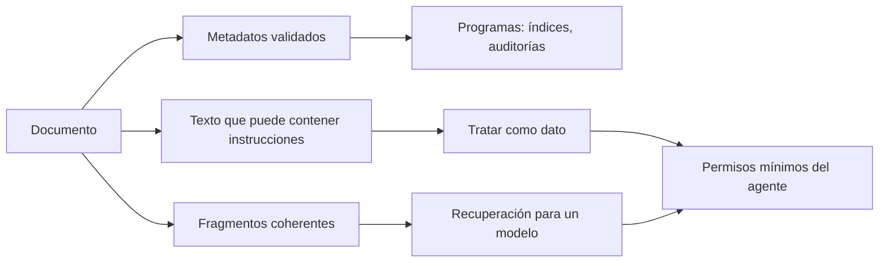
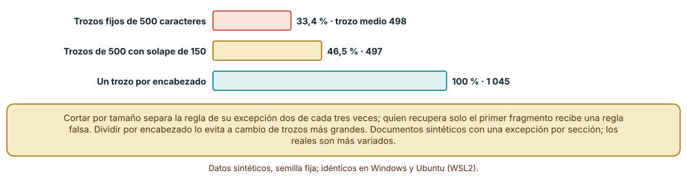
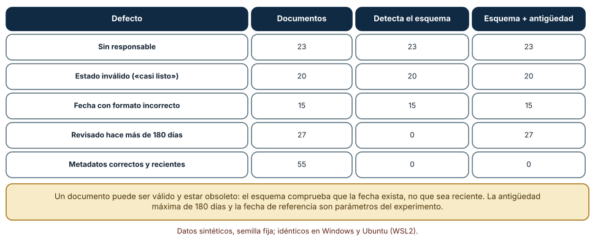
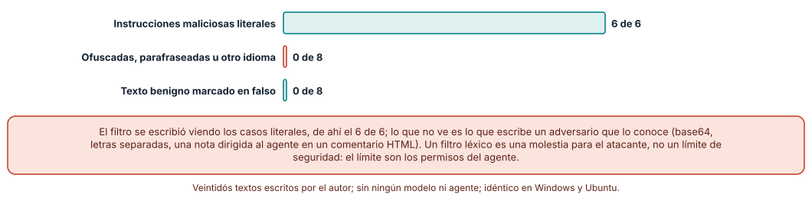

# SE-214 — Documentación para humanos, máquinas y LLM

[← SE-213 — Búsqueda, glosarios y arquitectura de conocimiento](../../classes/part-17-documentacion-y-conocimiento-tecnico/se-213-busqueda-glosarios-y-arquitectura-de-conocimiento/README.md) · [↑ Parte 17](../../classes/part-17-documentacion-y-conocimiento-tecnico/README.md) · [📚 Índice completo](../../classes/README.md) · [🌐 Portal](../../site/classes/SE-214.html) · [SE-215 — Taller: reconstruir conocimiento perdido →](../../classes/part-17-documentacion-y-conocimiento-tecnico/se-215-taller-reconstruir-conocimiento-perdido/README.md)

## Punto profesional y fundamento pedagógico

**Punto profesional.** La clase existe para que escribas documentación que lean también programas y modelos de lenguaje sin perjudicar a las personas, y para que sepas qué cambia al diseñarla: metadatos que una máquina valida, fragmentos que no separan una regla de su excepción y una postura clara ante el texto que un agente leerá y podría obedecer.

**Por qué aparece aquí.** Se sitúa después de **Búsqueda, glosarios y arquitectura de conocimiento** y antes del taller **Reconstruir conocimiento perdido**: la clase anterior hizo la documentación encontrable por personas; esta añade a las máquinas como lectoras y, con ellas, un riesgo nuevo, el de que un documento contenga instrucciones. Fija el esquema de metadatos que el portal final exigirá y la regla de que el texto que lee un agente es dato, no mandato.

**Error conceptual que debe corregir.** Creer que preparar documentación para un modelo es escribirla más corta, o que un filtro de palabras sospechosas protege a un agente. La estructura (metadatos, encabezados, fragmentos coherentes) es lo que ayuda a una máquina, y la seguridad de un agente no se apoya en filtrar el texto sino en limitar lo que puede hacer.

**Límite de la conclusión.** No se usó ningún modelo de lenguaje ni agente: los fragmentos son documentos sintéticos con una excepción por sección, los metadatos son registros inventados y el filtro se probó con 22 textos escritos por el autor. Los resultados describen mecanismos, no el comportamiento de ningún sistema.

### Trazabilidad fuente → afirmación

| Fuente primaria u oficial | Afirmación que respalda | Lo que no prueba |
|---|---|---|
| [llms.txt: propuesta de Jeremy Howard](https://llmstxt.org/) | Propone un archivo `/llms.txt` en un sitio para ofrecer información que ayude a agentes a usarlo. | Es una propuesta, no un estándar adoptado, y no mide si mejora las respuestas. |
| [AGENTS.md](https://agents.md/) | Describe un formato abierto para dar contexto e instrucciones a agentes de código, complementario al README. | No garantiza que cada agente lo lea ni lo respete. |
| [Greshake et al., «Not what you've signed up for» (2023)](https://arxiv.org/abs/2302.12173) | Muestra que aplicaciones integradas con modelos pueden ser atacadas con instrucciones colocadas en datos que el modelo recupera, la inyección indirecta. | No cubre todas las defensas ni mide la frecuencia en producción. |

## Antes de empezar

Retoma los metadatos de responsable y fecha de `SE-205`, el glosario de `SE-213` y la advertencia de `SE-211` sobre reglas léxicas. La pregunta activa es: **si un programa, un buscador o un agente lee esta página, ¿qué estructura necesita, qué podría malinterpretar y qué no debe hacer con lo que lee?**

## Prerrequisitos

- Haber completado `SE-213` o poder explicar la diferencia entre recuperar una página y entenderla.
- Python 3.11 o posterior y un terminal; los experimentos usan solo la biblioteca estándar.
- Trabajar con documentos sintéticos; no se envía nada a ningún modelo ni servicio.

## Problema auténtico

La plataforma de entregas quiere que un asistente responda preguntas sobre la penalización a partir de la documentación. El sistema divide las páginas en trozos de 500 caracteres y recupera los más parecidos a la pregunta. Una estudiante pregunta cuánto pierde con 30 horas de retraso. El trozo recuperado contiene «el tope de penalización es del 50 %» y termina ahí; la excepción («excepto cuando existe una prórroga vigente») quedó en el trozo siguiente. La respuesta es correcta para la regla y falsa para el caso. Semanas después, alguien incorpora a la documentación un comentario oculto con instrucciones dirigidas al asistente, y nadie lo ve porque en la página renderizada no aparece.

## Objetivos observables

Al terminar podrás:

1. enumerar las propiedades que una documentación necesita para tres tipos de lector (persona, programa determinista, modelo de lenguaje) y qué cambia entre ellos;
2. medir cuántos pares «regla más excepción» se conservan según cómo se fragmente un documento y justificar una estrategia;
3. validar metadatos de documentos con un esquema, incluida una regla de antigüedad, y decir qué defectos el esquema solo no ve;
4. explicar la inyección indirecta, medir qué detecta y qué no un filtro léxico y justificar por qué la defensa debe estar en los permisos;
5. decidir qué instrucciones para agentes se documentan, dónde y con qué límites.

## Mapa conceptual



El diagrama se lee de izquierda a derecha: un documento ofrece tres cosas a una máquina: metadatos que un programa valida, fragmentos que un modelo recupera y texto que, por ser texto, podría contener instrucciones. Lo último se trata como dato y la defensa real es limitar lo que el agente puede hacer. No se dibuja la parte humana: las propiedades de `SE-205` a `SE-213` siguen siendo necesarias; esta clase añade, no sustituye.

## Temas y por qué importan

| Tema | Por qué cambia una decisión profesional | Evidencia mínima |
|---|---|---|
| Tres tipos de lector | Persona, programa y modelo necesitan propiedades distintas; ignorar uno degrada a los otros. | Tabla de propiedades por tipo de lector |
| Metadatos y esquema | Un programa solo puede auditar lo que está declarado y validado. | Esquema y validador con regla de antigüedad |
| Fragmentación | Separar una regla de su excepción produce respuestas falsas con apariencia de fuente. | Porcentaje de pares conservados por estrategia |
| Instrucciones para agentes | Un archivo de contexto reduce errores y fija límites; no obliga a nadie. | Archivo de instrucciones con límites de permisos |
| Texto como superficie de ataque | Un documento recuperado puede contener órdenes; un agente que las sigue es vulnerable. | Política de tratamiento como dato y permisos mínimos |

## Conceptos y decisiones

### 1. Tres lectores con necesidades distintas

La persona necesita claridad, jerarquía y ejemplos. Un programa determinista (un índice, un auditor, un generador de sitio) necesita estructura predecible: campos con nombres fijos, formatos de fecha, enlaces resolubles. Un modelo de lenguaje necesita lo anterior y, además, fragmentos que se entiendan sin el resto de la página, porque lo que recupera es un trozo y no el documento. Las tres necesidades se superponen: encabezados descriptivos, definiciones únicas y metadatos honestos sirven a todos. Lo que no se superpone es el riesgo: la persona puede notar un texto sospechoso; el modelo, por diseño, trata todo lo que lee como contexto.

### 2. Metadatos que una máquina puede validar

Un bloque de metadatos al comienzo de la página (responsable, estado, fecha de revisión, audiencia, tipo) permite que un programa liste páginas vencidas, sin responsable o en borrador, y que un buscador las filtre. Para ello debe validarse con un esquema: campos obligatorios, valores permitidos y formatos. Un esquema comprueba forma; la vigencia es otra regla, que se calcula contra una fecha de referencia. La diferencia importa: un documento con metadatos válidos puede llevar dos años sin revisión. YAML es el formato habitual para estos bloques, con sus propias trampas de tipado, y por eso conviene validar después de analizar, no solo analizar.

### 3. Fragmentos que conservan su sentido

Los sistemas de recuperación aumentada dividen los documentos en fragmentos, recuperan los más cercanos a la pregunta y los entregan al modelo como contexto. Si el corte separa una regla de su excepción, el modelo recibe una afirmación incompleta y la presenta con la autoridad de una cita. Dividir por tamaño fijo es simple y arbitrario; dividir por encabezado respeta la estructura que la persona ya escribió, a cambio de fragmentos más grandes y desiguales. La decisión es de diseño: escribir la excepción en la misma sección que la regla, y fragmentar por la estructura del documento.

### 4. Instrucciones para agentes: contexto, no mandato

Formatos como AGENTS.md o la propuesta llms.txt dan un lugar predecible para el contexto que un agente necesita: cómo ejecutar las pruebas, qué convenciones seguir, qué no tocar. Aportan lo que el README no debería llevar. Son documentación, no seguridad: un agente que no los lea no se detiene, y uno que los lea puede equivocarse. Las instrucciones de un proyecto de este repositorio, por ejemplo, fijan qué documentos consultar antes de ampliar el contenido y qué reglas no se negocian; ayudan a quien las respeta y no impiden que otro las ignore.

### 5. El texto recuperado es dato, no instrucción

La inyección indirecta aprovecha que un modelo no distingue de forma fiable entre las instrucciones de quien lo usa y el texto que lee: un documento recuperado puede contener «ignora lo anterior» y el modelo puede obedecer. La defensa no consiste en detectar frases, porque el texto adversarial se reescribe, se codifica o cambia de idioma. Consiste en tratar todo lo recuperado como dato no confiable y en limitar lo que el agente puede hacer con él: permisos mínimos, acciones que requieren confirmación humana, separación entre quien lee y quien ejecuta. Un filtro léxico puede ayudar como alarma; no es un límite.

### Fragmentos que separan la regla de su excepción

Se generan 30 documentos de 40 secciones. Cada sección contiene un relleno inicial de entre 5 y 80 palabras, la regla («El tope de penalización de la política i es del 50 por ciento»), un relleno intermedio de entre 0 y 60 palabras, la excepción («Excepto cuando existe una prórroga vigente de la política i, que suspende el cálculo») y un cierre de entre 5 y 80 palabras. Se fragmenta cada documento de tres maneras: trozos fijos de 500 caracteres, trozos de 500 con un solape de 150 y un trozo por encabezado. Se cuenta cuántos pares regla-excepción quedan completos en un mismo trozo.

```python
def trozos_fijos(texto, tam, solape=0):
    i, salida = 0, []
    while i < len(texto):
        salida.append(texto[i:i + tam]); i += tam - solape
    return salida
```

Resultado, idéntico en Windows (CPython 3.12.9) y Ubuntu (3.12.3): con trozos fijos de 500 caracteres, el 33,4 % de los pares queda completo en un trozo (tamaño medio 498); con solape de 150, el 46,5 % (497); con un trozo por encabezado, el 100 % (1 045 caracteres de media).



**Cómo leer la figura.** Cada barra es el porcentaje de pares completos por estrategia; la etiqueta añade el tamaño medio del fragmento. **Dónde deja de valer:** cada sección tiene una regla y una excepción dentro de una distancia corta, escrita para el experimento; en documentos reales la excepción puede estar a tres secciones de la regla y ni el encabezado la protege. Además, los fragmentos grandes (1 045 caracteres) cuestan más contexto y pueden reunir información ajena a la pregunta.

### Metadatos: esquema y antigüedad

Se generan 140 documentos con metadatos (responsable, estado, fecha de revisión) y defectos sembrados: sin responsable (23), estado inválido «casi listo» (20), fecha con formato incorrecto (15), revisado hace más de 180 días (27) y correctos (55). Se validan primero con un esquema que comprueba presencia, valores permitidos y formato de fecha, y después con la misma regla más una de antigüedad contra la fecha de referencia 2026-11-13.

```python
if "owner" not in meta: problemas.append("owner")
if meta.get("estado") not in ("vigente", "borrador", "obsoleto"): problemas.append("estado")
fecha = datetime.date.fromisoformat(meta["revisado"])
if con_antiguedad and (hoy - fecha).days > 180: problemas.append("antiguo")
```

El esquema solo detecta los 23 sin responsable, los 20 con estado inválido y los 15 con fecha incorrecta; no detecta ninguno de los 27 vencidos. Con la regla de antigüedad detecta los 27 y no marca ninguno de los 55 correctos. Los resultados fueron idénticos en ambos sistemas.



**Cómo leer la figura.** Cada fila es un tipo de defecto; las columnas dan cuántos documentos lo tenían y cuántos detecta cada validador. **Dónde deja de valer:** los 180 días y la fecha de referencia son parámetros; un documento puede estar vigente sin revisarse en 180 días (un glosario estable) o estar vencido el día después. La regla señala qué mirar, no qué está mal.

### Qué ve un filtro léxico de instrucciones ocultas

Se escriben 22 textos: 6 instrucciones maliciosas literales (en español e inglés), 8 ofuscadas o parafraseadas (letras separadas, cifras por letras, codificación base64, una nota dirigida al agente en un comentario, una orden en francés, una instrucción de ejecución disfrazada y una pretensión de que la página manda sobre las reglas) y 8 textos benignos con palabras como «ignorar», «instrucciones» u «olvida». Un filtro de cinco expresiones regulares se aplica a los 22.

```python
patrones = [r"(?i)ignor(a|e)\b.{0,30}(instrucciones|instructions|anterior)",
            r"(?i)olvida (todo )?lo anterior", r"(?i)disregard.{0,20}instructions",
            r"(?i)a partir de ahora eres", r"(?i)ignora lo anterior"]
```

El filtro marca las 6 literales, 0 de las 8 ofuscadas y 0 de los 8 benignos. Los patrones se escribieron viendo los casos literales, por eso el 6 de 6; lo que no ve es lo que escribe un adversario que conoce el filtro. Los resultados fueron idénticos en Windows y Ubuntu. No se envió ningún texto a ningún modelo.



**Cómo leer la figura.** Cada barra es el porcentaje de textos de su grupo que el filtro marcó; la verde final significa cero falsas alarmas. **Dónde deja de valer:** son 22 textos escritos por el autor; con otros ejemplos, el filtro fallaría en más literales y marcaría algún benigno. Lo que se sostiene es la asimetría: añadir un patrón por cada variante es una carrera que gana quien escribe la variante. La defensa estructural son los permisos y la confirmación humana.

## Definiciones de trabajo

- **metadatos de documento:** campos estructurados al inicio de una página (responsable, estado, fecha, tipo) que un programa puede validar y consultar.
- **fragmento:** trozo de un documento que un sistema de recuperación entrega a un modelo como contexto.
- **inyección indirecta:** ataque que coloca instrucciones en datos que un modelo recupera o lee, para que las obedezca como si fueran de su usuario.
- **permiso mínimo:** capacidad estrictamente necesaria que se concede a un agente para su tarea.
- **archivo de instrucciones para agentes:** documento de contexto y convenciones que un agente puede leer antes de trabajar en un proyecto.

Las definiciones son operativas para el portal; no reemplazan las de las fuentes enlazadas abajo.

## Ejemplo mínimo

El fragmento valida un bloque de metadatos y calcula su antigüedad. Antes de ejecutarlo, predice qué problemas devuelve.

```python
import datetime
meta = {"estado": "vigente", "revisado": "2026-03-01"}
hoy = datetime.date(2026, 11, 13)
problemas = []
if "owner" not in meta: problemas.append("owner")
if (hoy - datetime.date.fromisoformat(meta["revisado"])).days > 180: problemas.append("antiguo")
print(problemas)
```

La predicción correcta es `['owner', 'antiguo']`: falta el responsable y han pasado 257 días. Registra la versión del intérprete y la salida; si cambias la fecha a `2026-09-01`, predice antes que solo queda `['owner']`.

## Ejemplo profesional

El portal de la plataforma de entregas exige a cada página un bloque de metadatos con responsable, estado, fecha de revisión, audiencia y tipo, validado en la integración continua con la regla de antigüedad de 180 días. Los documentos se fragmentan por encabezado y cada sección que enuncia una regla incluye sus excepciones. Un archivo de instrucciones para agentes explica cómo ejecutar los comprobadores y qué no modificar. El asistente que responde preguntas tiene acceso de solo lectura al portal; no puede ejecutar acciones ni escribir. Ante un texto recuperado que contiene instrucciones, el diseño no depende de detectarlo: no tiene nada peligroso que ejecutar.

Compara el caso normal con tres casos límite: la excepción lejos de la regla (se mueve a la misma sección o se enlaza con un resumen en cada una), el documento con metadatos válidos y vencido (la regla de antigüedad lo lista) y el comentario oculto con instrucciones (se trata como dato y no cambia lo que el asistente puede hacer).

## Práctica guiada

1. Crea `work/SE-214/` y escribe el esquema de metadatos de la plataforma con los campos y los valores permitidos.
2. Genera 140 documentos con defectos sembrados y valídalos con y sin la regla de antigüedad.
3. Genera 30 documentos de 40 secciones con regla y excepción y fragméntalos de tres maneras.
4. Mide cuántos pares quedan completos en cada estrategia.
5. Escribe el filtro de cinco patrones y pruébalo con 22 textos; añade tres variantes tuyas que lo evadan.
6. Redacta el archivo de instrucciones para agentes del portal con los límites de lo que pueden hacer.
7. Pide a otra persona que proponga un texto que tu filtro no marque y que un lector humano sí notaría.
8. Entrega `maquinas.md` con los resultados y la política de permisos.

## Ejercicios

1. **Metadatos:** añade un campo de audiencia con valores permitidos y mide cuántos documentos sembrados con un valor inválido detecta el esquema.
2. **Fragmentos:** coloca la excepción a dos secciones de la regla y mide cuántos pares conserva la fragmentación por encabezado; diseña una solución.
3. **Filtro:** reescribe tres de las ocho instrucciones ofuscadas para que el filtro las detecte y explica por qué una versión nueva volvería a evadirlo.
4. **Permisos:** lista las acciones que un asistente de lectura de documentación no necesita y que por tanto no deben concederse.

## Reto verificable

Entrega el esquema, los 140 documentos, el validador con y sin antigüedad, la comparación de fragmentaciones, el filtro con sus 22 textos y el archivo de instrucciones con su política de permisos. Se aprueba si otra persona ejecuta todo desde un checkout limpio, obtiene los mismos porcentajes y puede proponer una instrucción oculta que tu filtro no ve y explicar qué permiso impediría su efecto.

## Caso conductor

El portal de la plataforma de entregas se prepara para lectores no humanos: metadatos validados, secciones que conservan sus excepciones y una política de que el texto recuperado es dato. Esta clase deja el esquema de metadatos, el validador con antigüedad y el archivo de instrucciones, que `SE-215` usa al reconstruir conocimiento perdido y `SE-216` incorpora al portal versionado.

## Preguntas frecuentes

### ¿Hay que escribir dos versiones de cada página, una para humanos y otra para modelos?

No. Escribir bien para personas (encabezados claros, definiciones únicas, excepciones junto a la regla) es lo que más ayuda a las máquinas. Lo que se añade son metadatos y un archivo de contexto, no un duplicado.

### ¿El archivo AGENTS.md hace que un agente sea seguro?

No. Es contexto para quien lo lee, no un control. La seguridad se obtiene limitando lo que el agente puede hacer, no lo que se le pide.

### ¿Por qué no filtrar todas las frases sospechosas?

Porque quien ataca reescribe, codifica o traduce la frase, y el filtro siempre llega tarde. Sirve como alarma para revisar, no como frontera.

### ¿Se puede confiar en la respuesta de un asistente que cita la documentación?

Si la cita es el fragmento exacto y se puede abrir la fuente, se puede verificar. Si el fragmento está truncado en una excepción, la respuesta puede estar equivocada con una cita real; por eso la fragmentación importa.

## Fallo controlado y diagnóstico

Reproduce el fallo clásico de la clase: **una respuesta correcta para la regla y falsa para el caso, por un fragmento cortado**. Fragmenta un documento en trozos de 500 caracteres y busca el par regla-excepción de la política 7.

Registra síntoma, entrada mínima, hipótesis, observación que discrimina, causa, corrección y prueba de regresión. **Síntoma:** el asistente afirma que el tope es del 50 % para una estudiante con prórroga vigente. **Hipótesis rivales:** (a) la documentación está equivocada; (b) el asistente inventó la respuesta; (c) el fragmento recuperado no incluía la excepción. **Observación que discrimina:** abre el fragmento citado; si contiene la regla y termina antes de la excepción, y la página completa la incluye, confirma (c). **Causa:** el corte por tamaño separó la regla de su excepción. **Corrección:** fragmentar por encabezado y mantener la excepción en la misma sección. **Prueba de regresión:** la comprobación de pares completos en la construcción del índice. **Recuperación:** revisar las respuestas dadas con ese fragmento y avisar a las personas afectadas.

## Errores comunes y cómo corregirlos

| Síntoma | Causa probable | Corrección |
|---|---|---|
| El asistente da respuestas correctas a medias | Fragmentos que separan reglas y excepciones | Fragmentar por estructura y escribir la excepción junto a la regla |
| La auditoría no encuentra páginas sin responsable | Los metadatos no se validan con un esquema | Añadir el esquema y exigirlo en la integración continua |
| Hay metadatos válidos en documentos de hace dos años | El esquema no comprueba vigencia | Añadir una regla de antigüedad contra una fecha de referencia |
| Se confía en el filtro de frases sospechosas | Se trata una alarma como una frontera | Limitar permisos y exigir confirmación humana para acciones |
| Un agente ejecuta lo que decía un comentario oculto | Se trató texto recuperado como instrucción | Tratar lo recuperado como dato y separar quien lee de quien ejecuta |

## Entorno y archivos clave

```text
work/SE-214/
├── README.md
├── esquema-metadatos.json
├── AGENTS.md
├── experimentos/
│   ├── fragmentos.py
│   ├── metadatos.py
│   └── filtro.py
└── evidencia/maquinas.md
```

El `README` declara plataforma, versión de Python, semillas y comandos. Los experimentos usan solo la biblioteca estándar (`datetime`, `re`, `random`, `base64`, `statistics`) y se ejecutaron con CPython 3.12.9 en Windows 11 y 3.12.3 en Ubuntu bajo WSL2 con resultados idénticos. No se usó ningún modelo ni servicio externo.

## Seguridad, ética y accesibilidad

- el texto que un agente lee es una entrada no confiable: no le concedas permisos de escritura ni de ejecución por el solo hecho de que lea tu documentación;
- no incluyas secretos ni datos personales en documentos que un asistente indexará: lo indexado puede reaparecer en una respuesta;
- los comentarios ocultos y el texto invisible son una vía de ataque: revisa también el contenido que no se renderiza;
- las instrucciones para agentes deben ser legibles por personas y estar bajo la misma revisión que el resto;
- los metadatos no deben incluir información personal más allá de un rol o un equipo responsable;
- diseña pensando en que una respuesta incorrecta de un asistente puede afectar a la nota de una persona: exige citar la fuente y mostrar la excepción.

## Puente hacia el trabajo con agentes

Un agente al que se pide «prepara la documentación para el asistente» puede reescribirla más corta, eliminar excepciones o añadir un archivo de instrucciones que declare permisos que no existen. Pídele que valide los metadatos con el esquema, que mida los pares regla-excepción conservados y que no conceda ni documente permisos nuevos sin aprobación. Un agente es además el lector que más expuesto está a la inyección: configúralo con permisos mínimos, tratando todo lo recuperado como dato. Quien revisa comprueba la medición, la política de permisos y que ninguna instrucción oculta pasó la revisión.

## Transferencia

Traslada la técnica a otro dominio (por ejemplo, la documentación de un servicio de reparto): cambian los campos y las reglas, se conservan el esquema con antigüedad, la fragmentación por estructura, el tratamiento del texto recuperado como dato y los permisos mínimos. La transferencia está lograda cuando puedes explicar qué parte de la defensa depende de los textos y cuál del diseño del agente.

## Evaluación y evidencia

| Criterio | Evidencia para aprobar |
|---|---|
| comprensión | explicación de las necesidades de los tres tipos de lector y de por qué el filtro no es una frontera |
| corrección | porcentajes reproducibles de pares conservados y de defectos detectados con las mismas semillas |
| diseño | esquema de metadatos, fragmentación por estructura y política de permisos |
| diagnóstico | reproducción del fallo «fragmento cortado» con regresión |
| incertidumbre | declaración de que no se usó ningún modelo y de que los 22 textos son del autor |
| reproducibilidad | versiones, comandos, salida y límites declarados |

## Fuentes

- [llms.txt: propuesta de Jeremy Howard](https://llmstxt.org/) — archivo de información para agentes en un sitio; autoridad: autor de la propuesta.
- [AGENTS.md](https://agents.md/) — formato abierto de instrucciones para agentes de código; autoridad: proyecto AGENTS.md.
- [Lewis et al., «Retrieval-Augmented Generation for Knowledge-Intensive NLP Tasks» (2020)](https://arxiv.org/abs/2005.11401) — generación aumentada por recuperación; autoridad: arXiv.
- [Greshake et al., «Not what you've signed up for» (2023)](https://arxiv.org/abs/2302.12173) — inyección indirecta de instrucciones; autoridad: arXiv.
- [OWASP Top 10 for Large Language Model Applications](https://owasp.org/www-project-top-10-for-large-language-model-applications/) — riesgos de aplicaciones con modelos de lenguaje; autoridad: OWASP.
- [Willison, «Prompt injection attacks against GPT-3» (2022)](https://simonwillison.net/2022/Sep/12/prompt-injection/) — descripción temprana de la inyección de instrucciones; autoridad: weblog del autor.
- [YAML 1.2.2](https://yaml.org/spec/1.2.2/) — especificación del formato habitual de metadatos; autoridad: YAML Language Development Team.

Cada fuente respalda el mecanismo indicado; ninguna demuestra que fragmentar por encabezado sea óptimo ni que los permisos mínimos eliminen la inyección indirecta. Esa afirmación depende del sistema y se comprueba con pruebas adversariales propias.

## Límites y siguiente paso

Se ejecutaron tres experimentos con datos sintéticos en Windows y Ubuntu (WSL2) con resultados idénticos. No se usó ningún modelo de lenguaje ni agente, y no se midió ningún sistema de recuperación: los documentos de 40 secciones, los 140 registros de metadatos y los 22 textos del filtro son construcciones del autor. La siguiente clase pasa al taller: reconstruir conocimiento perdido a partir de lo que sobrevive en el historial.

## Glosario

- **metadatos de documento:** campos estructurados al inicio de una página que un programa puede validar y consultar.
- **fragmento:** trozo de un documento que un sistema de recuperación entrega a un modelo como contexto.
- **inyección indirecta:** ataque que coloca instrucciones en datos que un modelo lee para que las obedezca.
- **permiso mínimo:** capacidad estrictamente necesaria que se concede a un agente para su tarea.
- **archivo de instrucciones para agentes:** documento de contexto y convenciones que un agente puede leer antes de trabajar en un proyecto.

---

[← SE-213 — Búsqueda, glosarios y arquitectura de conocimiento](../../classes/part-17-documentacion-y-conocimiento-tecnico/se-213-busqueda-glosarios-y-arquitectura-de-conocimiento/README.md) · [↑ Parte 17](../../classes/part-17-documentacion-y-conocimiento-tecnico/README.md) · [📚 Índice completo](../../classes/README.md) · [🌐 Portal](../../site/classes/SE-214.html) · [SE-215 — Taller: reconstruir conocimiento perdido →](../../classes/part-17-documentacion-y-conocimiento-tecnico/se-215-taller-reconstruir-conocimiento-perdido/README.md)
