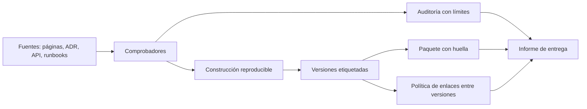
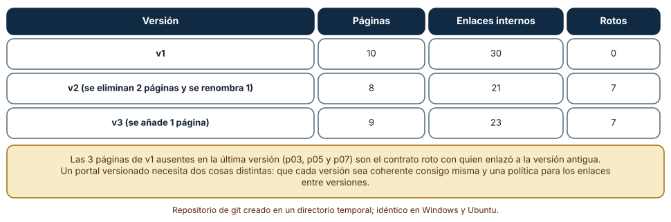
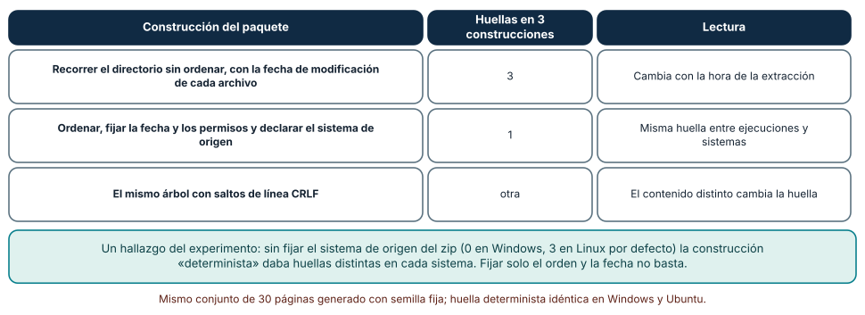
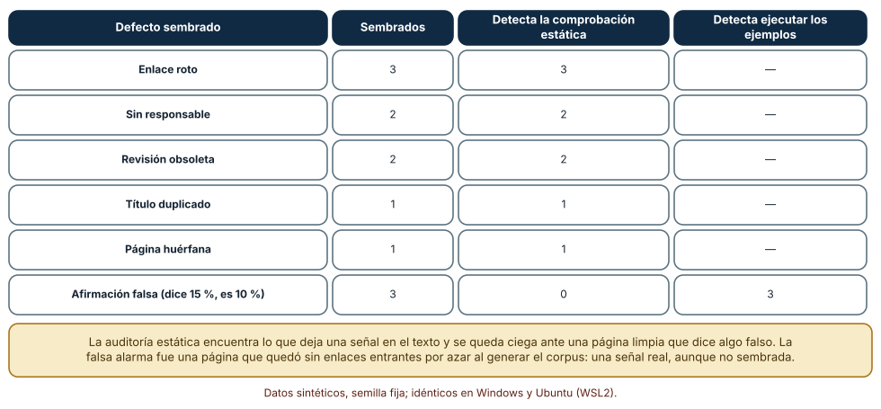

# SE-216 — Proyecto: portal documental versionado

[← SE-215 — Taller: reconstruir conocimiento perdido](../../classes/part-17-documentacion-y-conocimiento-tecnico/se-215-taller-reconstruir-conocimiento-perdido/README.md) · [↑ Parte 17](../../classes/part-17-documentacion-y-conocimiento-tecnico/README.md) · [📚 Índice completo](../../classes/README.md) · [🌐 Portal](../../site/classes/SE-216.html) · [SE-217 — Diseño de interfaces de línea de comandos →](../../classes/part-18-cli-tui-servicios-y-automatizacion/se-217-diseno-de-interfaces-de-linea-de-comandos/README.md)

## Punto profesional y fundamento pedagógico

**Punto profesional.** El proyecto existe para entregar un portal documental que otra persona pueda mantener sin ti: páginas con dueño y tipo, decisiones registradas, una API con ejemplos que se ejecutan, runbooks seguros de repetir, un glosario, comprobaciones automáticas, versiones coherentes consigo mismas y un paquete cuya huella se reproduce en dos sistemas, junto con un informe que dice qué se comprobó y qué no.

**Por qué aparece aquí.** Cierra la **Parte 17** después de **Taller: reconstruir conocimiento perdido**: las once clases anteriores produjeron piezas y comprobadores, y esta los reúne en una sola entrega con la trazabilidad que ninguna aislaba. Deja la base que la Parte 18 usará al construir interfaces de línea de comandos, cuyas opciones, ayudas y ejemplos serán la documentación de otro tipo de contrato.

**Error conceptual que debe corregir.** Creer que un portal con muchas páginas y todos los comprobadores en verde está terminado. Las comprobaciones mecánicas detectan lo que deja una señal en el texto y no ven una página limpia que dice algo falso; y las versiones solo son coherentes si alguien decide qué pasa con los enlaces entre ellas.

**Límite de la conclusión.** Los tres experimentos usan un portal de diez páginas, un repositorio de Git de juguete, un paquete zip de 30 páginas y una auditoría de 40 páginas con 12 defectos sembrados. No se publicó ningún sitio real ni se midió a ningún lector; los defectos sembrados son los que los comprobadores buscan.

### Trazabilidad fuente → afirmación

| Fuente primaria u oficial | Afirmación que respalda | Lo que no prueba |
|---|---|---|
| [Semantic Versioning 2.0.0](https://semver.org/) | Define una convención de números de versión (mayor, menor, parche) que comunica la compatibilidad de los cambios. | Se refiere a software; aplicarla a documentación es una decisión de cada proyecto. |
| [Read the Docs: versiones](https://docs.readthedocs.com/platform/stable/versions.html) | Documenta cómo una plataforma de documentación publica varias versiones, con una predeterminada y otras accesibles. | No dice qué hacer con los enlaces entre versiones. |
| [Reproducible Builds: documentación](https://reproducible-builds.org/docs/) | Describe por qué una construcción debe dar el mismo resultado y las causas habituales de variación. | No garantiza que tu paquete sea reproducible. |

## Antes de empezar

Retoma todo lo construido en la parte: audiencias y fuente única (`SE-205`), tipos de página (`SE-206`), README con primer éxito (`SE-207`), ADR (`SE-208`), diagramas generados (`SE-209`), API con ejemplos (`SE-210`), runbooks (`SE-211`), canalización (`SE-212`), glosario y alcance (`SE-213`), metadatos para máquinas (`SE-214`) y reconstrucción (`SE-215`). La pregunta activa es: **si entrego este portal mañana a otro equipo, ¿qué versión leen, qué pueden comprobar sin mí y qué no puedo prometerles?**

## Prerrequisitos

- Haber completado `SE-215` o poder explicar qué responde el historial y qué no.
- Python 3.11 o posterior, Git instalado y un terminal.
- Trabajar con un portal sintético de diez páginas y un repositorio creado por los experimentos; no se publica nada.

## Problema auténtico

La plataforma de entregas publica la versión 1 de su documentación. Meses después, la versión 2 elimina dos páginas y renombra una; las páginas de la versión 1 siguen enlazando a las antiguas, y siete enlaces de la nueva versión apuntan a páginas que ya no existen. Quien llegó desde un enlace de la versión anterior no puede saber si la regla que lee sigue vigente. Al preparar la entrega del portal a otro equipo, descubren que el paquete zip que adjuntan cambia de huella cada vez que se construye, y que la auditoría que dice «todo en verde» no ve que una página afirma un tope del 15 % cuando la política dice 10 %.

## Objetivos observables

Al terminar podrás:

1. construir varias versiones de un portal desde etiquetas de Git, medir sus enlaces rotos y decidir qué política aplicar a las páginas retiradas y renombradas;
2. empaquetar un portal de forma reproducible, con la misma huella en dos sistemas, e identificar las fuentes de variación que quedan;
3. integrar los comprobadores de la parte en una auditoría que informe de qué detectó, qué no puede detectar y qué falsas alarmas dio;
4. definir indicadores de salud del portal (enlaces rotos, vencidas, huérfanas, consultas sin resultado) con un responsable de cada uno;
5. entregar el portal con un informe que separe lo comprobado, lo inferido y lo no ejecutado.

## Mapa conceptual



El diagrama se lee de izquierda a derecha: las fuentes pasan por los comprobadores y se construyen de forma reproducible; las versiones se etiquetan; el paquete lleva huella; la auditoría informa de sus límites; la política de enlaces entre versiones completa el cuadro; todo desemboca en el informe de entrega. No es un proceso obligatorio y no incluye la publicación a un servidor, que depende de la plataforma elegida.

## Temas y por qué importan

| Tema | Por qué cambia una decisión profesional | Evidencia mínima |
|---|---|---|
| Portal como producto | Tiene audiencias, tareas, dueños y un ciclo de vida, no solo páginas. | Inventario de páginas con dueño, tipo y fecha |
| Versionado | Cada versión debe ser coherente consigo misma y declarar qué pasa con los enlaces entre versiones. | Enlaces rotos por versión y política de páginas retiradas |
| Paquete reproducible | La huella permite saber que lo entregado es lo revisado. | Misma huella en dos sistemas |
| Auditoría con límites | Una auditoría en verde no es un portal correcto; debe decir qué no ve. | Informe con detectados, no detectables y falsas alarmas |
| Salud y gobierno | Sin indicadores y responsables, el portal se degrada sin que nadie lo vea. | Indicadores con dueño y umbral |

## Conceptos y decisiones

### 1. El portal como producto

Un portal documental no es un directorio de archivos: tiene audiencias que lo usan para cumplir tareas, tipos de página que se escriben de formas distintas, decisiones registradas, un glosario, una API documentada, procedimientos operativos y comprobaciones. Cada pieza tiene un dueño y una fecha. Tratarlo como producto significa decidir qué entra y qué no, quién lo mantiene, cómo se mide su salud y qué se promete. La entrega del proyecto es el portal junto con el informe que dice en qué estado está.

### 2. Versiones coherentes y política de enlaces

Publicar versiones de la documentación sirve a quien usa una versión antigua del producto. Cada versión debe ser coherente consigo misma: sus enlaces internos apuntan a páginas de la misma versión. Los problemas aparecen entre versiones: una página eliminada, una renombrada, un enlace externo que apunta a «la última». La decisión es de política: qué versión es la predeterminada, qué se hace con una página retirada (redirección a su sucesora, aviso de retirada, error explícito) y cómo se informa de los cambios (un registro de cambios con enlace). Una convención de números de versión como SemVer puede comunicar si un cambio de la documentación es compatible, aunque aplicarla a documentación sea una elección.

### 3. Paquete reproducible y huella

Un paquete es el conjunto de archivos que se entrega o publica. Su huella es un resumen criptográfico de sus bytes. Si el paquete incluye fechas de modificación, depende del orden en que el sistema de archivos lista los archivos o lleva campos que cambian con el sistema operativo, su huella varía aunque el contenido no. Fijar el orden, las fechas y los atributos hace que dos construcciones del mismo árbol produzcan el mismo paquete. El contenido también cuenta: un árbol con saltos de línea CRLF no es el mismo árbol que con LF, y la huella lo muestra. Esto es lo que permite decir «este es el paquete que se revisó».

### 4. Auditoría con límites declarados

La auditoría reúne los comprobadores de la parte: enlaces, responsables, vigencia, títulos duplicados, páginas huérfanas, ejemplos ejecutados. Su informe es útil en la medida en que dice lo que no puede ver. Una página que afirma un tope del 15 % cuando la política dice 10 % no tiene ninguna señal en el texto: se detecta ejecutando los ejemplos contra el comportamiento real o comparando valores con la fuente única. La auditoría que declara «sin hallazgos» sin explicar su alcance transmite una seguridad que no tiene. Y las falsas alarmas se declaran también: una señal real que no era un defecto sembrado sigue siendo información.

### 5. Salud, dueños y ciclo de vida

Un portal sano se mide con pocos indicadores: enlaces rotos, páginas vencidas, páginas huérfanas, consultas sin resultado y ejemplos que fallan. Cada uno necesita un dueño y un umbral que dispare una acción. Sin ellos, los comprobadores producen informes que nadie lee. El ciclo de vida incluye cuándo se retira una página, quién decide y cómo se avisa; y el taller anterior enseñó el coste de no haberlo decidido a tiempo. El proyecto cierra la parte con esta idea: la documentación es un sistema que se opera, no un artefacto que se entrega.

### Versiones de un portal construidas desde etiquetas de Git

Se crea un repositorio de Git en un directorio temporal con tres etiquetas. La versión 1 tiene 10 páginas (`p00`–`p09`), cada una con tres enlaces a otras; la versión 2 elimina `p03` y `p07` y renombra `p05` a `p05b` sin actualizar los enlaces de las demás; la versión 3 añade `p10`. Para cada etiqueta se leen sus páginas con `git ls-tree` y `git show`, se extraen los enlaces internos y se cuentan los que apuntan a una página que no existe en esa misma versión.

```python
for etiqueta in ("v1", "v2", "v3"):
    archivos = {f: git("show", f"{etiqueta}:{f}") for f in git("ls-tree", "-r", "--name-only", etiqueta).split()}
    rotos = sum(1 for texto in archivos.values()
                for m in re.finditer(r"\]\(([^)]+)\)", texto) if m.group(1) not in archivos)
```

Resultado, idéntico en Windows (git 2.55, CPython 3.12.9) y Ubuntu (git 2.43, CPython 3.12.3): la versión 1 tiene 10 páginas, 30 enlaces y 0 rotos; la versión 2 tiene 8 páginas, 21 enlaces y 7 rotos; la versión 3 tiene 9 páginas, 23 enlaces y 7 rotos. Tres páginas de la versión 1 (`p03`, `p05` y `p07`) no existen en la última versión.



**Cómo leer la figura.** Cada fila es una versión etiquetada; las columnas dan sus páginas, sus enlaces internos y cuántos apuntan a una página inexistente en esa versión. **Dónde deja de valer:** cada versión se evalúa contra sí misma; los enlaces entre versiones (un enlace de la versión 1 hacia «la última») no se midieron, y son los que más importan a quien llegó desde un enlace antiguo. Los 7 enlaces rotos de la versión 2 se arrastran a la 3 porque nadie los corrigió: una versión nueva no limpia lo que la anterior dejó.

### Un paquete que da la misma huella en dos sistemas

Se genera un árbol de 30 páginas con contenido determinista y se construye un archivo zip de dos maneras. La construcción ingenua recorre el directorio con `os.walk`, escribe cada archivo con su fecha de modificación y deja los atributos por defecto. La determinista ordena los archivos, fija la fecha en 2026-01-01, fija los permisos y fija también el campo de sistema de origen. Cada construcción se repite tres veces, cambiando entre ellas las fechas de los archivos.

```python
zi = zipfile.ZipInfo(rel, date_time=(2026, 1, 1, 0, 0, 0))
zi.external_attr = 0o644 << 16
zi.create_system = 3                     # sin esto, 0 en Windows y 3 en Linux
zi.compress_type = zipfile.ZIP_DEFLATED
z.writestr(zi, p.read_bytes())
```

La construcción ingenua produce 3 huellas distintas en 3 construcciones; la determinista, una sola, y es la misma en Windows y Ubuntu. Sin fijar `create_system`, la construcción «determinista» daba huellas distintas en cada sistema: el valor por defecto de ese campo es 0 en Windows y 3 en Linux. Con saltos de línea CRLF en el contenido, la huella cambia respecto de la de LF.



**Cómo leer la figura.** Cada fila es una forma de construir el paquete; la segunda columna da cuántas huellas distintas salen en tres construcciones y la tercera su lectura. **Dónde deja de valer:** el árbol tiene solo archivos de texto de contenido fijo; un paquete real incluye imágenes, versiones de herramientas que escriben metadatos y rutas absolutas incrustadas. Fijar orden, fecha, permisos y sistema de origen es necesario y, como muestra el hallazgo, no se sabe si es suficiente hasta compararlo en el otro sistema.

### Una auditoría con límites: qué ve y qué no

Se genera un portal de 40 páginas con metadatos (responsable, fecha de revisión, título, enlaces, y un valor de porcentaje de penalización que debe ser 10) y se siembran 12 defectos: 3 enlaces rotos, 2 páginas sin responsable, 2 con revisión vencida (400 días), 1 título duplicado, 1 página huérfana y 3 afirmaciones falsas (la página dice 15 %). La auditoría ejecuta primero los comprobadores estáticos (enlaces, responsable, vigencia, títulos, huérfanas) y después una comprobación que compara cada afirmación con la política.

```python
if any(l not in docs for l in dd["links"]): hallazgos[i].append("enlace_roto")
if "owner" not in dd:                       hallazgos[i].append("sin_owner")
if (hoy - date.fromisoformat(dd["revisado"])).days > 180: hallazgos[i].append("obsoleto")
...
if dd["porcentaje"] != 10:                  ejecutado[i].append("afirmacion_falsa")
```

Las comprobaciones estáticas detectan 9 de los 12 defectos (los 3 enlaces rotos, los 2 sin responsable, las 2 revisiones vencidas, el título duplicado y la huérfana) y ninguna de las 3 afirmaciones falsas. La comparación con la política detecta las 3. Hubo una falsa alarma: una página sin enlaces entrantes por azar al generar el corpus, que no se sembró, y que era un hallazgo real. Los resultados fueron idénticos en Windows y Ubuntu.



**Cómo leer la figura.** Cada fila es un tipo de defecto; las columnas dan cuántos se sembraron, cuántos detecta la comprobación estática y cuántos detecta la comparación con la política. **Dónde deja de valer:** los defectos se sembraron como exactamente los que los comprobadores buscan, por eso la detección es total; en un portal real aparecerían defectos que ningún comprobador contempla. El 0 de las afirmaciones falsas ante lo estático es el límite verdadero.

## Definiciones de trabajo

- **portal documental:** conjunto de páginas, decisiones, referencias y procedimientos con dueños, tipos y comprobaciones, publicado para varias audiencias.
- **versión etiquetada:** estado de la documentación fijado con una etiqueta de control de versiones, que se publica como un conjunto coherente.
- **política de enlaces entre versiones:** regla que dice qué ocurre cuando una página se retira, se renombra o cambia entre versiones.
- **paquete reproducible:** archivo entregable que produce la misma huella cuando se construye dos veces a partir de las mismas fuentes.
- **informe de entrega:** documento que dice qué se comprobó, qué no puede comprobarse y qué quedó pendiente.

Las definiciones son operativas para el portal; no reemplazan las de las fuentes enlazadas abajo.

## Ejemplo mínimo

El fragmento calcula la huella de un archivo zip construido de forma determinista. Antes de ejecutarlo, predice si dos construcciones consecutivas dan la misma huella.

```python
import hashlib, io, zipfile

def construir(archivos):
    buf = io.BytesIO()
    with zipfile.ZipFile(buf, "w", zipfile.ZIP_DEFLATED) as z:
        for nombre in sorted(archivos):
            zi = zipfile.ZipInfo(nombre, date_time=(2026, 1, 1, 0, 0, 0))
            zi.external_attr = 0o644 << 16
            zi.create_system = 3
            z.writestr(zi, archivos[nombre])
    return hashlib.sha256(buf.getvalue()).hexdigest()[:12]

a = {"b.md": b"# B\n", "a.md": b"# A\n"}
print(construir(a) == construir(dict(reversed(list(a.items())))))
```

La predicción correcta es `True`: el orden de entrada del diccionario no importa porque se ordena. Registra la versión del intérprete y la salida; si quitas `sorted`, predice antes qué ocurre.

## Ejemplo profesional

El portal de la plataforma de entregas se entrega con un repositorio con tres etiquetas (`v1`, `v2`, `v3`), una política de páginas retiradas (cada página retirada deja una página mínima con el aviso y el enlace a su sucesora durante dos versiones), un paquete zip determinista cuya huella se publica con el informe, y una auditoría que ejecuta los comprobadores de la parte y los ejemplos de la API contra el servicio de pruebas. El informe de entrega tiene tres secciones: lo comprobado (con la salida de cada comprobador), lo inferido (la validez de la regla de ancla del sitio publicado) y lo no ejecutado (la publicación real y la experiencia de quienes lo leen).

Compara el caso normal con tres casos límite: la página renombrada con enlaces externos (se deja una redirección o página-aviso), la versión nueva que hereda enlaces rotos (la auditoría los lista y bloquea la etiqueta) y el paquete construido en otro sistema (se compara la huella antes de entregarlo).

## Práctica guiada

1. Crea `work/SE-216/` y reúne las piezas de la parte (README, ADR, diagramas, API, runbooks, glosario) en un portal de al menos diez páginas con metadatos.
2. Crea el repositorio con tres etiquetas y haz los cambios de la versión 2 (dos retiradas y una renombrada).
3. Escribe el lector de versiones y cuenta los enlaces internos rotos de cada una.
4. Define y aplica la política para las páginas retiradas y vuelve a contar.
5. Escribe el constructor de paquete determinista y compara su huella en Windows y en Ubuntu.
6. Escribe la auditoría que reúne los comprobadores y añade la comparación de afirmaciones con la política.
7. Siembra 12 defectos y registra cuáles detecta cada capa, cuáles no y qué falsas alarmas da.
8. Redacta el informe de entrega con tres secciones: comprobado, inferido y no ejecutado.

## Ejercicios

1. **Política:** compara tres políticas para páginas retiradas (redirección, página-aviso, error) en términos de enlaces rotos, esfuerzo de mantenimiento y claridad para el lector.
2. **Enlaces entre versiones:** añade a la medición los enlaces de la versión 1 hacia «la última» y cuenta cuántos fallan en la versión 3.
3. **Huella:** añade al paquete un archivo con la fecha de construcción y explica qué estrategia mantiene la reproducibilidad.
4. **Auditoría:** añade un decimotercer defecto que ningún comprobador contemple y explica cómo lo detectarías.

## Reto verificable

Entrega el portal con tres etiquetas, el lector de versiones, la política de páginas retiradas, el constructor determinista con su huella en dos sistemas, la auditoría con los 12 defectos sembrados y el informe de entrega. Se aprueba si otra persona ejecuta todo desde un checkout limpio, obtiene los mismos recuentos y la misma huella, y puede nombrar un defecto del portal que tu auditoría no detectaría.

## Caso conductor

Esta clase cierra el caso conductor de la Parte 17: el portal documental de la plataforma de entregas, con todas las piezas de las clases anteriores reunidas, versionadas y auditadas. Entrega a la Parte 18 una lección concreta: las opciones, las ayudas y los ejemplos de una interfaz de línea de comandos son documentación que se comprueba con las mismas técnicas.

## Preguntas frecuentes

### ¿Hay que versionar la documentación de cada versión del producto?

Si hay usuarios en versiones antiguas del producto, sí; si solo existe la última, una sola versión y un registro de cambios bastan. Versionar tiene un coste de mantenimiento (corregir una errata en varias versiones) que solo se justifica con lectores que lo necesitan.

### ¿Qué pasa con los enlaces externos a una página que retiré?

Son contrato implícito. Deja una página mínima con aviso y enlace a la sucesora, o una redirección, durante un plazo declarado. Borrarla sin más rompe a quienes no controlas.

### ¿La huella demuestra que el portal es correcto?

No: demuestra que el paquete entregado es el construido a partir de lo revisado. La corrección depende de la revisión y de los comprobadores, y de sus límites declarados.

### ¿Cuántos indicadores de salud son suficientes?

Los que tengan dueño y umbral de acción. Cinco indicadores vigilados valen más que veinte que nadie mira.

## Fallo controlado y diagnóstico

Reproduce el fallo clásico de la clase: **una versión nueva que hereda enlaces rotos y un paquete que no se puede verificar**. Construye la versión 2 sin actualizar los enlaces y construye dos veces el paquete ingenuo.

Registra síntoma, entrada mínima, hipótesis, observación que discrimina, causa, corrección y prueba de regresión. **Síntoma:** quien sigue un enlace de la página principal de la versión 2 obtiene un error, y dos construcciones del mismo árbol tienen huellas distintas. **Hipótesis rivales:** (a) el servidor de publicación falló; (b) el contenido cambió entre construcciones; (c) la construcción no es determinista y la versión nueva heredó enlaces. **Observación que discrimina:** ejecuta el lector de versiones sobre `v2` y compara el recuento de rotos con el de `v1`; compara el contenido de los dos paquetes archivo por archivo, y si es igual y la huella distinta, descarta (b). **Causa:** los enlaces no se actualizaron al retirar y renombrar páginas, y la construcción incluía fechas y orden de directorio. **Corrección:** aplicar la política de páginas retiradas y construir de forma determinista. **Prueba de regresión:** la auditoría bloquea la etiqueta con enlaces rotos y compara la huella de dos construcciones. **Recuperación:** publicar la corrección como parche de la versión y avisar a quien descargó el paquete anterior.

## Errores comunes y cómo corregirlos

| Síntoma | Causa probable | Corrección |
|---|---|---|
| Una versión nueva tiene enlaces rotos que ya tenía la anterior | Nadie los corrigió al etiquetar | Bloquear la etiqueta con la auditoría de enlaces |
| Las huellas del paquete difieren entre Windows y Linux | Campos de sistema de origen, orden o saltos de línea | Fijar orden, fecha, permisos y sistema de origen, y normalizar los saltos de línea |
| La auditoría dice «sin hallazgos» y hay una afirmación falsa | Solo hay comprobadores estáticos | Ejecutar los ejemplos y comparar valores con la política |
| Una página retirada rompe enlaces externos | No hay política de retirada | Dejar una página-aviso o redirección durante un plazo |
| El portal se degrada tras la entrega | Los indicadores no tienen dueño | Asignar responsable y umbral de acción a cada indicador |

## Entorno y archivos clave

```text
work/SE-216/
├── README.md
├── portal/
│   ├── paginas/
│   ├── decisiones/
│   ├── api/
│   ├── runbooks/
│   └── glosario.json
├── experimentos/
│   ├── versiones.py
│   ├── paquete.py
│   └── auditoria.py
├── politica-de-retirada.md
└── evidencia/informe-de-entrega.md
```

El `README` declara plataforma, versiones de Python y de Git, semillas y comandos. Los experimentos usan la biblioteca estándar y Git y se ejecutaron con CPython 3.12.9 y Git 2.55 en Windows 11, y con CPython 3.12.3 y Git 2.43 en Ubuntu bajo WSL2, con resultados idénticos. El repositorio y el árbol se crean en directorios temporales con autores inventados y se eliminan al terminar.

## Seguridad, ética y accesibilidad

- un portal reúne documentación de decisiones, operación y API: revisa antes de publicar que no incluye secretos, direcciones internas ni datos personales;
- el paquete entregado debe indicar su huella y cómo verificarla, para que quien lo reciba pueda comprobar su integridad;
- las páginas-aviso de retirada deben ser accesibles: encabezados, enlace descriptivo a la sucesora y texto claro;
- no ocultes el estado de la documentación: el informe de entrega debe decir qué no se comprobó;
- respeta las licencias de todo el contenido que incorpores y atribúyelas en el portal;
- define quién puede publicar y cómo se revierte una versión.

## Puente hacia el trabajo con agentes

Un agente al que se pide «entrega el portal» producirá un paquete y un informe optimista. Pídele que ejecute cada comprobador y adjunte su salida, que declare qué defectos no puede detectar, que construya el paquete dos veces y compare las huellas, y que no cambie reglas de los comprobadores para hacerlos pasar. Un agente puede mantener el portal entre entregas (renovar fechas de revisión, corregir enlaces), siempre con permisos mínimos y con cada cambio revisado por una persona. Quien revisa comprueba la salida real de los comprobadores, la huella y las secciones «inferido» y «no ejecutado» del informe.

## Transferencia

Traslada el proyecto a otro dominio (por ejemplo, el portal documental de un servicio de reparto): cambian las páginas y los valores a verificar, se conservan el versionado desde etiquetas, la política de retirada, el paquete determinista, la auditoría con límites declarados y los indicadores con dueño. La transferencia está lograda cuando puedes explicar qué parte del portal depende de la plataforma y cuál es estructura reutilizable.

## Evaluación y evidencia

| Criterio | Evidencia para aprobar |
|---|---|
| comprensión | explicación de la diferencia entre coherencia de una versión y política entre versiones, y de qué demuestra una huella |
| corrección | recuentos de enlaces rotos, huellas y hallazgos reproducibles con las mismas semillas |
| diseño | portal con dueños y tipos, política de retirada, paquete determinista y auditoría integrada |
| diagnóstico | reproducción del fallo «versión que hereda enlaces rotos» y «paquete no verificable» con regresión |
| incertidumbre | informe con tres secciones (comprobado, inferido, no ejecutado) y defectos no detectables nombrados |
| reproducibilidad | versiones de Python y de Git, comandos, huella en dos sistemas y límites declarados |

## Fuentes

- [Semantic Versioning 2.0.0](https://semver.org/) — convención de versiones; autoridad: especificación SemVer.
- [Read the Docs: versiones](https://docs.readthedocs.com/platform/stable/versions.html) — publicación de varias versiones de documentación; autoridad: Read the Docs.
- [mike: versionado de documentación con MkDocs](https://github.com/jimporter/mike) — herramienta de ejemplo de versiones desde Git; autoridad: proyecto mike.
- [Keep a Changelog](https://keepachangelog.com/) — convención de registro de cambios; autoridad: proyecto Keep a Changelog.
- [GitHub Pages: documentación](https://docs.github.com/en/pages) — publicación de sitios estáticos desde un repositorio; autoridad: GitHub Docs.
- [Reproducible Builds: documentación](https://reproducible-builds.org/docs/) — construcciones reproducibles; autoridad: proyecto Reproducible Builds.
- [Python: `zipfile`](https://docs.python.org/3/library/zipfile.html) — `ZipInfo` y campos de los archivos zip; autoridad: documentación de Python.

Cada fuente respalda el mecanismo indicado; ninguna demuestra que la política de páginas retiradas del proyecto sea la mejor ni que la huella determinista cubra todas las fuentes de variación de un paquete real. Esa afirmación depende de la plataforma y se comprueba construyendo en los sistemas que importan.

## Límites y siguiente paso

Se ejecutaron tres experimentos con datos sintéticos en Windows y Ubuntu (WSL2) con resultados idénticos. No se publicó ningún sitio real ni se midió a ningún lector: el portal de diez páginas, el árbol de 30 páginas y los 12 defectos sembrados son construcciones del autor, y los enlaces entre versiones no se midieron. La siguiente parte pasa de la documentación a las interfaces de línea de comandos, cuyo diseño es otra forma de contrato con quien las usa.

## Glosario

- **portal documental:** conjunto de páginas, decisiones, referencias y procedimientos con dueños, tipos y comprobaciones.
- **versión etiquetada:** estado de la documentación fijado con una etiqueta de control de versiones.
- **política de enlaces entre versiones:** regla que dice qué ocurre cuando una página se retira, se renombra o cambia entre versiones.
- **paquete reproducible:** archivo entregable que produce la misma huella al construirse dos veces desde las mismas fuentes.
- **informe de entrega:** documento que dice qué se comprobó, qué no puede comprobarse y qué quedó pendiente.

---

[← SE-215 — Taller: reconstruir conocimiento perdido](../../classes/part-17-documentacion-y-conocimiento-tecnico/se-215-taller-reconstruir-conocimiento-perdido/README.md) · [↑ Parte 17](../../classes/part-17-documentacion-y-conocimiento-tecnico/README.md) · [📚 Índice completo](../../classes/README.md) · [🌐 Portal](../../site/classes/SE-216.html) · [SE-217 — Diseño de interfaces de línea de comandos →](../../classes/part-18-cli-tui-servicios-y-automatizacion/se-217-diseno-de-interfaces-de-linea-de-comandos/README.md)
