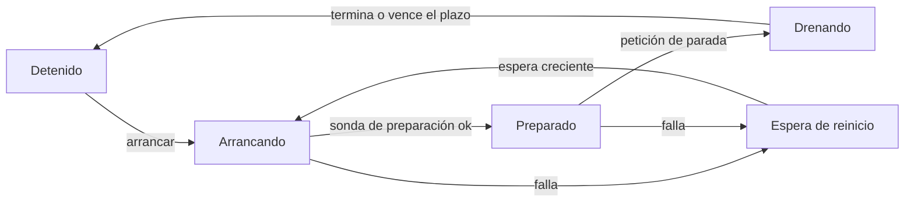
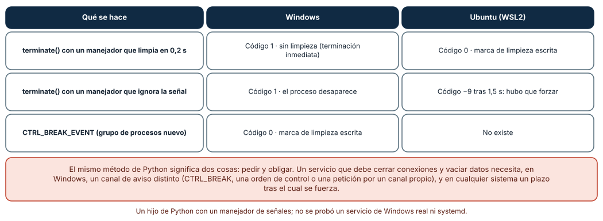
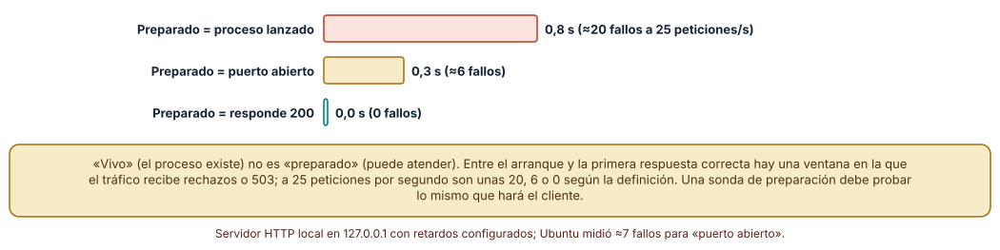
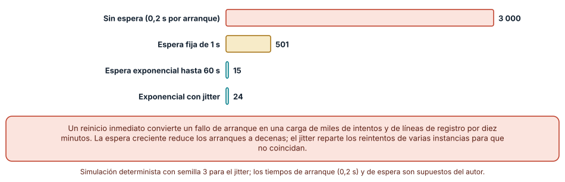

# SE-222 — Daemons, servicios y ciclo de vida

[← SE-221 — TUI, terminales y accesibilidad](../../classes/part-18-cli-tui-servicios-y-automatizacion/se-221-tui-terminales-y-accesibilidad/README.md) · [↑ Parte 18](../../classes/part-18-cli-tui-servicios-y-automatizacion/README.md) · [📚 Índice completo](../../classes/README.md) · [🌐 Portal](../../site/classes/SE-222.html) · [SE-223 — Schedulers, workers y trabajos por lotes →](../../classes/part-18-cli-tui-servicios-y-automatizacion/se-223-schedulers-workers-y-trabajos-por-lotes/README.md)

## Punto profesional y fundamento pedagógico

**Punto profesional.** La clase existe para diseñar un proceso que vive mucho tiempo —un servicio o daemon— con un ciclo de vida explícito: cómo arranca, cuándo está preparado, cómo se le pide que termine, qué hace al recibir esa petición y cómo se reinicia sin convertir un fallo de arranque en una avalancha.

**Por qué aparece aquí.** Se sitúa después de **TUI, terminales y accesibilidad** (`SE-221`) y antes de **Schedulers, workers y trabajos por lotes** (`SE-223`): hasta aquí `notas` era un proceso que arranca, hace algo y termina; ahora es un servicio que acepta peticiones durante horas. Deja una definición de «preparado», una política de terminación y una de reinicio que `SE-223` y `SE-224` darán por supuestas.

**Error conceptual que debe corregir.** Creer que «el proceso está corriendo» es lo mismo que «el servicio funciona», y que `terminate()` es «pedir amablemente que termine». Un proceso vivo puede no estar preparado; y en Windows la misma llamada que en Linux pide, obliga.

**Secuencia de aprendizaje.** Antes de leer la solución, predices qué ocurre al pedirle a un hijo que termine en cada sistema, cuántas peticiones fallan si se declara preparado al lanzar el proceso y cuántas veces se reinicia un servicio que siempre falla; después lo mides con procesos y sockets locales. La secuencia usa predicción, explicación propia, contraste y recuperación. [ICAP](https://icap.education.asu.edu/research) distingue participación de construcción de conocimiento; [How People Learn II](https://nap.nationalacademies.org/catalog/24783/how-people-learn-ii-learners-contexts-and-cultures) exige conectar conocimiento previo, contexto y transferencia; la [práctica de recuperación](https://pubmed.ncbi.nlm.nih.gov/16507066/) respalda producir de nuevo la explicación tras una demora; y [Education for Life and Work](https://nap.nationalacademies.org/resource/13398/dbasse_084153.pdf) exige devolución que explique la causa del error.

**Evidencia de aprendizaje.** `lifecycle-log.md` con el ciclo de vida del servicio (estados y transiciones), las tres mediciones (terminación, preparación y reinicios) y la política elegida con su justificación. Debe contener predicción previa, observación, explicación causal, contraejemplo y qué hallazgo haría cambiar el plazo de terminación.

**Límite de la conclusión.** Se usaron procesos hijos de Python y un servidor HTTP local, no un servicio de Windows ni una unidad de systemd; los retardos de arranque (0,5 s y 0,8 s) y de reinicio son supuestos del autor; los tiempos son de un equipo; no se probó un orquestador de contenedores.

### Trazabilidad fuente → afirmación

| Fuente primaria u oficial | Afirmación que respalda | Lo que no prueba |
|---|---|---|
| [systemd.service](https://www.freedesktop.org/software/systemd/man/latest/systemd.service.html) | Describe los tipos de servicio, `Restart=`, `TimeoutStopSec=` y el uso de `SIGTERM` seguido de `SIGKILL`. | No cubre otros gestores de servicios. |
| [Kubernetes: sondas de actividad, preparación e inicio](https://kubernetes.io/docs/tasks/configure-pod-container/configure-liveness-readiness-startup-probes/) | Distingue vivo, preparado y arrancado, y explica que un contenedor no preparado no recibe tráfico. | No dice cómo diseñar la comprobación de tu servicio. |
| [Microsoft: Services](https://learn.microsoft.com/en-us/windows/win32/services/services) | Describe el modelo de servicios de Windows y su control por el gestor de servicios. | No describe el comportamiento de `terminate()` de Python. |
| [Python: `signal`](https://docs.python.org/3/library/signal.html) | Documenta qué señales existen en Windows y cuáles en Unix, y `CTRL_BREAK_EVENT`. | No indica cómo diseñar un cierre ordenado. |
| [The Twelve-Factor App: Disposability](https://12factor.net/disposability) | Recomienda procesos que arranquen rápido y terminen limpiamente ante `SIGTERM`. | Es una guía de diseño, no una medición. |

## Antes de empezar

Recupera lo aprendido en `SE-221`: una interfaz debe funcionar sin quien la mira. La pregunta activa es: **¿qué ocurre desde que alguien ordena arrancar un servicio hasta que está atendiendo, y desde que se le ordena parar hasta que ha parado?**

## Prerrequisitos

- Haber completado `SE-221` o poder explicar qué cambia cuando la salida no va a un terminal.
- Python 3.11 o posterior; WSL2 con Ubuntu para el segundo sistema.
- Trabajar con un servicio sintético en `127.0.0.1`; no se abren puertos a otras máquinas.

## Problema auténtico

La plataforma de entregas ejecuta `notas servir`, un servicio que recibe peticiones de exportación. En cada despliegue, unos segundos de peticiones fallan porque el balanceador envía tráfico en cuanto el proceso arranca. Cuando se detiene el servicio para actualizarlo, una exportación a medias queda truncada, y un servicio con un error de configuración se reinicia 3 000 veces en 10 minutos llenando el registro. Todos son un mismo problema: nadie definió el ciclo de vida.

## Objetivos observables

Al terminar podrás:

1. dibujar el ciclo de vida de un servicio con estados y transiciones, incluidos arrancando, preparado, drenando y detenido;
2. distinguir una sonda de actividad de una de preparación y elegir qué debe comprobar cada una;
3. diseñar la terminación: señal, manejador, plazo y terminación forzada, sabiendo lo que ocurre en Windows y en Linux;
4. elegir una política de reinicio con espera creciente y límite;
5. medir el coste de cada decisión en peticiones fallidas, datos perdidos y reinicios.

## Mapa conceptual



El mapa se lee como una máquina de estados: solo en «preparado» se envía tráfico; la parada pasa por «drenando» antes de detenerse; los fallos van a una espera que crece. No describe un único gestor de servicios.

## Temas y por qué importan

| Tema | Por qué cambia una decisión profesional | Evidencia mínima |
|---|---|---|
| Estados del servicio | Sin estados explícitos no se puede decir qué hacer ante un fallo. | Predicción, traza causal y contraejemplo de **Estados** en `lifecycle-log.md` |
| Vivo y preparado | El tráfico solo debe llegar a quien puede atenderlo. | Predicción, traza causal y contraejemplo de **Preparación** en `lifecycle-log.md` |
| Terminación | Un cierre ordenado protege datos; uno forzado los pierde. | Predicción, traza causal y contraejemplo de **Terminación** en `lifecycle-log.md` |
| Reinicio | Un reinicio sin espera convierte un fallo en una avalancha. | Predicción, traza causal y contraejemplo de **Reinicio** en `lifecycle-log.md` |
| Diferencias de plataforma | Windows y Linux no ofrecen las mismas señales. | Predicción, traza causal y contraejemplo de **Plataformas** en `lifecycle-log.md` |

## Conceptos y decisiones

### 1. El servicio tiene estados, no solo «corre / no corre»

Un servicio pasa por estados: detenido, arrancando, preparado, drenando (rechaza trabajo nuevo y termina el que tiene), detenido otra vez, o fallido. Hacerlos explícitos permite decidir qué se hace en cada transición y dónde se mide: cuánto tarda en estar preparado, cuánto drena. Un gestor de servicios (systemd, el gestor de Windows, un orquestador) administra esas transiciones; el servicio debe cooperar publicando cuándo está preparado y respondiendo a la petición de parar.

### 2. Vivo no es preparado

Una **sonda de actividad** responde «¿sigo vivo o debo reiniciarme?»; una de **preparación** responde «¿puedo atender ahora?». Un proceso recién arrancado está vivo pero no preparado: abre el puerto, carga datos, calienta cachés. Si el balanceador envía tráfico al abrirse el puerto, las primeras peticiones fallan. La regla de las sondas: la de preparación comprueba lo mismo que hará el cliente (una petición real, de bajo costo) y la de actividad comprueba lo mínimo para decidir un reinicio, sin depender de servicios externos, porque un reinicio no arregla una base de datos caída.

### 3. Pedir terminar no es obligar

En sistemas tipo Unix, `SIGTERM` pide que el proceso termine y puede ser capturado; `SIGKILL` obliga y no puede capturarse. Los gestores envían la primera, esperan un plazo (`TimeoutStopSec=` en systemd, 30 s por defecto en contenedores) y envían la segunda. En Windows no existe un `SIGTERM` equivalente para procesos de consola: `terminate()` de Python llama a la terminación forzada, que no ejecuta manejadores; para un cierre ordenado hay que usar `CTRL_BREAK_EVENT` (con un grupo de procesos propio), una orden de control del gestor de servicios o un canal propio (un puerto de administración, un archivo). El diseño debe decir qué canal usa cada plataforma.

### 4. Drenar: terminar lo que se empezó

Al recibir la petición de parada, un servicio ordenado deja de aceptar trabajo (la sonda de preparación pasa a fallar), termina lo que está en curso dentro de un plazo, vacía lo pendiente (búferes, colas, archivos temporales) y sale con un código. Un plazo demasiado corto trunca trabajo; uno demasiado largo retrasa los despliegues. El plazo se calcula con la duración del trabajo más largo que se acepta y se mide, no se supone.

### 5. Reiniciar con memoria

Si un servicio falla al arrancar y el gestor lo reinicia de inmediato, el resultado es un bucle: miles de arranques, registros ilegibles y a veces daño a un recurso compartido. La política razonable: espera creciente (por ejemplo, 1, 2, 4… hasta 60 s), **jitter** (un factor aleatorio para que varias instancias no coincidan), un límite de intentos o una ventana tras la que se considera fallido y se alerta, y un reinicio del contador cuando el servicio lleva funcionando un tiempo estable. Reiniciar es una forma de reintentar, y las reglas de `SE-220` valen: reintentar un fallo permanente (una configuración inválida) no lo arregla.

### Pedir a un hijo que termine: tres casos, dos sistemas

Un hijo de Python instala un manejador que, al recibir el aviso, espera 0,2 s, escribe un archivo `limpio` y sale con 0. El padre lo termina con `p.terminate()`. En **Windows**: código **1**, **sin marca de limpieza** (la terminación fue inmediata) y sin esperar. En **Ubuntu**: código **0** y **marca escrita**. Con un manejador que ignora la señal, Windows devolvió código 1 al instante (el proceso desaparece) y Ubuntu **−9 tras 1,5 s**: hubo que forzar con `SIGKILL`. Con `CTRL_BREAK_EVENT` y un grupo de procesos nuevo, Windows ejecutó el manejador: código **0** y marca escrita.

```python
if os.name == "nt":
    p = subprocess.Popen(cmd, creationflags=subprocess.CREATE_NEW_PROCESS_GROUP)
    p.send_signal(signal.CTRL_BREAK_EVENT)   # cierre ordenado en Windows
else:
    p.terminate()                            # SIGTERM; luego, tras un plazo, p.kill()
```



**Cómo leer la figura.** Cada fila es una forma de pedir la terminación; las columnas dicen qué observó el padre en cada sistema. **Dónde deja de valer:** se midió un hijo de consola con un manejador simple; un servicio de Windows registrado en el gestor recibe órdenes de control propias, y una unidad de systemd añade `ExecStop=` y sus propios plazos. El resultado enseña que la misma llamada no equivale entre sistemas.

### Declararse preparado demasiado pronto

Un servicio HTTP local abre su puerto a los 0,5 s del arranque y termina de calentarse a los 0,8 s: entre esos instantes responde 503. Se midió, con una espera activa cada 10 ms, cuándo se cumplía cada definición de «preparado»: al lanzar el proceso (0 s), al aceptar conexiones (≈0,5 s) y al responder 200 (≈0,8 s). Si el tráfico empieza al **lanzar el proceso**, la ventana de peticiones fallidas es de **0,8 s**: a 25 peticiones por segundo, **unas 20**. Si empieza cuando el **puerto está abierto**, la ventana es de **0,3 s**: **unas 6** (7 en Ubuntu). Si empieza cuando **responde 200**, **0**.



**Cómo leer la figura.** Cada barra es el tiempo, desde el momento en que se declara preparado el servicio hasta que responde correctamente, durante el cual llegan peticiones que fallan. **Dónde deja de valer:** los retardos son configurados por el autor; en un servicio real el calentamiento depende de cachés, conexiones y carga, y la sonda de preparación misma puede mentir si prueba algo más fácil que lo que hará el cliente.

### Un servicio que siempre falla al arrancar

Simulación de 600 s con un servicio que falla de inmediato (0,2 s por arranque). **Sin espera**: **3 000** arranques. **Espera fija de 1 s**: **501**. **Espera exponencial** (1, 2, 4… hasta 60 s): **15**. **Exponencial con jitter** (semilla 3): **24**. El jitter aumenta algo los arranques de una instancia —espera menos en promedio—, pero evita que muchas instancias reinicien a la vez.



**Cómo leer la figura.** Cada barra cuenta arranques en diez minutos; la coral es el bucle sin espera. **Dónde deja de valer:** es una simulación determinista con un fallo inmediato; un servicio que falla tras minutos de trabajo no sigue esta curva, y por eso el contador se reinicia tras un periodo estable. Los tiempos (0,2 s, 1 s, 60 s) son supuestos del autor.

## Definiciones de trabajo

- **servicio (daemon):** proceso de larga duración que atiende peticiones o ejecuta trabajo sin un usuario interactivo.
- **sonda de preparación:** comprobación que decide si el servicio puede recibir tráfico.
- **sonda de actividad:** comprobación que decide si el proceso debe reiniciarse.
- **drenado:** fase en que un servicio deja de aceptar trabajo nuevo y termina el que tiene.
- **jitter:** variación aleatoria de una espera para evitar que varias instancias actúen a la vez.

Las definiciones son operativas para la herramienta `notas`. No convierten términos con historia más amplia en sinónimos y deben contrastarse con la documentación primaria enlazada al final.

## Ejemplo mínimo

El fragmento muestra un cierre ordenado con `SIGTERM` (Linux) o `SIGBREAK` (Windows). Antes de ejecutarlo, predice qué imprime al recibir la señal.

```python
import signal, sys, time

def cerrar(signum, frame):
    print("cerrando: vacío el búfer y salgo", flush=True)
    sys.exit(0)

for nombre in ("SIGTERM", "SIGBREAK"):
    if hasattr(signal, nombre):
        signal.signal(getattr(signal, nombre), cerrar)
print("listo", flush=True)
while True:
    time.sleep(0.1)
```

Envíale `SIGTERM` desde otro terminal en Linux o `CTRL_BREAK_EVENT` desde un padre en Windows; registra la versión y la salida.

## Ejemplo profesional

`notas servir` tiene cuatro estados (arrancando, preparado, drenando, detenido) y publica una ruta `/listo` que responde 200 solo cuando la configuración está cargada y el almacenamiento accesible, y otra `/vivo` que no consulta nada externo. Al recibir `SIGTERM` (Linux) o `CTRL_BREAK_EVENT` (Windows), la ruta `/listo` empieza a devolver 503, el servicio termina las exportaciones en curso durante un plazo de 20 s (el máximo observado más un margen), vacía sus archivos temporales y sale con 0 o con 75 si venció el plazo. El gestor lo reinicia con espera creciente de 1 a 60 s, con jitter y un límite de cinco fallos consecutivos tras los cuales alerta. Una prueba arranca el servicio, mide el tiempo hasta `/listo`, envía la señal con una exportación en curso y comprueba que el archivo está completo.

Compara el caso normal con un arranque lento, una parada con trabajo en curso y una configuración inválida. El diseño es apropiado cuando los tres producen un comportamiento distinto y documentado; es peligroso cuando los tres terminan en reinicio inmediato.

## Práctica guiada

1. Dibuja el ciclo de vida de `notas servir` con estados y transiciones.
2. Predice qué ocurre al pedir terminar a un hijo con manejador en cada sistema; mídelo con `terminate()` y con `CTRL_BREAK_EVENT`.
3. Escribe las sondas de actividad y de preparación y decide qué comprueba cada una.
4. Mide cuándo se cumple cada definición de «preparado» con un servicio de arranque lento.
5. Simula 600 s de un servicio que siempre falla con cuatro políticas de reinicio.
6. Calcula el plazo de drenado a partir de la duración del trabajo más largo aceptado.
7. Pide a otra persona que deduzca el comportamiento del servicio solo desde `lifecycle-log.md`.

## Ejercicios

1. **Plazo:** el trabajo más largo que acepta `notas servir` dura 14 s; propón un plazo de parada y explica qué ocurre si se fija en 5 s y si se fija en 300 s.
2. **Sonda de actividad:** diseña una sonda que no cause reinicios cuando cae la base de datos y justifica qué debe hacer entonces el servicio.
3. **Ventana de jitter:** con 50 instancias que fallan a la vez, calcula cuántas reinician en el mismo segundo con y sin jitter.
4. **Windows:** diseña cómo recibiría `notas servir` una orden de parada ordenada si lo ejecuta el gestor de servicios de Windows, y qué prueba lo demostraría.

## Reto verificable

Entrega `lifecycle-log.md` con el ciclo de vida de `notas servir`, las tres mediciones (terminación en cada sistema, ventana de preparación y reinicios) y el plazo justificado. Se aprueba si otra persona ejecuta el código desde un checkout limpio, obtiene las mismas cifras de la simulación (3 000, 501, 15 y 24 arranques), el mismo patrón de terminación por sistema y puede señalar qué parte depende de la plataforma. No se aprueba por usar un gestor de servicios concreto ni por un plazo sin medición.

## Caso conductor

La herramienta `notas` es el caso conductor de la Parte 18. Esta clase la convierte en un servicio con estados, sondas, drenado y reinicio con espera. `SE-223` añade lo que ese servicio hace por dentro: planificadores, trabajadores y lotes. Cambia después un solo detalle, el retardo de calentamiento de 0,8 s a 3 s, y revisa qué sonda, qué plazo y qué documentación dependían del valor anterior.

## Preguntas frecuentes

### ¿Por qué no reiniciar siempre que falle una sonda de actividad?

Porque el reinicio solo arregla fallos del propio proceso. Si la sonda depende de un servicio externo caído, reiniciar no ayuda y multiplica la carga cuando el externo vuelve. La sonda de actividad debe depender solo del proceso.

### ¿Qué plazo de parada se usa?

El trabajo más largo que el servicio acepta más un margen, medido en pruebas con carga realista. Un plazo arbitrario de 30 s es un valor por defecto, no una decisión.

### ¿Un servicio de Windows funciona igual que un daemon de Linux?

Cumplen el mismo propósito con mecanismos distintos: el gestor de servicios de Windows envía órdenes de control (parar, pausar) en lugar de señales. La lógica de drenado es la misma; la forma de recibir la orden cambia.

### ¿Hace falta un orquestador para esto?

No: un gestor de servicios del sistema cubre arranque, parada y reinicio. Un orquestador añade escalado y balanceo; las ideas de preparación, drenado y espera creciente son las mismas.

## Fallo controlado y diagnóstico

Reproduce el fallo clásico de la clase: **un cierre que trunca una exportación**. Usa el hijo con manejador y `terminate()` en Windows.

Registra síntoma, entrada mínima, hipótesis, observación que descarta cada hipótesis, causa, corrección y prueba de regresión. **Síntoma:** tras detener el servicio con una exportación en curso, el archivo de salida está incompleto y no hay mensaje en el registro. **Hipótesis rivales:** (a) el manejador tiene un defecto; (b) el disco se llenó; (c) el manejador nunca se ejecutó porque la terminación fue forzada. **Prueba:** con `terminate()` no aparece la marca de limpieza y el código es 1; con `CTRL_BREAK_EVENT` aparece y el código es 0. **Conclusión:** la causa es la tercera. **Regresión:** usar el canal de cierre ordenado de cada plataforma, escribir la exportación en un archivo temporal que solo se renombra al terminar (`SE-224`) y añadir una prueba que detenga el servicio con trabajo en curso. No cambies a la vez la señal y el plazo.

## Errores comunes y cómo corregirlos

| Síntoma | Causa probable | Corrección |
|---|---|---|
| Fallan peticiones tras cada despliegue | Se envía tráfico antes de que el servicio esté preparado | Sonda de preparación que prueba lo mismo que el cliente |
| Un archivo queda truncado al detener el servicio | La terminación fue forzada o el manejador no vació | Cierre ordenado y escritura en archivo temporal |
| El servicio se reinicia miles de veces | Reinicio inmediato sin espera | Espera creciente, jitter y límite de intentos |
| `terminate()` no limpia en Windows | Equivale a terminación forzada | `CTRL_BREAK_EVENT` o un canal de cierre propio |
| Se reinicia por una caída de la base de datos | La sonda de actividad depende de un recurso externo | Limitarla al propio proceso |

## Entorno y archivos clave

```text
work/SE-222/
├── README.md
├── notas_servir.py
├── experimentos/
│   ├── senales.py
│   ├── preparacion.py
│   └── reinicios.py
└── evidence/lifecycle-log.md
```

El `README` declara plataforma, versión de Python, semilla (3 para el jitter) y comandos. Los experimentos usan solo la biblioteca estándar (`signal`, `subprocess`, `http.server`, `socket`) y se ejecutaron con CPython 3.12.9 en Windows 11 y 3.12.3 en Ubuntu bajo WSL2: la simulación fue idéntica; la terminación fue distinta por sistema y la ventana de preparación coincidió salvo 1 petición, que se informan como resultados.

## Seguridad, ética y accesibilidad

- un servicio local de pruebas debe escuchar solo en `127.0.0.1`; abrir un puerto a la red es una decisión de seguridad;
- las rutas de salud no deben exponer versiones, rutas ni configuración;
- un reinicio automático infinito puede ocultar un incidente: alerta tras un límite de fallos;
- la parada ordenada debe proteger los datos de las personas (notas, entregas) antes que la rapidez del despliegue;
- documenta el ciclo de vida con texto y una tabla, no solo con un diagrama.

## Puente hacia el trabajo con agentes

Un agente al que se le pide «haz que el servicio se reinicie si falla» suele escribir un bucle `while True` con `subprocess.run`, sin espera, sin límite y sin distinguir un fallo de arranque de uno posterior, y llama a `terminate()` sin considerar Windows. Pídele el diagrama de estados, la sonda de preparación, la política de espera con jitter y límite, y una prueba que detenga el servicio con trabajo en curso en los dos sistemas. Revisa especialmente si el reinicio puede repetirse sin límite y si el cierre pierde datos.

## Transferencia

Traslada el experimento a otro servicio (por ejemplo, un procesador de cola con un calentamiento de caché): define su ciclo de vida, mide la ventana entre «vivo» y «preparado» y diseña su política de reinicio. La transferencia está lograda cuando puedes explicar qué parte del diseño dependía de la plataforma y cuál del servicio, no cuando los estados se parecen.

## Evaluación y evidencia

| Criterio | Evidencia para aprobar |
|---|---|
| comprensión | explicación de la diferencia entre vivo y preparado y entre pedir y obligar |
| corrección | tres mediciones reproducibles con cifras y semilla |
| diseño | ciclo de vida con sondas, plazo de drenado y política de reinicio |
| diagnóstico | reproducción del fallo «cierre que trunca» con regresión |
| incertidumbre | declaración de que no se probó un gestor de servicios real |
| reproducibilidad | versiones, semilla, comandos y límites declarados |

## Fuentes

- [systemd.service](https://www.freedesktop.org/software/systemd/man/latest/systemd.service.html) — tipos de servicio, reinicio y plazos de parada; autoridad: proyecto systemd.
- [Kubernetes: sondas de actividad, preparación e inicio](https://kubernetes.io/docs/tasks/configure-pod-container/configure-liveness-readiness-startup-probes/) — diferencia entre vivo y preparado; autoridad: documentación de Kubernetes.
- [Microsoft: Services](https://learn.microsoft.com/en-us/windows/win32/services/services) — servicios de Windows y su control; autoridad: Microsoft Learn.
- [Python: `signal`](https://docs.python.org/3/library/signal.html) — señales disponibles por sistema; autoridad: documentación de Python.
- [The Twelve-Factor App: Disposability](https://12factor.net/disposability) — arranque rápido y parada limpia; autoridad: guía de autores, de uso extendido.

Cada fuente respalda el mecanismo indicado; ninguna demuestra que el plazo o las sondas de `notas servir` sean los adecuados. Esa afirmación depende del trabajo que el servicio acepta.

- [Python: `http.server`](https://docs.python.org/3/library/http.server.html) — servidor local usado en la medición de preparación.
- [Python: `subprocess`](https://docs.python.org/3/library/subprocess.html) — procesos hijo y `CREATE_NEW_PROCESS_GROUP`.

## Límites y siguiente paso

Se ejecutaron tres experimentos en Windows y Ubuntu (WSL2): la terminación difirió por sistema, la ventana de preparación coincidió salvo una petición y la simulación fue idéntica. No se usó ningún gestor de servicios ni orquestador; los retardos y los tiempos de espera son supuestos del autor. La siguiente clase pregunta qué hace el servicio por dentro cuando debe programar y repartir trabajo.

## Glosario

- **servicio (daemon):** proceso de larga duración que atiende peticiones o ejecuta trabajo sin un usuario interactivo.
- **sonda de preparación:** comprobación que decide si el servicio puede recibir tráfico.
- **sonda de actividad:** comprobación que decide si el proceso debe reiniciarse.
- **drenado:** fase en que un servicio deja de aceptar trabajo nuevo y termina el que tiene.
- **jitter:** variación aleatoria de una espera para evitar que varias instancias actúen a la vez.

---

[← SE-221 — TUI, terminales y accesibilidad](../../classes/part-18-cli-tui-servicios-y-automatizacion/se-221-tui-terminales-y-accesibilidad/README.md) · [↑ Parte 18](../../classes/part-18-cli-tui-servicios-y-automatizacion/README.md) · [📚 Índice completo](../../classes/README.md) · [🌐 Portal](../../site/classes/SE-222.html) · [SE-223 — Schedulers, workers y trabajos por lotes →](../../classes/part-18-cli-tui-servicios-y-automatizacion/se-223-schedulers-workers-y-trabajos-por-lotes/README.md)
