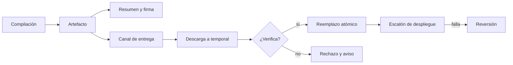
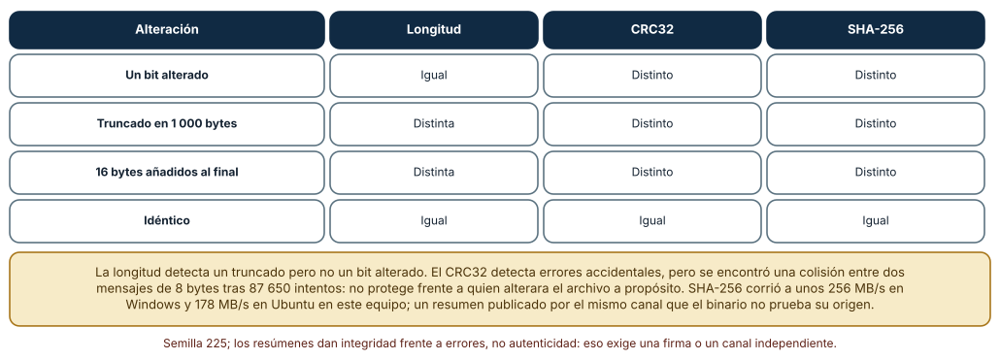
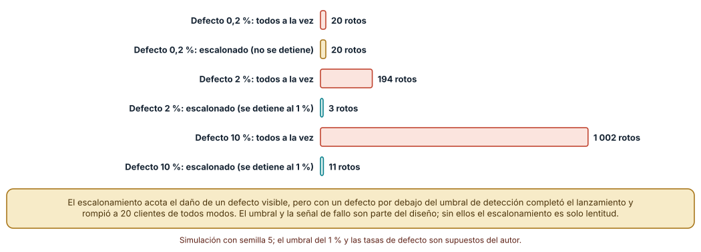
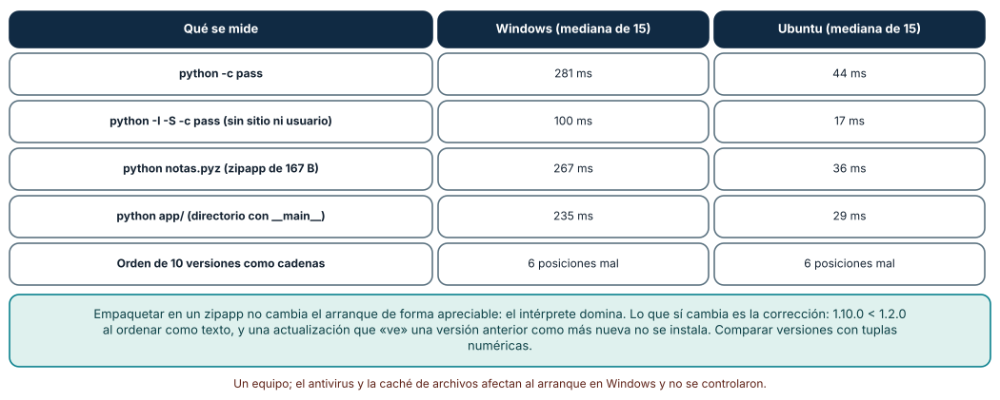

# SE-225 — Distribución de binarios y actualizaciones

[← SE-224 — Automatización idempotente y reanudable](../../classes/part-18-cli-tui-servicios-y-automatizacion/se-224-automatizacion-idempotente-y-reanudable/README.md) · [↑ Parte 18](../../classes/part-18-cli-tui-servicios-y-automatizacion/README.md) · [📚 Índice completo](../../classes/README.md) · [🌐 Portal](../../site/classes/SE-225.html) · [SE-226 — Telemetría opt-in y privacidad en herramientas →](../../classes/part-18-cli-tui-servicios-y-automatizacion/se-226-telemetria-opt-in-y-privacidad-en-herramientas/README.md)

## Punto profesional y fundamento pedagógico

**Punto profesional.** La clase existe para entregar una herramienta a otras personas y actualizarla de modo que cada copia sea la esperada, un lanzamiento defectuoso dañe a pocos antes de detenerse, las versiones se ordenen con criterio y exista siempre un camino de vuelta.

**Por qué aparece aquí.** Se sitúa después de **Automatización idempotente y reanudable** (`SE-224`) y antes de **Telemetría opt-in y privacidad en herramientas** (`SE-226`): `SE-224` dejó la técnica de descargar a un temporal, verificar y reemplazar; esta clase la aplica a un binario y a su cadena de entrega, y deja la señal de «un lanzamiento está funcionando mal» que `SE-226` pregunta cómo obtener sin vigilar a las personas.

**Error conceptual que debe corregir.** Creer que publicar un archivo y un hash al lado es «distribución segura» y que una actualización es «bajar el nuevo y copiarlo». Un hash publicado por el mismo canal que el archivo prueba integridad frente a errores, no origen; una actualización a todos a la vez convierte cualquier defecto en una incidencia total.

**Secuencia de aprendizaje.** Antes de leer la solución, predices qué alteraciones detectan la longitud, un CRC y SHA-256, cuántos clientes rompe un lanzamiento defectuoso con y sin escalones y qué versiones se ordenan mal como texto; después lo mides. La secuencia usa predicción, explicación propia, contraste y recuperación. [ICAP](https://icap.education.asu.edu/research) distingue participación de construcción de conocimiento; [How People Learn II](https://nap.nationalacademies.org/catalog/24783/how-people-learn-ii-learners-contexts-and-cultures) exige conectar conocimiento previo, contexto y transferencia; la [práctica de recuperación](https://pubmed.ncbi.nlm.nih.gov/16507066/) respalda producir de nuevo la explicación tras una demora; y [Education for Life and Work](https://nap.nationalacademies.org/resource/13398/dbasse_084153.pdf) exige devolución que explique la causa del error.

**Evidencia de aprendizaje.** `release-log.md` con la política de entrega de `notas` (integridad, origen, versionado, escalonamiento, reversión), las tres mediciones (alteraciones detectadas, daño de un lanzamiento defectuoso, arranque y orden de versiones) y el plan de reversión. Debe contener predicción previa, observación, explicación causal, contraejemplo y qué hallazgo haría detener un lanzamiento.

**Límite de la conclusión.** El archivo es de 20 MB generado con una semilla; los clientes, las tasas de defecto y el umbral del 1 % son supuestos del autor; la velocidad de resumen es de un equipo; no se firmó ni se verificó ninguna firma real, no se usó un marco de actualización (TUF) ni se midió una red.

### Trazabilidad fuente → afirmación

| Fuente primaria u oficial | Afirmación que respalda | Lo que no prueba |
|---|---|---|
| [NIST FIPS 180-4: Secure Hash Standard](https://csrc.nist.gov/pubs/fips/180-4/upd1/final) | Especifica SHA-256 y SHA-512 como funciones hash aprobadas. | No dice cómo distribuir el valor hash de forma confiable. |
| [Semantic Versioning 2.0.0](https://semver.org/) | Define el orden de versiones por componentes numéricos y las reglas de precedencia con sufijos. | No decide cuándo un cambio es «mayor». |
| [The Update Framework (TUF)](https://theupdateframework.io/) | Describe amenazas a los sistemas de actualización y un diseño con metadatos firmados. | No es una implementación para esta herramienta. |
| [SLSA](https://slsa.dev/) | Define niveles de seguridad de la cadena de suministro de artefactos. | No certifica una herramienta concreta. |
| [Python: `zipapp`](https://docs.python.org/3/library/zipapp.html) | Documenta cómo empaquetar una aplicación Python en un archivo ejecutable. | No resuelve las dependencias con extensiones compiladas. |

## Antes de empezar

Recupera lo aprendido en `SE-224`: se descarga a un temporal, se verifica y se reemplaza de forma atómica. La pregunta activa es: **¿qué verifico antes de reemplazar y cuánto daño hago si me equivoco?**

## Prerrequisitos

- Haber completado `SE-224` o poder explicar la escritura atómica.
- Python 3.11 o posterior; el módulo `zipapp` y `hashlib` de la biblioteca estándar.
- Trabajar con un archivo sintético, sin descargar nada real.

## Problema auténtico

El equipo distribuye `notas` como un archivo `notas.pyz` en una carpeta compartida y publica su SHA-256 en el mismo lugar. Un lanzamiento llega truncado a un tercio de las estaciones por una copia interrumpida, y el script de actualización, que solo comprueba que el archivo existe, lo instala. Otro lanzamiento tiene un defecto en una ruta con espacios y se despliega a todas las estaciones el viernes por la tarde. Y la herramienta de auto-actualización considera que `1.9.0` es posterior a `1.10.0`.

## Objetivos observables

Al terminar podrás:

1. elegir qué comprobar antes de instalar (longitud, resumen, firma) y entender qué prueba cada una;
2. diseñar un despliegue escalonado con umbral de detención y estimar el daño con y sin escalones;
3. ordenar versiones con criterio y evitar que una actualización instale una versión anterior;
4. empaquetar una aplicación Python en un solo archivo y medir su arranque;
5. escribir un plan de reversión con la versión anterior conservada.

## Mapa conceptual



El mapa se lee de izquierda a derecha: el artefacto lleva resumen y firma por un canal; el cliente descarga a un temporal, verifica y reemplaza; el despliegue avanza por escalones y puede revertirse. No describe un sistema de actualización concreto.

## Temas y por qué importan

| Tema | Por qué cambia una decisión profesional | Evidencia mínima |
|---|---|---|
| Integridad | Detecta archivos truncados o alterados antes de instalarlos. | Predicción, traza causal y contraejemplo de **Integridad** en `release-log.md` |
| Origen y firma | Un resumen por el mismo canal no prueba quién publicó. | Predicción, traza causal y contraejemplo de **Origen** en `release-log.md` |
| Versionado | Ordenar mal las versiones instala una anterior. | Predicción, traza causal y contraejemplo de **Versionado** en `release-log.md` |
| Despliegue escalonado | Limita el daño de un defecto antes de detectarlo. | Predicción, traza causal y contraejemplo de **Escalones** en `release-log.md` |
| Reversión | Sin versión anterior, una actualización mala es irreversible. | Predicción, traza causal y contraejemplo de **Reversión** en `release-log.md` |

## Conceptos y decisiones

### 1. El artefacto y lo que lo acompaña

Distribuir es entregar un artefacto (un archivo `.pyz`, un ejecutable, un paquete) y metadatos: versión, resumen criptográfico, firma, notas del cambio y versión mínima compatible. Una herramienta en Python puede empaquetarse como un **zipapp** (un archivo zip ejecutable con `python archivo.pyz`), que simplifica la entrega pero no incluye el intérprete ni las dependencias con extensiones compiladas. Un binario autónomo (empaquetado con un congelador) resuelve eso a cambio de tamaño y de proceso de compilación por sistema. La decisión es qué se entrega y qué se supone instalado.

### 2. Integridad, origen y por qué no son lo mismo

Un **resumen criptográfico** (SHA-256) cambia si cambia un solo bit: detecta truncados, corrupciones y alteraciones. Pero si el resumen se publica por el mismo canal que el archivo, quien pueda alterar uno puede alterar el otro: la integridad no prueba el **origen**. Para eso hace falta una **firma** con una clave cuyo propietario es quien publica y cuya clave pública el cliente ya conoce por otro camino. Un CRC32, aunque detecta errores accidentales, tiene 32 bits: es fácil construir dos mensajes con el mismo valor y no protege frente a una alteración deliberada. La longitud sola detecta truncados, no cambios de contenido.

### 3. Versionar para que el orden sea el correcto

El versionado semántico ordena por componentes numéricos (mayor, menor, parche) y trata los sufijos de preliminar (`-rc1`) como anteriores a la versión final. Ordenar como texto da `1.10.0 < 1.2.0`, porque compara carácter a carácter. Un cliente que decide «hay actualización» comparando cadenas puede ofrecer una versión anterior como nueva o negar una real. La regla: parsear a tuplas numéricas, comparar tuplas y tratar un formato desconocido como error, no como «igual».

### 4. Escalonar: dañar a pocos primero

Un despliegue por escalones (1 %, 5 %, 25 %, 100 %) entrega la versión a una fracción, observa una señal de salud y solo avanza si se mantiene bajo un umbral. Limita el daño de un defecto **visible** al tamaño del primer escalón. No ayuda con un defecto por debajo del umbral de detección, con uno que tarda en manifestarse ni con una señal que no existe: sin telemetría o sin un canal de informes, no hay umbral que vigilar (`SE-226`). El diseño debe decir qué es «salud», quién la mide y quién decide avanzar o parar.

### 5. Revertir es parte de la actualización

Cada actualización debe conservar la versión anterior y un camino documentado para volver: el nuevo se instala junto al viejo y se cambia un enlace o un nombre con un reemplazo atómico; si el arranque posterior falla, el cargador vuelve al anterior. Una reversión que depende de volver a descargar la versión vieja falla justo cuando la red o el servidor fallan. Los datos también cuentan: una versión que migra el formato de los datos no se revierte con solo cambiar el binario; las migraciones necesitan compatibilidad hacia atrás durante una ventana.

### Qué detecta cada comprobación

Un archivo sintético de 20 MB (semilla 225) se alteró de tres maneras. **Un bit alterado**: la longitud no cambió; CRC32, MD5 y SHA-256 sí cambiaron. **Truncado en 1 000 bytes**: cambiaron la longitud y los tres resúmenes. **16 bytes añadidos al final**: cambiaron la longitud y los tres resúmenes. Un archivo idéntico coincidió en todo. Con una búsqueda por cumpleaños, se encontró una **colisión de CRC32 entre dos mensajes de 8 bytes tras 87 650 intentos**. SHA-256 procesó unos **256 MB/s en Windows y 178 MB/s en Ubuntu** en este equipo, CRC32 unos 890 y 1 415 MB/s.

```python
h = hashlib.sha256()
with open(ruta, "rb") as f:
    for bloque in iter(lambda: f.read(1 << 20), b""):
        h.update(bloque)
assert h.hexdigest() == esperado
```



**Cómo leer la figura.** Cada fila es una alteración; las columnas dicen si la comprobación la detecta. **Dónde deja de valer:** las alteraciones son accidentales; frente a un atacante que controla el canal, ningún resumen publicado junto al archivo basta, y la colisión de CRC32 solo ilustra que 32 bits son pocos. No se midió MD5 ni SHA-1 contra colisiones construidas.

### Un lanzamiento defectuoso en 10 000 clientes

Simulación con semilla 5: cada cliente que recibe la versión defectuosa se rompe con una probabilidad dada, y el despliegue escalonado (1 %, 5 %, 25 %, 100 %) se detiene si falla más del 1 % de los actualizados en un escalón. **Defecto de 0,2 %**: lanzar a todos rompió 20 clientes; el escalonado **no se detuvo** y rompió los mismos 20. **Defecto de 2 %**: a todos, **194**; escalonado, **3**, detenido en el escalón del 1 %. **Defecto de 10 %**: a todos, **1 002**; escalonado, **11**, detenido en el 1 %.



**Cómo leer la figura.** Cada par de barras compara el mismo defecto con y sin escalones; la teal marca cuando el escalonamiento detuvo el lanzamiento. **Dónde deja de valer:** el umbral del 1 % y las tasas de defecto son supuestos; en un caso real la señal llega con retraso y con ruido, y una parte de los clientes no informa. El escalonamiento acota los daños que se ven; los que no se ven los hereda el 100 %.

### Arrancar, empaquetar y ordenar versiones

El arranque mínimo de Python (`python -c pass`) tardó una mediana de **281 ms en Windows y 44 ms en Ubuntu**; `python -I -S -c pass` (sin sitio ni usuario), **100 ms y 17 ms**; un zipapp de **167 bytes**, **267 y 36 ms**; el mismo programa como directorio con `__main__.py`, **235 y 29 ms**. Diez versiones (`0.9.5`, `1.0.0`, `1.2.0`, `1.2.9`, `1.2.10`, `1.9.0`, `1.10.0`, `2.0.0-rc1`, `2.0.0`, `10.0.0`) se ordenaron como cadenas y como tuplas: **seis posiciones difirieron**; como texto, `1.10.0` quedó antes que `1.2.0` y `10.0.0` antes que `2.0.0-rc1`.



**Cómo leer la figura.** Las cuatro primeras filas son medianas de 15 arranques; la última cuenta posiciones distintas entre el orden de texto y el semántico. **Dónde deja de valer:** el arranque en Windows incluye el efecto de antivirus y de la caché de archivos, que no se controlaron; un binario congelado arranca de otra forma. El orden de versiones no depende del equipo, solo de si se parsean.

## Definiciones de trabajo

- **artefacto:** archivo producido por la compilación o el empaquetado que se entrega a los usuarios.
- **resumen criptográfico (hash):** valor de longitud fija que cambia si cambia cualquier bit del contenido.
- **firma digital:** prueba, con una clave privada, de que el publicador es quien dice ser y de que el contenido no cambió.
- **despliegue escalonado:** entrega a fracciones crecientes de usuarios con una señal de salud entre cada una.
- **reversión (rollback):** vuelta a la versión anterior tras detectar un defecto.

Las definiciones son operativas para la herramienta `notas`. No convierten términos con historia más amplia en sinónimos y deben contrastarse con la documentación primaria enlazada al final.

## Ejemplo mínimo

El fragmento compara versiones como texto y como tuplas. Antes de ejecutarlo, predice cuál es mayor en cada caso.

```python
def clave(v):
    base, _, pre = v.partition("-")
    return (tuple(int(x) for x in base.split(".")), 0 if pre else 1)

print("1.10.0" > "1.9.0", clave("1.10.0") > clave("1.9.0"))
print(sorted(["2.0.0", "2.0.0-rc1", "1.10.0", "1.2.0"], key=clave))
```

La comparación de texto da `False` y la de tuplas `True`. Añade un formato desconocido (`"1.x"`) y decide si debe lanzar un error; registra versión y salida.

## Ejemplo profesional

La entrega de `notas` publica, para cada versión, un `notas-X.Y.Z.pyz`, un `SHA256SUMS` y su firma en un canal independiente. El cliente que se actualiza descarga a un temporal en el mismo directorio, comprueba la longitud, el SHA-256 contra una lista firmada y la compatibilidad mínima, y solo entonces reemplaza de forma atómica el archivo activo, conservando el anterior como `notas.anterior.pyz`. La versión se compara con tuplas y un formato desconocido es un error. El despliegue avanza por escalones de 1, 5, 25 y 100 %, con una pausa de 24 horas y una condición de detención (más de 1 % de arranques fallidos informados, o cualquier fallo de integridad). Una prueba simula un archivo truncado, uno con un bit alterado y una versión anterior publicada como nueva, y exige que ninguno se instale.

Compara el caso normal con una descarga cortada, un resumen que no coincide y un arranque fallido tras actualizar. La entrega es apropiada cuando los tres terminan con la versión anterior en uso y un aviso; es peligrosa cuando la única protección es que el archivo exista.

## Práctica guiada

1. Escribe el contrato de entrega de `notas`: qué se publica, cómo se verifica y qué versión mínima requiere.
2. Genera un archivo sintético, altéralo de tres maneras y mide qué detectan la longitud, el CRC32 y el SHA-256.
3. Empaqueta un programa con `zipapp` y mide el arranque frente a un directorio.
4. Compara el orden de diez versiones como texto y como tuplas.
5. Simula 10 000 clientes con tres tasas de defecto, con y sin escalones.
6. Diseña la reversión: dónde queda la versión anterior y quién decide volver.
7. Pide a otra persona que reconstruya la política solo desde `release-log.md`.

## Ejercicios

1. **Umbral:** con un defecto de 0,2 %, ¿qué umbral o qué tamaño de escalón habría detenido el lanzamiento? Calcula el coste en tiempo de un escalón más pequeño.
2. **Lista firmada:** diseña qué contiene `SHA256SUMS` y qué debe verificar el cliente antes de usarlo; explica por qué no basta con comprobar un hash.
3. **Versión mínima:** una actualización cambia el formato de los datos; define la ventana de compatibilidad y cómo se revierte sin perderlos.
4. **Arranque:** decide si el coste de 281 ms de arranque en Windows justifica un binario congelado para una herramienta de uso interactivo y para una de uso en lote.

## Reto verificable

Entrega `release-log.md` con el contrato de entrega, la tabla de integridad, la simulación de escalones con su semilla (5) y la comparación de versiones. Se aprueba si otra persona ejecuta el código desde un checkout limpio, obtiene las mismas cifras (20, 194 y 3, 1 002 y 11; seis posiciones distintas) y puede señalar qué lanzamiento no habría detenido el escalonamiento. No se aprueba por publicar un hash junto al archivo ni por «probar en un solo equipo».

## Caso conductor

La herramienta `notas` es el caso conductor de la Parte 18. Esta clase deja su contrato de entrega: artefacto con resumen y firma, verificación antes de reemplazar, orden de versiones correcto, escalones con umbral y reversión. `SE-226` pregunta cómo obtener la señal de salud sin vigilar a las personas. Cambia después un solo detalle, el umbral de detención de 1 % a 5 %, y mide cuántos clientes más se rompen con cada tasa de defecto.

## Preguntas frecuentes

### ¿Basta con publicar el hash junto al archivo?

Protege contra descargas corruptas, no contra quien pueda reemplazar ambos. Para probar el origen hace falta una firma y una clave pública conocida por otro camino, o un canal de distribución con autenticación fuerte.

### ¿Por qué no usar MD5 o CRC32 para integridad?

CRC32 es adecuado para detectar errores de transmisión, no alteraciones deliberadas; MD5 tiene colisiones construidas. Para distribución se usa SHA-256 o superior. La velocidad medida (256 MB/s) no es un obstáculo para un archivo de decenas de megabytes.

### ¿El escalonamiento sustituye a las pruebas?

No: limita el daño de lo que las pruebas no vieron. Un defecto que se manifiesta tarde o en un caso raro puede pasar todos los escalones.

### ¿Qué hago si la versión nueva migra datos?

Mantén compatibilidad hacia atrás durante una ventana: la versión nueva lee y escribe un formato que la anterior aún entiende, y la migración definitiva se aplica en un lanzamiento posterior.

## Fallo controlado y diagnóstico

Reproduce el fallo clásico de la clase: **instalar un archivo truncado porque solo se comprobó que existía**. Usa el archivo sintético truncado en 1 000 bytes.

Registra síntoma, entrada mínima, hipótesis, observación que descarta cada hipótesis, causa, corrección y prueba de regresión. **Síntoma:** tras la actualización, `notas` falla al arrancar con un error de archivo zip. **Hipótesis rivales:** (a) el intérprete de la estación es incompatible; (b) el archivo se corrompió en disco; (c) la descarga se cortó y se instaló igual. **Prueba:** la longitud del archivo instalado es menor que la publicada y su SHA-256 no coincide con la lista. **Conclusión:** la causa es la tercera. **Regresión:** descargar a un temporal, comprobar longitud y resumen, y reemplazar solo si coinciden, conservando el archivo anterior; añadir una prueba con un archivo truncado. No cambies a la vez el formato del paquete y la verificación.

## Errores comunes y cómo corregirlos

| Síntoma | Causa probable | Corrección |
|---|---|---|
| Se instala un archivo truncado | Solo se comprobó su existencia | Descarga a temporal, longitud y SHA-256 antes de reemplazar |
| Alguien sustituyó el archivo y su hash | El hash viaja por el mismo canal | Firma con clave pública conocida por otro camino |
| La actualización instala una versión anterior | Se comparan versiones como texto | Parsear a tuplas y rechazar formatos desconocidos |
| Un defecto llega a todos los usuarios | Despliegue a todos a la vez | Escalones con umbral y condición de parada |
| No hay forma de volver atrás | Se sobrescribió la versión anterior | Conservar la anterior y reemplazar de forma atómica |

## Entorno y archivos clave

```text
work/SE-225/
├── README.md
├── actualizar.py
├── experimentos/
│   ├── integridad.py
│   ├── escalonado.py
│   └── arranque.py
└── evidence/release-log.md
```

El `README` declara plataforma, versión de Python, semillas (225, 7 y 5) y comandos. Los experimentos usan solo la biblioteca estándar (`hashlib`, `zlib`, `zipapp`, `random`) y se ejecutaron con CPython 3.12.9 en Windows 11 y 3.12.3 en Ubuntu bajo WSL2: las detecciones, la colisión y las simulaciones fueron idénticas; las velocidades y los arranques difirieron y se informan como medianas de un equipo.

## Seguridad, ética y accesibilidad

- una clave de firma comprometida invalida toda la cadena: define cómo se guarda, quién la usa y cómo se rota;
- un actualizador es un vector de ataque: limita lo que puede ejecutar y verifica antes de reemplazar;
- no actualices sin que la persona pueda saber qué cambia: publica notas comprensibles y un modo de aplazar;
- las notas de lanzamiento deben ser texto plano y no depender del color;
- respeta las licencias de las dependencias incluidas en el paquete y atribúyelas.

## Puente hacia el trabajo con agentes

Un agente al que se le pide «añade auto-actualización» suele descargar el archivo nuevo, copiarlo sobre el activo y comparar versiones como cadenas, sin verificar longitud ni resumen y sin conservar la anterior. Pídele que descargue a un temporal, verifique, reemplace de forma atómica, compare versiones con tuplas y pruebe un archivo truncado y uno alterado. Revisa especialmente de dónde sale el hash que se compara y si hay un camino de vuelta.

## Transferencia

Traslada el experimento a otra entrega (por ejemplo, un complemento que se instala desde un repositorio interno): define su contrato de entrega, mide qué alteraciones detecta tu verificación y simula un lanzamiento defectuoso con y sin escalones. La transferencia está lograda cuando puedes explicar qué parte de la política dependía del tipo de artefacto y cuál del canal, no cuando la lista de pasos se parece.

## Evaluación y evidencia

| Criterio | Evidencia para aprobar |
|---|---|
| comprensión | explicación de la diferencia entre integridad y origen |
| corrección | tablas reproducibles de detección y de escalones con semilla |
| diseño | contrato de entrega con verificación, versionado, escalones y reversión |
| diagnóstico | reproducción del fallo «archivo truncado instalado» con regresión |
| incertidumbre | declaración de qué amenazas no cubre un resumen |
| reproducibilidad | versiones, semillas, comandos y límites declarados |

## Fuentes

- [NIST FIPS 180-4: Secure Hash Standard](https://csrc.nist.gov/pubs/fips/180-4/upd1/final) — SHA-256 y SHA-512; autoridad: NIST.
- [Semantic Versioning 2.0.0](https://semver.org/) — orden y precedencia de versiones; autoridad: especificación de la comunidad.
- [The Update Framework](https://theupdateframework.io/) — amenazas y diseño de actualizaciones seguras; autoridad: proyecto de la Cloud Native Computing Foundation.
- [SLSA](https://slsa.dev/) — niveles de seguridad de la cadena de suministro; autoridad: OpenSSF.
- [Python: `zipapp`](https://docs.python.org/3/library/zipapp.html) — aplicaciones Python en un solo archivo; autoridad: documentación de Python.
- [Python: `hashlib`](https://docs.python.org/3/library/hashlib.html) — funciones hash; autoridad: documentación de Python.

Cada fuente respalda el mecanismo indicado; ninguna demuestra que la política de entrega de `notas` sea suficiente frente a un atacante concreto. Esa afirmación depende del modelo de amenazas.

- [Python: `zlib`](https://docs.python.org/3/library/zlib.html) — `crc32` usado en la comparación.
- [Python: `random`](https://docs.python.org/3/library/random.html) — semillas del archivo y de la simulación.

## Límites y siguiente paso

Se ejecutaron tres experimentos en Windows y Ubuntu (WSL2): detecciones y simulaciones idénticas, velocidades y arranques distintos. No se firmó nada, no se verificó una firma real ni se probó un marco de actualización; los clientes, las tasas de defecto y el umbral son supuestos del autor. La siguiente clase pregunta cómo saber si un lanzamiento funciona sin vigilar a quien lo usa.

## Glosario

- **artefacto:** archivo producido por la compilación o el empaquetado que se entrega a los usuarios.
- **resumen criptográfico (hash):** valor de longitud fija que cambia si cambia cualquier bit del contenido.
- **firma digital:** prueba, con una clave privada, de que el publicador es quien dice ser y de que el contenido no cambió.
- **despliegue escalonado:** entrega a fracciones crecientes de usuarios con una señal de salud entre cada una.
- **reversión (rollback):** vuelta a la versión anterior tras detectar un defecto.

---

[← SE-224 — Automatización idempotente y reanudable](../../classes/part-18-cli-tui-servicios-y-automatizacion/se-224-automatizacion-idempotente-y-reanudable/README.md) · [↑ Parte 18](../../classes/part-18-cli-tui-servicios-y-automatizacion/README.md) · [📚 Índice completo](../../classes/README.md) · [🌐 Portal](../../site/classes/SE-225.html) · [SE-226 — Telemetría opt-in y privacidad en herramientas →](../../classes/part-18-cli-tui-servicios-y-automatizacion/se-226-telemetria-opt-in-y-privacidad-en-herramientas/README.md)
