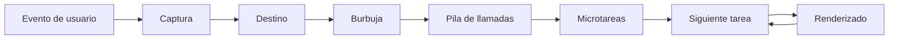
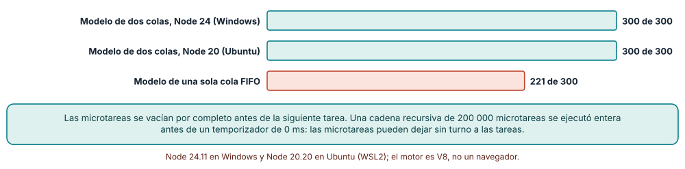
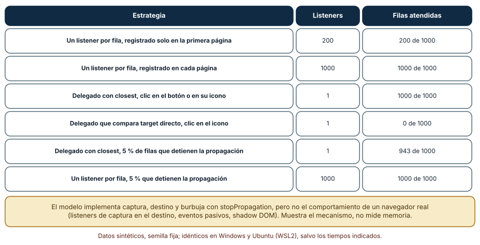
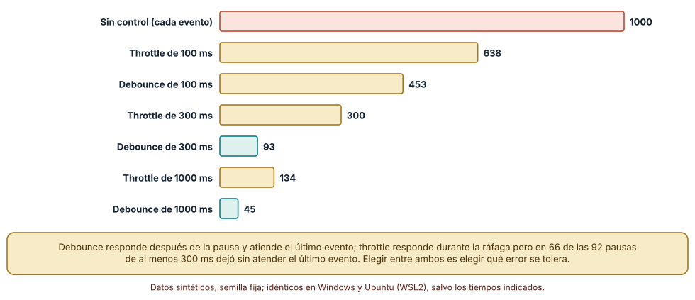

# SE-230 — JavaScript, DOM y eventos del navegador

[← SE-229 — Plataforma web, HTML semántico y CSS](../../classes/part-19-web-frontend-y-aplicaciones-progresivas/se-229-plataforma-web-html-semantico-y-css/README.md) · [↑ Parte 19](../../classes/part-19-web-frontend-y-aplicaciones-progresivas/README.md) · [📚 Índice completo](../../classes/README.md) · [🌐 Portal](../../site/classes/SE-230.html) · [SE-231 — Renderizado cliente, servidor, estático e híbrido →](../../classes/part-19-web-frontend-y-aplicaciones-progresivas/se-231-renderizado-cliente-servidor-estatico-e-hibrido/README.md)

## Punto profesional y fundamento pedagógico

**Punto profesional.** La clase existe para que entiendas el modelo de ejecución del navegador (un hilo, colas de tareas y de microtareas, renderizado entre tareas) y el flujo de eventos del DOM, de modo que un manejador no «a veces funcione»: sepas qué corre cuándo, quién recibe el clic y cuánto tiempo le dejas al navegador para responder.

**Por qué aparece aquí.** Se sitúa después de **Plataforma web, HTML semántico y CSS** y antes de **Renderizado cliente, servidor, estático e híbrido**: `SE-229` dejó un documento con estructura accesible; esta clase lo vuelve dinámico y pregunta qué reglas gobiernan el código que lo modifica. Fija tres cosas que las clases siguientes dan por sabidas: el orden de ejecución, el recorrido de un evento y el ritmo con que conviene reaccionar.

**Error conceptual que debe corregir.** Creer que JavaScript en el navegador «hace varias cosas a la vez» o que un evento llega solo al elemento donde se hizo clic: hay un hilo que ejecuta tareas una por una, las microtareas se vacían antes de la siguiente tarea y un evento recorre el árbol de ida y de vuelta.

**Secuencia de aprendizaje.** Antes de leer los resultados, predices el orden de salida de un programa con microtareas y temporizadores; después generas 300 programas con semilla fija y comparas un modelo de dos colas con el motor real, mides qué atiende una delegación de eventos en un modelo mínimo de DOM y cuentas cuántas llamadas deja pasar cada técnica de ritmo sobre 1000 pulsaciones.

**Evidencia de aprendizaje.** `dom-log.md` con las predicciones, el modelo de colas, la comparación con el motor, el modelo de DOM con captura y burbuja y la simulación de ritmo, con explicación causal, contraejemplo y qué hallazgo te haría cambiar de técnica.

**Límite de la conclusión.** El motor usado es V8 en Node, no un navegador: no hay renderizado, `requestAnimationFrame` ni eventos de usuario reales. El modelo de DOM omite shadow DOM, listeners pasivos y la captura en el destino. Ningún experimento mide memoria, percepción de latencia ni personas.

### Trazabilidad fuente → afirmación

| Fuente primaria u oficial | Afirmación que respalda | Lo que no prueba |
|---|---|---|
| [HTML Standard: bucles de eventos (WHATWG)](https://html.spec.whatwg.org/multipage/webappapis.html#event-loops) | Define tareas, colas de tareas y el punto de control de microtareas tras cada tarea. | No dice cuánto tarda en la práctica cada paso en un navegador concreto. |
| [DOM Standard: eventos (WHATWG)](https://dom.spec.whatwg.org/#events) | Define las fases de captura, destino y burbuja, `stopPropagation` y `preventDefault`. | No describe las diferencias de implementación en eventos específicos. |
| [web.dev: Interaction to Next Paint](https://web.dev/articles/inp) | Explica que la latencia de interacción depende de tareas largas que bloquean el hilo principal. | No fija un presupuesto válido para tu aplicación. |
| [Node.js: el bucle de eventos](https://nodejs.org/en/learn/asynchronous-work/event-loop-timers-and-nexttick) | Documenta el orden entre microtareas, temporizadores y otros en Node. | No equivale al orden de un navegador en todos los puntos. |

## Antes de empezar

Recupera de `SE-229` que el documento tiene estructura y nombres accesibles. La pregunta activa es: **¿cuándo se ejecuta mi código, a quién le llega el evento y cuánto tiempo bloqueo antes de que la página responda?**

## Prerrequisitos

- Haber completado `SE-229` o poder explicar qué estructura expone un formulario a las tecnologías de apoyo.
- Python 3.11 o posterior y Node.js 20 o posterior; los experimentos usan solo bibliotecas estándar.
- Nociones básicas de funciones, cierres y de asíncronía (promesas) en JavaScript.

## Problema auténtico

El formulario de entrega tiene una lista de archivos adjuntos con un botón de borrar por fila. Alguien registró un manejador por fila al cargar la página; cuando una página de resultados añade filas nuevas, sus botones no responden. Otra persona lo «arregló» con `setTimeout(..., 0)` y empezó a fallar de forma intermitente. Una tercera añadió un manejador en el contenedor y descubrió que ya no funciona al hacer clic en el icono dentro del botón. Nadie sabía en qué orden corría cada cosa ni qué elemento recibía el evento.

## Objetivos observables

Al terminar podrás:

1. predecir el orden de ejecución de código síncrono, microtareas y tareas, y verificarlo ejecutando;
2. describir el recorrido de un evento (captura, destino, burbuja) y qué cambian `stopPropagation` y `preventDefault`;
3. decidir entre un manejador por elemento y uno delegado, con los casos en que la delegación falla;
4. elegir entre debounce y throttle según el error que tolera la interacción;
5. reconocer una tarea larga como causa de falta de respuesta y fragmentarla o moverla.

## Mapa conceptual



El mapa se lee en dos mitades: a la izquierda, el bucle que ejecuta una pila, vacía las microtareas y solo entonces deja que el navegador pinte y tome otra tarea; a la derecha, el recorrido de un evento que entra por una tarea. Una microtarea recursiva o una tarea larga impiden el paso de la flecha hacia el renderizado.

## Temas y por qué importan

| Tema | Por qué cambia una decisión profesional | Evidencia mínima |
|---|---|---|
| Modelo de ejecución | Un solo hilo con colas explica por qué una tarea larga congela la página y por qué el orden importa. | Predicción, traza causal y contraejemplo de **Modelo de ejecución** en `dom-log.md` |
| El DOM como estructura viva | Las colecciones vivas y las mutaciones cambian lo que ve el código en medio de un recorrido. | Predicción, traza causal y contraejemplo de **El DOM como estructura viva** en `dom-log.md` |
| Flujo de eventos | Saber quién recibe el evento y en qué fase decide dónde escuchar y qué cancelar. | Predicción, traza causal y contraejemplo de **Flujo de eventos** en `dom-log.md` |
| Delegación y ciclo de vida de manejadores | Un manejador delegado cubre elementos futuros, pero depende de que el evento llegue y del destino. | Predicción, traza causal y contraejemplo de **Delegación y ciclo de vida de manejadores** en `dom-log.md` |
| Ritmo y respuesta | Debounce y throttle no son intercambiables; las tareas largas cuestan interactividad. | Predicción, traza causal y contraejemplo de **Ritmo y respuesta** en `dom-log.md` |

## Conceptos y decisiones

### 1. Modelo de ejecución

El navegador ejecuta el código de la página en un hilo principal con un bucle de eventos: toma una tarea de una cola (un temporizador vencido, un evento de usuario, la carga de un recurso), la ejecuta hasta vaciar la pila y, antes de tomar la siguiente, vacía **todas** las microtareas pendientes (las continuaciones de promesas y `queueMicrotask`). Solo entre tareas puede el navegador actualizar el renderizado. Consecuencia: `Promise.then` corre antes que un `setTimeout(0)` programado antes, y un bucle síncrono largo o una cadena infinita de microtareas dejan sin turno al resto.

### 2. El DOM como estructura viva

El DOM no es una copia: es el documento. `getElementsByTagName` devuelve una colección viva que cambia cuando el árbol cambia, y `querySelectorAll` una instantánea estática. Recorrer una colección viva mientras se añaden o quitan nodos es una fuente clásica de errores. Cada lectura de una propiedad de geometría tras una escritura puede obligar al navegador a recalcular el diseño, de modo que alternar lecturas y escrituras en un bucle cuesta mucho más que agrupar primero las lecturas y luego las escrituras.

### 3. Flujo de eventos

Un evento recorre el árbol en tres fases: **captura** (de la raíz al padre del destino), **destino** y **burbuja** (de vuelta hacia la raíz). Los manejadores se registran por defecto para la burbuja. `stopPropagation` detiene el recorrido posterior; `preventDefault` cancela la acción por defecto (enviar un formulario, seguir un enlace) pero no detiene la propagación. Son cosas distintas, y confundirlas es una fuente frecuente de errores como «cancelé el envío pero el evento sigue subiendo». Un evento que se origina en un hijo muestra ese hijo en `event.target`, mientras `event.currentTarget` es el elemento cuyo manejador se está ejecutando.

### 4. Delegación y ciclo de vida de manejadores

La delegación registra un único manejador en un ancestro y decide, mirando `event.target`, qué hacer. Cubre los elementos añadidos más tarde y reduce el número de manejadores, pero tiene tres límites: el evento debe burbujear (no todos lo hacen, como `focus`), nadie en el camino debe detenerlo, y el destino puede ser un descendiente del elemento esperado, por lo que conviene usar `target.closest(selector)`. El ciclo de vida importa igual: un manejador que no se retira cuando el elemento desaparece retiene memoria, y `addEventListener` admite una opción `signal` con un `AbortController` para retirar varios a la vez.

### 5. Ritmo y respuesta

Los eventos de entrada continuos (teclas, desplazamiento, redimensión) pueden llegar más rápido de lo que conviene reaccionar. **Debounce** espera a que cese la actividad y responde una vez, con el último valor; **throttle** responde como mucho una vez por intervalo y deja pasar valores intermedios. Para animaciones, `requestAnimationFrame` sincroniza con el pintado. Una tarea larga (más de 50 ms, como orientación de la plataforma) bloquea el hilo y demora el siguiente evento: se fragmenta cediendo el control entre trozos o se mueve a un trabajador.

### Dos colas frente a una: predecir el orden

Se generaron 300 programas con una gramática pequeña (sentencias que escriben un número, programan una microtarea con `queueMicrotask`, con `Promise.then` o con `setTimeout(0)`, anidados hasta tres niveles) con una semilla fija. Para cada uno se predijo el orden de salida con un modelo de **dos colas** (todas las microtareas antes de la siguiente tarea) y con un modelo de **una sola cola FIFO**, y se comparó con el motor real.

```javascript
function model(prog){
  const log=[], micro=[], tasks=[];
  const run = p => { for (const [k,a] of p){ if (k==="log") log.push(a);
                     else if (k==="task") tasks.push(a); else micro.push(a);} };
  run(prog);
  const drain = () => { while(micro.length) run(micro.shift()); };
  drain();
  while (tasks.length){ run(tasks.shift()); drain(); }
  return log;
}
```

Resultado: el modelo de dos colas acertó **300 de 300** programas, en Node 24.11 (Windows) y en Node 20.20 (Ubuntu); el de una sola cola acertó 221 (falló en 79 programas; 178 de los 300 usaban al menos un temporizador). Se programó además una cadena recursiva de 200 000 microtareas y un `setTimeout(0)` antes de ella: el temporizador no corrió hasta que se ejecutaron las 200 000. Y tras un bucle bloqueante de 10, 50 y 200 ms, un temporizador de 0 ms se disparó después de que terminara el bloqueo en los tres casos.



**Cómo leer la figura.** Cada barra es el número de programas, de 300, cuyo orden predijo el modelo; las dos primeras son el modelo de dos colas en dos sistemas y la tercera el de una sola cola. **Dónde deja de valer:** el motor es V8 en Node, y Node añade `process.nextTick` y `setImmediate` que no existen en un navegador; la gramática no incluye eventos de usuario ni `requestAnimationFrame`, cuyo punto en el ciclo depende de la implementación. Los temporizadores anidados tienen en los navegadores un retraso mínimo que este experimento no reproduce.

### Delegación frente a un listener por fila

Se escribió un modelo mínimo de DOM con captura, destino y burbuja y `stopPropagation`, con 1000 filas cargadas en cinco páginas de 200, cada una con un botón de borrar y un icono dentro. Se simularon seis estrategias y se contó cuántos de 1000 clics atendió cada una.

```python
def despachar(objetivo):
    ruta = []; n = objetivo
    while n: ruta.append(n); n = n.padre
    ruta.reverse()
    for n in ruta[:-1]: ...          # captura
    for n in reversed(ruta): ...     # destino y burbuja
```

Resultado, idéntico en Windows y Ubuntu: registrar un listener por fila solo al cargar la primera página atiende **200 de 1000** clics; registrarlo en cada página atiende 1000 pero con 1000 listeners; un único listener delegado con `closest` atiende **1000 de 1000** con uno; si el delegado compara `target` directamente, el clic en el icono no coincide y atiende **0 de 1000**; y si el 5 % de las filas detienen la propagación, el delegado atiende 943, mientras el listener por fila sigue atendiendo 1000.



**Cómo leer la figura.** Cada fila es una estrategia; la columna central cuenta los listeners registrados y la última las filas que respondieron. **Dónde deja de valer:** es un modelo del algoritmo de propagación, no un navegador: no mide memoria ni el coste de registrar mil listeners, que en un navegador real puede ser pequeño. Y no incluye eventos que no burbujean ni shadow DOM, donde `target` se reorienta.

### Debounce o throttle: qué error se tolera

Se generaron 1000 pulsaciones sintéticas (171,6 s) con intervalos de 40 a 150 ms y pausas ocasionales de 0,5 a 1,5 s, con semilla fija, y se simuló con reloj virtual cada técnica. Sin control hay 1000 llamadas. Con throttle de 100, 300 y 1000 ms hay **638, 300 y 134**; con debounce de 100, 300 y 1000 ms hay **453, 93 y 45**. Del total de 92 pausas de al menos 300 ms, en **66** el throttle de 300 ms no atendió el último evento de la ráfaga.

```python
def debounce(ev, espera):
    llamadas = []; ult = None
    for t in ev:
        if ult is not None and t - ult >= espera: llamadas.append(ult + espera)
        ult = t
    llamadas.append(ult + espera)
    return llamadas
```



**Cómo leer la figura.** Cada barra cuenta las llamadas resultantes; las verdes son debounce y las doradas throttle. **Dónde deja de valer:** las pulsaciones son sintéticas, con una distribución elegida por el autor; el número exacto depende de ella. La figura no mide qué retraso percibe una persona ni qué intervalo es adecuado: eso depende de la tarea (una búsqueda con sugerencias tolera más espera que un control de volumen).

## Definiciones de trabajo

- **tarea:** unidad de trabajo que el bucle de eventos toma de una cola y ejecuta hasta vaciar la pila.
- **microtarea:** continuación pendiente (promesa o `queueMicrotask`) que se ejecuta por completo antes de la siguiente tarea.
- **delegación de eventos:** registro de un manejador en un ancestro para atender eventos de descendientes presentes y futuros.
- **debounce:** técnica que retrasa una llamada hasta que pasa un tiempo sin nuevos eventos.
- **throttle:** técnica que limita una llamada a como mucho una por intervalo.

Las definiciones son operativas para esta clase y deben contrastarse con las especificaciones enlazadas al final.

## Ejemplo mínimo

Predice el orden de salida antes de ejecutar este programa en Node.

```javascript
console.log("1 síncrono");
setTimeout(() => console.log("4 tarea"), 0);
Promise.resolve().then(() => console.log("3 microtarea"));
console.log("2 síncrono");
```

La salida es 1, 2, 3, 4: el código síncrono termina, se vacían las microtareas y solo entonces corre el temporizador. Registra versión de Node y salida; si anidas otra microtarea dentro de la primera, predice dónde queda respecto del temporizador.

## Ejemplo profesional

La lista de adjuntos de la plataforma se rehace con un único manejador en el contenedor que usa `evento.target.closest("button.borrar")`, comprueba que el botón pertenece a la lista y llama a una función pura que decide qué borrar a partir de `data-id`. El manejador de búsqueda de entregas usa debounce de 300 ms y lanza una única petición por ráfaga. La actualización de la barra de progreso de subida se agrupa con `requestAnimationFrame`, y el cálculo del resumen de 5000 filas se divide en trozos de 5 ms que ceden el control entre sí.

Compara el caso normal con una fila añadida tarde, un clic en el icono y una persona que pulsa Enter con el teclado sobre el botón. La interacción es apropiada cuando esos tres casos funcionan sin registrar nada nuevo; es frágil cuando cada caso exige un parche distinto.

## Práctica guiada

1. Escribe diez programas pequeños con microtareas y temporizadores y predice el orden de cada uno antes de ejecutar.
2. Implementa el modelo de dos colas y compáralo con el motor sobre 300 programas generados con semilla fija.
3. Construye el modelo mínimo de DOM y las seis estrategias de registro; cuenta las filas atendidas.
4. Provoca el fallo del icono (comparar `target` directamente) y corrígelo con `closest`.
5. Simula debounce y throttle con las mismas 1000 pulsaciones y cuenta llamadas y últimos eventos sin atender.
6. Mide en Node cuánto retrasa un bucle bloqueante de 50 ms a un temporizador y cómo cambia al fragmentar el trabajo.
7. Entrega `dom-log.md` y pide a otra persona que reproduzca las cifras con las mismas semillas.

## Ejercicios

1. **Colas:** extiende la gramática con `setTimeout` de 5 ms y explica por qué el modelo de dos colas deja de bastar; mide el porcentaje de acuerdo.
2. **Delegación:** añade al modelo un evento que no burbujea (como `focus`) y muestra qué estrategia lo atiende sin cambiar el manejador.
3. **Ritmo:** diseña un híbrido que atienda de inmediato el primer evento y el último tras la pausa, y cuenta sus llamadas sobre las mismas pulsaciones.
4. **Tarea larga:** fragmenta un cálculo de 200 ms en trozos de 10 ms que cedan el control, y calcula cuánto retrasa el resultado final a cambio de qué mejora.

## Reto verificable

Entrega `dom-log.md` con el modelo de dos colas y su comparación con el motor, el modelo de DOM con las seis estrategias y la simulación de debounce y throttle. Se aprueba si otra persona ejecuta el código desde un checkout limpio, obtiene las mismas cifras con las mismas semillas y puede indicar qué evidencia te haría cambiar de técnica de ritmo. No se aprueba por demostrar que «funciona» en un navegador sin conocer el orden de ejecución.

## Caso conductor

El formulario de entrega gana su primer comportamiento en esta clase: una lista de adjuntos con borrado delegado, una búsqueda con debounce y un cálculo de resumen que no bloquea el hilo. Las siguientes clases añadirán el servidor y el cliente como lugares donde calcular (`SE-231`), el estado de la lista (`SE-232`) y la validación (`SE-233`). Cambia después una sola decisión, el intervalo de debounce de 300 a 150 ms, y revisa cuántas peticiones más se envían.

## Preguntas frecuentes

### ¿Por qué `setTimeout(fn, 0)` no ejecuta `fn` de inmediato?

Porque programa una tarea para el futuro: antes corren el código síncrono en curso y todas las microtareas pendientes. Y los navegadores aplican un retraso mínimo a temporizadores anidados.

### ¿`preventDefault` detiene la propagación?

No. Cancela la acción por defecto del evento (enviar un formulario, seguir un enlace) pero el evento sigue recorriendo el árbol. Para detenerlo se usa `stopPropagation`, y para impedir que otros manejadores del mismo elemento lo reciban, `stopImmediatePropagation`.

### ¿Cuándo no usar delegación?

Cuando el evento no burbujea (`focus`, `blur`, `mouseenter`), cuando el destino real puede ser un elemento de un árbol aislado (shadow DOM) o cuando hay manejadores intermedios que detienen la propagación sin que quien delega pueda saberlo.

### ¿Debounce o throttle para el desplazamiento?

Para reaccionar mientras se desplaza (barra de progreso, carga diferida) conviene limitar la frecuencia con throttle o `requestAnimationFrame`; para reaccionar al terminar (guardar la posición) conviene debounce. La pregunta es si el valor intermedio sirve.

## Fallo controlado y diagnóstico

Reproduce el fallo clásico de la clase: **creer que `event.target` es el elemento donde registraste el manejador**. Toma la lista de adjuntos con un manejador delegado que compara `evento.target.matches("button.borrar")` e inserta un icono dentro del botón.

Registra síntoma, entrada mínima, hipótesis, observación que descarta cada hipótesis, causa, corrección y prueba de regresión. **Síntoma:** el borrado no responde cuando se hace clic exactamente sobre el icono, pero sí en el borde del botón. **Hipótesis rivales:** (a) el icono tiene `pointer-events` bloqueados; (b) `target` es el icono y no el botón. **Prueba:** imprime `evento.target.tagName` y `evento.currentTarget.tagName` en ambos clics; comprueba que en el clic del icono `target` es `SPAN`. **Conclusión:** la causa es comparar el destino con el botón en lugar de buscar el ancestro. **Regresión:** usa `target.closest("button.borrar")` y añade una prueba con un clic simulado sobre el hijo. No cambies a la vez el HTML del icono y el manejador: no sabrás qué corrigió el problema.

## Errores comunes y cómo corregirlos

| Síntoma | Causa probable | Corrección |
|---|---|---|
| Los botones de filas nuevas no responden | Manejador registrado por elemento solo en la carga inicial | Delegar en el contenedor o registrar al crear cada fila |
| El manejador delegado ignora clics en el icono | Se compara `target` con el botón en lugar de usar `closest` | Buscar el ancestro con `closest` y comprobar que pertenece al contenedor |
| Un widget deja sin efecto la analítica de clics | Un componente llama a `stopPropagation` y el evento no llega a la raíz | Escuchar en captura o no detener la propagación sin necesidad |
| La página se congela durante el cálculo de un resumen | Tarea larga síncrona en el hilo principal | Fragmentar el trabajo, ceder el control o moverlo a un trabajador |
| Una búsqueda lanza una petición por pulsación | Ausencia de debounce en un evento de entrada continua | Aplicar debounce y cancelar la petición anterior |

## Entorno y archivos clave

```text
work/SE-230/
├── README.md
├── dom/
│   ├── bucle.js
│   ├── delegacion.py
│   └── ritmo.py
├── tests/test_bucle.js
└── evidence/dom-log.md
```

El `README` declara plataforma, versiones de Python y Node, semillas y comandos. Los experimentos se ejecutaron con CPython 3.12.9 y Node 24.11 en Windows 11 y con CPython 3.12.3 y Node 20.20 en Ubuntu bajo WSL2: las salidas fueron idénticas. No se usó un navegador, un depurador de rendimiento ni datos de personas.

## Seguridad, ética y accesibilidad

- un manejador que solo responde al clic excluye a quien usa el teclado: usa elementos nativos que ya reciben Enter y espacio;
- una tarea larga que congela la página perjudica sobre todo a dispositivos modestos y a quien usa tecnologías de apoyo, que necesitan que el hilo responda;
- un `preventDefault` en un enlace o en un formulario puede romper la navegación del teclado o del lector de pantalla;
- los ejemplos usan pulsaciones y filas sintéticas; no registres teclas ni contenidos reales de estudiantes en la evidencia;
- si un efecto depende del tiempo (animaciones), respeta la preferencia del sistema de reducir el movimiento.

## Puente hacia el trabajo con agentes

Un agente al que se le pide «haz que el botón de borrar funcione» tenderá a registrar un manejador por elemento o a envolver con `setTimeout` lo que no entiende. Pídele que explique en qué fase y en qué orden se ejecuta cada manejador, que use delegación con `closest` cuando haya elementos dinámicos y que entregue una prueba que haga clic sobre un hijo del botón. Revisa especialmente si añadió `stopPropagation` o `setTimeout` para que un caso funcione: son parches que suelen ocultar un error de orden o de destino.

## Transferencia

Traslada el experimento a otro entorno con un bucle de eventos (un servidor en Node, una aplicación móvil, un trabajador): cambia las colas pero conserva el método de modelar el orden y compararlo con el motor. La transferencia está lograda cuando puedes explicar qué parte del modelo dependía de la especificación del navegador y cuál de la idea general de colas, no cuando el código se parece.

## Evaluación y evidencia

| Criterio | Evidencia para aprobar |
|---|---|
| comprensión | explicación de microtarea, tarea y fase de evento con un ejemplo y un contraejemplo |
| corrección | cifras reproducibles del modelo de colas, de la delegación y del ritmo con las mismas semillas |
| diseño | manejadores delegados con `closest`, debounce y trabajo fragmentado |
| diagnóstico | reproducción del fallo del icono con regresión |
| incertidumbre | declaración de lo que el modelo omite (shadow DOM, eventos que no burbujean, renderizado) |
| reproducibilidad | versiones, comandos, salida y límites declarados |

## Fuentes

- [HTML Standard: bucles de eventos (WHATWG)](https://html.spec.whatwg.org/multipage/webappapis.html#event-loops) — tareas, microtareas y renderizado; autoridad: WHATWG.
- [DOM Standard: eventos (WHATWG)](https://dom.spec.whatwg.org/#events) — fases de captura, destino y burbuja; autoridad: WHATWG.
- [MDN: Introducción a los eventos](https://developer.mozilla.org/en-US/docs/Learn_web_development/Core/Scripting/Events) — burbuja, captura y delegación con ejemplos; autoridad: MDN.
- [web.dev: Interaction to Next Paint](https://web.dev/articles/inp) — latencia de interacción y tareas largas; autoridad: Google web.dev.
- [web.dev: Optimizar tareas largas](https://web.dev/articles/optimize-long-tasks) — fragmentar el trabajo y ceder el control; autoridad: Google web.dev.
- [Node.js: el bucle de eventos](https://nodejs.org/en/learn/asynchronous-work/event-loop-timers-and-nexttick) — orden entre microtareas y temporizadores en Node; autoridad: OpenJS Foundation.

Cada fuente respalda el mecanismo indicado; ninguna demuestra que el modelo de dos colas reproduzca el orden de un navegador concreto en todos los casos ni que el intervalo elegido sea el adecuado para la plataforma de entregas.

- [Python: `random`](https://docs.python.org/3/library/random.html) — generador con semilla para las pulsaciones sintéticas.

## Límites y siguiente paso

Se ejecutaron tres experimentos con datos sintéticos en Windows y Ubuntu (WSL2) con resultados idénticos. El motor es V8 en Node, no un navegador; el modelo de DOM es una simplificación del algoritmo y las pulsaciones son construcciones del autor. La siguiente clase pregunta dónde conviene calcular y construir el documento: en el navegador, en un servidor o antes de publicar.

## Glosario

- **tarea:** unidad de trabajo que el bucle de eventos toma de una cola y ejecuta hasta vaciar la pila.
- **microtarea:** continuación pendiente (promesa o `queueMicrotask`) que se ejecuta por completo antes de la siguiente tarea.
- **delegación de eventos:** registro de un manejador en un ancestro para atender eventos de descendientes presentes y futuros.
- **debounce:** técnica que retrasa una llamada hasta que pasa un tiempo sin nuevos eventos.
- **throttle:** técnica que limita una llamada a como mucho una por intervalo.

---

[← SE-229 — Plataforma web, HTML semántico y CSS](../../classes/part-19-web-frontend-y-aplicaciones-progresivas/se-229-plataforma-web-html-semantico-y-css/README.md) · [↑ Parte 19](../../classes/part-19-web-frontend-y-aplicaciones-progresivas/README.md) · [📚 Índice completo](../../classes/README.md) · [🌐 Portal](../../site/classes/SE-230.html) · [SE-231 — Renderizado cliente, servidor, estático e híbrido →](../../classes/part-19-web-frontend-y-aplicaciones-progresivas/se-231-renderizado-cliente-servidor-estatico-e-hibrido/README.md)
