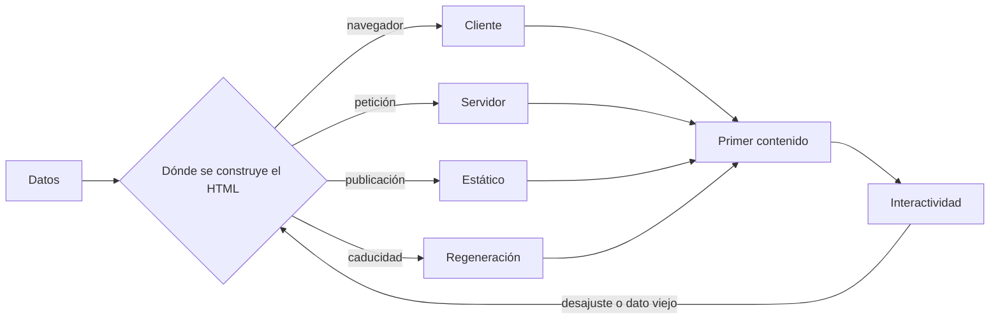
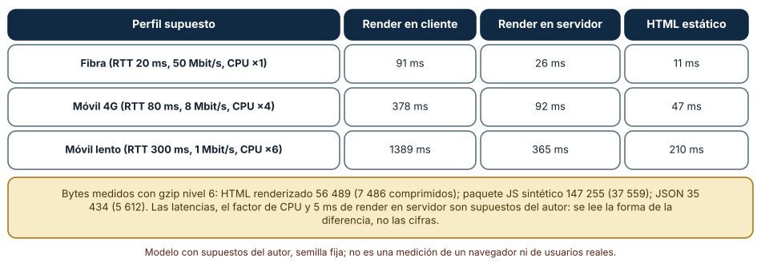
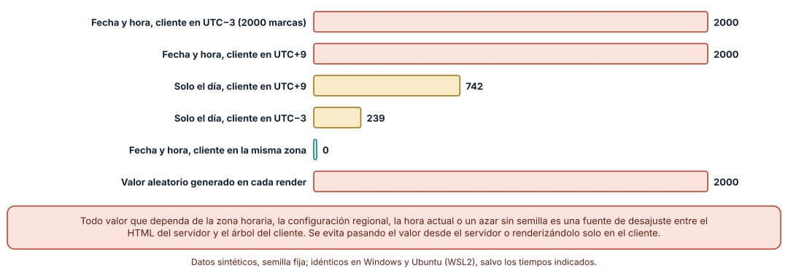
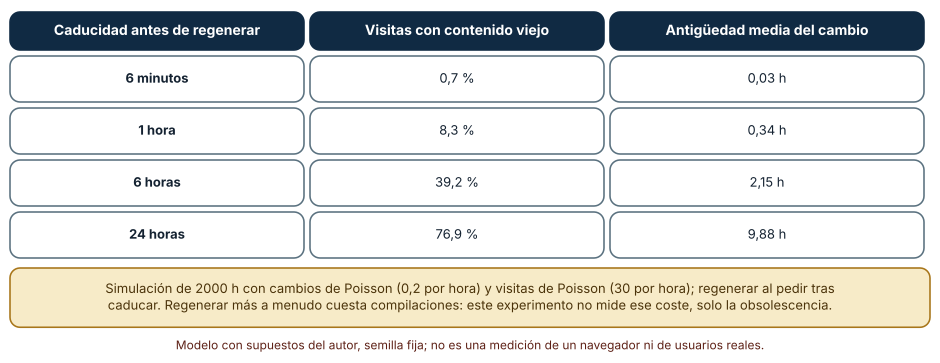

# SE-231 — Renderizado cliente, servidor, estático e híbrido

[← SE-230 — JavaScript, DOM y eventos del navegador](../../classes/part-19-web-frontend-y-aplicaciones-progresivas/se-230-javascript-dom-y-eventos-del-navegador/README.md) · [↑ Parte 19](../../classes/part-19-web-frontend-y-aplicaciones-progresivas/README.md) · [📚 Índice completo](../../classes/README.md) · [🌐 Portal](../../site/classes/SE-231.html) · [SE-232 — Estado, componentes y gestión de datos →](../../classes/part-19-web-frontend-y-aplicaciones-progresivas/se-232-estado-componentes-y-gestion-de-datos/README.md)

## Punto profesional y fundamento pedagógico

**Punto profesional.** La clase existe para que decidas, página por página, dónde se produce el HTML (en el navegador, en un servidor, antes de publicar o con regeneración periódica), sabiendo qué se paga en bytes, en tiempo de CPU del dispositivo, en obsolescencia y en riesgo de que el servidor y el cliente no coincidan, de modo que «usar el marco de moda» deje de ser un argumento.

**Por qué aparece aquí.** Se sitúa después de **JavaScript, DOM y eventos del navegador** y antes de **Estado, componentes y gestión de datos**: `SE-230` explicó cuándo corre el código en el navegador; esta clase pregunta cuánto de ese código hace falta para mostrar algo útil y quién construye el documento. Fija el criterio de elección que las clases de estado, rendimiento, SEO y PWA reutilizan.

**Error conceptual que debe corregir.** Creer que renderizar en el servidor «es siempre más rápido» o que una página estática «no puede cambiar»: cada estrategia mueve costos de un lugar a otro, y los desajustes entre lo que calcula el servidor y lo que calcula el cliente producen errores que no existen en ninguna de las dos mitades por separado.

**Secuencia de aprendizaje.** Antes de leer los resultados, predices cuál de las tres estrategias muestra antes el primer contenido en una red lenta y cuántos textos distintos producen un servidor y un cliente en zonas horarias distintas; después mides los bytes reales de un HTML renderizado frente a un paquete de JavaScript más datos, alimentas un modelo de tiempo con ellos y simulas cuántas visitas ven una página desactualizada según la caducidad.

**Evidencia de aprendizaje.** `render-log.md` con los bytes medidos, el modelo con sus supuestos explícitos, la prueba de desajuste de hidratación y la simulación de caducidad, con predicción previa, observación, explicación causal, contraejemplo y qué hallazgo te haría cambiar de estrategia.

**Límite de la conclusión.** Los bytes son de una página sintética de 500 filas; los tiempos salen de un modelo con latencias, ancho de banda y factor de CPU supuestos por el autor, no de una medición en un navegador. Ningún experimento mide a personas, buscadores ni una infraestructura real.

### Trazabilidad fuente → afirmación

| Fuente primaria u oficial | Afirmación que respalda | Lo que no prueba |
|---|---|---|
| [web.dev: Rendering on the Web](https://web.dev/articles/rendering-on-the-web) | Describe renderizado en servidor, estático, en cliente e híbrido y sus compromisos de rendimiento y complejidad. | No indica cuál conviene a una aplicación concreta. |
| [React: hydrateRoot](https://react.dev/reference/react-dom/client/hydrateRoot) | Documenta que la hidratación espera que el HTML del servidor coincida con el del cliente y avisa de los desajustes. | No cubre otros marcos ni cada causa de desajuste. |
| [RFC 5861: extensiones de Cache-Control](https://www.rfc-editor.org/rfc/rfc5861) | Define `stale-while-revalidate` y `stale-if-error` como formas de servir contenido caducado mientras se renueva. | No dice qué caducidad es razonable para una página. |
| [RFC 9111: caché HTTP](https://www.rfc-editor.org/rfc/rfc9111) | Fija cuándo una respuesta es fresca, cuándo caduca y cómo se revalida. | No describe la invalidación de una red de distribución concreta. |

## Antes de empezar

Recupera de `SE-230` que el navegador ejecuta el código en un hilo y que el trabajo del cliente compite con la interacción. La pregunta activa es: **¿quién construye este HTML, cuánto cuesta moverlo al navegador y qué pasa cuando lo construyen dos sitios a la vez?**

## Prerrequisitos

- Haber completado `SE-230` o poder explicar por qué una tarea larga retrasa la interacción.
- Python 3.11 o posterior y Node.js 20 o posterior; todo el código usa solo bibliotecas estándar.
- Nociones de HTTP: petición, respuesta, caché y compresión.

## Problema auténtico

La plataforma muestra una lista de 500 entregas. La primera versión envía un documento casi vacío y un paquete de JavaScript que pide los datos y construye la lista. En una red rápida se ve bien; en un móvil lento la persona mira una página en blanco varios segundos, y el buscador que rastrea la página ve un documento sin contenido. Se prueba entonces renderizar en el servidor y aparece un texto de fecha que «parpadea» al cargar y un aviso de desajuste en la consola. Después alguien propone generar la página al publicar, y las calificaciones nuevas tardan horas en aparecer.

## Objetivos observables

Al terminar podrás:

1. describir las cuatro estrategias de renderizado y dónde se paga el coste de cada una;
2. medir los bytes que envía cada estrategia y alimentar un modelo de tiempo con supuestos explícitos;
3. reconocer las causas de un desajuste entre servidor y cliente y evitarlas con una regla;
4. calcular la obsolescencia de una página regenerada por caducidad y elegir un intervalo con su coste;
5. decidir la estrategia de cada página según si es pública, personalizada o interactiva.

## Mapa conceptual



El mapa se lee desde los datos hasta la interactividad: cada rama es una estrategia que construye el mismo HTML en otro momento y lugar. La flecha de retorno indica que un desajuste entre servidor y cliente o un dato viejo obliga a revisar dónde se construye.

## Temas y por qué importan

| Tema | Por qué cambia una decisión profesional | Evidencia mínima |
|---|---|---|
| Dónde se produce el HTML | Cada estrategia mueve costo entre red, CPU del servidor y CPU del dispositivo. | Predicción, traza causal y contraejemplo de **Dónde se produce el HTML** en `render-log.md` |
| Primer contenido e interactividad | Ver una página no es poder usarla: el HTML llega antes que el JavaScript que lo activa. | Predicción, traza causal y contraejemplo de **Primer contenido e interactividad** en `render-log.md` |
| Hidratación y determinismo | El cliente debe reproducir lo que construyó el servidor; la zona horaria o un azar lo rompen. | Predicción, traza causal y contraejemplo de **Hidratación y determinismo** en `render-log.md` |
| Estático y regeneración | Una página precalculada es rápida y barata, y envejece; la caducidad regula cuánto. | Predicción, traza causal y contraejemplo de **Estático y regeneración** en `render-log.md` |
| Elegir por página | Contenido público, personalizado e interactivo piden estrategias distintas dentro de una misma aplicación. | Predicción, traza causal y contraejemplo de **Elegir por página** en `render-log.md` |

## Conceptos y decisiones

### 1. Dónde se produce el HTML

En el **renderizado en cliente**, el servidor entrega un documento mínimo y un paquete de JavaScript; el navegador lo descarga, lo ejecuta, pide los datos y construye la página. En el **renderizado en servidor**, cada petición produce el HTML completo con los datos incluidos. En el **estático**, el HTML se produce antes de publicar y se sirve desde una caché. En la **regeneración incremental** se sirve lo estático y se reconstruye al caducar. Ninguna es mejor en abstracto: el cliente ahorra servidor y paga dispositivo y red; el servidor paga cómputo por visita; el estático paga obsolescencia.

### 2. Primer contenido e interactividad

La métrica que suele importar al principio es cuándo aparece contenido útil (por ejemplo, el mayor elemento visible), pero eso no equivale a poder interactuar. Con renderizado en servidor el contenido llega en el primer HTML y la página es visible antes de que se ejecute el JavaScript; hasta que este se carga y se «hidrata», los controles pueden no responder. Con renderizado en cliente, ni siquiera hay contenido hasta que el JavaScript corre. Por eso la elección se hace pensando en las dos cosas: cuándo se ve y cuándo se puede usar.

### 3. Hidratación y determinismo

Hidratar es adjuntar el comportamiento a un HTML que ya existe, reproduciendo en el cliente el mismo árbol que construyó el servidor. Si los dos árboles difieren, el marco puede descartar el HTML y reconstruirlo, mostrar un aviso o dejar un estado inconsistente. Las causas típicas son valores que dependen del entorno: la zona horaria, la configuración regional, la hora actual y los números aleatorios. La regla es que lo que se renderiza en la primera pasada debe ser función solo de datos que ambos lados reciben; lo que depende del entorno se renderiza después, solo en el cliente.

### 4. Estático y regeneración

Un sitio estático se publica como archivos; la regeneración incremental los reconstruye al pasar un tiempo o al cambiar los datos. El mecanismo de caché HTTP equivalente es `stale-while-revalidate`: se sirve lo que hay y se renueva en segundo plano. Un intervalo corto reduce la obsolescencia y aumenta el coste de construcción; uno largo ahorra trabajo y deja visibles datos viejos. La elección depende de qué cuesta mostrar un dato desactualizado: una calificación errónea cuesta mucho más que una portada vieja.

### 5. Elegir por página

Una aplicación suele combinar estrategias: la portada pública se genera al publicar, las páginas con datos que cambian cada hora usan regeneración, las vistas personalizadas se renderizan en servidor o en cliente tras identificarse y los componentes realmente interactivos se hidratan solos. La mejora progresiva ofrece un criterio útil: el HTML básico debe funcionar sin JavaScript, y el comportamiento se añade encima. Ese criterio protege a quien tiene un dispositivo lento, una red mala o un bloqueador de scripts.

### Cuánto pesa y cuánto tarda cada estrategia

Se construyeron 500 filas sintéticas y se midieron los bytes de cuatro artefactos con gzip de nivel 6: el HTML ya renderizado (56 489 bytes, 7 486 comprimidos), el documento mínimo del cliente (193 bytes, 153 comprimidos), el JSON de datos (35 434 bytes, 5 612) y un paquete de JavaScript sintético de 147 255 bytes (37 559). Con esos tamaños se alimentó un modelo de tiempo hasta el primer contenido útil con tres perfiles de red y dispositivo (supuestos del autor): el cliente hace tres peticiones en cadena (documento, paquete, datos) y paga el análisis del paquete y el render; el servidor hace una petición y paga 5 ms de cómputo; el estático sirve el HTML desde una caché más cercana (la mitad de latencia).

```python
csr = rtt + tx(shell) \
    + rtt + tx(js) + cpu_parse_ms_por_100kb * (js_bytes / 100000) * k \
    + rtt + tx(json) + cpu_render_ms * k
ssr = rtt + 5.0 + tx(html_gz)
ssg = rtt * 0.5 + tx(html_gz)
```

Resultado: en fibra (RTT 20 ms, 50 Mbit/s, CPU ×1) el cliente tarda **91 ms**, el servidor 26 y el estático 11; en móvil 4G (80 ms, 8 Mbit/s, ×4) 378, 92 y 47; en móvil lento (300 ms, 1 Mbit/s, ×6) **1389, 365 y 210**. La causa no es magia: el cliente suma tres idas y vueltas y paga el análisis del JavaScript en un dispositivo lento. Como orientación de lectura, el render en cliente tarda de 3,5 a 4,1 veces lo que tarda el servidor en los tres perfiles, y esa razón es consecuencia directa de los supuestos.



**Cómo leer la figura.** Cada fila es un perfil supuesto; cada columna una estrategia; las cifras son milisegundos del modelo hasta el primer contenido útil. **Dónde deja de valer:** el modelo no incluye la compresión de la red de distribución, la conexión TLS, el análisis incremental del HTML ni la cache del navegador: una visita repetida con el paquete en caché cambia el orden. Los 5 ms del servidor excluyen una base de datos lenta, que puede dar la vuelta a la conclusión. Una medición real exige un navegador y una red controlada.

### El desajuste de hidratación tiene causa mecánica

Se tomaron 2000 marcas de tiempo sintéticas de 2026 y se formatearon con el mismo formato `dd/mm/aaaa hh:mm` en una zona (servidor en UTC) y en otra (cliente). Si el cliente está en la **misma** zona, 0 de 2000 textos difieren; si está en UTC−3 o en UTC+9, **los 2000 difieren**. Si solo se muestra el día, difieren **239** (UTC−3) y **742** (UTC+9). Un valor aleatorio sin semilla generado en el render difirió en **2000 de 2000** hidrataciones.

```python
srv = timezone.utc
cli = timezone(timedelta(hours=9))
a.astimezone(srv).strftime("%d/%m/%Y %H:%M") != a.astimezone(cli).strftime("%d/%m/%Y %H:%M")
```



**Cómo leer la figura.** Cada barra es el número de marcas, de 2000, cuyo texto difiere según el origen de la diferencia; la barra verde es la configuración que no difiere. **Dónde deja de valer:** el experimento usa zonas fijas y no reproduce el mecanismo de un marco concreto para recuperarse; no mide cuánto cuesta reconstruir el árbol ni cómo lo percibe una persona. Un solo valor que dependa del entorno basta para que la comprobación falle: el 100 % es consecuencia de la regla, no de la muestra.

### Cuánto envejece una página regenerada

Se simularon 2000 horas de una página cuyos datos cambian en promedio 0,2 veces por hora y que recibe 30 visitas por hora, con regeneración al recibir una visita tras caducar el contenido. Con caducidad de 6 minutos, el **0,7 %** de las visitas ve contenido que ya cambió (antigüedad media del cambio de 0,03 h); con 1 hora, el **8,3 %** (0,34 h); con 6 horas, el **39,2 %** (2,15 h); con 24 horas, el **76,9 %** (9,88 h). La regeneración más frecuente cuesta más compilaciones: el experimento no mide ese coste.



**Cómo leer la figura.** Cada fila es una caducidad; las columnas son la proporción de visitas con contenido que ya había cambiado y la antigüedad media de ese cambio. **Dónde deja de valer:** los cambios y las visitas siguen procesos de Poisson independientes, una simplificación que no refleja horarios ni picos; si los cambios se concentran justo antes de las visitas, la obsolescencia sube. Y no distingue el coste de servir un dato viejo: una calificación y un folleto no se comparan.

## Definiciones de trabajo

- **renderizado en cliente:** construcción del HTML en el navegador a partir de un documento mínimo, un paquete de código y datos pedidos después.
- **renderizado en servidor:** construcción del HTML completo en cada petición antes de enviarlo.
- **hidratación:** adjuntar comportamiento en el cliente a un HTML ya construido por el servidor, reproduciendo el mismo árbol.
- **generación estática:** producción del HTML antes de publicar y servicio desde archivos o una caché.
- **regeneración incremental:** reconstrucción de una página estática cuando caduca o cambian sus datos.

Las definiciones son operativas para esta clase y deben contrastarse con la documentación enlazada al final.

## Ejemplo mínimo

Comprueba qué ocurre al formatear una misma marca de tiempo en dos zonas; predice antes si los textos coinciden.

```python
from datetime import datetime, timezone, timedelta
a = datetime(2026, 3, 1, 23, 30, tzinfo=timezone.utc)
srv = a.astimezone(timezone.utc).strftime("%d/%m/%Y %H:%M")
cli = a.astimezone(timezone(timedelta(hours=-3))).strftime("%d/%m/%Y %H:%M")
assert srv != cli  # 01/03/2026 23:30 frente a 01/03/2026 20:30
```

Registra versión del intérprete y salida. Cambia la hora a 02:30 UTC y predice si ahora difiere también el día.

## Ejemplo profesional

La plataforma divide sus páginas por contenido: la portada y la ayuda se generan al publicar; el catálogo de cursos usa regeneración cada hora; la lista de entregas de una persona se renderiza en servidor después de identificarla, con las fechas enviadas como instantes ISO que el cliente formatea en su zona tras hidratar; y el formulario de entrega se hidrata como componente aislado. Cada página declara en el repositorio su estrategia, su caducidad y qué dato obsoleto sería inaceptable.

Compara el caso normal con una visita desde otra zona horaria, una calificación publicada hace un minuto y un móvil lento: la estrategia es apropiada cuando esos tres casos tienen una respuesta escrita, y peligrosa cuando la respuesta depende de que el equipo de desarrollo vea la página en una red rápida.

## Práctica guiada

1. Genera 500 filas sintéticas y mide los bytes y el gzip del HTML renderizado, del documento mínimo, del JSON y de un paquete sintético.
2. Predice cuál de las tres estrategias gana en cada perfil y escribe el orden antes de calcular.
3. Implementa el modelo de tiempo con supuestos nombrados y cambia uno por vez (RTT, ancho de banda, CPU) para ver cuál invierte el orden.
4. Formatea 2000 marcas de tiempo en tres zonas y cuenta las diferencias; repite con solo el día.
5. Corrige el desajuste enviando el instante ISO y formateando en el cliente.
6. Simula la caducidad con cuatro intervalos y elige uno con tu criterio de coste de un dato viejo.
7. Entrega `render-log.md` y pide a otra persona que reconstruya tu decisión por página.

## Ejercicios

1. **Modelo:** encuentra el valor de RTT en el que el servidor y el estático dan el mismo tiempo y explica qué supuesto lo decide.
2. **Hidratación:** añade al experimento un valor que depende de la configuración regional (separador decimal) y cuenta los desajustes entre `es-CL` y `en-US`.
3. **Caducidad:** simula una página cuyos cambios se concentran en la hora previa a las visitas y compara la obsolescencia con el caso uniforme.
4. **Decisión:** clasifica seis páginas de la plataforma por estrategia y justifica cada una con el dato obsoleto que no toleras.

## Reto verificable

Entrega `render-log.md` con los bytes medidos, el modelo con sus supuestos, la prueba de desajuste con una corrección y la simulación de caducidad. Se aprueba si otra persona ejecuta el código desde un checkout limpio, obtiene las mismas cifras con las mismas semillas y puede indicar qué cambio de supuesto invertiría tu elección. No se aprueba por afirmar que una estrategia «es más rápida» sin decir en qué perfil.

## Caso conductor

La aplicación de entregas con conectividad irregular decide en esta clase dónde se construye cada página. El artefacto que deja es la tabla de estrategias por página, con su caducidad y el dato obsoleto inaceptable. Las clases siguientes dirán cómo se gestiona el estado una vez que el HTML existe (`SE-232`), cómo se valida el formulario (`SE-233`) y qué URL tiene cada página (`SE-234`). Cambia después una sola decisión, pasar el catálogo de regeneración horaria a servidor, y calcula qué cuesta y qué mejora.

## Preguntas frecuentes

### ¿El renderizado en servidor es siempre más rápido?

No: ahorra trabajo en el dispositivo y red, pero añade cómputo por petición y, sin caché, el tiempo de la base de datos. Si el servidor es lento o está lejos, el cliente con datos en caché puede ganar.

### ¿Por qué falla la hidratación si «el código es el mismo»?

Porque el código es el mismo pero su entorno no: la zona horaria, la configuración regional, el reloj o un azar sin semilla hacen que dos ejecuciones produzcan árboles distintos.

### ¿Una página estática puede mostrar datos personales?

No directamente: se sirve igual a todas las visitas. Lo personal debe cargarse después de identificar a la persona, en el cliente o con una respuesta de servidor que no se almacene en una caché compartida.

### ¿Cada cuánto debe regenerarse una página?

Cada cuanto el coste de mostrar un dato viejo justifique el coste de reconstruir. Una portada tolera horas; una calificación, minutos o una invalidación por evento.

## Fallo controlado y diagnóstico

Reproduce el fallo clásico de la clase: **dar por hecho que el HTML del servidor y el árbol del cliente son idénticos**. Renderiza en servidor una lista con fechas formateadas en la zona del servidor e hidrata en un cliente de otra zona.

Registra síntoma, entrada mínima, hipótesis, observación que descarta cada hipótesis, causa, corrección y prueba de regresión. **Síntoma:** al cargar, las fechas «parpadean» y la consola avisa de un desajuste de hidratación. **Hipótesis rivales:** (a) un componente se renderiza dos veces; (b) el texto de la fecha difiere entre servidor y cliente. **Prueba:** compara el texto del HTML recibido con el del árbol tras hidratar para una misma marca; comprueba que difieren por la hora. **Conclusión:** la causa es formatear con la zona del entorno en la primera pasada. **Regresión:** envía el instante en ISO, formatea solo en el cliente tras la hidratación y añade una prueba que renderice la lista bajo tres zonas. No cambies a la vez el formato y la estrategia de renderizado: no sabrás qué corrigió el aviso.

## Errores comunes y cómo corregirlos

| Síntoma | Causa probable | Corrección |
|---|---|---|
| La página queda en blanco varios segundos en un móvil lento | Todo el contenido depende de un paquete grande y de una petición en cadena | Enviar el contenido principal en el primer HTML o reducir la cadena |
| Aviso de desajuste al hidratar | Valores que dependen de zona, región, reloj o azar | Pasar el valor desde el servidor o renderizarlo solo en el cliente |
| Las calificaciones nuevas tardan horas en verse | Caducidad larga en una página cuyo dato viejo es costoso | Acortar la caducidad o invalidar al cambiar el dato |
| Una página personal queda guardada para todos | Respuesta personalizada servida desde una caché compartida | Marcar la respuesta como no compartible y separar lo personal de lo público |
| El buscador ve una página vacía | Contenido que solo existe tras ejecutar JavaScript | Renderizar en servidor o estático lo que debe indexarse |

## Entorno y archivos clave

```text
work/SE-231/
├── README.md
├── render/
│   ├── bytes.py
│   ├── modelo.py
│   ├── hidratacion.py
│   └── caducidad.py
├── tests/test_modelo.py
└── evidence/render-log.md
```

El `README` declara plataforma, versiones de Python y Node, semillas, supuestos del modelo y comandos. Los experimentos se ejecutaron con CPython 3.12.9 en Windows 11 y 3.12.3 en Ubuntu bajo WSL2: las salidas fueron idénticas salvo el tiempo de render del HTML en Python (alrededor de 0,3 ms de mediana en ambos), que se informa como medida de un equipo y no entra en el modelo. No se usó un navegador ni un servidor real.

## Seguridad, ética y accesibilidad

- una página que solo funciona tras ejecutar un paquete grande excluye a quien tiene un dispositivo modesto o una red cara: el costo del paquete lo paga la persona usuaria;
- una caché compartida con contenido personal puede exponer datos de una persona a otra: separa lo público de lo personal;
- el contenido servido sin JavaScript es más robusto para tecnologías de apoyo y para rastreadores;
- los ejemplos usan filas y marcas de tiempo sintéticas; no pongas datos reales de estudiantes en la evidencia;
- un modelo con supuestos sirve para razonar, no para prometer un tiempo a nadie.

## Puente hacia el trabajo con agentes

Un agente al que se le pide «haz la lista más rápida» tenderá a añadir una biblioteca o a mover el renderizado a donde su ejemplo de entrenamiento lo ponía. Pídele que declare qué estrategia usa y por qué, que entregue los bytes medidos de cada alternativa y que explique qué valores dependen del entorno. Revisa especialmente cualquier formateo de fechas, números o azar en la primera pasada de renderizado: es el desajuste que ninguna prueba de una sola zona detecta.

## Transferencia

Traslada el experimento a otra superficie donde se decide dónde construir una vista (un informe PDF, un correo, una aplicación móvil con contenido remoto): cambia las latencias y los costos, pero conserva el método de medir bytes reales y modelar el tiempo con supuestos nombrados. La transferencia está lograda cuando puedes explicar qué conclusión depende de los supuestos y cuál del mecanismo, no cuando las cifras se parecen.

## Evaluación y evidencia

| Criterio | Evidencia para aprobar |
|---|---|
| comprensión | explicación de las cuatro estrategias y de qué costo mueve cada una |
| corrección | bytes, tiempos modelados, desajustes y obsolescencia reproducibles con las mismas semillas |
| diseño | tabla de estrategias por página con caducidad y dato obsoleto inaceptable |
| diagnóstico | reproducción del desajuste de hidratación con regresión |
| incertidumbre | declaración de los supuestos del modelo y de lo que no se midió (navegador, servidor real) |
| reproducibilidad | versiones, comandos, salida y límites declarados |

## Fuentes

- [web.dev: Rendering on the Web](https://web.dev/articles/rendering-on-the-web) — estrategias de renderizado y sus compromisos; autoridad: Google web.dev.
- [React: hydrateRoot](https://react.dev/reference/react-dom/client/hydrateRoot) — coincidencia entre HTML del servidor y árbol del cliente; autoridad: documentación de React.
- [RFC 5861: HTTP Cache-Control Extensions for Stale Content](https://www.rfc-editor.org/rfc/rfc5861) — `stale-while-revalidate` y `stale-if-error`; autoridad: IETF.
- [RFC 9111: HTTP Caching](https://www.rfc-editor.org/rfc/rfc9111) — frescura, caducidad y revalidación; autoridad: IETF.
- [web.dev: Largest Contentful Paint](https://web.dev/articles/lcp) — métrica de primer contenido útil; autoridad: Google web.dev.
- [Islands Architecture (Jason Miller)](https://jasonformat.com/islands-architecture/) — hidratar solo los componentes interactivos; autoridad: autor del patrón.

Cada fuente respalda el mecanismo indicado; ninguna demuestra que el modelo de tiempo de la clase reproduzca una medición en un navegador ni que una caducidad sea la adecuada para la plataforma de entregas.

- [Python: `datetime`](https://docs.python.org/3/library/datetime.html) — zonas horarias fijas usadas en el experimento de hidratación.
- [Python: `gzip`](https://docs.python.org/3/library/gzip.html) — compresión usada para medir los bytes.

## Límites y siguiente paso

Se ejecutaron tres experimentos con datos sintéticos en Windows y Ubuntu (WSL2) con resultados idénticos salvo el tiempo de render en Python. No se usó un navegador: los tiempos salen de un modelo con supuestos del autor y los cambios de datos y visitas son procesos sintéticos. La siguiente clase pregunta cómo se gestiona el estado de la interfaz una vez que el HTML existe.

## Glosario

- **renderizado en cliente:** construcción del HTML en el navegador a partir de un documento mínimo, un paquete de código y datos pedidos después.
- **renderizado en servidor:** construcción del HTML completo en cada petición antes de enviarlo.
- **hidratación:** adjuntar comportamiento en el cliente a un HTML ya construido por el servidor, reproduciendo el mismo árbol.
- **generación estática:** producción del HTML antes de publicar y servicio desde archivos o una caché.
- **regeneración incremental:** reconstrucción de una página estática cuando caduca o cambian sus datos.

---

[← SE-230 — JavaScript, DOM y eventos del navegador](../../classes/part-19-web-frontend-y-aplicaciones-progresivas/se-230-javascript-dom-y-eventos-del-navegador/README.md) · [↑ Parte 19](../../classes/part-19-web-frontend-y-aplicaciones-progresivas/README.md) · [📚 Índice completo](../../classes/README.md) · [🌐 Portal](../../site/classes/SE-231.html) · [SE-232 — Estado, componentes y gestión de datos →](../../classes/part-19-web-frontend-y-aplicaciones-progresivas/se-232-estado-componentes-y-gestion-de-datos/README.md)
