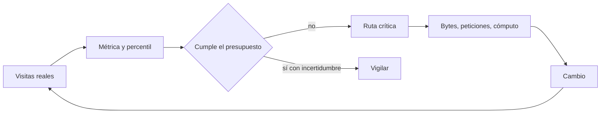
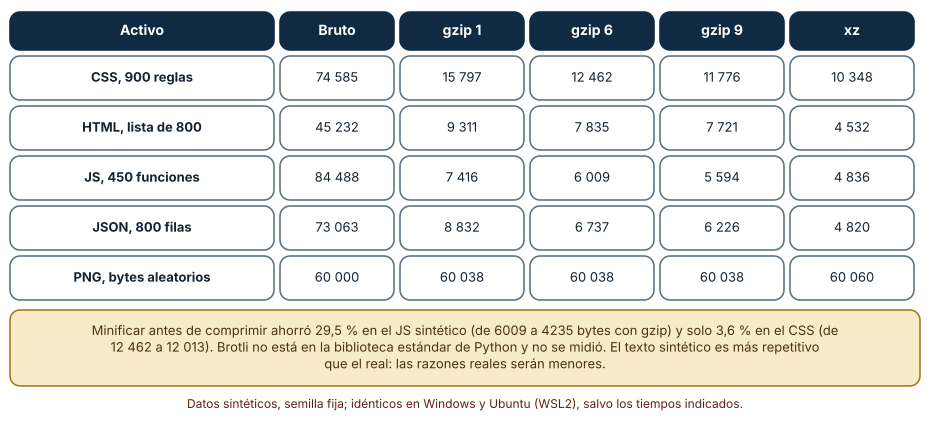
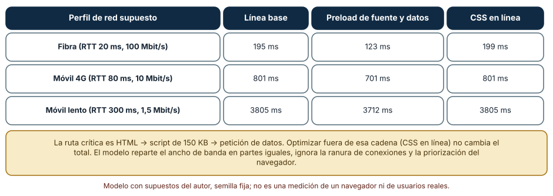
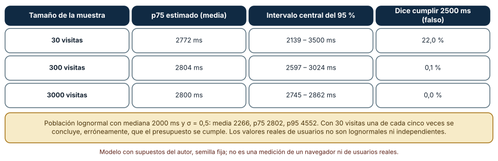

# SE-235 — Rendimiento web y presupuestos

[← SE-234 — Navegación, routing y URLs durables](../../classes/part-19-web-frontend-y-aplicaciones-progresivas/se-234-navegacion-routing-y-urls-durables/README.md) · [↑ Parte 19](../../classes/part-19-web-frontend-y-aplicaciones-progresivas/README.md) · [📚 Índice completo](../../classes/README.md) · [🌐 Portal](../../site/classes/SE-235.html) · [SE-236 — Seguridad del navegador y políticas de contenido →](../../classes/part-19-web-frontend-y-aplicaciones-progresivas/se-236-seguridad-del-navegador-y-politicas-de-contenido/README.md)

## Punto profesional y fundamento pedagógico

**Punto profesional.** La clase existe para que conviertas «la página es lenta» en una decisión medible: qué métrica, con qué muestra, contra qué presupuesto y en qué cadena de recursos está el tiempo, de modo que optimizar deje de ser aplicar recetas y pase a ser cortar el tramo que realmente decide el resultado.

**Por qué aparece aquí.** Se sitúa después de **Navegación, routing y URLs durables** y antes de **Seguridad del navegador y políticas de contenido**: `SE-234` dejó una tabla de URLs; esta clase pregunta cuánto cuesta servir cada una y cómo se decide cuánto es demasiado. Fija tres reglas que las clases siguientes reutilizan: se mide con percentiles y no con promedios, se optimiza la ruta crítica y no cualquier cosa, y un presupuesto es un compromiso comprobable.

**Error conceptual que debe corregir.** Creer que optimizar es aplicar técnicas (comprimir, minificar, diferir) sin preguntar dónde está el tiempo o que una medición con pocas visitas basta para declarar que se cumple un objetivo: la técnica solo ayuda si actúa sobre la cadena que decide, y una muestra pequeña puede decir que se cumple cuando no.

**Secuencia de aprendizaje.** Antes de leer los resultados, predices cuánto reduce gzip cada tipo de activo y qué optimización acorta una página con una cadena de recursos; después mides cinco activos con cuatro algoritmos, simulas la cascada de seis recursos con tres variantes y estimas un percentil 75 con 30, 300 y 3000 visitas contra un presupuesto de 2500 ms.

**Evidencia de aprendizaje.** `perf-log.md` con las predicciones, la tabla de compresión, el modelo de cascada con sus supuestos y la simulación de percentiles, con explicación causal, contraejemplo y qué hallazgo te haría cambiar de optimización.

**Límite de la conclusión.** Los activos son sintéticos y más repetitivos que los reales; el modelo de cascada reparte el ancho de banda por igual e ignora prioridades y conexiones; la población de tiempos es lognormal por supuesto del autor. Ningún experimento mide un navegador, una red real ni visitas de personas.

### Trazabilidad fuente → afirmación

| Fuente primaria u oficial | Afirmación que respalda | Lo que no prueba |
|---|---|---|
| [web.dev: umbrales de Core Web Vitals](https://web.dev/articles/defining-core-web-vitals-thresholds) | Define umbrales (LCP de 2,5 s, INP de 200 ms, CLS de 0,1) evaluados en el percentil 75 de las visitas. | No fija un presupuesto adecuado para tu aplicación. |
| [web.dev: Performance budgets 101](https://web.dev/articles/performance-budgets-101) | Explica qué es un presupuesto de rendimiento y cómo se fija y comprueba. | No dice qué valor elegir. |
| [MDN: ruta crítica de renderizado](https://developer.mozilla.org/en-US/docs/Web/Performance/Guides/Critical_rendering_path) | Describe la secuencia de pasos que el navegador sigue para mostrar la primera pintura. | No mide su duración en un dispositivo concreto. |
| [RFC 1952: formato gzip](https://www.rfc-editor.org/rfc/rfc1952) | Define el formato gzip y su cabecera, usado en la compresión de contenido HTTP. | No compara el rendimiento de gzip con Brotli. |

## Antes de empezar

Recupera de `SE-234` que cada URL es una interfaz pública que se pide muchas veces. La pregunta activa es: **¿qué parte del tiempo de esta página está en los bytes, cuál en la cadena de peticiones y qué muestra necesito para afirmar que cumple?**

## Prerrequisitos

- Haber completado `SE-234` o poder explicar qué identifica una ruta y cómo se resuelve.
- Python 3.11 o posterior; los experimentos usan solo la biblioteca estándar (`gzip`, `lzma`, `statistics`, `random`).
- Nociones de HTTP (cabeceras, caché, compresión) y de cómo carga una página.

## Problema auténtico

La página de entrega tarda en abrirse en el móvil de una estudiante con datos limitados. El equipo comprime las imágenes y no cambia nada; minifica el JavaScript y baja un poco; pone el CSS en línea y el tiempo sigue igual. Un compañero mide en su portátil, con fibra, y dice que va bien. Otro mide diez veces en el móvil y declara que se cumple el objetivo de 2,5 segundos. Nadie ha dicho en qué cadena de recursos está el tiempo, ni con cuántas visitas se afirma que se cumple.

## Objetivos observables

Al terminar podrás:

1. elegir una métrica y un percentil, y explicar por qué un promedio engaña en tiempos con cola larga;
2. fijar un presupuesto (bytes, peticiones o tiempo) y comprobarlo de forma automática;
3. identificar la ruta crítica de una página y decir qué optimización la acorta y cuál no;
4. medir el efecto de la compresión y de la minificación por tipo de activo;
5. calcular cuántas visitas hacen falta para afirmar que se cumple un percentil, con su intervalo.

## Mapa conceptual



El mapa se lee como un ciclo de medición: las visitas dan una métrica con un percentil que se compara con un presupuesto, y solo si no se cumple se busca en la ruta crítica qué cambiar. La rama inferior recuerda que cumplir con una muestra pequeña no es cumplir: se vigila.

## Temas y por qué importan

| Tema | Por qué cambia una decisión profesional | Evidencia mínima |
|---|---|---|
| Medir: laboratorio y campo | Una prueba controlada explica; los datos de visitas reales deciden. | Predicción, traza causal y contraejemplo de **Medir: laboratorio y campo** en `perf-log.md` |
| Presupuestos | Un número comprobable en cada cambio evita que el rendimiento se degrade sin que nadie lo decida. | Predicción, traza causal y contraejemplo de **Presupuestos** en `perf-log.md` |
| Ruta crítica | Solo importa lo que está en la cadena más larga; lo demás no cambia el total. | Predicción, traza causal y contraejemplo de **Ruta crítica** en `perf-log.md` |
| Bytes | La compresión y la minificación dependen del tipo de activo y a veces no hacen nada. | Predicción, traza causal y contraejemplo de **Bytes** en `perf-log.md` |
| Caché y prioridad | Un recurso en caché no cuesta una petición; una pista de precarga adelanta el inicio de otra. | Predicción, traza causal y contraejemplo de **Caché y prioridad** en `perf-log.md` |

## Conceptos y decisiones

### 1. Medir: laboratorio y campo

Las mediciones de **laboratorio** (un dispositivo y una red controlados) son reproducibles y sirven para encontrar la causa; las de **campo** (visitas reales) dicen qué experimentan las personas, con toda su variedad de dispositivos y redes. Las métricas de experiencia del usuario se evalúan en el percentil 75 de las visitas: el valor bajo el cual está el 75 % de ellas. El promedio engaña porque los tiempos tienen cola larga: unas pocas visitas muy lentas lo suben y ocultan que la mayoría está bien, o al revés.

### 2. Presupuestos

Un presupuesto de rendimiento es un límite explícito (kilobytes de JavaScript, número de peticiones, LCP en el percentil 75) que se comprueba en cada cambio. Su valor está en que convierte una decisión implícita («añadamos esta biblioteca») en una visible («cuesta 40 KB de los 200 que tenemos»). Debe derivarse de un objetivo (un tiempo en un dispositivo y red de referencia) y revisarse; un presupuesto que nadie hace cumplir es una intención.

### 3. Ruta crítica

El navegador no puede pintar hasta tener el HTML y los recursos que bloquean el renderizado (hojas de estilo, scripts síncronos); y hay recursos que solo se descubren al procesar otros (una fuente que declara el CSS, unos datos que pide el JavaScript). La **ruta crítica** es la cadena más larga de dependencias: acortar cualquier otra no cambia el tiempo total. Se acorta con menos bytes en la cadena, con menos eslabones (incluir lo necesario en el primer HTML) y con pistas que adelantan el inicio de un recurso (`preload`).

### 4. Bytes

Comprimir con gzip o Brotli reduce el texto (HTML, CSS, JavaScript, JSON) mucho y los formatos ya comprimidos (imágenes, vídeo, archivos) casi nada. La minificación quita lo que el motor no necesita; se suma a la compresión, pero la compresión ya elimina parte de la redundancia que la minificación quita, y por eso el beneficio combinado es menor que la suma. Las imágenes suelen dominar los bytes de una página: formato, tamaño y carga diferida pesan más que cualquier ajuste de CSS.

### 5. Caché y prioridad

Una respuesta con `Cache-Control` adecuado se sirve sin red; un recurso con huella en el nombre puede cachearse un año porque cambia de nombre al cambiar. HTTP/2 multiplexa varias peticiones en una conexión, de modo que no hay que reducir peticiones a toda costa, pero sí evitar que una cadena las serialice. La prioridad con la que el navegador pide cada recurso puede orientarse con pistas; una pista mal puesta compite con lo realmente importante.

### Cuánto comprimen los activos

Se generaron cinco activos sintéticos con semilla fija: 900 reglas de CSS, una lista HTML de 800 filas, 450 funciones de JavaScript, un JSON de 800 filas y 60 000 bytes aleatorios (que representan una imagen ya comprimida). Se comprimieron con gzip en los niveles 1, 6 y 9 y con xz.

```python
tabla[n] = {"bruto": len(b), "gzip1": len(gzip.compress(b, 1, mtime=0)),
            "gzip6": len(gzip.compress(b, 6, mtime=0)),
            "gzip9": len(gzip.compress(b, 9, mtime=0)), "xz": len(lzma.compress(b))}
```

Resultado, idéntico en Windows (CPython 3.12.9) y en Ubuntu bajo WSL2 (3.12.3): el CSS pasa de 74 585 a 12 462 bytes con gzip 6; el HTML, de 45 232 a 7 835; el JavaScript, de 84 488 a 6 009; el JSON, de 73 063 a 6 737. Los 60 000 bytes aleatorios **crecen a 60 038** con gzip y a 60 060 con xz. Subir de gzip 1 a gzip 9 ahorra entre 17 % y 30 % más según el activo, y tarda más (3,9 ms frente a 1,2 ms en el JavaScript en Windows; 2,9 y 0,9 en Ubuntu, medidas de un equipo). Minificar antes de comprimir bajó el JavaScript de 6009 a 4235 bytes (**29,5 %** menos) y el CSS de 12 462 a 12 013 (**3,6 %**).



**Cómo leer la figura.** Cada fila es un activo; las columnas, el tamaño en bytes con cada algoritmo. La última fila es el control: un contenido sin redundancia no se comprime. **Dónde deja de valer:** el texto sintético se genera con plantillas y repite mucho más que el real, de modo que las razones de compresión son optimistas. Brotli no está en la biblioteca estándar de Python y no se midió; sus resultados suelen ser mejores que los de gzip en texto estático. Los tiempos de compresión dependen del equipo y se leen como razones.

### Qué optimización acorta la cadena

Se modeló una página con seis recursos: el HTML (30 KB), una hoja de estilos (20 KB), un script (150 KB), una imagen principal (200 KB), una fuente (40 KB) que solo se descubre al procesar el CSS y unos datos (30 KB) que solo pide el script al ejecutarse (con 60 ms de ejecución). El modelo reparte el ancho de banda a partes iguales entre las descargas activas y comienza cada recurso cuando su padre termina. Se compararon tres variantes: la **línea base**, **preload** de la fuente y de los datos (pedirlos desde el HTML) y el **CSS en línea**.

```python
r = {"html": (30000, None, 0), "css": (20000, "html", 5), "js": (150000, "html", 5),
     "hero": (200000, "html", 5), "fuente": (40000, "css", 5), "api": (30000, "js", 60)}
if variante == "preload":
    r["fuente"] = (40000, "html", 5); r["api"] = (30000, "html", 5)
```

Resultado: en fibra (RTT 20 ms, 100 Mbit/s) la línea base termina en **195 ms**, con preload en **123** y con el CSS en línea en **199**; en móvil 4G (80 ms, 10 Mbit/s), **801**, **701** y **801**; en móvil lento (300 ms, 1,5 Mbit/s), **3805**, **3712** y **3805**. Poner el CSS en línea no cambia el total porque la ruta más larga es HTML → script → datos, y el preload la acorta al sacar los datos de detrás del script.



**Cómo leer la figura.** Cada fila es un perfil de red; cada columna, una variante de la misma página. La que baja el total actúa sobre la cadena más larga. **Dónde deja de valer:** el modelo ignora la priorización del navegador, el límite de conexiones, el coste de abrir una conexión nueva y el análisis incremental del HTML; un navegador real puede pedir la imagen antes que el script. Y adelantar los datos supone que el servidor puede responderlos antes de que el script los pida, que no siempre es cierto.

### ¿Cumple? Depende de cuántas visitas

Se simuló una métrica de carga con una población lognormal (mediana de 2000 ms, σ = 0,5) cuyo percentil 75 verdadero es **2802 ms**, mayor que un presupuesto de 2500 ms; la media es 2266 y el percentil 95, 4552. Se estimó el percentil 75 con 30, 300 y 3000 visitas, repitiendo 1000 veces (300 con 3000 visitas) con semilla fija. Con **30** visitas el percentil 75 estimado tiene un intervalo central del 95 % de **2139 a 3500 ms** y en el **22,0 %** de las repeticiones la estimación queda por debajo de 2500, es decir, se concluye falsamente que el presupuesto se cumple; con **300**, el intervalo es de 2597 a 3024 y el 0,1 % de falsa conformidad; con **3000**, de 2745 a 2862 y 0 %.

```python
p75s.append(q(0.75, [r2.lognormvariate(mu, sigma) for _ in range(n)]))
bajo_presupuesto = sum(1 for v in p75s if v <= 2500) / len(p75s)
```



**Cómo leer la figura.** Cada fila es un tamaño de muestra; las columnas son el percentil 75 medio estimado, el intervalo central del 95 % y el porcentaje de veces que se concluye que se cumple un presupuesto que no se cumple. **Dónde deja de valer:** los tiempos reales no son lognormales ni independientes (un mismo dispositivo repite visitas, hay horas punta) y el intervalo real es más ancho. Con 30 visitas «se cumple» una de cada cinco veces: diez mediciones en un portátil no sustituyen a los datos de campo.

## Definiciones de trabajo

- **percentil 75:** valor por debajo del cual está el 75 % de las visitas; se usa para evaluar métricas de experiencia.
- **presupuesto de rendimiento:** límite explícito y comprobable sobre una métrica o un tamaño que el equipo se compromete a no superar.
- **ruta crítica:** cadena más larga de recursos dependientes que decide el tiempo hasta la primera pintura.
- **minificación:** transformación del código que elimina lo que el motor no necesita sin cambiar su comportamiento.
- **precarga (`preload`):** pista que hace que el navegador pida un recurso antes de descubrirlo por sí mismo.

Las definiciones son operativas para esta clase y deben contrastarse con la documentación enlazada al final.

## Ejemplo mínimo

Estima el percentil 75 de una lista de tiempos y compáralo con el promedio; predice cuál es mayor.

```python
tiempos = [900, 1000, 1100, 1200, 1300, 1400, 1600, 2000, 2600, 9000]
tiempos.sort()
p75 = tiempos[int(0.75 * (len(tiempos) - 1))]
media = sum(tiempos) / len(tiempos)
assert p75 == 1600 and media == 2210
```

El promedio queda por encima del percentil 75 por una sola visita lenta. Registra versión del intérprete y salida; quita el 9000 y predice qué pasa con la media.

## Ejemplo profesional

El equipo fija presupuestos para la página de entrega: 170 KB de JavaScript comprimido en la ruta de entrada, 15 peticiones y LCP de 2,5 s en el percentil 75 de visitas reales desde un móvil de gama media. Cada cambio pasa un comprobador que falla si el paquete lo supera. El análisis de la cascada muestra que la cadena HTML → script → datos decide el tiempo, así que se envían los datos iniciales en el primer HTML y se pre-carga la fuente; el CSS en línea se descarta por no mover la ruta crítica. Los datos de campo se leen con al menos 300 visitas por segmento.

Compara el caso normal con una visita desde un móvil lento, una con la caché fría y una con la caché caliente. El presupuesto es apropiado cuando esos tres casos tienen un valor medido; es una intención cuando solo existe la medición del portátil del equipo.

## Práctica guiada

1. Genera cinco activos sintéticos y mide los bytes con gzip en tres niveles y con xz.
2. Predice qué activo se comprime más y cuál no se comprime y escribe el orden antes de ejecutar.
3. Minifica el JavaScript y el CSS y compara con la compresión sola.
4. Modela la cascada de seis recursos y evalúa la línea base, el preload y el CSS en línea en tres perfiles.
5. Simula la estimación del percentil 75 con 30, 300 y 3000 visitas y calcula el intervalo y la falsa conformidad.
6. Escribe un comprobador de presupuesto que falle si un archivo supera su límite.
7. Entrega `perf-log.md` y pide a otra persona que indique qué optimización recomendaría y por qué.

## Ejercicios

1. **Compresión:** mide la compresión de un archivo propio de texto y de uno binario y explica la diferencia con la tabla.
2. **Cascada:** añade un recurso (una hoja de estilos de impresión que bloquea) y evalúa si cambia la ruta crítica.
3. **Muestra:** calcula cuántas visitas hacen falta para que el intervalo del percentil 75 mida menos de 200 ms con σ = 0,5.
4. **Presupuesto:** fija un presupuesto de bytes por tipo de activo para la página de entrega y escribe el comprobador.

## Reto verificable

Entrega `perf-log.md` con la tabla de compresión, el modelo de cascada con sus supuestos, la simulación de percentiles y el comprobador de presupuesto. Se aprueba si otra persona ejecuta el código desde un checkout limpio, obtiene las mismas cifras con las mismas semillas y puede indicar qué cambio de supuesto invertiría la optimización elegida. No se aprueba por una optimización que no se justifica con la ruta crítica ni por una conclusión basada en pocas visitas.

## Caso conductor

La aplicación de entregas con conectividad irregular fija en esta clase el presupuesto de la página de entrega y el orden de los recursos. Ese presupuesto es el que `SE-237` usa para decidir qué precarga el service worker, `SE-238` para los metadatos de la página y `SE-239` para el taller de integración. Cambia después una sola decisión, el nivel de gzip de 6 a 9, y calcula cuánto ahorra y cuánto cuesta en tiempo de construcción.

## Preguntas frecuentes

### ¿Por qué el percentil 75 y no el promedio?

Porque los tiempos tienen cola larga y el promedio lo arrastran unas pocas visitas muy lentas; el percentil dice qué experimenta la mayoría. Las métricas de experiencia se evalúan en el percentil 75 para que reflejen a casi todas las visitas sin que los extremos las dominen.

### ¿Comprimir una imagen JPEG con gzip ayuda?

No: ya está comprimida y gzip añade unos bytes. Se reduce con un formato más eficiente, un tamaño adecuado al uso y carga diferida.

### ¿Más peticiones son siempre peores?

Con HTTP/1.1 y pocas conexiones, sí; con HTTP/2 las peticiones se multiplexan y lo que importa es que no formen una cadena. Un cambio que reduce peticiones pero alarga la cadena empeora la carga.

### ¿Poner el CSS en línea acelera la página?

Solo si el CSS está en la ruta crítica. Si el tiempo lo decide otra cadena, como script y datos, no cambia el total y aumenta el tamaño del HTML sin caché.

## Fallo controlado y diagnóstico

Reproduce el fallo clásico de la clase: **optimizar lo que no está en la ruta crítica**. Aplica el CSS en línea a la página de seis recursos y compara el total.

Registra síntoma, entrada mínima, hipótesis, observación que descarta cada hipótesis, causa, corrección y prueba de regresión. **Síntoma:** tras poner el CSS en línea, la página tarda lo mismo en un móvil lento. **Hipótesis rivales:** (a) el CSS en línea no se aplicó; (b) la ruta crítica pasa por otra cadena. **Prueba:** calcula la cadena más larga del modelo y comprueba que es HTML → script → datos; evalúa la variante con preload y observa que baja el total. **Conclusión:** la causa es optimizar fuera de la ruta crítica. **Regresión:** añade al comprobador un cálculo de la ruta crítica y exige que cada optimización indique en qué eslabón actúa. No cambies a la vez el CSS y los datos: no sabrás qué mejoró el total.

## Errores comunes y cómo corregirlos

| Síntoma | Causa probable | Corrección |
|---|---|---|
| La mejora no se nota en el móvil | Optimización fuera de la ruta crítica | Medir la cadena y actuar sobre su eslabón más largo |
| Se declara que se cumple con diez mediciones | Muestra pequeña con falsa conformidad frecuente | Usar datos de campo con cientos de visitas e informar el intervalo |
| El peso de la página sube sin que nadie lo decida | Sin presupuesto comprobable | Fijar límites y hacer que el cambio falle al superarlos |
| La compresión no reduce el tamaño de las imágenes | Formato ya comprimido | Elegir formato y tamaño adecuados y diferir la carga |
| Un archivo con huella se vuelve a descargar | Caché corta en un recurso inmutable | Servir con `Cache-Control` largo e `immutable` y cambiar el nombre al cambiar el contenido |

## Entorno y archivos clave

```text
work/SE-235/
├── README.md
├── rendimiento/
│   ├── compresion.py
│   ├── cascada.py
│   └── percentiles.py
├── tests/test_presupuesto.py
└── evidence/perf-log.md
```

El `README` declara plataforma, versión de Python, semillas, supuestos del modelo y comandos. Los experimentos usan solo la biblioteca estándar y se ejecutaron con CPython 3.12.9 en Windows 11 y 3.12.3 en Ubuntu bajo WSL2: las salidas fueron idénticas salvo los tiempos de compresión, que se informan como medidas de un equipo. No se usó un navegador, una herramienta de auditoría ni una red real.

## Seguridad, ética y accesibilidad

- una página pesada la paga quien tiene datos limitados: el rendimiento es un asunto de acceso y de equidad;
- un presupuesto demasiado ajustado puede empujar a eliminar contenido accesible (descripciones, subtítulos) para cumplirlo: define qué no se sacrifica;
- las pistas de precarga y las bibliotecas de terceros pueden filtrar información a otros dominios: revisa qué se pide y a quién;
- los ejemplos usan activos y tiempos sintéticos; no incluyas medidas de visitas reales de estudiantes en la evidencia;
- una muestra de campo es información personal agregada: respeta el consentimiento y la retención.

## Puente hacia el trabajo con agentes

Un agente al que se le pide «optimiza la carga de la página» aplicará un catálogo de técnicas (comprimir, diferir, minificar, poner el CSS en línea) sin decir cuál actúa sobre la ruta crítica, y declarará una mejora medida en una sola ejecución local. Pídele que identifique la cadena más larga antes de cambiar nada, que justifique cada cambio con una medición por tipo de activo y que informe el intervalo y el número de visitas de cualquier afirmación de cumplimiento. Revisa especialmente las mejoras declaradas con un promedio o con pocas ejecuciones.

## Transferencia

Traslada el experimento a otra superficie con costos de entrega (una aplicación móvil que descarga recursos, una API con latencia, un arranque de contenedor): cambia los eslabones pero conserva el método de modelar la cadena, medir cada eslabón y estimar un percentil con su incertidumbre. La transferencia está lograda cuando puedes explicar qué parte del modelo dependía del navegador y cuál de la idea de ruta crítica y de percentil.

## Evaluación y evidencia

| Criterio | Evidencia para aprobar |
|---|---|
| comprensión | explicación de percentil, presupuesto y ruta crítica con un ejemplo cada uno |
| corrección | cifras reproducibles de compresión, cascada y percentiles con las mismas semillas |
| diseño | presupuestos comprobables y optimizaciones justificadas por su eslabón |
| diagnóstico | reproducción de la optimización fuera de la ruta crítica con regresión |
| incertidumbre | declaración de los supuestos del modelo, del intervalo y de la muestra |
| reproducibilidad | versiones, comandos, salida y límites declarados |

## Fuentes

- [web.dev: umbrales de Core Web Vitals](https://web.dev/articles/defining-core-web-vitals-thresholds) — umbrales y percentil 75; autoridad: Google web.dev.
- [web.dev: Performance budgets 101](https://web.dev/articles/performance-budgets-101) — qué son los presupuestos y cómo comprobarlos; autoridad: Google web.dev.
- [web.dev: precargar recursos críticos](https://web.dev/articles/preload-critical-assets) — pistas de precarga; autoridad: Google web.dev.
- [MDN: ruta crítica de renderizado](https://developer.mozilla.org/en-US/docs/Web/Performance/Guides/Critical_rendering_path) — pasos hasta la primera pintura; autoridad: MDN.
- [RFC 9113: HTTP/2](https://www.rfc-editor.org/rfc/rfc9113) — multiplexación de peticiones; autoridad: IETF.
- [RFC 7932: formato Brotli](https://www.rfc-editor.org/rfc/rfc7932) — compresión Brotli, no medida en esta clase; autoridad: IETF.

Cada fuente respalda el mecanismo indicado; ninguna demuestra que el modelo de cascada de la clase reproduzca una carga real ni que un presupuesto sea adecuado para la plataforma de entregas.

- [Python: `gzip`](https://docs.python.org/3/library/gzip.html) — compresión usada en los experimentos.
- [Python: `statistics`](https://docs.python.org/3/library/statistics.html) — medianas y percentiles.

## Límites y siguiente paso

Se ejecutaron tres experimentos con datos sintéticos en Windows y Ubuntu (WSL2) con resultados idénticos salvo los tiempos de compresión. No se usó un navegador ni una red real: los activos son sintéticos, el modelo de cascada es mínimo y la población de tiempos es lognormal por supuesto. La siguiente clase pregunta qué puede hacer una página con lo que recibe y qué debe impedir el navegador.

## Glosario

- **percentil 75:** valor por debajo del cual está el 75 % de las visitas; se usa para evaluar métricas de experiencia.
- **presupuesto de rendimiento:** límite explícito y comprobable sobre una métrica o un tamaño que el equipo se compromete a no superar.
- **ruta crítica:** cadena más larga de recursos dependientes que decide el tiempo hasta la primera pintura.
- **minificación:** transformación del código que elimina lo que el motor no necesita sin cambiar su comportamiento.
- **precarga (`preload`):** pista que hace que el navegador pida un recurso antes de descubrirlo por sí mismo.

---

[← SE-234 — Navegación, routing y URLs durables](../../classes/part-19-web-frontend-y-aplicaciones-progresivas/se-234-navegacion-routing-y-urls-durables/README.md) · [↑ Parte 19](../../classes/part-19-web-frontend-y-aplicaciones-progresivas/README.md) · [📚 Índice completo](../../classes/README.md) · [🌐 Portal](../../site/classes/SE-235.html) · [SE-236 — Seguridad del navegador y políticas de contenido →](../../classes/part-19-web-frontend-y-aplicaciones-progresivas/se-236-seguridad-del-navegador-y-politicas-de-contenido/README.md)
