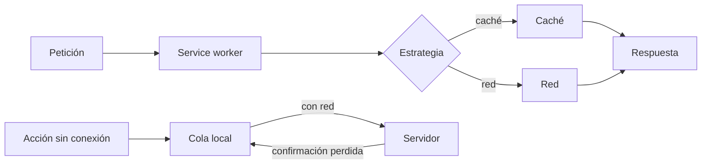
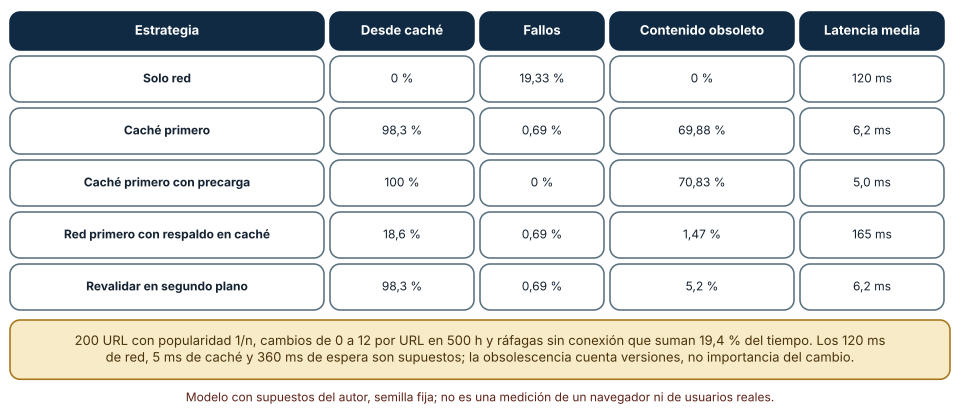
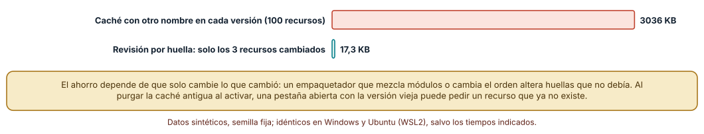
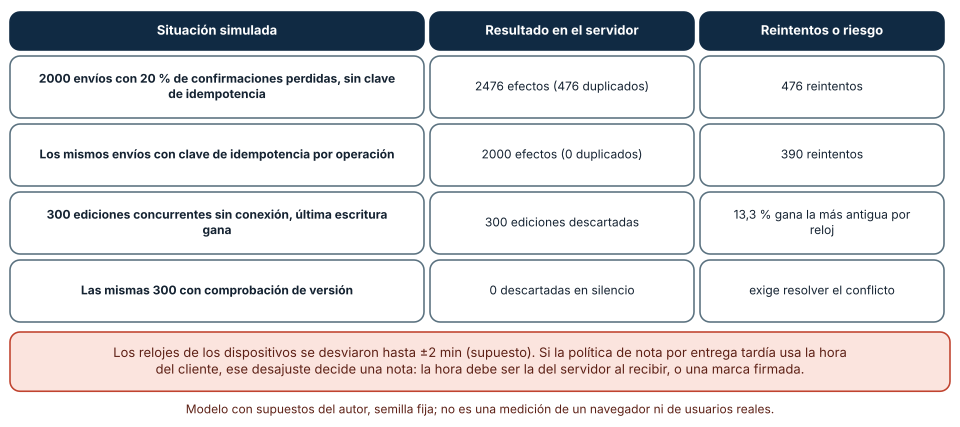

# SE-237 — PWA, caché, offline y sincronización

[← SE-236 — Seguridad del navegador y políticas de contenido](../../classes/part-19-web-frontend-y-aplicaciones-progresivas/se-236-seguridad-del-navegador-y-politicas-de-contenido/README.md) · [↑ Parte 19](../../classes/part-19-web-frontend-y-aplicaciones-progresivas/README.md) · [📚 Índice completo](../../classes/README.md) · [🌐 Portal](../../site/classes/SE-237.html) · [SE-238 — SEO, metadatos y descubribilidad →](../../classes/part-19-web-frontend-y-aplicaciones-progresivas/se-238-seo-metadatos-y-descubribilidad/README.md)

## Punto profesional y fundamento pedagógico

**Punto profesional.** La clase existe para que diseñes una aplicación web que siga siendo útil sin conexión sabiendo qué promete cada estrategia de caché, cómo se actualiza el código que vive en el dispositivo y qué ocurre con lo que la persona hizo mientras no había red, de modo que «funciona offline» sea una propiedad con casos, límites y reglas de reconciliación, y no un efecto secundario de una biblioteca.

**Por qué aparece aquí.** Se sitúa después de **Seguridad del navegador y políticas de contenido** y antes de **SEO, metadatos y descubribilidad**: `SE-236` fijó qué puede hacer una página con lo que recibe y quién puede leerlo; esta clase añade un componente que se instala una vez, intercepta las peticiones y vive mucho más que una visita: el service worker. Aquí el caso conductor de la Parte 19 muestra su razón de ser, una estudiante que entrega una tarea con una conexión que va y viene.

**Error conceptual que debe corregir.** Creer que «caché primero» es la estrategia offline y que basta con precargar los archivos: cada estrategia cambia la obsolescencia por velocidad, el nombre de la caché decide cuánto se vuelve a descargar y reintentar un envío sin una clave que lo identifique duplica el efecto.

**Secuencia de aprendizaje.** Antes de leer los resultados, predices qué estrategia sirve más contenido obsoleto y cuál falla más sin conexión; después simulas cinco estrategias sobre 20 000 peticiones con ráfagas sin conexión, mides cuánto se descarga al publicar una versión con dos políticas de nombre de caché y cuentas cuántos efectos duplicados produce un reintento con y sin clave de idempotencia y cuántas ediciones concurrentes pierde la última escritura.

**Evidencia de aprendizaje.** `pwa-log.md` con las predicciones, el simulador de estrategias con su traza, la comparación de descargas por versión, la simulación de la cola de sincronización y la política de conflictos, con explicación causal, contraejemplo y qué hallazgo te haría cambiar de estrategia.

**Límite de la conclusión.** No se ejecutó ningún service worker ni un navegador: las estrategias se simularon sobre una traza sintética con latencias supuestas por el autor. La interacción de varias pestañas con versiones distintas del código no se midió. Ningún experimento mide una red real ni a personas.

### Trazabilidad fuente → afirmación

| Fuente primaria u oficial | Afirmación que respalda | Lo que no prueba |
|---|---|---|
| [Service Workers (W3C)](https://www.w3.org/TR/service-workers/) | Define el registro, el ciclo de vida (instalación, espera, activación) y la interceptación de peticiones. | No dice qué estrategia conviene a tu aplicación. |
| [Web Application Manifest (W3C)](https://www.w3.org/TR/appmanifest/) | Define el manifiesto con nombre, iconos, URL de inicio y alcance de una aplicación instalable. | No garantiza que cada navegador ofrezca instalar la aplicación. |
| [web.dev: The Offline Cookbook](https://web.dev/articles/offline-cookbook) | Describe estrategias de caché (caché primero, red primero, revalidación) y cuándo aplicar cada una. | No mide su efecto en tu tráfico. |
| [IETF: cabecera Idempotency-Key (borrador)](https://datatracker.ietf.org/doc/draft-ietf-httpapi-idempotency-key-header/) | Propone una cabecera para que un servidor reconozca un reintento de una operación no idempotente. | Es un borrador: no es un estándar publicado. |

## Antes de empezar

Recupera de `SE-236` que un service worker es código con privilegios dentro de un origen y que la política de contenido y las cookies limitan lo que puede hacer. La pregunta activa es: **¿qué ve la persona cuando no hay red, cómo llega una versión nueva al dispositivo y qué pasa con lo que hizo mientras tanto?**

## Prerrequisitos

- Haber completado `SE-236` o poder explicar qué aísla el origen y qué riesgo implica ejecutar código persistente en él.
- Python 3.11 o posterior; los experimentos usan solo la biblioteca estándar (`random`, `bisect`, `hashlib`).
- Nociones de cabeceras de caché HTTP y de promesas en JavaScript.

## Problema auténtico

Una estudiante entrega su trabajo desde un autobús: la conexión se cae tres veces en cinco minutos. El formulario se queda cargando, ella pulsa de nuevo, el servidor recibe dos entregas y la plataforma le descuenta puntos por tarde porque la segunda llegó después del plazo. El equipo añade un service worker con «caché primero» y la siguiente semana nadie ve la versión corregida de la aplicación: el dispositivo sigue sirviendo la vieja. Otra persona edita su perfil sin conexión desde el móvil y desde el portátil y se pierde una de las ediciones sin que nadie lo note.

## Objetivos observables

Al terminar podrás:

1. describir qué requiere una aplicación web progresiva y el ciclo de vida de un service worker;
2. comparar estrategias de caché por obsolescencia, latencia y fallos sin conexión;
3. diseñar el versionado de la caché para que una versión nueva descargue solo lo que cambió y no rompa pestañas abiertas;
4. diseñar una cola de envíos con reintentos idempotentes;
5. elegir una política de conflictos y explicar por qué la hora del dispositivo no es una fuente fiable.

## Mapa conceptual



El mapa se lee en dos mitades: arriba, una petición pasa por un service worker que decide entre caché y red según una estrategia; abajo, una acción sin conexión espera en una cola y se envía cuando hay red, con el riesgo de que la confirmación se pierda y la acción se repita.

## Temas y por qué importan

| Tema | Por qué cambia una decisión profesional | Evidencia mínima |
|---|---|---|
| Qué es una aplicación web progresiva | Un manifiesto, HTTPS y un service worker hacen la aplicación instalable y capaz de funcionar sin red. | Predicción, traza causal y contraejemplo de **Qué es una aplicación web progresiva** en `pwa-log.md` |
| Ciclo de vida del service worker | Instalar, esperar y activar explican por qué una versión nueva no se ve de inmediato. | Predicción, traza causal y contraejemplo de **Ciclo de vida del service worker** en `pwa-log.md` |
| Estrategias de caché | Cada estrategia cambia obsolescencia por velocidad y por disponibilidad. | Predicción, traza causal y contraejemplo de **Estrategias de caché** en `pwa-log.md` |
| Versionado y actualización | El nombre de la caché decide cuánto se vuelve a descargar y si las pestañas viejas se rompen. | Predicción, traza causal y contraejemplo de **Versionado y actualización** en `pwa-log.md` |
| Sincronización y conflictos | Reintentar sin identificar la operación la duplica; la hora del dispositivo no ordena ediciones. | Predicción, traza causal y contraejemplo de **Sincronización y conflictos** en `pwa-log.md` |

## Conceptos y decisiones

### 1. Qué es una aplicación web progresiva

Una aplicación web progresiva es una aplicación web servida por HTTPS con un **manifiesto** (nombre, iconos, URL de inicio, alcance, modo de visualización) y un **service worker** que intercepta las peticiones. El manifiesto permite instalarla; el service worker permite responder sin red. «Progresiva» significa que debe funcionar en cualquier navegador y mejorar donde haya soporte: sin el service worker, sigue siendo una página normal. No sustituye a una aplicación nativa en todo; es una opción para llegar con un coste de distribución bajo.

### 2. Ciclo de vida del service worker

El navegador descarga el script y lo **instala**; si ya hay una versión en uso, la nueva queda **en espera** hasta que se cierran todas las pestañas controladas por la anterior (o hasta que se fuerza la activación), y entonces se **activa**. El navegador comprueba si el script cambió comparándolo byte a byte, por lo que servirlo con una caché HTTP larga puede retrasar la actualización: se sirve con `Cache-Control: no-cache`. Saltarse la espera acelera la actualización pero puede dejar a una pestaña abierta con código viejo hablando con un service worker nuevo, de modo que la decisión se documenta.

### 3. Estrategias de caché

**Solo red** es lo más fresco y no funciona sin conexión. **Caché primero** responde al instante y puede servir contenido viejo indefinidamente. **Red primero con respaldo en caché** da frescura cuando hay red y degrada con elegancia, a costa de esperar el tiempo de espera cuando la red es mala. **Revalidar en segundo plano** (`stale-while-revalidate`) responde desde la caché y renueva para la próxima vez: rápido y casi fresco, con la limitación de mostrar una versión vieja una vez. No hay una estrategia correcta: se elige por tipo de recurso (el esqueleto de la aplicación admite caché primero; los datos de una calificación, no).

### 4. Versionado y actualización

Si cada versión usa una caché con otro nombre, publicar una versión descarga de nuevo todos los recursos aunque solo cambiara uno. Registrar una **huella por recurso** (el contenido o su hash va en el nombre o en un manifiesto de precarga) permite descargar solo lo que cambió. Purgar la caché antigua al activar la nueva libera espacio, pero una pestaña abierta con la versión anterior puede pedir un recurso que ya no existe: conviene conservar una generación anterior un tiempo y avisar a la persona de que hay una versión nueva.

### 5. Sincronización y conflictos

Las acciones hechas sin conexión se guardan en una cola local y se envían al volver la red. Si la confirmación se pierde, el cliente reintenta, y si el servidor no reconoce la repetición, la operación se aplica dos veces. La solución es una **clave de idempotencia** generada en el cliente por operación. Para las ediciones concurrentes hay dos familias de políticas: **la última escritura gana** (simple, descarta una edición) y **comprobar una versión** (el servidor rechaza una edición basada en una versión vieja y obliga a combinar). La hora del dispositivo no es una fuente fiable para ordenarlas: los relojes difieren, como mostró Lamport al definir el orden de eventos sin relojes comunes.

### Cinco estrategias frente a una traza con ráfagas sin conexión

Se generó una traza sintética con semilla fija de 20 000 peticiones a 200 URL con popularidad decreciente (1/n), cada URL con entre 0 y 12 cambios a lo largo de 500 horas, y ráfagas sin conexión que suman el 19,4 % del tiempo. Se simularon cinco estrategias, con 120 ms de latencia de red, 5 ms de caché y 360 ms de espera antes de caer a la caché en «red primero» (supuestos del autor). «Obsoleto» significa que la caché guarda una versión anterior a la vigente.

```python
elif estrategia == "revalidar_en_segundo_plano":
    if u in cache:
        sirvio_cache += 1; viejas += cache[u] < v; lat.append(5)
        if not sin_red: cache[u] = v          # renueva para la próxima
    elif sin_red: fallos += 1
    else: cache[u] = v; lat.append(120)
```

Resultado, idéntico en Windows (CPython 3.12.9) y en Ubuntu bajo WSL2 (3.12.3): **solo red** falla en el **19,33 %** de las peticiones y no sirve nada obsoleto; **caché primero** sirve el 98,3 % desde la caché con 6,2 ms de latencia media, falla el 0,69 % (primeras visitas sin red) y sirve contenido **obsoleto en el 69,88 %**; con **precarga** de todas las URL el fallo baja a 0 % y lo obsoleto sube a 70,83 %; **red primero** casi no sirve obsoleto (1,47 %) y tarda 165 ms de media; **revalidar en segundo plano** sirve desde la caché con la misma latencia que caché primero (6,2 ms) y reduce lo obsoleto a **5,2 %**.



**Cómo leer la figura.** Cada fila es una estrategia; las columnas son el porcentaje servido desde la caché, el de fallos sin conexión, el de contenido obsoleto y la latencia media. **Dónde deja de valer:** las latencias y el patrón de cambios son supuestos; en una aplicación con pocos cambios la obsolescencia de «caché primero» sería mucho menor. La obsolescencia cuenta versiones, no la importancia del cambio: servir una portada vieja y servir una calificación vieja no se comparan. Y no hay un service worker real ni un navegador en la simulación.

### Descargar de nuevo solo lo que cambió

Se supuso una aplicación de 100 recursos con tamaños de 2 a 60 KB (3 035 682 bytes en total) y una versión nueva que cambia 3 recursos (17 312 bytes). Con una caché que **cambia de nombre en cada versión**, el dispositivo descarga los 100 recursos (**3 035 682 bytes**); con una **revisión por huella** por recurso, descarga solo los tres que cambiaron (**17 312 bytes**), es decir, **99,4 %** menos.

```python
cambiados = r.sample(list(recursos), 3)
total = sum(recursos.values())
delta = sum(recursos[k] for k in cambiados)
```



**Cómo leer la figura.** Cada barra son los kilobytes descargados al publicar la versión; la verde descarga solo lo que cambió. **Dónde deja de valer:** el ahorro supone que solo cambia lo que cambió: un empaquetador que mezcla módulos o cambia el orden altera huellas que no debía. Tampoco modela las pestañas abiertas: una versión que purga la caché vieja al activarse puede romper una pestaña que aún pide un recurso de la versión anterior, y por eso este experimento no pretende demostrar que purgar sea seguro, solo cuantificar la descarga.

### Duplicados y ediciones perdidas

Se simularon 2000 envíos con una probabilidad del 20 % de que se pierda la confirmación y el cliente reintente. **Sin clave de idempotencia**, el servidor produjo **2476 efectos para 2000 operaciones (476 duplicados)**, con 476 reintentos; **con clave** produjo **2000 efectos (0 duplicados)**, con 390 reintentos (menos, porque el reintento se reconoce como ya aplicado y no vuelve a arriesgarse a perder otra confirmación). Para las ediciones, se simularon 300 pares de ediciones concurrentes sin conexión en ventanas de ±5 minutos con relojes que se desvían hasta ±2 minutos (supuesto): **la última escritura gana descarta una edición en los 300 casos**, y en el **13,3 %** gana la más antigua según el reloj real; con **comprobación de versión** no se descarta ninguna en silencio, a costa de obligar a resolver el conflicto.

```python
if not claves or clave not in servidor:
    servidor[clave] = servidor.get(clave, 0) + 1     # sin clave, cada reintento suma otro efecto
if q.random() >= p_perdida_ack: hecho = True
else: reintentos += 1
```



**Cómo leer la figura.** Las dos primeras filas comparan el reintento con y sin clave; las dos últimas, las políticas de conflicto. **Dónde deja de valer:** el 20 % de pérdida de confirmaciones y los desvíos de reloj son supuestos; el descarte del 100 % por «última escritura gana» es una propiedad de la política, no una medida. La simulación no cubre el orden entre operaciones distintas ni la unión automática de ediciones. Y vale para el caso conductor: si la nota de una entrega tardía se calcula con la hora del cliente, un reloj desviado decide una nota.

## Definiciones de trabajo

- **service worker:** script que el navegador ejecuta aparte de la página y que intercepta las peticiones de un alcance para responder desde caché, red o lógica propia.
- **estrategia de caché:** regla que decide, para cada petición, si se responde desde la caché, desde la red o desde ambas.
- **huella de contenido:** identificador derivado del contenido de un recurso que cambia solo cuando el contenido cambia.
- **clave de idempotencia:** identificador generado por el cliente para una operación, de modo que el servidor la aplique una sola vez aunque llegue varias.
- **última escritura gana:** política de conflicto que conserva la edición con la marca de tiempo mayor y descarta las demás.

Las definiciones son operativas para esta clase y deben contrastarse con las especificaciones enlazadas al final.

## Ejemplo mínimo

Calcula cuántos bytes se descargan al cambiar un recurso con una caché por versión y con una huella por recurso; predice el cociente.

```python
recursos = {"a.js": 40_000, "b.js": 60_000, "c.css": 20_000}
total = sum(recursos.values())
cambiados = {"c.css"}
por_huella = sum(v for k, v in recursos.items() if k in cambiados)
assert total == 120_000 and por_huella == 20_000
```

Una caché por versión descarga 120 000 bytes y la huella, 20 000. Registra versión del intérprete y salida; cambia dos recursos y predice el cociente.

## Ejemplo profesional

La aplicación de entregas precarga el esqueleto (HTML, CSS, JavaScript y los iconos) con una revisión por huella y lo sirve con caché primero; los datos de la lista de entregas usan revalidar en segundo plano y las calificaciones, red primero con un tiempo de espera corto. El script del service worker se sirve con `no-cache`, la versión nueva avisa a la persona («hay una versión nueva») y se conserva una generación anterior. El envío de una entrega sin conexión va a una cola local con una clave de idempotencia por operación; al recibirla, el servidor marca la hora de recepción, que es la que cuenta para el plazo. Las ediciones del perfil llevan la versión del dato y un conflicto se muestra a la persona.

Compara el caso normal con una conexión que se cae durante el envío, una versión nueva con una pestaña abierta y una edición hecha en dos dispositivos. El diseño es apropiado cuando esos tres casos tienen una regla escrita; es frágil cuando dependen de que la persona vuelva a pulsar.

## Práctica guiada

1. Escribe el manifiesto de la aplicación y comprueba sus campos con un validador.
2. Predice qué estrategia sirve más contenido obsoleto y cuál falla más sin conexión y escribe el orden antes de simular.
3. Genera la traza sintética y simula las cinco estrategias con semilla fija.
4. Calcula las descargas de una versión que cambia 3 de 100 recursos con una caché por versión y con una huella por recurso.
5. Simula 2000 envíos con confirmaciones perdidas, con y sin clave de idempotencia.
6. Simula 300 ediciones concurrentes con la última escritura y con comprobación de versión.
7. Entrega `pwa-log.md` y pide a otra persona que indique qué estrategia asignaría a cada recurso.

## Ejercicios

1. **Estrategias:** asigna una estrategia a seis recursos de la aplicación y justifica cada una con la obsolescencia que toleras.
2. **Huella:** diseña un manifiesto de precarga con huellas y calcula las descargas tras cambiar el orden de dos módulos.
3. **Idempotencia:** explica qué debe guardar el servidor para reconocer un reintento y durante cuánto tiempo.
4. **Conflictos:** diseña la interfaz con que una persona resuelve una edición en conflicto y qué información necesita.

## Reto verificable

Entrega `pwa-log.md` con la traza, la simulación de las cinco estrategias, la comparación de descargas y la simulación de la cola con su política de conflictos. Se aprueba si otra persona ejecuta el código desde un checkout limpio, obtiene las mismas cifras con las mismas semillas y puede señalar qué supuesto cambiaría la estrategia elegida. No se aprueba por una afirmación de que «funciona offline» sin la tabla de qué ocurre en cada caso.

## Caso conductor

La aplicación de entregas con conectividad irregular fija en esta clase su comportamiento sin red: qué se sirve de la caché, cómo llega una versión nueva y cómo se envía una entrega que se hizo sin conexión sin duplicarla ni cambiar su hora de recepción. Esas reglas son las que `SE-239` ensambla en un flujo y `SE-240` verifica en el proyecto. Cambia después una sola decisión, la estrategia de la lista de entregas de revalidar a red primero, y calcula qué cambia en latencia y obsolescencia.

## Preguntas frecuentes

### ¿Una aplicación con service worker funciona siempre sin conexión?

No: funciona sin conexión solo para lo que se haya guardado y para las acciones que se hayan previsto. Una primera visita sin red, un recurso que nunca se pidió o una operación que requiere el servidor siguen fallando; hay que decidir qué se ofrece y cómo se explica.

### ¿Cómo hago que una versión nueva se active sin esperar?

Con `skipWaiting` y reclamando las pestañas, pero con riesgo de que una pestaña abierta quede con código viejo hablando con el service worker nuevo. Suele ser más seguro avisar a la persona y activar al cerrar o recargar.

### ¿Por qué no usar la hora del dispositivo para decidir quién gana?

Porque los relojes de los dispositivos difieren, se ajustan y pueden ser manipulados; en la simulación gana la edición más antigua en el 13,3 % de los casos con desvíos de dos minutos. Se usan versiones del dato o marcas del servidor.

### ¿La sincronización en segundo plano resuelve la cola?

La API de sincronización en segundo plano no está disponible en todos los navegadores y no garantiza cuándo corre. La cola debe funcionar también cuando la aplicación está abierta y reintenta al recuperar la red.

## Fallo controlado y diagnóstico

Reproduce el fallo clásico de la clase: **reintentar una operación sin identificarla**. Simula el envío de una entrega con una confirmación perdida y un reintento automático.

Registra síntoma, entrada mínima, hipótesis, observación que descarta cada hipótesis, causa, corrección y prueba de regresión. **Síntoma:** una estudiante aparece con dos entregas y la segunda llegó después del plazo. **Hipótesis rivales:** (a) pulsó dos veces; (b) el cliente reintentó tras perder la confirmación. **Prueba:** revisa el registro: ambas peticiones llegan con el mismo contenido separadas por el tiempo de espera del cliente y sin acción de la persona entre medias. **Conclusión:** la causa es un reintento sin clave. **Regresión:** genera la clave al crear la operación, guárdala en la cola y haz que el servidor devuelva el resultado original si la ve de nuevo; añade una prueba con la confirmación perdida. No cambies a la vez la clave y la hora de recepción: no sabrás qué cerró el problema.

## Errores comunes y cómo corregirlos

| Síntoma | Causa probable | Corrección |
|---|---|---|
| Nadie ve la versión nueva de la aplicación | Script del service worker servido con caché larga o activación bloqueada por pestañas | Servirlo con `no-cache` y avisar de la versión nueva |
| Cada versión descarga toda la aplicación | Caché con otro nombre en cada versión | Revisar por huella y descargar solo lo que cambió |
| Una pestaña abierta falla tras publicar | La caché vieja se purgó mientras la pestaña seguía pidiendo recursos | Conservar una generación anterior y avisar |
| Una entrega aparece duplicada | Reintento tras perder la confirmación sin clave de idempotencia | Generar la clave en el cliente y reconocerla en el servidor |
| Se pierde una edición hecha en otro dispositivo | Última escritura gana con relojes desviados | Comprobar versión y resolver el conflicto |

## Entorno y archivos clave

```text
work/SE-237/
├── README.md
├── pwa/
│   ├── estrategias.py
│   ├── versiones.py
│   └── sincronizar.py
├── tests/test_estrategias.py
└── evidence/pwa-log.md
```

El `README` declara plataforma, versión de Python, semillas, supuestos y comandos. Los experimentos usan solo la biblioteca estándar y se ejecutaron con CPython 3.12.9 en Windows 11 y 3.12.3 en Ubuntu bajo WSL2: las salidas fueron idénticas. No se registró ningún service worker ni se usó un navegador.

## Seguridad, ética y accesibilidad

- un service worker intercepta todas las peticiones de su alcance: un script comprometido o una biblioteca de terceros cargada en él da control persistente sobre la aplicación;
- una caché con datos personales en un dispositivo compartido puede exponerlos a la siguiente persona: límpiala al cerrar sesión y no guardes respuestas autenticadas sin pensarlo;
- una aplicación instalable debe seguir siendo accesible: prueba el modo instalado con teclado y con lector de pantalla;
- una persona sin conexión debe saber qué se guardó y qué no: muestra un estado claro y no prometas más de lo que haces;
- los ejemplos usan peticiones y ediciones sintéticas; no incluyas entregas ni perfiles de estudiantes reales en la evidencia.

## Puente hacia el trabajo con agentes

Un agente al que se le pide «haz que funcione sin conexión» generará un service worker con una estrategia única, normalmente caché primero para todo, sin versionado por huella ni cola de envíos. Pídele que asigne una estrategia por tipo de recurso y la justifique con la obsolescencia que tolera, que explique cómo llega una versión nueva y que entregue la cola con claves de idempotencia. Revisa especialmente cualquier uso de la hora del cliente para decidir un resultado, y cualquier `skipWaiting` sin aviso: son los dos atajos que producen errores difíciles de reproducir.

## Transferencia

Traslada el experimento a otra superficie con operación desconectada (una aplicación móvil con sincronización, una herramienta de campo, un cliente de correo): cambia el almacén y el protocolo, pero conserva el método de simular estrategias sobre una traza, cuantificar la descarga por versión y comprobar duplicados y conflictos. La transferencia está lograda cuando puedes explicar qué parte del diseño dependía del navegador y cuál de la idea de idempotencia y de versiones.

## Evaluación y evidencia

| Criterio | Evidencia para aprobar |
|---|---|
| comprensión | explicación del ciclo de vida del service worker y de cada estrategia con su límite |
| corrección | cifras reproducibles de estrategias, descargas, duplicados y conflictos con las mismas semillas |
| diseño | estrategia por recurso, versionado por huella, cola con claves y política de conflictos |
| diagnóstico | reproducción del reintento sin clave con regresión |
| incertidumbre | declaración de los supuestos de latencia, pérdida y reloj y de lo que no se midió (navegador, pestañas) |
| reproducibilidad | versiones, comandos, salida y límites declarados |

## Fuentes

- [Service Workers (W3C)](https://www.w3.org/TR/service-workers/) — registro, ciclo de vida e interceptación; autoridad: W3C.
- [Web Application Manifest (W3C)](https://www.w3.org/TR/appmanifest/) — campos del manifiesto; autoridad: W3C.
- [web.dev: The Offline Cookbook](https://web.dev/articles/offline-cookbook) — estrategias de caché; autoridad: Google web.dev.
- [MDN: usar service workers](https://developer.mozilla.org/en-US/docs/Web/API/Service_Worker_API/Using_Service_Workers) — instalación, espera y activación; autoridad: MDN.
- [RFC 8246: HTTP Immutable Responses](https://www.rfc-editor.org/rfc/rfc8246) — recursos con huella que no cambian; autoridad: IETF.
- [Lamport, «Time, clocks, and the ordering of events in a distributed system» (CACM, 1978)](https://doi.org/10.1145/359545.359563) — por qué los relojes no ordenan eventos distribuidos; autoridad: Communications of the ACM.

Cada fuente respalda el mecanismo indicado; ninguna demuestra que las estrategias simuladas de la clase reproduzcan el comportamiento de un navegador real ni que un esquema de huellas sea adecuado para una aplicación concreta.

- [Python: `bisect`](https://docs.python.org/3/library/bisect.html) — búsqueda usada para saber qué versión del recurso está vigente.
- [Python: `hashlib`](https://docs.python.org/3/library/hashlib.html) — huellas de contenido.

## Límites y siguiente paso

Se ejecutaron tres experimentos con datos sintéticos en Windows y Ubuntu (WSL2) con resultados idénticos. No se ejecutó ningún service worker ni un navegador: la traza, las latencias, las pérdidas de confirmación y los desvíos de reloj son supuestos del autor y las pestañas con versiones mixtas no se midieron. La siguiente clase pregunta cómo hacer que las páginas se encuentren y se entiendan fuera de la aplicación.

## Glosario

- **service worker:** script que el navegador ejecuta aparte de la página y que intercepta las peticiones de un alcance para responder desde caché, red o lógica propia.
- **estrategia de caché:** regla que decide, para cada petición, si se responde desde la caché, desde la red o desde ambas.
- **huella de contenido:** identificador derivado del contenido de un recurso que cambia solo cuando el contenido cambia.
- **clave de idempotencia:** identificador generado por el cliente para una operación, de modo que el servidor la aplique una sola vez aunque llegue varias.
- **última escritura gana:** política de conflicto que conserva la edición con la marca de tiempo mayor y descarta las demás.

---

[← SE-236 — Seguridad del navegador y políticas de contenido](../../classes/part-19-web-frontend-y-aplicaciones-progresivas/se-236-seguridad-del-navegador-y-politicas-de-contenido/README.md) · [↑ Parte 19](../../classes/part-19-web-frontend-y-aplicaciones-progresivas/README.md) · [📚 Índice completo](../../classes/README.md) · [🌐 Portal](../../site/classes/SE-237.html) · [SE-238 — SEO, metadatos y descubribilidad →](../../classes/part-19-web-frontend-y-aplicaciones-progresivas/se-238-seo-metadatos-y-descubribilidad/README.md)
