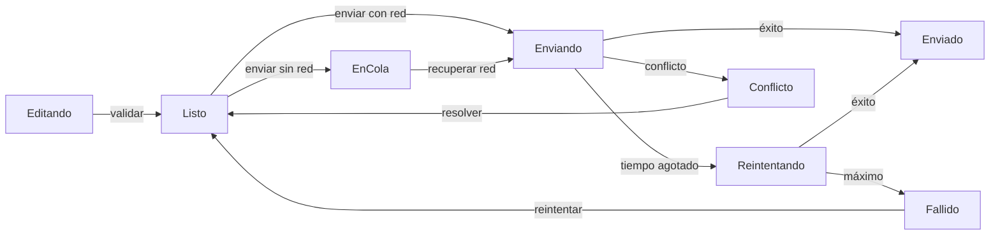
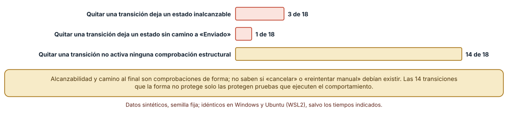
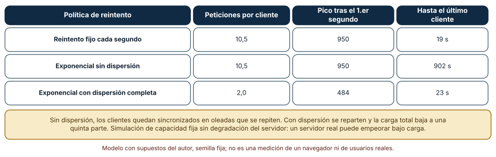
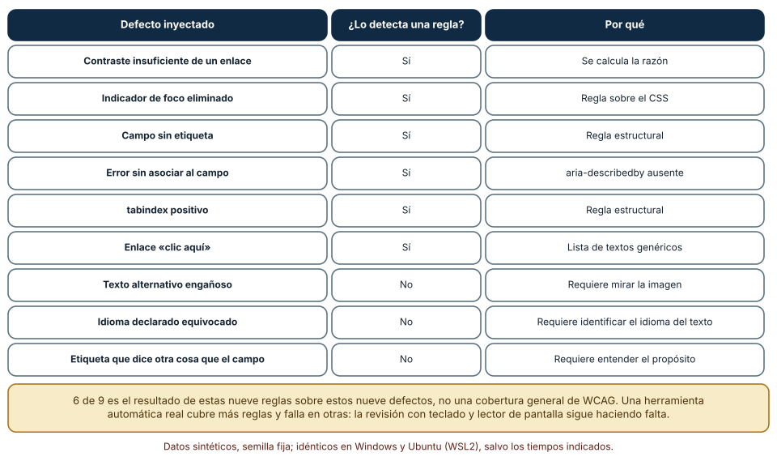

# SE-239 — Taller: construir un flujo web resiliente

[← SE-238 — SEO, metadatos y descubribilidad](../../classes/part-19-web-frontend-y-aplicaciones-progresivas/se-238-seo-metadatos-y-descubribilidad/README.md) · [↑ Parte 19](../../classes/part-19-web-frontend-y-aplicaciones-progresivas/README.md) · [📚 Índice completo](../../classes/README.md) · [🌐 Portal](../../site/classes/SE-239.html) · [SE-240 — Proyecto: aplicación web accesible y offline →](../../classes/part-19-web-frontend-y-aplicaciones-progresivas/se-240-proyecto-aplicacion-web-accesible-y-offline/README.md)

## Punto profesional y fundamento pedagógico

**Punto profesional.** El taller existe para que reúnas lo que las diez clases anteriores trataron por separado en un solo flujo, el de entregar una tarea con una conexión que falla, y lo especifiques como una máquina de estados explícita, lo pruebes con fallos inyectados y declares qué comprobaciones automáticas lo cubren y cuáles exigen a una persona. Un flujo resiliente no es el que no falla: es el que tiene una respuesta escrita para cada fallo previsto.

**Por qué aparece aquí.** Se sitúa después de **SEO, metadatos y descubribilidad** y antes de **Proyecto: aplicación web accesible y offline**: las clases `SE-229` a `SE-238` dejaron piezas (estructura, eventos, renderizado, estado, formularios, URLs, presupuesto, seguridad, caché y descubribilidad); aquí se ensamblan y se interrogan. Es un taller de seis horas: se trabaja, se rompe a propósito y se registra evidencia, en lugar de leer más teoría.

**Error conceptual que debe corregir.** Creer que un flujo está probado cuando funciona en el caso feliz y que una comprobación estructural (todos los estados son alcanzables) demuestra que el comportamiento es el que se quería: la forma no protege contra transiciones que faltan pero no rompen la forma, y la sincronía de los clientes convierte un reintento correcto en una avalancha.

**Secuencia de aprendizaje.** Antes de ejecutar, predices cuántas de las 18 transiciones del flujo, al quitarlas, rompen la forma de la máquina y cuántas pasan desapercibidas; después modelas el flujo y lo mutas, simulas 1000 clientes que fallan a la vez frente a un servidor de capacidad limitada con tres políticas de reintento y ejecutas nueve defectos de accesibilidad inyectados contra un conjunto de reglas automáticas.

**Evidencia de aprendizaje.** `workshop-log.md` con el diagrama de estados y su tabla de transiciones, las mutaciones y su efecto, la simulación de reintentos con las tres políticas, la tabla de defectos de accesibilidad con la columna «lo ve una regla / lo ve una persona» y un plan de pruebas por escenario, con predicción previa, observación, explicación causal, contraejemplo y qué hallazgo te haría cambiar el diseño.

**Límite de la conclusión.** El flujo de ocho estados y 18 transiciones lo diseñó el autor; el servidor de la simulación tiene capacidad fija sin degradación; los nueve defectos son una muestra elegida. Ningún experimento usa un navegador, una red real o personas, y las reglas automáticas no equivalen a una herramienta de auditoría ni a una revisión con tecnologías de apoyo.

### Trazabilidad fuente → afirmación

| Fuente primaria u oficial | Afirmación que respalda | Lo que no prueba |
|---|---|---|
| [Harel, «Statecharts: a visual formalism for complex systems» (Sci. Comput. Program., 1987)](https://doi.org/10.1016/0167-6423%2887%2990035-9) | Propone estados, transiciones y jerarquía para especificar comportamiento reactivo de forma visual y analizable. | No prueba que un diagrama de estados sea el modelo adecuado para cada interfaz. |
| [AWS Builders' Library: timeouts, reintentos y retroceso con dispersión](https://aws.amazon.com/builders-library/timeouts-retries-and-backoff-with-jitter/) | Explica por qué los reintentos sincronizados amplifican una sobrecarga y cómo la dispersión (jitter) reparte la carga. | No mide el comportamiento de tu servicio concreto. |
| [W3C WAI: evaluación preliminar de accesibilidad](https://www.w3.org/WAI/test-evaluate/preliminary/) | Reconoce que las herramientas automáticas detectan solo una parte de los problemas y que hace falta revisión manual. | No fija qué porcentaje cubre cada herramienta. |
| [WCAG 2.2 (W3C)](https://www.w3.org/TR/WCAG22/) | Define los criterios de éxito (nombre accesible, contraste, foco visible, errores) que el flujo debe cumplir. | No dice cómo probar cada criterio en tu flujo. |

## Antes de empezar

Recupera de `SE-237` que un envío sin conexión debe esperar en una cola con una clave de idempotencia y de `SE-233` que un error debe identificarse y conservarse lo escrito. La pregunta activa es: **¿qué estados puede tener una entrega, qué ocurre en cada fallo y cómo sé que mi plan de pruebas no solo mira el camino feliz?**

## Prerrequisitos

- Haber completado `SE-238` o poder explicar la diferencia entre rastrear, indexar y mostrar.
- Haber visto, al menos, `SE-233` (formularios), `SE-235` (presupuestos) y `SE-237` (sin conexión).
- Python 3.11 o posterior; los experimentos usan solo la biblioteca estándar (`collections`, `random`, `re`).

## Problema auténtico

El equipo ha construido las piezas: un formulario con estructura accesible, un manejador de eventos, un estado con identidad, validación, URLs estables, un presupuesto, una política de seguridad, un service worker y metadatos. Al integrarlas aparecen problemas que ninguna pieza tenía: una entrega queda en un estado «enviando» eterno porque no hay una transición para el 409; al volver la red, mil estudiantes reintentan en el mismo segundo tras una caída del servidor de entregas; y el flujo pasa todas las pruebas automáticas pero una persona con lector de pantalla no se entera de que su entrega quedó en cola. Nadie diseñó el flujo como un todo, y los fallos están en las costuras.

## Objetivos observables

Al terminar podrás:

1. especificar un flujo como una máquina de estados con eventos y transiciones explícitas, incluidos los fallos;
2. comprobar su forma (alcanzabilidad, ausencia de callejones sin salida) y reconocer lo que esa comprobación no ve;
3. elegir una política de reintentos y justificarla con una simulación de clientes sincronizados;
4. repartir las comprobaciones de accesibilidad entre reglas automáticas y revisión humana, con evidencia;
5. escribir un plan de pruebas por escenario (red buena, lenta, sin conexión, conflicto) que cubra costuras y no solo piezas.

## Mapa conceptual



El mapa se lee desde la edición hasta el envío: cada flecha es un evento, y los fallos (cola, reintento, conflicto, fallo definitivo) tienen sus propias transiciones de vuelta. Un estado sin salida o sin camino al estado final es un defecto de forma; una transición ausente que no rompe esa forma es un defecto de comportamiento.

## Temas y por qué importan

| Tema | Por qué cambia una decisión profesional | Evidencia mínima |
|---|---|---|
| El flujo como máquina de estados | Hace explícitos los estados y los eventos y permite comprobar su forma. | Predicción, traza causal y contraejemplo de **El flujo como máquina de estados** en `workshop-log.md` |
| Fallos como entradas de diseño | Un tiempo agotado, un conflicto o la falta de red son eventos con transición, no excepciones. | Predicción, traza causal y contraejemplo de **Fallos como entradas de diseño** en `workshop-log.md` |
| Reintentos con retroceso y dispersión | Reintentar sincronizado convierte un fallo local en una avalancha. | Predicción, traza causal y contraejemplo de **Reintentos con retroceso y dispersión** en `workshop-log.md` |
| Accesibilidad automatizable y humana | Una parte se prueba con reglas y otra exige una persona; mezclarlas da falsa confianza. | Predicción, traza causal y contraejemplo de **Accesibilidad automatizable y humana** en `workshop-log.md` |
| Plan de pruebas de integración | Las costuras entre piezas se prueban con escenarios, no con pruebas de cada pieza. | Predicción, traza causal y contraejemplo de **Plan de pruebas de integración** en `workshop-log.md` |

## Conceptos y decisiones

### 1. El flujo como máquina de estados

Una entrega pasa por estados (editando, lista, en cola, enviando, reintentando, en conflicto, fallida, enviada) y cambia de uno a otro por eventos (validar, enviar, perder la red, recibir una respuesta). Escribirlo como máquina obliga a responder preguntas que el código implícito esquiva: ¿qué ocurre si la red vuelve mientras se envía? ¿puede una entrega fallida reintentarse? ¿y una enviada, editarse? Con la tabla delante se pueden comprobar propiedades de forma: que todo estado sea alcanzable desde el inicial y que desde todo estado se pueda llegar a uno final o a una salida deliberada.

### 2. Fallos como entradas de diseño

En un flujo resiliente los fallos son eventos esperados con transición propia: un tiempo agotado lleva a reintentar, un conflicto lleva a una resolución, un máximo de reintentos lleva a un estado fallido que la persona puede reintentar o descartar. Cada uno necesita, además, algo que ver: el estado visible («en cola, se enviará cuando haya conexión»), un mensaje accesible y una forma de salir. Un estado que no se comunica es, para la persona, equivalente a no existir.

### 3. Reintentos con retroceso y dispersión

Reintentar rápido tras un fallo suele agravarlo: si muchos clientes fallan a la vez y reintentan al mismo tiempo, el servidor recibe una oleada tras otra. El **retroceso exponencial** espacia los intentos, pero si todos los clientes parten del mismo instante siguen sincronizados; la **dispersión** (jitter) añade un componente aleatorio que reparte los intentos. Es una decisión del cliente que protege al servidor y a los demás clientes, y debe combinarse con un máximo de intentos y, en el servidor, con límites de tasa y claves de idempotencia.

### 4. Accesibilidad automatizable y humana

Las reglas automáticas encuentran bien lo que puede calcularse: razones de contraste, controles sin nombre, atributos ausentes, orden de foco declarado. No ven lo que exige entender: si un texto alternativo describe la imagen, si el idioma declarado es el del texto, si una etiqueta dice lo que el campo pide, si el orden de lectura tiene sentido, si el mensaje de estado se anuncia en el momento adecuado. Por eso la evidencia de accesibilidad se reparte en dos columnas, lo que comprobó una regla y lo que comprobó una persona con teclado y con un lector de pantalla, y se declara qué quedó sin revisar.

### 5. Plan de pruebas de integración

Las pruebas de cada pieza no cubren las costuras: el formulario valida bien y la cola funciona, pero juntos pueden perder lo escrito. Un plan de integración se escribe por **escenarios** que cruzan piezas (entregar con red buena, con red lenta, sin red y al volver, con conflicto, con versión nueva a medias) y registra para cada uno qué se observa y qué se espera. Cuando los escenarios crecen, se reducen con cobertura de combinaciones, sabiendo que cubrir todos los pares no cubre las interacciones de tres factores, como mostrará el proyecto.

### Quitar una transición: qué ve la forma

Se escribió el flujo como una tabla de 18 transiciones entre 8 estados y se comprobaron dos propiedades de forma: que todos los estados sean alcanzables desde el inicial y que desde cada uno exista un camino al estado «Enviado». La máquina original cumple ambas. Después se quitó cada transición, una por vez (18 mutaciones), y se volvió a comprobar.

```python
def problemas(T):
    al = alcanzables(T)
    sin_salida = [s for s in al if s not in FINALES and not any(a == s for a, _ in T)]
    sin_camino = [s for s in al if not llega_a_final(T, s)]
    inalc = [s for s in ESTADOS if s not in al]
    return inalc, sin_salida, sin_camino
```

Resultado, idéntico en Windows (CPython 3.12.9) y en Ubuntu bajo WSL2 (3.12.3): quitar la transición `Editando → Listo` (validar) deja **7 estados inalcanzables**, quitar `Enviando → Reintentando` (tiempo agotado) deja 2 y quitar `Reintentando → Fallido` deja 1: **3 de 18** mutaciones dejan estados inalcanzables; quitar `Conflicto → Listo` (resolver) deja **1** estado sin salida y sin camino a «Enviado». Las **otras 14 mutaciones no activan ninguna comprobación de forma**, aunque cambian el comportamiento: sin `cancelar` desde la cola o sin `reintentar manual` desde el fallo, la persona queda sin una acción que antes tenía.



**Cómo leer la figura.** Cada barra cuenta, de las 18 mutaciones, cuántas producen cada efecto estructural; la dorada son las que la forma no ve. **Dónde deja de valer:** las dos comprobaciones son de forma y se escribieron sabiendo qué se iba a mutar; no dicen si el modelo coincide con la intención ni si el código implementa la tabla. Las 14 mutaciones invisibles son las que protege una prueba de comportamiento por escenario: la comprobación estructural complementa, no sustituye.

### 1000 clientes reintentando a la vez

Se simuló un servidor que atiende 50 peticiones por segundo y 1000 clientes que fallan en el segundo 0. Cada segundo, los clientes que reintentan en ese segundo compiten, el servidor atiende 50 al azar y los demás esperan según su política. Se compararon tres: reintento **fijo cada segundo**, **exponencial sin dispersión** (2, 4, 8… hasta 60 s) y **exponencial con dispersión completa** (un valor aleatorio entre 0 y el límite exponencial).

```python
if politica == "fijo_1s": esp = 1
elif politica == "exponencial_sin_jitter": esp = min(2 ** n, maximo)
elif politica == "exponencial_jitter_completo": esp = q.uniform(0, min(2 ** n, maximo))
```

Resultado: con reintento fijo y con exponencial sin dispersión cada cliente hace **10,5 peticiones** de media (10 500 en total) y la carga tras el primer segundo llega a **950 por segundo**; el fijo termina en **19 s** y el exponencial sin dispersión en **902 s**, porque los clientes quedan agrupados en oleadas que se repiten. Con dispersión completa, cada cliente hace **2,0 peticiones** (1969 en total), el pico tras el primer segundo es de **484** y el último cliente termina en **23 s**.



**Cómo leer la figura.** Cada fila es una política; las columnas son las peticiones por cliente, el pico de carga tras el primer segundo y el tiempo hasta el último cliente. **Dónde deja de valer:** el servidor tiene capacidad constante y rechaza el exceso sin costo; uno real puede degradarse bajo carga o encolar. Tampoco hay latencia de red, ni cancelación, ni clientes que abandonan. La conclusión que sí se sostiene es el mecanismo: la dispersión reparte las peticiones y reduce la carga total a la quinta parte; el retroceso sin dispersión mantiene la sincronía.

### Nueve defectos de accesibilidad, seis reglas

Se construyó una página sintética con un campo de correo, un mensaje de error, un enlace, una imagen y un botón, y se inyectaron nueve defectos, uno por página: contraste insuficiente de un enlace, indicador de foco eliminado, campo sin etiqueta, error sin asociar al campo, `tabindex` positivo, un enlace «clic aquí», un texto alternativo engañoso, el idioma declarado equivocado y una etiqueta que dice «Nombre» para un campo de correo. Se escribieron seis reglas automáticas (razón de contraste calculada, regla sobre el CSS del foco, campo sin etiqueta, `aria-describedby` ausente, `tabindex` positivo y lista de textos de enlace genéricos).

```python
def audit(s):
    p = set()
    if "outline:none" in s: p.add("foco_oculto")
    if 'type="email"' in s and "aria-describedby" not in s: p.add("error_sin_asociar")
    if re.search(r'tabindex="[1-9]', s): p.add("tabindex_positivo")
    ...
```

Resultado, idéntico en ambos sistemas: la página base no produce hallazgos y **6 de los 9 defectos se detectan**; los tres que no se detectan son el texto alternativo engañoso, el idioma equivocado y la etiqueta que dice otra cosa. Los tres exigen ver la imagen, identificar el idioma del texto o entender qué pide el campo.



**Cómo leer la figura.** Cada fila es un defecto inyectado; la columna central dice si una regla lo detectó y la última, por qué. **Dónde deja de valer:** el 6 de 9 es el resultado de estas reglas sobre estos defectos, no una cobertura de WCAG; una herramienta real tiene más reglas y también falsos positivos. Se muestra, eso sí, que existe una clase de defectos que ninguna regla de forma ve, y que una evidencia de accesibilidad que solo cita una herramienta está incompleta.

## Definiciones de trabajo

- **máquina de estados:** modelo con un conjunto finito de estados, eventos y transiciones que describe cómo reacciona un sistema a su entorno.
- **estado inalcanzable:** estado que no se puede alcanzar desde el estado inicial por ninguna secuencia de eventos.
- **retroceso exponencial:** política de reintento que multiplica la espera tras cada fallo.
- **dispersión (`jitter`):** componente aleatorio añadido a una espera para que los clientes no reintenten sincronizados.
- **escenario de integración:** secuencia de acciones y condiciones que cruza varias piezas y tiene un resultado esperado escrito.

Las definiciones son operativas para esta clase y deben contrastarse con la documentación enlazada al final.

## Ejemplo mínimo

Escribe una máquina de tres estados y comprueba si todos son alcanzables; predice el resultado antes de ejecutar.

```python
T = {("Editando", "validar"): "Listo", ("Listo", "enviar"): "Enviando", ("Enviando", "ok"): "Enviado"}
def alcanzables(T, ini="Editando"):
    vis = {ini}; cambio = True
    while cambio:
        cambio = False
        for (a, e), b in T.items():
            if a in vis and b not in vis: vis.add(b); cambio = True
    return vis
assert alcanzables(T) == {"Editando", "Listo", "Enviando", "Enviado"}
```

Registra versión del intérprete y salida. Quita la transición `("Listo", "enviar")` y predice cuántos estados quedan inalcanzables.

## Ejemplo profesional

El flujo de entrega se publica como una tabla de estados y transiciones en el repositorio, con una prueba que comprueba su forma y otra que ejecuta, para cada transición, el escenario que la dispara. El cliente reintenta con retroceso exponencial y dispersión completa, con un máximo de seis intentos, y el servidor limita la tasa y reconoce la clave de idempotencia. El estado «en cola» se anuncia en una región de estado y se muestra con texto («se enviará cuando haya conexión»), no solo con un icono. La evidencia de accesibilidad tiene dos columnas, lo que comprobó una herramienta y lo que comprobó una persona con teclado y con lector de pantalla, y una lista de lo que no se revisó.

Compara el caso normal con una caída de red a mitad del envío, un conflicto por una versión vieja y un reintento masivo tras una caída del servidor. El flujo es apropiado cuando esos tres casos tienen una transición probada; es frágil cuando dependen de que nadie los provoque.

## Práctica guiada

El taller se organiza en seis bloques de una hora.

1. **Modelar (1 h):** escribe la tabla de estados y transiciones del flujo de entrega y compárala con la de otra persona.
2. **Comprobar la forma (1 h):** implementa alcanzabilidad y camino al final; predice cuántas de las 18 mutaciones verá y ejecútalas.
3. **Romper a propósito (1 h):** añade a cada transición invisible una prueba de comportamiento que falle si falta.
4. **Reintentos (1 h):** simula 1000 clientes con las tres políticas y elige una con una justificación escrita.
5. **Accesibilidad (1 h):** inyecta los nueve defectos, ejecuta las reglas y completa la revisión manual de los tres que no se ven.
6. **Plan e informe (1 h):** escribe el plan de escenarios y entrega `workshop-log.md`; pide a otra persona que proponga una transición que falte.

## Ejercicios

1. **Estados:** añade el estado «Cancelada» y sus transiciones y comprueba si la forma sigue cumpliéndose.
2. **Mutación:** calcula, para tu tabla, cuántas mutaciones por eliminación son invisibles a la forma y escribe una prueba por cada una.
3. **Reintentos:** cambia la capacidad del servidor a 100 por segundo y a 20 por segundo y calcula el efecto de cada política.
4. **Accesibilidad:** diseña una revisión manual de cinco minutos con teclado y lector de pantalla para el flujo y registra qué mirarías.

## Reto verificable

Entrega `workshop-log.md` con la tabla de estados, la comprobación de forma y sus 18 mutaciones, la simulación de reintentos con las tres políticas, la tabla de defectos de accesibilidad con las dos columnas y el plan de escenarios. Se aprueba si otra persona ejecuta el código desde un checkout limpio, obtiene las mismas cifras con las mismas semillas y puede señalar qué transición añadiría. No se aprueba por un diagrama sin pruebas ni por una evidencia de accesibilidad que solo cita una herramienta.

## Caso conductor

El taller ensambla el caso conductor de la Parte 19: la aplicación de entregas con conectividad irregular como un flujo completo. Deja la tabla de estados, la política de reintentos y el plan de escenarios que el proyecto `SE-240` verifica de punta a punta con un manifiesto, unas cabeceras y una matriz de pruebas. Cambia después una sola decisión, el máximo de reintentos de seis a tres, y revisa qué escenarios cambian de resultado.

## Preguntas frecuentes

### ¿Por qué modelar con estados si ya tengo el código?

Porque el modelo hace visibles las transiciones que el código esquiva y permite comprobarlas. El código dice lo que ocurre; la tabla dice lo que debería poder ocurrir.

### ¿Cuántos reintentos son razonables?

Los suficientes para superar fallos transitorios sin prolongar el problema: unos pocos con retroceso y dispersión, un máximo y una salida visible. La cifra depende del coste de fallar y de lo que tolera el servidor.

### ¿La dispersión elimina la sobrecarga?

No: la reparte. Si el servidor sigue sin capacidad, todos terminan fallando; hace falta además limitar la tasa en el servidor y degradar con gracia.

### ¿Basta con una herramienta de accesibilidad en la integración continua?

Es necesaria y no suficiente: detecta lo calculable y deja fuera lo que exige entender. Se completa con una revisión periódica con teclado y lector de pantalla y se registra qué se probó.

## Fallo controlado y diagnóstico

Reproduce el fallo clásico de la clase: **un estado sin transición para un fallo previsto**. Quita la transición `Enviando → Conflicto` de la tabla y simula una respuesta 409.

Registra síntoma, entrada mínima, hipótesis, observación que descarta cada hipótesis, causa, corrección y prueba de regresión. **Síntoma:** una entrega queda en «enviando» indefinidamente tras un 409. **Hipótesis rivales:** (a) el servidor no responde; (b) la respuesta llega y el cliente no sabe qué hacer con ella. **Prueba:** registra los eventos recibidos y comprueba que llega un 409 y que la tabla no tiene transición desde «Enviando» para ese evento. **Conclusión:** la causa es una transición ausente. **Regresión:** añade la transición, un estado visible de conflicto con una acción de resolver y una prueba que simule el 409 y compruebe el estado resultante. No cambies a la vez la tabla y el reintento: no sabrás qué corrigió el problema.

## Errores comunes y cómo corregirlos

| Síntoma | Causa probable | Corrección |
|---|---|---|
| Una entrega queda «enviando» sin fin | Falta la transición para un evento de fallo | Escribir la tabla con todos los eventos y probar cada transición |
| Mil clientes agotan al servidor al recuperarse | Reintentos sincronizados sin dispersión | Retroceso exponencial con dispersión, máximo de intentos y límite de tasa |
| La persona no sabe que su entrega está en cola | Estado visible solo con un icono o sin anuncio | Texto de estado accesible y región de estado |
| Todas las pruebas pasan y el flujo falla al integrarlo | Pruebas por pieza sin escenarios que crucen costuras | Plan de escenarios por red, versión y conflicto |
| La evidencia de accesibilidad solo cita una herramienta | Se confunde lo automatizable con todo | Registrar lo comprobado por reglas, lo comprobado por una persona y lo no revisado |

## Entorno y archivos clave

```text
work/SE-239/
├── README.md
├── flujo/
│   ├── estados.py
│   ├── tormenta.py
│   └── accesibilidad.py
├── tests/test_estados.py
└── evidence/workshop-log.md
```

El `README` declara plataforma, versión de Python, semillas y comandos. Los experimentos usan solo la biblioteca estándar y se ejecutaron con CPython 3.12.9 en Windows 11 y 3.12.3 en Ubuntu bajo WSL2: las salidas fueron idénticas. No se usó un navegador, un lector de pantalla ni un servidor real.

## Seguridad, ética y accesibilidad

- un flujo que falla sin avisar a la persona puede costarle una nota: el estado visible y accesible es un asunto de justicia, no de estilo;
- el reintento automático puede enviar dos veces una acción irreversible: sin una clave de idempotencia es una fuente de daño;
- una simulación de sobrecarga no debe ejecutarse contra servidores ajenos ni de producción: los experimentos son modelos locales;
- los ejemplos usan clientes y defectos sintéticos; no incluyas datos reales de estudiantes en la evidencia;
- declara lo que una revisión de accesibilidad no cubrió, en lugar de dar por cumplido el criterio.

## Puente hacia el trabajo con agentes

Un agente al que se le pide «haz el envío resiliente» escribirá un reintento con `setTimeout` y un contador, a veces sin dispersión ni clave de idempotencia, y declarará que funciona porque su prueba cubre el caso feliz y una caída. Pídele que entregue primero la tabla de estados y eventos, que enumere los fallos previstos con su transición, que justifique la política de reintento con una simulación y que reparta las comprobaciones de accesibilidad en automáticas y manuales. Revisa especialmente los estados que no tienen salida o no se comunican a la persona: son los que el código generado omite sin que ninguna prueba lo note.

## Transferencia

Traslada el taller a otro flujo con fallos y estados (un pago, un alta de cuenta, una subida de un archivo grande): cambia la tabla y los eventos, pero conserva el método de modelar, mutar para ver qué protege la forma, simular los reintentos y repartir la accesibilidad. La transferencia está lograda cuando puedes explicar qué parte de tu plan dependía del flujo de entregas y cuál del método.

## Evaluación y evidencia

| Criterio | Evidencia para aprobar |
|---|---|
| comprensión | explicación de por qué la forma de una máquina no garantiza su comportamiento |
| corrección | cifras reproducibles de mutaciones, reintentos y defectos con las mismas semillas |
| diseño | tabla de estados con fallos, política de reintentos justificada y plan de escenarios |
| diagnóstico | reproducción del estado sin transición con regresión |
| incertidumbre | declaración de los supuestos del servidor simulado y de lo que ninguna regla ve |
| reproducibilidad | versiones, comandos, salida y límites declarados |

## Fuentes

- [Harel, «Statecharts: a visual formalism for complex systems» (Sci. Comput. Program., 1987)](https://doi.org/10.1016/0167-6423%2887%2990035-9) — estados y transiciones para comportamiento reactivo; autoridad: Science of Computer Programming.
- [AWS Builders' Library: timeouts, reintentos y retroceso con dispersión](https://aws.amazon.com/builders-library/timeouts-retries-and-backoff-with-jitter/) — por qué sincronizan los reintentos y cómo repartirlos; autoridad: Amazon Web Services.
- [W3C WAI: evaluación preliminar de accesibilidad](https://www.w3.org/WAI/test-evaluate/preliminary/) — alcance y límites de las comprobaciones rápidas; autoridad: W3C WAI.
- [W3C: Website Accessibility Conformance Evaluation Methodology (WCAG-EM)](https://www.w3.org/TR/WCAG-EM/) — metodología para evaluar la conformidad de un sitio; autoridad: W3C.
- [WCAG 2.2 (W3C)](https://www.w3.org/TR/WCAG22/) — criterios de éxito aplicados al flujo; autoridad: W3C.
- [MDN: ARIA live regions](https://developer.mozilla.org/en-US/docs/Web/Accessibility/ARIA/Guides/Live_regions) — anunciar cambios de estado a las tecnologías de apoyo; autoridad: MDN.

Cada fuente respalda el mecanismo indicado; ninguna demuestra que la máquina de ocho estados de la clase sea la adecuada para la plataforma de entregas ni que la política de reintentos simulada proteja a un servidor real.

- [Python: `collections`](https://docs.python.org/3/library/collections.html) — cola usada en la búsqueda de estados alcanzables.
- [Python: `random`](https://docs.python.org/3/library/random.html) — generador con semilla para la simulación de clientes.

## Límites y siguiente paso

Se ejecutaron tres experimentos con datos sintéticos en Windows y Ubuntu (WSL2) con resultados idénticos. El flujo, el servidor de capacidad fija y los nueve defectos son construcciones del autor; no se usó un navegador, un lector de pantalla ni una red real. La siguiente clase es el proyecto que lo verifica de punta a punta: una aplicación web accesible y offline con evidencia revisable.

## Glosario

- **máquina de estados:** modelo con un conjunto finito de estados, eventos y transiciones que describe cómo reacciona un sistema a su entorno.
- **estado inalcanzable:** estado que no se puede alcanzar desde el estado inicial por ninguna secuencia de eventos.
- **retroceso exponencial:** política de reintento que multiplica la espera tras cada fallo.
- **dispersión (`jitter`):** componente aleatorio añadido a una espera para que los clientes no reintenten sincronizados.
- **escenario de integración:** secuencia de acciones y condiciones que cruza varias piezas y tiene un resultado esperado escrito.

---

[← SE-238 — SEO, metadatos y descubribilidad](../../classes/part-19-web-frontend-y-aplicaciones-progresivas/se-238-seo-metadatos-y-descubribilidad/README.md) · [↑ Parte 19](../../classes/part-19-web-frontend-y-aplicaciones-progresivas/README.md) · [📚 Índice completo](../../classes/README.md) · [🌐 Portal](../../site/classes/SE-239.html) · [SE-240 — Proyecto: aplicación web accesible y offline →](../../classes/part-19-web-frontend-y-aplicaciones-progresivas/se-240-proyecto-aplicacion-web-accesible-y-offline/README.md)
