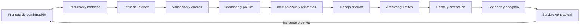

# Parte 20 — Backend, APIs y procesamiento asíncrono

La Parte 19 terminó con una aplicación web que se comporta bien sin red. La pregunta cambia de «qué hace el cliente» a «qué hay al otro lado y qué promete». Esta parte trabaja sobre el **backend de la plataforma de entregas de tareas**, un caso sintético que recorre las doce clases: una frontera entre lo que se confirma ahora y lo que se completa después, recursos con métodos de semántica conocida, una interfaz elegida por su costo, errores con una sola forma, identidad y autorización por objeto, operaciones que se pueden repetir, trabajo diferido que se entrega al menos una vez, archivos que no caben en memoria, protección contra la avalancha, sondeos y apagado ordenado, una API defectuosa que reparar y un servicio contractual cuya promesa se comprueba.

## Pregunta rectora

> ¿Qué efecto se promete, cuándo se confirma y cómo se evita duplicarlo o perderlo?

## Antes del recorrido clase por clase

Esta parte no enseña un framework. Enseña a medir qué ocurre cuando algo cae entre dos pasos, a elegir métodos por sus garantías, a contar consultas y bytes de una pantalla, a validar con cargas límite, a atacar un verificador de tokens, a diseñar claves de idempotencia, a dimensionar una cola, a procesar archivos por trozos, a cachear sabiendo qué se sirve obsoleto, a separar vida de disponibilidad y a comprobar un contrato con mutaciones. Cada clase ejecuta experimentos con datos sintéticos que muestran un mecanismo (10 de 24 escenarios de caída con una violación grave, 984 filas ajenas leídas con identificadores secuenciales, 184 entregas duplicadas bajo caídas inyectadas) y declara lo que ese experimento no demuestra.

El diagrama se lee de izquierda a derecha y no es un proceso obligatorio. El retorno indica que un incidente, una deriva entre contrato e implementación o un defecto hallado reabre la frontera de confirmación; un servicio que pasa su evidencia no cierra el contrato, lo fecha.

## Resultados acumulativos

Podrás decidir qué paso va antes o después de la respuesta y medir qué estado deja cada punto de caída; clasificar operaciones por método y evitar la actualización perdida y la paginación inestable; elegir un estilo de interfaz y contar bytes, viajes y consultas; escribir un validador con lista de permitidos y medir su deriva con mutaciones; verificar un token con todas sus comprobaciones y proteger cada objeto por dueño; hacer repetible una operación con una clave y una política de reintento con jitter; dimensionar una cola y aislar un mensaje venenoso; procesar archivos por trozos con límites de nombre, tamaño y descompresión; cachear y limitar sabiendo qué deja pasar cada algoritmo; separar vida y disponibilidad y apagar sin cortar solicitudes; reparar una API con pruebas de regresión; y entregar un servicio con contrato comprobable, invariantes bajo fallos y alertas por tasa de consumo.

Al finalizar podrás defender un servicio con una frontera declarada, una política de acceso con denegación por defecto, operaciones repetibles, trabajo diferido con garantías, límites medidos y un contrato cuya deriva se detecta, y podrás indicar qué parte de tu conclusión es observación, cuál es inferencia y cuál es suposición.

## Prerrequisitos enlazados

- [Parte 3 — Redes e internet](../../classes/part-03-redes-internet-y-protocolos/): solicitudes, respuestas, tiempos agotados y pérdida de paquetes.
- [Parte 13 — Especificaciones, contratos y modelos](../../classes/part-13-especificaciones-contratos-y-modelos/): contratos, esquemas, compatibilidad y pruebas contractuales que esta parte pone en un servicio.
- [Parte 19 — Web, frontend y aplicaciones progresivas](../../classes/part-19-web-frontend-y-aplicaciones-progresivas/): el cliente que envía las solicitudes que aquí se reciben.
- Python 3.11+ y terminal; los experimentos usan solo la biblioteca estándar y datos sintéticos.

## Bloques y progresión

1. **Fronteras e interfaces:** las clases 241–243 fijan qué se confirma y cuándo, cómo se nombran los recursos y qué estilo de interfaz conviene a cada pantalla.
2. **Contratos e identidad:** las clases 244–245 definen qué se rechaza, cómo se comunican los errores y quién puede hacer qué.
3. **Repetición y trabajo diferido:** las clases 246–248 hacen repetibles las operaciones, aceptan trabajo que se completa después y tratan los archivos extensos.
4. **Protección y operación:** las clases 249–250 limitan la carga, cachean y separan vida de disponibilidad con apagado ordenado.
5. **Aplicar e integrar:** las clases 251–252 reparan una API defectuosa y entregan un servicio contractual y operable.

## Evidencia medida y límites

Las figuras y los ejemplos de esta parte usan experimentos ejecutados con CPython 3.12.9 en Windows 11 y repetidos con CPython 3.12.3 en Ubuntu bajo WSL2. Los datos son **sintéticos** y las semillas están fijadas: las salidas deterministas fueron idénticas en ambos sistemas. Las diferencias que se informan como resultados son cinco: los tiempos de servidor local y de lectura de archivos (por ejemplo, 40 solicitudes de 50 ms tardaron 3,42 s en Windows y 2,60 s en Ubuntu con un solo hilo, y 0,16 s y 0,14 s con un hilo por solicitud), las consultas al origen sin protección en una estampida de 200 hilos (169 a 189 en Windows y 46 a 129 en Ubuntu, frente a 1 con una sola carga en vuelo), el resultado de la prueba de nombres de archivo hostiles (3 de 12 escapan del directorio en Windows y 2 de 12 en Ubuntu porque Windows trata la barra invertida como separador), el orden de impresión de una carrera de ocho hilos y los tiempos de comparación de firmas, que son ruido de un intérprete y no prueban nada sobre canales laterales.

Los experimentos son: latencia de una cadena síncrona frente a una diferida, 24 escenarios de caída de un alta con y sin outbox y tres servidores HTTP locales (`SE-241`); un GET con efecto frente a un rastreador, la actualización perdida con y sin `If-Match` y la paginación por desplazamiento frente a la paginación por clave (`SE-242`); bytes y viajes de una pantalla en tres estilos, consultas N+1 y coste de consultas anidadas (`SE-243`); 14 cargas JSON límite contra dos validadores, 283 mutaciones de una respuesta y reintentos según la clasificación del error (`SE-244`); ocho ataques a un token, identificadores secuenciales y aleatorios con y sin comprobación de dueño y cobertura de una política de 48 decisiones (`SE-245`); duplicados con y sin clave de idempotencia, una tormenta de reintentos y la ventana de la clave (`SE-246`); efectos duplicados en una cola con visibilidad, espera frente a la teoría M/M/1 y un mensaje venenoso (`SE-247`); memoria por trozos, subida reanudable y nombres hostiles con bombas de descompresión (`SE-248`); aciertos y obsolescencia de una caché, una estampida y cuatro limitadores (`SE-249`); sondeos de vida, apagado con drenaje y calentamiento (`SE-250`); tres suites contra una API con diez defectos, reintroducción de cada defecto e inyección SQL (`SE-251`); y caídas inyectadas, alertas por tasa de consumo y deriva de un contrato de 12 rutas (`SE-252`).

Los parámetros (las latencias de 8, 400 y 150 ms, los porcentajes de caída del 5, 8 y 20 %, la capacidad de 400 solicitudes por segundo, el 1 % de mensajes venenosos, la popularidad Zipf, el SLO de 99,5 %, los diez defectos de la API del taller y las 200 mutaciones de un contrato) son supuestos del autor, no datos de un producto, una institución ni de personas reales. Los validadores, las suites y las comprobaciones se escribieron mirando los casos que miden, así que su acierto es optimista. No se usó ninguna herramienta de producción (un corredor de mensajes, un orquestador, un proxy, un proveedor de identidad, un servidor GraphQL), no se auditó ninguna API y no se midió a nadie. Algunas fuentes citadas por título no tienen enlace porque no se pudo verificar su dirección en esta ejecución (sin acceso de red autorizado): RFC 9457, RFC 6585, RFC 7519, RFC 8725, RFC 5789, el OWASP API Security Top 10, la guía de subida de archivos de OWASP, la documentación de claves de idempotencia de Stripe y de Amazon, los borradores del IETF sobre `Idempotency-Key` y `RateLimit`, la documentación de sondeos y terminación de Kubernetes, el principio de desechabilidad de Twelve-Factor, el patrón outbox, el protocolo tus, la tesis de Fielding, la documentación de gRPC y de colas de AWS, el artículo de estampida de caché y el de la fórmula de Little. Esta parte no tiene laboratorio propio en `labs/`; el proyecto integrador `SE-252` define el servicio y la evidencia. Cada clase termina con un puente hacia el trabajo con agentes.

## Guía razonada clase por clase

La plataforma de entregas mantiene una pregunta estable mientras cambian los mecanismos. Cada clase explica qué riesgo reduce, qué experimento lo muestra, qué no demuestra y qué evidencia permite abandonar la conclusión.

### Bloque 1 — Fronteras e interfaces

#### SE-241 — Responsabilidades y fronteras del backend

Qué hace el servidor antes y después de responder decide la latencia que ve el cliente y los estados que quedan tras una caída. La clase mide cuántas solicitudes superan un tiempo máximo en una cadena síncrona y en una que guarda y encola, enumera los 24 puntos de caída de un alta de tres pasos y compara tres servidores locales reales.

El estudiante entrega el reparto de responsabilidades del alta y su frontera de confirmación. `SE-242` pregunta cómo se nombran los recursos que esa frontera expone.

#### SE-242 — REST y semántica de recursos

Un método HTTP es una promesa que los intermediarios asumen sin preguntar. La clase mide qué borra un rastreador de enlaces si el borrado es un GET, qué pierde un PUT sin precondición frente a `If-Match` y qué repite la paginación por desplazamiento frente a la paginación por clave.

El estudiante entrega la tabla método × propiedad de cada operación. `SE-243` pregunta cuándo REST deja de ser la forma adecuada.

#### SE-243 — RPC, GraphQL y selección de interfaz

Cada estilo de interfaz mueve el costo de sitio. La clase mide los bytes y viajes de una pantalla en tres estilos, cuenta las consultas SQL de un resolvedor con y sin lotes y calcula cuántos nodos permite resolver un límite de profundidad y cuánto tráfico legítimo rechaza.

El estudiante entrega la decisión de estilo por superficie con una condición que la revertiría. `SE-244` pregunta cómo se valida lo que llega por cualquiera de ellas.

### Bloque 2 — Contratos e identidad

#### SE-244 — Validación, errores y contratos consistentes

Una validación que no cuenta los casos límite deja pasar lo que parece válido. La clase mide 14 cargas JSON contra un validador ingenuo y uno estricto, 283 mutaciones de una respuesta contra cuatro capas de comprobación y la carga adicional de reintentar todo frente a clasificar los errores.

El estudiante entrega la lista de permitidos, la forma única de error y la clasificación de reintentos. `SE-245` pregunta quién hace la solicitud.

#### SE-245 — Autenticación, autorización y contexto

Un token válido solo dice quién lo emitió. La clase ataca un verificador con ocho tokens, mide las filas ajenas que obtiene un alumno con identificadores secuenciales y aleatorios con y sin comprobación de dueño y calcula qué decisiones de una política de 48 celdas protege cada suite.

El estudiante entrega la política con denegación por defecto y el origen de cada dato de identidad. `SE-246` pregunta qué ocurre cuando una solicitud autorizada se repite.

### Bloque 3 — Repetición y trabajo diferido

#### SE-246 — Idempotencia, reintentos y deduplicación

Un tiempo agotado no dice si la operación ocurrió. La clase mide los duplicados tras perder la respuesta con y sin clave de idempotencia, simula una tormenta de reintentos con tres políticas y calcula qué fracción de los reintentos llega tras caducar la clave.

El estudiante entrega la clave, su huella y su retención con la política de reintento. `SE-247` aplica la idea al trabajo diferido.

#### SE-247 — Jobs, colas y procesamiento diferido

Ninguna cola entrega exactamente una vez. La clase mide los efectos duplicados de dos handlers cuando los trabajadores caen, compara la espera simulada con la teoría de una cola M/M/1 y observa cómo un mensaje venenoso acapara a los trabajadores según la política de reintento.

El estudiante entrega el contrato del trabajo con estados, intentos, plazo y cola de muertos. `SE-248` trata el trabajo más pesado, los archivos.

#### SE-248 — Archivos, streaming y cargas extensas

Un archivo es la entrada más grande y menos fiable. La clase mide el pico de memoria al leer un archivo entero y por trozos, compara reiniciar con reanudar una subida con caídas frecuentes, detecta un archivo truncado y prueba doce nombres hostiles y una bomba de descompresión en dos sistemas.

El estudiante entrega el contrato de la subida con trozo, plazo y límites. `SE-249` protege el servicio de la avalancha de solicitudes.

### Bloque 4 — Protección y operación

#### SE-249 — Caching, rate limiting y protección

Cachear compra velocidad con obsolescencia y limitar compra disponibilidad con rechazos. La clase mide aciertos y lecturas obsoletas en nueve configuraciones, reproduce una estampida de 200 hilos y compara cuatro limitadores ante una ráfaga en el borde de la ventana.

El estudiante entrega la política de caché y de límites por identidad. `SE-250` pregunta cómo se sabe que el servicio está listo y cómo se apaga.

#### SE-250 — Health, readiness y shutdown ordenado

Un sondeo de vida que consulta una dependencia convierte su caída en una cascada de reinicios. La clase mide los reinicios de dos diseños de sondeos, cuenta las solicitudes perdidas al apagar un servidor local con y sin drenaje y compara tres criterios para recibir tráfico con la caché fría.

El estudiante entrega los tres sondeos y el contrato de apagado. `SE-251` aplica todo el recorrido a una API defectuosa.

### Bloque 5 — Aplicar e integrar

#### SE-251 — Taller: reparar una API insegura e inconsistente

Una API puede superar su camino feliz con diez defectos. El taller mide qué ven tres suites, reintroduce cada defecto tras repararlo para saber qué suite lo detecta, descubre un defecto dormido que ninguna ve y mide doce cargas de inyección contra SQL concatenado y parametrizado.

El estudiante entrega el registro de reparación con pruebas de regresión y la lista de defectos dormidos. `SE-252` integra todo en un servicio contractual.

#### SE-252 — Proyecto: servicio contractual operable

Un contrato solo vale si una comprobación detecta la deriva, y la operabilidad solo vale si las alertas saltan a tiempo. El proyecto inyecta caídas en dos diseños y comprueba cuatro invariantes, calcula alertas por tasa de consumo en tres incidentes y mide qué capas detectan 189 mutaciones de un contrato de 12 rutas.

El estudiante entrega el contrato, la inyección de caídas, las alertas y la lista de promesas comprobadas, declaradas y supuestas. La Parte 21 lleva el producto a móviles y escritorio.

## Resumen operativo del recorrido

| Clase | Capacidad que construye | Pregunta que resuelve | Evidencia acumulativa |
|---|---|---|---|
| [SE-241](../../classes/part-20-backend-apis-y-procesamiento-asincrono/se-241-responsabilidades-y-fronteras-del-backend/) | Responsabilidades y fronteras del backend | ¿Qué se confirma ahora y qué después? | `boundary-log.md` con fronteras, caídas y servidores |
| [SE-242](../../classes/part-20-backend-apis-y-procesamiento-asincrono/se-242-rest-y-semantica-de-recursos/) | REST y semántica de recursos | ¿Qué garantiza cada método a quien lo repite o lo cachea? | `rest-log.md` con métodos, concurrencia y paginación |
| [SE-243](../../classes/part-20-backend-apis-y-procesamiento-asincrono/se-243-rpc-graphql-y-seleccion-de-interfaz/) | RPC, GraphQL y selección de interfaz | ¿Cuántos viajes, bytes y consultas cuesta una pantalla? | `interface-log.md` con estilos, N+1 y coste |
| [SE-244](../../classes/part-20-backend-apis-y-procesamiento-asincrono/se-244-validacion-errores-y-contratos-consistentes/) | Validación, errores y contratos consistentes | ¿Qué se rechaza, cómo se cuenta y qué se reintenta? | `contract-log.md` con cargas, deriva y reintentos |
| [SE-245](../../classes/part-20-backend-apis-y-procesamiento-asincrono/se-245-autenticacion-autorizacion-y-contexto/) | Autenticación, autorización y contexto | ¿Quién pide, qué le corresponde y en qué contexto? | `access-log.md` con ataques, objetos y política |
| [SE-246](../../classes/part-20-backend-apis-y-procesamiento-asincrono/se-246-idempotencia-reintentos-y-deduplicacion/) | Idempotencia, reintentos y deduplicación | ¿Cómo sabe el servidor que esta solicitud ya ocurrió? | `retry-log.md` con duplicados, tormenta y ventana |
| [SE-247](../../classes/part-20-backend-apis-y-procesamiento-asincrono/se-247-jobs-colas-y-procesamiento-diferido/) | Jobs, colas y procesamiento diferido | ¿Qué pasa si el trabajador cae, si hay más trabajo que trabajadores o si un trabajo nunca termina? | `queue-log.md` con duplicados, espera y venenosos |
| [SE-248](../../classes/part-20-backend-apis-y-procesamiento-asincrono/se-248-archivos-streaming-y-cargas-extensas/) | Archivos, streaming y cargas extensas | ¿Qué pasa cuando el archivo es enorme, se corta o es hostil? | `files-log.md` con memoria, reanudación y límites |
| [SE-249](../../classes/part-20-backend-apis-y-procesamiento-asincrono/se-249-caching-rate-limiting-y-proteccion/) | Caching, rate limiting y protección | ¿Qué se reutiliza, qué se limita y qué ocurre en el borde? | `protection-log.md` con caché, estampida y limitadores |
| [SE-250](../../classes/part-20-backend-apis-y-procesamiento-asincrono/se-250-health-readiness-y-shutdown-ordenado/) | Health, readiness y shutdown ordenado | ¿Está vivo, está listo y cómo se retira sin cortar nada? | `ops-log.md` con sondeos, apagado y calentamiento |
| [SE-251](../../classes/part-20-backend-apis-y-procesamiento-asincrono/se-251-taller-reparar-una-api-insegura-e-inconsistente/) | Taller: reparar una API insegura e inconsistente | ¿Qué defectos ve cada tipo de prueba y cuáles ninguna? | `workshop-log.md` con la matriz defecto × suite |
| [SE-252](../../classes/part-20-backend-apis-y-procesamiento-asincrono/se-252-proyecto-servicio-contractual-operable/) | Proyecto: servicio contractual operable | ¿Qué promete el servicio y cómo demuestro que lo cumple aun si algo cae? | `service-log.md`, contrato y comprobador |

## Proyecto integrador

El proyecto **SE-252** entrega un servicio con contrato comprobable: alta con clave de idempotencia y outbox, trabajo diferido con handler idempotente, errores de forma única, política de acceso con denegación por defecto, límites, sondeos y apagado ordenado. Lo acompañan la inyección de caídas con cuatro invariantes en dos diseños, un SLO con alertas por tasa de consumo, un comprobador de conformidad con sus mutaciones y la lista de promesas comprobadas, declaradas y supuestas. Se acompaña de los límites declarados: qué fallos no se inyectaron y qué cambios de significado no detecta el comprobador.

## Criterios de salida

- las doce clases explican todos sus temas mediante mecanismos, ejemplos y límites;
- cada operación de escritura tiene una clave de idempotencia o una justificación de por qué no la necesita;
- cada acceso por identificador comprueba el dueño y la política tiene una prueba por cada celda denegada;
- los trabajos diferidos tienen estados consultables, intentos acotados, plazo y cola de muertos;
- las cifras, los porcentajes y las capacidades se declaran como supuestos y nunca como mediciones de un producto;
- el servicio separa vida, disponibilidad y arranque y declara su plazo de apagado;
- otra persona reproduce comandos y resultados desde un checkout limpio;
- el informe declara lo observado, lo inferido y lo no ejecutado.

## Preguntas de control por bloque

- ¿Qué paso va antes de la respuesta y qué estado deja una caída entre dos pasos?
- ¿Qué garantiza este método a un intermediario que lo repite o lo cachea?
- ¿Qué rechaza esta frontera sin explicar y cómo sabe el cliente si reintentar?
- ¿Quién hace la solicitud, qué le corresponde y qué dato de identidad viene del cliente?
- ¿Qué ocurre si esta operación llega dos veces, si el trabajador cae después del efecto o si la clave caducó?
- ¿Qué límite protege el servicio y qué patrón legítimo deja pasar en el borde?
- ¿Qué promete el servicio, cómo lo compruebo y qué incidente no dispararía ninguna alerta?

## Fuentes de la parte

- [HTTP Semantics (RFC 9110)](https://www.rfc-editor.org/rfc/rfc9110) — métodos, códigos de estado y precondiciones; autoridad: IETF.
- [HTTP Caching (RFC 9111)](https://www.rfc-editor.org/rfc/rfc9111) — frescura y revalidación; autoridad: IETF.
- [The JSON Data Interchange Format (RFC 8259)](https://www.rfc-editor.org/rfc/rfc8259) — sintaxis JSON; autoridad: IETF.
- [OpenAPI Specification](https://spec.openapis.org/oas/latest.html) — descripción de interfaces HTTP; autoridad: OpenAPI Initiative.
- [GraphQL Specification](https://spec.graphql.org/) — consulta con selección de campos; autoridad: GraphQL Foundation.
- [JSON Schema 2020-12: Validation](https://json-schema.org/draft/2020-12/json-schema-validation) — validación de datos; autoridad: proyecto JSON Schema.
- [OWASP Input Validation Cheat Sheet](https://cheatsheetseries.owasp.org/cheatsheets/Input_Validation_Cheat_Sheet.html) — validación en el servidor; autoridad: OWASP.
- [OWASP Application Security Verification Standard](https://owasp.org/www-project-application-security-verification-standard/) — requisitos verificables; autoridad: OWASP.
- [Timeouts, retries and backoff with jitter](https://aws.amazon.com/builders-library/timeouts-retries-and-backoff-with-jitter/) — reintentos con retroceso; autoridad: Amazon Builders' Library.
- [Google SRE Book: Service Level Objectives](https://sre.google/sre-book/service-level-objectives/) — SLO y presupuesto de error; autoridad: Google.
- [Google SRE Book: Handling Overload](https://sre.google/sre-book/handling-overload/) — sobrecarga y degradación; autoridad: Google.
- [Dean y Barroso, «The tail at scale» (CACM, 2013)](https://doi.org/10.1145/2408776.2408794) — latencia de cola en servicios compuestos; autoridad: Communications of the ACM.
- [SWEBOK Guide v4.0a](https://www.computer.org/education/bodies-of-knowledge/software-engineering) — diseño, pruebas y operación como áreas de conocimiento; autoridad: IEEE Computer Society.

Las fuentes se vinculan también dentro de cada clase. Definen vocabulario y mecanismos; la adecuación de las decisiones de la plataforma de entregas se demuestra con el caso, la evidencia trazable y la revisión de otra persona, no con la autoridad de la fuente.
