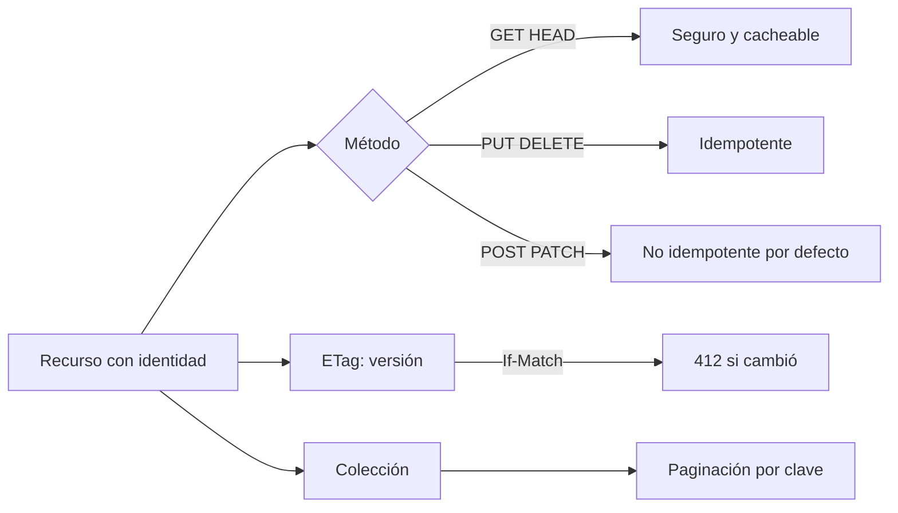
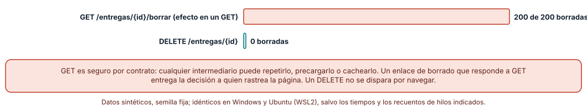
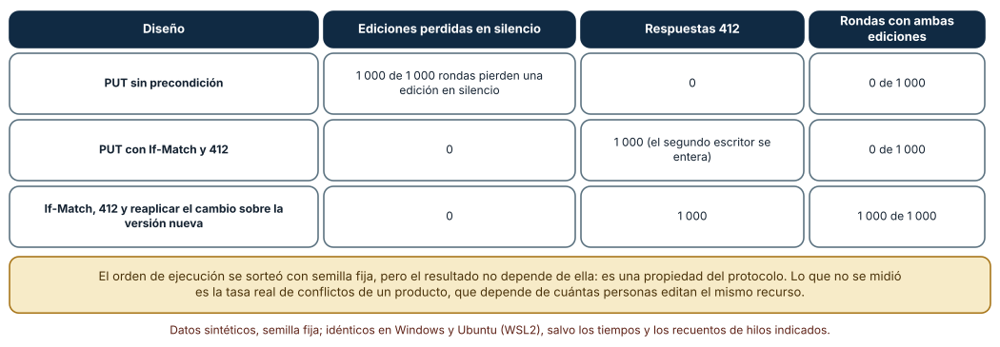
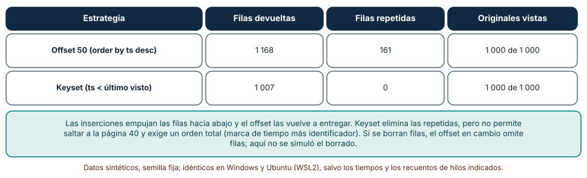

# SE-242 — REST y semántica de recursos

[← SE-241 — Responsabilidades y fronteras del backend](../../classes/part-20-backend-apis-y-procesamiento-asincrono/se-241-responsabilidades-y-fronteras-del-backend/README.md) · [↑ Parte 20](../../classes/part-20-backend-apis-y-procesamiento-asincrono/README.md) · [📚 Índice completo](../../classes/README.md) · [🌐 Portal](../../site/classes/SE-242.html) · [SE-243 — RPC, GraphQL y selección de interfaz →](../../classes/part-20-backend-apis-y-procesamiento-asincrono/se-243-rpc-graphql-y-seleccion-de-interfaz/README.md)

## Punto profesional y fundamento pedagógico

**Punto profesional.** La clase existe para que modeles la plataforma como recursos con identidad y operaciones de semántica conocida, y para que sepas qué garantiza cada método HTTP (seguro, idempotente, cacheable) y qué se rompe cuando un diseño usa un método con otro sentido. REST aquí no es un estilo de URL: es un conjunto de promesas que intermediarios y clientes asumen sin preguntar.

**Por qué aparece aquí.** Se sitúa después de **Responsabilidades y fronteras del backend** y antes de **RPC, GraphQL y selección de interfaz**: la clase anterior fijó qué se confirma y cuándo; esta decide cómo se nombra lo que se confirma y qué operaciones se permiten sobre ello. Sus tres mecanismos (método con semántica, precondiciones con `ETag` y paginación estable) serán la base del contrato de errores, de la autorización por recurso y de la idempotencia que siguen.

**Error conceptual que debe corregir.** Creer que REST consiste en poner sustantivos en las URL y usar JSON. Un diseño puede tener URL perfectas y romper la semántica: un GET que borra, un PUT que pisa ediciones ajenas o una paginación que repite filas cuando llegan datos nuevos.

**Secuencia de aprendizaje.** Antes de ejecutar nada, predices cuántas entregas borraría un rastreador que sigue todos los enlaces de una página si el borrado se modela como GET; después compruebas qué pasa con dos escritores concurrentes con y sin precondición, y mides cuántas filas repite o pierde la paginación por desplazamiento mientras llegan datos. La secuencia usa predicción, explicación propia, contraste y recuperación. [ICAP](https://icap.education.asu.edu/research) distingue participación de construcción de conocimiento; [How People Learn II](https://nap.nationalacademies.org/catalog/24783/how-people-learn-ii-learners-contexts-and-cultures) exige conectar conocimiento previo, contexto y transferencia; la [práctica de recuperación](https://pubmed.ncbi.nlm.nih.gov/16507066/) respalda producir de nuevo la explicación tras una demora; y [Education for Life and Work](https://nap.nationalacademies.org/resource/13398/dbasse_084153.pdf) exige devolución que explique la causa del error.

**Evidencia de aprendizaje.** `rest-log.md` con la tabla método × propiedad (seguro, idempotente, cacheable) de cada operación de la plataforma, la predicción previa, la comparación del PUT con y sin `If-Match`, la paginación por desplazamiento y por clave con sus cifras, y una nota de qué hallazgo movería una operación a otro método.

**Límite de la conclusión.** Los experimentos modelan el protocolo, no un servidor real con red: el orden de los escritores se sorteó con semilla, pero el resultado es una propiedad del diseño. La tasa real de conflictos de edición y la frecuencia de inserciones durante una paginación dependen del producto y no se midieron.

### Trazabilidad fuente → afirmación

| Fuente primaria u oficial | Afirmación que respalda | Lo que no prueba |
|---|---|---|
| [HTTP Semantics (RFC 9110)](https://www.rfc-editor.org/rfc/rfc9110) | Define los métodos seguros e idempotentes, los códigos 412 y 428 y las precondiciones condicionales (`If-Match`, `ETag`). | No decide cómo debe modelarse cada recurso de la plataforma. |
| [HTTP Caching (RFC 9111)](https://www.rfc-editor.org/rfc/rfc9111) | Describe cómo los almacenes de caché reutilizan respuestas a GET y cuándo deben revalidarlas. | No fija el tiempo de vida adecuado para un recurso concreto. |
| Fielding, Architectural Styles and the Design of Network-based Software Architectures (2000), capítulo 5 | Presenta REST como estilo arquitectónico con restricciones (interfaz uniforme, sin estado, cacheable) y no como una convención de URL. | No es una especificación de protocolo ni prescribe los nombres de recursos. |

## Antes de empezar

Recupera `SE-241`: el alta de una entrega responde 201 con la ubicación del recurso y deja el análisis para después. La pregunta activa es: **¿qué operaciones tiene ese recurso, qué garantiza cada una a quien la repite o la cachea y qué ocurre cuando dos personas lo cambian a la vez?**

## Prerrequisitos

- Haber completado `SE-241` o poder explicar qué evidencia entregó y qué quedó abierto.
- Python 3.11 o posterior; los experimentos usan `sqlite3` y `random`.
- Saber qué es un método HTTP y un código de estado.
- Trabajar con entregas sintéticas; no se necesita ningún servidor real.

## Problema auténtico

Un módulo del panel docente muestra una lista de entregas con un enlace «borrar» que apunta a `GET /entregas/42/borrar`. Un día el navegador de una docente precarga los enlaces de la página para acelerar la navegación y media bandeja desaparece. Otro día dos docentes editan la misma entrega: una corrige el texto y otra pone la nota; la segunda en guardar borra el cambio de la primera sin aviso. Y la lista paginada de la semana de cierre muestra la misma entrega en la página 3 y en la 4.

## Objetivos observables

Al terminar podrás:

1. clasificar las operaciones de la plataforma por método HTTP según sean seguras e idempotentes, y justificar cuándo un método no corresponde;
2. medir cuántas entregas borra un recorrido de enlaces cuando una operación destructiva usa GET, y explicar por qué los intermediarios pueden repetirlo;
3. evitar la actualización perdida con `ETag` e `If-Match` y distinguir el 412 de un conflicto de fusión;
4. comparar paginación por desplazamiento y por clave con inserciones concurrentes y decir qué compra cada una;
5. declarar qué recursos tienen identidad estable, cuáles son colecciones y qué cabe en una representación.

## Mapa conceptual



El mapa se lee desde el recurso: cada método le asigna una garantía distinta, la versión (`ETag`) protege las escrituras concurrentes y la colección necesita una paginación que no dependa de la posición. La bifurcación del método no es un menú de gustos: la fila de la garantía es lo que un intermediario asume sin leer la documentación.

## Temas y por qué importan

| Tema | Por qué cambia una decisión profesional | Evidencia mínima |
|---|---|---|
| Recursos e identidad | Sin un identificador estable no hay a qué aplicar un método, una versión ni una caché. | Lista de recursos con su identificador y su representación en `rest-log.md` |
| Métodos y sus garantías | Seguro e idempotente son promesas que los intermediarios explotan: repetir, precargar, cachear. | Tabla método × propiedad y recorrido de enlaces sobre un GET con efecto |
| Representaciones y negociación | El mismo recurso puede entregarse en varios formatos; el cliente y el servidor deben ponerse de acuerdo sin ambigüedad. | Ejemplo de dos representaciones y el encabezado que las distingue |
| Condicionales y concurrencia | Un `ETag` convierte «la última escritura gana» en un conflicto detectable. | Rondas con y sin `If-Match` y número de 412 |
| Colecciones y paginación | La posición de una fila cambia cuando llegan datos; la clave de orden no. | Filas repetidas y vistas con offset y con keyset |

## Conceptos y decisiones

### 1. Recursos e identidad

Un recurso es algo con identidad que el sistema puede nombrar y sobre lo que puede actuar: la entrega 42, la colección de entregas de un curso, la nota de una entrega. La URL identifica al recurso, no a la acción. «Entrega» es un recurso; «subirEntrega» es una acción que pertenece al método (`POST` sobre la colección). Modelar acciones como recursos (`/entregas/42/apelaciones`) es legítimo cuando la acción crea algo con identidad propia que luego se consulta; ahí el sustantivo es la apelación.

### 2. Métodos y sus garantías

Un método es **seguro** si no pretende cambiar el estado (`GET`, `HEAD`) e **idempotente** si repetirlo deja el mismo estado que ejecutarlo una vez (`PUT`, `DELETE`, y los seguros). `POST` no es idempotente por definición; `PATCH` depende de cómo se defina. Estas propiedades no son decoración: un navegador reintenta un `GET`, un proxy puede repetir un `PUT` tras un corte, un rastreador sigue enlaces. Si una operación que cambia estado se expone como `GET`, cualquiera de esos actores puede ejecutarla.

### 3. Representaciones y negociación

El cliente nunca ve el recurso, ve una representación: un JSON con ciertos campos, quizá una versión resumida. La negociación (`Accept`, `Content-Type`) permite servir la misma entrega como JSON o como PDF de acuse. Lo que importa para el diseño es que la representación es un contrato: cambiar el nombre de un campo es cambiar la API aunque la URL sea igual (`SE-244`, `SE-164`).

### 4. Condicionales y concurrencia

Si dos clientes leen la versión 1 de una entrega y ambos hacen `PUT`, el servidor ve dos escrituras válidas y conserva la última: la primera edición se pierde sin error. El `ETag` identifica la versión leída; con `If-Match: "v1"` el servidor aplica la escritura solo si el recurso sigue en esa versión y, si no, responde **412 Precondition Failed**. El 412 no resuelve el conflicto: obliga al cliente a releer y decidir (reaplicar su cambio, fusionar o preguntar a la persona). Exigir la precondición (**428**) impide los PUT ciegos.

### 5. Colecciones y paginación

Una colección ordenada por fecha cambia mientras se pagina: las entregas nuevas entran por el principio. Con `offset=50` el servidor cuenta 50 filas desde el principio *actual*, de modo que cada inserción desplaza las demás y la página siguiente repite filas. Con paginación por clave (`ts < último visto`) el punto de continuación es un valor, no una posición. Costo: no se puede saltar a la página 40, y el orden debe ser total (fecha más identificador) para no perder empates.

### Un GET con efecto frente a un rastreador de enlaces

El panel muestra 200 entregas. Se comparan dos diseños del borrado: `GET /entregas/{id}/borrar` y `DELETE /entregas/{id}`. Un «rastreador» (precarga del navegador, indexador, antivirus de correo) sigue todos los enlaces con GET.

```python
for metodo, ruta in enlaces:          # el rastreador solo hace GET
    if metodo == "GET" and ruta.endswith("/borrar"):
        estado[int(ruta.split("/")[2])] = "borrada"
```

Resultado: con el borrado como GET, **200 de 200 entregas** quedan borradas; con `DELETE`, **0**, porque un rastreador no emite `DELETE`. La salida es idéntica en Windows y Ubuntu. Es una consecuencia directa de la definición de método seguro: la especificación autoriza a cualquiera a repetir o precargar un GET.



**Cómo leer la figura.** Cada barra cuenta las entregas borradas tras un recorrido automático de todos los enlaces de la página. **Dónde deja de valer:** el experimento no mide a ningún rastreador real; supone que sigue todos los enlaces. Un DELETE también puede repetirse (es idempotente): repetirlo no hace daño, pero tampoco lo protege de un clic accidental ni de un acceso no autorizado (`SE-245`).

### Actualización perdida y precondición

Dos clientes leen la versión 1 de una entrega: A cambia el texto, B pone la nota. Se simulan 1 000 rondas con el orden de llegada sorteado (semilla 242). Tres diseños: `PUT` del documento entero sin precondición, `PUT` con `If-Match` y 412, y la variante donde el cliente rechazado relee y reaplica su cambio.

Sin precondición, **1 000 de 1 000 rondas pierden una edición en silencio** (la que llegó primero). Con `If-Match`, el segundo escritor recibe 412 en **1 000 de 1 000 rondas** y no se pierde nada, pero tampoco se han guardado las dos ediciones; cuando el cliente relee y reaplica solo su campo, **1 000 de 1 000 rondas terminan con las dos ediciones**. La cifra de 1 000 no es una tasa de conflictos: el experimento fuerza el conflicto para observar qué hace el protocolo con él.



**Cómo leer la figura.** Cada fila es un diseño; las columnas cuentan ediciones perdidas, respuestas 412 y rondas que terminan con las dos ediciones. **Dónde deja de valer:** el resultado es una propiedad del protocolo y no depende de la semilla, pero no dice con qué frecuencia ocurren conflictos reales. Además fusionar campos distintos es fácil; dos cambios al mismo campo exigen una decisión humana que ningún encabezado resuelve.

### Paginación por desplazamiento frente a paginación por clave

Una colección de 1 000 entregas ordenada por marca de tiempo descendente se pagina de 50 en 50 mientras llegan 7 entregas nuevas antes de cada página. Se compara `limit 50 offset k` con `where ts < ultimo limit 50`, usando SQLite.

El desplazamiento devuelve **1 168 filas con 161 repetidas** y llega a ver las 1 000 originales; la paginación por clave devuelve **1 007 filas con 0 repetidas** y también ve las 1 000 originales. Las 7 nuevas del inicio aparecen en la primera página de la clave porque estaban allí cuando se pidió; las siguientes nunca interfieren con las páginas ya entregadas.

```python
filas = db.execute("select id,ts from e where ts < ? order by ts desc limit 50", (ultimo,))
```



**Cómo leer la figura.** Cada fila es una estrategia de paginación; la columna de repetidas cuenta filas que el cliente recibió más de una vez. **Dónde deja de valer:** solo se simularon inserciones. Con borrados, el desplazamiento omite filas en vez de repetirlas, y no se midió. Además la paginación por clave exige un índice sobre la clave de orden; sin él, la consulta recorre toda la tabla (`SE-243`).

## Definiciones de trabajo

- **recurso:** cosa con identidad que el sistema nombra y sobre la que actúa mediante métodos.
- **método seguro:** método que no pretende cambiar el estado del servidor y puede repetirse o precargarse.
- **método idempotente:** método cuyo efecto, repetido varias veces, es el mismo que el de una ejecución.
- **ETag:** validador opaco que identifica la versión de una representación y permite solicitudes condicionales.
- **keyset:** paginación cuyo punto de continuación es el valor de la clave de orden del último elemento visto.

Las definiciones son operativas para la plataforma de entregas. No convierten términos con una historia técnica más amplia en sinónimos y deben contrastarse con la documentación primaria enlazada al final.

## Ejemplo mínimo

El fragmento comprueba qué ocurre al repetir un `PUT` y un `POST`. Antes de ejecutarlo, predice cuántas filas habrá al final.

```python
import sqlite3
db = sqlite3.connect(":memory:")
db.execute("create table e(id integer primary key, texto text)")
def put(i, t): db.execute("insert or replace into e values (?,?)", (i, t))
def post(t):   db.execute("insert into e(texto) values (?)", (t,))
put(1, "a"); put(1, "a"); post("b"); post("b")
print(db.execute("select count(*) from e").fetchone()[0])
```

Resultado: 3. El segundo `put` no añadió nada (idempotente) y los dos `post` añadieron dos filas. Registra versión y salida; después cambia `put(1, "a")` por `put(1, "c")` y predice qué cambia en el recuento y en el contenido.

## Ejemplo profesional

La plataforma define cinco recursos: la colección `/entregas`, la entrega, la nota, la apelación y el estado de un trabajo. Cada operación del panel se asigna a un método: listar y leer con GET (cacheable con revalidación), crear con POST y respuesta 201, editar con PUT y `If-Match` obligatorio, anular con DELETE y apelar con POST sobre `/entregas/{id}/apelaciones`. La colección pagina por clave (fecha y identificador). Compara este diseño con el original en tres casos: precarga de enlaces, dos docentes editando y cierre de plazo con cientos de entregas nuevas por minuto.

## Práctica guiada

1. Lista las operaciones del panel docente y asigna a cada una un método, justificando por qué es seguro o idempotente.
2. Predice cuántas entregas borra un rastreador si el borrado es un GET y escribe el número.
3. Ejecuta el recorrido de enlaces sobre ambos diseños y compara con tu predicción.
4. Simula dos escritores con y sin `If-Match` y cuenta ediciones perdidas y 412.
5. Pagina la colección con offset y con clave mientras llegan datos; cuenta repetidas y vistas.
6. Escribe el contrato del 412 y del 428: qué debe hacer el cliente al recibirlos.
7. Entrega `rest-log.md` y pide a otra persona que clasifique una operación nueva con tu criterio.

## Ejercicios

1. **Clasificación:** clasifica en seguro/idempotente/cacheable las operaciones listar, leer, crear, reemplazar, anular, marcar como leída y apelar, y justifica `marcar como leída`.
2. **Condicionales:** diseña el flujo de un `GET` condicional con `If-None-Match` y cuenta cuántos bytes ahorra cuando la entrega no cambió.
3. **Paginación:** añade borrados a la simulación y mide qué filas omite el desplazamiento; propón el índice que necesita la paginación por clave.
4. **Límites:** explica por qué `PATCH` con una lista de operaciones no es idempotente en general y cómo `If-Match` lo protege.

## Reto verificable

Entrega `rest-log.md` con la tabla de operaciones, el recorrido de enlaces, la comparación de PUT con y sin precondición y la paginación con ambas estrategias. Se aprueba si otra persona ejecuta tu código con las mismas semillas, obtiene las mismas cifras y puede señalar una operación cuyo método cambiaría si el cliente fuera un rastreador, un móvil sin conexión estable o un cliente con caché.

## Caso conductor

La plataforma de entregas fija en esta clase el vocabulario de recursos que usarán las demás. Revisita `SE-241`: el 201 del alta ahora lleva la ubicación del recurso y un `ETag`; el 202 del trabajo diferido apunta a un recurso de estado. Cambia después una sola decisión, el orden de la colección, y revisa qué artefactos hay que tocar.

## Preguntas frecuentes

### ¿PUT y PATCH no son lo mismo?

No. PUT reemplaza el recurso completo y es idempotente; PATCH aplica un cambio parcial y su idempotencia depende de cómo se defina la operación (fijar un valor lo es; «sumar uno» no). Para dos clientes que editan campos distintos, PATCH reduce la ventana de conflicto pero no la elimina.

### ¿Un 412 es un error del cliente?

Es una señal legítima de concurrencia. El cliente no hizo nada mal: el recurso cambió. Debe releer y decidir; ocultarlo como un error genérico obliga a la persona a rehacer su trabajo sin saber por qué.

### ¿Puedo usar siempre POST para todo?

Funciona, pero renuncia a la caché, a los reintentos seguros de intermediarios y a que un cliente genérico entienda el efecto. Cada acción modelada como POST obliga a documentarla y a proteger su repetición por separado.

### ¿La paginación por clave sirve para cualquier orden?

Solo si el orden es total. Con empates en la fecha, hay que añadir el identificador a la clave; si no, se omiten filas con el mismo valor en el borde de la página.

## Fallo controlado y diagnóstico

Reproduce el fallo de la clase: **un GET con efecto lateral ejecutado por un intermediario**. Modela el borrado como GET y deja que un script siga todos los enlaces. **Síntoma:** la lista queda vacía sin que nadie haya pulsado nada. **Hipótesis rivales:** (a) un usuario borró todo; (b) un cliente automático siguió los enlaces. **Prueba:** busca en el registro el agente de usuario y el encabezado `Purpose` o `Sec-Purpose` de la solicitud, y comprueba que las 200 solicitudes llegaron en milisegundos. **Causa:** una operación destructiva expuesta como método seguro. **Corrección:** mover el borrado a `DELETE` y exigir identidad. **Regresión:** una prueba que recorra todos los enlaces de la página y compruebe que el recuento de entregas no cambia.

## Errores comunes y cómo corregirlos

| Síntoma | Causa probable | Corrección |
|---|---|---|
| Entregas que desaparecen al abrir una página | Una operación destructiva usa GET | Mover a DELETE y probar con un rastreador |
| Un docente pierde su cambio sin error | PUT ciego sobre un recurso editable por varias personas | ETag, If-Match y 412 con releer |
| La misma entrega en dos páginas | Paginación por desplazamiento con datos entrando | Paginación por clave con orden total |
| La caché sirve datos viejos tras editar | Respuesta cacheable sin validador ni invalidación | ETag y revalidación; evitar TTL largos en recursos editables |
| Un cliente nuevo no sabe qué hacer con un 202 | Contrato sin recurso de estado | Devolver la URL de estado y documentar sus valores |

## Entorno y archivos clave

```text
work/SE-242/
├── README.md
├── sim/
│   ├── rastreador.py
│   ├── condicionales.py
│   └── paginacion.py
├── tests/test_metodos.py
└── evidence/rest-log.md
```

El `README` declara plataforma, versión de Python, semillas (242) y comandos. Todo usa la biblioteca estándar y SQLite en memoria; las salidas fueron idénticas en CPython 3.12.9 (Windows 11) y 3.12.3 (Ubuntu bajo WSL2). No se levanta ningún servidor: se modela el comportamiento del protocolo para aislar la propiedad que se mide.

## Seguridad, ética y accesibilidad

- un enlace destructivo con GET es también un vector de falsificación de solicitudes entre sitios (CSRF); el método correcto no sustituye la autenticación ni los tokens anti-CSRF;
- un `ETag` basado en un contador es predecible, pero no revela contenido; uno derivado del contenido puede filtrar si dos recursos son iguales;
- las colecciones devuelven solo lo que la persona puede ver: paginar no autoriza (`SE-245`);
- los identificadores en la URL aparecen en registros y cabeceras `Referer`: no incluyas datos personales;
- documenta el 412 en lenguaje comprensible para que la persona sepa qué ocurrió con su edición.

## Puente hacia el trabajo con agentes

Un agente al que se le pide «crea los endpoints REST de entregas» suele producir rutas con verbos (`/borrarEntrega`) o un PUT sin versión. Pídele la tabla método × propiedad antes del código, exige `If-Match` en las escrituras editables y que justifique por qué la paginación es estable. Revisa especialmente si dejó una operación con efecto detrás de un GET: es la misma costura que borró 200 de 200 entregas.

## Transferencia

Traslada el experimento a otro de los dominios persistentes (por ejemplo, un servicio de reservas con edición compartida): cambia los recursos y conserva el procedimiento de clasificar métodos, forzar el conflicto y comparar paginaciones. La transferencia está lograda cuando explicas qué parte dependía de las entregas y cuál es la propiedad del protocolo.

## Evaluación y evidencia

| Criterio | Evidencia para aprobar |
|---|---|
| comprensión | explicación de seguro, idempotente y cacheable con un ejemplo y un contraejemplo de la plataforma |
| corrección | cifras reproducibles del recorrido, de las rondas y de la paginación con las mismas semillas |
| diseño | tabla de operaciones con método, precondición y paginación justificados |
| diagnóstico | reproducción del GET con efecto con hipótesis, prueba y regresión |
| incertidumbre | declaración de lo que no se midió: tasa real de conflictos y borrados |
| reproducibilidad | versiones, comandos, salida y límites declarados |

## Fuentes

- [HTTP Semantics (RFC 9110)](https://www.rfc-editor.org/rfc/rfc9110) — métodos seguros e idempotentes, `ETag`, 412 y 428; autoridad: IETF.
- [HTTP Caching (RFC 9111)](https://www.rfc-editor.org/rfc/rfc9111) — reutilización y revalidación de respuestas cacheadas; autoridad: IETF.
- Fielding, Architectural Styles and the Design of Network-based Software Architectures (2000), capítulo 5 (enlace no verificado en esta ejecución; búscalo por título) — restricciones del estilo REST; autoridad: Universidad de California en Irvine.
- PATCH Method for HTTP (RFC 5789) (enlace no verificado en esta ejecución; búscalo por título) — semántica del método PATCH; autoridad: IETF.
- [Python: sqlite3](https://docs.python.org/3/library/sqlite3.html) — transacciones y consultas del experimento de paginación; autoridad: Python Software Foundation.
- [SQLite: The Query Planner](https://www.sqlite.org/queryplanner.html) — cómo un índice sirve a una consulta por rango; autoridad: SQLite.
- [OpenAPI Specification](https://spec.openapis.org/oas/latest.html) — descripción de recursos y métodos de una API; autoridad: OpenAPI Initiative.
- [SWEBOK Guide v4.0a](https://www.computer.org/education/bodies-of-knowledge/software-engineering) — diseño de interfaces como área de conocimiento; autoridad: IEEE Computer Society.

Cada fuente respalda el mecanismo indicado; ninguna demuestra que las cifras sintéticas de esta clase describan un sistema real. Las fuentes marcadas como no verificadas se citan por título porque no se pudo comprobar su enlace en esta ejecución (sin acceso de red autorizado); se verificaron las demás por haberse comprobado en clases publicadas de otras partes.

## Límites y siguiente paso

Se ejecutaron tres experimentos con datos sintéticos en Windows y Ubuntu (WSL2) con resultados idénticos. No se levantó un servidor ni se midió a ninguna persona: los rastreadores, los conflictos y las inserciones son construcciones del autor. La siguiente clase pregunta cuándo REST deja de ser la forma adecuada y qué otros estilos de interfaz existen.

## Glosario

- **representación:** forma concreta (formato y campos) en que un recurso se entrega a un cliente.
- **precondición:** condición sobre el estado del recurso que debe cumplirse para que una solicitud se aplique.
- **actualización perdida:** efecto por el que una escritura posterior sobrescribe otra sin haberla visto.
- **colección:** recurso que agrupa otros recursos del mismo tipo y admite consultas sobre ellos.
- **orden total:** orden en el que no hay dos elementos equivalentes, por ejemplo fecha más identificador.

---

[← SE-241 — Responsabilidades y fronteras del backend](../../classes/part-20-backend-apis-y-procesamiento-asincrono/se-241-responsabilidades-y-fronteras-del-backend/README.md) · [↑ Parte 20](../../classes/part-20-backend-apis-y-procesamiento-asincrono/README.md) · [📚 Índice completo](../../classes/README.md) · [🌐 Portal](../../site/classes/SE-242.html) · [SE-243 — RPC, GraphQL y selección de interfaz →](../../classes/part-20-backend-apis-y-procesamiento-asincrono/se-243-rpc-graphql-y-seleccion-de-interfaz/README.md)
